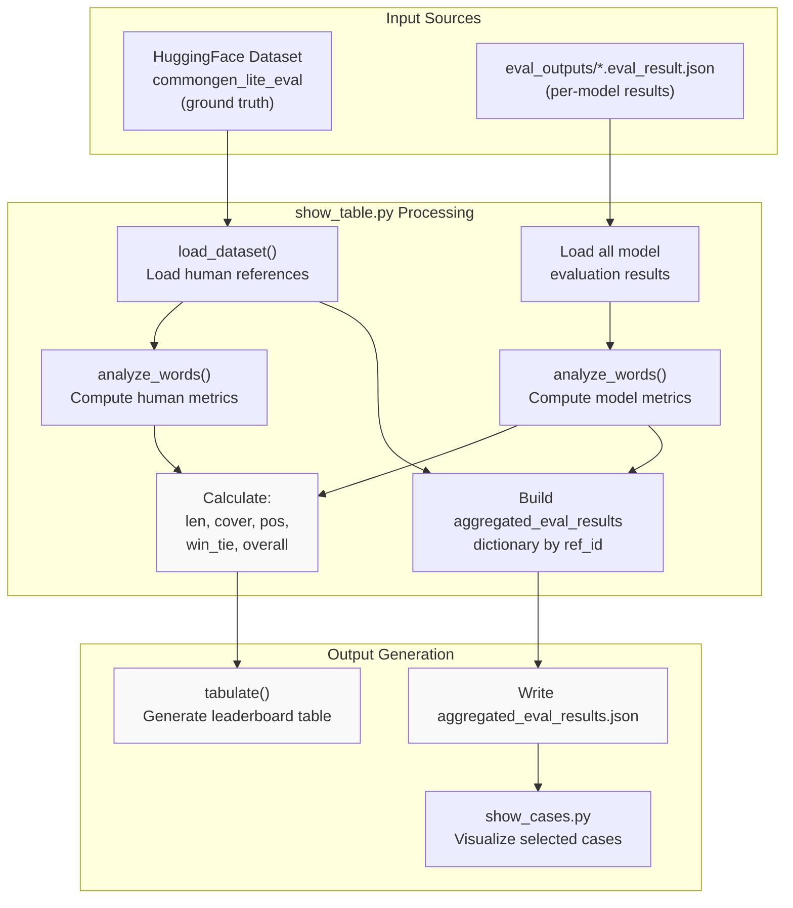
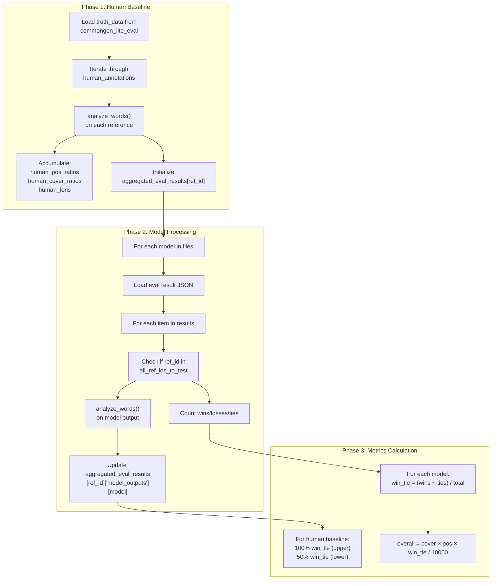
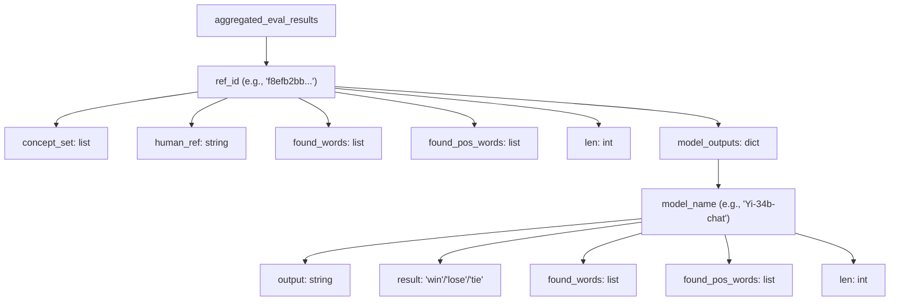
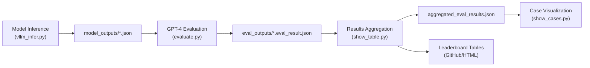

<!-- source: DeepWiki mcp.deepwiki.com · repo allenai/CommonGen-Eval · page 6 Analyzing Results · fetched 2026-10-26 -->

# Analyzing Results

<details>
<summary>Relevant source files</summary>

The following files were used as context for generating this wiki page:

- [README.md](README.md)
- [show_cases.py](show_cases.py)
- [show_table.py](show_table.py)

</details>


## Purpose and Scope

This page guides you through analyzing evaluation results after running GPT-4-based evaluations on model outputs. It covers how to aggregate individual evaluation results across multiple models, compute performance metrics, and generate the final leaderboard table. You will learn how the `show_table.py` and `show_cases.py` scripts process evaluation data and produce human-readable outputs.

For details on running the evaluation process that generates these results, see [Running Evaluation](#5). For implementation details of the aggregation script, see [Results Aggregation](#6.1). For visualizing specific examples, see [Case Visualization](#6.2). For understanding the metrics themselves, see [Understanding Metrics](#6.3).

**Sources**: [README.md:21-46](), [show_table.py:1-122](), [show_cases.py:1-28]()

---

## Analysis Pipeline Overview

After running evaluations, the analysis system aggregates results from individual model evaluation files, computes metrics, and generates both tabular leaderboards and case-by-case visualizations.



**Diagram**: Results analysis pipeline showing how `show_table.py` aggregates evaluation results and generates outputs

**Sources**: [show_table.py:1-122](), [show_cases.py:1-28]()

---

## Loading Evaluation Results

The `show_table.py` script begins by defining a dictionary mapping model names to their evaluation result files:

```python
files = {
    "TurnOpt": "eval_outputs/TurnOpt.eval_result.gpt-4-1106-preview.json",
    "Pallas-0.5": "eval_outputs/Pallas-0.5.eval_result.gpt-4-1106-preview.json",
    "Mixtral-8x7B-Instruct-v0.1": "eval_outputs/Mixtral-8x7B-Instruct-v0.1.eval_result.gpt-4-1106-preview.json",
    # ... more models
}
```

Each evaluation result file contains per-reference comparisons between model outputs and human references, including:
- The concept set used
- The human reference text
- The model's generated output
- The winner of the pairwise comparison (model, human, or tie)
- Word-level analysis (found words, found POS words)

**Sources**: [show_table.py:7-20]()

---

## Data Aggregation Process

The aggregation process operates in two phases: computing human baseline metrics and processing each model's results.



**Diagram**: Two-phase aggregation process showing human baseline computation followed by model result processing

**Sources**: [show_table.py:29-112]()

---

## Human Baseline Computation

The script establishes human performance bounds by analyzing human-written references from the dataset:

```python
truth_data = load_dataset("allenai/commongen_lite_eval", split="train")
for item in truth_data:
    for ref in item["human_annotations"]:
        all_ref_ids_to_test.append(ref["id"]) 
        cs = item["concept_set"]
        found_words, found_pos_words = analyze_words(cs, ref["ref"])
        human_pos_ratios.append(len(found_pos_words)==len(cs))
        human_cover_ratios.append(len(found_words)==len(cs))
        human_lens.append(len(ref["ref"].split(" ")))
```

The human baseline appears in the leaderboard with two entries:
- **Upper bound**: assumes 100% win_tie (human always wins or ties against itself)
- **Lower bound**: assumes 50% win_tie (neutral expectation in self-comparison)

**Sources**: [show_table.py:29-61](), [README.md:44]()

---

## Model Metrics Computation

For each model, the script processes evaluation results and computes metrics:

| Metric | Calculation | Code Reference |
|--------|-------------|----------------|
| `win_count` | Number of times model output preferred over human | [show_table.py:83-88]() |
| `tie_count` | Number of ties between model and human | [show_table.py:83-88]() |
| `win_tie` | `(win_count + tie_count) / total * 100` | [show_table.py:105]() |
| `cover` | Percentage where all concepts appear in output | [show_table.py:91-93]() |
| `pos` | Percentage where all concepts have correct POS tags | [show_table.py:91-93]() |
| `len` | Average word count in generated sentences | [show_table.py:94]() |
| `overall` | `cover * pos * win_tie / 10000` | [show_table.py:110]() |

The `analyze_words()` function from `eval_utils.py` determines which concepts from the concept set are found in the output and whether they match the required part-of-speech tags.

**Sources**: [show_table.py:69-112](), [eval_utils.py]()

---

## Aggregated Results Structure

The script builds a comprehensive dictionary `aggregated_eval_results` indexed by reference ID:



**Diagram**: Structure of `aggregated_eval_results.json` showing hierarchical organization by reference ID and model

This structure enables easy lookup of all model outputs for a given reference, facilitating case-by-case comparison in `show_cases.py`.

**Sources**: [show_table.py:38-99](), [show_table.py:121-122]()

---

## Leaderboard Generation

The script uses the `tabulate` library to generate formatted tables in multiple output formats:

```python
table = [{"model": item["model"], "len": item["len"], "cover": item["cover"], 
          "pos": item["pos"], "win_tie":item["win_tie"], "overall": item["overall"]} 
         for item in table]
table = table[0:1] + sorted(table[1:], key=lambda x: float(x["overall"]), reverse=True)
print(tabulate(table, headers="keys", tablefmt="github", floatfmt=".2f"))
print(tabulate(table, headers="keys", tablefmt="html", floatfmt=".2f"))
```

The table is sorted by the `overall` score in descending order, with the human upper bound always appearing first. The script outputs:
1. **GitHub-flavored markdown** table for the README
2. **HTML** table for web display

**Example Output**:

| model | len | cover | pos | win_tie | overall |
|-------|-----|-------|-----|---------|---------|
| human (upper bound) | 12.84 | 99.00 | 98.11 | 100.00 | 97.13 |
| gpt-4-0613 | 14.13 | 97.44 | 91.78 | 50.44 | 45.11 |
| Yi-34b-chat | 13.45 | 80.11 | 75.11 | 39.44 | 23.73 |

**Sources**: [show_table.py:115-118](), [README.md:23-38]()

---

## Output Files

The analysis process generates two primary output files:

### aggregated_eval_results.json

Path: `eval_outputs/aggregated_eval_results.json`

This file contains the complete aggregated data structure, with each reference ID mapped to:
- Concept set and human reference
- Human baseline metrics (found words, POS accuracy, length)
- All model outputs with their metrics and evaluation results

This file serves as the single source of truth for downstream analysis and visualization.

### Console Output Tables

The script prints leaderboard tables to stdout in two formats:
- **GitHub markdown format**: Can be copy-pasted directly into README.md
- **HTML format**: Can be embedded in web pages

**Sources**: [show_table.py:121-122](), [show_table.py:117-118]()

---

## Running the Analysis

To generate the leaderboard and aggregated results:

```bash
python show_table.py
```

**Prerequisites**:
- All model evaluation result files must exist in `eval_outputs/` directory
- Each file must follow the naming pattern: `{model_name}.eval_result.gpt-4-1106-preview.json`
- Access to HuggingFace dataset `allenai/commongen_lite_eval`

The script automatically:
1. Loads ground truth data from HuggingFace
2. Processes all evaluation files listed in the `files` dictionary
3. Computes metrics for each model
4. Generates and prints leaderboard tables
5. Writes `aggregated_eval_results.json`

**Sources**: [show_table.py:1-122](), [README.md:150-268]()

---

## Case-by-Case Analysis

After generating aggregated results, you can visualize specific examples using `show_cases.py`:

```python
with open("eval_outputs/aggregated_eval_results.json", "r") as f:
    data = json.load(f)

def visualize_case(item):
    print(f"- **Concepts**: `{item['concept_set']}`")
    print(f"- **Human Reference**: `{item['human_ref']}`")
    for model_name, o in item["model_outputs"].items():
        cover_all = len(o["found_words"]) == len(item["concept_set"])
        pos_all = len(o["found_pos_words"]) == len(item["concept_set"])
        print(f"- **{model_name}**: `{o['output']}`")
        print(f"--> ```Versus={o['result']}; Cover={cover_all}; PoS={pos_all}; Len={o['len']}```")
```

This generates formatted case studies showing how different models performed on the same input, which appear in the README under "Case studies".

**Sources**: [show_cases.py:1-28](), [README.md:150-268]()

---

## Workflow Integration



**Diagram**: Complete workflow showing how results analysis fits into the overall evaluation pipeline

The analysis stage is the final step in the evaluation pipeline, consuming evaluation results and producing human-readable summaries. It bridges the gap between raw GPT-4 judgments and actionable insights about model performance.

**Sources**: [show_table.py:1-122](), [show_cases.py:1-28](), [README.md:1-298]()

---

## Next Steps

- **[Results Aggregation](#6.1)**: Detailed documentation of `show_table.py` implementation
- **[Case Visualization](#6.2)**: Learn how to visualize specific evaluation examples
- **[Understanding Metrics](#6.3)**: Deep dive into metric definitions and calculation methods

For information about the evaluation files being processed, see [Running Evaluation](#5). For details on the model outputs being evaluated, see [Model Outputs Reference](#7).

**Sources**: [README.md:1-298](), [show_table.py:1-122](), [show_cases.py:1-28]()

---

