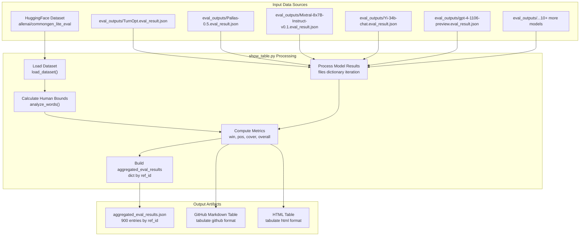
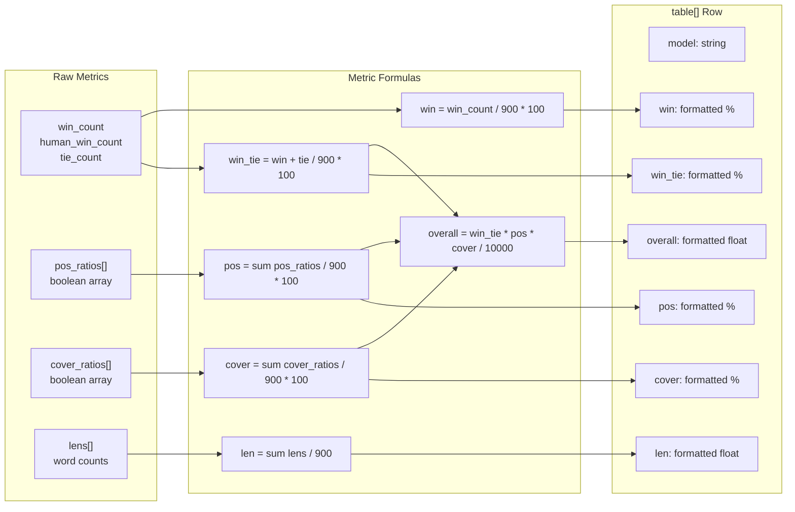
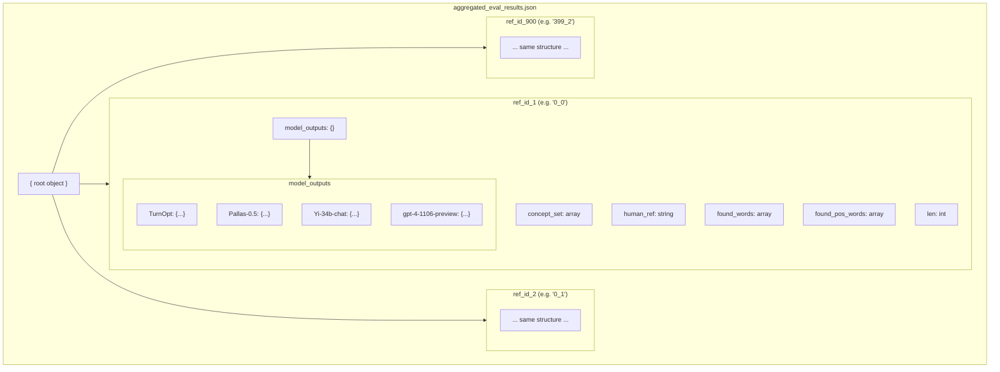
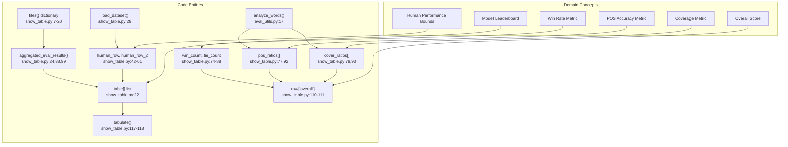

<!-- source: DeepWiki mcp.deepwiki.com · repo allenai/CommonGen-Eval · page 6.1 Results Aggregation · fetched 2026-10-26 -->

# Results Aggregation

<details>
<summary>Relevant source files</summary>

The following files were used as context for generating this wiki page:

- [eval_utils.py](eval_utils.py)
- [show_table.py](show_table.py)

</details>


## Purpose and Scope

This document explains the results aggregation system implemented in `show_table.py`, which consolidates evaluation results from multiple models into a unified leaderboard. The script processes individual model evaluation outputs, computes comparative metrics, establishes human performance bounds, and generates both machine-readable aggregated data and human-readable leaderboard tables.

For information about running the evaluation that produces the input data, see [Running Evaluation](#5). For details about the individual metrics being aggregated, see [Understanding Metrics](#6.3). For visualizing specific cases from the aggregated results, see [Case Visualization](#6.2).

**Sources:** [show_table.py:1-122]()

## Overview

The `show_table.py` script serves as the final stage in the CommonGen-Eval pipeline. It takes evaluation results from GPT-4 judge comparisons (stored in `eval_outputs/`) and produces:

1. **Aggregated Results File** - A comprehensive JSON file (`aggregated_eval_results.json`) containing all model outputs organized by reference ID
2. **Human Performance Bounds** - Upper bound (100% win_tie) and lower bound (50% win_tie) metrics representing best and average human performance
3. **Leaderboard Tables** - Formatted tables in GitHub markdown and HTML showing model rankings by overall score



**Sources:** [show_table.py:1-122]()

## Input Data Specification

### Model-to-File Mapping

The `files` dictionary [show_table.py:7-20]() maps model names to their evaluation result files. Each file contains GPT-4 judge results comparing model outputs against human references:

| Model Name | Evaluation File Path |
|-----------|---------------------|
| `TurnOpt` | `eval_outputs/TurnOpt.eval_result.gpt-4-1106-preview.json` |
| `Pallas-0.5` | `eval_outputs/Pallas-0.5.eval_result.gpt-4-1106-preview.json` |
| `Mixtral-8x7B-Instruct-v0.1` | `eval_outputs/Mixtral-8x7B-Instruct-v0.1.eval_result.gpt-4-1106-preview.json` |
| `Yi-34b-chat` | `eval_outputs/Yi-34b-chat.eval_result.gpt-4-1106-preview.json` |
| `gpt-4-1106-preview` | `eval_outputs/gpt-4-1106-preview.eval_result.gpt-4-1106-preview.json` |
| ... | *10+ additional models* |

### Evaluation Result File Structure

Each evaluation result file contains an array of comparison records. Each record includes:

- `concept_set` - The input concept set
- `human_ref` - The human reference with `id` and `ref` fields
- `model_output` - Array containing the generated sentence
- `winner` - GPT-4 judge decision: model name, `"human"`, or `"tie"`

**Sources:** [show_table.py:7-20](), [show_table.py:69-99]()

### Ground Truth Dataset

The script loads human references from HuggingFace [show_table.py:29]():

```python
truth_data = load_dataset("allenai/commongen_lite_eval", split="train")
```

This dataset provides 400 test examples with 900 total human references (multiple references per example). Each item contains:
- `concept_set` - Array of POS-tagged concepts
- `human_annotations` - Array of reference objects with `id` and `ref` fields

**Sources:** [show_table.py:29-38]()

## Processing Pipeline

```mermaid
flowchart TD
    Start["Start show_table.py"]
    
    subgraph Phase1["Phase 1: Human Bounds Calculation"]
        P1A["Load truth_data from HuggingFace<br/>load_dataset()"]
        P1B["Iterate 900 human references<br/>all_ref_ids_to_test"]
        P1C["Call analyze_words()<br/>from eval_utils"]
        P1D["Calculate human_pos_ratios<br/>human_cover_ratios<br/>human_lens"]
        P1E["Build aggregated_eval_results<br/>skeleton dict"]
    end
    
    subgraph Phase2["Phase 2: Model Results Processing"]
        P2A["Iterate files dictionary<br/>12 models"]
        P2B["Load eval_result.json<br/>json.load()"]
        P2C["Count win/lose/tie<br/>winner field"]
        P2D["Call analyze_words()<br/>for model outputs"]
        P2E["Calculate pos_ratios<br/>cover_ratios, lens"]
        P2F["Populate model_outputs<br/>in aggregated_eval_results"]
    end
    
    subgraph Phase3["Phase 3: Metric Calculation"]
        P3A["Compute human_row<br/>upper bound 100% win_tie"]
        P3B["Compute human_row_2<br/>lower bound 50% win_tie"]
        P3C["Compute model rows<br/>win_tie, pos, cover, overall"]
        P3D["Sort by overall score<br/>descending"]
    end
    
    subgraph Phase4["Phase 4: Output Generation"]
        P4A["Generate GitHub table<br/>tabulate github"]
        P4B["Generate HTML table<br/>tabulate html"]
        P4C["Save aggregated_eval_results.json<br/>json.dump()"]
    end
    
    Start --> P1A
    P1A --> P1B
    P1B --> P1C
    P1C --> P1D
    P1D --> P1E
    
    P1E --> P2A
    P2A --> P2B
    P2B --> P2C
    P2C --> P2D
    P2D --> P2E
    P2E --> P2F
    
    P2F --> P3A
    P3A --> P3B
    P3B --> P3C
    P3C --> P3D
    
    P3D --> P4A
    P4A --> P4B
    P4B --> P4C
```



**Sources:** [show_table.py:1-122]()

### Phase 1: Human Bounds Calculation

The script first establishes human performance baselines [show_table.py:29-38]():

1. **Load Ground Truth** - Retrieves the CommonGen-lite dataset using `load_dataset()`
2. **Extract Reference IDs** - Builds `all_ref_ids_to_test` list containing 900 reference IDs
3. **Analyze Coverage** - Calls `analyze_words(cs, ref["ref"])` from `eval_utils.py` to determine:
   - `found_words` - Concepts present in the reference (lemmatized)
   - `found_pos_words` - Concepts with correct part-of-speech tags
4. **Accumulate Metrics** - Collects boolean values for perfect coverage and POS accuracy
5. **Initialize Skeleton** - Creates `aggregated_eval_results[ref["id"]]` with concept set, human reference, and empty `model_outputs` dictionary

**Sources:** [show_table.py:29-38](), [eval_utils.py:17-37]()

### Phase 2: Model Results Processing

For each model in the `files` dictionary [show_table.py:69-99]():

1. **Load Evaluation Results** - Reads the JSON file containing GPT-4 judge decisions
2. **Initialize Counters** - Sets up `win_count`, `human_win_count`, `tie_count`, and metric accumulators
3. **Iterate Evaluation Items** - For each comparison in the results:
   - Check if `item["human_ref"]["id"]` is in `all_ref_ids_to_test`
   - Increment the appropriate counter based on `item["winner"]`
   - Extract `model_output[0]` (the generated sentence)
   - Call `analyze_words(cs, output)` to compute coverage and POS metrics
   - Append boolean ratios to `pos_ratios` and `cover_ratios`
   - Calculate sentence length in words
4. **Validate Totals** - Assert that win + human_win + tie equals 900
5. **Update Aggregated Results** - Add model output and result (`"win"`, `"lose"`, or `"tie"`) to `aggregated_eval_results[ref_id]["model_outputs"][model]`

**Sources:** [show_table.py:69-99]()

### Phase 3: Metric Calculation



#### Human Bounds

Two human performance rows are added to the table [show_table.py:42-61]():

**Upper Bound** (`human_row`):
- `win_tie` = 100.00 (assumes human always wins or ties)
- `pos` = Human POS accuracy percentage
- `cover` = Human coverage percentage
- `overall` = (100 * pos * cover) / 10000

**Lower Bound** (`human_row_2`):
- `win_tie` = 50.00 (assumes human ties on average)
- Same `pos` and `cover` as upper bound
- `overall` = (50 * pos * cover) / 10000

#### Model Metrics

For each model [show_table.py:102-112]():

| Metric | Calculation | Format |
|--------|-------------|--------|
| `win` | `win_count / 900 * 100` | `{:.2f}%` |
| `win_tie` | `(win_count + tie_count) / 900 * 100` | `{:.2f}%` |
| `pos` | `sum(pos_ratios) / 900 * 100` | `{:.2f}%` |
| `cover` | `sum(cover_ratios) / 900 * 100` | `{:.2f}%` |
| `len` | `sum(lens) / 900` | `{:.2f}` |
| `overall` | `(win_tie * pos * cover) / 10000` | `{:.2f}` |

The `overall` score is the key ranking metric, combining all three quality dimensions (win_tie, pos, cover) multiplicatively.

**Sources:** [show_table.py:42-61](), [show_table.py:102-112]()

### Phase 4: Output Generation

#### Leaderboard Sorting

The table is sorted [show_table.py:115-116]():
1. Human upper bound remains at index 0
2. Remaining rows sorted by `overall` score in descending order

#### Table Formatting

Two output formats are generated using the `tabulate` library [show_table.py:117-118]():

**GitHub Markdown Table:**
```python
tabulate(table, headers="keys", tablefmt="github", floatfmt=".2f")
```

**HTML Table:**
```python
tabulate(table, headers="keys", tablefmt="html", floatfmt=".2f")
.replace(' style="text-align: right;"', "")
```

The HTML generation removes inline styles for cleaner output.

**Sources:** [show_table.py:115-118]()

## Aggregated Results Structure



### Top-Level Structure

The `aggregated_eval_results` dictionary [show_table.py:38]() uses reference IDs as keys:

```python
aggregated_eval_results[ref["id"]] = {
    "concept_set": item["concept_set"],
    "human_ref": ref["ref"],
    "found_words": list(found_words),
    "found_pos_words": list(found_pos_words),
    "len": len(ref["ref"].split(" ")),
    "model_outputs": {}
}
```

**Fields:**
- `concept_set` - Array of POS-tagged concepts (e.g., `["dog_NOUN", "frisbee_NOUN", "catch_VERB"]`)
- `human_ref` - The human-written reference sentence
- `found_words` - Lemmatized concepts found in the human reference
- `found_pos_words` - Concepts with matching POS tags in the human reference
- `len` - Word count of the human reference
- `model_outputs` - Dictionary mapping model names to their outputs

### Model Output Structure

For each model, the nested `model_outputs[model]` dictionary contains [show_table.py:99]():

```python
{
    "output": output,           # Generated sentence
    "result": r,                # "win", "lose", or "tie"
    "found_pos_words": list,    # Concepts with correct POS
    "found_words": list,        # All concepts found
    "len": int                  # Word count
}
```

**Sources:** [show_table.py:38](), [show_table.py:99]()

## Code Entity Mapping

This diagram maps the natural language concepts to specific code constructs in `show_table.py`:



**Key Function Mapping:**

| Function/Variable | Location | Purpose |
|------------------|----------|---------|
| `files` | [show_table.py:7-20]() | Maps model names to evaluation file paths |
| `table` | [show_table.py:22]() | Accumulates leaderboard rows |
| `aggregated_eval_results` | [show_table.py:24]() | Central data structure for cross-model analysis |
| `all_ref_ids_to_test` | [show_table.py:28]() | List of 900 reference IDs |
| `human_pos_ratios` | [show_table.py:25,35]() | Boolean array of human POS accuracy |
| `human_cover_ratios` | [show_table.py:26,36]() | Boolean array of human coverage |
| `analyze_words()` | [eval_utils.py:17-37]() | Computes coverage and POS matching using spaCy |
| `tabulate()` | [show_table.py:117-118]() | Formats table for display |

**Sources:** [show_table.py:1-122](), [eval_utils.py:17-37]()

## Usage

### Running the Script

Execute from the repository root:

```bash
python show_table.py
```

**Prerequisites:**
- All model evaluation files must exist in `eval_outputs/` directory
- Files must follow naming convention: `{model}.eval_result.gpt-4-1106-preview.json`
- Internet connection required to load HuggingFace dataset

**Sources:** [show_table.py:1-122]()

### Expected Output

The script prints two formatted tables to stdout and writes one JSON file:

**Console Output:**
1. GitHub-formatted markdown table
2. HTML-formatted table (with inline styles removed)

**File Output:**
- `eval_outputs/aggregated_eval_results.json` - Complete aggregation [show_table.py:121-122]()

### Adding New Models

To include a new model in the aggregation:

1. Run evaluation to generate `eval_outputs/{model_name}.eval_result.gpt-4-1106-preview.json`
2. Add entry to `files` dictionary [show_table.py:7-20]():
   ```python
   files = {
       "YourModelName": "eval_outputs/YourModelName.eval_result.gpt-4-1106-preview.json",
       # ... existing models
   }
   ```
3. Re-run `python show_table.py`

The model will automatically appear in the sorted leaderboard based on its overall score.

**Sources:** [show_table.py:7-20]()

## Performance Characteristics

### Computational Complexity

- **Time Complexity:** O(M × N) where M = number of models (~12), N = number of references (900)
- **Space Complexity:** O(M × N) for storing aggregated results
- **spaCy Analysis:** Called once per reference per model + once per human reference = ~11,700 calls

### Execution Time

Typical execution time: 10-30 seconds depending on:
- spaCy model loading time (first call only)
- File I/O operations
- JSON parsing and serialization

**Sources:** [show_table.py:1-122](), [eval_utils.py:17-37]()

## Error Handling

### Assertion Validation

The script includes a critical assertion [show_table.py:101]():

```python
assert win_count + human_win_count + tie_count == len(all_ref_ids_to_test)
```

This ensures every reference has exactly one evaluation result (win, lose, or tie).

### Common Issues

| Issue | Cause | Solution |
|-------|-------|----------|
| `AssertionError` on line 101 | Missing evaluation results | Verify all 900 references evaluated |
| `FileNotFoundError` | Missing eval result file | Check `eval_outputs/` directory |
| `KeyError` in aggregated_eval_results | Inconsistent reference IDs | Ensure evaluation used same dataset version |

**Sources:** [show_table.py:101]()

---

