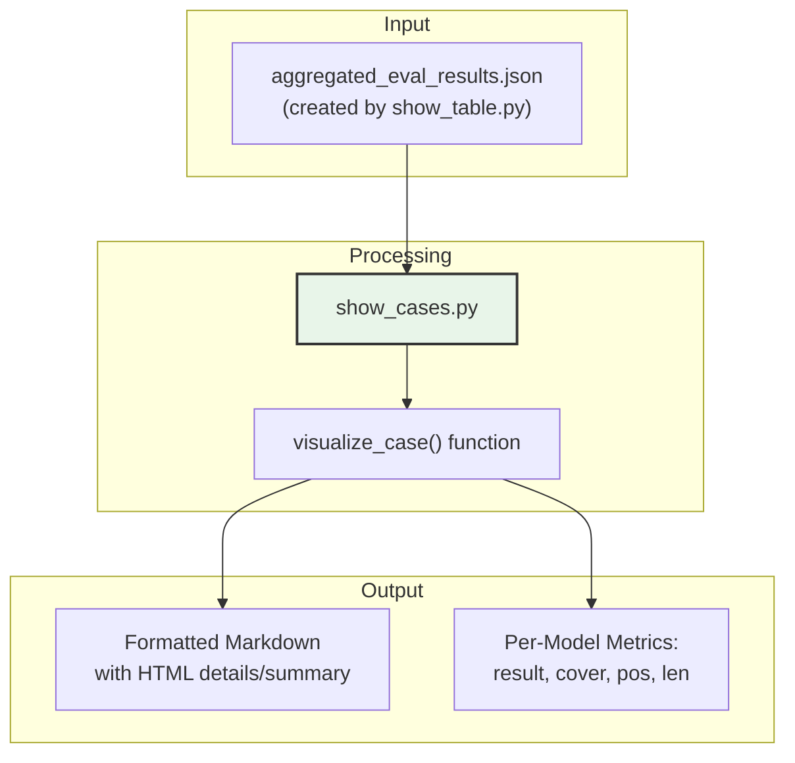
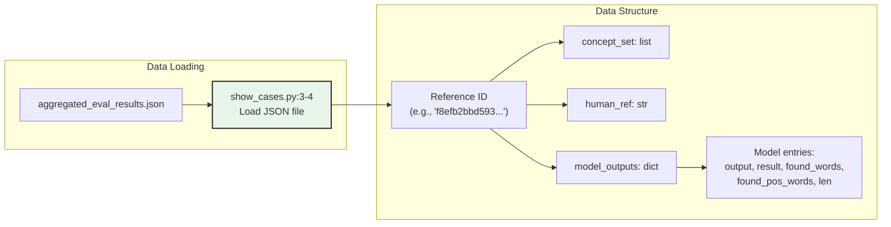
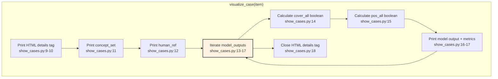
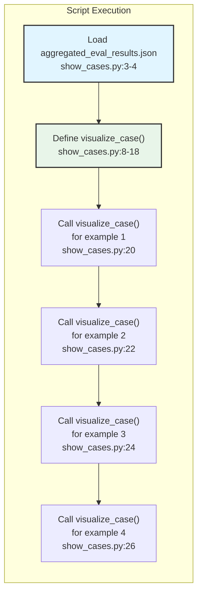
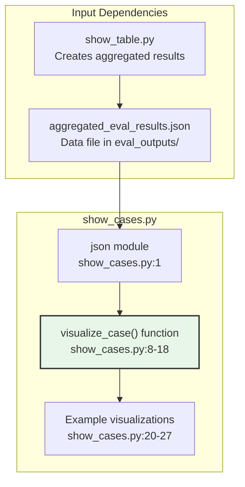

<!-- source: DeepWiki mcp.deepwiki.com · repo allenai/CommonGen-Eval · page 6.2 Case Visualization · fetched 2026-10-26 -->

# Case Visualization

<details>
<summary>Relevant source files</summary>

The following files were used as context for generating this wiki page:

- [show_cases.py](show_cases.py)
- [show_table.py](show_table.py)

</details>


## Purpose and Scope

This page documents the `show_cases.py` script, which provides functionality for visualizing individual evaluation examples from the CommonGen-Eval system. The script reads aggregated evaluation results and formats them into human-readable, collapsible markdown sections showing concept sets, human references, and model outputs with their evaluation metrics.

For information about how the aggregated results are computed, see [Results Aggregation](#6.1). For understanding the metrics displayed in case visualizations, see [Understanding Metrics](#6.3).

**Sources:** [show_cases.py:1-28]()

---

## Overview

The case visualization system consists of a single Python script that transforms aggregated evaluation data into formatted markdown output. It enables detailed inspection of how different models perform on specific concept-to-sentence generation examples.



**Sources:** [show_cases.py:1-28](), [show_table.py:121-122]()

---

## Aggregated Results Data Structure

The `show_cases.py` script loads the `aggregated_eval_results.json` file created by `show_table.py`. This JSON file contains evaluation results indexed by reference ID, with the following structure:

| Field | Type | Description |
|-------|------|-------------|
| `concept_set` | list[str] | The concept words (nouns and verbs) to be used |
| `human_ref` | str | The human-written reference sentence |
| `found_words` | list[str] | Words from human reference matching concepts |
| `found_pos_words` | list[str] | Words matching both concept and part-of-speech |
| `len` | int | Word count of human reference |
| `model_outputs` | dict | Per-model evaluation results |

Each entry in `model_outputs` contains:

| Field | Type | Description |
|-------|------|-------------|
| `output` | str | The model-generated sentence |
| `result` | str | Evaluation outcome: "win", "lose", or "tie" |
| `found_words` | list[str] | Words from model output matching concepts |
| `found_pos_words` | list[str] | Words matching both concept and POS |
| `len` | int | Word count of model output |



**Sources:** [show_cases.py:3-4](), [show_table.py:38-39](), [show_table.py:99]()

---

## The visualize_case Function

The core functionality is provided by the `visualize_case()` function, which takes an item from the aggregated results and formats it as collapsible markdown.

### Function Signature and Flow



### Metric Calculations

The function performs two boolean checks for each model output:

- **`cover_all`**: Whether all concept words were found (regardless of POS)
  - Computed as: `len(o["found_words"]) == len(item["concept_set"])`
  - [show_cases.py:14]()

- **`pos_all`**: Whether all concepts were found with correct part-of-speech
  - Computed as: `len(o["found_pos_words"]) == len(item["concept_set"])`
  - [show_cases.py:15]()

**Sources:** [show_cases.py:8-18]()

---

## Output Format

The `visualize_case()` function generates markdown with embedded HTML for collapsible sections. Each case visualization follows this structure:

```markdown
<details>
    <summary> Example 1 </summary>

- **Concepts**: `['word1', 'word2', 'word3']`
- **Human Reference**: `The reference sentence here.`
- **model-name-1**: `Model generated sentence.`
--> ```Versus=win; Cover=True; POS=True; Len=12```
- **model-name-2**: `Another model output.`
--> ```Versus=lose; Cover=True; POS=False; Len=10```

</details>
```

### Displayed Metrics

| Metric | Description | Values |
|--------|-------------|--------|
| `Versus` | Evaluation result vs human reference | `win`, `lose`, `tie` |
| `Cover` | All concepts present (any POS) | `True`, `False` |
| `POS` | All concepts with correct POS | `True`, `False` |
| `Len` | Word count of output | Integer |

**Sources:** [show_cases.py:9-18]()

---

## Usage Examples

The script includes four hardcoded example visualizations at the end:

```python
visualize_case(data["f8efb2bbd593ee6e943cfa79aa347e2e#1"])
visualize_case(data["de5f30479745102be44f5f1f572730bc#0"])
visualize_case(data["81ec84a05e29c1b0066ebbc778ef9ae5#0"])
visualize_case(data["7b78772b4f86d8834751a0d852c0152d#0"])
```

These reference IDs correspond to specific examples in the CommonGen-lite evaluation dataset. To visualize a different case:

1. Identify the reference ID from `aggregated_eval_results.json`
2. Call `visualize_case(data["<reference_id>"])`
3. The output will be printed to stdout

**Example Reference ID Format:**
- Format: `{hash}#{number}`
- Hash: MD5-like identifier for the concept set
- Number: Index of the specific human reference annotation (0-2, as each concept set has ~2.25 references)

**Sources:** [show_cases.py:20-27]()

---

## Execution Flow



**Sources:** [show_cases.py:1-28]()

---

## Practical Applications

### Debugging Model Behavior

Case visualization enables inspection of:
- **Coverage failures**: Models missing specific concept words
- **POS errors**: Models using concepts with wrong grammatical form
- **Length patterns**: Models generating overly verbose or terse sentences
- **Comparison patterns**: Understanding why GPT-4 judge preferred one output over another

### Identifying Edge Cases

By examining cases where models win, lose, or tie, developers can:
- Understand model strengths on specific concept combinations
- Identify systematic errors (e.g., always missing certain word types)
- Compare model architectures on challenging examples

### Example Analysis Workflow

1. Run `show_table.py` to generate aggregated results and identify models with unusual metrics
2. Identify specific reference IDs where a model performs unexpectedly
3. Modify `show_cases.py` to visualize those specific cases
4. Run `python show_cases.py > cases.md` to save formatted output
5. Review the markdown to understand model behavior

**Sources:** [show_cases.py:8-27]()

---

## File Dependencies



The script has minimal dependencies:
- **Python standard library**: Only requires `json` module
- **Input file**: `eval_outputs/aggregated_eval_results.json` (must exist)
- **Prerequisite**: `show_table.py` must be run first to create the aggregated results

**Sources:** [show_cases.py:1](), [show_table.py:121-122]()

---

## Customization

### Modifying Display Format

To customize the output format, modify the print statements in `visualize_case()`:

- **Change header level**: Modify [show_cases.py:9-10]()
- **Add/remove metrics**: Modify [show_cases.py:16-17]()
- **Reorder fields**: Rearrange print statements at [show_cases.py:11-17]()

### Selecting Different Cases

To visualize different examples:

1. Open `aggregated_eval_results.json` in a text editor
2. Copy the desired reference ID keys
3. Replace the hardcoded IDs at [show_cases.py:20-27]()
4. Run the script

### Programmatic Case Selection

For automated analysis, you can modify the script to iterate over all cases or filter by specific criteria:

```python
# Example: Visualize all cases where a specific model won
for ref_id, item in data.items():
    if "gpt-4-0613" in item["model_outputs"]:
        if item["model_outputs"]["gpt-4-0613"]["result"] == "win":
            visualize_case(item)
```

**Sources:** [show_cases.py:8-27]()

---

