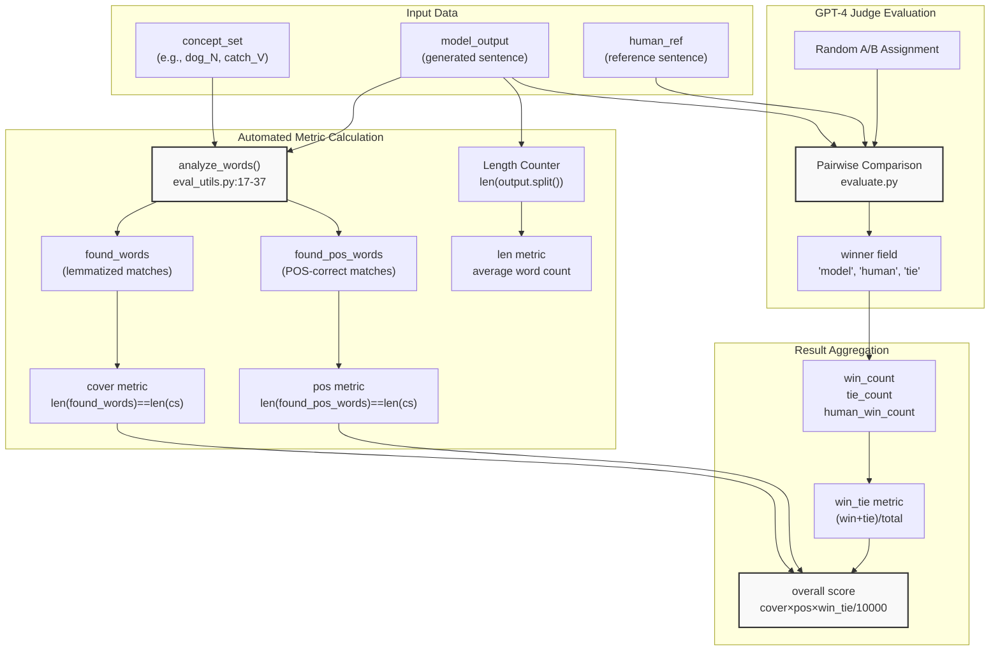
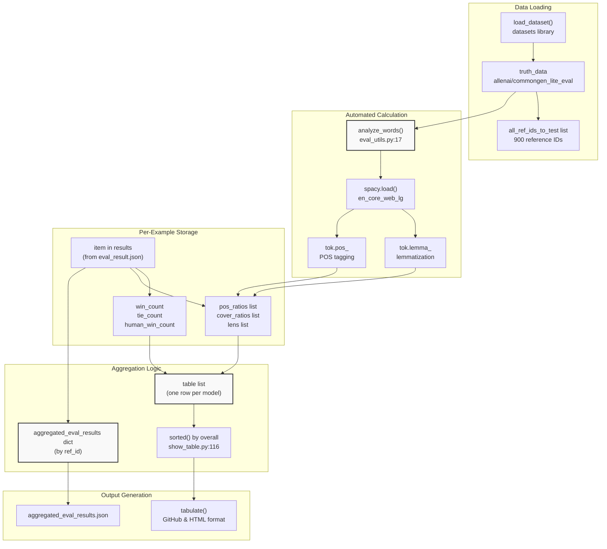

<!-- source: DeepWiki mcp.deepwiki.com · repo allenai/CommonGen-Eval · page 6.3 Understanding Metrics · fetched 2026-10-26 -->

# Understanding Metrics

<details>
<summary>Relevant source files</summary>

The following files were used as context for generating this wiki page:

- [README.md](README.md)
- [eval_utils.py](eval_utils.py)
- [show_table.py](show_table.py)

</details>


This page provides a detailed explanation of the evaluation metrics used in the CommonGen-Eval system. These metrics assess the quality of model-generated sentences from multiple dimensions: completeness (coverage), grammatical correctness (PoS accuracy), length, and human judgment (win_tie rate). For information on how to generate and view these metrics, see [Analyzing Results](#6). For the underlying evaluation process, see [Evaluation System](#3.3).

## Metric Overview

The CommonGen-Eval system uses five key metrics to evaluate model performance. Four metrics are computed automatically, and one involves GPT-4 as a judge:

| Metric | Type | Range | Description |
|--------|------|-------|-------------|
| `len` | Automated | ~10-20 words | Average sentence length in words |
| `cover` | Automated | 71-99% | Percentage where ALL concepts appear |
| `pos` | Automated | 63-98% | Percentage where ALL concepts have correct part-of-speech |
| `win_tie` | GPT-4 Judge | 15-50% | Percentage where model wins or ties with human |
| `overall` | Computed | 10-48% | Multiplicative score: `cover × pos × win_tie` |

Sources: [README.md:23-44](), [show_table.py:1-122]()

## Metric Calculation Pipeline



**Diagram: End-to-End Metric Computation Flow**

This diagram shows how raw inputs (concept sets, model outputs, human references) flow through the automated and GPT-4 judge systems to produce the final metrics. The `analyze_words` function is central to coverage and PoS calculations, while GPT-4 evaluation determines the win_tie rate.

Sources: [show_table.py:74-112](), [eval_utils.py:17-37](), [README.md:39-44]()

## Individual Metrics

### Length (`len`)

The `len` metric measures the average number of words in generated sentences. It is computed by splitting the sentence on whitespace and counting tokens.

**Calculation Location**: [show_table.py:94](), [show_table.py:109]()

```python
# Length calculation for each output
lens.append(len(output.split(" ")))

# Average length for the model
row["len"] = f"{sum(lens)/len(lens):.2f}"
```

**Interpretation**:
- Human references average **12.84** words
- Shorter models (10-14 words): Yi-6b-chat, gpt-3.5-turbo, Yi-34b-chat
- Longer models (16-20 words): Mixtral-8x7B-Instruct, tulu-2-dpo-70b
- Excessively long outputs may indicate verbosity or difficulty following instructions

**Example**:
- Concepts: `['dog_N', 'frisbee_N', 'catch_V', 'throw_V']`
- Human (12 words): "The dog catches the frisbee when the boy throws it into the air."
- Model (14 words): "The instructor demonstrates how to use the sewing machine by sewing a piece of fabric."

Sources: [README.md:39](), [show_table.py:94](), [show_table.py:109]()

### Coverage (`cover`)

The `cover` metric measures whether ALL required concepts appear in the generated sentence. It uses lemmatization via spaCy to match concept lemmas regardless of inflection.

**Calculation Location**: [eval_utils.py:17-37](), [show_table.py:91-93]()

```python
# analyze_words returns found_words and found_pos_words
found_words, found_pos_words = analyze_words(cs, output)

# Coverage check: all concepts must be present
cover_ratios.append(len(found_words)==len(cs))
```

The `analyze_words` function performs:
1. Loads spaCy model `en_core_web_lg` [eval_utils.py:21]()
2. Lemmatizes all tokens in the sentence [eval_utils.py:28]()
3. Checks if each concept's lemma appears [eval_utils.py:28]()
4. Returns unique matches only [eval_utils.py:35-36]()

**Coverage Ranges**:
- Human references: **99.00%** (nearly perfect)
- Top models: 92-97% (GPT-4 variants, gpt-3.5-turbo)
- Mid-tier models: 80-88% (Yi-34b-chat, Pallas, vicuna, tulu-2-dpo-70b)
- Lower models: 71-84% (Yi-6b-chat, Mixtral, zephyr)

**Example**:
- Concepts: `['demonstrate_V', 'machine_N', 'sew_V', 'use_V']`
- Model Output: "The tailor demonstrates how to use the sewing machine." 
- Analysis: Missing `sew_V` → `cover=False`

Sources: [eval_utils.py:17-37](), [show_table.py:91-93](), [show_table.py:108](), [README.md:40]()

### Part-of-Speech Accuracy (`pos`)

The `pos` metric measures whether ALL concepts appear with the correct part-of-speech tag. This is stricter than coverage — the concept must exist AND have the correct grammatical role.

**Calculation Location**: [eval_utils.py:29](), [show_table.py:92]()

```python
# POS matching: checks both lemma and POS tag
found_pos_words = [tok.lemma_+"_"+tok.pos_ 
                   for tok in doc 
                   if tok.lemma_ in input_dict.keys() 
                   and input_dict[tok.lemma_].lower() in tok.pos_.lower()]

# POS accuracy check: all concepts must have correct POS
pos_ratios.append(len(found_pos_words)==len(cs))
```

**How POS Matching Works**:
1. Concepts are formatted as `word_POS` (e.g., `demonstrate_V`, `machine_N`)
2. spaCy tags each token with Penn Treebank POS tags (VERB, NOUN, etc.)
3. The code checks if the concept's expected POS is a substring of spaCy's POS tag [eval_utils.py:29]()
4. Example: `demonstrate_V` matches `tok.pos_="VERB"` because `"V"` is in `"VERB"`

**POS Accuracy Ranges**:
- Human references: **98.11%** (nearly perfect)
- Top models: 83-91% (GPT-4 variants, gpt-3.5-turbo)
- Mid-tier models: 75-79% (Yi-34b-chat, Pallas, vicuna, Llama-2, tulu-2-dpo-70b)
- Lower models: 63-73% (Yi-6b-chat, zephyr, Mixtral)

**Common POS Errors**:
- Using a noun form instead of verb: "The sewing machine" vs "to sew"
- Using passive voice incorrectly: "The rope is suspended" (correct) vs "suspends from" (incorrect)

Sources: [eval_utils.py:29](), [show_table.py:92](), [show_table.py:107](), [README.md:41]()

### Win/Tie Rate (`win_tie`)

The `win_tie` metric measures how often GPT-4 judges the model output as better than or equal to the human reference. This involves pairwise comparison with random A/B assignment to prevent position bias.

**Calculation Location**: [show_table.py:83-88](), [show_table.py:105]()

```python
# Count wins, ties, and losses
if item["winner"] == model:
    win_count += 1    
elif item["winner"] == "human":
    human_win_count += 1
else:
    tie_count += 1

# Win/tie rate includes both wins and ties
row["win_tie"] = f"{(win_count+tie_count)/len(all_ref_ids_to_test)*100:.2f}"
```

The `winner` field comes from GPT-4 evaluation performed by `evaluate.py` (see [Running Evaluation](#5) for details).

**Win/Tie Ranges**:
- Human upper bound: **100.00%** (perfect match)
- Human lower bound: **50.00%** (tie assumption)
- Top models: 49-50% (GPT-4 variants, gpt-3.5-turbo)
- Mid-tier models: 27-39% (Yi-34b-chat, Pallas, vicuna)
- Lower models: 15-23% (Yi-6b-chat, Llama-2, zephyr, tulu-2-dpo-70b, Mixtral)

**Why Top Models Only Reach ~50%**:
The win_tie rate measures preference against human-written references. Even the best models rarely exceed human quality consistently, so achieving ~50% (meaning ties are common) is actually strong performance.

Sources: [show_table.py:83-88](), [show_table.py:105](), [README.md:42]()

## Overall Score Computation

The `overall` score is a **multiplicative metric** that combines all three quality dimensions. A model must excel in ALL areas to achieve a high overall score.

### Formula

```
overall = (cover% × pos% × win_tie%) / 10000
```

**Implementation**: [show_table.py:110-111](), [show_table.py:55]()

```python
overall = (float(row["win_tie"]) * float(row["pos"]) * float(row["cover"])) / 10000
row["overall"] = f"{overall:.2f}"
```

### Why Multiplicative?

The multiplicative formula creates a harsh penalty for weakness in any dimension:

| Model | cover | pos | win_tie | overall |
|-------|-------|-----|---------|---------|
| Balanced | 90% | 90% | 40% | 32.40% |
| High coverage, low POS | 95% | 70% | 40% | 26.60% |
| High POS, low win_tie | 90% | 90% | 20% | 16.20% |

**Key Insight**: Missing 10% of concepts (90% coverage) and missing 10% of POS tags (90% accuracy) doesn't result in 20% penalty — it compounds. The multiplicative nature ensures models must maintain quality across all dimensions.

Sources: [show_table.py:110-111](), [README.md:43]()

### Overall Score Ranges

```mermaid
graph LR
    subgraph Human["Human Bounds"]
        HU["Upper Bound<br/>97.13%<br/>(100% win_tie)"]
        HL["Lower Bound<br/>48.57%<br/>(50% win_tie)"]
    end
    
    subgraph Tier1["Top Tier (38-45%)"]
        T1A["gpt-4-0613<br/>45.11%"]
        T1B["gpt-4-1106-preview<br/>44.08%"]
        T1C["gpt-3.5-turbo<br/>38.06%"]
    end
    
    subgraph Tier2["Mid Tier (18-24%)"]
        T2A["Yi-34b-chat<br/>23.73%"]
        T2B["Pallas-0.5<br/>22.22%"]
        T2C["vicuna-13b-v1.5<br/>18.75%"]
    end
    
    subgraph Tier3["Lower Tier (10-16%)"]
        T3A["tulu-2-dpo-70b<br/>16.36%"]
        T3B["Mixtral-8x7B<br/>11.03%"]
        T3C["zephyr-7b-beta<br/>10.13%"]
    end
    
    HU --- HL
    HL --> T1A
    T1A --> T1B
    T1B --> T1C
    T1C --> T2A
    T2A --> T2B
    T2B --> T2C
    T2C --> T3A
    T3A --> T3B
    T3B --> T3C
    
    style HU fill:#f9f9f9,stroke:#333,stroke-width:2px
    style HL fill:#f9f9f9,stroke:#333,stroke-width:2px
```



**Diagram: Overall Score Distribution Across Model Tiers**

This shows the clear separation between human performance (48-97%), top-tier models (38-45%), mid-tier (18-24%), and lower-tier models (10-16%). The gap between human lower bound (48.57%) and the best model (45.11%) is surprisingly small, indicating GPT-4-0613 achieves near-human performance.

Sources: [README.md:23-37](), [show_table.py:115-116]()

## Human Performance Bounds

The leaderboard includes two human baselines that represent theoretical upper and lower bounds for human performance.

### Upper Bound (97.13%)

**Assumption**: Human references always win or tie when compared to themselves  
**Formula**: `99.00% × 98.11% × 100.00% / 10000 = 97.13%`

**Implementation**: [show_table.py:48-56]()

```python
human_row["win_tie"] = "100.00"
human_row["pos"] = f"{sum(human_pos_ratios)/len(human_pos_ratios)*100:.2f}"
human_row["cover"] = f"{sum(human_cover_ratios)/len(human_cover_ratios)*100:.2f}"
human_row["overall"] = f"{(float(human_row['win_tie']) * float(human_row['pos']) * float(human_row['cover'])) / 10000:.2f}"
```

This represents the **best possible performance** a model could theoretically achieve.

Sources: [show_table.py:48-56](), [README.md:25](), [README.md:44]()

### Lower Bound (48.57%)

**Assumption**: When human references are compared to themselves, they tie 50% of the time  
**Formula**: `99.00% × 98.11% × 50.00% / 10000 = 48.57%`

**Implementation**: [show_table.py:57-61]()

```python
human_row_2 = copy.deepcopy(human_row)
human_row_2["model"] = "human (lower bound)"
human_row_2["win_tie"] = "50.00"
human_row_2["overall"] = f"{(float(human_row_2['win_tie']) * float(human_row_2['pos']) * float(human_row_2['cover'])) / 10000:.2f}"
```

This represents a more **realistic human baseline**, assuming evaluators would reasonably judge similar-quality outputs as ties.

**Key Observation**: GPT-4-0613 (45.11%) is remarkably close to the human lower bound (48.57%), suggesting it achieves near-human performance on this task.

Sources: [show_table.py:57-61](), [README.md:26](), [README.md:44]()

## Code Architecture for Metrics



**Diagram: Code Entities for Metric Computation**

This diagram maps the key code entities involved in metric calculation, showing data flow from dataset loading through automated analysis to final aggregation and output.

Sources: [show_table.py:1-122](), [eval_utils.py:17-37]()

## Metric Aggregation Process

The `show_table.py` script performs aggregation across all models and all 900 human references:

### Per-Model Aggregation

For each model, the script:
1. Loads evaluation results from `eval_outputs/{model}.eval_result.json` [show_table.py:71-72]()
2. Filters to reference IDs in the test set [show_table.py:82]()
3. Accumulates counts and ratios [show_table.py:83-94]()
4. Computes averages and percentages [show_table.py:102-111]()

### Cross-Model Aggregation

The `aggregated_eval_results` dictionary stores results by reference ID, enabling:
- Comparison across all models for specific examples (see [Case Visualization](#6.2))
- Per-concept analysis (not currently implemented)
- Error analysis by model and metric

**Structure**: [show_table.py:38](), [show_table.py:99]()

```python
aggregated_eval_results[ref["id"]] = {
    "concept_set": item["concept_set"],
    "human_ref": ref["ref"],
    "found_words": list(found_words),
    "found_pos_words": list(found_pos_words),
    "len": len(ref["ref"].split(" ")),
    "model_outputs": {
        model_name: {
            "output": output,
            "result": "win"/"lose"/"tie",
            "found_pos_words": list(found_pos_words),
            "found_words": list(found_words),
            "len": word_count
        }
    }
}
```

This structure is saved to `eval_outputs/aggregated_eval_results.json` [show_table.py:121-122]().

Sources: [show_table.py:24-122]()

## Interpreting Metrics

### High Coverage, Low POS

**Pattern**: Model uses all concepts but with wrong grammatical forms  
**Example**: Using "sew" (verb) as "sewing" (noun/gerund) incorrectly

**Models**: Yi-6b-chat (71.67% cover, 63.56% pos)

### High POS, Low Win/Tie

**Pattern**: Grammatically correct but unnatural or overly verbose  
**Example**: "During gym class, the students take turns climbing the suspended rope while the others cheer from below..." (27 words vs human's 11 words)

**Models**: tulu-2-dpo-70b (80.11% pos, 23.00% win_tie), Mixtral (73.33% pos, 17.89% win_tie)

### Balanced Performance

**Pattern**: Strong across all metrics, indicating well-rounded capabilities  
**Example**: gpt-4-0613 (97.44% cover, 91.78% pos, 50.44% win_tie)

**Models**: GPT-4 variants, gpt-3.5-turbo

### Reading the Leaderboard

When analyzing model performance:
1. **Check coverage first**: Models below 80% frequently miss required concepts
2. **Verify POS accuracy**: Models below 75% struggle with grammatical correctness
3. **Consider win_tie context**: Anything above 40% indicates strong quality relative to humans
4. **Use overall as tiebreaker**: When metrics are close, overall score provides a single quality indicator

Sources: [README.md:23-44](), [README.md:152-267]()

## Statistical Validation

### Sample Size

- **Test set**: 400 examples × 2.25 references/example = 900 evaluations per model
- **Cross-validation**: Not applicable (single test split)
- **Assertion checks**: [show_table.py:101]() verifies all examples are evaluated

```python
assert win_count + human_win_count + tie_count == len(all_ref_ids_to_test)
```

### Confidence

With 900 samples per model, the standard error for a 50% win rate is:
- SE = sqrt(0.5 × 0.5 / 900) ≈ 1.67%
- 95% CI ≈ ±3.3%

This means win_tie differences of >3-4% between models are statistically meaningful.

Sources: [show_table.py:29-38](), [show_table.py:101]()

## Related Pages

- For generating these metrics from model outputs, see [Results Aggregation](#6.1)
- For viewing specific examples with these metrics, see [Case Visualization](#6.2)
- For the evaluation process that produces win_tie scores, see [Evaluation System](#3.3)
- For running GPT-4 evaluation, see [Running Evaluation](#5)

---

