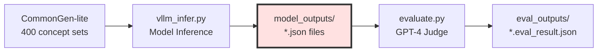
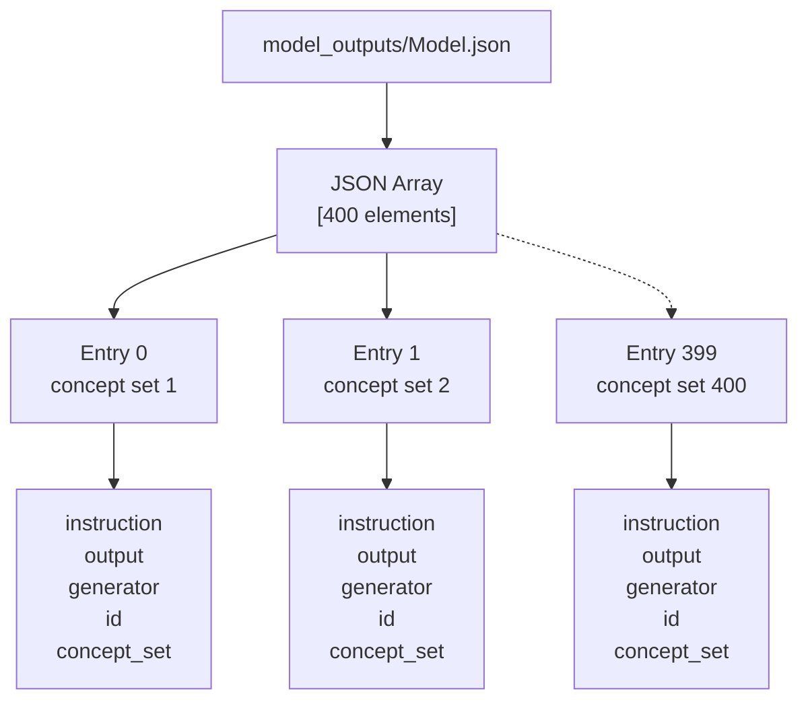
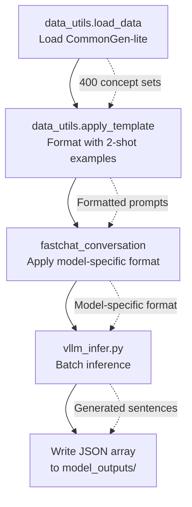
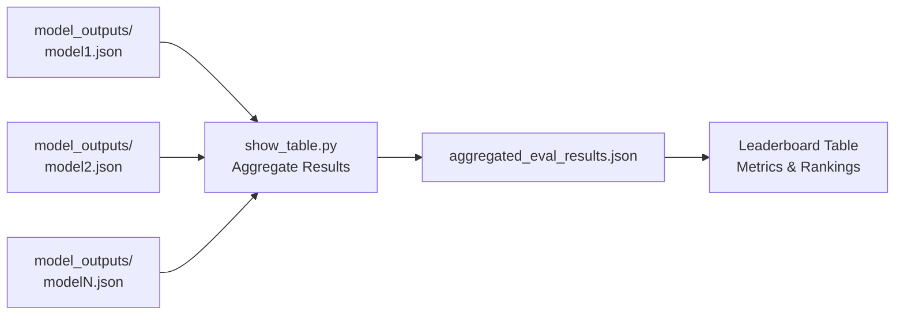

<!-- source: DeepWiki mcp.deepwiki.com · repo allenai/CommonGen-Eval · page 7 Model Outputs Reference · fetched 2026-10-26 -->

# Model Outputs Reference

<details>
<summary>Relevant source files</summary>

The following files were used as context for generating this wiki page:

- [README.md](README.md)
- [model_outputs/Pallas-0.5.json](model_outputs/Pallas-0.5.json)
- [model_outputs/TurnOpt.json](model_outputs/TurnOpt.json)

</details>


This document provides a reference for model output JSON files generated by the CommonGen-Eval system. Model outputs contain the sentences generated by various language models in response to concept-to-sentence generation prompts.

For detailed JSON schema specifications, see [Output Format Specification](#7.1). For concrete examples from different models, see [Example Model Outputs](#7.2). For information about running model inference to generate these files, see [Running Model Inference](#4).

## Overview

Model output files are JSON documents stored in the `model_outputs/` directory. Each file represents the complete set of 400 generated sentences from a single model on the CommonGen-lite evaluation dataset. These outputs serve as the primary input to the GPT-4-based evaluation pipeline.

**Sources:** [README.md:55-69](), [model_outputs/TurnOpt.json:1-15](), [model_outputs/Pallas-0.5.json:1-15]()

## Pipeline Position



**Diagram: Model outputs in the evaluation pipeline**

Model output files are created by the inference system (see [Inference System](#3.2)) and consumed by the evaluation system (see [Evaluation System](#3.3)). They represent the boundary between model generation and automated evaluation.

**Sources:** [README.md:55-115](), Diagram 1 from high-level architecture

## File Organization

### Directory Structure

Model outputs are stored in the `model_outputs/` directory with the following naming convention:

```
model_outputs/
├── TurnOpt.json
├── Pallas-0.5.json
├── Llama-2-7b-chat-hf.json
├── Yi-34b-chat.json
├── gpt-4-0613.json
└── [other-model-name].json
```

Each filename corresponds to the model identifier used during inference. The filename (without `.json` extension) is used when running evaluation to match outputs with their source model.

**Sources:** [model_outputs/TurnOpt.json:1](), [model_outputs/Pallas-0.5.json:1](), [README.md:107-115]()

### File Format

Each model output file contains a JSON array of 400 objects, one per test example:



**Diagram: Model output file structure**

**Sources:** [model_outputs/TurnOpt.json:1](), [model_outputs/Pallas-0.5.json:1]()

## Core Fields

Each entry in a model output file contains the following fields:

| Field | Type | Description |
|-------|------|-------------|
| `instruction` | string | Complete prompt including 2-shot examples and task description |
| `output` | array of strings | Generated sentence(s) from the model (typically single element) |
| `generator` | string | Model name/identifier that produced this output |
| `id` | string | Unique identifier (MD5 hash) for this test case |
| `concept_set` | array of strings | List of concepts with POS tags (e.g., `"dog_N"`, `"catch_V"`) |

### Field Details

**`instruction`**: Contains the full prompt text following the 2-shot format defined in `instruct_template.md`. The prompt includes:
- Task description
- Two demonstration examples (dog/frisbee, apple/tree)
- The specific concept set for this instance

**`output`**: An array of generated sentences. While the structure is an array, typically contains a single string element representing the model's generated sentence. Multiple outputs may be present if the model generates alternative responses.

**`generator`**: Identifies the source model. This value must match the filename (without `.json`) and is used for tracking model performance in aggregated results.

**`id`**: A unique MD5 hash identifying this specific concept set. The same ID appears across all model outputs and in the evaluation dataset, enabling cross-model comparison for the same test case.

**`concept_set`**: The list of concepts the model was asked to use. Each concept includes a part-of-speech tag suffix: `_N` (noun), `_V` (verb), etc. This field is used by evaluation scripts to verify concept coverage and POS correctness.

**Sources:** [model_outputs/TurnOpt.json:1-15](), [model_outputs/Pallas-0.5.json:1-15](), [README.md:74-94]()

## Generation Process



**Diagram: Model output generation flow**

The generation process follows these steps:

1. **Data Loading**: `data_utils.load_data()` loads the 400 test cases from the CommonGen-lite dataset on HuggingFace
2. **Template Application**: `data_utils.apply_template()` formats each concept set with the 2-shot instruction template
3. **Conversation Formatting**: `fastchat_conversation.py` applies model-specific conversation templates (e.g., Llama-2 chat format, Vicuna format)
4. **Batch Inference**: `vllm_infer.py` performs batched inference using vLLM with specified parameters (temperature=0, top_p=1)
5. **Output Writing**: Results are serialized to JSON in the `model_outputs/` directory

**Sources:** [README.md:55-69](), [vllm_infer.py]() (referenced but not provided), [data_utils.py]() (referenced), [fastchat_conversation.py]() (referenced)

## Usage in Evaluation

Model output files are consumed by the evaluation pipeline in two ways:

### Direct Evaluation

The `evaluate.py` script loads model outputs for comparison against human references:

```bash
python evaluate.py --mode "compare" \
    --model_output_file "model_outputs/Yi-34b-chat.json" \
    --eval_output_file "eval_outputs/Yi-34b-chat.eval_result.json"
```

The evaluation process:
1. Reads the model output JSON file
2. For each entry, extracts the generated sentence from the `output` field
3. Performs automated checks using the `concept_set` field (coverage, POS validation)
4. Submits pairwise comparisons to GPT-4 for quality judgment
5. Writes results to the corresponding evaluation output file

**Sources:** [README.md:99-115](), [evaluate.py]() (referenced)

### Results Aggregation

The `show_table.py` script reads all model output files to generate the leaderboard:



**Diagram: Aggregation of model outputs for leaderboard generation**

**Sources:** [README.md:21-44](), [show_table.py]() (referenced), Diagram 5 from high-level architecture

## Example Entry Structure

Here is a representative entry from a model output file:

```json
{
  "instruction": "# Instruction\n\nGiven several concepts (i.e., nouns or verbs)...",
  "output": [
    "The dog catches the frisbee when the boy throws it into the air."
  ],
  "generator": "TurnOpt",
  "id": "468fa6fbb21bc3b0d8c156a628cbf222",
  "concept_set": [
    "catch_V",
    "dog_N",
    "frisbee_N",
    "throw_V"
  ]
}
```

Key observations:
- The `instruction` field contains the complete multi-line prompt
- The `output` array has a single sentence
- The `generator` matches the filename ("TurnOpt.json")
- The `concept_set` includes POS tags for validation
- All concepts from `concept_set` appear in the generated sentence

For more detailed examples showing quality variations and common patterns, see [Example Model Outputs](#7.2).

**Sources:** [model_outputs/TurnOpt.json:1-15](), [model_outputs/Pallas-0.5.json:1-15]()

## Field Validation

When processing model outputs, the evaluation system validates:

1. **Structure Validation**:
   - File must contain a JSON array
   - Each entry must have all required fields
   - Array must contain exactly 400 entries

2. **Content Validation**:
   - `concept_set` must match the expected test case concepts
   - `id` must match the dataset's unique identifier
   - `output` array should not be empty

3. **Coverage Analysis** (performed during evaluation):
   - All concepts in `concept_set` appear in the generated sentence
   - Concepts are used with correct part-of-speech forms

**Sources:** [README.md:39-44]() (metrics description), [evaluate.py]() (referenced)

## Common Issues and Debugging

### Missing Concepts

Some models fail to include all required concepts:

```json
{
  "output": ["The tailor demonstrates how to use the sewing machine."],
  "concept_set": ["demonstrate_V", "machine_N", "sew_V", "use_V"]
}
```

This output is missing the verb "sew" as a standalone word (it appears only in "sewing"), resulting in `Cover=False` in evaluation metrics.

### Incorrect Part-of-Speech

Models may use concepts with wrong grammatical forms:

```json
{
  "output": ["The knitted hat sat on a pile of rocks."],
  "concept_set": ["hat_N", "knit_V", "pile_N", "rock_N", "sit_V"]
}
```

Here "knitted" (adjective) is used instead of "knit" (verb), resulting in `PoS=False`.

### Output Array Variations

While most models produce single-element `output` arrays, some may generate multiple alternatives or empty arrays, which should be handled by downstream processing.

**Sources:** [README.md:150-267]() (case studies showing these patterns)

## File Size and Performance

- **Typical file size**: 400-600 KB per model output file
- **Total entries**: Exactly 400 per file
- **Processing time**: Evaluation scripts process all entries sequentially, taking approximately 5-10 minutes per model depending on GPT-4 API rate limits

**Sources:** [model_outputs/TurnOpt.json](), [model_outputs/Pallas-0.5.json]() (file size inference)

## Related Documentation

- [Output Format Specification](#7.1) - Detailed JSON schema and field specifications
- [Example Model Outputs](#7.2) - Concrete examples from various models with quality analysis
- [Running Model Inference](#4) - How to generate model output files
- [Evaluation System](#3.3) - How model outputs are evaluated
- [Understanding Metrics](#6.3) - How coverage, POS, and other metrics are computed from model outputs

---

