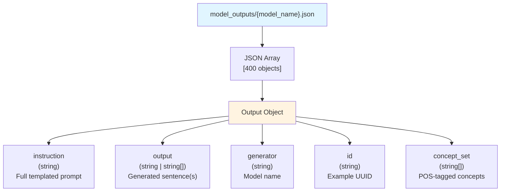
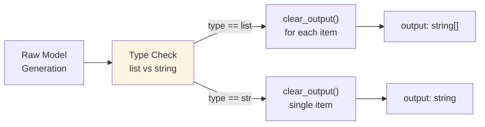
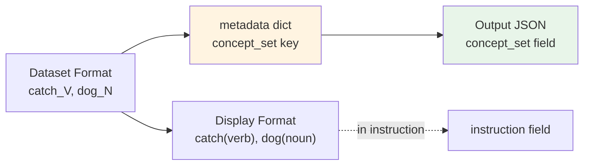
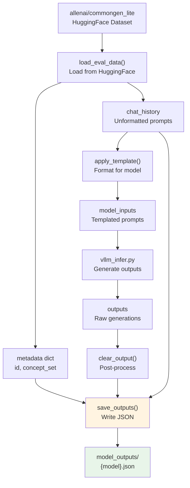
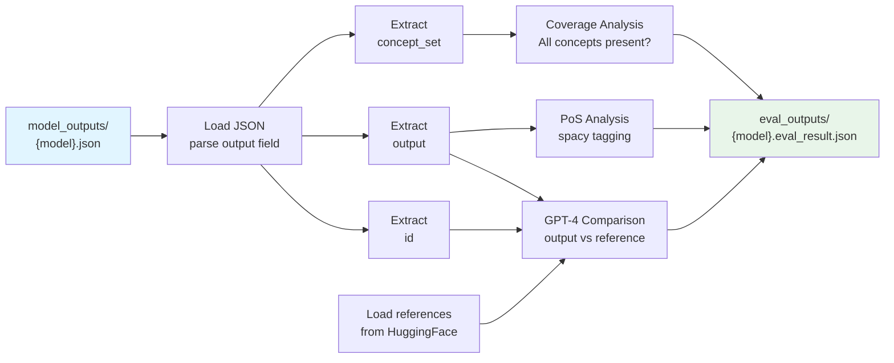

<!-- source: DeepWiki mcp.deepwiki.com · repo allenai/CommonGen-Eval · page 7.1 Output Format Specification · fetched 2026-10-26 -->

# Output Format Specification

<details>
<summary>Relevant source files</summary>

The following files were used as context for generating this wiki page:

- [data_utils.py](data_utils.py)
- [model_outputs/Pallas-0.5.json](model_outputs/Pallas-0.5.json)
- [model_outputs/TurnOpt.json](model_outputs/TurnOpt.json)
- [scripts/Pallas-0.5.sh](scripts/Pallas-0.5.sh)

</details>


This document specifies the exact JSON schema for model output files in the CommonGen-Eval system. Model outputs are stored in the `model_outputs/` directory and follow a standardized format to enable consistent evaluation and comparison across different language models. For concrete examples of model outputs, see [Example Model Outputs](#7.2). For information about how these outputs are evaluated, see [Evaluation System](#3.3).

---

## Schema Overview

Model output files are JSON arrays containing one object per test example from the CommonGen-lite dataset. Each object combines the input prompt, generated output, model metadata, and ground truth concept information needed for evaluation.

**Diagram: Model Output JSON Structure**



**Sources:** [model_outputs/TurnOpt.json:1-10](), [model_outputs/Pallas-0.5.json:1-15]()

---

## Top-Level Structure

The output file is a JSON array where each element represents one test case from the 400-example CommonGen-lite dataset.

```
[
  {
    // Object for test case 1
  },
  {
    // Object for test case 2
  },
  ...
]
```

**Sources:** [model_outputs/TurnOpt.json:1](), [data_utils.py:72-87]()

---

## Field Specifications

### Required Fields

All output objects must contain the following five fields:

| Field | Type | Description | Example |
|-------|------|-------------|---------|
| `instruction` | `string` | Complete prompt with template, examples, and task | See full example below |
| `output` | `string` or `string[]` | Generated sentence(s) from the model | `"The dog catches the frisbee..."` |
| `generator` | `string` | Name/identifier of the model | `"TurnOpt"`, `"Pallas-0.5"` |
| `id` | `string` | Unique identifier (UUID) for the test case | `"468fa6fbb21bc3b0d8c156a628cbf222"` |
| `concept_set` | `string[]` | Array of concepts with POS tags | `["catch_V", "dog_N", "frisbee_N"]` |

**Sources:** [data_utils.py:76-85]()

---

### Field: `instruction`

The `instruction` field contains the complete prompt given to the model, including:
- Task instructions explaining the concept-to-sentence generation task
- Two in-context examples (dog/frisbee and apple/tree)
- The specific concept set for this test case
- A prompt for the model to generate the sentence

This field is constructed by the data loading pipeline and formatted according to the model's conversation template.

**Structure:**
```
# Instruction

Given several concepts (i.e., nouns or verbs), write a short and simple sentence...

# Examples

## Example 1
- Concepts: "dog(noun), frisbee(noun), catch(verb), throw(verb)"
- Sentence: The dog catches the frisbee when the boy throws it into the air.

## Example 2
- Concepts: "apple(noun), place(verb), tree(noun), pick(verb)"
- Sentence: A girl picks some apples from a tree and places them into her basket.

# Your Task 

- Concepts: "{concept_set}"
- Sentence: 
```

**Sources:** [model_outputs/TurnOpt.json:1](), [data_utils.py:77](), [data_utils.py:39-57]()

---

### Field: `output`

The `output` field contains the model's generated sentence(s). This field has two possible formats:

**Format 1: Single String** (most common)
```json
"output": "The dog catches the frisbee when the boy throws it into the air."
```

**Format 2: Array of Strings** (for models generating multiple candidates)
```json
"output": [
  "The boy throws the frisbee and his dog quickly catches it in the park.",
  "A dog catches a frisbee that someone throws in the park."
]
```

The output is post-processed by `clear_output()` to remove trailing whitespace and model-specific artifacts.

**Data Flow:**



**Sources:** [data_utils.py:78-81](), [data_utils.py:62-69]()

---

### Field: `generator`

The `generator` field identifies which model produced the output. This value comes from the `--model_name` argument passed to the inference script.

**Examples:**
- `"TurnOpt"`
- `"Pallas-0.5"`
- `"Llama-2-7b-chat-hf"`
- `"Yi-34b-chat"`
- `"gpt-4"`

**Sources:** [data_utils.py:82](), [scripts/Pallas-0.5.sh:5]()

---

### Field: `id`

The `id` field is a unique identifier (UUID string) for each test case in the CommonGen-lite dataset. This ID is used to:
- Match model outputs with ground truth references during evaluation
- Track specific examples across different model outputs
- Aggregate results by reference ID

The ID is loaded from the HuggingFace dataset and preserved through the pipeline.

**Sources:** [data_utils.py:51](), [model_outputs/TurnOpt.json:1]()

---

### Field: `concept_set`

The `concept_set` field contains the list of concepts that the model was asked to use in its generated sentence. Each concept is tagged with its part of speech:
- `_N` suffix for nouns
- `_V` suffix for verbs

**Example:**
```json
"concept_set": ["catch_V", "dog_N", "frisbee_N", "throw_V"]
```

This field is used during evaluation to:
1. Calculate **coverage** - whether all concepts appear in the generated sentence
2. Verify **PoS accuracy** - whether concepts are used with correct grammatical tags

**Concept Format Conversion:**



**Sources:** [data_utils.py:44](), [data_utils.py:83-84](), [data_utils.py:90-94]()

---

## File Naming Convention

Model output files are stored in the `model_outputs/` directory with the naming pattern:

```
model_outputs/{model_name}.json
```

Where `{model_name}` matches the value in the `generator` field and the `--model_name` parameter used during inference.

**Examples:**
- `model_outputs/TurnOpt.json`
- `model_outputs/Pallas-0.5.json`
- `model_outputs/Llama-2-7b-chat-hf.json`

**Sources:** [scripts/Pallas-0.5.sh:6](), [data_utils.py:86-87]()

---

## Schema Validation Rules

### Data Type Constraints

| Field | Type | Nullable | Default |
|-------|------|----------|---------|
| `instruction` | `string` | No | N/A |
| `output` | `string` \| `string[]` | No | N/A |
| `generator` | `string` | No | N/A |
| `id` | `string` | No | N/A |
| `concept_set` | `string[]` | No | N/A |

### Structural Requirements

1. **Array Length:** Must contain exactly 400 objects (one per test case)
2. **Output Type:** Must be either a single string or array of strings, not mixed types across the file
3. **Concept Set Format:** Each element must follow the pattern `{word}_{N|V}`
4. **ID Uniqueness:** All `id` values must be unique within the file

### Content Requirements

1. **Instruction Consistency:** All instructions follow the same template structure
2. **Generator Consistency:** The `generator` field should be identical across all objects in a file
3. **Output Post-processing:** All outputs should have trailing whitespace removed via `clear_output()`

**Sources:** [data_utils.py:72-87]()

---

## Complete Example Object

Here is a complete example of a single object from a model output file:

```json
{
  "instruction": "# Instruction\n\nGiven several concepts (i.e., nouns or verbs), write a short and simple sentence that contains *all* the required words.\nThe sentence should describe a common scene in daily life, and the concepts should be used in a natural way.\n\n# Examples\n\n## Example 1\n- Concepts: \"dog(noun), frisbee(noun), catch(verb), throw(verb)\"\n- Sentence: The dog catches the frisbee when the boy throws it into the air.\n\n## Example 2\n- Concepts: \"apple(noun), place(verb), tree(noun), pick(verb)\"\n- Sentence: A girl picks some apples from a tree and places them into her basket.\n\n# Your Task \n\n- Concepts: \"catch(verb), dog(noun), frisbee(noun), throw(verb)\"\n- Sentence: ",
  "output": [
    "The boy throws the frisbee and his dog quickly catches it in the park."
  ],
  "generator": "TurnOpt",
  "id": "468fa6fbb21bc3b0d8c156a628cbf222",
  "concept_set": [
    "catch_V",
    "dog_N",
    "frisbee_N",
    "throw_V"
  ]
}
```

**Sources:** [model_outputs/TurnOpt.json:1-10]()

---

## Creation Pipeline

The output format is created by the following pipeline:



**Sources:** [data_utils.py:34-57](), [data_utils.py:6-32](), [data_utils.py:72-87]()

---

## Usage in Evaluation

The output format is consumed by the evaluation pipeline as follows:

**Diagram: Output Format in Evaluation Flow**



**Sources:** [data_utils.py:72-87](), [model_outputs/TurnOpt.json:1]()

---

