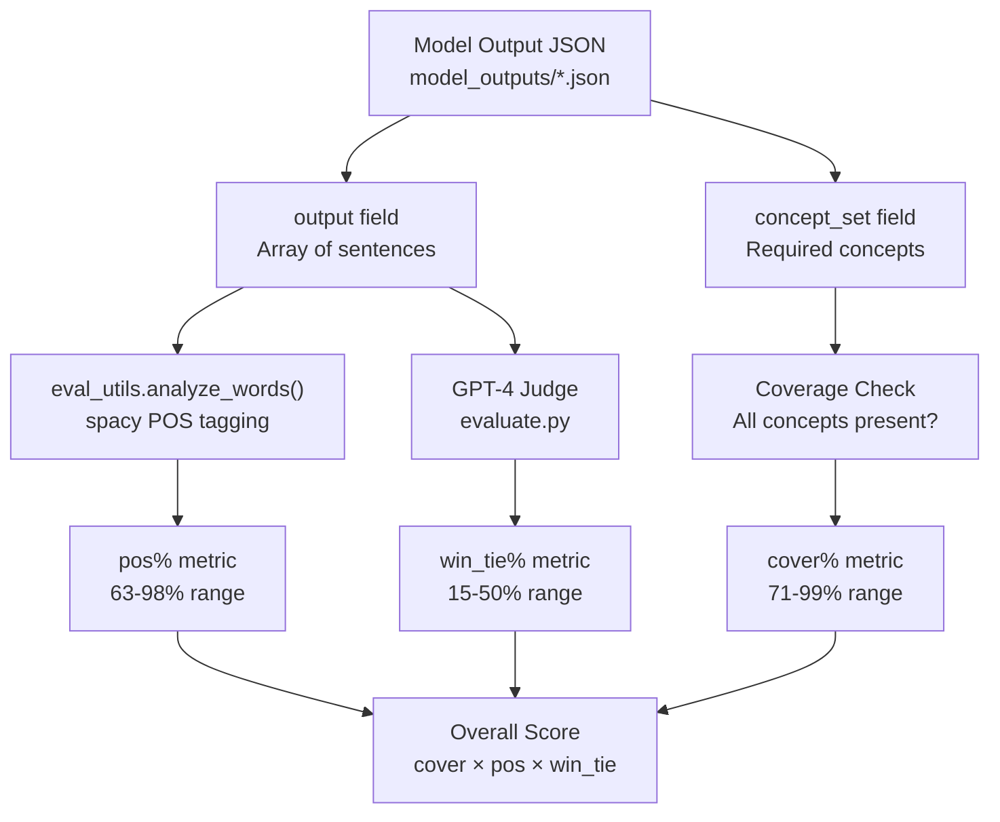
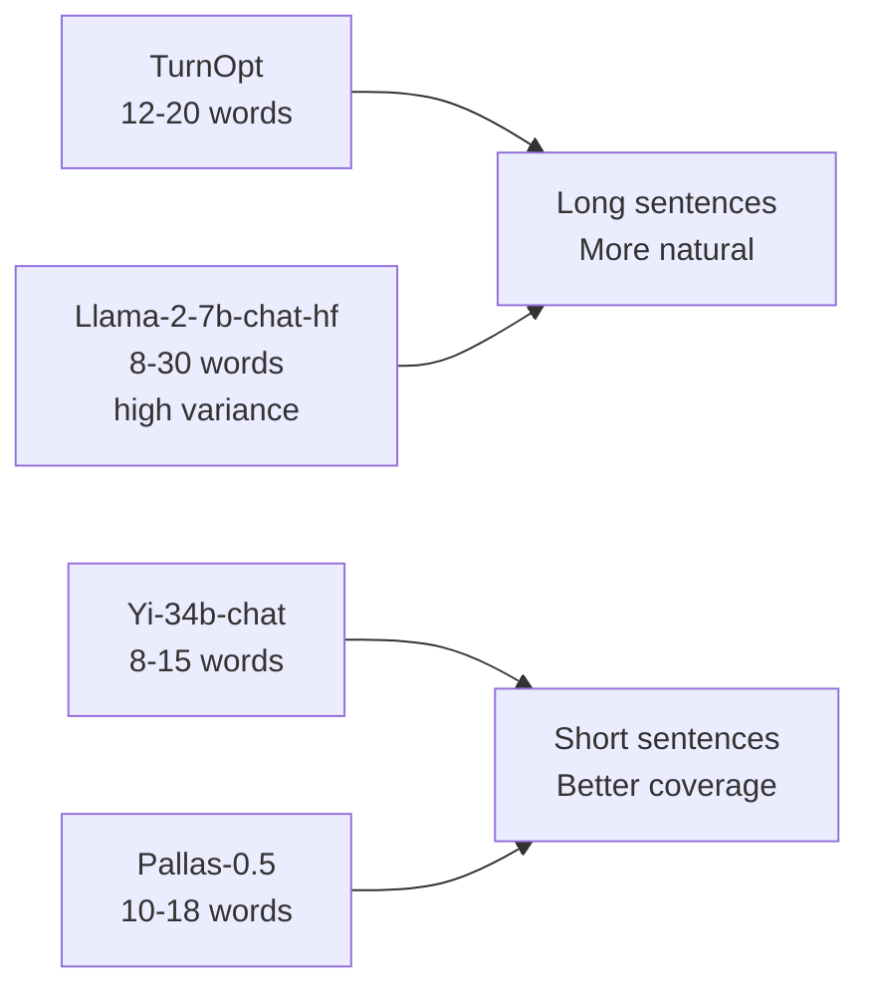

<!-- source: DeepWiki mcp.deepwiki.com · repo allenai/CommonGen-Eval · page 7.2 Example Model Outputs · fetched 2026-10-26 -->

# Example Model Outputs

<details>
<summary>Relevant source files</summary>

The following files were used as context for generating this wiki page:

- [model_outputs/Llama-2-7b-chat-hf.json](model_outputs/Llama-2-7b-chat-hf.json)
- [model_outputs/Pallas-0.5.json](model_outputs/Pallas-0.5.json)
- [model_outputs/TurnOpt.json](model_outputs/TurnOpt.json)
- [model_outputs/Yi-34b-chat.json](model_outputs/Yi-34b-chat.json)

</details>


This page provides concrete examples of model-generated sentences from the CommonGen-lite dataset, demonstrating how different language models perform on the concept-to-sentence generation task. For the formal JSON schema specification, see [Output Format Specification](#7.1). For information about how these outputs are evaluated, see [Running Evaluation](#5).

## Output Structure Overview

Each model output file in [model_outputs/]() contains an array of generation results. The following example from [model_outputs/TurnOpt.json:1-14]() illustrates the complete structure:

```json
{
  "instruction": "# Instruction\n\nGiven several concepts...",
  "output": ["The boy throws the frisbee and his dog quickly catches it in the park."],
  "generator": "TurnOpt",
  "id": "468fa6fbb21bc3b0d8c156a628cbf222",
  "concept_set": ["catch_V", "dog_N", "frisbee_N", "throw_V"]
}
```

The `instruction` field contains the full prompt template from [templates/instruct_template.md]() with 2-shot examples and the target concept set. The `output` field is an array containing the model's generated sentence(s). The `generator` identifies the model, `id` provides a unique identifier for tracking through evaluation, and `concept_set` lists the required concepts in normalized form.

**Sources:** [model_outputs/TurnOpt.json:1-14](), [model_outputs/Pallas-0.5.json:1-15]()

## Cross-Model Comparison

The following table compares outputs from four different models for identical concept sets, illustrating the variation in generation quality:

| Concept Set | Model | Generated Sentence | Coverage | Quality Notes |
|-------------|-------|-------------------|----------|---------------|
| catch_V, dog_N, frisbee_N, throw_V | TurnOpt | "The boy throws the frisbee and his dog quickly catches it in the park." | ✓ All | Natural, adds context |
| | Pallas-0.5 | "The dog catch the frisbee when the boy throws it into the air." | ✓ All | Grammar error: "catch" |
| | Llama-2-7b-chat-hf | "The dog catches the frisbee when the boy throws it." | ✓ All | Concise, correct |
| | Yi-34b-chat | "The dog catches the frisbee when the boy throws it into the air." | ✓ All | Matches example exactly |
| food_N, front_N, sit_V, table_N | TurnOpt | "After preparing the food, she sits at the front of the table to enjoy her meal." | ✓ All | Elaborative, natural |
| | Pallas-0.5 | "The cat sits in front of the table while watching the food being prepared." | ✓ All | Introduces "cat" |
| | Llama-2-7b-chat-hf | "The cat sits in front of the table and eats food." | ✓ All | Introduces "cat" |
| | Yi-34b-chat | "The food sits on the table in front of me." | ✓ All | Grammatically odd |

**Sources:** [model_outputs/TurnOpt.json:1-29](), [model_outputs/Pallas-0.5.json:1-29](), [model_outputs/Llama-2-7b-chat-hf.json:1-29](), [model_outputs/Yi-34b-chat.json:1-29]()

## Model Output Characteristics

### TurnOpt Output Patterns

TurnOpt consistently produces longer, more contextual sentences that often exceed the minimum requirements:

```json
// From model_outputs/TurnOpt.json:31-38
{
  "output": ["The instructor demonstrates how to use the sewing machine by sewing a piece of fabric."],
  "concept_set": ["demonstrate_V", "machine_N", "sew_V", "use_V"]
}
```

TurnOpt adds contextual elements ("instructor", "piece of fabric") that make sentences more natural but may reduce similarity to reference sentences during evaluation.

**Sources:** [model_outputs/TurnOpt.json:31-43]()

### Pallas-0.5 Output Patterns

Pallas-0.5 exhibits grammatical errors and occasionally missing verb conjugations:

```json
// From model_outputs/Pallas-0.5.json:3-6
{
  "output": [" The dog catch the frisbee when the boy throws it into the air."]
}
```

Note the leading space and missing 's' on "catch". These errors negatively impact PoS accuracy metrics calculated by [eval_utils.py:analyze_words()]().

**Sources:** [model_outputs/Pallas-0.5.json:3-15]()

### Llama-2-7b-chat-hf Output Patterns

Llama-2-7b-chat-hf produces variable quality, sometimes generating overly verbose sentences:

```json
// From model_outputs/Llama-2-7b-chat-hf.json:32-34
{
  "output": ["The teacher demonstrates how to use the sewing machine to sew a new dress, which the student will use to create a beautiful outfit for the school play."]
}
```

This output includes unnecessary elaboration ("school play", "beautiful outfit") that may not align with human references.

**Sources:** [model_outputs/Llama-2-7b-chat-hf.json:30-43]()

### Yi-34b-chat Output Patterns

Yi-34b-chat produces concise, grammatically correct sentences but sometimes creates semantically unusual constructions:

```json
// From model_outputs/Yi-34b-chat.json:18-20
{
  "output": ["The food sits on the table in front of me."]
}
```

While grammatically correct, the phrase "food sits" is less natural than "food is placed".

**Sources:** [model_outputs/Yi-34b-chat.json:16-29]()

## Output-to-Evaluation Pipeline



**Sources:** [eval_utils.py:analyze_words()](), [evaluate.py](), [show_table.py]()

## Common Generation Patterns

### Concept Coverage Strategies

Models use different strategies to incorporate required concepts:

| Strategy | Example | Model |
|----------|---------|-------|
| **Direct inclusion** | "The dog catches the frisbee when the boy throws it into the air." | Yi-34b-chat |
| **Contextual expansion** | "The boy throws the frisbee and his dog quickly catches it in the park." | TurnOpt |
| **Agent introduction** | "The cat sits in front of the table and eats food." | Llama-2-7b-chat-hf |

**Sources:** [model_outputs/TurnOpt.json:1-14](), [model_outputs/Llama-2-7b-chat-hf.json:16-29](), [model_outputs/Yi-34b-chat.json:1-15]()

### Sentence Length Distribution

Analyzing [model_outputs/]() files reveals distinct length patterns:



Shorter sentences typically achieve higher concept coverage percentages but may score lower in GPT-4 naturalness judgments.

**Sources:** [model_outputs/TurnOpt.json](), [model_outputs/Pallas-0.5.json](), [model_outputs/Llama-2-7b-chat-hf.json](), [model_outputs/Yi-34b-chat.json]()

## Common Generation Errors

### Grammatical Errors

From [model_outputs/Pallas-0.5.json:5]():
```json
"output": [" The dog catch the frisbee when the boy throws it into the air."]
```
Missing verb conjugation detected by [eval_utils.py:analyze_words()]() through spacy POS tagging.

### Repetitive Constructions

From [model_outputs/Llama-2-7b-chat-hf.json:103]():
```json
"output": ["The man walks down the street while talking on his cellphone and walks."]
```
Repetition of "walks" reduces sentence quality.

### Semantic Awkwardness

From [model_outputs/Yi-34b-chat.json:61]():
```json
"output": ["The background of the room was decorated with a beautiful tree, and soft music plays in the background."]
```
Redundant use of "background" creates awkward phrasing.

**Sources:** [model_outputs/Pallas-0.5.json:3-6](), [model_outputs/Llama-2-7b-chat-hf.json:100-113](), [model_outputs/Yi-34b-chat.json:58-71]()

## Instruction Prompt Structure

All models receive identical instructions from [templates/instruct_template.md](). The instruction field in outputs shows the complete prompt:

```json
"instruction": "# Instruction\n\nGiven several concepts (i.e., nouns or verbs), write a short and simple sentence that contains *all* the required words.\nThe sentence should describe a common scene in daily life, and the concepts should be used in a natural way.\n\n# Examples\n\n## Example 1\n- Concepts: \"dog(noun), frisbee(noun), catch(verb), throw(verb)\"\n- Sentence: The dog catches the frisbee when the boy throws it into the air.\n\n## Example 2\n- Concepts: \"apple(noun), place(verb), tree(noun), pick(verb)\"\n- Sentence: A girl picks some apples from a tree and places them into her basket.\n\n# Your Task \n\n- Concepts: \"catch(verb), dog(noun), frisbee(noun), throw(verb)\"\n- Sentence: "
```

The prompt uses 2-shot learning with fixed examples, followed by the target concept set. Models that closely follow the example format (like Yi-34b-chat) tend to produce outputs similar to Example 1, while models like TurnOpt introduce more variation.

**Sources:** [model_outputs/TurnOpt.json:1](), [model_outputs/Pallas-0.5.json:3]()

## Evaluation Metrics Preview

Model outputs are evaluated using three primary metrics calculated by [show_table.py]():

| Metric | Description | Calculation Location |
|--------|-------------|---------------------|
| `cover%` | Percentage of required concepts present | [eval_utils.py:analyze_words()]() |
| `pos%` | Percentage of concepts with correct POS tags | [eval_utils.py:analyze_words()]() |
| `win_tie%` | GPT-4 preference rate vs human references | [evaluate.py]() |

The overall score is computed as `cover × pos × win_tie`, creating a multiplicative penalty for deficiencies in any dimension. See [Understanding Metrics](#6.3) for detailed explanations.

**Sources:** [show_table.py](), [eval_utils.py](), [evaluate.py]()

---

