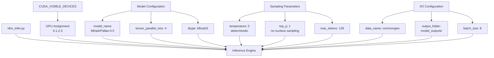
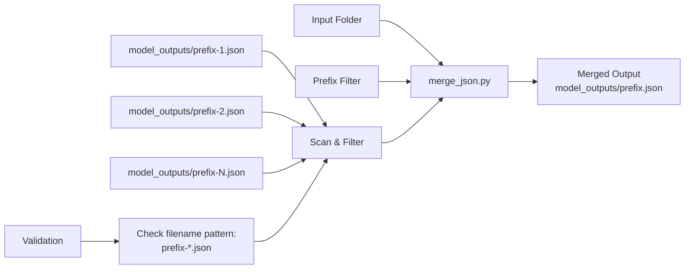
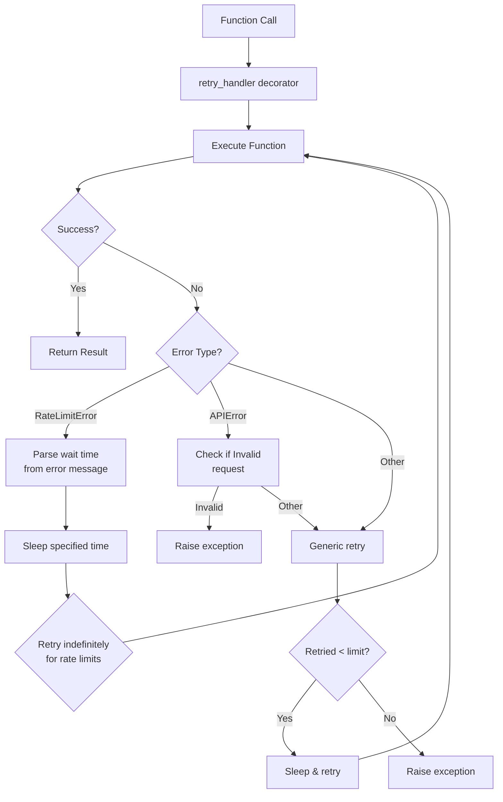
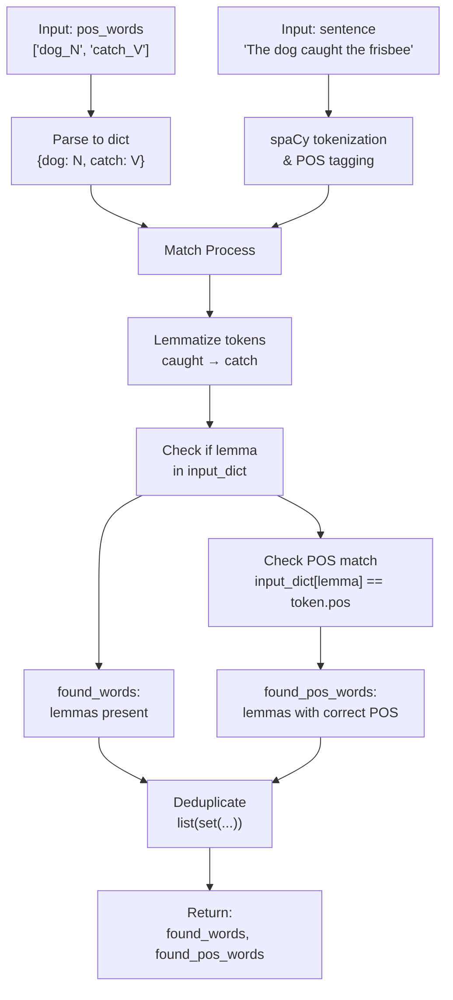
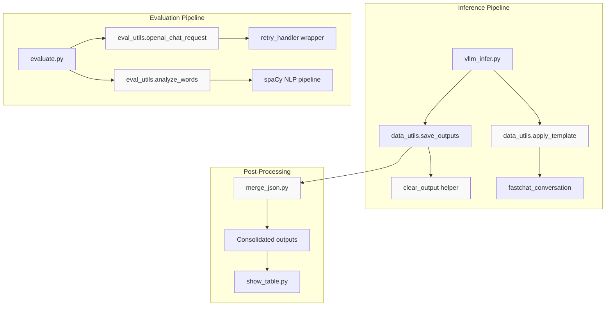

<!-- source: DeepWiki mcp.deepwiki.com · repo allenai/CommonGen-Eval · page 8 Utilities and Tools · fetched 2026-10-26 -->

# Utilities and Tools

<details>
<summary>Relevant source files</summary>

The following files were used as context for generating this wiki page:

- [data_utils.py](data_utils.py)
- [eval_utils.py](eval_utils.py)
- [merge_json.py](merge_json.py)
- [scripts/Pallas-0.5.sh](scripts/Pallas-0.5.sh)

</details>


This page documents auxiliary scripts and helper functions that support the main inference and evaluation workflows. These utilities handle tasks such as merging split outputs, formatting data, and implementing common patterns like retry logic and error handling.

For detailed documentation of the core data loading and formatting functions, see [Data Utilities](#4.1). For evaluation-specific utilities including NLP analysis and OpenAI API interaction, see [Evaluation Utilities](#5.1).

## Shell Script Infrastructure

The repository provides shell scripts for running inference on different models. These scripts follow a consistent pattern and wrap the `vllm_infer.py` execution with model-specific parameters.

### Script Structure

Each script in `scripts/` follows this general pattern:

```bash
CUDA_VISIBLE_DEVICES=0,1,2,3 \
python vllm_infer.py \
    --download_dir /path/to/models \
    --data_name "commongen" \
    --model_name <model_identifier> \
    --tensor_parallel_size <num_gpus> \
    --dtype <precision> \
    --output_folder "model_outputs/" \
    --top_p 1 --temperature 0 \
    --batch_size <batch_size> \
    --max_tokens 128
```

**Script Anatomy (Pallas-0.5.sh Example)**



**Sources:** [scripts/Pallas-0.5.sh:1-7]()

### Common Script Parameters

| Parameter | Purpose | Typical Values |
|-----------|---------|----------------|
| `CUDA_VISIBLE_DEVICES` | GPU device assignment | `0,1,2,3` for 4 GPUs |
| `--download_dir` | Model cache directory | `/net/nfs/s2-research/llama2/` |
| `--data_name` | Dataset identifier | `commongen` |
| `--model_name` | HuggingFace model path | `Mihaiii/Pallas-0.5`, `meta-llama/Llama-2-7b-chat-hf` |
| `--tensor_parallel_size` | Number of GPUs for model parallelism | `1`, `2`, `4` |
| `--dtype` | Model precision | `bfloat16`, `float16` |
| `--output_folder` | Output directory | `model_outputs/` |
| `--temperature` | Sampling temperature | `0` (deterministic) |
| `--top_p` | Nucleus sampling threshold | `1` (disabled) |
| `--batch_size` | Inference batch size | `8`, `16`, `32` |
| `--max_tokens` | Maximum generation length | `128` |

**Sources:** [scripts/Pallas-0.5.sh:1-7]()

## JSON Merging Utility

The `merge_json.py` script consolidates multiple JSON output files into a single file. This is useful when inference is run in parallel batches or when combining outputs from different runs.

### Functionality



**Sources:** [merge_json.py:1-30]()

### Usage

```bash
python merge_json.py <folder> <prefix>
```

**Arguments:**
- `folder`: Directory containing JSON files (e.g., `model_outputs/`)
- `prefix`: Model name prefix to filter files (e.g., `gpt-4`)

**Example:**
```bash
python merge_json.py model_outputs/ gpt-4
```

This finds all files matching `model_outputs/gpt-4-*.json` and merges them into `model_outputs/gpt-4.json`.

### Implementation Details

The script performs the following operations:

1. **File Discovery** - Scans the directory for files matching `<prefix>-*.json` pattern [merge_json.py:8-13]()
2. **Pattern Validation** - Ensures filenames contain a hyphen between prefix and extension [merge_json.py:12]()
3. **Data Aggregation** - Loads and concatenates JSON arrays from all matching files [merge_json.py:16-26]()
4. **Output Generation** - Writes the merged array to `<folder>/<prefix>.json` [merge_json.py:29-30]()

**Sources:** [merge_json.py:1-30]()

## Helper Functions

### Data Formatting Helpers

The `data_utils.py` module provides utility functions for post-processing and formatting. These complement the core data loading functions documented in [Data Utilities](#4.1).

#### clear_output

```python
def clear_output(output, model_name):
```

Cleans model outputs by removing extraneous formatting artifacts specific to certain models [data_utils.py:62-69]().

**Current Implementation:**
- Strips extra newlines from Llama-2-7b outputs when present [data_utils.py:66-68]()
- Extensible for model-specific cleaning logic

#### concept_list_str

```python
def concept_list_str(concept_set):
```

Converts concept sets with POS tags into human-readable strings [data_utils.py:90-94]().

**Transformation:**
```
["dog_N", "catch_V", "frisbee_N"] → "dog(noun), catch(verb), frisbee(noun)"
```

This is used when constructing prompts that display concepts to models [data_utils.py:92-94]().

**Sources:** [data_utils.py:62-94]()

### Evaluation Helpers

The `eval_utils.py` module provides core utilities for the evaluation pipeline. Key functions are detailed in [Evaluation Utilities](#5.1), but we highlight their architectural roles here.

#### Retry Infrastructure



**Sources:** [eval_utils.py:47-98]()

The system provides two retry mechanisms:

1. **completion_with_backoff** - Uses tenacity library with exponential backoff [eval_utils.py:40-43]()
2. **retry_handler** - Custom decorator with intelligent error handling [eval_utils.py:47-98]()

The `retry_handler` decorator implements sophisticated logic:
- **Rate limit errors**: Extracts wait time from error message and retries indefinitely [eval_utils.py:72-80]()
- **API errors**: Distinguishes between retryable and terminal errors [eval_utils.py:81-86]()
- **Generic errors**: Applies configurable retry limit before failing [eval_utils.py:88-96]()

**Sources:** [eval_utils.py:40-98]()

#### NLP Analysis

```python
def analyze_words(pos_words, sentence):
```

Performs lemmatization and POS matching using spaCy [eval_utils.py:17-37]().

**Processing Pipeline:**



**Sources:** [eval_utils.py:17-37]()

**Lazy Loading:** The spaCy model is loaded once and cached globally to avoid repeated initialization overhead [eval_utils.py:16-21]().

#### OpenAI API Wrapper

```python
def openai_chat_request(...) -> List[str]:
```

Standardized interface for OpenAI API calls with consistent parameter handling [eval_utils.py:100-156]().

**Key Features:**
- Supports both `prompt` (string) and `messages` (chat format) inputs [eval_utils.py:131-134]()
- Default system message for consistent behavior [eval_utils.py:133-134]()
- Validates finish reasons to catch API issues [eval_utils.py:152-153]()
- Returns list of content strings from all choices [eval_utils.py:149-156]()

**Sources:** [eval_utils.py:100-156]()

## Common Patterns and Conventions

### Output File Naming

Model outputs follow a consistent naming convention:

```
model_outputs/<model_identifier>.json
```

Examples:
- `model_outputs/gpt-4.json`
- `model_outputs/Llama-2-7b-chat-hf.json`
- `model_outputs/Yi-34b-chat.json`

For split outputs (before merging):
```
model_outputs/<model_identifier>-<part_number>.json
```

**Sources:** [merge_json.py:10-13]()

### Progress Tracking

The codebase uses `tqdm` for progress tracking throughout:

```python
from tqdm import tqdm

for item in tqdm(items, desc="Processing", disable=False):
    # process item
```

The `disable` parameter allows suppressing progress bars programmatically [data_utils.py:8]().

**Sources:** [data_utils.py:2,8]()

### Error Handling Philosophy

The utilities implement defensive error handling:

1. **Graceful degradation** - Rate limit errors trigger waiting, not failure [eval_utils.py:72-80]()
2. **Informative errors** - Print context before raising exceptions [eval_utils.py:88,94]()
3. **Validation** - Check API response finish reasons [eval_utils.py:152-153]()
4. **Type checking** - Assert required parameters are provided [eval_utils.py:131]()

**Sources:** [eval_utils.py:66-96,131,152-153]()

### Integration Points



**Sources:** [data_utils.py:6-94](), [eval_utils.py:17-156](), [merge_json.py:1-30]()

## Summary of Utility Functions

| Function | Module | Purpose | Key Parameters |
|----------|--------|---------|----------------|
| `clear_output` | data_utils.py | Clean model-specific artifacts | `output`, `model_name` |
| `concept_list_str` | data_utils.py | Format concepts for display | `concept_set` |
| `analyze_words` | eval_utils.py | POS tagging and lemmatization | `pos_words`, `sentence` |
| `retry_handler` | eval_utils.py | Decorator for robust API calls | `retry_limit` |
| `completion_with_backoff` | eval_utils.py | Tenacity-based retry | OpenAI API kwargs |
| `openai_chat_request` | eval_utils.py | Standardized OpenAI API calls | `model`, `prompt`, `messages` |

**Sources:** [data_utils.py:62-94](), [eval_utils.py:17-156]()

---

