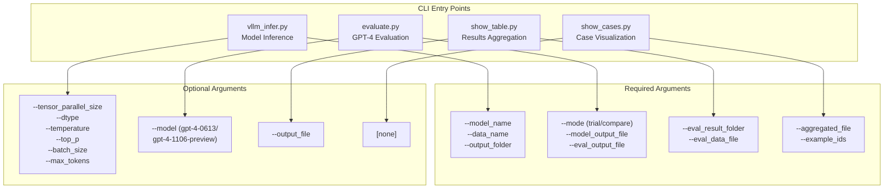
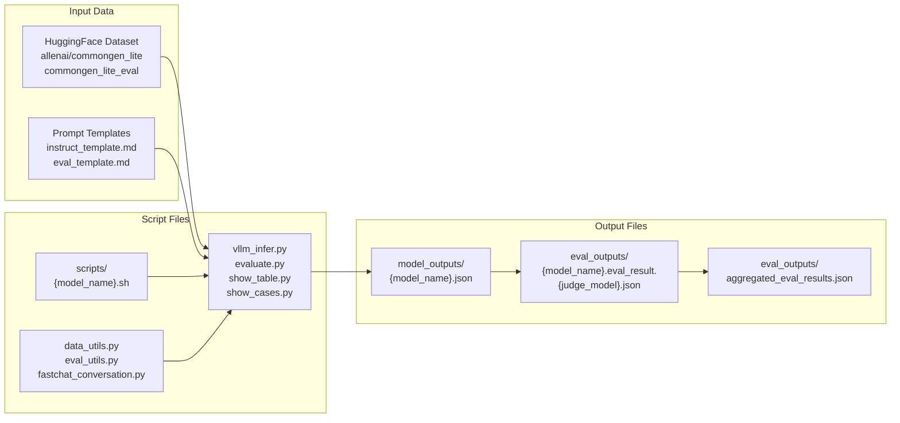
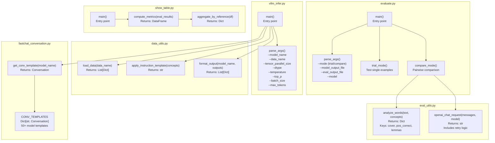

<!-- source: DeepWiki mcp.deepwiki.com · repo allenai/CommonGen-Eval · page 9 Reference · fetched 2026-10-26 -->

# Reference

<details>
<summary>Relevant source files</summary>

The following files were used as context for generating this wiki page:

- [README.md](README.md)
- [requirements.txt](requirements.txt)

</details>


This section provides technical reference material for the CommonGen-Eval system, including system requirements, command-line interface specifications, file format conventions, and quick reference tables for common operations.

For detailed dependency information and version requirements, see [Dependencies](#9.1). For complete command-line argument documentation, see [Configuration Options](#9.2). For a full list of supported models and their template names, see [Supported Models](#9.3).

**Sources:** [README.md:1-298]()

## System Requirements

The CommonGen-Eval system requires Python 3.8+ and has the following key technical specifications:

| Component | Specification |
|-----------|--------------|
| Python Version | 3.8 or higher |
| GPU Support | Required for model inference (CUDA-enabled) |
| Core Dependencies | vllm 0.2.6, transformers 4.36.2, openai 0.28.0 |
| NLP Processing | spacy 3.7.2 with en_core_web_lg model |
| Disk Space | ~10GB for model outputs and evaluation results |
| Memory | Varies by model (7B models: ~16GB VRAM, 70B models: ~140GB VRAM) |

**Sources:** [requirements.txt:1-6](), [README.md:48-53]()

## Quick Reference: Command-Line Entry Points

The system provides four main command-line interfaces for different operations:



**Sources:** [README.md:63-69](), [README.md:106-115]()

## File Structure and Naming Conventions

The repository follows a strict file structure with specific naming conventions for inputs and outputs:



### File Naming Pattern Reference

| File Type | Pattern | Example |
|-----------|---------|---------|
| Model Output | `{model_name}.json` | `Yi-34b-chat.json` |
| Evaluation Result | `{model_name}.eval_result.{judge_model}.json` | `Yi-34b-chat.eval_result.gpt-4-1106-preview.json` |
| Shell Script | `{model_name}.sh` | `Yi-34b-chat.sh` |
| Aggregated Results | `aggregated_eval_results.json` | Fixed name |

**Sources:** [README.md:57-69](), [README.md:106-115]()

## Core System Components and Interfaces

This diagram maps the primary Python modules to their key functions and interfaces:



**Sources:** [README.md:63-69](), [README.md:106-115]()

## Standard Inference Parameters

The following table shows the standard parameter values used across all model evaluations:

| Parameter | Value | Purpose |
|-----------|-------|---------|
| `temperature` | 0 | Deterministic generation |
| `top_p` | 1 | No nucleus sampling filtering |
| `max_tokens` | 128 | Maximum output length |
| `batch_size` | 8 | Inference batch size |
| `dtype` | bfloat16 | Computation precision |

These parameters ensure consistency across model comparisons and are set in individual shell scripts in the `scripts/` directory.

**Sources:** [README.md:63-69]()

## Evaluation Configuration

### GPT-4 Judge Models

Two GPT-4 variants are supported for evaluation:

| Model ID | Description | Usage |
|----------|-------------|-------|
| `gpt-4-0613` | GPT-4 snapshot from June 2023 | Legacy evaluations |
| `gpt-4-1106-preview` | GPT-4 Turbo preview | Current default |

### Evaluation Modes

The `evaluate.py` script supports two operational modes:

| Mode | Purpose | Command Example |
|------|---------|-----------------|
| `trial` | Test evaluation on specific examples | `--mode trial` |
| `compare` | Full pairwise comparison evaluation | `--mode compare` |

**Sources:** [README.md:106-115]()

## Data Format Specifications

### Model Output JSON Schema

Model outputs must conform to the following structure:

```json
{
  "model_name": "string (e.g., 'Yi-34b-chat')",
  "outputs": [
    {
      "idx": "integer (0-399)",
      "concepts": ["concept1_POS", "concept2_POS", ...],
      "output": "string (generated sentence)"
    }
  ]
}
```

### Evaluation Result JSON Schema

Evaluation results follow this structure:

```json
{
  "model_name": "string",
  "judge_model": "string (e.g., 'gpt-4-1106-preview')",
  "results": [
    {
      "idx": "integer",
      "concepts": ["concept1_POS", ...],
      "model_output": "string",
      "ref_id": "string (reference identifier)",
      "human_reference": "string",
      "versus": "string ('win'|'tie'|'lose')",
      "cover": "boolean",
      "pos_correct": "boolean",
      "length": "integer"
    }
  ]
}
```

**Sources:** [README.md:150-268]()

## Directory Structure Reference

```
CommonGen-Eval/
├── scripts/                    # Shell scripts for each model
│   ├── {model_name}.sh        # Individual model inference scripts
│   └── all_gpt_eval.sh        # Batch evaluation script
├── model_outputs/             # Generated sentences from models
│   └── {model_name}.json      # One file per model
├── eval_outputs/              # Evaluation results
│   ├── {model_name}.eval_result.{judge}.json
│   └── aggregated_eval_results.json
├── vllm_infer.py              # Main inference script
├── evaluate.py                # GPT-4 evaluation script
├── show_table.py              # Results aggregation script
├── show_cases.py              # Case visualization script
├── data_utils.py              # Data loading utilities
├── eval_utils.py              # Evaluation utilities
├── fastchat_conversation.py   # Model template definitions
├── instruct_template.md       # Instruction prompt template
├── eval_template.md           # Evaluation prompt template
└── requirements.txt           # Python dependencies
```

**Sources:** [README.md:1-298]()

## External API Requirements

### HuggingFace Dataset Access

The system requires access to the HuggingFace dataset:
- Dataset ID: `allenai/commongen_lite` (public test set)
- Dataset ID: `allenai/commongen_lite_eval` (evaluation set with references, private)

### OpenAI API Access

Evaluation requires a valid OpenAI API key:
- Environment variable: `OPENAI_API_KEY`
- API version: Compatible with `openai==0.28.0`
- Models used: `gpt-4-0613`, `gpt-4-1106-preview`

**Sources:** [README.md:10-12](), [README.md:99-115](), [requirements.txt:2]()

## Metric Calculation Reference

The overall score is computed as a multiplicative composite:

```
overall_score = coverage_% × pos_accuracy_% × win_tie_%
```

Where:
- **coverage_%**: Percentage of examples where all concepts are present (71-99% range)
- **pos_accuracy_%**: Percentage where all concepts have correct part-of-speech tags (63-98% range)
- **win_tie_%**: Percentage where GPT-4 prefers model output or declares tie (15-50% range)

### Human Benchmark Calculation

| Bound | Formula | Value |
|-------|---------|-------|
| Upper | `99.00 × 98.11 × 100.00` | 97.13% |
| Lower | `99.00 × 98.11 × 50.00` | 48.57% |

The lower bound assumes random A/B assignment (50% win_tie), while the upper bound assumes perfect preference (100% win_tie).

**Sources:** [README.md:39-44]()

## Installation Quick Reference

### Basic Installation

```bash
pip install -r requirements.txt
python -m spacy download en_core_web_lg
```

### GPU Configuration

Use `CUDA_VISIBLE_DEVICES` environment variable to control GPU allocation:

```bash
# Single GPU
CUDA_VISIBLE_DEVICES=0 python vllm_infer.py ...

# Multiple GPUs with tensor parallelism
CUDA_VISIBLE_DEVICES=0,1,2,3 python vllm_infer.py --tensor_parallel_size 4 ...
```

**Sources:** [README.md:48-69]()

---

