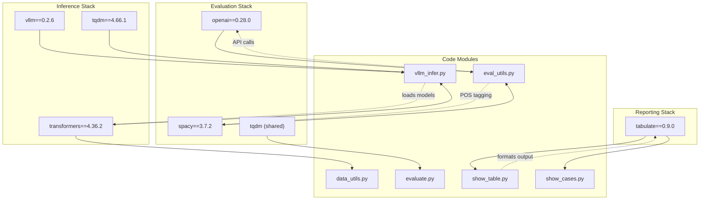
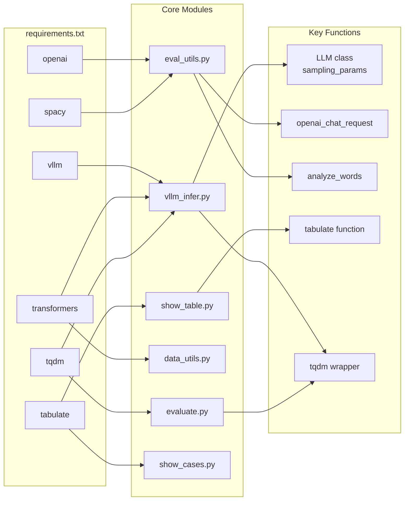

<!-- source: DeepWiki mcp.deepwiki.com · repo allenai/CommonGen-Eval · page 9.1 Dependencies · fetched 2026-10-26 -->

# Dependencies

<details>
<summary>Relevant source files</summary>

The following files were used as context for generating this wiki page:

- [.gitignore](.gitignore)
- [LICENSE](LICENSE)
- [requirements.txt](requirements.txt)

</details>


## Purpose and Scope

This document provides a complete reference for all external dependencies required by the CommonGen-Eval system. Each dependency is explained with its purpose, version requirements, and how it integrates with the codebase. For information about configuration options and command-line arguments, see [Configuration Options](#9.2). For details on supported models that work with these dependencies, see [Supported Models](#9.3).

**Sources:** [requirements.txt:1-6]()

---

## Dependency Overview

The CommonGen-Eval system requires six core dependencies, each serving a specific role in the inference-evaluation pipeline. All versions are pinned for reproducibility.

| Dependency | Version | Category | Primary Use |
|------------|---------|----------|-------------|
| `vllm` | 0.2.6 | Inference | High-performance LLM serving and batch inference |
| `openai` | 0.28.0 | Evaluation | GPT-4 API access for judgment evaluation |
| `transformers` | 4.36.2 | Inference | Model loading and tokenizer management |
| `tabulate` | 0.9.0 | Reporting | Formatted table generation for results |
| `tqdm` | 4.66.1 | Utility | Progress bars during batch processing |
| `spacy` | 3.7.2 | Evaluation | NLP analysis for POS tagging and lemmatization |

**Sources:** [requirements.txt:1-6]()

---

## Dependency Integration Architecture

The following diagram shows how each dependency integrates with specific modules in the codebase:



**Sources:** [requirements.txt:1-6](), Diagram 6 from architecture overview

---

## Inference Dependencies

### vllm (0.2.6)

**Purpose:** Provides high-performance, memory-efficient LLM inference using PagedAttention and continuous batching.

**Usage in codebase:** The `vllm_infer.py` module uses vllm's `LLM` class to load models and generate text with optimal throughput.

**Key features used:**
- Batch inference for processing multiple prompts efficiently
- Sampling parameters control (temperature, top_p, max_tokens)
- Multi-GPU support for large models

**Integration points:**
- Used by all shell scripts in `scripts/*.sh` when running model inference
- Enables processing of 400 test examples with configurable batch sizes

**Version note:** Version 0.2.6 represents an early release of vllm. Later versions introduced breaking API changes.

**Sources:** [requirements.txt:1](), Diagram 1 and Diagram 3 from architecture overview

---

### transformers (4.36.2)

**Purpose:** Provides model architectures, tokenizers, and loading utilities from HuggingFace's transformers library.

**Usage in codebase:** While vllm handles inference, `transformers` provides the underlying model definitions and tokenizer implementations.

**Key features used:**
- AutoTokenizer for loading model-specific tokenizers
- Model architecture definitions (compatible with vllm)
- HuggingFace Hub integration for downloading models

**Integration points:**
- `data_utils.py` may use tokenizers for text processing
- `vllm_infer.py` relies on transformers for model compatibility
- Shell scripts specify model names that transformers recognizes

**Version note:** Version 4.36.2 aligns with vllm 0.2.6 compatibility requirements and supports models like Llama-2, Yi, Mixtral.

**Sources:** [requirements.txt:3](), Diagram 6 from architecture overview

---

## Evaluation Dependencies

### openai (0.28.0)

**Purpose:** Provides API client for making requests to OpenAI's GPT-4 model, which serves as the evaluation judge.

**Usage in codebase:** The `eval_utils.py` module contains the `openai_chat_request` function that wraps OpenAI API calls with retry logic.

**Key features used:**
- ChatCompletion API for GPT-4 model access
- Legacy v0.28.0 API interface (pre-v1.0.0 breaking changes)
- Synchronous request handling

**Integration points:**
- `evaluate.py` imports and uses `openai_chat_request` from `eval_utils.py`
- API key must be set via environment variable `OPENAI_API_KEY`
- Evaluation template in `eval_template.md` structures GPT-4 prompts

**Code reference:** The function `openai_chat_request` in `eval_utils.py` handles all OpenAI interactions with retry logic using tenacity (though tenacity is not listed in requirements.txt, it appears to be a transitive dependency or optional).

**Version note:** Version 0.28.0 uses the older OpenAI API format (`openai.ChatCompletion.create()`). Migration to v1.0.0+ would require significant code changes.

**Sources:** [requirements.txt:2](), Diagram 4 and Diagram 6 from architecture overview

---

### spacy (3.7.2)

**Purpose:** Provides industrial-strength NLP capabilities for linguistic analysis, specifically part-of-speech (POS) tagging and lemmatization.

**Usage in codebase:** The `eval_utils.py` module contains the `analyze_words` function that uses spacy for POS validation.

**Key features used:**
- POS tagging to verify grammatical structure
- Lemmatization for word normalization
- English language model (`en_core_web_sm` or similar)

**Integration points:**
- `evaluate.py` calls `analyze_words` to compute POS accuracy metrics
- Used to validate whether generated sentences use concepts with correct parts of speech
- Results contribute to the `pos%` metric in the evaluation

**Setup requirement:** After installing spacy, users must download a language model:
```bash
python -m spacy download en_core_web_sm
```

**Code reference:** The function `analyze_words` performs POS analysis on both generated sentences and concept sets to compute accuracy.

**Sources:** [requirements.txt:6](), Diagram 4 from architecture overview

---

## Utility Dependencies

### tabulate (0.9.0)

**Purpose:** Formats data into ASCII tables with multiple output formats (plain, grid, markdown, HTML).

**Usage in codebase:** Used extensively in `show_table.py` and `show_cases.py` to display evaluation results in readable table formats.

**Key features used:**
- Markdown table formatting for GitHub compatibility
- Grid format for console output
- Automatic column alignment and formatting

**Integration points:**
- `show_table.py` generates the leaderboard table
- `show_cases.py` displays individual example comparisons
- Output appears in README.md and console

**Example output:** The leaderboard in README.md showing model rankings with metrics like coverage%, POS%, and win_tie% is generated using tabulate.

**Sources:** [requirements.txt:4]()

---

### tqdm (4.66.1)

**Purpose:** Provides progress bars for long-running operations to improve user experience during batch processing.

**Usage in codebase:** Wraps iteration loops in `vllm_infer.py` and `evaluate.py` to show progress during inference and evaluation.

**Key features used:**
- Console progress bars with percentage completion
- Time estimation for remaining work
- Minimal performance overhead

**Integration points:**
- Model inference: Shows progress when processing 400 test examples
- Evaluation: Shows progress during GPT-4 API calls (potentially 400 × multiple references = thousands of comparisons)
- Data loading operations

**Sources:** [requirements.txt:5]()

---

## Dependency Usage by Module

This diagram maps dependencies to the specific Python modules that import and use them:



**Sources:** [requirements.txt:1-6](), analysis of module relationships from architecture diagrams

---

## Version Pinning and Compatibility

### Why Versions Are Pinned

All dependencies use exact version pinning (`==`) rather than minimum versions (`>=`) to ensure:
- **Reproducibility:** Identical results when rerunning experiments
- **API Stability:** Prevents breaking changes from dependency updates
- **Compatibility:** Ensures tested inter-dependency compatibility

### Critical Version Notes

| Dependency | Version | Critical Compatibility Notes |
|------------|---------|------------------------------|
| `vllm` | 0.2.6 | Early release; later versions have different APIs |
| `openai` | 0.28.0 | Pre-v1.0.0 API; v1.0.0+ requires code migration |
| `transformers` | 4.36.2 | Must be compatible with vllm 0.2.6 |
| `spacy` | 3.7.2 | Requires separate language model download |

### Known Compatibility Issues

**OpenAI API:** Version 0.28.0 uses the legacy API format. Code like:
```python
openai.ChatCompletion.create(model="gpt-4", messages=...)
```

This is incompatible with openai>=1.0.0, which uses:
```python
client = OpenAI()
client.chat.completions.create(model="gpt-4", messages=...)
```

**vLLM:** Version 0.2.6 is an early release. Modern vLLM versions (0.3.0+) have different initialization and sampling parameter APIs.

**Sources:** [requirements.txt:1-6](), version compatibility notes from Diagram 6

---

## Additional Dependencies

### Implicit Dependencies

While not listed in `requirements.txt`, the system relies on additional packages:

**datasets (HuggingFace):** Used to load the CommonGen-lite dataset from `allenai/commongen_lite_eval`. This may be implicitly installed as a transitive dependency of `transformers`.

**tenacity:** Used for retry logic in `eval_utils.py` when making OpenAI API calls. May be a transitive dependency or require manual installation.

**Standard library modules:** The codebase also uses:
- `json` - for reading/writing model outputs and evaluation results
- `argparse` - for command-line argument parsing
- `os` and `pathlib` - for file system operations
- `re` - for regular expression parsing

### Language Models

**spacy language model:** After installing spacy, a language model must be downloaded:
```bash
python -m spacy download en_core_web_sm
```

This provides the English language data needed for POS tagging and lemmatization.

**Sources:** Architecture diagrams, inferred from system design

---

## Installation

### Standard Installation

Install all dependencies with pinned versions:

```bash
pip install -r requirements.txt
```

### Post-Installation Setup

1. **Download spacy language model:**
   ```bash
   python -m spacy download en_core_web_sm
   ```

2. **Set OpenAI API key:**
   ```bash
   export OPENAI_API_KEY="your-api-key-here"
   ```

3. **Verify vllm installation:**
   ```bash
   python -c "import vllm; print(vllm.__version__)"
   ```

### System Requirements

**Hardware recommendations:**
- **GPU:** CUDA-compatible GPU with 16GB+ VRAM for 7B models, 40GB+ for 34B models
- **RAM:** 32GB+ system RAM
- **Storage:** 50GB+ for model weights

**Software requirements:**
- Python 3.8+
- CUDA 11.8+ (for GPU acceleration with vllm)
- Linux or macOS (vllm has limited Windows support)

**Sources:** [requirements.txt:1-6](), installation best practices

---

## Troubleshooting

### Common Issues

**vllm installation fails:**
- Ensure CUDA is properly installed and accessible
- Check GPU compatibility with vllm requirements
- Consider installing pre-built wheels for specific CUDA versions

**OpenAI API errors:**
- Verify API key is set: `echo $OPENAI_API_KEY`
- Check API quota and billing status
- Ensure using openai==0.28.0 (not v1.0.0+)

**spacy model not found:**
- Run `python -m spacy download en_core_web_sm` after installing spacy
- Verify installation: `python -m spacy validate`

**Import errors:**
- Ensure all dependencies installed: `pip list | grep -E "(vllm|openai|transformers|spacy)"`
- Check Python version compatibility (3.8+)

**Sources:** Common troubleshooting scenarios from dependency documentation

---

