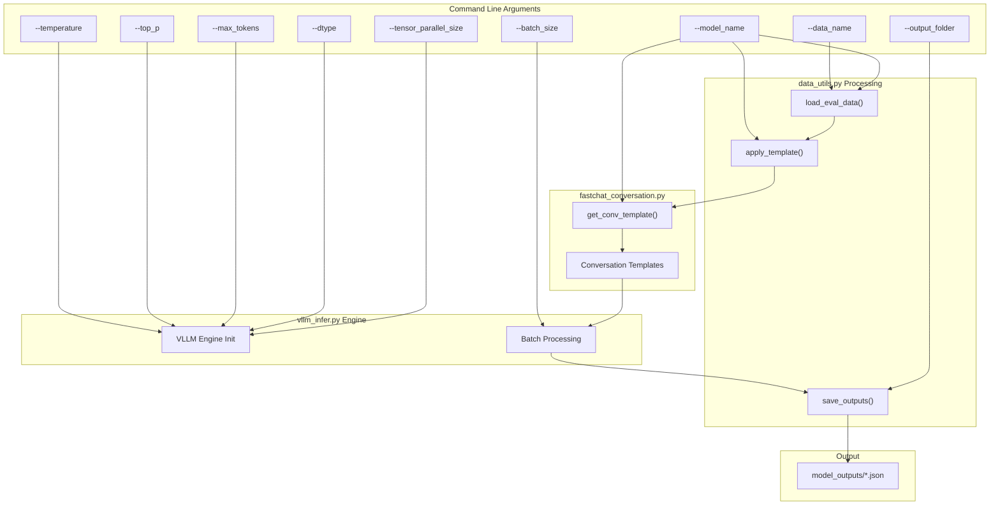
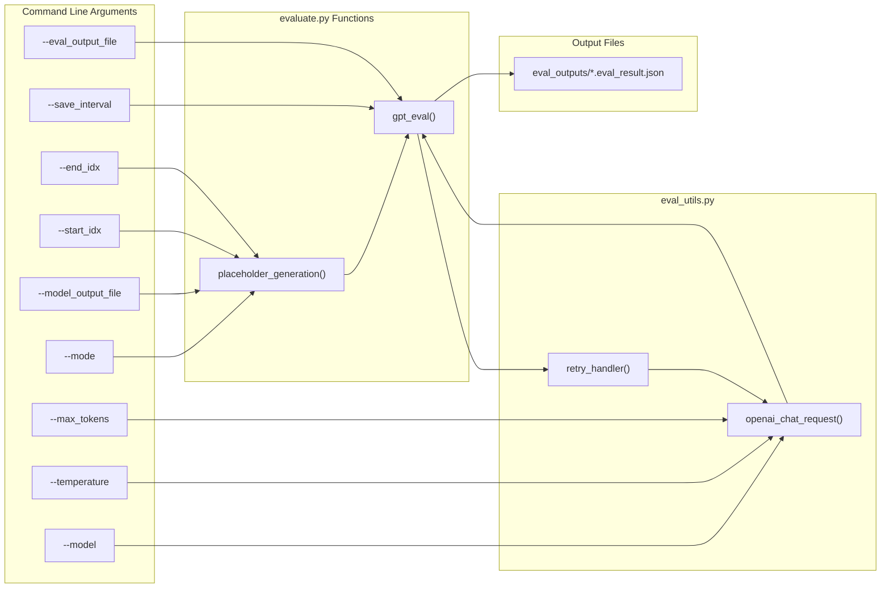
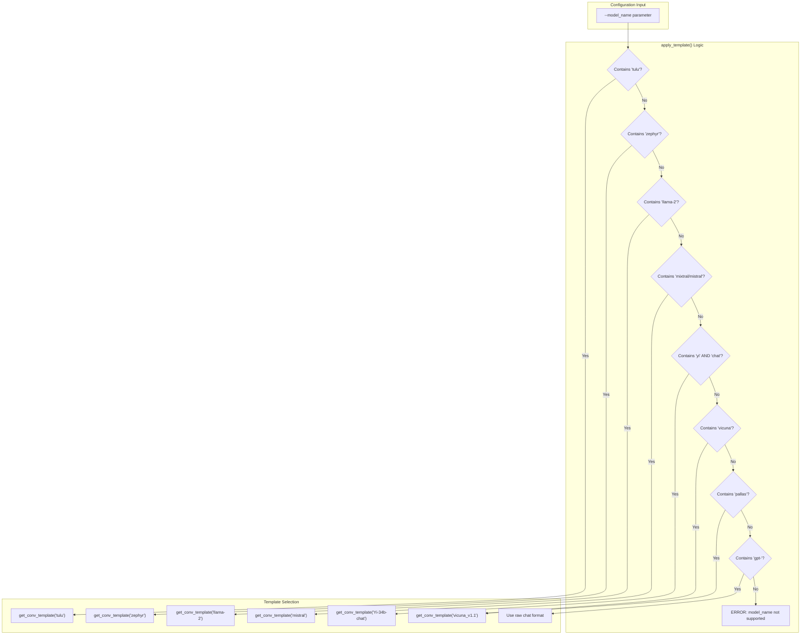

<!-- source: DeepWiki mcp.deepwiki.com · repo allenai/CommonGen-Eval · page 9.2 Configuration Options · fetched 2026-10-26 -->

# Configuration Options

<details>
<summary>Relevant source files</summary>

The following files were used as context for generating this wiki page:

- [README.md](README.md)
- [data_utils.py](data_utils.py)
- [evaluate.py](evaluate.py)
- [scripts/Pallas-0.5.sh](scripts/Pallas-0.5.sh)

</details>


This page documents all command-line arguments and configuration parameters for the core scripts in the CommonGen-Eval system. The system consists of two primary executable scripts with distinct configuration needs: `vllm_infer.py` for model inference and `evaluate.py` for GPT-4 based evaluation.

For information about required dependencies and their versions, see [Dependencies](#9.1). For a complete list of supported model names and their template mappings, see [Supported Models](#9.3). For detailed usage instructions, see [Running Model Inference](#4) and [Running Evaluation](#5).

---

## Model Inference Configuration

The `vllm_infer.py` script handles model inference and accepts the following command-line arguments:

### Core Parameters

| Parameter | Type | Required | Default | Description |
|-----------|------|----------|---------|-------------|
| `--data_name` | string | Yes | - | Dataset identifier, currently only `"commongen"` is supported |
| `--model_name` | string | Yes | - | HuggingFace model identifier (e.g., `01-ai/Yi-34b-chat`) |
| `--output_folder` | string | Yes | - | Directory path where generated outputs will be saved as JSON files |
| `--download_dir` | string | No | None | Local directory for cached model files (optional) |

### Model Loading Parameters

| Parameter | Type | Required | Default | Description |
|-----------|------|----------|---------|-------------|
| `--tensor_parallel_size` | integer | No | 1 | Number of GPUs to use for tensor parallelism (multi-GPU inference) |
| `--dtype` | string | No | `"auto"` | Data type for model weights (`"float16"`, `"bfloat16"`, `"float32"`, or `"auto"`) |

### Inference Parameters

| Parameter | Type | Required | Default | Description |
|-----------|------|----------|---------|-------------|
| `--temperature` | float | No | 1.0 | Sampling temperature (0.0 = greedy, higher = more random) |
| `--top_p` | float | No | 1.0 | Nucleus sampling threshold (1.0 = disabled) |
| `--max_tokens` | integer | No | 512 | Maximum number of tokens to generate per example |
| `--batch_size` | integer | No | 1 | Number of prompts to process in parallel |

**Sources:** [README.md:63-68](), [scripts/Pallas-0.5.sh:1-7]()

---

## Evaluation Configuration

The `evaluate.py` script performs GPT-4 based pairwise comparison and supports the following arguments:

### Core Parameters

| Parameter | Type | Required | Default | Description |
|-----------|------|----------|---------|-------------|
| `--mode` | string | Yes | - | Evaluation mode: `"trial"` (generate placeholders) or `"compare"` (run GPT-4 evaluation) |
| `--model_output_file` | string | Conditional* | - | Path to model output JSON file to evaluate |
| `--eval_output_file` | string | Yes | - | Path where evaluation results will be saved |

\* Required when `--mode` is `"compare"`

### Data Selection Parameters

| Parameter | Type | Required | Default | Description |
|-----------|------|----------|---------|-------------|
| `--start_idx` | integer | No | 0 | Starting index in the dataset (for partial evaluation) |
| `--end_idx` | integer | No | -1 | Ending index in the dataset (-1 = evaluate all) |
| `--save_interval` | integer | No | 3 | Save results every N examples (for incremental saving) |

### Prompt Configuration

| Parameter | Type | Required | Default | Description |
|-----------|------|----------|---------|-------------|
| `--max_words_to_eval` | integer | No | -1 | Maximum words to include in evaluation prompt (-1 = no limit) |

### OpenAI API Parameters

| Parameter | Type | Required | Default | Description |
|-----------|------|----------|---------|-------------|
| `--api_key` | string | No | None | OpenAI API key (can also be set via environment variable) |
| `--model` | string | No | `"gpt-4-0314"` | OpenAI model identifier (`"gpt-4-0613"`, `"gpt-4-1106-preview"`, etc.) |
| `--engine` | string | No | None | Azure OpenAI engine name (if using Azure) |
| `--temperature` | float | No | 0.0 | GPT-4 sampling temperature for evaluation |
| `--max_tokens` | integer | No | 1024 | Maximum tokens in GPT-4 response |

**Sources:** [evaluate.py:20-44](), [README.md:107-114]()

---

## Configuration Flow Architecture

The following diagram shows how configuration parameters flow through the inference pipeline:



**Sources:** [data_utils.py:6-57](), [scripts/Pallas-0.5.sh:1-7]()

---

## Evaluation Configuration Flow

This diagram illustrates how evaluation parameters control the GPT-4 comparison process:



**Sources:** [evaluate.py:20-125](), [evaluate.py:134-183]()

---

## Common Configuration Patterns

### Pattern 1: Standard Inference (Single GPU)

```bash
python vllm_infer.py \
    --data_name "commongen" \
    --model_name "HuggingFaceH4/zephyr-7b-beta" \
    --output_folder "model_outputs/" \
    --temperature 0 \
    --top_p 1 \
    --max_tokens 128 \
    --batch_size 8 \
    --dtype "float16"
```

**Key Settings:**
- `temperature=0` and `top_p=1`: Greedy decoding for deterministic outputs
- `max_tokens=128`: Sufficient for short sentences in CommonGen task
- `batch_size=8`: Balance between throughput and memory usage

**Sources:** [README.md:63-68]()

---

### Pattern 2: Multi-GPU Inference (Large Models)

```bash
CUDA_VISIBLE_DEVICES=0,1,2,3 \
python vllm_infer.py \
    --data_name "commongen" \
    --model_name "01-ai/Yi-34b-chat" \
    --tensor_parallel_size 4 \
    --dtype "bfloat16" \
    --output_folder "model_outputs/" \
    --temperature 0 \
    --top_p 1 \
    --max_tokens 128 \
    --batch_size 8
```

**Key Settings:**
- `CUDA_VISIBLE_DEVICES=0,1,2,3`: Expose 4 GPUs to the process
- `tensor_parallel_size=4`: Split model across 4 GPUs
- `dtype="bfloat16"`: Reduce memory footprint while maintaining precision

**Sources:** [README.md:63-68](), [scripts/Pallas-0.5.sh:1-7]()

---

### Pattern 3: Evaluation with GPT-4

```bash
python evaluate.py \
    --mode "compare" \
    --model_output_file "model_outputs/Yi-34b-chat.json" \
    --eval_output_file "eval_outputs/Yi-34b-chat.eval_result.gpt-4-1106-preview.json" \
    --model "gpt-4-1106-preview" \
    --temperature 0.0 \
    --save_interval 5
```

**Key Settings:**
- `mode="compare"`: Run full GPT-4 evaluation (not just trial)
- `temperature=0.0`: Deterministic GPT-4 responses
- `save_interval=5`: Save progress every 5 examples (useful for long evaluations)

**Sources:** [README.md:107-114](), [evaluate.py:20-44]()

---

### Pattern 4: Batch Evaluation of Multiple Models

```bash
models=("zephyr-7b-beta" "tulu-2-dpo-70b" "vicuna-13b-v1.5")
for model in "${models[@]}"
do 
    python evaluate.py --mode "compare" \
        --model_output_file "model_outputs/${model}.json" \
        --eval_output_file "eval_outputs/${model}.eval_result.gpt-4-1106-preview.json" \
        --model gpt-4-1106-preview &
done
```

**Key Settings:**
- Background processes (`&`): Parallel evaluation of multiple models
- Consistent `--model` parameter: Ensures fair comparison across models
- Output file naming convention: `${model}.eval_result.${gpt_model}.json`

**Sources:** [README.md:107-114]()

---

## Parameter Validation and Template Mapping

The system validates configuration parameters and maps them to appropriate templates:



**Sources:** [data_utils.py:6-32]()

---

## Configuration File Naming Conventions

The system uses specific naming patterns for configuration and output files:

### Model Output Files

**Format:** `model_outputs/${model_identifier}.json`

**Examples:**
- `model_outputs/Yi-34b-chat.json`
- `model_outputs/Llama-2-7b-chat-hf.json`
- `model_outputs/gpt-4-0613.json`

### Evaluation Result Files

**Format:** `eval_outputs/${model_identifier}.eval_result.${gpt_model}.json`

**Examples:**
- `eval_outputs/Yi-34b-chat.eval_result.gpt-4-1106-preview.json`
- `eval_outputs/vicuna-13b-v1.5.eval_result.gpt-4-0613.json`

### Shell Script Files

**Format:** `scripts/${model_identifier}.sh`

**Examples:**
- `scripts/Pallas-0.5.sh`
- `scripts/Yi-34b-chat.sh`

**Sources:** [README.md:107-114](), [scripts/Pallas-0.5.sh:1]()

---

## Environment Variables

The system recognizes the following environment variables:

| Variable | Purpose | Example |
|----------|---------|---------|
| `CUDA_VISIBLE_DEVICES` | Control GPU visibility for inference | `CUDA_VISIBLE_DEVICES=0,1,2,3` |
| `OPENAI_API_KEY` | OpenAI API authentication (alternative to `--api_key`) | Set in shell environment |
| `HF_HOME` | HuggingFace cache directory | `/path/to/cache` |

**Usage Example:**
```bash
export OPENAI_API_KEY="sk-..."
export CUDA_VISIBLE_DEVICES=0,1
python vllm_infer.py --model_name "..." --data_name "commongen" ...
```

**Sources:** [scripts/Pallas-0.5.sh:1](), [evaluate.py:41-42]()

---

## Configuration Validation

### Inference Script Validation

The inference configuration undergoes the following validation checks:

| Parameter | Validation | Error Condition |
|-----------|------------|-----------------|
| `--data_name` | Must be `"commongen"` | Script prints `"ERROR: data_name not supported"` |
| `--model_name` | Must match a known template pattern | `apply_template()` prints `"ERROR: model_name not supported"` |
| `--tensor_parallel_size` | Must not exceed available GPUs | VLLM raises runtime error |
| `--dtype` | Must be valid VLLM dtype | VLLM raises ValueError |

### Evaluation Script Validation

| Parameter | Validation | Error Condition |
|-----------|------------|-----------------|
| `--mode` | Must be `"trial"` or `"compare"` | No explicit validation, falls through to `"Not implemented yet!"` |
| `--model_output_file` | File must exist and be valid JSON | JSON parsing error raised |
| `--start_idx` | Must be < `--end_idx` | May result in empty evaluation set |

**Sources:** [data_utils.py:42-46](), [data_utils.py:26-27](), [evaluate.py:186-200]()

---

## Advanced Configuration Options

### Partial Dataset Evaluation

For testing or debugging, evaluate only a subset of examples:

```bash
python evaluate.py \
    --mode "compare" \
    --model_output_file "model_outputs/test-model.json" \
    --eval_output_file "eval_outputs/test-model.partial.json" \
    --model "gpt-4-1106-preview" \
    --start_idx 0 \
    --end_idx 50
```

This evaluates only examples 0-49 from the dataset.

**Sources:** [evaluate.py:26-27](), [evaluate.py:147-152]()

### Custom Model Cache Directory

For systems with limited home directory space:

```bash
python vllm_infer.py \
    --download_dir "/net/nfs/s2-research/llama2/" \
    --model_name "meta-llama/Llama-2-70b-chat-hf" \
    --data_name "commongen" \
    --output_folder "model_outputs/"
```

The `--download_dir` specifies where HuggingFace Transformers should cache model files.

**Sources:** [scripts/Pallas-0.5.sh:3]()

### Incremental Evaluation with Resume

The evaluation script automatically resumes from existing results:

```bash
# Initial run (completes 100 examples)
python evaluate.py --mode "compare" \
    --model_output_file "model_outputs/model.json" \
    --eval_output_file "eval_outputs/model.json" \
    --save_interval 10

# Later run (resumes from example 100)
# Same command - automatically skips completed examples
python evaluate.py --mode "compare" \
    --model_output_file "model_outputs/model.json" \
    --eval_output_file "eval_outputs/model.json" \
    --save_interval 10
```

The script loads existing results from `--eval_output_file` and skips examples where `result != "N/A"`.

**Sources:** [evaluate.py:61-78](), [evaluate.py:98-102]()

---

