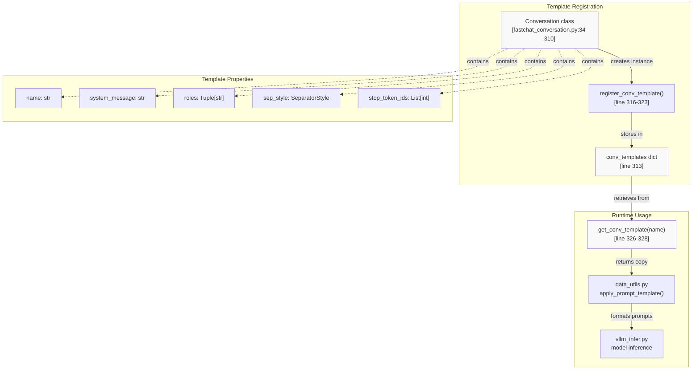
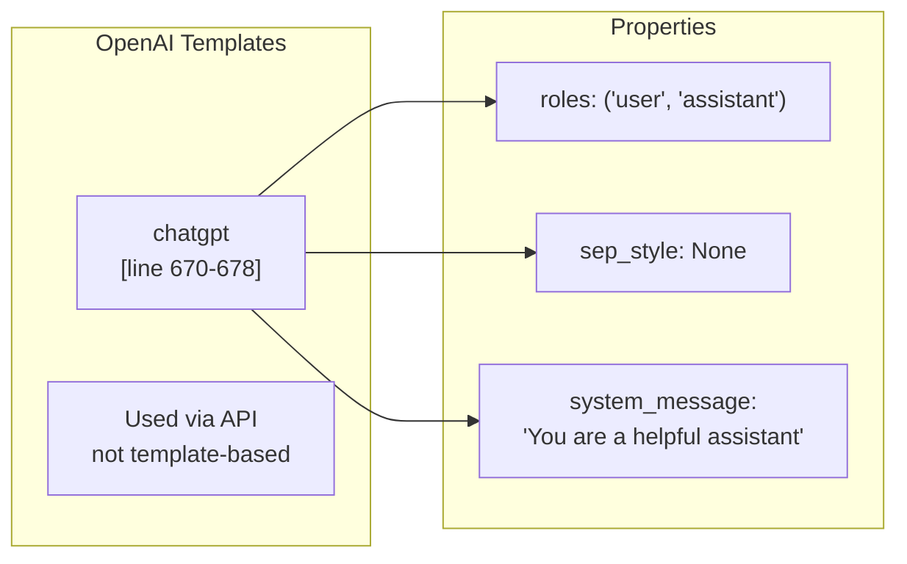
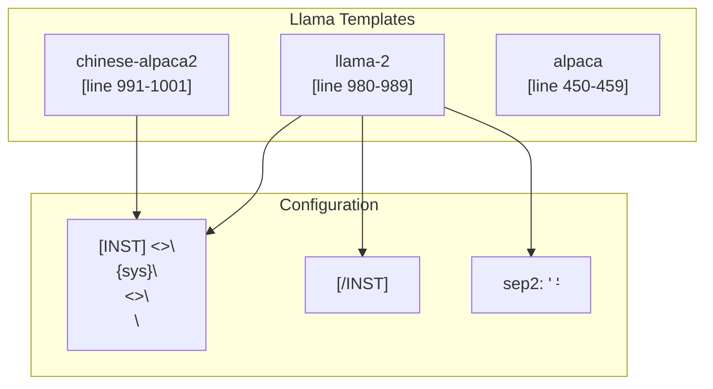
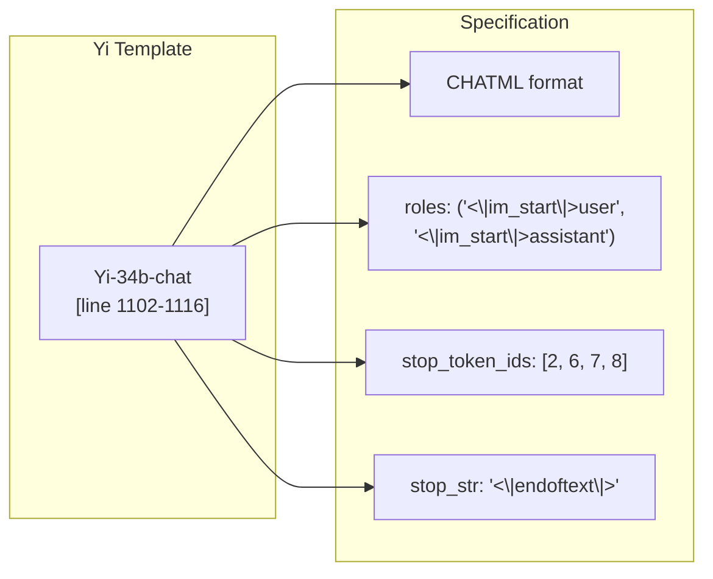
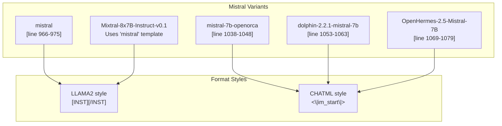
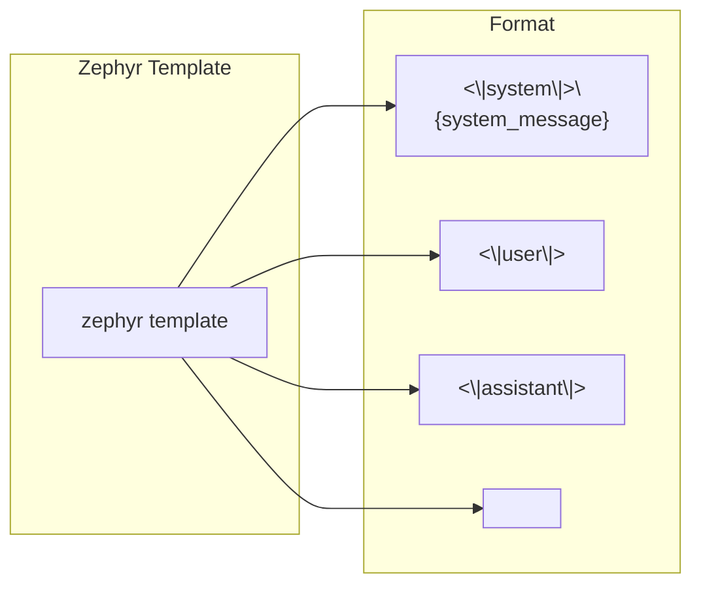
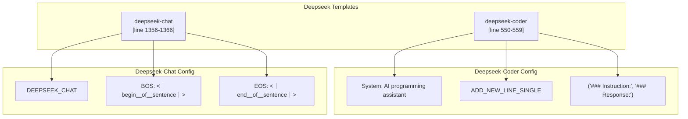
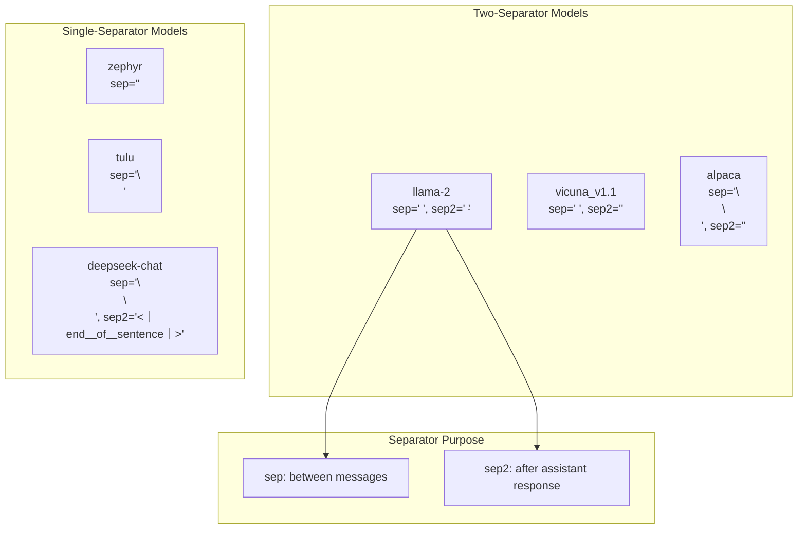

<!-- source: DeepWiki mcp.deepwiki.com · repo allenai/CommonGen-Eval · page 9.3 Supported Models · fetched 2026-10-26 -->

# Supported Models

Relevant source files

The following files were used as context for generating this wiki page:

- [README.md](README.md)
- [fastchat_conversation.py](fastchat_conversation.py)

This page provides a comprehensive reference of all conversation templates available in the CommonGen-Eval system. These templates enable the system to format prompts correctly for 50+ different language models, ensuring each model receives inputs in its expected format.

For information about how conversation templates are applied during inference, see [Conversation Templates](#4.2). For details on running inference with specific models, see [Running Model Inference](#4).

## Overview

The system supports **57 distinct conversation templates** registered in [fastchat_conversation.py](). Each template defines:

- **Separator style**: How messages are formatted (e.g., with colons, special tokens)
- **Role names**: The labels used for user and assistant turns
- **System message**: Default instructions or persona
- **Stop tokens/strings**: Sequences that terminate generation
- **Special formatting**: Model-specific prompt structures

The templates are accessed via the global registry `conv_templates` and retrieved using `get_conv_template(name)` [fastchat_conversation.py:326-328]().

**Sources**: [fastchat_conversation.py:1-1422](), [README.md:1-298]()

## Template Architecture

The following diagram shows how conversation templates are registered and used in the system:

**Sources**: [fastchat_conversation.py:34-328]()

## Separator Styles

Templates use different separator styles to format multi-turn conversations. The `SeparatorStyle` enum [fastchat_conversation.py:11-32]() defines 15 distinct formatting patterns:

| Separator Style | Format Pattern | Example Templates |
|----------------|----------------|-------------------|
| `ADD_COLON_SINGLE` | `Role: message\n` | vicuna_v1.1, koala_v1 |
| `ADD_COLON_TWO` | `Role: message</s>` | llama-2, mistral, alpaca |
| `CHATML` | `<\|im_start\|>role\nmessage<\|im_end\|>` | qwen-7b-chat, Yi-34b-chat, zephyr |
| `LLAMA2` | `[INST] message [/INST]` | llama-2, airoboros_v3 |
| `NO_COLON_SINGLE` | `Rolemessage\n` | baichuan-chat, raw |
| `NO_COLON_TWO` | `Rolemessage</s>` | cutegpt, aquila-legacy |
| `DEEPSEEK_CHAT` | Custom deepseek format | deepseek-chat |
| `CHATGLM` | `[Round N]\nRole：message` | chatglm, chatglm2 |
| `CHATGLM3` | Custom ChatGLM3 format | chatglm3 |
| `RWKV` | Role-based with newlines | rwkv, falcon |
| `PHOENIX` | `Role: <s>message</s>` | phoenix, ReaLM-7b-v1 |
| `FALCON_CHAT` | `Role: message\n` | falcon-chat, openchat_3.5 |
| `METAMATH` | Instruction-response format | metamath |
| `DOLLY` | `Role:\nmessage\n\n` | dolly_v2, vigogne_instruct |
| `ADD_NEW_LINE_SINGLE` | `Role\nmessage\n` | deepseek-coder, tulu, solar |

**Sources**: [fastchat_conversation.py:11-32](), [fastchat_conversation.py:59-247]()

## Model Family Categories

### OpenAI-Compatible Models

| Template Name | System Message | Stop Tokens | Notes |
|--------------|----------------|-------------|-------|
| `chatgpt` | "You are a helpful assistant." | None | Uses OpenAI API format via `to_openai_api_messages()` |

**Sources**: [fastchat_conversation.py:670-678](), [fastchat_conversation.py:275-285]()

### Meta Llama Family

| Template Name | Separator Style | System Message | Stop String | Special Features |
|--------------|----------------|----------------|-------------|------------------|
| `llama-2` | `LLAMA2` | (customizable) | `</s>` | System prompt in `<<SYS>>` tags |
| `chinese-alpaca2` | `LLAMA2` | Chinese + English bilingual | `</s>` | Includes Chinese system message |
| `alpaca` | `ADD_COLON_TWO` | Instruction-completion format | `</s>` | Simple instruction template |

**Sources**: [fastchat_conversation.py:450-459](), [fastchat_conversation.py:980-1001]()

### Yi Models

**Configuration Details:**
- **Template name**: `Yi-34b-chat`
- **Separator style**: `CHATML`
- **Separator**: `<|im_end|>`
- **Stop token IDs**: `[2, 6, 7, 8]` representing `<|endoftext|>`, `<|im_start|>`, `<|im_end|>`, `<|im_sep|>`
- **Models tested**: Yi-34b-chat, Yi-6b-chat (both use same template)

**Sources**: [fastchat_conversation.py:1102-1116](), [README.md:30-37]()

### Vicuna Family

| Template Name | Separator Style | Roles | Stop String | System Message |
|--------------|----------------|-------|-------------|----------------|
| `vicuna_v1.1` | `ADD_COLON_TWO` | `("USER", "ASSISTANT")` | `</s>` | "A chat between a curious user and an artificial intelligence assistant..." |
| `stable-vicuna` | `ADD_COLON_TWO` | `("### Human", "### Assistant")` | None | "I am StableVicuna, a large language model created by CarperAI..." |

**Sources**: [fastchat_conversation.py:389-399](), [fastchat_conversation.py:1229-1238]()

### Mistral Family

| Template | Style | System Message | Stop Tokens |
|----------|-------|----------------|-------------|
| `mistral` | `LLAMA2` | (customizable) | `</s>` |
| `mistral-7b-openorca` | `CHATML` | "You are MistralOrca..." | `[32000, 32001]` |
| `dolphin-2.2.1-mistral-7b` | `CHATML` | "You are Dolphin, a helpful AI assistant." | `[32000, 32001]` |
| `OpenHermes-2.5-Mistral-7B` | `CHATML` | "You are Hermes 2, a sentient, conscious, super intelligent AI..." | `[32000, 32001]` |

**Sources**: [fastchat_conversation.py:966-975](), [fastchat_conversation.py:1038-1079]()

### Qwen Models

**Template**: `qwen-7b-chat` [fastchat_conversation.py:1084-1099]()

- **Separator style**: `CHATML`
- **Separator**: `<|im_end|>`
- **System message**: "You are a helpful assistant."
- **Stop token IDs**: `[151643, 151644, 151645]` for `<|endoftext|>`, `<|im_start|>`, `<|im_end|>`
- **Roles**: `("<|im_start|>user", "<|im_start|>assistant")`

**Sources**: [fastchat_conversation.py:1084-1099]()

### HuggingFace Tulu Models

**Template**: `tulu` [fastchat_conversation.py:563-570]()

- **Separator style**: `ADD_NEW_LINE_SINGLE`
- **Separator**: `\n`
- **Roles**: `("<|user|>", "<|assistant|>")`
- **Used by**: tulu-2-dpo-70b

**Sources**: [fastchat_conversation.py:563-570](), [README.md:33]()

### Zephyr Models

**Template**: `zephyr` [fastchat_conversation.py:1314-1324]()

- **Separator style**: `CHATML`
- **Stop token IDs**: `[2]`
- **Stop string**: `</s>`

**Sources**: [fastchat_conversation.py:1314-1324](), [README.md:36]()

### Chinese Language Models

| Template | Model Family | Separator Style | Special Features |
|----------|-------------|-----------------|------------------|
| `chatglm` | ChatGLM | `CHATGLM` | Chinese roles: `("问", "答")` |
| `chatglm2` | ChatGLM2 | `CHATGLM` | Round-based numbering |
| `chatglm3` | ChatGLM3 | `CHATGLM3` | Stop tokens: `[64795, 64797, 2]` |
| `baichuan-chat` | Baichuan-13B | `NO_COLON_SINGLE` | Special reserved tokens |
| `baichuan2-chat` | Baichuan2-13B | `NO_COLON_SINGLE` | Roles: `("<reserved_106>", "<reserved_107>")` |
| `llama2-chinese` | FlagAlpha | `ADD_COLON_TWO` | Three roles including "System" |
| `chinese-alpaca2` | Chinese-Alpaca-2 | `LLAMA2` | Bilingual system message |

**Sources**: [fastchat_conversation.py:462-494](), [fastchat_conversation.py:937-962](), [fastchat_conversation.py:1180-1190](), [fastchat_conversation.py:991-1001]()

### Deepseek Models

**Sources**: [fastchat_conversation.py:550-559](), [fastchat_conversation.py:1356-1366]()

### Aquila Models

The Aquila family has four template variants for different model versions:

| Template | Target Models | Separator Style | Roles | Stop Strings |
|----------|--------------|----------------|-------|--------------|
| `aquila-chat` | AquilaChat | `ADD_COLON_SINGLE` | `("Human", "Assistant")` | `["###", "</s>", "[UNK]"]` |
| `aquila-legacy` | AquilaChat2-34B | `NO_COLON_TWO` | `("### Human: ", "### Assistant: ")` | `["</s>", "[UNK]"]` |
| `aquila` | AquilaChat2-7B-16K, AquilaChat2-34B-16K | `ADD_COLON_TWO` | `("Human", "Assistant")` | `["</s>", "[UNK]"]` |
| `aquila-v1` | AquilaChat2-7B | `NO_COLON_TWO` | `("<\|startofpiece\|>", "<\|endofpiece\|>")` | `["</s>", "<\|endoftext\|>"]` |

**Sources**: [fastchat_conversation.py:1121-1176]()

### Other Notable Models

| Template | Model/Family | Key Configuration | Notes |
|----------|-------------|-------------------|-------|
| `openchat_3.5` | OpenChat 3.5 | `FALCON_CHAT`, roles: `("GPT4 Correct User", "GPT4 Correct Assistant")` | Stop: `<\|end_of_turn\|>` |
| `orca-2` | Microsoft Orca-2 | `CHATML`, system: "You are Orca, an AI language model created by Microsoft..." | Stop: `<\|im_end\|>` |
| `solar` | SOLAR-10.7B | `ADD_NEW_LINE_SINGLE`, roles: `("### User", "### Assistant")` | Minimal formatting |
| `falcon-chat` | Falcon-180B | `FALCON_CHAT`, roles: `("User", "Falcon")` | System template: `"System: {system_message}"` |
| `mpt-7b-chat` | MosaicML MPT-7B | `CHATML`, stop tokens: `[50278, 0]` | Detailed system message about capabilities |
| `mpt-30b-chat` | MosaicML MPT-30B | `CHATML`, system: "A conversation between a user and an LLM-based AI assistant." | Stop tokens: `[50278, 0]` |
| `starchat` | StarChat | `CHATML`, roles: `("<\|user\|>", "<\|assistant\|>")` | Stop: `<\|end\|>`, token: `[0, 49155]` |
| `xgen` | Salesforce XGen-7B | `ADD_COLON_SINGLE`, stop tokens: `[50256]` | Roles: `("### Human", "### Assistant")` |
| `internlm-chat` | InternLM | `CHATINTERN`, separator: `<eoh>`, sep2: `<eoa>` | Stop tokens: `[1, 103028]` |

**Sources**: [fastchat_conversation.py:540-547](), [fastchat_conversation.py:1342-1352](), [fastchat_conversation.py:1370-1379](), [fastchat_conversation.py:1257-1268](), [fastchat_conversation.py:705-733](), [fastchat_conversation.py:924-934](), [fastchat_conversation.py:897-906](), [fastchat_conversation.py:909-920]()

## Complete Template Registry

The following table lists all 57 registered templates in alphabetical order:

| Template Name | Line Range | Separator Style | Primary Use Case |
|--------------|-----------|----------------|------------------|
| alpaca | 450-459 | ADD_COLON_TWO | Instruction following |
| airoboros_v1 | 401-412 | ADD_COLON_TWO | Uncensored assistant |
| airoboros_v2 | 414-423 | ADD_COLON_TWO | Minimal chat |
| airoboros_v3 | 425-435 | LLAMA2 | Llama2-based uncensored |
| aquila-chat | 1121-1132 | ADD_COLON_SINGLE | AquilaChat |
| aquila-legacy | 1135-1147 | NO_COLON_TWO | AquilaChat2-34B |
| aquila | 1150-1162 | ADD_COLON_TWO | AquilaChat2-16K |
| aquila-v1 | 1166-1176 | NO_COLON_TWO | AquilaChat2-7B |
| baichuan-chat | 937-948 | NO_COLON_SINGLE | Baichuan-13B |
| baichuan2-chat | 951-962 | NO_COLON_SINGLE | Baichuan2-13B |
| baize | 591-605 | NO_COLON_SINGLE | Baize assistant |
| bard | 767-774 | None | Google Bard |
| billa | 777-785 | ADD_COLON_SPACE_SINGLE | BiLLa |
| catppt | 1328-1338 | CHATML | CatPPT |
| chatglm | 462-469 | CHATGLM | ChatGLM |
| chatglm2 | 472-479 | CHATGLM | ChatGLM2 |
| chatglm3 | 482-494 | CHATGLM3 | ChatGLM3 |
| chatgpt | 670-678 | None | OpenAI ChatGPT |
| chinese-alpaca2 | 991-1001 | LLAMA2 | Chinese Alpaca 2 |
| claude | 681-688 | ADD_COLON_SINGLE | Anthropic Claude |
| codegeex | 497-505 | NO_COLON_SINGLE | CodeGeex |
| cutegpt | 1003-1012 | NO_COLON_TWO | CuteGPT |
| deepseek-chat | 1356-1366 | DEEPSEEK_CHAT | Deepseek LLM |
| deepseek-coder | 550-559 | ADD_NEW_LINE_SINGLE | Deepseek Coder |
| dolly_v2 | 508-517 | DOLLY | Databricks Dolly v2 |
| dolphin-2.2.1-mistral-7b | 1053-1063 | CHATML | Dolphin Mistral |
| falcon | 847-871 | RWKV | Falcon base |
| falcon-chat | 1257-1268 | FALCON_CHAT | Falcon-180B chat |
| h2ogpt | 799-806 | NO_COLON_SINGLE | H2O GPT |
| internlm-chat | 909-920 | CHATINTERN | InternLM |
| koala_v1 | 438-447 | ADD_COLON_TWO | Koala |
| lemur-70b-chat | 737-748 | CHATML | Lemur 70B |
| llama-2 | 980-989 | LLAMA2 | Meta Llama 2 |
| llama2-chinese | 1180-1190 | ADD_COLON_TWO | Chinese Llama 2 |
| manticore | 836-844 | ADD_COLON_TWO | Manticore |
| metharme | 1286-1298 | NO_COLON_SINGLE | Pygmalion/Metharme |
| metamath | 692-702 | METAMATH | MetaMath |
| mistral | 966-975 | LLAMA2 | Mistral Instruct |
| mistral-7b-openorca | 1038-1048 | CHATML | Mistral OpenOrca |
| mpt-7b-chat | 705-719 | CHATML | MosaicML MPT-7B |
| mpt-30b-chat | 722-733 | CHATML | MosaicML MPT-30B |
| mpt-30b-instruct | 752-762 | ADD_NEW_LINE_SINGLE | MPT-30B Instruct |
| oasst_llama | 530-537 | NO_COLON_SINGLE | OpenAssistant Llama |
| oasst_pythia | 520-527 | NO_COLON_SINGLE | OpenAssistant Pythia |
| open-orca | 1015-1033 | ADD_COLON_SPACE_SINGLE | OpenOrca |
| openbuddy | 627-645 | ADD_COLON_SINGLE | OpenBuddy |
| openchat_3.5 | 540-547 | FALCON_CHAT | OpenChat 3.5 |
| OpenHermes-2.5-Mistral-7B | 1069-1079 | CHATML | OpenHermes Mistral |
| one_shot | 343-373 | ADD_COLON_SINGLE | Generic one-shot |
| orca-2 | 1342-1352 | CHATML | Microsoft Orca-2 |
| phind | 1272-1282 | ADD_COLON_SINGLE | Phind CodeLlama |
| phoenix | 648-656 | PHOENIX | Phoenix |
| polyglot_changgpt | 874-881 | ADD_COLON_SINGLE | ChangGPT |
| qwen-7b-chat | 1084-1099 | CHATML | Qwen Chat |
| raw | 332-340 | NO_COLON_SINGLE | Raw/no formatting |
| ReaLM-7b-v1 | 659-667 | PHOENIX | ReaLM |
| redpajama-incite | 788-796 | ADD_COLON_SINGLE | RedPajama |
| Robin | 809-819 | ROBIN | Robin |
| rwkv | 608-624 | RWKV | RWKV-4-Raven |
| snoozy | 823-833 | ADD_COLON_SINGLE | Snoozy |
| solar | 1370-1379 | ADD_NEW_LINE_SINGLE | SOLAR-10.7B |
| stablelm | 573-588 | NO_COLON_SINGLE | StableLM |
| stable-vicuna | 1229-1238 | ADD_COLON_TWO | Stable Vicuna |
| starchat | 924-934 | CHATML | StarChat |
| tigerbot | 884-894 | ROBIN | TigerBot |
| tulu | 563-570 | ADD_NEW_LINE_SINGLE | Tulu |
| vicuna_v1.1 | 389-399 | ADD_COLON_TWO | Vicuna v1.1 |
| vigogne_chat_v2 | 1211-1224 | ADD_COLON_TWO | Vigogne Chat v2 |
| vigogne_chat_v3 | 1241-1253 | LLAMA2 | Vigogne Chat v3 |
| vigogne_instruct | 1194-1207 | DOLLY | Vigogne Instruct |
| xdan-v1 | 1301-1310 | NO_COLON_SINGLE | xDAN |
| xgen | 897-906 | ADD_COLON_SINGLE | Salesforce XGen |
| Yi-34b-chat | 1102-1116 | CHATML | Yi Chat models |
| zephyr | 1314-1324 | CHATML | Zephyr |
| zero_shot | 376-386 | ADD_COLON_SINGLE | Generic zero-shot |

**Sources**: [fastchat_conversation.py:1-1422]()

## Using Templates in Practice

### Template Lookup Flow

```mermaid
graph LR
    ModelName["Model Name<br/>(e.g., 'Yi-34b-chat')"]
    GetTemplate["get_conv_template(name)<br/>[line 326-328]"]
    Registry["conv_templates dict<br/>[line 313]"]
    Instance["Conversation instance"]
    AppendMsg["append_message(role, msg)<br/>[line 253-255]"]
    GetPrompt["get_prompt()<br/>[line 59-247]"]
    FormattedPrompt["Formatted prompt string"]
    
    ModelName -->|"lookup"| GetTemplate
    GetTemplate -->|"retrieves from"| Registry
    Registry -->|"returns copy"| Instance
    Instance -->|"1. Add messages"| AppendMsg
    AppendMsg -->|"2. Generate"| GetPrompt
    GetPrompt -->|"returns"| FormattedPrompt
```

**Example Usage Pattern:**

1. **Retrieve template**: Call `get_conv_template("Yi-34b-chat")` [fastchat_conversation.py:326-328]()
2. **Set system message** (optional): `conv.set_system_message(message)` [fastchat_conversation.py:249-251]()
3. **Append messages**: `conv.append_message(conv.roles[0], user_message)` [fastchat_conversation.py:253-255]()
4. **Generate prompt**: `prompt = conv.get_prompt()` [fastchat_conversation.py:59-247]()

**Sources**: [fastchat_conversation.py:253-328]()

### Special Configuration Requirements

#### Models Requiring Custom Stop Tokens

| Model Template | Stop Token IDs | Stop Strings | Notes |
|---------------|----------------|--------------|-------|
| `Yi-34b-chat` | `[2, 6, 7, 8]` | `<\|endoftext\|>` | Critical for proper termination |
| `chatglm3` | `[64795, 64797, 2]` | None | Represents user/observation/EOS |
| `qwen-7b-chat` | `[151643, 151644, 151645]` | `<\|endoftext\|>` | Three-token stop sequence |
| `mpt-7b-chat` | `[50278, 0]` | None | MPT-specific tokens |
| `starchat` | `[0, 49155]` | `<\|end\|>` | Both token ID and string |
| `stablelm` | `[50278, 50279, 50277, 1, 0]` | None | Multiple stop tokens |
| `falcon` | `[0, 1, 2, 3, 4, 5, 6, 7, 8, 9, 10, 11]` | `\nUser` | Extensive token list |

**Sources**: [fastchat_conversation.py:1102-1116](), [fastchat_conversation.py:482-494](), [fastchat_conversation.py:1084-1099](), [fastchat_conversation.py:705-719](), [fastchat_conversation.py:924-934](), [fastchat_conversation.py:573-588](), [fastchat_conversation.py:847-871]()

#### Models with Complex System Templates

Some templates use elaborate system template formatting:

- **Llama-2 style** (`llama-2`, `airoboros_v3`, `vigogne_chat_v3`): `[INST] <<SYS>>\n{system_message}\n<</SYS>>\n\n` [fastchat_conversation.py:983]()
- **CHATML style** (`qwen-7b-chat`, `Yi-34b-chat`, `zephyr`): `<|im_start|>system\n{system_message}` [fastchat_conversation.py:1087]()
- **MPT style** (`mpt-7b-chat`, `mpt-30b-chat`): `<|im_start|>system\n{system_message}` [fastchat_conversation.py:708]()

**Sources**: [fastchat_conversation.py:708-733](), [fastchat_conversation.py:980-989](), [fastchat_conversation.py:1084-1099]()

#### Models Requiring Specific Separators

**Sources**: [fastchat_conversation.py:980-989](), [fastchat_conversation.py:389-399](), [fastchat_conversation.py:450-459](), [fastchat_conversation.py:1314-1324](), [fastchat_conversation.py:563-570](), [fastchat_conversation.py:1356-1366]()

## Template Selection Guide

When adding a new model to the evaluation system, select the appropriate template based on the model family:

1. **Check model documentation** for recommended prompt format
2. **Look up model family** in the sections above
3. **Verify separator style** matches model expectations
4. **Test with sample prompts** to ensure correct formatting
5. **Add custom template** if no existing template matches [fastchat_conversation.py:316-323]()

For models evaluated in the leaderboard [README.md:23-37](), the following templates were used:

| Model Name | Template Used |
|-----------|---------------|
| gpt-4-0613, gpt-4-1106-preview, gpt-3.5-turbo | `chatgpt` |
| Yi-34b-chat, Yi-6b-chat | `Yi-34b-chat` |
| Llama-2-7b-chat-hf | `llama-2` |
| vicuna-13b-v1.5 | `vicuna_v1.1` |
| tulu-2-dpo-70b | `tulu` |
| Mixtral-8x7B-Instruct-v0.1 | `mistral` |
| zephyr-7b-beta | `zephyr` |

**Sources**: [README.md:1-298](), [fastchat_conversation.py:1-1422]()