# Page: Overview

# Overview

<details>
<summary>Relevant source files</summary>

The following files were used as context for generating this wiki page:

- [README.md](README.md)
- [requirements.txt](requirements.txt)

</details>


## Purpose and Scope

This document provides a high-level introduction to the CommonGen-Eval system, a framework for evaluating Large Language Models (LLMs) on constrained text generation tasks using GPT-4 as an automated judge. This page explains what the system does, why it exists, and how its major components fit together.

For detailed instructions on running the system, see [Getting Started](#2). For in-depth architectural details, see [System Architecture](#3). For metric definitions and interpretation, see [Understanding Metrics](#6.3).

**Sources:** [README.md:1-18]()

## What is CommonGen-Eval?

CommonGen-Eval is an evaluation framework that tests how well LLMs can generate natural sentences from given concept sets. The system evaluates models on the **concept-to-sentence generation task**: given several concepts (nouns and verbs), the model must produce a coherent sentence that uses all concepts in a natural way.

The evaluation uses:
- **CommonGen-lite dataset**: 400 test examples with 900 human-written reference sentences
- **GPT-4 as judge**: Automated pairwise comparison between model outputs and human references
- **Multi-dimensional metrics**: Coverage, part-of-speech accuracy, and win rate

The framework produces a public leaderboard comparing 10+ state-of-the-art LLMs, with scores ranging from 10% (Yi-6b-chat) to 45% (gpt-4-0613), against human upper bounds of 97%.

**Sources:** [README.md:16-18](), [README.md:21-44]()

## The CommonGen Task

The core task involves generating sentences that describe common daily scenes using provided concepts with specific part-of-speech tags. 

| Component | Description | Example |
|-----------|-------------|---------|
| **Input Concepts** | Nouns and verbs with POS tags | `['dog_N', 'frisbee_N', 'catch_V', 'throw_V']` |
| **Expected Output** | Natural, simple sentence using all concepts | "The dog catches the frisbee when the boy throws it into the air." |
| **Constraints** | All concepts must appear; POS tags must be correct; scene must be common | |

The system uses 2-shot prompting with examples like dog/frisbee/catch/throw and apple/tree/place/pick to guide model behavior.

**Sources:** [README.md:74-94]()

## System Workflow

```mermaid
graph LR
    subgraph "1. Data Preparation"
        DS["CommonGen-lite<br/>HuggingFace Dataset<br/>400 examples"]
        Concepts["Concept Sets<br/>e.g., demonstrate_V,<br/>machine_N, sew_V, use_V"]
        Refs["Human References<br/>900 gold sentences"]
    end
    
    subgraph "2. Model Inference"
        Scripts["scripts/*.sh<br/>Model-specific configs"]
        VLLM["vllm_infer.py<br/>Batch inference engine"]
        Templates["fastchat_conversation.py<br/>50+ model templates"]
        Output["model_outputs/<br/>{model_name}.json"]
    end
    
    subgraph "3. GPT-4 Evaluation"
        EvalScript["evaluate.py<br/>--mode compare"]
        Judge["GPT-4-1106-preview<br/>Pairwise comparison"]
        EvalOut["eval_outputs/<br/>{model}.eval_result.json"]
    end
    
    subgraph "4. Results Analysis"
        Agg["show_table.py<br/>Aggregate metrics"]
        Cases["show_cases.py<br/>Example visualization"]
        LB["Leaderboard<br/>aggregated_eval_results.json"]
    end
    
    DS --> Concepts
    DS --> Refs
    Concepts --> Scripts
    Scripts --> VLLM
    Templates --> VLLM
    VLLM --> Output
    
    Output --> EvalScript
    Refs --> EvalScript
    EvalScript --> Judge
    Judge --> EvalOut
    
    EvalOut --> Agg
    Agg --> LB
    LB --> Cases
    
    style VLLM fill:#f9f9f9
    style Judge fill:#f9f9f9
    style Agg fill:#f9f9f9
```

**Diagram 1: End-to-End System Workflow**

The system operates in four sequential stages:

1. **Data Preparation**: Load the CommonGen-lite dataset from HuggingFace (`allenai/commongen_lite_eval`)
2. **Model Inference**: Run models via `vllm_infer.py` with conversation templates from `fastchat_conversation.py`
3. **GPT-4 Evaluation**: Compare model outputs to human references using `evaluate.py` with GPT-4 as judge
4. **Results Analysis**: Aggregate metrics with `show_table.py` and visualize cases with `show_cases.py`

**Sources:** [README.md:55-69](), [README.md:99-115]()

## Core Components and Code Entities

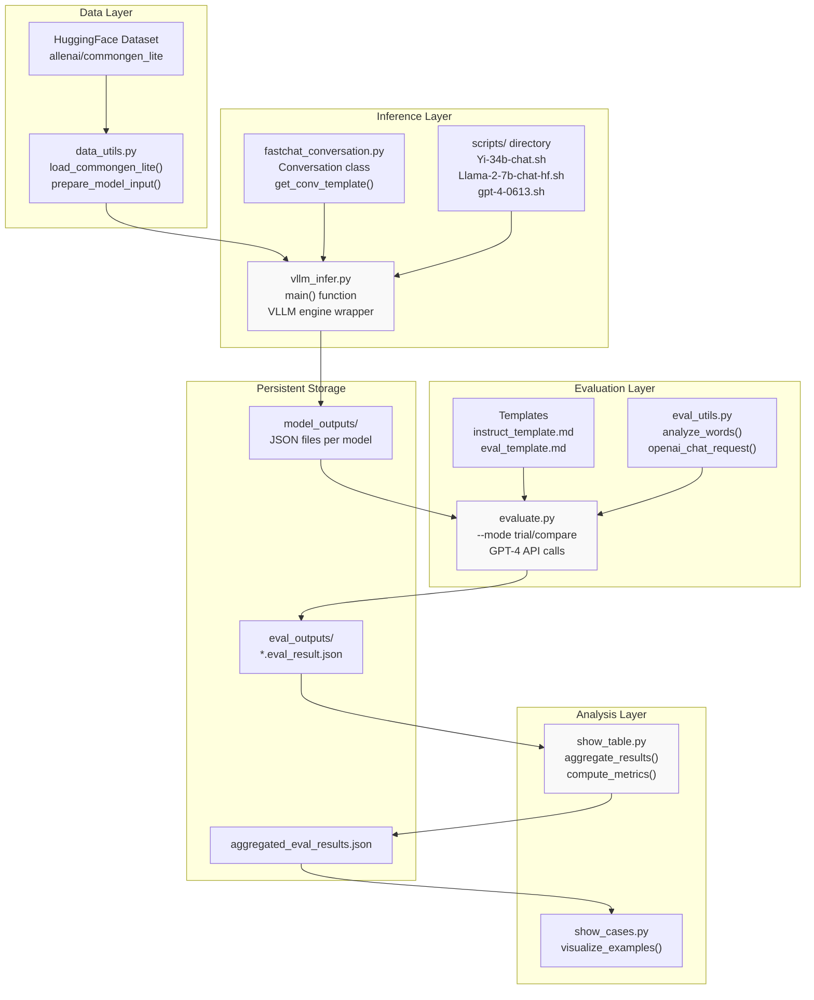

**Diagram 2: Component Architecture with Code Entities**

This diagram maps system functionality to specific code files and functions:

| Component | Key Files | Primary Functions/Classes | Purpose |
|-----------|-----------|---------------------------|---------|
| **Data Loading** | `data_utils.py` | `load_commongen_lite()`, `prepare_model_input()` | Load dataset, format prompts |
| **Model Inference** | `vllm_infer.py` | `main()`, VLLM engine wrapper | Generate sentences from concepts |
| **Conversation Templates** | `fastchat_conversation.py` | `Conversation` class, `get_conv_template()` | Format prompts for 50+ models |
| **Shell Scripts** | `scripts/*.sh` | Individual model launchers | Configure and run specific models |
| **Evaluation** | `evaluate.py` | `--mode trial/compare` | Orchestrate GPT-4 evaluation |
| **Eval Utilities** | `eval_utils.py` | `analyze_words()`, `openai_chat_request()` | NLP analysis, API interaction |
| **Results Aggregation** | `show_table.py` | `aggregate_results()`, `compute_metrics()` | Generate leaderboard |
| **Case Studies** | `show_cases.py` | `visualize_examples()` | Display example outputs |

**Sources:** [README.md:55-69](), [README.md:99-115]()

## Evaluation Metrics

The system computes five key metrics for each model:

| Metric | Symbol | Definition | Range | Human Baseline |
|--------|--------|------------|-------|----------------|
| **Length** | `len` | Average word count per sentence | ~13-20 | 12.84 |
| **Coverage** | `cover` | % of examples with all concepts present | 71-99% | 99.00% |
| **Part-of-Speech** | `pos` | % of examples with correct POS for all concepts | 63-98% | 98.11% |
| **Win/Tie Rate** | `win_tie` | % where GPT-4 prefers model over human (or tie) | 15-50% | 50-100% |
| **Overall Score** | `overall` | `cover × pos × win_tie` | 10-45% | 48.57-97.13% |

The multiplicative `overall` score ensures models must perform well across all dimensions. Models failing on coverage or POS accuracy receive low scores even if GPT-4 rates their outputs highly.

**Sources:** [README.md:39-44]()

## Repository Structure

```
CommonGen-Eval/
├── vllm_infer.py              # Main inference engine
├── evaluate.py                # GPT-4 evaluation script
├── data_utils.py              # Dataset loading utilities
├── eval_utils.py              # Evaluation helper functions
├── fastchat_conversation.py   # 50+ model conversation templates
├── show_table.py              # Leaderboard generation
├── show_cases.py              # Case study visualization
├── instruct_template.md       # Instruction prompt template
├── eval_template.md           # Evaluation prompt template
├── requirements.txt           # Python dependencies
├── scripts/                   # Model-specific shell scripts
│   ├── Yi-34b-chat.sh
│   ├── Llama-2-7b-chat-hf.sh
│   ├── gpt-4-0613.sh
│   └── ...
├── model_outputs/             # Generated sentences (JSON)
├── eval_outputs/              # Evaluation results (JSON)
└── aggregated_eval_results.json  # Final leaderboard data
```

**Sources:** [README.md:1-298]()

## Key Dependencies

The system relies on several external libraries specified in `requirements.txt`:

| Dependency | Version | Purpose |
|------------|---------|---------|
| `vllm` | 0.2.6 | High-performance model inference engine |
| `openai` | 0.28.0 | GPT-4 API client (pre-v1.0 API) |
| `transformers` | 4.36.2 | HuggingFace model loading |
| `spacy` | 3.7.2 | NLP analysis (POS tagging, lemmatization) |
| `tabulate` | 0.9.0 | ASCII table formatting |
| `tqdm` | 4.66.1 | Progress bars |

Note: The system uses `openai==0.28.0`, the legacy API version before OpenAI's v1.0.0 breaking changes.

**Sources:** [requirements.txt:1-6]()

## Supported Models

The system provides pre-configured templates for 50+ models via `fastchat_conversation.py`, including:

**Open-Source Models:**
- Yi family: Yi-34b-chat, Yi-6b-chat
- Llama family: Llama-2-7b-chat-hf, Llama-2-70b-chat-hf
- Mistral/Mixtral: Mixtral-8x7B-Instruct-v0.1, zephyr-7b-beta
- Vicuna: vicuna-13b-v1.5, vicuna-33b-v1.3
- Tulu: tulu-2-dpo-70b
- Pallas: Pallas-0.5

**Commercial Models:**
- OpenAI: gpt-4-0613, gpt-4-1106-preview, gpt-3.5-turbo

Each model requires specific conversation formatting handled by templates in `fastchat_conversation.py`. For the complete list of supported models, see [Supported Models](#9.3).

**Sources:** [README.md:23-37]()

## Leaderboard Results

The current leaderboard shows GPT-4 models leading with ~45% overall score, followed by open-source models:

**Top Performers:**
1. gpt-4-0613: 45.11% (cover=97.44%, pos=91.78%, win_tie=50.44%)
2. gpt-4-1106-preview: 44.08% (cover=96.33%, pos=90.11%, win_tie=50.78%)
3. gpt-3.5-turbo: 38.06% (cover=92.11%, pos=83.00%, win_tie=49.78%)

**Best Open-Source:**
- Yi-34b-chat: 23.73% (cover=80.11%, pos=75.11%, win_tie=39.44%)
- Pallas-0.5: 22.22% (cover=86.67%, pos=79.56%, win_tie=32.22%)

The human upper bound (assuming 100% win rate) is 97.13%, while the lower bound (50% win rate against self) is 48.57%. This indicates substantial room for improvement in LLM constrained generation capabilities.

**Sources:** [README.md:21-44]()

## Next Steps

To start using CommonGen-Eval:
- **Installation**: See [Getting Started](#2) for setup instructions
- **Run Inference**: See [Running Model Inference](#4) to generate outputs for a new model
- **Run Evaluation**: See [Running Evaluation](#5) to evaluate model outputs with GPT-4
- **Analyze Results**: See [Analyzing Results](#6) to generate leaderboards and visualize cases
- **Add New Models**: See [Conversation Templates](#4.2) to add support for new models

**Sources:** [README.md:48-115]()

---

# Page: Getting Started

# Getting Started

<details>
<summary>Relevant source files</summary>

The following files were used as context for generating this wiki page:

- [README.md](README.md)
- [data_utils.py](data_utils.py)
- [requirements.txt](requirements.txt)
- [scripts/Pallas-0.5.sh](scripts/Pallas-0.5.sh)

</details>


This page guides you through installing the CommonGen-Eval system and running your first model inference. By the end, you will have generated model outputs for the CommonGen-lite dataset and understand how they are evaluated.

For detailed information about the system architecture, see [System Architecture](#3). For in-depth guidance on inference configuration and adding new models, see [Running Model Inference](#4). For evaluation details, see [Running Evaluation](#5).

## Purpose and Scope

This page covers:
- Installing dependencies and downloading required resources
- Running inference on a model to generate CommonGen outputs
- Understanding the output format
- Overview of the evaluation workflow (note: evaluation requires special dataset access)

## Prerequisites

Before starting, ensure you have:
- Python 3.8 or later
- CUDA-capable GPU(s) for model inference
- Sufficient disk space for model weights (varies by model, typically 10-50GB)
- Internet connection for downloading models and datasets

**Sources**: [README.md:48-53]()

## Installation

### Step 1: Install Python Dependencies

The system requires specific versions of key packages for compatibility:

```bash
pip install -r requirements.txt
```

This installs the following core dependencies:

| Package | Version | Purpose |
|---------|---------|---------|
| `vllm` | 0.2.6 | Efficient model serving and inference |
| `transformers` | 4.36.2 | Model loading and tokenization |
| `openai` | 0.28.0 | GPT-4 evaluation API access |
| `spacy` | 3.7.2 | Part-of-speech tagging and NLP analysis |
| `tabulate` | 0.9.0 | Table formatting for results |
| `tqdm` | 4.66.1 | Progress bars |

**Sources**: [requirements.txt:1-6]()

### Step 2: Download Spacy Language Model

The evaluation system uses spaCy for linguistic analysis (part-of-speech tagging):

```bash
python -m spacy download en_core_web_lg
```

This downloads the large English language model required by `eval_utils.py` for analyzing word types in generated sentences.

**Sources**: [README.md:52]()

## System Workflow Overview

The following diagram shows how the components interact during a typical usage flow:

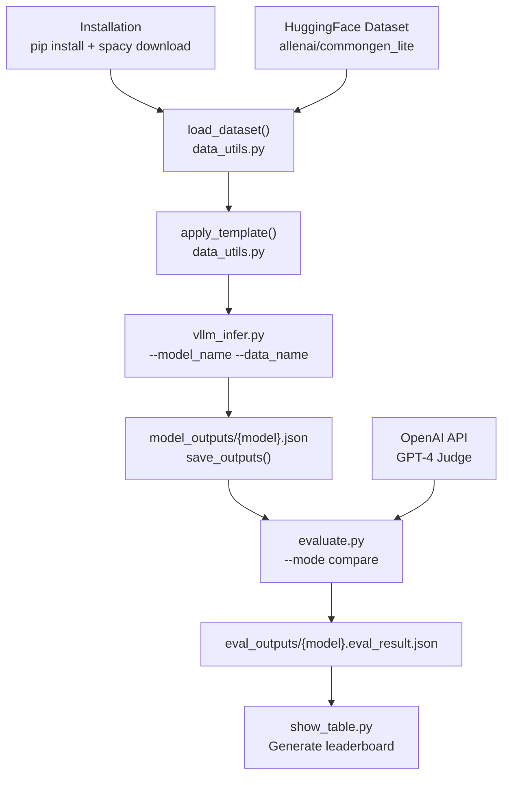

**Sources**: [README.md:55-115](), [data_utils.py:1-94]()

## Running Your First Inference

### Understanding the Data

The system uses the CommonGen-lite dataset, which contains 400 test examples. Each example consists of:
- A set of concepts (nouns and verbs with part-of-speech tags)
- An instruction prompt asking the model to generate a sentence using all concepts

The `load_eval_data()` function in `data_utils.py` loads this dataset from HuggingFace:

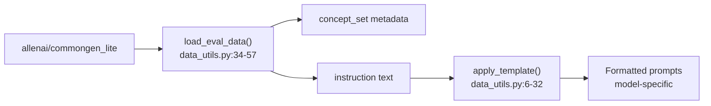

**Sources**: [data_utils.py:34-57](), [README.md:57]()

### Basic Inference Command

Here is a minimal example for running inference with the Yi-34b-chat model:

```bash
CUDA_VISIBLE_DEVICES=0,1,2,3 \
python vllm_infer.py \
    --data_name "commongen" \
    --model_name 01-ai/Yi-34b-chat \
    --tensor_parallel_size 4 \
    --dtype bfloat16 \
    --output_folder "model_outputs/" \
    --top_p 1 \
    --temperature 0 \
    --batch_size 8 \
    --max_tokens 128
```

**Key Parameters**:
- `--data_name "commongen"`: Specifies the CommonGen-lite dataset
- `--model_name`: HuggingFace model identifier or local path
- `--tensor_parallel_size`: Number of GPUs for parallelization
- `--temperature 0`: Deterministic generation (no randomness)
- `--max_tokens 128`: Maximum length of generated sentences

**Sources**: [README.md:62-69](), [scripts/Pallas-0.5.sh:1-7]()

### Template Application Process

The system automatically selects the appropriate conversation template based on the model name:

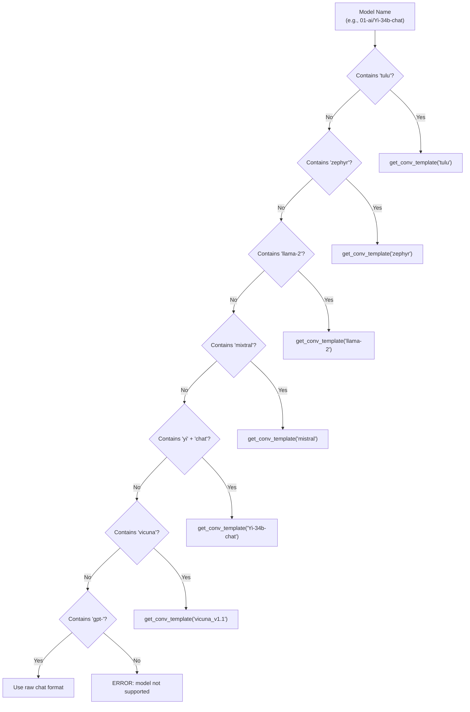

This logic is implemented in `apply_template()` at [data_utils.py:6-32]().

**Sources**: [data_utils.py:6-32]()

## Verifying Your Outputs

### Output File Structure

After inference completes, outputs are saved to `model_outputs/{model_name}.json`. The `save_outputs()` function creates this file with the following structure:

```json
[
  {
    "instruction": "Given several concepts...",
    "output": "The generated sentence.",
    "generator": "01-ai/Yi-34b-chat",
    "id": "example_id",
    "concept_set": ["dog_N", "frisbee_N", "catch_V", "throw_V"]
  }
]
```

Each entry contains:
- `instruction`: The prompt given to the model
- `output`: The model's generated sentence
- `generator`: The model name that produced this output
- `id`: Unique identifier for the example
- `concept_set`: The concepts that should appear in the output

**Sources**: [data_utils.py:72-87]()

### Quick Validation

Verify your output file was created successfully:

```bash
# Check file exists and count examples
ls -lh model_outputs/
jq length model_outputs/Yi-34b-chat.json  # Should output: 400
```

Inspect a single example:

```bash
jq '.[0]' model_outputs/Yi-34b-chat.json
```

## Understanding Evaluation (Overview)

The evaluation process uses GPT-4 as a judge to compare model outputs against human references. **Note**: Running evaluation requires special access to the private HuggingFace dataset containing human references and is typically performed by the repository maintainers.

### Evaluation Workflow

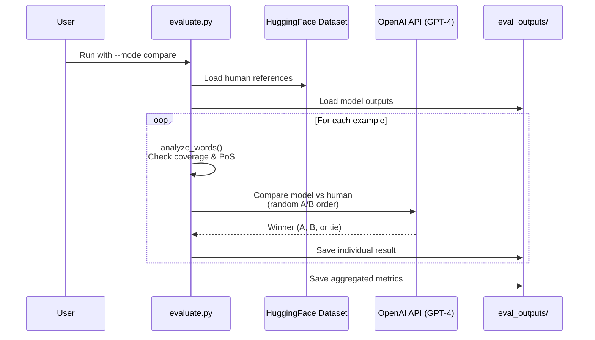

**Sources**: [README.md:99-115]()

### Evaluation Metrics

The system computes multiple metrics for each model:

| Metric | Description | Implementation |
|--------|-------------|----------------|
| **length** | Average word count | Computed from output tokens |
| **cover** | % with all concepts present | Checked via string matching |
| **pos** | % with correct part-of-speech | Analyzed using spaCy `analyze_words()` |
| **win_tie** | % preferred/tied by GPT-4 | Pairwise comparison results |
| **overall** | `cover × pos × win_tie` | Final combined score |

**Sources**: [README.md:39-44]()

## Next Steps

Now that you have completed your first inference run:

1. **Explore different models**: See [Supported Models](#9.3) for the full list of 50+ supported model templates
2. **Understand the architecture**: Read [System Architecture](#3) to learn how components interact
3. **Customize inference**: See [Running Model Inference](#4) for advanced configuration options
4. **Add a new model**: Follow the guide in [Conversation Templates](#4.2) to add support for additional models
5. **Analyze results**: Learn about metrics and leaderboard generation in [Analyzing Results](#6)

**Sources**: [README.md:1-298]()

---

# Page: System Architecture

# System Architecture

<details>
<summary>Relevant source files</summary>

The following files were used as context for generating this wiki page:

- [README.md](README.md)
- [data_utils.py](data_utils.py)
- [eval_utils.py](eval_utils.py)
- [scripts/Pallas-0.5.sh](scripts/Pallas-0.5.sh)
- [show_table.py](show_table.py)

</details>


## Purpose and Scope

This document describes the overall architecture of the CommonGen-Eval system, explaining how the major components interact to evaluate language models on concept-to-sentence generation tasks. It covers the three-tier architecture (data, execution, presentation), component interactions, data flow patterns, and storage organization.

For detailed information on specific subsystems:
- Data flow mechanics: see [Data Pipeline](#3.1)
- Model inference details: see [Inference System](#3.2)
- GPT-4 evaluation mechanics: see [Evaluation System](#3.3)
- Results processing: see [Results Aggregation](#6.1)

---

## Architectural Overview

The CommonGen-Eval system follows a **pipeline architecture** with three distinct stages: inference, evaluation, and aggregation. Each stage reads from and writes to specific directories, creating a clear separation of concerns.

### System Components Diagram

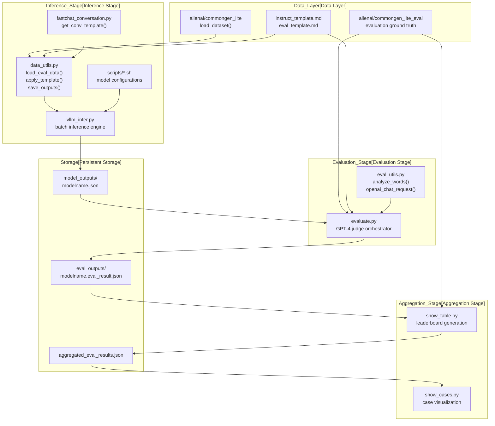

**Sources**: [README.md:16-98](), [data_utils.py:1-94](), [show_table.py:1-122](), [eval_utils.py:1-158]()

---

## Three-Tier Logical Architecture

The system is organized into three logical tiers that separate configuration, execution, and presentation concerns.

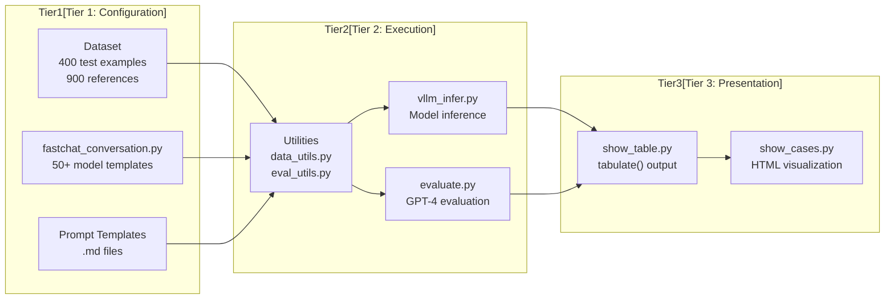

**Sources**: [README.md:48-97](), [data_utils.py:6-57](), [show_table.py:22-122]()

---

## Component Interaction Details

### Inference Pipeline Components

The inference pipeline transforms concept sets into model-generated sentences through several stages of processing.

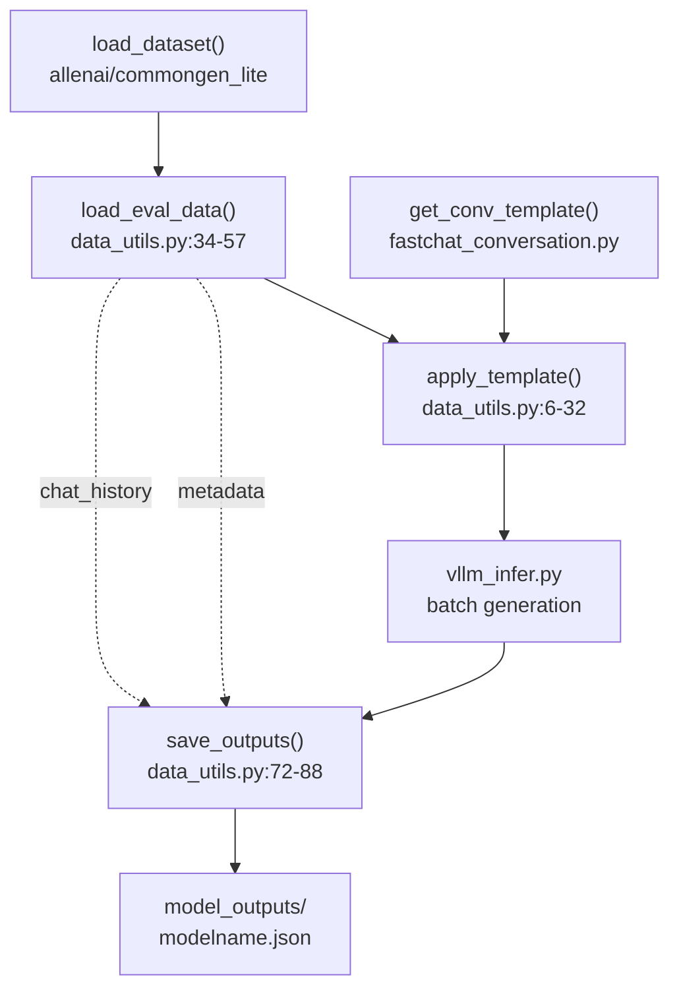

| Component | Function | Key Outputs |
|-----------|----------|-------------|
| `load_eval_data()` | Loads dataset and formats as chat history | `id_strs`, `chat_history`, `model_inputs`, `metadata` |
| `apply_template()` | Applies model-specific conversation format | List of formatted prompt strings |
| `get_conv_template()` | Retrieves template for specific model | Conversation object with `get_prompt()` method |
| `save_outputs()` | Serializes results to JSON | `formatted_outputs` with instruction, output, metadata |

**Sources**: [data_utils.py:34-88](), [scripts/Pallas-0.5.sh:1-7]()

---

### Evaluation Pipeline Components

The evaluation pipeline compares model outputs against human references using both automated metrics and GPT-4 judgment.

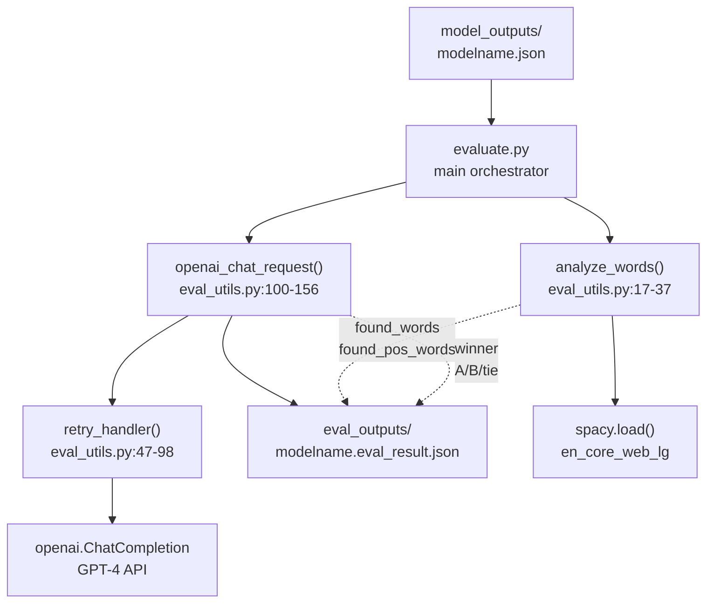

| Function | Purpose | Returns |
|----------|---------|---------|
| `analyze_words()` | Lemmatizes and checks POS tags using spacy | `found_words`, `found_pos_words` (sets) |
| `openai_chat_request()` | Makes API call to GPT-4 with temperature=0 | List of response strings |
| `retry_handler()` | Decorator with exponential backoff for rate limits | Wrapped function with retry logic |

**Sources**: [eval_utils.py:17-156](), [README.md:99-147]()

---

### Aggregation Pipeline Components

The aggregation pipeline collects evaluation results from all models and generates comparative metrics.

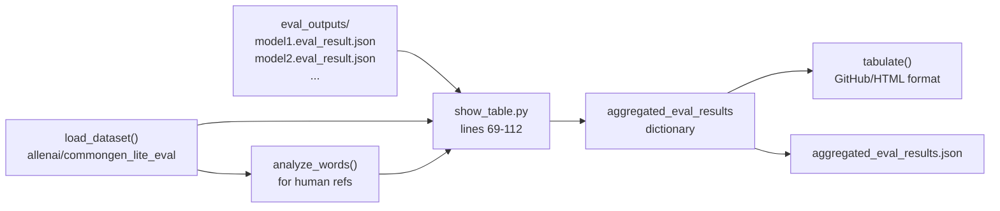

**Key Data Structures in show_table.py:**

```
aggregated_eval_results = {
  "ref_id": {
    "concept_set": [...],
    "human_ref": "...",
    "found_words": [...],
    "found_pos_words": [...],
    "len": int,
    "model_outputs": {
      "model_name": {
        "output": "...",
        "result": "win|lose|tie",
        "found_pos_words": [...],
        "found_words": [...],
        "len": int
      }
    }
  }
}
```

**Sources**: [show_table.py:24-122]()

---

## Data Flow Architecture

### End-to-End Data Flow with Code References

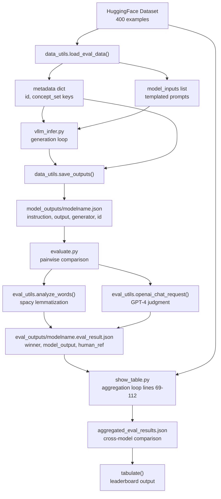

**Sources**: [data_utils.py:34-88](), [show_table.py:69-122](), [eval_utils.py:17-156]()

---

## Storage Organization

### File System Structure

```
CommonGen-Eval/
├── model_outputs/
│   ├── Yi-34b-chat.json              # Generated by vllm_infer.py
│   ├── Llama-2-7b-chat-hf.json
│   ├── gpt-4-0613.json
│   └── ...
│
├── eval_outputs/
│   ├── Yi-34b-chat.eval_result.gpt-4-1106-preview.json
│   ├── Llama-2-7b-chat-hf.eval_result.gpt-4-1106-preview.json
│   └── aggregated_eval_results.json  # Generated by show_table.py
│
├── scripts/
│   ├── Pallas-0.5.sh
│   ├── Yi-34b-chat.sh
│   └── all_gpt_eval.sh
│
└── templates/
    ├── instruct_template.md
    └── eval_template.md
```

**JSON Schema Reference:**

**model_outputs/*.json** (generated by [data_utils.py:72-88]()):
```json
[
  {
    "instruction": "Given concepts, write sentence...",
    "output": ["Generated sentence"],
    "generator": "model_name",
    "id": "example_id",
    "concept_set": ["word_POS", ...]
  }
]
```

**eval_outputs/*.eval_result.json** (generated by `evaluate.py`):
```json
[
  {
    "concept_set": ["word_POS", ...],
    "human_ref": {"id": "ref_id", "ref": "Human sentence"},
    "model_output": ["Model sentence"],
    "winner": "model|human|tie"
  }
]
```

**Sources**: [data_utils.py:72-88](), [show_table.py:7-20, 69-99]()

---

## Execution Orchestration

### Shell Script Configuration Pattern

The system uses shell scripts to configure and launch model inference with specific parameters:

**Example: scripts/Pallas-0.5.sh**
```bash
CUDA_VISIBLE_DEVICES=0,1,2,3 \
python vllm_infer.py \
    --data_name "commongen" \
    --model_name Mihaiii/Pallas-0.5 
    --tensor_parallel_size 4 
    --dtype bfloat16 \
    --output_folder "model_outputs/" \
    --top_p 1 
    --temperature 0 
    --batch_size 8 
    --max_tokens 128
```

**Common Parameters:**
| Parameter | Purpose | Typical Value |
|-----------|---------|---------------|
| `--data_name` | Dataset identifier | `"commongen"` |
| `--model_name` | HuggingFace model path | Model-specific |
| `--tensor_parallel_size` | GPU parallelization | 1, 2, 4, or 8 |
| `--temperature` | Sampling temperature | 0 (deterministic) |
| `--batch_size` | Inference batch size | 8 |
| `--max_tokens` | Max generation length | 128 |

**Sources**: [scripts/Pallas-0.5.sh:1-7](), [README.md:55-69]()

---

## Template Application System

### Model-Specific Template Selection

The `apply_template()` function in [data_utils.py:6-32]() uses conditional logic to select appropriate conversation templates:

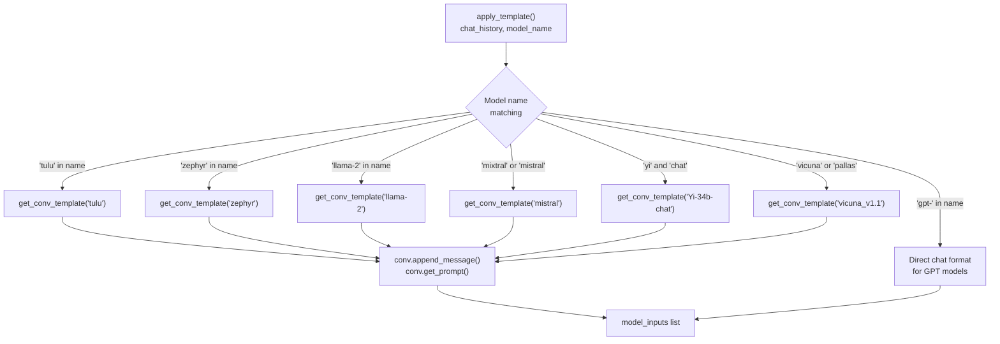

**Sources**: [data_utils.py:6-32]()

---

## Metrics Calculation

The system computes multiple metrics for each model, calculated in [show_table.py:74-112]():

### Metric Computation Flow

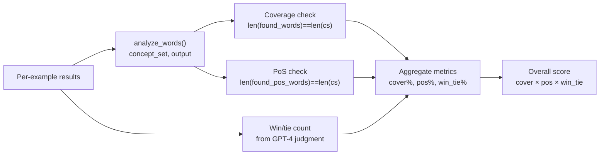

**Metric Formulas** (from [show_table.py:101-111]()):

| Metric | Calculation | Line Reference |
|--------|-------------|----------------|
| `cover%` | `sum(cover_ratios)/len * 100` | [show_table.py:108]() |
| `pos%` | `sum(pos_ratios)/len * 100` | [show_table.py:107]() |
| `win_tie%` | `(win_count+tie_count)/len * 100` | [show_table.py:105]() |
| `overall` | `(cover × pos × win_tie) / 10000` | [show_table.py:110]() |
| `len` | `sum(lens)/len` | [show_table.py:109]() |

**Sources**: [show_table.py:74-112](), [README.md:39-44]()

---

## Dependency Architecture

### Core Dependencies and Their Roles

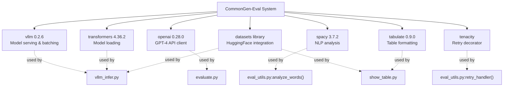

**Sources**: [README.md:48-53](), [eval_utils.py:1-14](), [show_table.py:1-4]()

---

## Extension Points

The architecture provides several extension points for adding new models or evaluation methods:

| Extension Point | Location | Mechanism |
|----------------|----------|-----------|
| **New Model Support** | [data_utils.py:9-27]() | Add conditional branch in `apply_template()` |
| **New Conversation Template** | `fastchat_conversation.py` | Add template via `get_conv_template()` |
| **New Evaluation Metrics** | [eval_utils.py:17-37]() | Extend `analyze_words()` or add new functions |
| **Custom Evaluation Judges** | [eval_utils.py:100-156]() | Modify `openai_chat_request()` model parameter |
| **Output Format Changes** | [data_utils.py:72-88]() | Modify `save_outputs()` formatting logic |
| **New Aggregation Methods** | [show_table.py:69-112]() | Add calculation loops for new metrics |

**Sources**: [data_utils.py:6-88](), [eval_utils.py:17-156](), [show_table.py:69-122]()

---

# Page: Data Pipeline

# Data Pipeline

<details>
<summary>Relevant source files</summary>

The following files were used as context for generating this wiki page:

- [README.md](README.md)
- [data_utils.py](data_utils.py)
- [scripts/Pallas-0.5.sh](scripts/Pallas-0.5.sh)
- [show_table.py](show_table.py)

</details>


## Purpose and Scope

This document details the complete data flow through the CommonGen-Eval system, from loading the CommonGen-lite dataset through model inference, GPT-4 evaluation, and final results aggregation. It covers the five main pipeline stages, data transformations at each stage, and the storage locations for intermediate and final outputs.

For details about the inference execution and model-specific configurations, see [Inference System](#3.2). For evaluation mechanics and GPT-4 judging, see [Evaluation System](#3.3). For working with results and metrics, see [Analyzing Results](#6).

**Sources:** README.md, show_table.py, data_utils.py

---

## Complete Pipeline Overview

The data pipeline transforms 400 concept sets from the CommonGen-lite dataset into evaluated model outputs with calculated metrics. The pipeline consists of five sequential stages, each with distinct inputs, processing, and outputs.

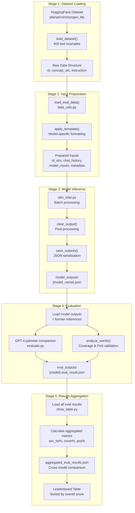

**Sources:** README.md:17-18, README.md:57-96, data_utils.py:34-57, show_table.py:1-122

---

## Stage 1: Dataset Loading

### Source Dataset

The pipeline begins by loading the CommonGen-lite dataset from HuggingFace. This dataset contains 400 test examples with 900 human-written reference sentences (some examples have multiple references).

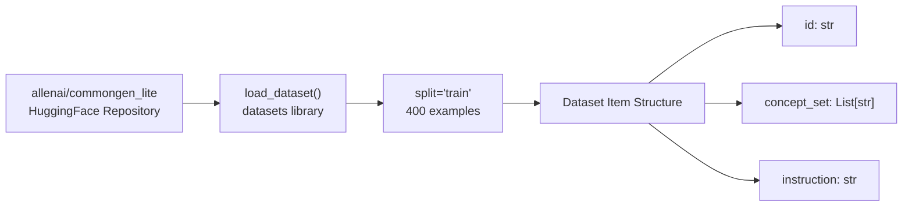

The dataset is loaded using the `datasets` library at [data_utils.py:43]():

```python
dataset = load_dataset("allenai/commongen_lite", split="train")
```

**Sources:** data_utils.py:1, data_utils.py:43, README.md:17, README.md:57

### Data Structure

Each dataset item contains:

| Field | Type | Description | Example |
|-------|------|-------------|---------|
| `id` | `str` | Unique identifier | `"0"` |
| `concept_set` | `List[str]` | Tagged concepts (noun/verb) | `["dog_N", "frisbee_N", "catch_V", "throw_V"]` |
| `instruction` | `str` | Formatted task prompt | Full instruction with examples |

The instruction field contains a pre-formatted 2-shot prompt with the task description and the specific concepts to use. This template is shown in [README.md:74-94]().

**Sources:** data_utils.py:42-54, README.md:74-94

### Human Reference Data

For evaluation purposes, human references are loaded separately from the `allenai/commongen_lite_eval` dataset at [show_table.py:29]():

```python
truth_data = load_dataset("allenai/commongen_lite_eval", split="train")
```

Each item in the truth dataset includes `human_annotations`, where each annotation has:
- `id`: Reference identifier  
- `ref`: Human-written sentence

The system iterates through 900 total references across 400 examples at [show_table.py:30-38]().

**Sources:** show_table.py:29-38, README.md:17

---

## Stage 2: Input Preparation

### Data Loading Function

The `load_eval_data()` function at [data_utils.py:34-57]() orchestrates the preparation of inputs for model inference. It returns four key data structures:

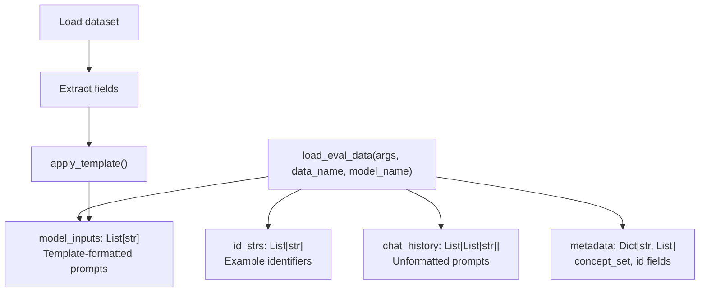

**Sources:** data_utils.py:34-57

### Template Application

The `apply_template()` function at [data_utils.py:6-32]() transforms raw chat history into model-specific formatted prompts. It handles 50+ model conversation formats via the `fastchat_conversation` module.

The function performs model detection and template selection:

| Model Pattern | Template | Lines |
|--------------|----------|-------|
| `"tulu"` | `"tulu"` | [data_utils.py:9-10]() |
| `"zephyr"` | `"zephyr"` | [data_utils.py:11-12]() |
| `"llama-2"` | `"llama-2"` | [data_utils.py:13-14]() |
| `"mixtral"` or `"mistral"` | `"mistral"` | [data_utils.py:15-16]() |
| `"yi"` and `"chat"` | `"Yi-34b-chat"` | [data_utils.py:17-18]() |
| `"vicuna"` | `"vicuna_v1.1"` | [data_utils.py:19-20]() |
| `"pallas"` | `"vicuna_v1.1"` | [data_utils.py:21-22]() |
| `"gpt-"` | No template (direct) | [data_utils.py:23-25]() |

For most models, the conversation template is retrieved via `get_conv_template()` and messages are appended according to the template's role structure at [data_utils.py:28-31]().

**Sources:** data_utils.py:6-32

### Metadata Extraction

The metadata dictionary is populated during dataset iteration at [data_utils.py:48-54](). For the CommonGen task, it includes:

```python
metadata = {"id": [], "concept_set": []}
```

This metadata is preserved through the pipeline and included in the final output files at [data_utils.py:83-84]().

**Sources:** data_utils.py:42-54, data_utils.py:83-84

---

## Stage 3: Model Inference

### Inference Execution

Model inference is executed via shell scripts that call `vllm_infer.py`. Example from [scripts/Pallas-0.5.sh:1-7]():

```bash
CUDA_VISIBLE_DEVICES=0,1,2,3 \
python vllm_infer.py \
    --data_name "commongen" \
    --model_name Mihaiii/Pallas-0.5 --tensor_parallel_size 4 --dtype bfloat16 \
    --output_folder "model_outputs/" \
    --top_p 1 --temperature 0 --batch_size 8 --max_tokens 128
```

The inference parameters are standardized across models:
- `temperature=0`: Deterministic generation
- `top_p=1`: No nucleus sampling
- `max_tokens=128`: Maximum output length
- `batch_size=8`: Batch processing for efficiency

**Sources:** scripts/Pallas-0.5.sh:1-7, README.md:63-69

### Output Post-Processing

The `clear_output()` function at [data_utils.py:62-69]() performs model-specific cleanup. For example, Llama-2-7b outputs may contain extra newlines that need trimming:

```python
if "llama-2-7b" in model_name.lower():
    if "\n\n" in output:
        output = output[output.index("\n\n"):].strip()
```

**Sources:** data_utils.py:62-69

### Output Serialization

The `save_outputs()` function at [data_utils.py:72-87]() formats and saves the generated outputs. For the CommonGen task, each output item contains:

```python
{
    "instruction": str,      # Original prompt
    "output": List[str],     # Generated sentences (may be single or multiple)
    "generator": str,        # Model name
    "id": str,              # Example identifier
    "concept_set": List[str] # Original concepts
}
```

These are saved to `model_outputs/{model_name}.json` at [data_utils.py:86-87]().

**Sources:** data_utils.py:72-87

---

## Stage 4: Evaluation

### Evaluation Input Loading

The evaluation stage loads both model outputs and human references. The `evaluate.py` script processes each model output file and compares it against human-written references.

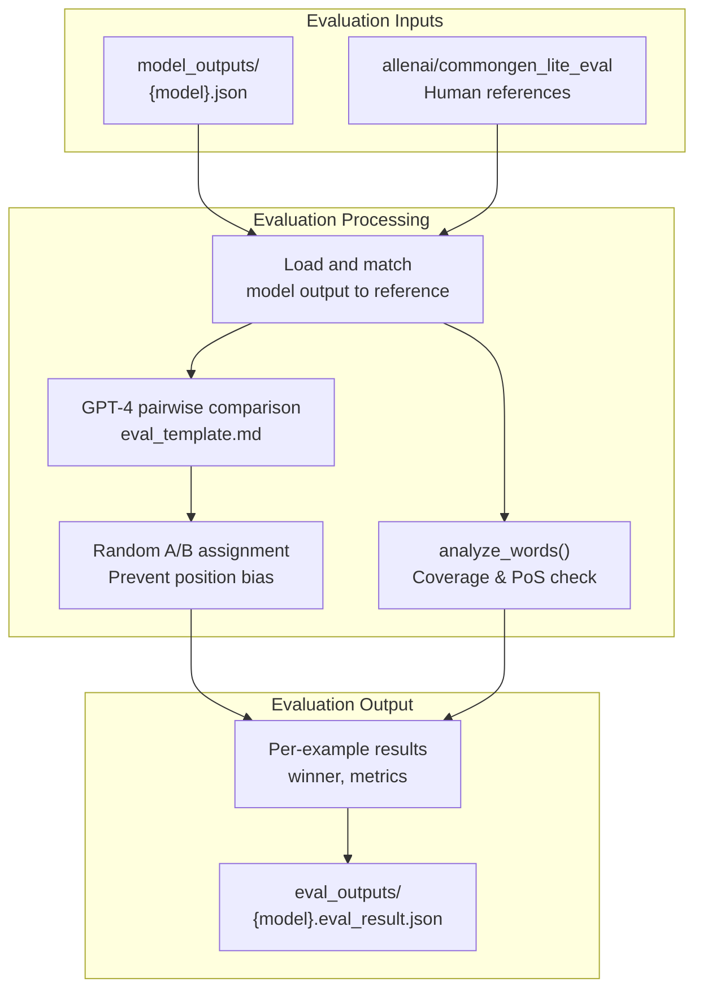

**Sources:** show_table.py:69-99, README.md:99-147

### Automated Metrics Calculation

The `analyze_words()` function from `eval_utils.py` performs linguistic analysis on both model outputs and human references. It is called at [show_table.py:34]() for human references and [show_table.py:91]() for model outputs.

For each generated sentence, the function returns:
- `found_words`: Set of concepts found in the output
- `found_pos_words`: Set of concepts with correct part-of-speech tags

These are used to calculate:
- **Coverage ratio**: `len(found_words) == len(concept_set)` at [show_table.py:93]()
- **PoS ratio**: `len(found_pos_words) == len(concept_set)` at [show_table.py:92]()

**Sources:** show_table.py:34, show_table.py:91-93

### Evaluation Result Structure

Each evaluation result contains:

```python
{
    "concept_set": List[str],
    "human_ref": {"id": str, "ref": str},
    "model_output": List[str],
    "winner": str,  # "model_name", "human", or "tie"
    # ... additional metrics
}
```

Results are saved to `eval_outputs/{model}.eval_result.{judge_model}.json`.

**Sources:** show_table.py:69-99

---

## Stage 5: Results Aggregation

### Aggregation Process

The `show_table.py` script at [show_table.py:1-122]() performs cross-model aggregation. It processes all evaluation result files and computes comparative metrics.

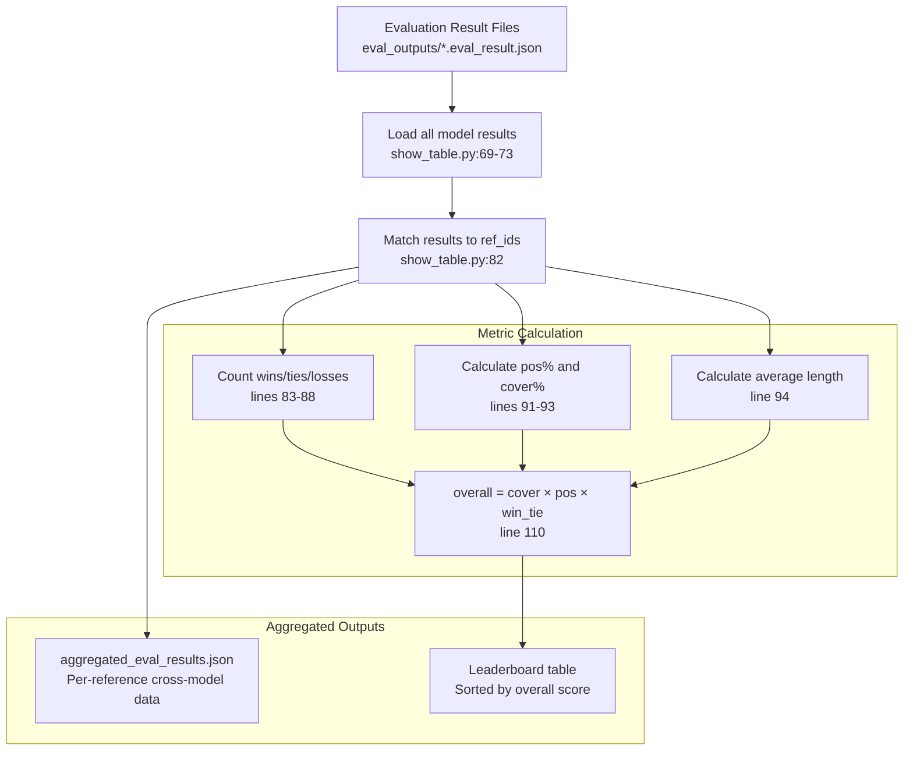

**Sources:** show_table.py:1-122

### File Registry

The aggregation script maintains a dictionary of model evaluation files at [show_table.py:7-20]():

```python
files = {
    "TurnOpt": "eval_outputs/TurnOpt.eval_result.gpt-4-1106-preview.json",
    "Pallas-0.5": "eval_outputs/Pallas-0.5.eval_result.gpt-4-1106-preview.json",
    # ... additional models
}
```

Each file is loaded and processed in the loop at [show_table.py:69-112]().

**Sources:** show_table.py:7-20, show_table.py:69-112

### Human Baseline Calculation

Human performance is calculated from the truth dataset at [show_table.py:25-38](). The system computes:

- **Human coverage**: 99.00% (proportion of references using all concepts)
- **Human PoS accuracy**: 98.11% (proportion with correct PoS tags)
- **Upper bound**: Assumes `win_tie=100%` at [show_table.py:48-56]()
- **Lower bound**: Assumes `win_tie=50%` at [show_table.py:57-61]()

**Sources:** show_table.py:25-61, README.md:25-26, README.md:44

### Aggregated Results File

The script generates `aggregated_eval_results.json` at [show_table.py:121-122](), structured as:

```python
{
    "ref_id": {
        "concept_set": List[str],
        "human_ref": str,
        "found_words": List[str],
        "found_pos_words": List[str],
        "len": int,
        "model_outputs": {
            "model_name": {
                "output": str,
                "result": "win" | "lose" | "tie",
                "found_pos_words": List[str],
                "found_words": List[str],
                "len": int
            }
        }
    }
}
```

This file enables cross-model comparison for individual examples at [show_table.py:38, 99]().

**Sources:** show_table.py:38, show_table.py:99, show_table.py:121-122

### Leaderboard Generation

The final leaderboard table is generated at [show_table.py:115-118]() with columns:

| Column | Calculation | Description |
|--------|-------------|-------------|
| `model` | Model name | Identifier |
| `len` | Average word count | Sentence length |
| `cover` | % with all concepts | Concept coverage |
| `pos` | % with correct PoS | Part-of-speech accuracy |
| `win_tie` | % wins + ties | GPT-4 preference |
| `overall` | `cover × pos × win_tie / 10000` | Combined score |

The table is sorted by overall score in descending order at [show_table.py:116]() and output in both GitHub markdown and HTML formats at [show_table.py:117-118]().

**Sources:** show_table.py:102-118, README.md:23-43

---

## Data Transformation Summary

The following table summarizes the transformations at each pipeline stage:

| Stage | Input Format | Processing | Output Format | Location |
|-------|-------------|------------|---------------|----------|
| 1. Dataset Loading | HuggingFace dataset | `load_dataset()` | Python dict with `id`, `concept_set`, `instruction` | Memory |
| 2. Input Preparation | Raw dataset items | `load_eval_data()`, `apply_template()` | Model-formatted prompts + metadata | Memory |
| 3. Model Inference | Formatted prompts | `vllm_infer.py`, `save_outputs()` | JSON with `instruction`, `output`, `generator`, metadata | `model_outputs/*.json` |
| 4. Evaluation | Model outputs + human refs | `evaluate.py`, `analyze_words()` | JSON with per-example comparison results | `eval_outputs/*.eval_result.json` |
| 5. Aggregation | All evaluation results | `show_table.py` metric calculation | Cross-model JSON + leaderboard table | `aggregated_eval_results.json` |

**Sources:** data_utils.py, show_table.py, README.md

---

# Page: Inference System

# Inference System

<details>
<summary>Relevant source files</summary>

The following files were used as context for generating this wiki page:

- [README.md](README.md)
- [data_utils.py](data_utils.py)
- [fastchat_conversation.py](fastchat_conversation.py)
- [scripts/Pallas-0.5.sh](scripts/Pallas-0.5.sh)

</details>


## Purpose and Scope

This document describes the model inference architecture of the CommonGen-Eval system, including how the `vllm_infer.py` engine processes concept sets, how conversation templates are applied via `fastchat_conversation.py`, and how model-specific shell scripts orchestrate inference. For information about how data flows into this system, see [Data Pipeline](#3.1). For information about how inference outputs are evaluated, see [Evaluation System](#3.3).

The inference system is responsible for:
- Loading the CommonGen-lite dataset and formatting prompts
- Applying model-specific conversation templates to prompts
- Running batch inference using vLLM
- Saving structured JSON outputs for downstream evaluation

## System Overview

The inference system transforms concept sets into model-generated sentences through a multi-stage pipeline. The system supports 50+ different language models through a template-based approach that handles each model's unique prompt format.

```mermaid
graph TB
    subgraph "Entry Points"
        ShellScript["Shell Scripts<br/>scripts/*.sh"]
    end
    
    subgraph "Core Inference Engine"
        VLLM["vllm_infer.py<br/>Main inference coordinator"]
    end
    
    subgraph "Data Processing"
        DataUtils["data_utils.py<br/>load_eval_data()<br/>apply_template()<br/>save_outputs()"]
    end
    
    subgraph "Template System"
        FastChat["fastchat_conversation.py<br/>get_conv_template()<br/>Conversation.get_prompt()"]
        Templates["50+ Templates<br/>vicuna_v1.1, llama-2,<br/>Yi-34b-chat, mistral,<br/>tulu, zephyr, etc."]
    end
    
    subgraph "Model Runtime"
        VLLMEngine["vLLM Engine<br/>LLM.generate()"]
        Models["Loaded Models<br/>transformers format"]
    end
    
    subgraph "Outputs"
        ModelOutputs["model_outputs/<br/>{model_name}.json"]
    end
    
    ShellScript --> VLLM
    VLLM --> DataUtils
    DataUtils --> FastChat
    FastChat --> Templates
    VLLM --> VLLMEngine
    VLLMEngine --> Models
    VLLM --> ModelOutputs
    
    DataUtils -.loads.-> Dataset["CommonGen-lite<br/>allenai/commongen_lite"]
```

**Sources:** [README.md:55-96](), [scripts/Pallas-0.5.sh:1-7](), [data_utils.py:1-94](), [fastchat_conversation.py:326-328]()

## Core Components

### vllm_infer.py - Main Inference Engine

The `vllm_infer.py` script is the central coordinator for model inference. While the file itself is not provided in the sources, its usage is documented extensively in the README and shell scripts.

**Key responsibilities:**
- Parsing command-line arguments for model configuration
- Initializing vLLM engine with specified parameters
- Orchestrating the inference pipeline
- Writing outputs to JSON files

**Command-line interface:**

| Argument | Purpose | Example Value |
|----------|---------|---------------|
| `--data_name` | Dataset identifier | `"commongen"` |
| `--model_name` | HuggingFace model path | `"01-ai/Yi-34b-chat"` |
| `--tensor_parallel_size` | GPU parallelism | `4` |
| `--dtype` | Model precision | `"bfloat16"` |
| `--output_folder` | Output directory | `"model_outputs/"` |
| `--top_p` | Nucleus sampling | `1` |
| `--temperature` | Sampling temperature | `0` (greedy) |
| `--batch_size` | Inference batch size | `8` |
| `--max_tokens` | Max generation length | `128` |

**Sources:** [README.md:62-69](), [scripts/Pallas-0.5.sh:1-7]()

### data_utils.py - Data Loading and Formatting

The `data_utils.py` module handles all data loading, template application, and output formatting operations.

#### Key Functions

**`load_eval_data(args, data_name, model_name)`** - [data_utils.py:34-57]()

Loads the CommonGen-lite dataset and prepares it for inference:

1. Loads dataset from HuggingFace: `allenai/commongen_lite`
2. Extracts instruction text from each item
3. Stores metadata (concept_set, id)
4. Applies conversation template via `apply_template()`
5. Returns: `id_strs`, `chat_history`, `model_inputs`, `metadata`

**`apply_template(chat_history, model_name)`** - [data_utils.py:6-32]()

Maps model names to conversation templates and formats prompts:

```mermaid
flowchart LR
    Input["chat_history<br/>List of conversations"]
    
    ModelDetection["Model Name Detection<br/>if 'tulu' in model_name<br/>elif 'zephyr' in model_name<br/>elif 'llama-2' in model_name<br/>elif 'mixtral' or 'mistral'<br/>elif 'yi' and 'chat'<br/>elif 'vicuna'<br/>elif 'pallas'<br/>elif 'gpt-'"]
    
    GetTemplate["get_conv_template(name)<br/>from fastchat_conversation"]
    
    BuildPrompt["conv.append_message()<br/>conv.get_prompt()"]
    
    Output["model_inputs<br/>Formatted prompt strings"]
    
    Input --> ModelDetection
    ModelDetection --> GetTemplate
    GetTemplate --> BuildPrompt
    BuildPrompt --> Output
    
    ModelDetection -.special case.-> GPTPath["Return raw chat<br/>for GPT models"]
    GPTPath --> Output
```

**Model name to template mapping:**

| Model Pattern | Template Name | Line Reference |
|---------------|---------------|----------------|
| `"tulu"` | `"tulu"` | [data_utils.py:10]() |
| `"zephyr"` | `"zephyr"` | [data_utils.py:12]() |
| `"llama-2"` | `"llama-2"` | [data_utils.py:14]() |
| `"mixtral"` or `"mistral"` | `"mistral"` | [data_utils.py:16]() |
| `"yi"` + `"chat"` | `"Yi-34b-chat"` | [data_utils.py:18]() |
| `"vicuna"` | `"vicuna_v1.1"` | [data_utils.py:20]() |
| `"pallas"` | `"vicuna_v1.1"` | [data_utils.py:22]() |
| `"gpt-"` | Raw chat (no template) | [data_utils.py:24-25]() |

**`save_outputs(args, id_strs, outputs, chat_history, metadata, model_inputs, filepath)`** - [data_utils.py:72-88]()

Formats and saves inference outputs to JSON:

```json
{
  "instruction": "...",
  "output": "generated sentence",
  "generator": "model_name",
  "id": "example_id",
  "concept_set": ["concept1_N", "concept2_V", ...]
}
```

**`clear_output(output, model_name)`** - [data_utils.py:62-69]()

Post-processes model outputs with model-specific cleaning (e.g., removing extra newlines from Llama-2-7b outputs).

**`concept_list_str(concept_set)`** - [data_utils.py:90-94]()

Converts concept tags to human-readable format:
- `"dog_N"` → `"dog(noun)"`
- `"catch_V"` → `"catch(verb)"`

**Sources:** [data_utils.py:1-94]()

### fastchat_conversation.py - Conversation Template System

The `fastchat_conversation.py` module (adapted from FastChat) provides a comprehensive template system supporting 50+ different conversational model formats.

#### Conversation Class

The `Conversation` dataclass [fastchat_conversation.py:34-310]() manages prompt templates and conversation history:

**Key attributes:**

| Attribute | Type | Purpose |
|-----------|------|---------|
| `name` | `str` | Template identifier |
| `system_template` | `str` | Format for system message |
| `system_message` | `str` | Default system prompt |
| `roles` | `Tuple[str]` | Role names (e.g., "USER", "ASSISTANT") |
| `messages` | `List[List[str]]` | Conversation history |
| `sep_style` | `SeparatorStyle` | Message separator style enum |
| `sep` | `str` | Primary separator |
| `sep2` | `str` | Secondary separator (optional) |
| `stop_str` | `str \| List[str]` | Stop sequences |
| `stop_token_ids` | `List[int]` | Stop token IDs |

#### Separator Styles

The `SeparatorStyle` enum [fastchat_conversation.py:11-31]() defines formatting strategies:

```mermaid
graph TD
    SepStyle["SeparatorStyle<br/>Enum"]
    
    Single["Single Separator Styles"]
    Double["Double Separator Styles"]
    Special["Special Format Styles"]
    
    SepStyle --> Single
    SepStyle --> Double
    SepStyle --> Special
    
    Single --> ADD_COLON_SINGLE["ADD_COLON_SINGLE<br/>'USER: message\n'"]
    Single --> NO_COLON_SINGLE["NO_COLON_SINGLE<br/>'USER message\n'"]
    Single --> ADD_NEW_LINE_SINGLE["ADD_NEW_LINE_SINGLE<br/>'USER\nmessage\n'"]
    
    Double --> ADD_COLON_TWO["ADD_COLON_TWO<br/>'USER: msg SEP1 ASSISTANT: msg SEP2'"]
    Double --> NO_COLON_TWO["NO_COLON_TWO<br/>'USER msg SEP1 ASSISTANT msg SEP2'"]
    
    Special --> LLAMA2["LLAMA2<br/>'[INST] msg [/INST] response </s>'"]
    Special --> CHATML["CHATML<br/>'<|im_start|>role\nmsg<|im_end|>'"]
    Special --> CHATGLM["CHATGLM<br/>'[Round N] role：msg'"]
```

**Sources:** [fastchat_conversation.py:11-31]()

#### Key Methods

**`get_prompt()`** - [fastchat_conversation.py:59-247]()

Generates the final prompt string by applying the separator style to the conversation history. This method contains extensive logic for handling each separator style variant.

**`get_conv_template(name)`** - [fastchat_conversation.py:326-328]()

Retrieves a registered template by name and returns a copy:

```python
return conv_templates[name].copy()
```

#### Template Registry

The module registers 50+ templates using `register_conv_template()` [fastchat_conversation.py:316-323](). Key examples:

**Vicuna v1.1** - [fastchat_conversation.py:389-399]()
```python
Conversation(
    name="vicuna_v1.1",
    system_message="A chat between a curious user and an artificial intelligence assistant...",
    roles=("USER", "ASSISTANT"),
    sep_style=SeparatorStyle.ADD_COLON_TWO,
    sep=" ",
    sep2="</s>",
)
```

**Llama-2** - [fastchat_conversation.py:981-989]()
```python
Conversation(
    name="llama-2",
    system_template="[INST] <<SYS>>\n{system_message}\n<</SYS>>\n\n",
    roles=("[INST]", "[/INST]"),
    sep_style=SeparatorStyle.LLAMA2,
    sep=" ",
    sep2=" </s><s>",
)
```

**Yi-34b-chat** - [fastchat_conversation.py:1103-1116]()
```python
Conversation(
    name="Yi-34b-chat",
    roles=("<|im_start|>user", "<|im_start|>assistant"),
    sep_style=SeparatorStyle.CHATML,
    sep="<|im_end|>",
    stop_token_ids=[2, 6, 7, 8],
    stop_str="<|endoftext|>",
)
```

**Zephyr** - [fastchat_conversation.py:1315-1324]()
```python
Conversation(
    name="zephyr",
    system_template="<|system|>\n{system_message}",
    roles=("<|user|>", "<|assistant|>"),
    sep_style=SeparatorStyle.CHATML,
    sep="</s>",
    stop_token_ids=[2],
    stop_str="</s>",
)
```

**Mistral** - [fastchat_conversation.py:967-975]()
```python
Conversation(
    name="mistral",
    system_template="[INST]{system_message}\n",
    roles=("[INST]", "[/INST]"),
    sep_style=SeparatorStyle.LLAMA2,
    sep=" ",
    sep2="</s>",
)
```

**Sources:** [fastchat_conversation.py:34-1380]()

### Shell Scripts - Model-Specific Orchestration

Each model has a dedicated shell script in `scripts/` that invokes `vllm_infer.py` with model-specific parameters.

**Example: Pallas-0.5** - [scripts/Pallas-0.5.sh:1-7]()

```bash
CUDA_VISIBLE_DEVICES=0,1,2,3 \
python vllm_infer.py \
    --download_dir /net/nfs/s2-research/llama2/ \
    --data_name "commongen" \
    --model_name Mihaiii/Pallas-0.5 --tensor_parallel_size 4  --dtype bfloat16 \
    --output_folder "model_outputs/" \
    --top_p 1 --temperature 0 --batch_size 8 --max_tokens 128
```

**Common patterns:**
- `CUDA_VISIBLE_DEVICES` controls GPU allocation
- `--tensor_parallel_size` matches number of GPUs
- `--temperature 0` for deterministic generation (greedy decoding)
- `--top_p 1` for full vocabulary consideration
- `--max_tokens 128` limits output length to keep sentences concise

**Sources:** [scripts/Pallas-0.5.sh:1-7](), [README.md:62-69]()

## Inference Pipeline Flow

The complete inference pipeline follows this sequence:

```mermaid
flowchart TD
    Start["Shell Script Execution<br/>scripts/{model}.sh"]
    
    LoadData["load_eval_data()<br/>data_utils.py:34-57"]
    
    LoadDataset["Load HuggingFace Dataset<br/>allenai/commongen_lite"]
    
    ExtractInstr["Extract instruction field<br/>Contains 2-shot prompt"]
    
    StoreMetadata["Store metadata<br/>id, concept_set"]
    
    ApplyTemplate["apply_template()<br/>data_utils.py:6-32"]
    
    DetectModel["Detect model type<br/>from model_name string"]
    
    GetTemplate["get_conv_template(name)<br/>fastchat_conversation.py:326"]
    
    AppendMessages["Append messages to conversation<br/>conv.append_message()"]
    
    GetPrompt["Generate formatted prompt<br/>conv.get_prompt()"]
    
    VLLMInit["Initialize vLLM Engine<br/>LLM(model, tensor_parallel_size, dtype)"]
    
    BatchInfer["Batch Inference<br/>LLM.generate(prompts, params)"]
    
    ClearOutput["clear_output()<br/>Post-process outputs"]
    
    SaveOutput["save_outputs()<br/>data_utils.py:72-88"]
    
    FormatJSON["Format as JSON<br/>instruction, output, generator, metadata"]
    
    WriteFile["Write to file<br/>model_outputs/{model}.json"]
    
    End["Complete"]
    
    Start --> LoadData
    LoadData --> LoadDataset
    LoadDataset --> ExtractInstr
    ExtractInstr --> StoreMetadata
    StoreMetadata --> ApplyTemplate
    
    ApplyTemplate --> DetectModel
    DetectModel --> GetTemplate
    GetTemplate --> AppendMessages
    AppendMessages --> GetPrompt
    
    GetPrompt --> VLLMInit
    VLLMInit --> BatchInfer
    BatchInfer --> ClearOutput
    ClearOutput --> SaveOutput
    
    SaveOutput --> FormatJSON
    FormatJSON --> WriteFile
    WriteFile --> End
```

**Sources:** [data_utils.py:6-88](), [fastchat_conversation.py:253-328](), [README.md:55-96]()

## Prompt Structure

The inference system uses a 2-shot prompting approach defined in the instruction template:

**Instruction Template** - [README.md:74-94]()

```markdown
# Instruction

Given several concepts (i.e., nouns or verbs), write a short and simple sentence that contains *all* the required words.
The sentence should describe a common scene in daily life, and the concepts should be used in a natural way.

# Examples

## Example 1
- Concepts: "dog(noun), frisbee(noun), catch(verb), throw(verb)"
- Sentence: The dog catches the frisbee when the boy throws it into the air.

## Example 2
- Concepts: "apple(noun), place(verb), tree(noun), pick(verb)"
- Sentence: A girl picks some apples from a tree and places them into her basket.

# Your Task 

- Concepts: "{$concept_list}"
- Sentence: 
```

This template is stored as a field in the dataset and loaded by `load_eval_data()`. The `{$concept_list}` placeholder is populated with formatted concepts via `concept_list_str()` [data_utils.py:90-94]().

**Example formatted concepts:**
- Input: `["dog_N", "frisbee_N", "catch_V", "throw_V"]`
- Output: `"dog(noun), frisbee(noun), catch(verb), throw(verb)"`

**Sources:** [README.md:74-94](), [data_utils.py:90-94]()

## Output Format

All model outputs are saved as JSON arrays in `model_outputs/{model_name}.json`.

**Schema per output item:**

| Field | Type | Description | Example |
|-------|------|-------------|---------|
| `instruction` | `string` | Full 2-shot prompt | "# Instruction\nGiven several concepts..." |
| `output` | `string` | Generated sentence | "The dog catches the frisbee..." |
| `generator` | `string` | Model identifier | "01-ai/Yi-34b-chat" |
| `id` | `string` | Example ID from dataset | "example_42" |
| `concept_set` | `array` | Concept tags with POS | `["dog_N", "catch_V"]` |

**Example output structure:**

```json
[
  {
    "instruction": "# Instruction\n\nGiven several concepts...",
    "output": "The dog catches the frisbee when thrown.",
    "generator": "01-ai/Yi-34b-chat",
    "id": "example_1",
    "concept_set": ["dog_N", "frisbee_N", "catch_V", "throw_V"]
  },
  ...
]
```

**Sources:** [data_utils.py:72-88]()

## Adding New Models

To add support for a new model, follow this process:

### 1. Identify or Create Conversation Template

Check if a template exists in `fastchat_conversation.py` for your model family:

```mermaid
graph TD
    Start["New Model"]
    
    CheckTemplate{"Template exists<br/>in fastchat_conversation.py?"}
    
    UseExisting["Use existing template<br/>via get_conv_template()"]
    
    CreateNew["Create new template<br/>register_conv_template()"]
    
    DefineFormat["Define format:<br/>- roles<br/>- sep_style<br/>- separators<br/>- stop tokens"]
    
    RegisterTemplate["Register template<br/>conv_templates[name] = template"]
    
    UpdateDataUtils["Update apply_template()<br/>in data_utils.py"]
    
    AddCondition["Add model name condition<br/>elif 'newmodel' in model_name.lower():<br/>    conv = get_conv_template('newmodel')"]
    
    CreateScript["Create shell script<br/>scripts/newmodel.sh"]
    
    SetParams["Set parameters:<br/>- model_name<br/>- tensor_parallel_size<br/>- dtype<br/>- temperature, top_p<br/>- batch_size, max_tokens"]
    
    Test["Test inference"]
    
    Start --> CheckTemplate
    CheckTemplate -->|Yes| UseExisting
    CheckTemplate -->|No| CreateNew
    CreateNew --> DefineFormat
    DefineFormat --> RegisterTemplate
    RegisterTemplate --> UpdateDataUtils
    UseExisting --> UpdateDataUtils
    UpdateDataUtils --> AddCondition
    AddCondition --> CreateScript
    CreateScript --> SetParams
    SetParams --> Test
```

### 2. Update data_utils.py

Add a condition in `apply_template()` [data_utils.py:6-32]() to map your model name to the template:

```python
elif "your_model" in model_name.lower():
    conv = get_conv_template("your_template_name")
```

### 3. Create Shell Script

Create `scripts/your_model.sh` with appropriate parameters:

```bash
CUDA_VISIBLE_DEVICES=0,1,2,3 \
python vllm_infer.py \
    --data_name "commongen" \
    --model_name your-org/your-model-name \
    --tensor_parallel_size 4 \
    --dtype bfloat16 \
    --output_folder "model_outputs/" \
    --top_p 1 --temperature 0 --batch_size 8 --max_tokens 128
```

### 4. Run Inference

```bash
bash scripts/your_model.sh
```

The output will be saved to `model_outputs/your-model-name.json`.

**Sources:** [data_utils.py:6-32](), [fastchat_conversation.py:316-328](), [scripts/Pallas-0.5.sh:1-7](), [README.md:55-69]()

## Configuration Parameters

### Model Loading Parameters

| Parameter | Purpose | Recommended Values |
|-----------|---------|-------------------|
| `--model_name` | HuggingFace model path | Full path (e.g., "01-ai/Yi-34b-chat") |
| `--download_dir` | Optional cache directory | Path to model cache (optional) |
| `--tensor_parallel_size` | Number of GPUs for model parallelism | 1, 2, 4, or 8 based on model size |
| `--dtype` | Model precision | `"bfloat16"` or `"float16"` for memory efficiency |

### Generation Parameters

| Parameter | Purpose | CommonGen Setting | Rationale |
|-----------|---------|------------------|-----------|
| `--temperature` | Sampling temperature | `0` | Deterministic/greedy decoding |
| `--top_p` | Nucleus sampling threshold | `1` | Consider full vocabulary |
| `--max_tokens` | Maximum output tokens | `128` | Limit to concise sentences |
| `--batch_size` | Inference batch size | `8` | Balance throughput and memory |

### Output Parameters

| Parameter | Purpose | Value |
|-----------|---------|-------|
| `--data_name` | Dataset identifier | `"commongen"` |
| `--output_folder` | Output directory | `"model_outputs/"` |

**Temperature = 0** is used for CommonGen evaluation to ensure reproducibility and consistency across runs. This produces deterministic outputs via greedy decoding.

**Sources:** [README.md:62-69](), [scripts/Pallas-0.5.sh:1-7]()

---

# Page: Evaluation System

# Evaluation System

<details>
<summary>Relevant source files</summary>

The following files were used as context for generating this wiki page:

- [README.md](README.md)
- [eval_template.md](eval_template.md)
- [eval_utils.py](eval_utils.py)
- [evaluate.py](evaluate.py)

</details>


The Evaluation System is responsible for assessing the quality of model-generated sentences by comparing them against human references. It combines automated linguistic metrics with GPT-4-based judgment to produce a comprehensive quality score. The system performs pairwise comparisons between model outputs and human references, calculating coverage, part-of-speech accuracy, and win/tie rates.

For information about how evaluation results are aggregated and displayed, see [Results Aggregation](#6.1). For details about the metrics themselves, see [Understanding Metrics](#6.3).

**Sources:** [README.md:99-148](), [evaluate.py:1-203]()

## System Overview

The evaluation system operates in two modes: `trial` mode for generating evaluation prompts without executing them, and `compare` mode for full GPT-4-based evaluation. The core workflow loads model outputs, pairs them with human references from the CommonGen-lite dataset, and conducts automated analysis alongside GPT-4 judgment.

```mermaid
graph TB
    subgraph Input["Input Sources"]
        ModelOut["model_outputs/*.json<br/>Generated sentences"]
        HFData["HuggingFace Dataset<br/>allenai/commongen_lite_eval"]
    end
    
    subgraph Evaluation["Evaluation Pipeline"]
        LoadData["evaluate.py:placeholder_generation()<br/>Load & pair data"]
        AutoMetrics["eval_utils.py:analyze_words()<br/>Coverage & POS analysis"]
        PromptGen["evaluate.py:170-182<br/>Generate pairwise prompts"]
        GPT4Judge["evaluate.py:gpt_eval()<br/>GPT-4 API calls"]
        ResultParse["evaluate.py:parse_result()<br/>Extract A/B/tie"]
    end
    
    subgraph Output["Output Files"]
        EvalResults["eval_outputs/*.eval_result.json<br/>Per-example results"]
    end
    
    ModelOut --> LoadData
    HFData --> LoadData
    LoadData --> AutoMetrics
    LoadData --> PromptGen
    PromptGen --> GPT4Judge
    GPT4Judge --> ResultParse
    AutoMetrics --> EvalResults
    ResultParse --> EvalResults
```

**Sources:** [evaluate.py:186-202](), [README.md:99-116]()

## Automated Linguistic Metrics

The system performs automated analysis using the spaCy NLP library to compute coverage and part-of-speech accuracy before invoking GPT-4. These metrics are deterministic and provide objective measures of concept usage.

### Coverage Analysis

Coverage measures whether all required concepts appear in the generated sentence. The `analyze_words()` function uses lemmatization to match concept words in the output text:

```mermaid
flowchart LR
    ConceptSet["Concept Set<br/>['demonstrate_V', 'machine_N',<br/>'sew_V', 'use_V']"]
    ParseConcepts["Split into word & POS<br/>{demonstrate: V, machine: N,<br/>sew: V, use: V}"]
    LoadSpacy["spacy.load('en_core_web_lg')"]
    Tokenize["Tokenize & lemmatize<br/>generated sentence"]
    Match["Match lemmas to<br/>concept words"]
    CoverageCalc["found_words = unique matches<br/>Coverage = all present?"]
    
    ConceptSet --> ParseConcepts
    ParseConcepts --> Match
    LoadSpacy --> Tokenize
    Tokenize --> Match
    Match --> CoverageCalc
```

The implementation at [eval_utils.py:17-37]() processes the sentence through spaCy's `en_core_web_lg` model and extracts lemmatized tokens that match the required concepts.

**Sources:** [eval_utils.py:17-37](), [README.md:40]()

### Part-of-Speech Validation

POS validation ensures that concepts are used with their correct grammatical roles. A concept marked as `word_V` (verb) must appear as a verb in the generated sentence:

| Concept Format | Expected POS Tag | spaCy Check |
|---------------|------------------|-------------|
| `word_N` | Noun | `tok.pos_ == 'NOUN'` |
| `word_V` | Verb | `tok.pos_ == 'VERB'` |
| `word_ADJ` | Adjective | `tok.pos_ == 'ADJ'` |

The matching logic at [eval_utils.py:29]() verifies that `input_dict[tok.lemma_].lower() in tok.pos_.lower()`, allowing partial matches like "V" matching "VERB".

**Sources:** [eval_utils.py:17-37](), [README.md:41]()

### Length Calculation

Sentence length is computed as the number of whitespace-separated tokens. This metric appears in the leaderboard to show verbosity tendencies across models (e.g., Mixtral-8x7B averages 20.15 words while Yi-6b-chat averages 13.32 words).

**Sources:** [README.md:23-38](), [README.md:39]()

## GPT-4 Judge System

The GPT-4 judge performs pairwise comparisons between model outputs and human references. Each comparison is treated as an independent evaluation task with randomized position assignment to prevent bias.

### Pairwise Comparison Architecture

```mermaid
graph TB
    subgraph Setup["Comparison Setup"]
        LoadTemplate["Load eval_template.md<br/>Evaluation criteria"]
        RandomAssign["evaluate.py:170-177<br/>Random A/B assignment"]
        FormatPrompt["evaluate.py:179-180<br/>Substitute placeholders"]
    end
    
    subgraph APICall["OpenAI API Execution"]
        RetryWrapper["eval_utils.py:retry_handler()<br/>Decorator with retry logic"]
        ChatRequest["eval_utils.py:openai_chat_request()<br/>API call with parameters"]
        ResponseParse["evaluate.py:parse_result()<br/>Extract A/B/tie from text"]
    end
    
    subgraph ResultStorage["Result Processing"]
        DetermineWinner["evaluate.py:110-113<br/>Map parsed result to generator"]
        SaveIncremental["evaluate.py:120-122<br/>Save every 3 examples"]
    end
    
    LoadTemplate --> FormatPrompt
    RandomAssign --> FormatPrompt
    FormatPrompt --> RetryWrapper
    RetryWrapper --> ChatRequest
    ChatRequest --> ResponseParse
    ResponseParse --> DetermineWinner
    DetermineWinner --> SaveIncremental
```

**Sources:** [evaluate.py:59-125](), [eval_utils.py:100-156]()

### Evaluation Prompt Template

The evaluation prompt at [eval_template.md:1-24]() structures the comparison task:

| Template Section | Purpose | Key Elements |
|-----------------|---------|--------------|
| Data | Present the task context | Concepts, Model A output, Model B output |
| Your Task | Define the comparison goal | Choose better sentence based on naturalness |
| Rules | Specify judgment criteria | (1) Natural concept usage, (2) Correct POS, (3) Prefer simpler/shorter, (4) Allow ties |

The template uses placeholder syntax `{$concept_list}`, `{$candidate_A}`, and `{$candidate_B}` which are replaced at [evaluate.py:179-180]() using string substitution.

**Example prompt structure:**
```
Concepts: "demonstrate_V, machine_N, sew_V, use_V"
Model A: "The instructor demonstrates how to use the sewing machine."
Model B: "She used the sewing machine to demonstrate how well she could sew."

Your task is to choose a better sentence...
Your choice:
```

**Sources:** [eval_template.md:1-24](), [evaluate.py:136-183]()

### Random Position Assignment

To prevent position bias, the system randomly assigns model outputs and human references to positions A and B at [evaluate.py:170-177]():

```mermaid
flowchart TD
    Start["Generate random number<br/>random.random() < 0.5"]
    AssignA["A = model_output<br/>B = human_ref<br/>assignment = {A: generator, B: human}"]
    AssignB["A = human_ref<br/>B = model_output<br/>assignment = {A: human, B: generator}"]
    StoreAssignment["Store assignment dict<br/>for result interpretation"]
    
    Start -->|"True"| AssignA
    Start -->|"False"| AssignB
    AssignA --> StoreAssignment
    AssignB --> StoreAssignment
```

After GPT-4 responds with "A", "B", or "tie", the `assignment` dictionary maps the choice back to the actual generator at [evaluate.py:110-113]().

**Sources:** [evaluate.py:170-177](), [evaluate.py:110-113]()

### Response Parsing

The `parse_result()` function at [evaluate.py:47-57]() extracts the judgment from GPT-4's response text:

| Response Pattern | Parsed Result | Meaning |
|-----------------|---------------|---------|
| Contains "A" | `"A"` | Prefers candidate A |
| Contains "B" | `"B"` | Prefers candidate B |
| Contains "tie" | `"tie"` | Equally good/bad |
| Contains "neither" | `"neither"` | Special case |
| No match | `"Not Matched"` | Parsing failed |

The function performs simple substring matching, checking for these keywords in the response string.

**Sources:** [evaluate.py:47-57]()

## API Interaction and Retry Logic

The system includes robust error handling for OpenAI API calls with exponential backoff and rate limit management.

### Retry Handler Decorator

The `retry_handler()` decorator at [eval_utils.py:47-98]() wraps API calls with automatic retry logic:

```mermaid
graph TD
    APICall["Execute openai_chat_request()"]
    Success["Return result"]
    CheckError{"Error type?"}
    RateLimit["RateLimitError<br/>Extract wait time<br/>from error message"]
    APIError["APIError<br/>Check if Invalid request"]
    OtherError["Other exceptions<br/>Check retry count"]
    Wait["time.sleep(wait_time)"]
    Retry["Increment retry counter"]
    Raise["Raise exception<br/>after retry_limit"]
    
    APICall --> Success
    APICall --> CheckError
    CheckError -->|"Rate limit"| RateLimit
    CheckError -->|"API error"| APIError
    CheckError -->|"Other"| OtherError
    RateLimit --> Wait
    Wait --> APICall
    APIError --> Raise
    OtherError --> Retry
    Retry -->|"< retry_limit"| APICall
    Retry -->|">= retry_limit"| Raise
```

**Key features:**
- Rate limit errors trigger automatic waiting based on the error message's suggested wait time
- Other errors retry up to `retry_limit` times (default 10)
- Invalid API errors are immediately raised without retry

**Sources:** [eval_utils.py:47-98](), [evaluate.py:90-94]()

### OpenAI Chat Request Function

The `openai_chat_request()` function at [eval_utils.py:100-156]() provides a standardized interface for GPT-4 API calls:

| Parameter | Default | Purpose |
|-----------|---------|---------|
| `model` | None | Model identifier (e.g., "gpt-4-1106-preview") |
| `temperature` | 0.0 | Sampling temperature for deterministic output |
| `max_tokens` | 512 | Maximum response length |
| `top_p` | 1.0 | Nucleus sampling parameter |
| `prompt` | None | Single-turn prompt string |
| `messages` | None | Multi-turn conversation format |

The function constructs a messages list at [eval_utils.py:132-134]() if only a prompt string is provided, wrapping it in a standard assistant role format.

**Sources:** [eval_utils.py:100-156]()

## Evaluation Modes

The `evaluate.py` script supports two execution modes controlled by the `--mode` argument:

### Trial Mode

Trial mode generates evaluation prompts without executing GPT-4 calls. It creates the placeholder structure for all comparisons and saves them to the output file. This is useful for:
- Verifying prompt generation logic
- Estimating API costs before execution
- Debugging data pairing issues

At [evaluate.py:190-194](), trial mode calls `placeholder_generation()` and saves results immediately without invoking `gpt_eval()`.

**Sources:** [evaluate.py:190-194](), [evaluate.py:134-183]()

### Compare Mode

Compare mode performs the full evaluation pipeline:

1. Generate evaluation prompts via `placeholder_generation()` at [evaluate.py:196]()
2. Execute GPT-4 judgments via `gpt_eval()` at [evaluate.py:197]()
3. Save results incrementally every 3 examples at [evaluate.py:120-122]()

The system loads existing results from the output file if available, skipping already-evaluated examples at [evaluate.py:61-78](). This enables resumption after interruptions.

**Sources:** [evaluate.py:195-197](), [evaluate.py:59-125]()

## Result Data Structure

Each evaluation generates a detailed JSON record capturing all aspects of the comparison:

```mermaid
classDiagram
    class EvaluationResult {
        +string id
        +int ref_index
        +string input
        +list concept_set
        +dict human_ref
        +list model_output
        +string generator
        +dict eval_config
        +dict assignment
        +string prompt
        +string result
        +string parsed_result
        +string winner
    }
    
    class EvalConfig {
        +string mode
        +string gpt
        +int max_words
    }
    
    class Assignment {
        +string A
        +string B
    }
    
    EvaluationResult --> EvalConfig
    EvaluationResult --> Assignment
```

| Field | Description | Example Value |
|-------|-------------|---------------|
| `id` | Example identifier from dataset | `"dev_123"` |
| `ref_index` | Index of human reference (0-2) | `0` |
| `concept_set` | List of concept strings with POS | `["demonstrate_V", "machine_N"]` |
| `generator` | Model name | `"gpt-4-0613"` |
| `assignment` | A/B position mapping | `{"A": "human", "B": "gpt-4-0613"}` |
| `prompt` | Complete evaluation prompt | Full template with substitutions |
| `result` | Raw GPT-4 response | `"A"` or explanation text |
| `parsed_result` | Extracted choice | `"A"`, `"B"`, `"tie"`, or `"Not Matched"` |
| `winner` | Actual generator identified as winner | `"human"`, model name, or `"tie"` |

**Sources:** [evaluate.py:160-182](), [evaluate.py:107-113]()

## Data Pairing Process

The `placeholder_generation()` function at [evaluate.py:134-183]() pairs model outputs with human references:

```mermaid
sequenceDiagram
    participant DS as datasets.load_dataset
    participant File as model_output_file
    participant Proc as placeholder_generation
    participant Output as results list
    
    DS->>Proc: Load commongen_lite_eval
    File->>Proc: Load model outputs JSON
    Proc->>Proc: Create id_to_references mapping
    Proc->>Proc: Filter candidates by valid IDs
    
    loop For each candidate
        loop For each human reference
            Proc->>Proc: Create comparison pair
            Proc->>Proc: Random A/B assignment
            Proc->>Proc: Substitute template placeholders
            Proc->>Output: Append evaluation record
        end
    end
    
    Output->>File: Save to eval_output_file
```

Since each example has multiple human references (typically 2-3), the system creates multiple evaluation records per model output. With 400 examples and ~2.25 references per example, this generates approximately 900 pairwise comparisons per model.

**Sources:** [evaluate.py:134-183](), [README.md:17]()

## Incremental Saving

To prevent data loss during long evaluation runs, the system saves results incrementally at [evaluate.py:120-122]():

- Every `args.save_interval` examples (default: 3)
- After the final example in the batch
- Before raising any fatal exceptions

When resuming, the system loads existing results at [evaluate.py:61-78]() and skips examples where `result != "N/A"`, preserving completed evaluations.

**Sources:** [evaluate.py:120-122](), [evaluate.py:61-78]()

## Command-Line Execution

The evaluation script is typically invoked through shell scripts at `scripts/all_gpt_eval.sh`:

```bash
python evaluate.py --mode "compare" \
    --model_output_file "model_outputs/${model}.json" \
    --eval_output_file "eval_outputs/${model}.eval_result.gpt-4-1106-preview.json" \
    --model gpt-4-1106-preview
```

| Argument | Required | Description |
|----------|----------|-------------|
| `--mode` | Yes | Execution mode: "trial" or "compare" |
| `--model_output_file` | For compare mode | Path to model outputs JSON |
| `--eval_output_file` | Yes | Path for saving evaluation results |
| `--model` | For compare mode | OpenAI model identifier |
| `--temperature` | No | Sampling temperature (default: 0.0) |
| `--max_tokens` | No | Max response length (default: 1024) |
| `--save_interval` | No | Examples between saves (default: 3) |

**Sources:** [evaluate.py:20-44](), [README.md:105-115]()

---

# Page: Running Model Inference

# Running Model Inference

<details>
<summary>Relevant source files</summary>

The following files were used as context for generating this wiki page:

- [README.md](README.md)
- [data_utils.py](data_utils.py)
- [instruct_template.md](instruct_template.md)
- [scripts/Pallas-0.5.sh](scripts/Pallas-0.5.sh)

</details>


This page describes how to run model inference to generate sentences from concept sets using the CommonGen-lite dataset. It covers the command-line interface, configuration options, and the overall inference pipeline that produces model outputs for later evaluation.

For details about the data loading and formatting functions, see [Data Utilities](#4.1). For information about conversation templates for different models, see [Conversation Templates](#4.2). For running evaluation on generated outputs, see [Running Evaluation](#5).

## Purpose and Scope

The model inference system takes concept sets from the CommonGen-lite dataset and generates natural language sentences using various large language models (LLMs). The system supports 50+ model architectures through model-specific conversation templates and uses vLLM for efficient batch inference.

**Sources:** [README.md:55-69]()

## Inference Pipeline Overview

The inference process follows a structured pipeline from data loading through model output generation:

```mermaid
flowchart TD
    subgraph "Input Stage"
        DS["CommonGen-lite Dataset<br/>allenai/commongen_lite"]
        IT["instruct_template.md<br/>2-shot prompt template"]
    end
    
    subgraph "Data Loading"
        LDE["load_eval_data()<br/>data_utils.py"]
        CH["chat_history list<br/>raw instructions"]
        META["metadata dict<br/>id, concept_set"]
    end
    
    subgraph "Template Application"
        AT["apply_template()<br/>data_utils.py"]
        GCT["get_conv_template()<br/>fastchat_conversation.py"]
        MI["model_inputs list<br/>formatted prompts"]
    end
    
    subgraph "Model Inference"
        VLLM["vllm_infer.py<br/>LLM class from vllm"]
        BATCH["Batch processing<br/>batch_size=8"]
        GEN["generate() method<br/>temp=0, top_p=1"]
    end
    
    subgraph "Output Stage"
        CO["clear_output()<br/>post-processing"]
        SO["save_outputs()<br/>JSON serialization"]
        OUT["model_outputs/*.json<br/>400 examples"]
    end
    
    DS --> LDE
    IT --> LDE
    LDE --> CH
    LDE --> META
    CH --> AT
    AT --> GCT
    GCT --> MI
    MI --> VLLM
    VLLM --> BATCH
    BATCH --> GEN
    GEN --> CO
    CO --> SO
    META --> SO
    SO --> OUT
```

**Sources:** [data_utils.py:34-57](), [data_utils.py:6-32](), [README.md:55-96]()

## Command-Line Interface

The primary entry point for model inference is `vllm_infer.py`, which is invoked through shell scripts with model-specific parameters.

### Basic Command Structure

```bash
CUDA_VISIBLE_DEVICES=0,1,2,3 \
python vllm_infer.py \
    --data_name "commongen" \
    --model_name 01-ai/Yi-34b-chat \
    --tensor_parallel_size 4 \
    --dtype bfloat16 \
    --output_folder "model_outputs/" \
    --top_p 1 \
    --temperature 0 \
    --batch_size 8 \
    --max_tokens 128
```

### Key Command-Line Arguments

| Argument | Purpose | Example Values |
|----------|---------|----------------|
| `--data_name` | Dataset identifier | `"commongen"` |
| `--model_name` | HuggingFace model path or name | `"01-ai/Yi-34b-chat"`, `"meta-llama/Llama-2-7b-chat-hf"` |
| `--tensor_parallel_size` | Number of GPUs for model parallelism | `1`, `2`, `4` |
| `--dtype` | Model precision format | `"bfloat16"`, `"float16"` |
| `--output_folder` | Directory for output JSON files | `"model_outputs/"` |
| `--top_p` | Nucleus sampling parameter | `1` |
| `--temperature` | Sampling temperature (0=greedy) | `0` |
| `--batch_size` | Number of examples per batch | `8` |
| `--max_tokens` | Maximum tokens per generation | `128` |
| `--download_dir` | Optional model cache directory | `"/path/to/cache/"` |

**Sources:** [README.md:62-69](), [scripts/Pallas-0.5.sh:1-7]()

## Model-Specific Shell Scripts

Each evaluated model has a corresponding shell script in the `scripts/` directory that configures model-specific parameters:

```mermaid
flowchart LR
    subgraph "Shell Scripts Directory"
        S1["scripts/Yi-34b-chat.sh<br/>tensor_parallel=4"]
        S2["scripts/Llama-2-7b-chat-hf.sh<br/>tensor_parallel=1"]
        S3["scripts/Pallas-0.5.sh<br/>tensor_parallel=4"]
        S4["scripts/Mixtral-8x7B-Instruct.sh<br/>tensor_parallel=4"]
    end
    
    subgraph "vllm_infer.py"
        VI["vllm_infer.py<br/>Main inference script"]
    end
    
    subgraph "Output Files"
        O1["Yi-34b-chat.json"]
        O2["Llama-2-7b-chat-hf.json"]
        O3["Pallas-0.5.json"]
        O4["Mixtral-8x7B-Instruct-v0.1.json"]
    end
    
    S1 --> VI
    S2 --> VI
    S3 --> VI
    S4 --> VI
    
    VI --> O1
    VI --> O2
    VI --> O3
    VI --> O4
```

**Example script structure** (Pallas-0.5):

```bash
CUDA_VISIBLE_DEVICES=0,1,2,3 \
python vllm_infer.py \
    --download_dir /net/nfs/s2-research/llama2/ \
    --data_name "commongen" \
    --model_name Mihaiii/Pallas-0.5 \
    --tensor_parallel_size 4 \
    --dtype bfloat16 \
    --output_folder "model_outputs/" \
    --top_p 1 --temperature 0 --batch_size 8 --max_tokens 128
```

**Sources:** [scripts/Pallas-0.5.sh:1-7]()

## Data Loading and Formatting

The inference system loads data through `load_eval_data()` in `data_utils.py`, which performs the following transformations:

```mermaid
flowchart TD
    subgraph "load_eval_data() Function"
        direction TB
        LD["load_dataset()<br/>datasets library"]
        DS["CommonGen-lite split=train<br/>400 examples"]
        
        LOOP["for item in dataset:<br/>extract instruction"]
        
        META["Build metadata dict:<br/>id, concept_set"]
        CH["Build chat_history:<br/>list of instructions"]
        
        AT["apply_template()<br/>model_name based routing"]
        
        RET["Return:<br/>id_strs, chat_history,<br/>model_inputs, metadata"]
    end
    
    LD --> DS
    DS --> LOOP
    LOOP --> META
    LOOP --> CH
    CH --> AT
    META --> RET
    AT --> RET
```

The `apply_template()` function routes to the appropriate conversation template based on model name pattern matching:

| Model Pattern | Template Name | Matching Logic |
|---------------|---------------|----------------|
| `"tulu"` | `"tulu"` | `if "tulu" in model_name.lower()` |
| `"zephyr"` | `"zephyr"` | `if "zephyr" in model_name.lower()` |
| `"llama-2"` | `"llama-2"` | `if "llama-2" in model_name.lower()` |
| `"mixtral"` or `"mistral"` | `"mistral"` | `if "mixtral" or "mistral" in model_name.lower()` |
| `"yi"` + `"chat"` | `"Yi-34b-chat"` | `if "yi" and "chat" in model_name.lower()` |
| `"vicuna"` | `"vicuna_v1.1"` | `if "vicuna" in model_name.lower()` |
| `"pallas"` | `"vicuna_v1.1"` | `if "pallas" in model_name.lower()` |
| `"gpt-"` | No template (direct use) | `if "gpt-" in model_name.lower()` |

**Sources:** [data_utils.py:34-57](), [data_utils.py:6-32]()

## Instruction Template

All models receive the same task instruction formatted using `instruct_template.md`, which provides a 2-shot prompt:

### Template Structure

```markdown
# Instruction

Given several concepts (i.e., nouns or verbs), write a short and simple sentence 
that contains *all* the required words. The sentence should describe a common 
scene in daily life, and the concepts should be used in a natural way.

# Examples

## Example 1
- Concepts: "dog(noun), frisbee(noun), catch(verb), throw(verb)"
- Sentence: The dog catches the frisbee when the boy throws it into the air.

## Example 2
- Concepts: "apple(noun), place(verb), tree(noun), pick(verb)"
- Sentence: A girl picks some apples from a tree and places them into her basket.

# Your Task 

- Concepts: "{$concept_list}"
- Sentence: 
```

The `{$concept_list}` placeholder is replaced with the actual concepts for each example, formatted by `concept_list_str()` which converts tags like `_N` to `(noun)` and `_V` to `(verb)`.

**Sources:** [instruct_template.md:1-19](), [data_utils.py:90-94]()

## Output Format and Storage

Model outputs are saved to `model_outputs/{model_name}.json` through the `save_outputs()` function:

```mermaid
flowchart LR
    subgraph "Raw Outputs"
        RO["outputs list<br/>from vLLM generate()"]
    end
    
    subgraph "save_outputs() Processing"
        direction TB
        LOOP["for ind in range(len(outputs))"]
        BUILD["Build output_item dict:<br/>instruction, output, generator"]
        CLEAR["clear_output()<br/>post-process text"]
        ADD["Add metadata:<br/>id, concept_set"]
    end
    
    subgraph "JSON Structure"
        direction TB
        ITEM1["Item 0:<br/>{instruction, output,<br/>generator, id, concept_set}"]
        ITEM2["Item 1:<br/>{instruction, output,<br/>generator, id, concept_set}"]
        ITEM3["..."]
        ITEM400["Item 399:<br/>{instruction, output,<br/>generator, id, concept_set}"]
    end
    
    subgraph "File Output"
        JSON["model_outputs/<br/>model_name.json"]
    end
    
    RO --> LOOP
    LOOP --> BUILD
    BUILD --> CLEAR
    CLEAR --> ADD
    ADD --> ITEM1
    ADD --> ITEM2
    ADD --> ITEM3
    ADD --> ITEM400
    
    ITEM1 --> JSON
    ITEM2 --> JSON
    ITEM3 --> JSON
    ITEM400 --> JSON
```

### Output JSON Schema

Each output file contains a JSON array of objects with the following fields:

| Field | Type | Description |
|-------|------|-------------|
| `instruction` | string | The full prompt sent to the model |
| `output` | string or list | Generated sentence(s) from the model |
| `generator` | string | The model name that generated the output |
| `id` | string | Unique identifier for the example |
| `concept_set` | list | Array of concept strings with POS tags (e.g., `["dog_N", "catch_V"]`) |

**Sources:** [data_utils.py:72-88]()

## Post-Processing

The `clear_output()` function applies model-specific post-processing to clean up generated text:

```python
# Llama-2-7b specific cleaning
if "llama-2-7b" in model_name.lower():
    if "\n\n" in output:
        output = output[output.index("\n\n"):].strip()
```

This function handles model-specific artifacts and formatting issues. Additional post-processing can be added for new models as needed.

**Sources:** [data_utils.py:62-69]()

## Adding a New Model

To add inference support for a new model:

1. **Create a shell script** in `scripts/{model_name}.sh` with appropriate parameters:
   ```bash
   CUDA_VISIBLE_DEVICES=0 \
   python vllm_infer.py \
       --data_name "commongen" \
       --model_name your/model-name \
       --tensor_parallel_size 1 \
       --dtype bfloat16 \
       --output_folder "model_outputs/" \
       --top_p 1 --temperature 0 --batch_size 8 --max_tokens 128
   ```

2. **Add template routing** in `apply_template()` if the model requires a specific conversation format (see [Conversation Templates](#4.2))

3. **Add post-processing** in `clear_output()` if the model produces artifacts that need cleaning

4. **Run inference** using the shell script:
   ```bash
   bash scripts/{model_name}.sh
   ```

5. **Verify output** in `model_outputs/{model_name}.json`

**Sources:** [data_utils.py:6-32](), [data_utils.py:62-69](), [scripts/Pallas-0.5.sh:1-7]()

## Inference Parameters

The system uses conservative inference parameters to ensure deterministic, high-quality outputs:

| Parameter | Value | Rationale |
|-----------|-------|-----------|
| `temperature` | `0` | Greedy decoding for deterministic outputs |
| `top_p` | `1` | No nucleus sampling (greedy mode) |
| `max_tokens` | `128` | Sufficient for single sentences (avg ~15 words) |
| `batch_size` | `8` | Balances throughput and memory usage |

These parameters ensure that model outputs are reproducible and comparable across different runs.

**Sources:** [README.md:68](), [scripts/Pallas-0.5.sh:7]()

---

# Page: Data Utilities

# Data Utilities

<details>
<summary>Relevant source files</summary>

The following files were used as context for generating this wiki page:

- [data_utils.py](data_utils.py)
- [fastchat_conversation.py](fastchat_conversation.py)
- [scripts/Pallas-0.5.sh](scripts/Pallas-0.5.sh)

</details>


## Purpose and Scope

This document covers the `data_utils.py` module, which provides essential data loading, formatting, and output management functions for the CommonGen-Eval inference pipeline. These utilities handle dataset loading from HuggingFace, application of model-specific conversation templates, and standardization of model outputs.

For information about the conversation template system itself, see [Conversation Templates](#4.2). For the full inference pipeline that uses these utilities, see [Inference System](#3.2).

**Sources:** [data_utils.py:1-94]()

## Module Overview

The `data_utils.py` module serves as the data preparation layer between raw datasets and the model inference engine. It provides five core functions:

| Function | Purpose | Input | Output |
|----------|---------|-------|--------|
| `load_eval_data()` | Loads dataset from HuggingFace and prepares for inference | Arguments object, data name, model name | ID strings, chat history, model inputs, metadata |
| `apply_template()` | Applies model-specific conversation templates | Chat history, model name | Formatted model input strings |
| `save_outputs()` | Saves model outputs in standardized JSON format | Arguments, outputs, metadata, file path | JSON file on disk |
| `clear_output()` | Post-processes model outputs | Output string, model name | Cleaned output string |
| `concept_list_str()` | Formats concept sets for human readability | Concept set list | Formatted string |

**Sources:** [data_utils.py:1-94]()

## Data Loading Pipeline

```mermaid
flowchart TD
    subgraph "External Data Source"
        HF["HuggingFace Dataset<br/>allenai/commongen_lite"]
    end
    
    subgraph "load_eval_data Function"
        Load["load_dataset()<br/>line 43"]
        Extract["Extract Fields<br/>lines 48-54"]
        PrepChat["Prepare chat_history<br/>line 52"]
        PrepMeta["Prepare metadata<br/>lines 53-54"]
        ApplyTemp["apply_template()<br/>line 56"]
    end
    
    subgraph "Output Data Structures"
        IDs["id_strs: List[str]<br/>Example IDs"]
        Chat["chat_history: List[List[str]]<br/>User instructions"]
        Inputs["model_inputs: List[str]<br/>Templated prompts"]
        Meta["metadata: Dict<br/>concept_set, id fields"]
    end
    
    HF --> Load
    Load --> Extract
    Extract --> PrepChat
    Extract --> PrepMeta
    PrepChat --> ApplyTemp
    ApplyTemp --> Inputs
    PrepChat --> Chat
    Extract --> IDs
    PrepMeta --> Meta
    
    IDs --> Return["Return Tuple<br/>line 57"]
    Chat --> Return
    Inputs --> Return
    Meta --> Return
```

**Sources:** [data_utils.py:34-57]()

### load_eval_data Function

The `load_eval_data()` function is the entry point for data loading. It loads the CommonGen-lite dataset from HuggingFace and prepares it for model inference.

**Function Signature:**
```python
def load_eval_data(args, data_name=None, model_name=None)
```

**Parameters:**
- `args` - Arguments object containing configuration
- `data_name` - Dataset identifier (default: from args, only "commongen" supported)
- `model_name` - Model name for template selection (default: from args)

**Return Values:**
```python
(id_strs, chat_history, model_inputs, metadata)
```
- `id_strs` - List of example IDs from the dataset
- `chat_history` - List of chat turns (single user message per example)
- `model_inputs` - List of templated prompts ready for model inference
- `metadata` - Dictionary with keys `"id"` and `"concept_set"`

**Dataset Loading:**

The function loads data from the HuggingFace dataset repository at line 43:
```python
dataset = load_dataset("allenai/commongen_lite", split="train")
```

**Field Extraction:**

For each item in the dataset, the function extracts:
- `instruction` field - Contains the formatted prompt with concepts
- `id` field - Example identifier
- `concept_set` field - List of concepts for metadata tracking

**Sources:** [data_utils.py:34-57]()

## Template Application System

```mermaid
flowchart LR
    subgraph "Input"
        ChatHist["chat_history<br/>List[List[str]]"]
        ModelName["model_name<br/>String"]
    end
    
    subgraph "apply_template Function"
        Loop["Iterate Examples<br/>line 8"]
        Detect["Model Detection<br/>lines 9-27"]
        GetConv["get_conv_template()<br/>line 10-22"]
        BuildConv["Build Conversation<br/>lines 28-30"]
        GetPrompt["conv.get_prompt()<br/>line 31"]
    end
    
    subgraph "Template Selection"
        Tulu["tulu template"]
        Zephyr["zephyr template"]
        Llama2["llama-2 template"]
        Mixtral["mistral template"]
        Yi["Yi-34b-chat template"]
        Vicuna["vicuna_v1.1 template"]
        GPT["GPT passthrough"]
        Error["ERROR: not supported"]
    end
    
    subgraph "Output"
        ModelInputs["model_inputs<br/>List[str]<br/>Formatted prompts"]
    end
    
    ChatHist --> Loop
    ModelName --> Detect
    Loop --> Detect
    Detect --> GetConv
    Detect --> Tulu
    Detect --> Zephyr
    Detect --> Llama2
    Detect --> Mixtral
    Detect --> Yi
    Detect --> Vicuna
    Detect --> GPT
    Detect --> Error
    GetConv --> BuildConv
    BuildConv --> GetPrompt
    GetPrompt --> ModelInputs
```

**Sources:** [data_utils.py:6-32]()

### apply_template Function

The `apply_template()` function maps model names to their appropriate conversation templates and formats chat histories into model-ready prompts.

**Function Signature:**
```python
def apply_template(chat_history, model_name)
```

**Model Detection Logic:**

The function uses string matching on the `model_name` to select the appropriate template:

| Model Pattern | Template Used | Line Reference |
|--------------|---------------|----------------|
| `"tulu"` (case-insensitive) | `"tulu"` | [data_utils.py:9-10]() |
| `"zephyr"` (case-insensitive) | `"zephyr"` | [data_utils.py:11-12]() |
| `"llama-2"` (case-insensitive) | `"llama-2"` | [data_utils.py:13-14]() |
| `"mixtral"` or `"mistral"` | `"mistral"` | [data_utils.py:15-16]() |
| `"yi"` and `"chat"` | `"Yi-34b-chat"` | [data_utils.py:17-18]() |
| `"vicuna"` | `"vicuna_v1.1"` | [data_utils.py:19-20]() |
| `"pallas"` | `"vicuna_v1.1"` | [data_utils.py:21-22]() |
| `"gpt-"` | Direct passthrough | [data_utils.py:23-25]() |
| No match | Error raised | [data_utils.py:26-27]() |

**Template Integration:**

For non-GPT models, the function:
1. Retrieves the conversation template using `get_conv_template()` from `fastchat_conversation.py`
2. Appends each chat turn to the conversation object using alternating roles
3. Appends a final empty assistant message to prompt generation
4. Calls `conv.get_prompt()` to produce the formatted string

**GPT Model Handling:**

For GPT models (detected by `"gpt-"` in the model name), the function bypasses template formatting and directly uses the first element of the chat history, as GPT models handle their own conversation formatting through the OpenAI API.

**Sources:** [data_utils.py:6-32]()

## Output Processing

### save_outputs Function

```mermaid
graph TD
    subgraph "Input Parameters"
        Args["args<br/>Configuration object"]
        Outputs["outputs<br/>List[str] or List[List[str]]"]
        ChatHist["chat_history<br/>Original instructions"]
        Meta["metadata<br/>concept_set, id"]
        FPath["filepath<br/>Output JSON path"]
    end
    
    subgraph "Processing"
        Format["Format Loop<br/>lines 75-85"]
        ClearOut["clear_output()<br/>lines 79, 81"]
        BuildItem["Build output_item<br/>lines 76-84"]
        CheckType["Check output type<br/>lines 78-81"]
    end
    
    subgraph "Output Item Structure"
        Inst["instruction: str"]
        Out["output: str or List[str]"]
        Gen["generator: str"]
        MetaFields["id, concept_set<br/>from metadata"]
    end
    
    subgraph "Write to Disk"
        JSON["JSON File<br/>json.dump() line 87"]
    end
    
    Args --> Format
    Outputs --> Format
    ChatHist --> Format
    Meta --> Format
    Format --> CheckType
    CheckType --> ClearOut
    ClearOut --> BuildItem
    BuildItem --> Inst
    BuildItem --> Out
    BuildItem --> Gen
    BuildItem --> MetaFields
    Inst --> JSON
    Out --> JSON
    Gen --> JSON
    MetaFields --> JSON
    FPath --> JSON
```

**Sources:** [data_utils.py:72-88]()

The `save_outputs()` function standardizes model outputs into a consistent JSON format. It handles both single-generation and multi-generation outputs (when sampling multiple responses per prompt).

**Output Item Schema:**

Each item in the output JSON array contains:
```python
{
  "instruction": str,      # Original prompt
  "output": str or list,   # Model generation(s)
  "generator": str,        # Model name
  "id": str,              # Example ID
  "concept_set": list     # Concepts used
}
```

**Processing Steps:**

1. **Iterate through outputs** - Process each example in sequence
2. **Clear output** - Call `clear_output()` to post-process generation
3. **Handle output types** - Support both single strings and lists of strings
4. **Copy metadata** - Attach `id` and `concept_set` from metadata dictionary
5. **Write JSON** - Save formatted outputs with indentation for readability

**Sources:** [data_utils.py:72-88]()

### clear_output Function

The `clear_output()` function performs model-specific post-processing to clean generated text.

**Function Signature:**
```python
def clear_output(output, model_name)
```

**Current Implementation:**

The function currently has a commented-out section for Tulu/Zephyr models and one active cleaning rule:

- **Llama-2-7B specific**: If the model name contains `"llama-2-7b"` and the output contains `"\n\n"`, the function strips everything before the first double newline occurrence.

This addresses a known issue where Llama-2-7B sometimes includes preamble text before the actual generated sentence.

**Sources:** [data_utils.py:62-69]()

## Helper Functions

### concept_list_str Function

```mermaid
flowchart LR
    subgraph "Input"
        ConceptSet["concept_set<br/>List[str]"]
    end
    
    subgraph "Processing"
        Loop["Iterate concepts<br/>line 92"]
        Replace1["Replace _N with<br/>(noun) line 93"]
        Replace2["Replace _V with<br/>(verb) line 93"]
        Join["Join with commas<br/>line 94"]
    end
    
    subgraph "Output"
        FormattedStr["Formatted string<br/>e.g. 'dog(noun), frisbee(noun), catch(verb)'"]
    end
    
    ConceptSet --> Loop
    Loop --> Replace1
    Replace1 --> Replace2
    Replace2 --> Join
    Join --> FormattedStr
```

**Sources:** [data_utils.py:90-94]()

The `concept_list_str()` function formats concept sets from the dataset's internal representation to human-readable strings.

**Transformation Rules:**
- `"_N"` suffix → `"(noun)"` annotation
- `"_V"` suffix → `"(verb)"` annotation
- Concepts joined with `", "` separator

**Example:**
```python
Input:  ["dog_N", "frisbee_N", "catch_V"]
Output: "dog(noun), frisbee(noun), catch(verb)"
```

This function is used when displaying concept sets in prompts or visualizations to make part-of-speech information explicit.

**Sources:** [data_utils.py:90-94]()

## Integration with Inference Pipeline

```mermaid
sequenceDiagram
    participant Script as Shell Script<br/>(e.g., Pallas-0.5.sh)
    participant VLLM as vllm_infer.py
    participant DataUtils as data_utils.py
    participant FastChat as fastchat_conversation.py
    participant HF as HuggingFace<br/>Dataset
    participant Disk as Filesystem

    Script->>VLLM: Execute with args
    VLLM->>DataUtils: load_eval_data(args)
    DataUtils->>HF: load_dataset("allenai/commongen_lite")
    HF-->>DataUtils: 400 examples
    DataUtils->>DataUtils: Extract instruction, id, concept_set
    DataUtils->>DataUtils: apply_template(chat_history, model_name)
    DataUtils->>FastChat: get_conv_template(template_name)
    FastChat-->>DataUtils: Conversation object
    DataUtils->>FastChat: conv.get_prompt()
    FastChat-->>DataUtils: Formatted prompt
    DataUtils-->>VLLM: (id_strs, chat_history, model_inputs, metadata)
    
    Note over VLLM: Model inference happens here
    
    VLLM->>DataUtils: save_outputs(args, outputs, ...)
    DataUtils->>DataUtils: Format each output
    DataUtils->>DataUtils: clear_output(output, model_name)
    DataUtils->>Disk: Write JSON to model_outputs/
    Disk-->>DataUtils: Success
    DataUtils-->>VLLM: Complete
```

**Sources:** [data_utils.py:1-94](), [scripts/Pallas-0.5.sh:1-7]()

## Data Structures

### Input Data Structure (from HuggingFace)

Each example in the CommonGen-lite dataset contains:

| Field | Type | Description | Example |
|-------|------|-------------|---------|
| `id` | `str` | Unique example identifier | `"commongen_lite_000"` |
| `instruction` | `str` | Formatted prompt with concepts | See below |
| `concept_set` | `List[str]` | List of concepts with POS tags | `["dog_N", "frisbee_N", "catch_V"]` |

**Instruction Format:**

The instruction field contains a 2-shot prompt with the concept set:
```
Below is a list of concepts, please compose a sentence using all the concepts.

Concept set: dog(noun), frisbee(noun)
Sentence: The dog catches the frisbee in the park.

Concept set: apple(noun), tree(noun), grow(verb)  
Sentence: Red apples grow on the tree in the garden.

Concept set: [current example concepts]
Sentence:
```

**Sources:** [data_utils.py:42-54]()

### Output Data Structure (to JSON file)

The standardized output format saved to `model_outputs/`:

```json
[
  {
    "instruction": "Below is a list of concepts...",
    "output": "The generated sentence using all concepts.",
    "generator": "Mihaiii/Pallas-0.5",
    "id": "commongen_lite_000",
    "concept_set": ["dog_N", "frisbee_N", "catch_V"]
  }
]
```

For multi-generation sampling, the `output` field becomes a list:
```json
{
  "output": [
    "First generated sentence.",
    "Second generated sentence.",
    "Third generated sentence."
  ]
}
```

**Sources:** [data_utils.py:72-87]()

## Usage Example

The typical usage pattern in the inference pipeline:

1. **Shell script invocation:**
   ```bash
   python vllm_infer.py \
       --data_name "commongen" \
       --model_name Mihaiii/Pallas-0.5 \
       --output_folder "model_outputs/"
   ```

2. **Data loading in vllm_infer.py:**
   ```python
   # Inside vllm_infer.py
   id_strs, chat_history, model_inputs, metadata = load_eval_data(args)
   ```

3. **Model inference occurs** (not shown, handled by vllm)

4. **Output saving:**
   ```python
   # After inference completes
   save_outputs(args, outputs, chat_history, metadata, filepath)
   ```

**Sources:** [data_utils.py:34-88](), [scripts/Pallas-0.5.sh:1-7]()

## Error Handling

The module includes minimal error handling:

1. **Unsupported data names:** If `data_name` is not `"commongen"`, the function prints an error message and continues, which may cause downstream failures.

2. **Unsupported model names:** If the model name doesn't match any known patterns in `apply_template()`, the function prints `"ERROR: model_name not supported"` but does not raise an exception.

These design choices suggest the module expects valid inputs from the caller and relies on the inference script to validate configuration.

**Sources:** [data_utils.py:26-27, 45-46]()

---

# Page: Conversation Templates

# Conversation Templates

<details>
<summary>Relevant source files</summary>

The following files were used as context for generating this wiki page:

- [data_utils.py](data_utils.py)
- [fastchat_conversation.py](fastchat_conversation.py)
- [scripts/Pallas-0.5.sh](scripts/Pallas-0.5.sh)

</details>


This page documents the conversation template system used to format prompts for different language models during inference. The template system, implemented in [fastchat_conversation.py](), provides 50+ pre-configured templates that handle model-specific prompt formatting requirements.

For information about how templates are used within the broader inference pipeline, see [Running Model Inference](#4). For details on the data loading and formatting functions that call these templates, see [Data Utilities](#4.1).

## Purpose and Scope

The conversation template system solves a critical problem in multi-model evaluation: different language models expect different prompt formats. For example:
- **Llama-2** uses `[INST]` and `[/INST]` tags with special system message formatting
- **Vicuna** uses `USER:` and `ASSISTANT:` with space separators
- **Mistral** uses the Llama-2 format but with different separators
- **ChatGPT** uses the OpenAI API message format

This system provides a unified interface to abstract these differences, allowing the inference code to work with any supported model without modification.

**Sources:** [fastchat_conversation.py:1-11](), [data_utils.py:1-32]()

## System Architecture

The template system consists of three main components: the `Conversation` dataclass that defines template structure, the `SeparatorStyle` enum that defines formatting patterns, and a global registry that stores all template instances.

```mermaid
graph TB
    subgraph "Template Registry"
        Registry["conv_templates: Dict[str, Conversation]<br/>Global template registry"]
    end
    
    subgraph "Core Classes"
        ConvClass["Conversation dataclass<br/>name, roles, system_message,<br/>sep_style, sep, sep2, messages"]
        SepEnum["SeparatorStyle enum<br/>ADD_COLON_SINGLE, LLAMA2,<br/>CHATML, NO_COLON_TWO, etc."]
    end
    
    subgraph "Registration Functions"
        RegFunc["register_conv_template()<br/>Add template to registry"]
        GetFunc["get_conv_template(name)<br/>Retrieve template copy"]
    end
    
    subgraph "Template Instances"
        Llama2["llama-2 template<br/>sep_style=LLAMA2"]
        Vicuna["vicuna_v1.1 template<br/>sep_style=ADD_COLON_TWO"]
        Mistral["mistral template<br/>sep_style=LLAMA2"]
        Yi["Yi-34b-chat template<br/>sep_style=CHATML"]
        ChatGPT["chatgpt template<br/>sep_style=None"]
    end
    
    ConvClass --> RegFunc
    SepEnum --> ConvClass
    RegFunc --> Registry
    Registry --> GetFunc
    
    Llama2 --> Registry
    Vicuna --> Registry
    Mistral --> Registry
    Yi --> Registry
    ChatGPT --> Registry
```

**Sources:** [fastchat_conversation.py:34-328](), [fastchat_conversation.py:312-328]()

## The Conversation Class

The `Conversation` dataclass ([fastchat_conversation.py:34-310]()) is the core data structure that defines how to format prompts for a specific model. It manages conversation history and generates properly formatted prompts.

### Key Fields

| Field | Type | Purpose |
|-------|------|---------|
| `name` | `str` | Template identifier (e.g., "llama-2", "vicuna_v1.1") |
| `system_template` | `str` | Format string for system message (default: `"{system_message}"`) |
| `system_message` | `str` | Default system prompt content |
| `roles` | `Tuple[str]` | Role names (e.g., `("USER", "ASSISTANT")`) |
| `messages` | `List[List[str]]` | Conversation history as `[role, message]` pairs |
| `sep_style` | `SeparatorStyle` | Separator formatting pattern |
| `sep` | `str` | Primary separator string |
| `sep2` | `str` | Secondary separator (for alternating patterns) |
| `stop_str` | `Union[str, List[str]]` | String(s) that signal end of generation |
| `stop_token_ids` | `List[int]` | Token IDs that signal end of generation |

**Sources:** [fastchat_conversation.py:34-58]()

### Core Methods

```mermaid
graph LR
    subgraph "Conversation Methods"
        AppendMsg["append_message(role, message)<br/>Add message to history"]
        GetPrompt["get_prompt()<br/>Generate formatted prompt"]
        SetSys["set_system_message(msg)<br/>Update system message"]
        ToOpenAI["to_openai_api_messages()<br/>Convert to OpenAI format"]
        CopyConv["copy()<br/>Create independent copy"]
    end
    
    Messages["self.messages<br/>List[List[str]]"]
    SepStyle["self.sep_style<br/>SeparatorStyle enum"]
    
    AppendMsg --> Messages
    Messages --> GetPrompt
    SepStyle --> GetPrompt
    GetPrompt --> FormattedPrompt["Formatted prompt string"]
    Messages --> ToOpenAI
    ToOpenAI --> OpenAIFormat["OpenAI API message list"]
```

The `get_prompt()` method ([fastchat_conversation.py:59-247]()) is the most important function, converting the conversation history into a model-specific prompt string based on the `sep_style`.

**Sources:** [fastchat_conversation.py:249-309]()

## Separator Styles

The `SeparatorStyle` enum ([fastchat_conversation.py:11-32]()) defines different patterns for formatting messages. Each style corresponds to a specific formatting convention used by different model families.

### Common Separator Styles

| Style | Pattern | Example Models | Line Reference |
|-------|---------|----------------|----------------|
| `ADD_COLON_SINGLE` | `role: message\n` | Vicuna (basic), Alpaca | [fastchat_conversation.py:62-69]() |
| `ADD_COLON_TWO` | `role: message sep1` / `role: message sep2` | Vicuna v1.1, Koala | [fastchat_conversation.py:70-78]() |
| `LLAMA2` | `[INST] message [/INST]` | Llama-2, Mistral, Mixtral | [fastchat_conversation.py:125-140]() |
| `CHATML` | `<|im_start|>role\nmessage<|im_end|>` | Yi-34b-chat, Qwen, MPT | [fastchat_conversation.py:159-166]() |
| `NO_COLON_SINGLE` | `role message\n` | Raw, StableLM | [fastchat_conversation.py:95-102]() |
| `NO_COLON_TWO` | `role message sep1` / `role message sep2` | Baichuan, CuteGPT | [fastchat_conversation.py:103-111]() |

### Llama-2 Format Example

The Llama-2 format ([fastchat_conversation.py:980-989]()) is widely used:

```
[INST] <<SYS>>
{system_message}
<</SYS>>

{user_message_1} [/INST] {assistant_message_1} </s><s>[INST] {user_message_2} [/INST]
```

**Sources:** [fastchat_conversation.py:11-32](), [fastchat_conversation.py:59-247]()

## Template Usage in Inference

During inference, templates are applied to format the instruction text before sending it to the model. The process is orchestrated by `apply_template()` in [data_utils.py:6-32]().

```mermaid
flowchart TD
    LoadData["load_eval_data()<br/>data_utils.py:34-57"]
    ChatHistory["chat_history list<br/>[instruction] for each example"]
    ModelName["model_name string<br/>e.g., 'Yi-34b-chat'"]
    
    ApplyTemplate["apply_template()<br/>data_utils.py:6-32"]
    
    TemplateSelect{"Model name<br/>pattern matching"}
    
    GetTulu["get_conv_template('tulu')"]
    GetZephyr["get_conv_template('zephyr')"]
    GetLlama2["get_conv_template('llama-2')"]
    GetMistral["get_conv_template('mistral')"]
    GetYi["get_conv_template('Yi-34b-chat')"]
    GetVicuna["get_conv_template('vicuna_v1.1')"]
    GetGPT["Skip template for GPT models"]
    
    AppendMessages["Loop: append_message() for each chat"]
    GetPrompt["conv.get_prompt()<br/>Generate formatted string"]
    
    ModelInputs["model_inputs list<br/>Formatted prompts ready for inference"]
    
    LoadData --> ChatHistory
    LoadData --> ModelName
    ChatHistory --> ApplyTemplate
    ModelName --> ApplyTemplate
    
    ApplyTemplate --> TemplateSelect
    
    TemplateSelect -->|"'tulu' in model_name"| GetTulu
    TemplateSelect -->|"'zephyr' in model_name"| GetZephyr
    TemplateSelect -->|"'llama-2' in model_name"| GetLlama2
    TemplateSelect -->|"'mixtral/mistral'"| GetMistral
    TemplateSelect -->|"'yi' + 'chat'"| GetYi
    TemplateSelect -->|"'vicuna' or 'pallas'"| GetVicuna
    TemplateSelect -->|"'gpt-'"| GetGPT
    
    GetTulu --> AppendMessages
    GetZephyr --> AppendMessages
    GetLlama2 --> AppendMessages
    GetMistral --> AppendMessages
    GetYi --> AppendMessages
    GetVicuna --> AppendMessages
    GetGPT --> ModelInputs
    
    AppendMessages --> GetPrompt
    GetPrompt --> ModelInputs
```

### Template Selection Logic

The `apply_template()` function uses string matching on the model name to select the appropriate template:

```python
# From data_utils.py:9-26
if "tulu" in model_name.lower():
    conv = get_conv_template("tulu")
elif "zephyr" in model_name.lower():
    conv = get_conv_template("zephyr")
elif "llama-2" in model_name.lower():
    conv = get_conv_template("llama-2")
elif "mixtral" in model_name.lower() or "mistral" in model_name.lower():
    conv = get_conv_template("mistral")
elif "yi" in model_name.lower() and "chat" in model_name.lower():
    conv = get_conv_template("Yi-34b-chat")
elif "vicuna" in model_name.lower():
    conv = get_conv_template("vicuna_v1.1")
elif "pallas" in model_name.lower():
    conv = get_conv_template("vicuna_v1.1")
elif "gpt-" in model_name.lower():
    model_inputs.append(chats[0])  # No template needed
    continue
```

**Sources:** [data_utils.py:6-32](), [data_utils.py:34-57]()

## Available Templates

The system provides 50+ registered templates. Below are some commonly used templates in this evaluation framework:

### Model Family Templates

```mermaid
graph TB
    subgraph "Llama Family"
        L1["llama-2<br/>LLAMA2 style<br/>[INST] tags"]
        L2["chinese-alpaca2<br/>LLAMA2 with Chinese system"]
    end
    
    subgraph "Mistral Family"
        M1["mistral<br/>LLAMA2 style<br/>Similar to Llama-2"]
        M2["mixtral<br/>Uses mistral template<br/>via model name matching"]
    end
    
    subgraph "Vicuna Family"
        V1["vicuna_v1.1<br/>ADD_COLON_TWO<br/>USER:/ASSISTANT:"]
        V2["pallas<br/>Uses vicuna template<br/>via model name matching"]
    end
    
    subgraph "Yi Family"
        Y1["Yi-34b-chat<br/>CHATML style<br/>&lt;|im_start|&gt; tags"]
    end
    
    subgraph "Instruction-Tuned"
        I1["tulu<br/>ADD_NEW_LINE_SINGLE<br/>&lt;|user|&gt;/&lt;|assistant|&gt;"]
        I2["zephyr<br/>CHATML style<br/>Similar to Yi"]
    end
    
    subgraph "OpenAI"
        O1["chatgpt<br/>No special formatting<br/>OpenAI API format"]
    end
```

### Template Examples

| Template Name | Roles | Separator | System Message |
|---------------|-------|-----------|----------------|
| `llama-2` | `("[INST]", "[/INST]")` | `sep=" "`, `sep2=" </s><s>"` | Custom via template |
| `vicuna_v1.1` | `("USER", "ASSISTANT")` | `sep=" "`, `sep2="</s>"` | "A chat between a curious user..." |
| `mistral` | `("[INST]", "[/INST]")` | `sep=" "`, `sep2="</s>"` | Via template |
| `Yi-34b-chat` | `("<|im_start|>user", "<|im_start|>assistant")` | `sep="<|im_end|>"` | None |
| `tulu` | `("<|user|>", "<|assistant|>")` | `sep="\n"` | "" |
| `zephyr` | `("<|user|>", "<|assistant|>")` | `sep="</s>"` | Via template |
| `chatgpt` | `("user", "assistant")` | `sep_style=None` | "You are a helpful assistant." |

**Sources:** [fastchat_conversation.py:980-989](), [fastchat_conversation.py:389-399](), [fastchat_conversation.py:966-975](), [fastchat_conversation.py:1102-1116](), [fastchat_conversation.py:563-570](), [fastchat_conversation.py:1314-1324](), [fastchat_conversation.py:670-678]()

## Detailed Template Examples

### Llama-2 Template

The Llama-2 template ([fastchat_conversation.py:980-989]()) is one of the most widely used formats:

```python
Conversation(
    name="llama-2",
    system_template="[INST] <<SYS>>\n{system_message}\n<</SYS>>\n\n",
    roles=("[INST]", "[/INST]"),
    sep_style=SeparatorStyle.LLAMA2,
    sep=" ",
    sep2=" </s><s>",
)
```

**Generated prompt format:**
```
[INST] <<SYS>>
You are a helpful assistant.
<</SYS>>

User message 1 [/INST] Assistant response 1 </s><s>[INST] User message 2 [/INST]
```

### Vicuna Template

The Vicuna v1.1 template ([fastchat_conversation.py:389-399]()) uses a simpler colon-based format:

```python
Conversation(
    name="vicuna_v1.1",
    system_message="A chat between a curious user and an artificial intelligence assistant. "
    "The assistant gives helpful, detailed, and polite answers to the user's questions.",
    roles=("USER", "ASSISTANT"),
    sep_style=SeparatorStyle.ADD_COLON_TWO,
    sep=" ",
    sep2="</s>",
)
```

**Generated prompt format:**
```
A chat between a curious user and an artificial intelligence assistant. The assistant gives helpful, detailed, and polite answers to the user's questions.
USER: Hello! ASSISTANT: Hi!</s>USER: How are you? ASSISTANT:
```

### Yi-34b-chat Template

The Yi template ([fastchat_conversation.py:1102-1116]()) uses the ChatML format:

```python
Conversation(
    name="Yi-34b-chat",
    roles=("<|im_start|>user", "<|im_start|>assistant"),
    sep_style=SeparatorStyle.CHATML,
    sep="<|im_end|>",
    stop_token_ids=[2, 6, 7, 8],
    stop_str="<|endoftext|>",
)
```

**Generated prompt format:**
```
<|im_start|>user
Hello!<|im_end|>
<|im_start|>assistant
Hi!<|im_end|>
<|im_start|>user
How are you?<|im_end|>
<|im_start|>assistant
```

**Sources:** [fastchat_conversation.py:980-989](), [fastchat_conversation.py:389-399](), [fastchat_conversation.py:1102-1116]()

## Adding New Models

To add support for a new model, you need to:

1. **Register a new template** (if the model requires a unique format)
2. **Update the template selection logic** in `apply_template()`
3. **Create a shell script** for running inference

### Step 1: Register a New Template

Add a new template registration in [fastchat_conversation.py]() (after existing templates):

```python
register_conv_template(
    Conversation(
        name="your-model-name",
        system_message="Your system message",
        roles=("Role1", "Role2"),
        sep_style=SeparatorStyle.ADD_COLON_TWO,  # Choose appropriate style
        sep="\n",
        sep2="</s>",
    )
)
```

### Step 2: Update Template Selection

Modify `apply_template()` in [data_utils.py:6-32]() to include your model:

```python
elif "your-model" in model_name.lower():
    conv = get_conv_template("your-model-name")
```

### Step 3: Create Inference Script

Create a shell script in `scripts/` directory (e.g., `scripts/your-model.sh`):

```bash
CUDA_VISIBLE_DEVICES=0,1,2,3 \
python vllm_infer.py \
    --model_name your-org/your-model-name \
    --data_name "commongen" \
    --output_folder "model_outputs/" \
    --tensor_parallel_size 4 \
    --dtype bfloat16 \
    --top_p 1 \
    --temperature 0 \
    --batch_size 8 \
    --max_tokens 128
```

**Sources:** [data_utils.py:6-32](), [scripts/Pallas-0.5.sh:1-7]()

## Using Existing Templates for Similar Models

Many models use the same prompt format as existing templates. Instead of creating a new template, you can map the model name to an existing template in `apply_template()`:

### Common Template Reuse Patterns

```mermaid
graph LR
    subgraph "Template Reuse"
        Pallas["Pallas model<br/>Uses vicuna_v1.1"]
        Mixtral["Mixtral model<br/>Uses mistral"]
        MistralBase["Mistral base<br/>Uses mistral"]
    end
    
    subgraph "Base Templates"
        VicunaTemplate["vicuna_v1.1 template"]
        MistralTemplate["mistral template"]
    end
    
    Pallas -.->|"'pallas' in model_name"| VicunaTemplate
    Mixtral -.->|"'mixtral' in model_name"| MistralTemplate
    MistralBase -.->|"'mistral' in model_name"| MistralTemplate
```

From [data_utils.py:21-22]():
```python
elif "pallas" in model_name.lower():
    conv = get_conv_template("vicuna_v1.1")
```

This approach is used when a model follows the same format as an existing template (e.g., Pallas uses the Vicuna format).

**Sources:** [data_utils.py:9-26]()

## Template Testing and Verification

The [fastchat_conversation.py]() file includes a test section ([fastchat_conversation.py:1381-1421]()) that demonstrates how to use templates:

```python
# Example from the test code
conv = get_conv_template("vicuna_v1.1")
conv.append_message(conv.roles[0], "Hello!")
conv.append_message(conv.roles[1], "Hi!")
conv.append_message(conv.roles[0], "How are you?")
conv.append_message(conv.roles[1], None)  # None indicates waiting for response
print(conv.get_prompt())
```

When adding a new template, you can test it by running the module directly:
```bash
python fastchat_conversation.py
```

**Sources:** [fastchat_conversation.py:1381-1421]()

## Special Cases

### GPT Models

GPT models (ChatGPT, GPT-4) don't use template formatting. They are detected by the `"gpt-"` prefix and skip template application entirely ([data_utils.py:23-25]()):

```python
elif "gpt-" in model_name.lower():
    model_inputs.append(chats[0])
    continue
```

The raw instruction text is used directly because these models are accessed via the OpenAI API, which handles formatting internally.

### Output Cleaning

Some models require post-processing of their outputs. The `clear_output()` function ([data_utils.py:62-69]()) handles model-specific output cleaning:

```python
def clear_output(output, model_name):
    if "llama-2-7b" in model_name.lower():
        if "\n\n" in output:
            output = output[output.index("\n\n"):].strip()
    return output
```

**Sources:** [data_utils.py:23-25](), [data_utils.py:62-69]()

## Summary

The conversation template system provides:
- **50+ pre-configured templates** for different model families
- **Unified interface** via the `Conversation` class and `get_conv_template()` function
- **Flexible separator styles** to handle diverse prompt formats
- **Easy extensibility** through template registration
- **Integration with inference pipeline** via `apply_template()` in data_utils.py

The system abstracts away prompt formatting complexity, allowing the evaluation framework to work seamlessly with any supported model by simply matching the model name to the appropriate template.

**Sources:** [fastchat_conversation.py:1-1422](), [data_utils.py:1-94]()

---

# Page: Running Evaluation

# Running Evaluation

<details>
<summary>Relevant source files</summary>

The following files were used as context for generating this wiki page:

- [README.md](README.md)
- [eval_template.md](eval_template.md)
- [evaluate.py](evaluate.py)

</details>


## Purpose and Scope

This page guides users through running GPT-4-based evaluation on model outputs generated from the inference stage. The evaluation system compares model-generated sentences against human-written references using GPT-4 as a judge, implementing pairwise comparison with automated metrics.

**Related pages:**
- For details on the evaluation utility functions, see [Evaluation Utilities](#5.1)
- For information about prompt templates used in evaluation, see [Prompt Templates](#5.2)
- For running model inference to generate outputs, see [Running Model Inference](#4)
- For analyzing and aggregating evaluation results, see [Analyzing Results](#6)

---

## Evaluation Overview

The evaluation system loads model outputs from the inference stage, pairs them with human reference sentences from the CommonGen-lite dataset, and uses GPT-4 to perform pairwise comparisons. The system operates in two modes: **trial** (generates evaluation tasks without calling GPT-4) and **compare** (performs actual GPT-4 evaluation).

### Evaluation Workflow

```mermaid
flowchart TD
    A["Load Model Outputs<br/>(model_outputs/*.json)"]
    B["Load Human References<br/>(HuggingFace dataset)"]
    C["Generate Evaluation Tasks<br/>(placeholder_generation)"]
    D["Random A/B Assignment<br/>(prevent bias)"]
    E["Apply eval_template.md<br/>(pairwise comparison)"]
    F["GPT-4 API Call<br/>(openai_chat_request)"]
    G["Parse Result<br/>(A, B, tie, neither)"]
    H["Save Incremental Results<br/>(eval_outputs/*.json)"]
    I["Determine Winner<br/>(model vs human)"]
    
    A --> C
    B --> C
    C --> D
    D --> E
    E --> F
    F --> G
    G --> I
    I --> H
    H --> |"Continue for all examples"| C
    
    style A fill:#e1f5ff
    style F fill:#fff4e1
    style H fill:#e8f5e9
```

**Sources:** [evaluate.py:1-203](), [README.md:99-147]()

---

## Evaluation Modes

The evaluation system supports two operational modes controlled by the `--mode` argument:

| Mode | Purpose | GPT-4 API Calls | Output |
|------|---------|-----------------|--------|
| **trial** | Generate evaluation tasks without API calls | No | JSON file with prompts and placeholders |
| **compare** | Perform full GPT-4-based evaluation | Yes | JSON file with GPT-4 judgments and winners |

### Trial Mode

Trial mode generates evaluation tasks and saves them without making GPT-4 API calls. This is useful for:
- Verifying the evaluation setup
- Previewing prompts before spending API credits
- Debugging prompt generation logic

```bash
python evaluate.py --mode "trial" \
    --model_output_file "model_outputs/Yi-34b-chat.json" \
    --eval_output_file "eval_outputs/Yi-34b-chat.trial.json"
```

**Sources:** [evaluate.py:190-194]()

### Compare Mode

Compare mode performs the full evaluation pipeline, including GPT-4 API calls for pairwise comparison:

```bash
python evaluate.py --mode "compare" \
    --model_output_file "model_outputs/Yi-34b-chat.json" \
    --eval_output_file "eval_outputs/Yi-34b-chat.eval_result.gpt-4-1106-preview.json" \
    --model gpt-4-1106-preview
```

**Sources:** [evaluate.py:195-197](), [README.md:106-115]()

---

## Command-Line Arguments

The `evaluate.py` script accepts the following arguments:

### Required Arguments

| Argument | Type | Description |
|----------|------|-------------|
| `--mode` | string | Evaluation mode: `"trial"` or `"compare"` |
| `--eval_output_file` | string | Path to save evaluation results (JSON format) |

### Optional Arguments

| Argument | Type | Default | Description |
|----------|------|---------|-------------|
| `--model_output_file` | string | Required for both modes | Path to model inference output file |
| `--start_idx` | int | 0 | Starting index for evaluation subset |
| `--end_idx` | int | -1 | Ending index (-1 means all examples) |
| `--save_interval` | int | 3 | Save results every N examples |
| `--max_words_to_eval` | int | -1 | Maximum words to evaluate (-1 means no limit) |
| `--api_key` | string | None | OpenAI API key (uses env var if not provided) |
| `--model` | string | gpt-4-0314 | GPT model for evaluation |
| `--engine` | string | None | OpenAI engine (alternative to model) |
| `--temperature` | float | 0.0 | Temperature for GPT-4 generation |
| `--max_tokens` | int | 1024 | Maximum tokens in GPT-4 response |

**Sources:** [evaluate.py:20-44]()

---

## Evaluation Process Details

### Step 1: Loading Data

The evaluation system loads two data sources:

1. **Model outputs** from the inference stage [evaluate.py:139-140]()
2. **Human reference annotations** from the HuggingFace dataset `allenai/commongen_lite_eval` [evaluate.py:135](), [evaluate.py:141]()

The system matches model outputs to reference annotations by `id` and filters to ensure alignment [evaluate.py:142-144]().

```mermaid
flowchart LR
    A["commongen_lite_eval<br/>(HuggingFace)"]
    B["model_outputs/<br/>model.json"]
    C["id_to_references<br/>(dict mapping)"]
    D["Aligned Pairs<br/>(candidate + refs)"]
    
    A --> |"load_dataset"| C
    B --> |"json.load"| D
    C --> |"match by id"| D
    
    style A fill:#e1f5ff
    style D fill:#e8f5e9
```

**Sources:** [evaluate.py:135-144]()

### Step 2: Pairwise Comparison Setup

For each model output, the system creates evaluation tasks by pairing it with each human reference annotation. The key feature is **random A/B assignment** to prevent positional bias:

```mermaid
flowchart TD
    A["Model Output"]
    B["Human Reference"]
    C{"Random<br/>(50/50)"}
    D["A = Model<br/>B = Human"]
    E["A = Human<br/>B = Model"]
    F["Apply eval_template.md"]
    G["GPT-4 Prompt"]
    
    A --> C
    B --> C
    C --> |"< 0.5"| D
    C --> |">= 0.5"| E
    D --> F
    E --> F
    F --> G
    
    style C fill:#fff4e1
    style G fill:#e8f5e9
```

**Sources:** [evaluate.py:170-177]()

The assignment is tracked in the result structure [evaluate.py:173](), [evaluate.py:177]() so the system can determine the actual winner after GPT-4 responds.

### Step 3: Prompt Generation

The evaluation prompt is generated by substituting values into the `eval_template.md` template:

- `{$concept_list}`: The concept set formatted as a string
- `{$candidate_A}`: First candidate sentence (randomly assigned)
- `{$candidate_B}`: Second candidate sentence (randomly assigned)

**Sources:** [evaluate.py:136-137](), [evaluate.py:178-179](), [eval_template.md:1-24]()

### Step 4: GPT-4 Evaluation

The system calls GPT-4 via the OpenAI API with retry logic:

```mermaid
flowchart LR
    A["Evaluation Task"]
    B["openai_chat_request<br/>(with retry)"]
    C["GPT-4 Response<br/>(raw text)"]
    D["parse_result<br/>(extract A/B/tie)"]
    E["Determine Winner<br/>(model or human)"]
    F["Save Result"]
    
    A --> B
    B --> |"@retry_handler"| C
    C --> D
    D --> E
    E --> F
    
    style B fill:#fff4e1
    style D fill:#e8f5e9
```

**Sources:** [evaluate.py:90-94](), [evaluate.py:104-114]()

The `@retry_handler` decorator provides automatic retry with exponential backoff [evaluate.py:90](). For implementation details, see [Evaluation Utilities](#5.1).

### Step 5: Result Parsing

The system parses GPT-4's response to extract the choice [evaluate.py:47-57]():

| GPT-4 Response Contains | Parsed Result |
|-------------------------|---------------|
| "A" | "A" |
| "B" | "B" |
| "tie" | "tie" |
| "neither" | "neither" |
| Other | "Not Matched" |

The parsed result is mapped back through the assignment to determine whether the model or human won [evaluate.py:110-113]().

**Sources:** [evaluate.py:47-57](), [evaluate.py:99](), [evaluate.py:108-113]()

---

## Input/Output Specifications

### Input: Model Output File

The model output file must be a JSON file containing a list of dictionaries with the following structure:

```json
[
  {
    "id": "example_id",
    "instruction": "Given several concepts...",
    "concept_set": ["word1_N", "word2_V", ...],
    "output": ["Generated sentence here."],
    "generator": "model_name"
  }
]
```

**Sources:** [evaluate.py:139-140]()

### Output: Evaluation Result File

The evaluation result file is a JSON file with detailed evaluation information:

```json
[
  {
    "id": "example_id",
    "ref_index": 0,
    "input": "Given several concepts...",
    "concept_set": ["word1_N", "word2_V", ...],
    "human_ref": {"ref": "Human sentence.", "ref_id": "ref_123"},
    "model_output": ["Generated sentence."],
    "generator": "model_name",
    "eval_config": {
      "mode": "compare",
      "gpt": "gpt-4-1106-preview",
      "max_words": -1
    },
    "assignment": {"A": "model_name", "B": "human"},
    "prompt": "Full GPT-4 prompt text...",
    "result": "GPT-4 raw response...",
    "parsed_result": "A",
    "winner": "model_name"
  }
]
```

**Sources:** [evaluate.py:160-182]()

### Checkpoint and Resume Functionality

The evaluation system automatically saves progress at regular intervals (controlled by `--save_interval`) and can resume from existing results:

1. **Incremental saving**: Results are saved every N examples [evaluate.py:120-122]()
2. **Resume capability**: If the output file exists, the system loads existing results and skips completed evaluations [evaluate.py:61-78]()
3. **Result matching**: Prompts are matched to ensure consistency [evaluate.py:68-69]()

This enables interrupting and resuming long evaluation runs without losing progress or wasting API credits.

**Sources:** [evaluate.py:61-78](), [evaluate.py:97-102](), [evaluate.py:120-124]()

---

## Batch Evaluation Example

To evaluate multiple models efficiently, use shell scripting to run evaluations in parallel:

```bash
models=("zephyr-7b-beta" "tulu-2-dpo-70b" "vicuna-13b-v1.5")
for model in "${models[@]}"
do 
    python evaluate.py --mode "compare" \
        --model_output_file "model_outputs/${model}.json" \
        --eval_output_file "eval_outputs/${model}.eval_result.gpt-4-1106-preview.json" \
        --model gpt-4-1106-preview &
done
```

The `&` at the end runs evaluations in parallel. Monitor progress via the individual output files.

**Sources:** [README.md:107-115]()

---

## Key Implementation Components

### Main Entry Point

The `main()` function [evaluate.py:186-200]() orchestrates the evaluation:

```mermaid
flowchart TD
    A["main()"]
    B["Parse Arguments<br/>(get_args)"]
    C{"Check Mode"}
    D["Trial Mode<br/>(placeholder_generation)"]
    E["Compare Mode<br/>(placeholder_generation + gpt_eval)"]
    F["Save Results"]
    
    A --> B
    B --> C
    C --> |"trial"| D
    C --> |"compare"| E
    D --> F
    E --> F
    
    style A fill:#fff4e1
    style E fill:#ffe1e1
```

**Sources:** [evaluate.py:186-200]()

### Core Functions

| Function | Lines | Purpose |
|----------|-------|---------|
| `get_args()` | [evaluate.py:20-44]() | Parse command-line arguments |
| `placeholder_generation()` | [evaluate.py:134-183]() | Generate evaluation tasks with A/B assignment |
| `gpt_eval()` | [evaluate.py:59-125]() | Execute GPT-4 evaluation with retry logic |
| `parse_result()` | [evaluate.py:47-57]() | Extract choice from GPT-4 response |

**Sources:** [evaluate.py:20-125]()

### Error Handling

The evaluation system implements robust error handling:

1. **Retry decorator**: The `@retry_handler` decorator on the `api()` function provides automatic retry [evaluate.py:90]()
2. **Exception catching**: Failed API calls are caught and logged [evaluate.py:115-117]()
3. **Progress saving**: Regular checkpoints prevent data loss [evaluate.py:120-122]()

For detailed information on retry logic and API interaction, see [Evaluation Utilities](#5.1).

**Sources:** [evaluate.py:90-117]()

---

## Important Notes

### API Access Requirements

The evaluation script requires special access to the HuggingFace dataset `allenai/commongen_lite_eval` [evaluate.py:135](). According to the README, users should submit their inference results via GitHub issue or PR, and the maintainers will run the evaluation [README.md:101]().

### Random Seed

The evaluation uses a fixed random seed (`random.seed(42)`) [evaluate.py:187]() to ensure reproducibility of A/B assignments across runs.

### Cost Considerations

With 400 examples and an average of 2-3 human references per example, a full evaluation requires approximately 800-1200 GPT-4 API calls. At current GPT-4 pricing, this represents a significant cost. Use `--start_idx` and `--end_idx` for testing on subsets.

**Sources:** [README.md:101](), [evaluate.py:187](), [evaluate.py:26-27]()

---

# Page: Evaluation Utilities

# Evaluation Utilities

<details>
<summary>Relevant source files</summary>

The following files were used as context for generating this wiki page:

- [eval_utils.py](eval_utils.py)
- [evaluate.py](evaluate.py)

</details>


## Purpose and Scope

This page documents the `eval_utils.py` module, which provides core utility functions for the CommonGen-Eval evaluation pipeline. The module contains two primary categories of functionality:

1. **NLP Analysis** - The `analyze_words` function for linguistic processing using spaCy
2. **OpenAI API Integration** - The `openai_chat_request` function and associated retry mechanisms for GPT-4 evaluation

For information about how these utilities are used in the complete evaluation workflow, see [Running Evaluation](#5). For details on the evaluation prompt templates that are passed to these functions, see [Prompt Templates](#5.2).

## Module Overview

The `eval_utils.py` module serves as a bridge between the evaluation orchestration in `evaluate.py` and external dependencies (spaCy and OpenAI API). It encapsulates error handling, retry logic, and NLP processing to provide reliable, reusable utility functions.

```mermaid
graph TB
    subgraph "evaluate.py"
        EvalMain["evaluate.py main()"]
        PlaceholderGen["placeholder_generation()"]
        GPTEval["gpt_eval()"]
    end
    
    subgraph "eval_utils.py"
        AnalyzeWords["analyze_words()<br/>Lines 17-37"]
        OpenAIRequest["openai_chat_request()<br/>Lines 100-156"]
        RetryHandler["retry_handler()<br/>Lines 47-98"]
        CompletionBackoff["completion_with_backoff()<br/>Lines 40-43"]
    end
    
    subgraph "External Dependencies"
        Spacy["spacy.load()<br/>en_core_web_lg"]
        OpenAI["openai.ChatCompletion"]
        Tenacity["tenacity.retry"]
    end
    
    GPTEval --> OpenAIRequest
    GPTEval --> RetryHandler
    OpenAIRequest --> OpenAI
    RetryHandler --> OpenAI
    AnalyzeWords --> Spacy
    CompletionBackoff --> Tenacity
    
    style OpenAIRequest fill:#f9f9f9,stroke:#333,stroke-width:2px
    style AnalyzeWords fill:#f9f9f9,stroke:#333,stroke-width:2px
    style RetryHandler fill:#f9f9f9,stroke:#333,stroke-width:2px
```

**Sources:** [eval_utils.py:1-158](), [evaluate.py:1-203]()

## NLP Analysis with `analyze_words`

The `analyze_words` function performs linguistic analysis on generated sentences to determine concept coverage and part-of-speech (POS) accuracy. It uses spaCy's `en_core_web_lg` model for lemmatization and POS tagging.

### Function Signature

```python
def analyze_words(pos_words, sentence):
    """
    Analyzes a sentence to find which concepts are covered and whether
    they match the expected part-of-speech tags.
    
    Args:
        pos_words: List of strings in format "word_POS" (e.g., ["dog_NOUN", "run_VERB"])
        sentence: String containing the generated sentence to analyze
        
    Returns:
        Tuple of (found_words, found_pos_words) where both are lists of unique lemmas
    """
```

### Processing Flow

```mermaid
flowchart TD
    Input["Input: pos_words, sentence"]
    LoadSpacy["Load spacy model<br/>en_core_web_lg<br/>(cached globally)<br/>Line 21"]
    ParseDoc["nlp(sentence)<br/>Tokenization + Lemmatization<br/>Line 22"]
    BuildDict["Build input_dict<br/>word -> expected_POS<br/>Line 25"]
    
    FindLemmas["Find tokens where<br/>tok.lemma_ in input_dict.keys()<br/>Line 28"]
    FindPOSMatch["Find tokens where<br/>lemma matches AND<br/>POS matches expected<br/>Line 29"]
    
    Unique["Take unique items<br/>Lines 35-36"]
    Output["Return (found_words,<br/>found_pos_words)"]
    
    Input --> LoadSpacy
    LoadSpacy --> ParseDoc
    Input --> BuildDict
    ParseDoc --> FindLemmas
    ParseDoc --> FindPOSMatch
    BuildDict --> FindLemmas
    BuildDict --> FindPOSMatch
    FindLemmas --> Unique
    FindPOSMatch --> Unique
    Unique --> Output
```

**Sources:** [eval_utils.py:17-37]()

### Implementation Details

| Aspect | Details |
|--------|---------|
| **Model Loading** | Lazy initialization using global `nlp` variable ([eval_utils.py:16-21]()) |
| **Input Format** | Concepts as `"word_POS"` strings (e.g., `"dog_NOUN"`, `"catch_VERB"`) |
| **Lemmatization** | Uses spaCy's lemmatizer to match word forms (e.g., "caught" → "catch") |
| **POS Matching** | Case-insensitive comparison: `input_dict[tok.lemma_].lower() in tok.pos_.lower()` |
| **Deduplication** | Converts to set and back to list to ensure unique results ([eval_utils.py:35-36]()) |

### Example Usage

Given a concept set with POS tags:
```
["dog_NOUN", "frisbee_NOUN", "catch_VERB"]
```

And a generated sentence:
```
"The dog caught the frisbee in the park."
```

The function returns:
- `found_words`: `["dog", "frisbee", "catch"]` - all 3 concepts present
- `found_pos_words`: `["dog_NOUN", "frisbee_NOUN", "catch_VERB"]` - all have correct POS

**Sources:** [eval_utils.py:17-37]()

## OpenAI API Integration

The `openai_chat_request` function provides a standardized interface for making ChatGPT API calls with comprehensive error handling. It supports both prompt-based and message-based invocations.

### Function Signature and Parameters

```python
def openai_chat_request(
    model: str=None,              # e.g., "gpt-4-0314"
    engine: str=None,             # Azure-specific engine name
    temperature: float=0,         # 0 = deterministic
    max_tokens: int=512,          # Response length limit
    top_p: float=1.0,             # Nucleus sampling
    frequency_penalty: float=0,   
    presence_penalty: float=0,
    prompt: str=None,             # Simple prompt string
    n: int=1,                     # Number of completions
    messages: List[dict]=None,    # Chat format messages
    stop: List[str]=None,         # Stop sequences
    **kwargs,
) -> List[str]:
```

**Sources:** [eval_utils.py:100-156]()

### Message Format Construction

The function accepts either a simple `prompt` string or pre-formatted `messages`. When using `prompt`, it automatically constructs the message format:

```mermaid
flowchart LR
    Input["Input Parameters"]
    CheckMessages{"messages<br/>provided?"}
    UseMessages["Use provided<br/>messages"]
    BuildMessages["Build default format:<br/>[system: 'You are an AI assistant...',<br/>user: prompt]<br/>Lines 132-134"]
    APICall["openai.ChatCompletion.create()<br/>Lines 136-148"]
    ValidateResponse["Validate finish_reason<br/>Lines 152-153"]
    ExtractContent["Extract message content<br/>from choices<br/>Line 154"]
    Return["Return List[str]"]
    
    Input --> CheckMessages
    CheckMessages -->|Yes| UseMessages
    CheckMessages -->|No| BuildMessages
    UseMessages --> APICall
    BuildMessages --> APICall
    APICall --> ValidateResponse
    ValidateResponse --> ExtractContent
    ExtractContent --> Return
```

**Sources:** [eval_utils.py:131-156]()

### Response Validation

The function includes strict validation of OpenAI API responses:

| Validation | Implementation | Error Handling |
|------------|---------------|----------------|
| **Finish Reason** | Must be `'stop'` or `'length'` | Raises `ValueError` if other values ([eval_utils.py:152-153]()) |
| **Multiple Choices** | Processes all `n` completions | Returns list of content strings ([eval_utils.py:150-154]()) |
| **Content Extraction** | Accesses `choice['message']['content']` | Returns as-is without post-processing |

**Sources:** [eval_utils.py:149-156]()

## Error Handling and Retry Logic

The module provides two complementary retry mechanisms for handling OpenAI API errors.

### Legacy Retry: `completion_with_backoff`

This function uses the `tenacity` library for simple exponential backoff:

```python
@retry(wait=wait_random_exponential(min=1, max=30), stop=stop_after_attempt(30))
def completion_with_backoff(**kwargs):
    completion = openai.ChatCompletion.create(**kwargs) 
    return completion.choices[0].message["content"].strip()
```

| Parameter | Value | Purpose |
|-----------|-------|---------|
| **Wait Strategy** | Exponential (1-30 seconds) | Prevents overwhelming API with retries |
| **Max Attempts** | 30 | Ensures eventual failure on persistent errors |
| **Return Value** | Single string (stripped) | Simplified interface for single completions |

**Note:** This function is less flexible than `openai_chat_request` and appears to be legacy code. The modern evaluation pipeline uses `retry_handler` instead.

**Sources:** [eval_utils.py:40-43]()

### Production Retry: `retry_handler` Decorator

The `retry_handler` is a sophisticated decorator that provides fine-grained error handling for different OpenAI API error types:

```mermaid
stateDiagram-v2
    [*] --> FunctionCall
    FunctionCall --> Success: No Error
    FunctionCall --> CheckError: Exception Raised
    
    CheckError --> RateLimitError: openai.error.RateLimitError
    CheckError --> APIError: openai.error.APIError
    CheckError --> OtherError: Other Exception
    
    RateLimitError --> ParseWaitTime: Extract 'after X' seconds
    ParseWaitTime --> WaitAndRetry: time.sleep(X)
    WaitAndRetry --> FunctionCall
    
    APIError --> CheckInvalid: Check if 'Invalid' in message
    CheckInvalid --> RaiseError: Invalid request
    CheckInvalid --> IncrementRetry: Other API error
    
    OtherError --> CheckRetryLimit: retried < retry_limit?
    CheckRetryLimit --> IncrementRetry: Yes
    CheckRetryLimit --> RaiseError: No (limit reached)
    
    IncrementRetry --> FunctionCall
    RaiseError --> [*]
    Success --> [*]
```

**Sources:** [eval_utils.py:47-98]()

### Error Type Handling

The decorator handles three categories of errors:

#### 1. Rate Limit Errors

```python
if isinstance(e, openai.error.RateLimitError):
    words = str(e).split(' ')
    try:
        time_to_wait = int(words[words.index('after') + 1])
    except ValueError:
        time_to_wait = 5
    time.sleep(time_to_wait)
```

- **Behavior:** Parses wait time from error message, sleeps, then retries indefinitely
- **Default Wait:** 5 seconds if parsing fails
- **Retry Limit:** None (keeps retrying until rate limit clears)

**Sources:** [eval_utils.py:72-80]()

#### 2. API Errors

```python
elif isinstance(e, openai.error.APIError):
    print("API error:", str(e))
    if "Invalid" in str(e):
        print("Invalid request, returning.")
        raise e
```

- **Behavior:** Logs error; raises immediately if "Invalid" in message
- **Use Case:** Catches content filter violations or malformed requests
- **Retry:** Not attempted for invalid requests

**Sources:** [eval_utils.py:81-86]()

#### 3. Other Errors

```python
else:
    print(e.__class__.__name__+":", str(e))
    if retried < retry_limit:
        print(f"Retrying for the {retried + 1} time..")
    else:
        print("Retry limit reached. Saving the error message and returning.")
        print(kwargs["prompt"])
        raise e
    retried += 1
```

- **Behavior:** Retries up to `retry_limit` times (default 10)
- **Debug Output:** Prints error class name, error message, and retry count
- **Final Action:** Prints the prompt before raising on failure

**Sources:** [eval_utils.py:87-96]()

### Usage Pattern in Evaluation

The `evaluate.py` script demonstrates the typical usage pattern:

```python
@retry_handler(retry_limit=10)
def api(ind, item, **kwargs):
    result = openai_chat_request(**kwargs)
    result = result[0]  
    return result
```

This wraps `openai_chat_request` with the retry handler, combining:
- Retry logic from `retry_handler`
- Message formatting and validation from `openai_chat_request`

**Sources:** [evaluate.py:90-94]()

## Integration with Evaluation Pipeline

The utilities in `eval_utils.py` support two key evaluation stages:

### Stage 1: Automated Metrics (NLP Analysis)

While `analyze_words` is defined in `eval_utils.py`, it is not directly called in the current evaluation pipeline. Instead, similar logic appears to be embedded in `show_table.py` for calculating coverage and POS metrics. The function provides the core algorithm that could be used for:

- **Coverage Calculation:** Percentage of concepts found in generated text
- **POS Accuracy:** Percentage of concepts with correct part-of-speech tags

**Sources:** [eval_utils.py:17-37]()

### Stage 2: GPT-4 Judge Evaluation

The `openai_chat_request` function is central to the GPT-4 pairwise comparison:

```mermaid
sequenceDiagram
    participant E as evaluate.py:gpt_eval()
    participant D as retry_handler decorator
    participant R as openai_chat_request()
    participant A as OpenAI API
    
    E->>D: Call api(ind, item, prompt=eval_template)
    D->>R: Forward with retry protection
    R->>R: Build messages from prompt
    R->>A: openai.ChatCompletion.create()
    
    alt API Error (Rate Limit)
        A-->>R: RateLimitError
        R-->>D: Exception raised
        D->>D: Parse wait time, sleep
        D->>R: Retry request
        R->>A: openai.ChatCompletion.create()
    end
    
    alt API Error (Other)
        A-->>R: Other Error
        R-->>D: Exception raised
        D->>D: Increment retry counter
        D->>R: Retry (if under limit)
    end
    
    A-->>R: Response
    R->>R: Validate finish_reason
    R->>R: Extract content
    R-->>D: Return List[str]
    D-->>E: Return result[0]
    E->>E: Parse "A", "B", or "tie"
```

**Sources:** [evaluate.py:90-117](), [eval_utils.py:100-156](), [eval_utils.py:47-98]()

## Summary of Key Functions

| Function | Lines | Purpose | Key Features |
|----------|-------|---------|--------------|
| `analyze_words` | 17-37 | NLP concept analysis | spaCy lemmatization, POS matching, deduplication |
| `completion_with_backoff` | 40-43 | Legacy retry wrapper | Tenacity-based exponential backoff |
| `retry_handler` | 47-98 | Production error handling | Rate limit parsing, typed error handling, configurable retry limit |
| `openai_chat_request` | 100-156 | OpenAI API interface | Message formatting, response validation, multi-completion support |

**Sources:** [eval_utils.py:1-158]()

---

# Page: Prompt Templates

# Prompt Templates

<details>
<summary>Relevant source files</summary>

The following files were used as context for generating this wiki page:

- [README.md](README.md)
- [eval_template.md](eval_template.md)
- [instruct_template.md](instruct_template.md)

</details>


This page documents the two prompt templates used in the CommonGen-Eval system: the **instruction template** for guiding model generation and the **evaluation template** for GPT-4 judging. These templates define how models are prompted to generate sentences from concepts and how GPT-4 evaluates the quality of generated outputs.

For information about how these templates are applied during inference, see [Data Utilities](#4.1). For details on the evaluation process that uses these templates, see [Evaluation Utilities](#5.1).

---

## Template Overview

The CommonGen-Eval system uses two distinct markdown-formatted prompt templates:

| Template | File | Purpose | Used By |
|----------|------|---------|---------|
| Instruction Template | `instruct_template.md` | Guides LLMs to generate sentences from concepts | Model inference (`vllm_infer.py`) |
| Evaluation Template | `eval_template.md` | Guides GPT-4 to compare generated vs. reference sentences | Evaluation script (`evaluate.py`) |

Both templates use a consistent variable substitution syntax: `{$variable_name}` placeholders are replaced with actual values at runtime.

**Sources:** [README.md:72-95](), [README.md:117-146](), [instruct_template.md:1-19](), [eval_template.md:1-24]()

---

## Instruction Template Structure

### Template Components

The instruction template ([instruct_template.md:1-19]()) follows a structured format designed for 2-shot prompting:

```mermaid
graph TD
    subgraph "instruct_template.md"
        A["# Instruction<br/>(Task Definition)"]
        B["# Examples<br/>(2-Shot Learning)"]
        C["## Example 1<br/>dog/frisbee/catch/throw"]
        D["## Example 2<br/>apple/tree/place/pick"]
        E["# Your Task<br/>(Actual Test Input)"]
    end
    
    A --> B
    B --> C
    B --> D
    C --> E
    D --> E
    
    E --> F["{$concept_list}<br/>Variable Substitution"]
    F --> G["Model Generated<br/>Sentence"]
```

**Sources:** [instruct_template.md:1-19]()

### Task Definition

The instruction section ([instruct_template.md:1-4]()) establishes the generation constraints:

```markdown
Given several concepts (i.e., nouns or verbs), write a short and simple sentence 
that contains *all* the required words.
The sentence should describe a common scene in daily life, and the concepts should 
be used in a natural way.
```

Key requirements emphasized:
- **ALL concepts must be included** (enforced with italicized emphasis)
- Sentence should be **short and simple**
- Scene should be **common in daily life**
- Concepts used in a **natural way**

**Sources:** [instruct_template.md:1-4]()

### Few-Shot Examples

The template provides two carefully selected examples ([instruct_template.md:6-14]()):

| Example | Concepts | Generated Sentence | Features Demonstrated |
|---------|----------|-------------------|----------------------|
| Example 1 | dog(noun), frisbee(noun), catch(verb), throw(verb) | The dog catches the frisbee when the boy throws it into the air. | Action sequence, temporal relationship |
| Example 2 | apple(noun), place(verb), tree(noun), pick(verb) | A girl picks some apples from a tree and places them into her basket. | Multiple actions, spatial relationships |

Both examples demonstrate:
- Correct part-of-speech usage (verbs as actions, nouns as objects)
- Natural daily life scenes
- Complete coverage of all concepts
- Simple sentence structure (12-16 words)

**Sources:** [instruct_template.md:8-14]()

### Variable Substitution

The template uses a single variable placeholder ([instruct_template.md:18]()):

- `{$concept_list}`: Replaced with the actual concept set in format `"concept1(pos), concept2(pos), ..."`

Example substitution:
```
Input: ['demonstrate_V', 'machine_N', 'sew_V', 'use_V']
After substitution: "demonstrate(verb), machine(noun), sew(verb), use(verb)"
```

**Sources:** [instruct_template.md:16-19](), [README.md:157]()

---

## Evaluation Template Structure

### Template Components

The evaluation template ([eval_template.md:1-24]()) implements pairwise comparison for GPT-4 judging:

```mermaid
graph TD
    subgraph "eval_template.md"
        A["# Data<br/>(Context + Candidates)"]
        B["Concepts:<br/>{$concept_list}"]
        C["Model A:<br/>{$candidate_A}"]
        D["Model B:<br/>{$candidate_B}"]
        E["# Your Task<br/>(Comparison Criteria)"]
        F["## Rules<br/>(4 Evaluation Rules)"]
    end
    
    A --> B
    A --> C
    A --> D
    B --> E
    C --> E
    D --> E
    E --> F
    F --> G["GPT-4 Output:<br/>A, B, or tie"]
```

**Sources:** [eval_template.md:1-24]()

### Data Section

The data section ([eval_template.md:1-10]()) provides context and the two candidates being compared:

```markdown
# Data

Given several concepts (i.e., nouns or verbs), we ask models to write a short and 
simple sentence that contains *all* the required words.

Concepts: "{$concept_list}"
Model A: "{$candidate_A}"
Model B: "{$candidate_B}"
```

**Variable substitutions:**
- `{$concept_list}`: Same format as instruction template
- `{$candidate_A}`: First sentence (randomly assigned model or human reference)
- `{$candidate_B}`: Second sentence (randomly assigned model or human reference)

**Sources:** [eval_template.md:1-10]()

### Evaluation Criteria

The task section ([eval_template.md:12-24]()) defines four explicit rules for comparison:

| Rule | Description | Priority |
|------|-------------|----------|
| Rule 1 | Better sentence describes **common daily scene** with **natural concept usage** | High |
| Rule 2 | Prefer sentences using **all concepts** with **correct PoS tags** | High |
| Rule 3 | Prefer **simpler and shorter** if same scene described | Medium |
| Rule 4 | Choose **"tie"** if equally good or bad | Fallback |

The template explicitly requests one of three outputs: `"A"`, `"B"`, or `"tie"`.

**Sources:** [eval_template.md:12-24]()

---

## Template Usage Flow

### Instruction Template Application

```mermaid
sequenceDiagram
    participant DU as data_utils.py
    participant IT as instruct_template.md
    participant FC as fastchat_conversation.py
    participant Model as LLM Model
    
    DU->>IT: Load template content
    IT->>DU: Return markdown template
    DU->>DU: Substitute {$concept_list}<br/>with actual concepts
    DU->>FC: Apply conversation template<br/>(model-specific formatting)
    FC->>Model: Formatted prompt
    Model->>DU: Generated sentence
    
    Note over DU,Model: Template used once per example<br/>during inference phase
```

**Sources:** [README.md:55-69](), [instruct_template.md:1-19]()

### Evaluation Template Application

```mermaid
sequenceDiagram
    participant Eval as evaluate.py
    participant ET as eval_template.md
    participant Random as Random Assignment
    participant GPT4 as GPT-4 Judge
    
    Eval->>Random: Randomly assign A/B roles
    Random->>Eval: Assign model=A, human=B<br/>(or reversed)
    Eval->>ET: Load template content
    ET->>Eval: Return markdown template
    Eval->>Eval: Substitute variables:<br/>{$concept_list}<br/>{$candidate_A}<br/>{$candidate_B}
    Eval->>GPT4: Send formatted prompt
    GPT4->>Eval: Return "A", "B", or "tie"
    Eval->>Eval: Parse result based on<br/>original assignment
    
    Note over Eval,GPT4: Randomization prevents position bias<br/>Template used per comparison
```

**Sources:** [README.md:99-115](), [eval_template.md:1-24]()

---

## Template Variable Mapping

### Complete Variable Reference

| Variable | Template(s) | Format | Example Value |
|----------|-------------|--------|---------------|
| `{$concept_list}` | Both | `"concept1(pos), concept2(pos), ..."` | `"dog(noun), frisbee(noun), catch(verb), throw(verb)"` |
| `{$candidate_A}` | Evaluation only | Plain text sentence | `"The dog catches the frisbee when the boy throws it."` |
| `{$candidate_B}` | Evaluation only | Plain text sentence | `"A dog jumps to catch a frisbee that someone threw."` |

### Concept List Formatting

The concept list format includes both the lemmatized concept and its part-of-speech tag:

```mermaid
graph LR
    A["Raw Concept:<br/>demonstrate_V"] --> B["Format:<br/>demonstrate(verb)"]
    C["Raw Concept:<br/>machine_N"] --> D["Format:<br/>machine(noun)"]
    E["Combined:<br/>['demonstrate_V', 'machine_N', 'sew_V', 'use_V']"]
    
    B --> F["Final String:<br/>demonstrate(verb), machine(noun),<br/>sew(verb), use(verb)"]
    D --> F
```

**Transformation rules:**
- Suffix `_V` → `(verb)`
- Suffix `_N` → `(noun)`
- Multiple concepts joined with `", "`
- Quotes added around entire list

**Sources:** [instruct_template.md:9-13](), [eval_template.md:6](), [README.md:157]()

---

## Randomization for Bias Prevention

The evaluation system implements random A/B assignment to prevent position bias in GPT-4 judgments:

```mermaid
graph TD
    A["Model Output:<br/>Generated Sentence"]
    B["Human Reference:<br/>Gold Standard"]
    
    C{Random<br/>Assignment}
    
    D["Position A:<br/>Model"]
    E["Position B:<br/>Human"]
    
    F["Position A:<br/>Human"]
    G["Position B:<br/>Model"]
    
    H["GPT-4 Judgment:<br/>A, B, or tie"]
    
    I["Remap Result:<br/>Model win/loss/tie"]
    
    A --> C
    B --> C
    
    C -->|50% probability| D
    C -->|50% probability| F
    
    D --> H
    E --> H
    F --> H
    G --> H
    
    H --> I
    
    style C fill:#f9f9f9
    style H fill:#f9f9f9
```

This randomization ensures that GPT-4's judgment is based on content quality rather than position preference. The `evaluate.py` script tracks the original assignment and remaps results accordingly.

**Sources:** [README.md:117-146](), [eval_template.md:8-10]()

---

## Template Design Principles

### Instruction Template Design

The instruction template is designed with specific pedagogical principles:

1. **Clear Constraints**: Uses italics (`*all*`) to emphasize the coverage requirement
2. **Minimal Examples**: Only 2 shots to avoid overfitting to specific patterns
3. **Diverse Examples**: Shows different types of scenes (action, spatial)
4. **Explicit PoS Tags**: Teaches models the correct grammatical usage
5. **Natural Language**: Avoids technical jargon to match expected output style

**Sources:** [instruct_template.md:1-19](), [README.md:72-95]()

### Evaluation Template Design

The evaluation template prioritizes objectivity and consistency:

1. **Context Repetition**: Restates the task to remind GPT-4 of requirements
2. **Explicit Rules**: Four numbered rules prevent subjective interpretation
3. **Hierarchical Criteria**: Orders rules from most to least important
4. **Tie Option**: Prevents forced choices when candidates are equal
5. **Simple Output Format**: Requests only `"A"`, `"B"`, or `"tie"` for easy parsing

**Sources:** [eval_template.md:1-24](), [README.md:117-146]()

---

## Template Relationship to Metrics

The evaluation template rules directly correspond to the automated and judged metrics:

| Template Rule | Automated Metric | Description |
|---------------|------------------|-------------|
| "use all given concepts" | `cover%` | Percentage where all concepts present |
| "correct part-of-speech tags" | `pos%` | Percentage with correct PoS for all concepts |
| "simpler and shorter" | `len` | Average word count (informational only) |
| GPT-4 judgment | `win_tie%` | Percentage where model wins or ties vs. human |

The multiplicative overall score (`cover × pos × win_tie`) ensures models must satisfy all template requirements to achieve high rankings.

**Sources:** [README.md:39-44](), [eval_template.md:16-20]()

---

## Example Template Instantiation

### Instruction Template Example

**Before substitution** ([instruct_template.md:16-19]()):
```markdown
# Your Task 
- Concepts: "{$concept_list}"
- Sentence: 
```

**After substitution**:
```markdown
# Your Task
- Concepts: "demonstrate(verb), machine(noun), sew(verb), use(verb)"
- Sentence:
```

### Evaluation Template Example

**Before substitution** ([eval_template.md:6-10]()):
```markdown
Concepts: "{$concept_list}"
Model A: "{$candidate_A}"
Model B: "{$candidate_B}"
```

**After substitution** (with randomization):
```markdown
Concepts: "car(noun), drive(verb), road(noun), water(noun)"
Model A: "The car drives down the road splashing water from the puddles."
Model B: "A man drives the car slowly because there is water on the road"
```

**Sources:** [instruct_template.md:16-19](), [eval_template.md:6-10](), [README.md:186-191]()

---

# Page: Analyzing Results

# Analyzing Results

<details>
<summary>Relevant source files</summary>

The following files were used as context for generating this wiki page:

- [README.md](README.md)
- [show_cases.py](show_cases.py)
- [show_table.py](show_table.py)

</details>


## Purpose and Scope

This page guides you through analyzing evaluation results after running GPT-4-based evaluations on model outputs. It covers how to aggregate individual evaluation results across multiple models, compute performance metrics, and generate the final leaderboard table. You will learn how the `show_table.py` and `show_cases.py` scripts process evaluation data and produce human-readable outputs.

For details on running the evaluation process that generates these results, see [Running Evaluation](#5). For implementation details of the aggregation script, see [Results Aggregation](#6.1). For visualizing specific examples, see [Case Visualization](#6.2). For understanding the metrics themselves, see [Understanding Metrics](#6.3).

**Sources**: [README.md:21-46](), [show_table.py:1-122](), [show_cases.py:1-28]()

---

## Analysis Pipeline Overview

After running evaluations, the analysis system aggregates results from individual model evaluation files, computes metrics, and generates both tabular leaderboards and case-by-case visualizations.

```mermaid
graph TB
    subgraph "Input Sources"
        HF["HuggingFace Dataset<br/>commongen_lite_eval<br/>(ground truth)"]
        EvalFiles["eval_outputs/*.eval_result.json<br/>(per-model results)"]
    end
    
    subgraph "show_table.py Processing"
        LoadTruth["load_dataset()<br/>Load human references"]
        LoadEvals["Load all model<br/>evaluation results"]
        AnalyzeHuman["analyze_words()<br/>Compute human metrics"]
        AnalyzeModels["analyze_words()<br/>Compute model metrics"]
        ComputeMetrics["Calculate:<br/>len, cover, pos,<br/>win_tie, overall"]
        BuildAgg["Build aggregated_eval_results<br/>dictionary by ref_id"]
    end
    
    subgraph "Output Generation"
        GenTable["tabulate()<br/>Generate leaderboard table"]
        WriteAgg["Write aggregated_eval_results.json"]
        ShowCases["show_cases.py<br/>Visualize selected cases"]
    end
    
    HF --> LoadTruth
    EvalFiles --> LoadEvals
    LoadTruth --> AnalyzeHuman
    LoadTruth --> BuildAgg
    LoadEvals --> AnalyzeModels
    AnalyzeHuman --> ComputeMetrics
    AnalyzeModels --> ComputeMetrics
    AnalyzeModels --> BuildAgg
    ComputeMetrics --> GenTable
    BuildAgg --> WriteAgg
    WriteAgg --> ShowCases
    
    style ComputeMetrics fill:#f9f9f9
    style WriteAgg fill:#f9f9f9
    style GenTable fill:#f9f9f9
```

**Diagram**: Results analysis pipeline showing how `show_table.py` aggregates evaluation results and generates outputs

**Sources**: [show_table.py:1-122](), [show_cases.py:1-28]()

---

## Loading Evaluation Results

The `show_table.py` script begins by defining a dictionary mapping model names to their evaluation result files:

```python
files = {
    "TurnOpt": "eval_outputs/TurnOpt.eval_result.gpt-4-1106-preview.json",
    "Pallas-0.5": "eval_outputs/Pallas-0.5.eval_result.gpt-4-1106-preview.json",
    "Mixtral-8x7B-Instruct-v0.1": "eval_outputs/Mixtral-8x7B-Instruct-v0.1.eval_result.gpt-4-1106-preview.json",
    # ... more models
}
```

Each evaluation result file contains per-reference comparisons between model outputs and human references, including:
- The concept set used
- The human reference text
- The model's generated output
- The winner of the pairwise comparison (model, human, or tie)
- Word-level analysis (found words, found POS words)

**Sources**: [show_table.py:7-20]()

---

## Data Aggregation Process

The aggregation process operates in two phases: computing human baseline metrics and processing each model's results.

```mermaid
flowchart TD
    subgraph "Phase 1: Human Baseline"
        A1["Load truth_data from<br/>commongen_lite_eval"]
        A2["Iterate through<br/>human_annotations"]
        A3["analyze_words()<br/>on each reference"]
        A4["Accumulate:<br/>human_pos_ratios<br/>human_cover_ratios<br/>human_lens"]
        A5["Initialize<br/>aggregated_eval_results[ref_id]"]
    end
    
    subgraph "Phase 2: Model Processing"
        B1["For each model in files"]
        B2["Load eval result JSON"]
        B3["For each item in results"]
        B4["Check if ref_id in<br/>all_ref_ids_to_test"]
        B5["Count wins/losses/ties"]
        B6["analyze_words()<br/>on model output"]
        B7["Update aggregated_eval_results<br/>[ref_id]['model_outputs'][model]"]
    end
    
    subgraph "Phase 3: Metrics Calculation"
        C1["For human baseline:<br/>100% win_tie (upper)<br/>50% win_tie (lower)"]
        C2["For each model:<br/>win_tie = (wins + ties) / total"]
        C3["overall = cover × pos × win_tie / 10000"]
    end
    
    A1 --> A2
    A2 --> A3
    A3 --> A4
    A3 --> A5
    A5 --> B1
    B1 --> B2
    B2 --> B3
    B3 --> B4
    B4 --> B5
    B4 --> B6
    B6 --> B7
    B7 --> C1
    B5 --> C2
    C2 --> C3
```

**Diagram**: Two-phase aggregation process showing human baseline computation followed by model result processing

**Sources**: [show_table.py:29-112]()

---

## Human Baseline Computation

The script establishes human performance bounds by analyzing human-written references from the dataset:

```python
truth_data = load_dataset("allenai/commongen_lite_eval", split="train")
for item in truth_data:
    for ref in item["human_annotations"]:
        all_ref_ids_to_test.append(ref["id"]) 
        cs = item["concept_set"]
        found_words, found_pos_words = analyze_words(cs, ref["ref"])
        human_pos_ratios.append(len(found_pos_words)==len(cs))
        human_cover_ratios.append(len(found_words)==len(cs))
        human_lens.append(len(ref["ref"].split(" ")))
```

The human baseline appears in the leaderboard with two entries:
- **Upper bound**: assumes 100% win_tie (human always wins or ties against itself)
- **Lower bound**: assumes 50% win_tie (neutral expectation in self-comparison)

**Sources**: [show_table.py:29-61](), [README.md:44]()

---

## Model Metrics Computation

For each model, the script processes evaluation results and computes metrics:

| Metric | Calculation | Code Reference |
|--------|-------------|----------------|
| `win_count` | Number of times model output preferred over human | [show_table.py:83-88]() |
| `tie_count` | Number of ties between model and human | [show_table.py:83-88]() |
| `win_tie` | `(win_count + tie_count) / total * 100` | [show_table.py:105]() |
| `cover` | Percentage where all concepts appear in output | [show_table.py:91-93]() |
| `pos` | Percentage where all concepts have correct POS tags | [show_table.py:91-93]() |
| `len` | Average word count in generated sentences | [show_table.py:94]() |
| `overall` | `cover * pos * win_tie / 10000` | [show_table.py:110]() |

The `analyze_words()` function from `eval_utils.py` determines which concepts from the concept set are found in the output and whether they match the required part-of-speech tags.

**Sources**: [show_table.py:69-112](), [eval_utils.py]()

---

## Aggregated Results Structure

The script builds a comprehensive dictionary `aggregated_eval_results` indexed by reference ID:

```mermaid
graph TD
    Root["aggregated_eval_results"]
    RefID["ref_id (e.g., 'f8efb2bb...')"]
    
    ConceptSet["concept_set: list"]
    HumanRef["human_ref: string"]
    FoundWords["found_words: list"]
    FoundPOS["found_pos_words: list"]
    Len["len: int"]
    ModelOutputs["model_outputs: dict"]
    
    ModelName["model_name (e.g., 'Yi-34b-chat')"]
    Output["output: string"]
    Result["result: 'win'/'lose'/'tie'"]
    ModelFoundWords["found_words: list"]
    ModelFoundPOS["found_pos_words: list"]
    ModelLen["len: int"]
    
    Root --> RefID
    RefID --> ConceptSet
    RefID --> HumanRef
    RefID --> FoundWords
    RefID --> FoundPOS
    RefID --> Len
    RefID --> ModelOutputs
    
    ModelOutputs --> ModelName
    ModelName --> Output
    ModelName --> Result
    ModelName --> ModelFoundWords
    ModelName --> ModelFoundPOS
    ModelName --> ModelLen
```

**Diagram**: Structure of `aggregated_eval_results.json` showing hierarchical organization by reference ID and model

This structure enables easy lookup of all model outputs for a given reference, facilitating case-by-case comparison in `show_cases.py`.

**Sources**: [show_table.py:38-99](), [show_table.py:121-122]()

---

## Leaderboard Generation

The script uses the `tabulate` library to generate formatted tables in multiple output formats:

```python
table = [{"model": item["model"], "len": item["len"], "cover": item["cover"], 
          "pos": item["pos"], "win_tie":item["win_tie"], "overall": item["overall"]} 
         for item in table]
table = table[0:1] + sorted(table[1:], key=lambda x: float(x["overall"]), reverse=True)
print(tabulate(table, headers="keys", tablefmt="github", floatfmt=".2f"))
print(tabulate(table, headers="keys", tablefmt="html", floatfmt=".2f"))
```

The table is sorted by the `overall` score in descending order, with the human upper bound always appearing first. The script outputs:
1. **GitHub-flavored markdown** table for the README
2. **HTML** table for web display

**Example Output**:

| model | len | cover | pos | win_tie | overall |
|-------|-----|-------|-----|---------|---------|
| human (upper bound) | 12.84 | 99.00 | 98.11 | 100.00 | 97.13 |
| gpt-4-0613 | 14.13 | 97.44 | 91.78 | 50.44 | 45.11 |
| Yi-34b-chat | 13.45 | 80.11 | 75.11 | 39.44 | 23.73 |

**Sources**: [show_table.py:115-118](), [README.md:23-38]()

---

## Output Files

The analysis process generates two primary output files:

### aggregated_eval_results.json

Path: `eval_outputs/aggregated_eval_results.json`

This file contains the complete aggregated data structure, with each reference ID mapped to:
- Concept set and human reference
- Human baseline metrics (found words, POS accuracy, length)
- All model outputs with their metrics and evaluation results

This file serves as the single source of truth for downstream analysis and visualization.

### Console Output Tables

The script prints leaderboard tables to stdout in two formats:
- **GitHub markdown format**: Can be copy-pasted directly into README.md
- **HTML format**: Can be embedded in web pages

**Sources**: [show_table.py:121-122](), [show_table.py:117-118]()

---

## Running the Analysis

To generate the leaderboard and aggregated results:

```bash
python show_table.py
```

**Prerequisites**:
- All model evaluation result files must exist in `eval_outputs/` directory
- Each file must follow the naming pattern: `{model_name}.eval_result.gpt-4-1106-preview.json`
- Access to HuggingFace dataset `allenai/commongen_lite_eval`

The script automatically:
1. Loads ground truth data from HuggingFace
2. Processes all evaluation files listed in the `files` dictionary
3. Computes metrics for each model
4. Generates and prints leaderboard tables
5. Writes `aggregated_eval_results.json`

**Sources**: [show_table.py:1-122](), [README.md:150-268]()

---

## Case-by-Case Analysis

After generating aggregated results, you can visualize specific examples using `show_cases.py`:

```python
with open("eval_outputs/aggregated_eval_results.json", "r") as f:
    data = json.load(f)

def visualize_case(item):
    print(f"- **Concepts**: `{item['concept_set']}`")
    print(f"- **Human Reference**: `{item['human_ref']}`")
    for model_name, o in item["model_outputs"].items():
        cover_all = len(o["found_words"]) == len(item["concept_set"])
        pos_all = len(o["found_pos_words"]) == len(item["concept_set"])
        print(f"- **{model_name}**: `{o['output']}`")
        print(f"--> ```Versus={o['result']}; Cover={cover_all}; PoS={pos_all}; Len={o['len']}```")
```

This generates formatted case studies showing how different models performed on the same input, which appear in the README under "Case studies".

**Sources**: [show_cases.py:1-28](), [README.md:150-268]()

---

## Workflow Integration

```mermaid
graph LR
    Inference["Model Inference<br/>(vllm_infer.py)"]
    ModelOutputs["model_outputs/*.json"]
    Evaluation["GPT-4 Evaluation<br/>(evaluate.py)"]
    EvalResults["eval_outputs/*.eval_result.json"]
    Aggregation["Results Aggregation<br/>(show_table.py)"]
    AggFile["aggregated_eval_results.json"]
    Visualization["Case Visualization<br/>(show_cases.py)"]
    Leaderboard["Leaderboard Tables<br/>(GitHub/HTML)"]
    
    Inference --> ModelOutputs
    ModelOutputs --> Evaluation
    Evaluation --> EvalResults
    EvalResults --> Aggregation
    Aggregation --> AggFile
    Aggregation --> Leaderboard
    AggFile --> Visualization
```

**Diagram**: Complete workflow showing how results analysis fits into the overall evaluation pipeline

The analysis stage is the final step in the evaluation pipeline, consuming evaluation results and producing human-readable summaries. It bridges the gap between raw GPT-4 judgments and actionable insights about model performance.

**Sources**: [show_table.py:1-122](), [show_cases.py:1-28](), [README.md:1-298]()

---

## Next Steps

- **[Results Aggregation](#6.1)**: Detailed documentation of `show_table.py` implementation
- **[Case Visualization](#6.2)**: Learn how to visualize specific evaluation examples
- **[Understanding Metrics](#6.3)**: Deep dive into metric definitions and calculation methods

For information about the evaluation files being processed, see [Running Evaluation](#5). For details on the model outputs being evaluated, see [Model Outputs Reference](#7).

**Sources**: [README.md:1-298](), [show_table.py:1-122](), [show_cases.py:1-28]()

---

# Page: Results Aggregation

# Results Aggregation

<details>
<summary>Relevant source files</summary>

The following files were used as context for generating this wiki page:

- [eval_utils.py](eval_utils.py)
- [show_table.py](show_table.py)

</details>


## Purpose and Scope

This document explains the results aggregation system implemented in `show_table.py`, which consolidates evaluation results from multiple models into a unified leaderboard. The script processes individual model evaluation outputs, computes comparative metrics, establishes human performance bounds, and generates both machine-readable aggregated data and human-readable leaderboard tables.

For information about running the evaluation that produces the input data, see [Running Evaluation](#5). For details about the individual metrics being aggregated, see [Understanding Metrics](#6.3). For visualizing specific cases from the aggregated results, see [Case Visualization](#6.2).

**Sources:** [show_table.py:1-122]()

## Overview

The `show_table.py` script serves as the final stage in the CommonGen-Eval pipeline. It takes evaluation results from GPT-4 judge comparisons (stored in `eval_outputs/`) and produces:

1. **Aggregated Results File** - A comprehensive JSON file (`aggregated_eval_results.json`) containing all model outputs organized by reference ID
2. **Human Performance Bounds** - Upper bound (100% win_tie) and lower bound (50% win_tie) metrics representing best and average human performance
3. **Leaderboard Tables** - Formatted tables in GitHub markdown and HTML showing model rankings by overall score

```mermaid
flowchart TB
    subgraph Input["Input Data Sources"]
        HF["HuggingFace Dataset<br/>allenai/commongen_lite_eval"]
        E1["eval_outputs/TurnOpt.eval_result.json"]
        E2["eval_outputs/Pallas-0.5.eval_result.json"]
        E3["eval_outputs/Mixtral-8x7B-Instruct-v0.1.eval_result.json"]
        E4["eval_outputs/Yi-34b-chat.eval_result.json"]
        E5["eval_outputs/gpt-4-1106-preview.eval_result.json"]
        E6["eval_outputs/...10+ more models"]
    end
    
    subgraph Processing["show_table.py Processing"]
        L1["Load Dataset<br/>load_dataset()"]
        L2["Calculate Human Bounds<br/>analyze_words()"]
        L3["Process Model Results<br/>files dictionary iteration"]
        L4["Compute Metrics<br/>win, pos, cover, overall"]
        L5["Build aggregated_eval_results<br/>dict by ref_id"]
    end
    
    subgraph Output["Output Artifacts"]
        O1["aggregated_eval_results.json<br/>900 entries by ref_id"]
        O2["GitHub Markdown Table<br/>tabulate github format"]
        O3["HTML Table<br/>tabulate html format"]
    end
    
    HF --> L1
    E1 --> L3
    E2 --> L3
    E3 --> L3
    E4 --> L3
    E5 --> L3
    E6 --> L3
    
    L1 --> L2
    L2 --> L4
    L3 --> L4
    L4 --> L5
    L5 --> O1
    L4 --> O2
    L4 --> O3
```

**Sources:** [show_table.py:1-122]()

## Input Data Specification

### Model-to-File Mapping

The `files` dictionary [show_table.py:7-20]() maps model names to their evaluation result files. Each file contains GPT-4 judge results comparing model outputs against human references:

| Model Name | Evaluation File Path |
|-----------|---------------------|
| `TurnOpt` | `eval_outputs/TurnOpt.eval_result.gpt-4-1106-preview.json` |
| `Pallas-0.5` | `eval_outputs/Pallas-0.5.eval_result.gpt-4-1106-preview.json` |
| `Mixtral-8x7B-Instruct-v0.1` | `eval_outputs/Mixtral-8x7B-Instruct-v0.1.eval_result.gpt-4-1106-preview.json` |
| `Yi-34b-chat` | `eval_outputs/Yi-34b-chat.eval_result.gpt-4-1106-preview.json` |
| `gpt-4-1106-preview` | `eval_outputs/gpt-4-1106-preview.eval_result.gpt-4-1106-preview.json` |
| ... | *10+ additional models* |

### Evaluation Result File Structure

Each evaluation result file contains an array of comparison records. Each record includes:

- `concept_set` - The input concept set
- `human_ref` - The human reference with `id` and `ref` fields
- `model_output` - Array containing the generated sentence
- `winner` - GPT-4 judge decision: model name, `"human"`, or `"tie"`

**Sources:** [show_table.py:7-20](), [show_table.py:69-99]()

### Ground Truth Dataset

The script loads human references from HuggingFace [show_table.py:29]():

```python
truth_data = load_dataset("allenai/commongen_lite_eval", split="train")
```

This dataset provides 400 test examples with 900 total human references (multiple references per example). Each item contains:
- `concept_set` - Array of POS-tagged concepts
- `human_annotations` - Array of reference objects with `id` and `ref` fields

**Sources:** [show_table.py:29-38]()

## Processing Pipeline

```mermaid
flowchart TD
    Start["Start show_table.py"]
    
    subgraph Phase1["Phase 1: Human Bounds Calculation"]
        P1A["Load truth_data from HuggingFace<br/>load_dataset()"]
        P1B["Iterate 900 human references<br/>all_ref_ids_to_test"]
        P1C["Call analyze_words()<br/>from eval_utils"]
        P1D["Calculate human_pos_ratios<br/>human_cover_ratios<br/>human_lens"]
        P1E["Build aggregated_eval_results<br/>skeleton dict"]
    end
    
    subgraph Phase2["Phase 2: Model Results Processing"]
        P2A["Iterate files dictionary<br/>12 models"]
        P2B["Load eval_result.json<br/>json.load()"]
        P2C["Count win/lose/tie<br/>winner field"]
        P2D["Call analyze_words()<br/>for model outputs"]
        P2E["Calculate pos_ratios<br/>cover_ratios, lens"]
        P2F["Populate model_outputs<br/>in aggregated_eval_results"]
    end
    
    subgraph Phase3["Phase 3: Metric Calculation"]
        P3A["Compute human_row<br/>upper bound 100% win_tie"]
        P3B["Compute human_row_2<br/>lower bound 50% win_tie"]
        P3C["Compute model rows<br/>win_tie, pos, cover, overall"]
        P3D["Sort by overall score<br/>descending"]
    end
    
    subgraph Phase4["Phase 4: Output Generation"]
        P4A["Generate GitHub table<br/>tabulate github"]
        P4B["Generate HTML table<br/>tabulate html"]
        P4C["Save aggregated_eval_results.json<br/>json.dump()"]
    end
    
    Start --> P1A
    P1A --> P1B
    P1B --> P1C
    P1C --> P1D
    P1D --> P1E
    
    P1E --> P2A
    P2A --> P2B
    P2B --> P2C
    P2C --> P2D
    P2D --> P2E
    P2E --> P2F
    
    P2F --> P3A
    P3A --> P3B
    P3B --> P3C
    P3C --> P3D
    
    P3D --> P4A
    P4A --> P4B
    P4B --> P4C
```

**Sources:** [show_table.py:1-122]()

### Phase 1: Human Bounds Calculation

The script first establishes human performance baselines [show_table.py:29-38]():

1. **Load Ground Truth** - Retrieves the CommonGen-lite dataset using `load_dataset()`
2. **Extract Reference IDs** - Builds `all_ref_ids_to_test` list containing 900 reference IDs
3. **Analyze Coverage** - Calls `analyze_words(cs, ref["ref"])` from `eval_utils.py` to determine:
   - `found_words` - Concepts present in the reference (lemmatized)
   - `found_pos_words` - Concepts with correct part-of-speech tags
4. **Accumulate Metrics** - Collects boolean values for perfect coverage and POS accuracy
5. **Initialize Skeleton** - Creates `aggregated_eval_results[ref["id"]]` with concept set, human reference, and empty `model_outputs` dictionary

**Sources:** [show_table.py:29-38](), [eval_utils.py:17-37]()

### Phase 2: Model Results Processing

For each model in the `files` dictionary [show_table.py:69-99]():

1. **Load Evaluation Results** - Reads the JSON file containing GPT-4 judge decisions
2. **Initialize Counters** - Sets up `win_count`, `human_win_count`, `tie_count`, and metric accumulators
3. **Iterate Evaluation Items** - For each comparison in the results:
   - Check if `item["human_ref"]["id"]` is in `all_ref_ids_to_test`
   - Increment the appropriate counter based on `item["winner"]`
   - Extract `model_output[0]` (the generated sentence)
   - Call `analyze_words(cs, output)` to compute coverage and POS metrics
   - Append boolean ratios to `pos_ratios` and `cover_ratios`
   - Calculate sentence length in words
4. **Validate Totals** - Assert that win + human_win + tie equals 900
5. **Update Aggregated Results** - Add model output and result (`"win"`, `"lose"`, or `"tie"`) to `aggregated_eval_results[ref_id]["model_outputs"][model]`

**Sources:** [show_table.py:69-99]()

### Phase 3: Metric Calculation

```mermaid
flowchart LR
    subgraph Inputs["Raw Metrics"]
        I1["win_count<br/>human_win_count<br/>tie_count"]
        I2["pos_ratios[]<br/>boolean array"]
        I3["cover_ratios[]<br/>boolean array"]
        I4["lens[]<br/>word counts"]
    end
    
    subgraph Calculations["Metric Formulas"]
        C1["win = win_count / 900 * 100"]
        C2["win_tie = win + tie / 900 * 100"]
        C3["pos = sum pos_ratios / 900 * 100"]
        C4["cover = sum cover_ratios / 900 * 100"]
        C5["len = sum lens / 900"]
        C6["overall = win_tie * pos * cover / 10000"]
    end
    
    subgraph Outputs["table[] Row"]
        O1["model: string"]
        O2["win: formatted %"]
        O3["win_tie: formatted %"]
        O4["pos: formatted %"]
        O5["cover: formatted %"]
        O6["len: formatted float"]
        O7["overall: formatted float"]
    end
    
    I1 --> C1
    I1 --> C2
    I2 --> C3
    I3 --> C4
    I4 --> C5
    C2 --> C6
    C3 --> C6
    C4 --> C6
    
    C1 --> O2
    C2 --> O3
    C3 --> O4
    C4 --> O5
    C5 --> O6
    C6 --> O7
```

#### Human Bounds

Two human performance rows are added to the table [show_table.py:42-61]():

**Upper Bound** (`human_row`):
- `win_tie` = 100.00 (assumes human always wins or ties)
- `pos` = Human POS accuracy percentage
- `cover` = Human coverage percentage
- `overall` = (100 * pos * cover) / 10000

**Lower Bound** (`human_row_2`):
- `win_tie` = 50.00 (assumes human ties on average)
- Same `pos` and `cover` as upper bound
- `overall` = (50 * pos * cover) / 10000

#### Model Metrics

For each model [show_table.py:102-112]():

| Metric | Calculation | Format |
|--------|-------------|--------|
| `win` | `win_count / 900 * 100` | `{:.2f}%` |
| `win_tie` | `(win_count + tie_count) / 900 * 100` | `{:.2f}%` |
| `pos` | `sum(pos_ratios) / 900 * 100` | `{:.2f}%` |
| `cover` | `sum(cover_ratios) / 900 * 100` | `{:.2f}%` |
| `len` | `sum(lens) / 900` | `{:.2f}` |
| `overall` | `(win_tie * pos * cover) / 10000` | `{:.2f}` |

The `overall` score is the key ranking metric, combining all three quality dimensions (win_tie, pos, cover) multiplicatively.

**Sources:** [show_table.py:42-61](), [show_table.py:102-112]()

### Phase 4: Output Generation

#### Leaderboard Sorting

The table is sorted [show_table.py:115-116]():
1. Human upper bound remains at index 0
2. Remaining rows sorted by `overall` score in descending order

#### Table Formatting

Two output formats are generated using the `tabulate` library [show_table.py:117-118]():

**GitHub Markdown Table:**
```python
tabulate(table, headers="keys", tablefmt="github", floatfmt=".2f")
```

**HTML Table:**
```python
tabulate(table, headers="keys", tablefmt="html", floatfmt=".2f")
.replace(' style="text-align: right;"', "")
```

The HTML generation removes inline styles for cleaner output.

**Sources:** [show_table.py:115-118]()

## Aggregated Results Structure

```mermaid
graph TD
    subgraph JSON["aggregated_eval_results.json"]
        Root["{ root object }"]
        
        subgraph RefID1["ref_id_1 (e.g. '0_0')"]
            R1A["concept_set: array"]
            R1B["human_ref: string"]
            R1C["found_words: array"]
            R1D["found_pos_words: array"]
            R1E["len: int"]
            R1F["model_outputs: {}"]
            
            subgraph MO1["model_outputs"]
                M1A["TurnOpt: {...}"]
                M1B["Pallas-0.5: {...}"]
                M1C["Yi-34b-chat: {...}"]
                M1D["gpt-4-1106-preview: {...}"]
            end
            
            R1F --> MO1
        end
        
        subgraph RefID2["ref_id_2 (e.g. '0_1')"]
            R2["... same structure ..."]
        end
        
        subgraph RefIDN["ref_id_900 (e.g. '399_2')"]
            RN["... same structure ..."]
        end
        
        Root --> RefID1
        Root --> RefID2
        Root --> RefIDN
    end
```

### Top-Level Structure

The `aggregated_eval_results` dictionary [show_table.py:38]() uses reference IDs as keys:

```python
aggregated_eval_results[ref["id"]] = {
    "concept_set": item["concept_set"],
    "human_ref": ref["ref"],
    "found_words": list(found_words),
    "found_pos_words": list(found_pos_words),
    "len": len(ref["ref"].split(" ")),
    "model_outputs": {}
}
```

**Fields:**
- `concept_set` - Array of POS-tagged concepts (e.g., `["dog_NOUN", "frisbee_NOUN", "catch_VERB"]`)
- `human_ref` - The human-written reference sentence
- `found_words` - Lemmatized concepts found in the human reference
- `found_pos_words` - Concepts with matching POS tags in the human reference
- `len` - Word count of the human reference
- `model_outputs` - Dictionary mapping model names to their outputs

### Model Output Structure

For each model, the nested `model_outputs[model]` dictionary contains [show_table.py:99]():

```python
{
    "output": output,           # Generated sentence
    "result": r,                # "win", "lose", or "tie"
    "found_pos_words": list,    # Concepts with correct POS
    "found_words": list,        # All concepts found
    "len": int                  # Word count
}
```

**Sources:** [show_table.py:38](), [show_table.py:99]()

## Code Entity Mapping

This diagram maps the natural language concepts to specific code constructs in `show_table.py`:

```mermaid
flowchart TB
    subgraph Concepts["Domain Concepts"]
        C1["Model Leaderboard"]
        C2["Human Performance Bounds"]
        C3["Coverage Metric"]
        C4["POS Accuracy Metric"]
        C5["Win Rate Metric"]
        C6["Overall Score"]
    end
    
    subgraph CodeEntities["Code Entities"]
        E1["table[] list<br/>show_table.py:22"]
        E2["human_row, human_row_2<br/>show_table.py:42-61"]
        E3["cover_ratios[]<br/>show_table.py:78,93"]
        E4["pos_ratios[]<br/>show_table.py:77,92"]
        E5["win_count, tie_count<br/>show_table.py:74-88"]
        E6["row['overall']<br/>show_table.py:110-111"]
        
        E7["aggregated_eval_results{}<br/>show_table.py:24,38,99"]
        E8["analyze_words()<br/>eval_utils.py:17"]
        E9["load_dataset()<br/>show_table.py:29"]
        E10["tabulate()<br/>show_table.py:117-118"]
        E11["files{} dictionary<br/>show_table.py:7-20"]
    end
    
    C1 --> E1
    C2 --> E2
    C3 --> E3
    C4 --> E4
    C5 --> E5
    C6 --> E6
    
    E1 --> E10
    E2 --> E1
    E3 --> E6
    E4 --> E6
    E5 --> E6
    E7 --> E1
    E8 --> E3
    E8 --> E4
    E9 --> E2
    E11 --> E7
```

**Key Function Mapping:**

| Function/Variable | Location | Purpose |
|------------------|----------|---------|
| `files` | [show_table.py:7-20]() | Maps model names to evaluation file paths |
| `table` | [show_table.py:22]() | Accumulates leaderboard rows |
| `aggregated_eval_results` | [show_table.py:24]() | Central data structure for cross-model analysis |
| `all_ref_ids_to_test` | [show_table.py:28]() | List of 900 reference IDs |
| `human_pos_ratios` | [show_table.py:25,35]() | Boolean array of human POS accuracy |
| `human_cover_ratios` | [show_table.py:26,36]() | Boolean array of human coverage |
| `analyze_words()` | [eval_utils.py:17-37]() | Computes coverage and POS matching using spaCy |
| `tabulate()` | [show_table.py:117-118]() | Formats table for display |

**Sources:** [show_table.py:1-122](), [eval_utils.py:17-37]()

## Usage

### Running the Script

Execute from the repository root:

```bash
python show_table.py
```

**Prerequisites:**
- All model evaluation files must exist in `eval_outputs/` directory
- Files must follow naming convention: `{model}.eval_result.gpt-4-1106-preview.json`
- Internet connection required to load HuggingFace dataset

**Sources:** [show_table.py:1-122]()

### Expected Output

The script prints two formatted tables to stdout and writes one JSON file:

**Console Output:**
1. GitHub-formatted markdown table
2. HTML-formatted table (with inline styles removed)

**File Output:**
- `eval_outputs/aggregated_eval_results.json` - Complete aggregation [show_table.py:121-122]()

### Adding New Models

To include a new model in the aggregation:

1. Run evaluation to generate `eval_outputs/{model_name}.eval_result.gpt-4-1106-preview.json`
2. Add entry to `files` dictionary [show_table.py:7-20]():
   ```python
   files = {
       "YourModelName": "eval_outputs/YourModelName.eval_result.gpt-4-1106-preview.json",
       # ... existing models
   }
   ```
3. Re-run `python show_table.py`

The model will automatically appear in the sorted leaderboard based on its overall score.

**Sources:** [show_table.py:7-20]()

## Performance Characteristics

### Computational Complexity

- **Time Complexity:** O(M × N) where M = number of models (~12), N = number of references (900)
- **Space Complexity:** O(M × N) for storing aggregated results
- **spaCy Analysis:** Called once per reference per model + once per human reference = ~11,700 calls

### Execution Time

Typical execution time: 10-30 seconds depending on:
- spaCy model loading time (first call only)
- File I/O operations
- JSON parsing and serialization

**Sources:** [show_table.py:1-122](), [eval_utils.py:17-37]()

## Error Handling

### Assertion Validation

The script includes a critical assertion [show_table.py:101]():

```python
assert win_count + human_win_count + tie_count == len(all_ref_ids_to_test)
```

This ensures every reference has exactly one evaluation result (win, lose, or tie).

### Common Issues

| Issue | Cause | Solution |
|-------|-------|----------|
| `AssertionError` on line 101 | Missing evaluation results | Verify all 900 references evaluated |
| `FileNotFoundError` | Missing eval result file | Check `eval_outputs/` directory |
| `KeyError` in aggregated_eval_results | Inconsistent reference IDs | Ensure evaluation used same dataset version |

**Sources:** [show_table.py:101]()

---

# Page: Case Visualization

# Case Visualization

<details>
<summary>Relevant source files</summary>

The following files were used as context for generating this wiki page:

- [show_cases.py](show_cases.py)
- [show_table.py](show_table.py)

</details>


## Purpose and Scope

This page documents the `show_cases.py` script, which provides functionality for visualizing individual evaluation examples from the CommonGen-Eval system. The script reads aggregated evaluation results and formats them into human-readable, collapsible markdown sections showing concept sets, human references, and model outputs with their evaluation metrics.

For information about how the aggregated results are computed, see [Results Aggregation](#6.1). For understanding the metrics displayed in case visualizations, see [Understanding Metrics](#6.3).

**Sources:** [show_cases.py:1-28]()

---

## Overview

The case visualization system consists of a single Python script that transforms aggregated evaluation data into formatted markdown output. It enables detailed inspection of how different models perform on specific concept-to-sentence generation examples.

```mermaid
flowchart TB
    subgraph Input
        A["aggregated_eval_results.json<br/>(created by show_table.py)"]
    end
    
    subgraph Processing
        B["show_cases.py"]
        C["visualize_case() function"]
    end
    
    subgraph Output
        D["Formatted Markdown<br/>with HTML details/summary"]
        E["Per-Model Metrics:<br/>result, cover, pos, len"]
    end
    
    A --> B
    B --> C
    C --> D
    C --> E
    
    style B fill:#e8f5e9,stroke:#333,stroke-width:2px
```

**Sources:** [show_cases.py:1-28](), [show_table.py:121-122]()

---

## Aggregated Results Data Structure

The `show_cases.py` script loads the `aggregated_eval_results.json` file created by `show_table.py`. This JSON file contains evaluation results indexed by reference ID, with the following structure:

| Field | Type | Description |
|-------|------|-------------|
| `concept_set` | list[str] | The concept words (nouns and verbs) to be used |
| `human_ref` | str | The human-written reference sentence |
| `found_words` | list[str] | Words from human reference matching concepts |
| `found_pos_words` | list[str] | Words matching both concept and part-of-speech |
| `len` | int | Word count of human reference |
| `model_outputs` | dict | Per-model evaluation results |

Each entry in `model_outputs` contains:

| Field | Type | Description |
|-------|------|-------------|
| `output` | str | The model-generated sentence |
| `result` | str | Evaluation outcome: "win", "lose", or "tie" |
| `found_words` | list[str] | Words from model output matching concepts |
| `found_pos_words` | list[str] | Words matching both concept and POS |
| `len` | int | Word count of model output |

```mermaid
graph LR
    subgraph "Data Loading"
        A["show_cases.py:3-4<br/>Load JSON file"]
        B["aggregated_eval_results.json"]
    end
    
    subgraph "Data Structure"
        C["Reference ID<br/>(e.g., 'f8efb2bbd593...')"]
        D["concept_set: list"]
        E["human_ref: str"]
        F["model_outputs: dict"]
        G["Model entries:<br/>output, result, found_words,<br/>found_pos_words, len"]
    end
    
    B --> A
    A --> C
    C --> D
    C --> E
    C --> F
    F --> G
    
    style A fill:#e8f5e9,stroke:#333,stroke-width:2px
```

**Sources:** [show_cases.py:3-4](), [show_table.py:38-39](), [show_table.py:99]()

---

## The visualize_case Function

The core functionality is provided by the `visualize_case()` function, which takes an item from the aggregated results and formats it as collapsible markdown.

### Function Signature and Flow

```mermaid
flowchart TD
    subgraph "visualize_case(item)"
        A["Print HTML details tag<br/>show_cases.py:9-10"]
        B["Print concept_set<br/>show_cases.py:11"]
        C["Print human_ref<br/>show_cases.py:12"]
        D["Iterate model_outputs<br/>show_cases.py:13-17"]
        E["Calculate cover_all boolean<br/>show_cases.py:14"]
        F["Calculate pos_all boolean<br/>show_cases.py:15"]
        G["Print model output + metrics<br/>show_cases.py:16-17"]
        H["Close HTML details tag<br/>show_cases.py:18"]
    end
    
    A --> B
    B --> C
    C --> D
    D --> E
    E --> F
    F --> G
    G --> D
    D --> H
    
    style D fill:#fff4e1,stroke:#333,stroke-width:2px
```

### Metric Calculations

The function performs two boolean checks for each model output:

- **`cover_all`**: Whether all concept words were found (regardless of POS)
  - Computed as: `len(o["found_words"]) == len(item["concept_set"])`
  - [show_cases.py:14]()

- **`pos_all`**: Whether all concepts were found with correct part-of-speech
  - Computed as: `len(o["found_pos_words"]) == len(item["concept_set"])`
  - [show_cases.py:15]()

**Sources:** [show_cases.py:8-18]()

---

## Output Format

The `visualize_case()` function generates markdown with embedded HTML for collapsible sections. Each case visualization follows this structure:

```markdown
<details>
    <summary> Example 1 </summary>

- **Concepts**: `['word1', 'word2', 'word3']`
- **Human Reference**: `The reference sentence here.`
- **model-name-1**: `Model generated sentence.`
--> ```Versus=win; Cover=True; POS=True; Len=12```
- **model-name-2**: `Another model output.`
--> ```Versus=lose; Cover=True; POS=False; Len=10```

</details>
```

### Displayed Metrics

| Metric | Description | Values |
|--------|-------------|--------|
| `Versus` | Evaluation result vs human reference | `win`, `lose`, `tie` |
| `Cover` | All concepts present (any POS) | `True`, `False` |
| `POS` | All concepts with correct POS | `True`, `False` |
| `Len` | Word count of output | Integer |

**Sources:** [show_cases.py:9-18]()

---

## Usage Examples

The script includes four hardcoded example visualizations at the end:

```python
visualize_case(data["f8efb2bbd593ee6e943cfa79aa347e2e#1"])
visualize_case(data["de5f30479745102be44f5f1f572730bc#0"])
visualize_case(data["81ec84a05e29c1b0066ebbc778ef9ae5#0"])
visualize_case(data["7b78772b4f86d8834751a0d852c0152d#0"])
```

These reference IDs correspond to specific examples in the CommonGen-lite evaluation dataset. To visualize a different case:

1. Identify the reference ID from `aggregated_eval_results.json`
2. Call `visualize_case(data["<reference_id>"])`
3. The output will be printed to stdout

**Example Reference ID Format:**
- Format: `{hash}#{number}`
- Hash: MD5-like identifier for the concept set
- Number: Index of the specific human reference annotation (0-2, as each concept set has ~2.25 references)

**Sources:** [show_cases.py:20-27]()

---

## Execution Flow

```mermaid
flowchart LR
    subgraph "Script Execution"
        A["Load aggregated_eval_results.json<br/>show_cases.py:3-4"]
        B["Define visualize_case()<br/>show_cases.py:8-18"]
        C["Call visualize_case()<br/>for example 1<br/>show_cases.py:20"]
        D["Call visualize_case()<br/>for example 2<br/>show_cases.py:22"]
        E["Call visualize_case()<br/>for example 3<br/>show_cases.py:24"]
        F["Call visualize_case()<br/>for example 4<br/>show_cases.py:26"]
    end
    
    A --> B
    B --> C
    C --> D
    D --> E
    E --> F
    
    style A fill:#e1f5ff,stroke:#333,stroke-width:2px
    style B fill:#e8f5e9,stroke:#333,stroke-width:2px
```

**Sources:** [show_cases.py:1-28]()

---

## Practical Applications

### Debugging Model Behavior

Case visualization enables inspection of:
- **Coverage failures**: Models missing specific concept words
- **POS errors**: Models using concepts with wrong grammatical form
- **Length patterns**: Models generating overly verbose or terse sentences
- **Comparison patterns**: Understanding why GPT-4 judge preferred one output over another

### Identifying Edge Cases

By examining cases where models win, lose, or tie, developers can:
- Understand model strengths on specific concept combinations
- Identify systematic errors (e.g., always missing certain word types)
- Compare model architectures on challenging examples

### Example Analysis Workflow

1. Run `show_table.py` to generate aggregated results and identify models with unusual metrics
2. Identify specific reference IDs where a model performs unexpectedly
3. Modify `show_cases.py` to visualize those specific cases
4. Run `python show_cases.py > cases.md` to save formatted output
5. Review the markdown to understand model behavior

**Sources:** [show_cases.py:8-27]()

---

## File Dependencies

```mermaid
graph TD
    subgraph "Input Dependencies"
        A["show_table.py<br/>Creates aggregated results"]
        B["aggregated_eval_results.json<br/>Data file in eval_outputs/"]
    end
    
    subgraph "show_cases.py"
        C["json module<br/>show_cases.py:1"]
        D["visualize_case() function<br/>show_cases.py:8-18"]
        E["Example visualizations<br/>show_cases.py:20-27"]
    end
    
    A --> B
    B --> C
    C --> D
    D --> E
    
    style D fill:#e8f5e9,stroke:#333,stroke-width:2px
```

The script has minimal dependencies:
- **Python standard library**: Only requires `json` module
- **Input file**: `eval_outputs/aggregated_eval_results.json` (must exist)
- **Prerequisite**: `show_table.py` must be run first to create the aggregated results

**Sources:** [show_cases.py:1](), [show_table.py:121-122]()

---

## Customization

### Modifying Display Format

To customize the output format, modify the print statements in `visualize_case()`:

- **Change header level**: Modify [show_cases.py:9-10]()
- **Add/remove metrics**: Modify [show_cases.py:16-17]()
- **Reorder fields**: Rearrange print statements at [show_cases.py:11-17]()

### Selecting Different Cases

To visualize different examples:

1. Open `aggregated_eval_results.json` in a text editor
2. Copy the desired reference ID keys
3. Replace the hardcoded IDs at [show_cases.py:20-27]()
4. Run the script

### Programmatic Case Selection

For automated analysis, you can modify the script to iterate over all cases or filter by specific criteria:

```python
# Example: Visualize all cases where a specific model won
for ref_id, item in data.items():
    if "gpt-4-0613" in item["model_outputs"]:
        if item["model_outputs"]["gpt-4-0613"]["result"] == "win":
            visualize_case(item)
```

**Sources:** [show_cases.py:8-27]()

---

# Page: Understanding Metrics

# Understanding Metrics

<details>
<summary>Relevant source files</summary>

The following files were used as context for generating this wiki page:

- [README.md](README.md)
- [eval_utils.py](eval_utils.py)
- [show_table.py](show_table.py)

</details>


This page provides a detailed explanation of the evaluation metrics used in the CommonGen-Eval system. These metrics assess the quality of model-generated sentences from multiple dimensions: completeness (coverage), grammatical correctness (PoS accuracy), length, and human judgment (win_tie rate). For information on how to generate and view these metrics, see [Analyzing Results](#6). For the underlying evaluation process, see [Evaluation System](#3.3).

## Metric Overview

The CommonGen-Eval system uses five key metrics to evaluate model performance. Four metrics are computed automatically, and one involves GPT-4 as a judge:

| Metric | Type | Range | Description |
|--------|------|-------|-------------|
| `len` | Automated | ~10-20 words | Average sentence length in words |
| `cover` | Automated | 71-99% | Percentage where ALL concepts appear |
| `pos` | Automated | 63-98% | Percentage where ALL concepts have correct part-of-speech |
| `win_tie` | GPT-4 Judge | 15-50% | Percentage where model wins or ties with human |
| `overall` | Computed | 10-48% | Multiplicative score: `cover × pos × win_tie` |

Sources: [README.md:23-44](), [show_table.py:1-122]()

## Metric Calculation Pipeline

```mermaid
flowchart TB
    subgraph Input["Input Data"]
        CS["concept_set<br/>(e.g., dog_N, catch_V)"]
        MO["model_output<br/>(generated sentence)"]
        HR["human_ref<br/>(reference sentence)"]
    end
    
    subgraph AutomatedMetrics["Automated Metric Calculation"]
        AW["analyze_words()<br/>eval_utils.py:17-37"]
        LC["Length Counter<br/>len(output.split())"]
        AW --> FW["found_words<br/>(lemmatized matches)"]
        AW --> FPW["found_pos_words<br/>(POS-correct matches)"]
        FW --> CV["cover metric<br/>len(found_words)==len(cs)"]
        FPW --> POS["pos metric<br/>len(found_pos_words)==len(cs)"]
        LC --> LEN["len metric<br/>average word count"]
    end
    
    subgraph GPTJudge["GPT-4 Judge Evaluation"]
        COMP["Pairwise Comparison<br/>evaluate.py"]
        RAND["Random A/B Assignment"]
        COMP --> WINNER["winner field<br/>'model', 'human', 'tie'"]
        RAND --> COMP
    end
    
    subgraph Aggregation["Result Aggregation"]
        WC["win_count<br/>tie_count<br/>human_win_count"]
        WT["win_tie metric<br/>(win+tie)/total"]
        OS["overall score<br/>cover×pos×win_tie/10000"]
    end
    
    CS --> AW
    MO --> AW
    MO --> LC
    MO --> COMP
    HR --> COMP
    
    WINNER --> WC
    CV --> OS
    POS --> OS
    WC --> WT
    WT --> OS
    
    style AW fill:#f9f9f9,stroke:#333,stroke-width:2px
    style COMP fill:#f9f9f9,stroke:#333,stroke-width:2px
    style OS fill:#f9f9f9,stroke:#333,stroke-width:2px
```

**Diagram: End-to-End Metric Computation Flow**

This diagram shows how raw inputs (concept sets, model outputs, human references) flow through the automated and GPT-4 judge systems to produce the final metrics. The `analyze_words` function is central to coverage and PoS calculations, while GPT-4 evaluation determines the win_tie rate.

Sources: [show_table.py:74-112](), [eval_utils.py:17-37](), [README.md:39-44]()

## Individual Metrics

### Length (`len`)

The `len` metric measures the average number of words in generated sentences. It is computed by splitting the sentence on whitespace and counting tokens.

**Calculation Location**: [show_table.py:94](), [show_table.py:109]()

```python
# Length calculation for each output
lens.append(len(output.split(" ")))

# Average length for the model
row["len"] = f"{sum(lens)/len(lens):.2f}"
```

**Interpretation**:
- Human references average **12.84** words
- Shorter models (10-14 words): Yi-6b-chat, gpt-3.5-turbo, Yi-34b-chat
- Longer models (16-20 words): Mixtral-8x7B-Instruct, tulu-2-dpo-70b
- Excessively long outputs may indicate verbosity or difficulty following instructions

**Example**:
- Concepts: `['dog_N', 'frisbee_N', 'catch_V', 'throw_V']`
- Human (12 words): "The dog catches the frisbee when the boy throws it into the air."
- Model (14 words): "The instructor demonstrates how to use the sewing machine by sewing a piece of fabric."

Sources: [README.md:39](), [show_table.py:94](), [show_table.py:109]()

### Coverage (`cover`)

The `cover` metric measures whether ALL required concepts appear in the generated sentence. It uses lemmatization via spaCy to match concept lemmas regardless of inflection.

**Calculation Location**: [eval_utils.py:17-37](), [show_table.py:91-93]()

```python
# analyze_words returns found_words and found_pos_words
found_words, found_pos_words = analyze_words(cs, output)

# Coverage check: all concepts must be present
cover_ratios.append(len(found_words)==len(cs))
```

The `analyze_words` function performs:
1. Loads spaCy model `en_core_web_lg` [eval_utils.py:21]()
2. Lemmatizes all tokens in the sentence [eval_utils.py:28]()
3. Checks if each concept's lemma appears [eval_utils.py:28]()
4. Returns unique matches only [eval_utils.py:35-36]()

**Coverage Ranges**:
- Human references: **99.00%** (nearly perfect)
- Top models: 92-97% (GPT-4 variants, gpt-3.5-turbo)
- Mid-tier models: 80-88% (Yi-34b-chat, Pallas, vicuna, tulu-2-dpo-70b)
- Lower models: 71-84% (Yi-6b-chat, Mixtral, zephyr)

**Example**:
- Concepts: `['demonstrate_V', 'machine_N', 'sew_V', 'use_V']`
- Model Output: "The tailor demonstrates how to use the sewing machine." 
- Analysis: Missing `sew_V` → `cover=False`

Sources: [eval_utils.py:17-37](), [show_table.py:91-93](), [show_table.py:108](), [README.md:40]()

### Part-of-Speech Accuracy (`pos`)

The `pos` metric measures whether ALL concepts appear with the correct part-of-speech tag. This is stricter than coverage — the concept must exist AND have the correct grammatical role.

**Calculation Location**: [eval_utils.py:29](), [show_table.py:92]()

```python
# POS matching: checks both lemma and POS tag
found_pos_words = [tok.lemma_+"_"+tok.pos_ 
                   for tok in doc 
                   if tok.lemma_ in input_dict.keys() 
                   and input_dict[tok.lemma_].lower() in tok.pos_.lower()]

# POS accuracy check: all concepts must have correct POS
pos_ratios.append(len(found_pos_words)==len(cs))
```

**How POS Matching Works**:
1. Concepts are formatted as `word_POS` (e.g., `demonstrate_V`, `machine_N`)
2. spaCy tags each token with Penn Treebank POS tags (VERB, NOUN, etc.)
3. The code checks if the concept's expected POS is a substring of spaCy's POS tag [eval_utils.py:29]()
4. Example: `demonstrate_V` matches `tok.pos_="VERB"` because `"V"` is in `"VERB"`

**POS Accuracy Ranges**:
- Human references: **98.11%** (nearly perfect)
- Top models: 83-91% (GPT-4 variants, gpt-3.5-turbo)
- Mid-tier models: 75-79% (Yi-34b-chat, Pallas, vicuna, Llama-2, tulu-2-dpo-70b)
- Lower models: 63-73% (Yi-6b-chat, zephyr, Mixtral)

**Common POS Errors**:
- Using a noun form instead of verb: "The sewing machine" vs "to sew"
- Using passive voice incorrectly: "The rope is suspended" (correct) vs "suspends from" (incorrect)

Sources: [eval_utils.py:29](), [show_table.py:92](), [show_table.py:107](), [README.md:41]()

### Win/Tie Rate (`win_tie`)

The `win_tie` metric measures how often GPT-4 judges the model output as better than or equal to the human reference. This involves pairwise comparison with random A/B assignment to prevent position bias.

**Calculation Location**: [show_table.py:83-88](), [show_table.py:105]()

```python
# Count wins, ties, and losses
if item["winner"] == model:
    win_count += 1    
elif item["winner"] == "human":
    human_win_count += 1
else:
    tie_count += 1

# Win/tie rate includes both wins and ties
row["win_tie"] = f"{(win_count+tie_count)/len(all_ref_ids_to_test)*100:.2f}"
```

The `winner` field comes from GPT-4 evaluation performed by `evaluate.py` (see [Running Evaluation](#5) for details).

**Win/Tie Ranges**:
- Human upper bound: **100.00%** (perfect match)
- Human lower bound: **50.00%** (tie assumption)
- Top models: 49-50% (GPT-4 variants, gpt-3.5-turbo)
- Mid-tier models: 27-39% (Yi-34b-chat, Pallas, vicuna)
- Lower models: 15-23% (Yi-6b-chat, Llama-2, zephyr, tulu-2-dpo-70b, Mixtral)

**Why Top Models Only Reach ~50%**:
The win_tie rate measures preference against human-written references. Even the best models rarely exceed human quality consistently, so achieving ~50% (meaning ties are common) is actually strong performance.

Sources: [show_table.py:83-88](), [show_table.py:105](), [README.md:42]()

## Overall Score Computation

The `overall` score is a **multiplicative metric** that combines all three quality dimensions. A model must excel in ALL areas to achieve a high overall score.

### Formula

```
overall = (cover% × pos% × win_tie%) / 10000
```

**Implementation**: [show_table.py:110-111](), [show_table.py:55]()

```python
overall = (float(row["win_tie"]) * float(row["pos"]) * float(row["cover"])) / 10000
row["overall"] = f"{overall:.2f}"
```

### Why Multiplicative?

The multiplicative formula creates a harsh penalty for weakness in any dimension:

| Model | cover | pos | win_tie | overall |
|-------|-------|-----|---------|---------|
| Balanced | 90% | 90% | 40% | 32.40% |
| High coverage, low POS | 95% | 70% | 40% | 26.60% |
| High POS, low win_tie | 90% | 90% | 20% | 16.20% |

**Key Insight**: Missing 10% of concepts (90% coverage) and missing 10% of POS tags (90% accuracy) doesn't result in 20% penalty — it compounds. The multiplicative nature ensures models must maintain quality across all dimensions.

Sources: [show_table.py:110-111](), [README.md:43]()

### Overall Score Ranges

```mermaid
graph LR
    subgraph Human["Human Bounds"]
        HU["Upper Bound<br/>97.13%<br/>(100% win_tie)"]
        HL["Lower Bound<br/>48.57%<br/>(50% win_tie)"]
    end
    
    subgraph Tier1["Top Tier (38-45%)"]
        T1A["gpt-4-0613<br/>45.11%"]
        T1B["gpt-4-1106-preview<br/>44.08%"]
        T1C["gpt-3.5-turbo<br/>38.06%"]
    end
    
    subgraph Tier2["Mid Tier (18-24%)"]
        T2A["Yi-34b-chat<br/>23.73%"]
        T2B["Pallas-0.5<br/>22.22%"]
        T2C["vicuna-13b-v1.5<br/>18.75%"]
    end
    
    subgraph Tier3["Lower Tier (10-16%)"]
        T3A["tulu-2-dpo-70b<br/>16.36%"]
        T3B["Mixtral-8x7B<br/>11.03%"]
        T3C["zephyr-7b-beta<br/>10.13%"]
    end
    
    HU --- HL
    HL --> T1A
    T1A --> T1B
    T1B --> T1C
    T1C --> T2A
    T2A --> T2B
    T2B --> T2C
    T2C --> T3A
    T3A --> T3B
    T3B --> T3C
    
    style HU fill:#f9f9f9,stroke:#333,stroke-width:2px
    style HL fill:#f9f9f9,stroke:#333,stroke-width:2px
```

**Diagram: Overall Score Distribution Across Model Tiers**

This shows the clear separation between human performance (48-97%), top-tier models (38-45%), mid-tier (18-24%), and lower-tier models (10-16%). The gap between human lower bound (48.57%) and the best model (45.11%) is surprisingly small, indicating GPT-4-0613 achieves near-human performance.

Sources: [README.md:23-37](), [show_table.py:115-116]()

## Human Performance Bounds

The leaderboard includes two human baselines that represent theoretical upper and lower bounds for human performance.

### Upper Bound (97.13%)

**Assumption**: Human references always win or tie when compared to themselves  
**Formula**: `99.00% × 98.11% × 100.00% / 10000 = 97.13%`

**Implementation**: [show_table.py:48-56]()

```python
human_row["win_tie"] = "100.00"
human_row["pos"] = f"{sum(human_pos_ratios)/len(human_pos_ratios)*100:.2f}"
human_row["cover"] = f"{sum(human_cover_ratios)/len(human_cover_ratios)*100:.2f}"
human_row["overall"] = f"{(float(human_row['win_tie']) * float(human_row['pos']) * float(human_row['cover'])) / 10000:.2f}"
```

This represents the **best possible performance** a model could theoretically achieve.

Sources: [show_table.py:48-56](), [README.md:25](), [README.md:44]()

### Lower Bound (48.57%)

**Assumption**: When human references are compared to themselves, they tie 50% of the time  
**Formula**: `99.00% × 98.11% × 50.00% / 10000 = 48.57%`

**Implementation**: [show_table.py:57-61]()

```python
human_row_2 = copy.deepcopy(human_row)
human_row_2["model"] = "human (lower bound)"
human_row_2["win_tie"] = "50.00"
human_row_2["overall"] = f"{(float(human_row_2['win_tie']) * float(human_row_2['pos']) * float(human_row_2['cover'])) / 10000:.2f}"
```

This represents a more **realistic human baseline**, assuming evaluators would reasonably judge similar-quality outputs as ties.

**Key Observation**: GPT-4-0613 (45.11%) is remarkably close to the human lower bound (48.57%), suggesting it achieves near-human performance on this task.

Sources: [show_table.py:57-61](), [README.md:26](), [README.md:44]()

## Code Architecture for Metrics

```mermaid
graph TB
    subgraph DataLoader["Data Loading"]
        DS["load_dataset()<br/>datasets library"]
        TD["truth_data<br/>allenai/commongen_lite_eval"]
        ARIT["all_ref_ids_to_test list<br/>900 reference IDs"]
    end
    
    subgraph AutoCalc["Automated Calculation"]
        AW["analyze_words()<br/>eval_utils.py:17"]
        SP["spacy.load()<br/>en_core_web_lg"]
        LEMMA["tok.lemma_<br/>lemmatization"]
        POSTAG["tok.pos_<br/>POS tagging"]
    end
    
    subgraph Storage["Per-Example Storage"]
        IRES["item in results<br/>(from eval_result.json)"]
        WCOUNT["win_count<br/>tie_count<br/>human_win_count"]
        RATIOS["pos_ratios list<br/>cover_ratios list<br/>lens list"]
    end
    
    subgraph Aggregate["Aggregation Logic"]
        AEVR["aggregated_eval_results dict<br/>(by ref_id)"]
        TABLE["table list<br/>(one row per model)"]
        SORT["sorted() by overall<br/>show_table.py:116"]
    end
    
    subgraph Output["Output Generation"]
        TAB["tabulate()<br/>GitHub & HTML format"]
        JSON["aggregated_eval_results.json"]
    end
    
    DS --> TD
    TD --> ARIT
    TD --> AW
    
    AW --> SP
    SP --> LEMMA
    SP --> POSTAG
    LEMMA --> RATIOS
    POSTAG --> RATIOS
    
    IRES --> WCOUNT
    IRES --> RATIOS
    IRES --> AEVR
    
    WCOUNT --> TABLE
    RATIOS --> TABLE
    AEVR --> JSON
    TABLE --> SORT
    SORT --> TAB
    
    style AW fill:#f9f9f9,stroke:#333,stroke-width:2px
    style AEVR fill:#f9f9f9,stroke:#333,stroke-width:2px
    style TABLE fill:#f9f9f9,stroke:#333,stroke-width:2px
```

**Diagram: Code Entities for Metric Computation**

This diagram maps the key code entities involved in metric calculation, showing data flow from dataset loading through automated analysis to final aggregation and output.

Sources: [show_table.py:1-122](), [eval_utils.py:17-37]()

## Metric Aggregation Process

The `show_table.py` script performs aggregation across all models and all 900 human references:

### Per-Model Aggregation

For each model, the script:
1. Loads evaluation results from `eval_outputs/{model}.eval_result.json` [show_table.py:71-72]()
2. Filters to reference IDs in the test set [show_table.py:82]()
3. Accumulates counts and ratios [show_table.py:83-94]()
4. Computes averages and percentages [show_table.py:102-111]()

### Cross-Model Aggregation

The `aggregated_eval_results` dictionary stores results by reference ID, enabling:
- Comparison across all models for specific examples (see [Case Visualization](#6.2))
- Per-concept analysis (not currently implemented)
- Error analysis by model and metric

**Structure**: [show_table.py:38](), [show_table.py:99]()

```python
aggregated_eval_results[ref["id"]] = {
    "concept_set": item["concept_set"],
    "human_ref": ref["ref"],
    "found_words": list(found_words),
    "found_pos_words": list(found_pos_words),
    "len": len(ref["ref"].split(" ")),
    "model_outputs": {
        model_name: {
            "output": output,
            "result": "win"/"lose"/"tie",
            "found_pos_words": list(found_pos_words),
            "found_words": list(found_words),
            "len": word_count
        }
    }
}
```

This structure is saved to `eval_outputs/aggregated_eval_results.json` [show_table.py:121-122]().

Sources: [show_table.py:24-122]()

## Interpreting Metrics

### High Coverage, Low POS

**Pattern**: Model uses all concepts but with wrong grammatical forms  
**Example**: Using "sew" (verb) as "sewing" (noun/gerund) incorrectly

**Models**: Yi-6b-chat (71.67% cover, 63.56% pos)

### High POS, Low Win/Tie

**Pattern**: Grammatically correct but unnatural or overly verbose  
**Example**: "During gym class, the students take turns climbing the suspended rope while the others cheer from below..." (27 words vs human's 11 words)

**Models**: tulu-2-dpo-70b (80.11% pos, 23.00% win_tie), Mixtral (73.33% pos, 17.89% win_tie)

### Balanced Performance

**Pattern**: Strong across all metrics, indicating well-rounded capabilities  
**Example**: gpt-4-0613 (97.44% cover, 91.78% pos, 50.44% win_tie)

**Models**: GPT-4 variants, gpt-3.5-turbo

### Reading the Leaderboard

When analyzing model performance:
1. **Check coverage first**: Models below 80% frequently miss required concepts
2. **Verify POS accuracy**: Models below 75% struggle with grammatical correctness
3. **Consider win_tie context**: Anything above 40% indicates strong quality relative to humans
4. **Use overall as tiebreaker**: When metrics are close, overall score provides a single quality indicator

Sources: [README.md:23-44](), [README.md:152-267]()

## Statistical Validation

### Sample Size

- **Test set**: 400 examples × 2.25 references/example = 900 evaluations per model
- **Cross-validation**: Not applicable (single test split)
- **Assertion checks**: [show_table.py:101]() verifies all examples are evaluated

```python
assert win_count + human_win_count + tie_count == len(all_ref_ids_to_test)
```

### Confidence

With 900 samples per model, the standard error for a 50% win rate is:
- SE = sqrt(0.5 × 0.5 / 900) ≈ 1.67%
- 95% CI ≈ ±3.3%

This means win_tie differences of >3-4% between models are statistically meaningful.

Sources: [show_table.py:29-38](), [show_table.py:101]()

## Related Pages

- For generating these metrics from model outputs, see [Results Aggregation](#6.1)
- For viewing specific examples with these metrics, see [Case Visualization](#6.2)
- For the evaluation process that produces win_tie scores, see [Evaluation System](#3.3)
- For running GPT-4 evaluation, see [Running Evaluation](#5)

---

# Page: Model Outputs Reference

# Model Outputs Reference

<details>
<summary>Relevant source files</summary>

The following files were used as context for generating this wiki page:

- [README.md](README.md)
- [model_outputs/Pallas-0.5.json](model_outputs/Pallas-0.5.json)
- [model_outputs/TurnOpt.json](model_outputs/TurnOpt.json)

</details>


This document provides a reference for model output JSON files generated by the CommonGen-Eval system. Model outputs contain the sentences generated by various language models in response to concept-to-sentence generation prompts.

For detailed JSON schema specifications, see [Output Format Specification](#7.1). For concrete examples from different models, see [Example Model Outputs](#7.2). For information about running model inference to generate these files, see [Running Model Inference](#4).

## Overview

Model output files are JSON documents stored in the `model_outputs/` directory. Each file represents the complete set of 400 generated sentences from a single model on the CommonGen-lite evaluation dataset. These outputs serve as the primary input to the GPT-4-based evaluation pipeline.

**Sources:** [README.md:55-69](), [model_outputs/TurnOpt.json:1-15](), [model_outputs/Pallas-0.5.json:1-15]()

## Pipeline Position

```mermaid
graph LR
    Dataset["CommonGen-lite<br/>400 concept sets"]
    Inference["vllm_infer.py<br/>Model Inference"]
    ModelOutputs["model_outputs/<br/>*.json files"]
    Evaluation["evaluate.py<br/>GPT-4 Judge"]
    EvalResults["eval_outputs/<br/>*.eval_result.json"]
    
    Dataset --> Inference
    Inference --> ModelOutputs
    ModelOutputs --> Evaluation
    Evaluation --> EvalResults
    
    style ModelOutputs fill:#ffe1e1,stroke:#333,stroke-width:3px
```

**Diagram: Model outputs in the evaluation pipeline**

Model output files are created by the inference system (see [Inference System](#3.2)) and consumed by the evaluation system (see [Evaluation System](#3.3)). They represent the boundary between model generation and automated evaluation.

**Sources:** [README.md:55-115](), Diagram 1 from high-level architecture

## File Organization

### Directory Structure

Model outputs are stored in the `model_outputs/` directory with the following naming convention:

```
model_outputs/
├── TurnOpt.json
├── Pallas-0.5.json
├── Llama-2-7b-chat-hf.json
├── Yi-34b-chat.json
├── gpt-4-0613.json
└── [other-model-name].json
```

Each filename corresponds to the model identifier used during inference. The filename (without `.json` extension) is used when running evaluation to match outputs with their source model.

**Sources:** [model_outputs/TurnOpt.json:1](), [model_outputs/Pallas-0.5.json:1](), [README.md:107-115]()

### File Format

Each model output file contains a JSON array of 400 objects, one per test example:

```mermaid
graph TD
    File["model_outputs/Model.json"]
    Array["JSON Array<br/>[400 elements]"]
    Entry1["Entry 0<br/>concept set 1"]
    Entry2["Entry 1<br/>concept set 2"]
    Entry400["Entry 399<br/>concept set 400"]
    
    File --> Array
    Array --> Entry1
    Array --> Entry2
    Array -.-> Entry400
    
    Entry1 --> Fields1["instruction<br/>output<br/>generator<br/>id<br/>concept_set"]
    Entry2 --> Fields2["instruction<br/>output<br/>generator<br/>id<br/>concept_set"]
    Entry400 --> Fields400["instruction<br/>output<br/>generator<br/>id<br/>concept_set"]
```

**Diagram: Model output file structure**

**Sources:** [model_outputs/TurnOpt.json:1](), [model_outputs/Pallas-0.5.json:1]()

## Core Fields

Each entry in a model output file contains the following fields:

| Field | Type | Description |
|-------|------|-------------|
| `instruction` | string | Complete prompt including 2-shot examples and task description |
| `output` | array of strings | Generated sentence(s) from the model (typically single element) |
| `generator` | string | Model name/identifier that produced this output |
| `id` | string | Unique identifier (MD5 hash) for this test case |
| `concept_set` | array of strings | List of concepts with POS tags (e.g., `"dog_N"`, `"catch_V"`) |

### Field Details

**`instruction`**: Contains the full prompt text following the 2-shot format defined in `instruct_template.md`. The prompt includes:
- Task description
- Two demonstration examples (dog/frisbee, apple/tree)
- The specific concept set for this instance

**`output`**: An array of generated sentences. While the structure is an array, typically contains a single string element representing the model's generated sentence. Multiple outputs may be present if the model generates alternative responses.

**`generator`**: Identifies the source model. This value must match the filename (without `.json`) and is used for tracking model performance in aggregated results.

**`id`**: A unique MD5 hash identifying this specific concept set. The same ID appears across all model outputs and in the evaluation dataset, enabling cross-model comparison for the same test case.

**`concept_set`**: The list of concepts the model was asked to use. Each concept includes a part-of-speech tag suffix: `_N` (noun), `_V` (verb), etc. This field is used by evaluation scripts to verify concept coverage and POS correctness.

**Sources:** [model_outputs/TurnOpt.json:1-15](), [model_outputs/Pallas-0.5.json:1-15](), [README.md:74-94]()

## Generation Process

```mermaid
graph TD
    LoadData["data_utils.load_data<br/>Load CommonGen-lite"]
    ApplyTemplate["data_utils.apply_template<br/>Format with 2-shot examples"]
    ConvFormat["fastchat_conversation<br/>Apply model-specific format"]
    VLLM["vllm_infer.py<br/>Batch inference"]
    WriteJSON["Write JSON array<br/>to model_outputs/"]
    
    LoadData --> ApplyTemplate
    ApplyTemplate --> ConvFormat
    ConvFormat --> VLLM
    VLLM --> WriteJSON
    
    LoadData -.->|"400 concept sets"| ApplyTemplate
    ApplyTemplate -.->|"Formatted prompts"| ConvFormat
    ConvFormat -.->|"Model-specific format"| VLLM
    VLLM -.->|"Generated sentences"| WriteJSON
```

**Diagram: Model output generation flow**

The generation process follows these steps:

1. **Data Loading**: `data_utils.load_data()` loads the 400 test cases from the CommonGen-lite dataset on HuggingFace
2. **Template Application**: `data_utils.apply_template()` formats each concept set with the 2-shot instruction template
3. **Conversation Formatting**: `fastchat_conversation.py` applies model-specific conversation templates (e.g., Llama-2 chat format, Vicuna format)
4. **Batch Inference**: `vllm_infer.py` performs batched inference using vLLM with specified parameters (temperature=0, top_p=1)
5. **Output Writing**: Results are serialized to JSON in the `model_outputs/` directory

**Sources:** [README.md:55-69](), [vllm_infer.py]() (referenced but not provided), [data_utils.py]() (referenced), [fastchat_conversation.py]() (referenced)

## Usage in Evaluation

Model output files are consumed by the evaluation pipeline in two ways:

### Direct Evaluation

The `evaluate.py` script loads model outputs for comparison against human references:

```bash
python evaluate.py --mode "compare" \
    --model_output_file "model_outputs/Yi-34b-chat.json" \
    --eval_output_file "eval_outputs/Yi-34b-chat.eval_result.json"
```

The evaluation process:
1. Reads the model output JSON file
2. For each entry, extracts the generated sentence from the `output` field
3. Performs automated checks using the `concept_set` field (coverage, POS validation)
4. Submits pairwise comparisons to GPT-4 for quality judgment
5. Writes results to the corresponding evaluation output file

**Sources:** [README.md:99-115](), [evaluate.py]() (referenced)

### Results Aggregation

The `show_table.py` script reads all model output files to generate the leaderboard:

```mermaid
graph LR
    ModelOut1["model_outputs/<br/>model1.json"]
    ModelOut2["model_outputs/<br/>model2.json"]
    ModelOutN["model_outputs/<br/>modelN.json"]
    ShowTable["show_table.py<br/>Aggregate Results"]
    AggResults["aggregated_eval_results.json"]
    Leaderboard["Leaderboard Table<br/>Metrics & Rankings"]
    
    ModelOut1 --> ShowTable
    ModelOut2 --> ShowTable
    ModelOutN --> ShowTable
    ShowTable --> AggResults
    AggResults --> Leaderboard
```

**Diagram: Aggregation of model outputs for leaderboard generation**

**Sources:** [README.md:21-44](), [show_table.py]() (referenced), Diagram 5 from high-level architecture

## Example Entry Structure

Here is a representative entry from a model output file:

```json
{
  "instruction": "# Instruction\n\nGiven several concepts (i.e., nouns or verbs)...",
  "output": [
    "The dog catches the frisbee when the boy throws it into the air."
  ],
  "generator": "TurnOpt",
  "id": "468fa6fbb21bc3b0d8c156a628cbf222",
  "concept_set": [
    "catch_V",
    "dog_N",
    "frisbee_N",
    "throw_V"
  ]
}
```

Key observations:
- The `instruction` field contains the complete multi-line prompt
- The `output` array has a single sentence
- The `generator` matches the filename ("TurnOpt.json")
- The `concept_set` includes POS tags for validation
- All concepts from `concept_set` appear in the generated sentence

For more detailed examples showing quality variations and common patterns, see [Example Model Outputs](#7.2).

**Sources:** [model_outputs/TurnOpt.json:1-15](), [model_outputs/Pallas-0.5.json:1-15]()

## Field Validation

When processing model outputs, the evaluation system validates:

1. **Structure Validation**:
   - File must contain a JSON array
   - Each entry must have all required fields
   - Array must contain exactly 400 entries

2. **Content Validation**:
   - `concept_set` must match the expected test case concepts
   - `id` must match the dataset's unique identifier
   - `output` array should not be empty

3. **Coverage Analysis** (performed during evaluation):
   - All concepts in `concept_set` appear in the generated sentence
   - Concepts are used with correct part-of-speech forms

**Sources:** [README.md:39-44]() (metrics description), [evaluate.py]() (referenced)

## Common Issues and Debugging

### Missing Concepts

Some models fail to include all required concepts:

```json
{
  "output": ["The tailor demonstrates how to use the sewing machine."],
  "concept_set": ["demonstrate_V", "machine_N", "sew_V", "use_V"]
}
```

This output is missing the verb "sew" as a standalone word (it appears only in "sewing"), resulting in `Cover=False` in evaluation metrics.

### Incorrect Part-of-Speech

Models may use concepts with wrong grammatical forms:

```json
{
  "output": ["The knitted hat sat on a pile of rocks."],
  "concept_set": ["hat_N", "knit_V", "pile_N", "rock_N", "sit_V"]
}
```

Here "knitted" (adjective) is used instead of "knit" (verb), resulting in `PoS=False`.

### Output Array Variations

While most models produce single-element `output` arrays, some may generate multiple alternatives or empty arrays, which should be handled by downstream processing.

**Sources:** [README.md:150-267]() (case studies showing these patterns)

## File Size and Performance

- **Typical file size**: 400-600 KB per model output file
- **Total entries**: Exactly 400 per file
- **Processing time**: Evaluation scripts process all entries sequentially, taking approximately 5-10 minutes per model depending on GPT-4 API rate limits

**Sources:** [model_outputs/TurnOpt.json](), [model_outputs/Pallas-0.5.json]() (file size inference)

## Related Documentation

- [Output Format Specification](#7.1) - Detailed JSON schema and field specifications
- [Example Model Outputs](#7.2) - Concrete examples from various models with quality analysis
- [Running Model Inference](#4) - How to generate model output files
- [Evaluation System](#3.3) - How model outputs are evaluated
- [Understanding Metrics](#6.3) - How coverage, POS, and other metrics are computed from model outputs

---

# Page: Output Format Specification

# Output Format Specification

<details>
<summary>Relevant source files</summary>

The following files were used as context for generating this wiki page:

- [data_utils.py](data_utils.py)
- [model_outputs/Pallas-0.5.json](model_outputs/Pallas-0.5.json)
- [model_outputs/TurnOpt.json](model_outputs/TurnOpt.json)
- [scripts/Pallas-0.5.sh](scripts/Pallas-0.5.sh)

</details>


This document specifies the exact JSON schema for model output files in the CommonGen-Eval system. Model outputs are stored in the `model_outputs/` directory and follow a standardized format to enable consistent evaluation and comparison across different language models. For concrete examples of model outputs, see [Example Model Outputs](#7.2). For information about how these outputs are evaluated, see [Evaluation System](#3.3).

---

## Schema Overview

Model output files are JSON arrays containing one object per test example from the CommonGen-lite dataset. Each object combines the input prompt, generated output, model metadata, and ground truth concept information needed for evaluation.

**Diagram: Model Output JSON Structure**

```mermaid
graph TB
    File["model_outputs/{model_name}.json"]
    Array["JSON Array<br/>[400 objects]"]
    Object["Output Object"]
    
    Instruction["instruction<br/>(string)<br/>Full templated prompt"]
    Output["output<br/>(string | string[])<br/>Generated sentence(s)"]
    Generator["generator<br/>(string)<br/>Model name"]
    ID["id<br/>(string)<br/>Example UUID"]
    ConceptSet["concept_set<br/>(string[])<br/>POS-tagged concepts"]
    
    File --> Array
    Array --> Object
    Object --> Instruction
    Object --> Output
    Object --> Generator
    Object --> ID
    Object --> ConceptSet
    
    style File fill:#e1f5ff
    style Object fill:#fff4e1
```

**Sources:** [model_outputs/TurnOpt.json:1-10](), [model_outputs/Pallas-0.5.json:1-15]()

---

## Top-Level Structure

The output file is a JSON array where each element represents one test case from the 400-example CommonGen-lite dataset.

```
[
  {
    // Object for test case 1
  },
  {
    // Object for test case 2
  },
  ...
]
```

**Sources:** [model_outputs/TurnOpt.json:1](), [data_utils.py:72-87]()

---

## Field Specifications

### Required Fields

All output objects must contain the following five fields:

| Field | Type | Description | Example |
|-------|------|-------------|---------|
| `instruction` | `string` | Complete prompt with template, examples, and task | See full example below |
| `output` | `string` or `string[]` | Generated sentence(s) from the model | `"The dog catches the frisbee..."` |
| `generator` | `string` | Name/identifier of the model | `"TurnOpt"`, `"Pallas-0.5"` |
| `id` | `string` | Unique identifier (UUID) for the test case | `"468fa6fbb21bc3b0d8c156a628cbf222"` |
| `concept_set` | `string[]` | Array of concepts with POS tags | `["catch_V", "dog_N", "frisbee_N"]` |

**Sources:** [data_utils.py:76-85]()

---

### Field: `instruction`

The `instruction` field contains the complete prompt given to the model, including:
- Task instructions explaining the concept-to-sentence generation task
- Two in-context examples (dog/frisbee and apple/tree)
- The specific concept set for this test case
- A prompt for the model to generate the sentence

This field is constructed by the data loading pipeline and formatted according to the model's conversation template.

**Structure:**
```
# Instruction

Given several concepts (i.e., nouns or verbs), write a short and simple sentence...

# Examples

## Example 1
- Concepts: "dog(noun), frisbee(noun), catch(verb), throw(verb)"
- Sentence: The dog catches the frisbee when the boy throws it into the air.

## Example 2
- Concepts: "apple(noun), place(verb), tree(noun), pick(verb)"
- Sentence: A girl picks some apples from a tree and places them into her basket.

# Your Task 

- Concepts: "{concept_set}"
- Sentence: 
```

**Sources:** [model_outputs/TurnOpt.json:1](), [data_utils.py:77](), [data_utils.py:39-57]()

---

### Field: `output`

The `output` field contains the model's generated sentence(s). This field has two possible formats:

**Format 1: Single String** (most common)
```json
"output": "The dog catches the frisbee when the boy throws it into the air."
```

**Format 2: Array of Strings** (for models generating multiple candidates)
```json
"output": [
  "The boy throws the frisbee and his dog quickly catches it in the park.",
  "A dog catches a frisbee that someone throws in the park."
]
```

The output is post-processed by `clear_output()` to remove trailing whitespace and model-specific artifacts.

**Data Flow:**

```mermaid
graph LR
    RawOutput["Raw Model<br/>Generation"]
    TypeCheck["Type Check<br/>list vs string"]
    ClearList["clear_output()<br/>for each item"]
    ClearStr["clear_output()<br/>single item"]
    FinalList["output: string[]"]
    FinalStr["output: string"]
    
    RawOutput --> TypeCheck
    TypeCheck -->|"type == list"| ClearList
    TypeCheck -->|"type == str"| ClearStr
    ClearList --> FinalList
    ClearStr --> FinalStr
    
    style TypeCheck fill:#fff4e1
```

**Sources:** [data_utils.py:78-81](), [data_utils.py:62-69]()

---

### Field: `generator`

The `generator` field identifies which model produced the output. This value comes from the `--model_name` argument passed to the inference script.

**Examples:**
- `"TurnOpt"`
- `"Pallas-0.5"`
- `"Llama-2-7b-chat-hf"`
- `"Yi-34b-chat"`
- `"gpt-4"`

**Sources:** [data_utils.py:82](), [scripts/Pallas-0.5.sh:5]()

---

### Field: `id`

The `id` field is a unique identifier (UUID string) for each test case in the CommonGen-lite dataset. This ID is used to:
- Match model outputs with ground truth references during evaluation
- Track specific examples across different model outputs
- Aggregate results by reference ID

The ID is loaded from the HuggingFace dataset and preserved through the pipeline.

**Sources:** [data_utils.py:51](), [model_outputs/TurnOpt.json:1]()

---

### Field: `concept_set`

The `concept_set` field contains the list of concepts that the model was asked to use in its generated sentence. Each concept is tagged with its part of speech:
- `_N` suffix for nouns
- `_V` suffix for verbs

**Example:**
```json
"concept_set": ["catch_V", "dog_N", "frisbee_N", "throw_V"]
```

This field is used during evaluation to:
1. Calculate **coverage** - whether all concepts appear in the generated sentence
2. Verify **PoS accuracy** - whether concepts are used with correct grammatical tags

**Concept Format Conversion:**

```mermaid
graph LR
    Dataset["Dataset Format<br/>catch_V, dog_N"]
    Metadata["metadata dict<br/>concept_set key"]
    Display["Display Format<br/>catch(verb), dog(noun)"]
    Output["Output JSON<br/>concept_set field"]
    
    Dataset --> Metadata
    Metadata --> Output
    Dataset --> Display
    Display -.->|"in instruction"| Prompt["instruction field"]
    
    style Metadata fill:#fff4e1
    style Output fill:#e8f5e9
```

**Sources:** [data_utils.py:44](), [data_utils.py:83-84](), [data_utils.py:90-94]()

---

## File Naming Convention

Model output files are stored in the `model_outputs/` directory with the naming pattern:

```
model_outputs/{model_name}.json
```

Where `{model_name}` matches the value in the `generator` field and the `--model_name` parameter used during inference.

**Examples:**
- `model_outputs/TurnOpt.json`
- `model_outputs/Pallas-0.5.json`
- `model_outputs/Llama-2-7b-chat-hf.json`

**Sources:** [scripts/Pallas-0.5.sh:6](), [data_utils.py:86-87]()

---

## Schema Validation Rules

### Data Type Constraints

| Field | Type | Nullable | Default |
|-------|------|----------|---------|
| `instruction` | `string` | No | N/A |
| `output` | `string` \| `string[]` | No | N/A |
| `generator` | `string` | No | N/A |
| `id` | `string` | No | N/A |
| `concept_set` | `string[]` | No | N/A |

### Structural Requirements

1. **Array Length:** Must contain exactly 400 objects (one per test case)
2. **Output Type:** Must be either a single string or array of strings, not mixed types across the file
3. **Concept Set Format:** Each element must follow the pattern `{word}_{N|V}`
4. **ID Uniqueness:** All `id` values must be unique within the file

### Content Requirements

1. **Instruction Consistency:** All instructions follow the same template structure
2. **Generator Consistency:** The `generator` field should be identical across all objects in a file
3. **Output Post-processing:** All outputs should have trailing whitespace removed via `clear_output()`

**Sources:** [data_utils.py:72-87]()

---

## Complete Example Object

Here is a complete example of a single object from a model output file:

```json
{
  "instruction": "# Instruction\n\nGiven several concepts (i.e., nouns or verbs), write a short and simple sentence that contains *all* the required words.\nThe sentence should describe a common scene in daily life, and the concepts should be used in a natural way.\n\n# Examples\n\n## Example 1\n- Concepts: \"dog(noun), frisbee(noun), catch(verb), throw(verb)\"\n- Sentence: The dog catches the frisbee when the boy throws it into the air.\n\n## Example 2\n- Concepts: \"apple(noun), place(verb), tree(noun), pick(verb)\"\n- Sentence: A girl picks some apples from a tree and places them into her basket.\n\n# Your Task \n\n- Concepts: \"catch(verb), dog(noun), frisbee(noun), throw(verb)\"\n- Sentence: ",
  "output": [
    "The boy throws the frisbee and his dog quickly catches it in the park."
  ],
  "generator": "TurnOpt",
  "id": "468fa6fbb21bc3b0d8c156a628cbf222",
  "concept_set": [
    "catch_V",
    "dog_N",
    "frisbee_N",
    "throw_V"
  ]
}
```

**Sources:** [model_outputs/TurnOpt.json:1-10]()

---

## Creation Pipeline

The output format is created by the following pipeline:

```mermaid
graph TB
    LoadData["load_eval_data()<br/>Load from HuggingFace"]
    ApplyTemplate["apply_template()<br/>Format for model"]
    RunInference["vllm_infer.py<br/>Generate outputs"]
    ClearOutput["clear_output()<br/>Post-process"]
    SaveOutputs["save_outputs()<br/>Write JSON"]
    
    Dataset["allenai/commongen_lite<br/>HuggingFace Dataset"]
    Metadata["metadata dict<br/>id, concept_set"]
    ChatHistory["chat_history<br/>Unformatted prompts"]
    ModelInputs["model_inputs<br/>Templated prompts"]
    RawOutputs["outputs<br/>Raw generations"]
    JSONFile["model_outputs/<br/>{model}.json"]
    
    Dataset --> LoadData
    LoadData --> Metadata
    LoadData --> ChatHistory
    ChatHistory --> ApplyTemplate
    ApplyTemplate --> ModelInputs
    ModelInputs --> RunInference
    RunInference --> RawOutputs
    RawOutputs --> ClearOutput
    ClearOutput --> SaveOutputs
    Metadata --> SaveOutputs
    ChatHistory --> SaveOutputs
    SaveOutputs --> JSONFile
    
    style SaveOutputs fill:#fff4e1
    style JSONFile fill:#e8f5e9
```

**Sources:** [data_utils.py:34-57](), [data_utils.py:6-32](), [data_utils.py:72-87]()

---

## Usage in Evaluation

The output format is consumed by the evaluation pipeline as follows:

**Diagram: Output Format in Evaluation Flow**

```mermaid
graph LR
    OutputFile["model_outputs/<br/>{model}.json"]
    LoadOutputs["Load JSON<br/>parse output field"]
    LoadRefs["Load references<br/>from HuggingFace"]
    
    ExtractConcepts["Extract<br/>concept_set"]
    ExtractOutput["Extract<br/>output"]
    ExtractID["Extract<br/>id"]
    
    CoverageCheck["Coverage Analysis<br/>All concepts present?"]
    POSCheck["PoS Analysis<br/>spacy tagging"]
    GPTJudge["GPT-4 Comparison<br/>output vs reference"]
    
    Results["eval_outputs/<br/>{model}.eval_result.json"]
    
    OutputFile --> LoadOutputs
    LoadOutputs --> ExtractConcepts
    LoadOutputs --> ExtractOutput
    LoadOutputs --> ExtractID
    
    ExtractConcepts --> CoverageCheck
    ExtractOutput --> POSCheck
    ExtractOutput --> GPTJudge
    ExtractID --> GPTJudge
    LoadRefs --> GPTJudge
    
    CoverageCheck --> Results
    POSCheck --> Results
    GPTJudge --> Results
    
    style OutputFile fill:#e1f5ff
    style Results fill:#e8f5e9
```

**Sources:** [data_utils.py:72-87](), [model_outputs/TurnOpt.json:1]()

---

# Page: Example Model Outputs

# Example Model Outputs

<details>
<summary>Relevant source files</summary>

The following files were used as context for generating this wiki page:

- [model_outputs/Llama-2-7b-chat-hf.json](model_outputs/Llama-2-7b-chat-hf.json)
- [model_outputs/Pallas-0.5.json](model_outputs/Pallas-0.5.json)
- [model_outputs/TurnOpt.json](model_outputs/TurnOpt.json)
- [model_outputs/Yi-34b-chat.json](model_outputs/Yi-34b-chat.json)

</details>


This page provides concrete examples of model-generated sentences from the CommonGen-lite dataset, demonstrating how different language models perform on the concept-to-sentence generation task. For the formal JSON schema specification, see [Output Format Specification](#7.1). For information about how these outputs are evaluated, see [Running Evaluation](#5).

## Output Structure Overview

Each model output file in [model_outputs/]() contains an array of generation results. The following example from [model_outputs/TurnOpt.json:1-14]() illustrates the complete structure:

```json
{
  "instruction": "# Instruction\n\nGiven several concepts...",
  "output": ["The boy throws the frisbee and his dog quickly catches it in the park."],
  "generator": "TurnOpt",
  "id": "468fa6fbb21bc3b0d8c156a628cbf222",
  "concept_set": ["catch_V", "dog_N", "frisbee_N", "throw_V"]
}
```

The `instruction` field contains the full prompt template from [templates/instruct_template.md]() with 2-shot examples and the target concept set. The `output` field is an array containing the model's generated sentence(s). The `generator` identifies the model, `id` provides a unique identifier for tracking through evaluation, and `concept_set` lists the required concepts in normalized form.

**Sources:** [model_outputs/TurnOpt.json:1-14](), [model_outputs/Pallas-0.5.json:1-15]()

## Cross-Model Comparison

The following table compares outputs from four different models for identical concept sets, illustrating the variation in generation quality:

| Concept Set | Model | Generated Sentence | Coverage | Quality Notes |
|-------------|-------|-------------------|----------|---------------|
| catch_V, dog_N, frisbee_N, throw_V | TurnOpt | "The boy throws the frisbee and his dog quickly catches it in the park." | ✓ All | Natural, adds context |
| | Pallas-0.5 | "The dog catch the frisbee when the boy throws it into the air." | ✓ All | Grammar error: "catch" |
| | Llama-2-7b-chat-hf | "The dog catches the frisbee when the boy throws it." | ✓ All | Concise, correct |
| | Yi-34b-chat | "The dog catches the frisbee when the boy throws it into the air." | ✓ All | Matches example exactly |
| food_N, front_N, sit_V, table_N | TurnOpt | "After preparing the food, she sits at the front of the table to enjoy her meal." | ✓ All | Elaborative, natural |
| | Pallas-0.5 | "The cat sits in front of the table while watching the food being prepared." | ✓ All | Introduces "cat" |
| | Llama-2-7b-chat-hf | "The cat sits in front of the table and eats food." | ✓ All | Introduces "cat" |
| | Yi-34b-chat | "The food sits on the table in front of me." | ✓ All | Grammatically odd |

**Sources:** [model_outputs/TurnOpt.json:1-29](), [model_outputs/Pallas-0.5.json:1-29](), [model_outputs/Llama-2-7b-chat-hf.json:1-29](), [model_outputs/Yi-34b-chat.json:1-29]()

## Model Output Characteristics

### TurnOpt Output Patterns

TurnOpt consistently produces longer, more contextual sentences that often exceed the minimum requirements:

```json
// From model_outputs/TurnOpt.json:31-38
{
  "output": ["The instructor demonstrates how to use the sewing machine by sewing a piece of fabric."],
  "concept_set": ["demonstrate_V", "machine_N", "sew_V", "use_V"]
}
```

TurnOpt adds contextual elements ("instructor", "piece of fabric") that make sentences more natural but may reduce similarity to reference sentences during evaluation.

**Sources:** [model_outputs/TurnOpt.json:31-43]()

### Pallas-0.5 Output Patterns

Pallas-0.5 exhibits grammatical errors and occasionally missing verb conjugations:

```json
// From model_outputs/Pallas-0.5.json:3-6
{
  "output": [" The dog catch the frisbee when the boy throws it into the air."]
}
```

Note the leading space and missing 's' on "catch". These errors negatively impact PoS accuracy metrics calculated by [eval_utils.py:analyze_words()]().

**Sources:** [model_outputs/Pallas-0.5.json:3-15]()

### Llama-2-7b-chat-hf Output Patterns

Llama-2-7b-chat-hf produces variable quality, sometimes generating overly verbose sentences:

```json
// From model_outputs/Llama-2-7b-chat-hf.json:32-34
{
  "output": ["The teacher demonstrates how to use the sewing machine to sew a new dress, which the student will use to create a beautiful outfit for the school play."]
}
```

This output includes unnecessary elaboration ("school play", "beautiful outfit") that may not align with human references.

**Sources:** [model_outputs/Llama-2-7b-chat-hf.json:30-43]()

### Yi-34b-chat Output Patterns

Yi-34b-chat produces concise, grammatically correct sentences but sometimes creates semantically unusual constructions:

```json
// From model_outputs/Yi-34b-chat.json:18-20
{
  "output": ["The food sits on the table in front of me."]
}
```

While grammatically correct, the phrase "food sits" is less natural than "food is placed".

**Sources:** [model_outputs/Yi-34b-chat.json:16-29]()

## Output-to-Evaluation Pipeline

```mermaid
graph TD
    ModelOutput["Model Output JSON<br/>model_outputs/*.json"]
    OutputField["output field<br/>Array of sentences"]
    ConceptSet["concept_set field<br/>Required concepts"]
    
    AnalyzeWords["eval_utils.analyze_words()<br/>spacy POS tagging"]
    Coverage["Coverage Check<br/>All concepts present?"]
    
    PosMetric["pos% metric<br/>63-98% range"]
    CoverMetric["cover% metric<br/>71-99% range"]
    
    GPT4["GPT-4 Judge<br/>evaluate.py"]
    WinTie["win_tie% metric<br/>15-50% range"]
    
    Overall["Overall Score<br/>cover × pos × win_tie"]
    
    ModelOutput --> OutputField
    ModelOutput --> ConceptSet
    
    OutputField --> AnalyzeWords
    OutputField --> GPT4
    
    ConceptSet --> Coverage
    
    AnalyzeWords --> PosMetric
    Coverage --> CoverMetric
    GPT4 --> WinTie
    
    PosMetric --> Overall
    CoverMetric --> Overall
    WinTie --> Overall
```

**Sources:** [eval_utils.py:analyze_words()](), [evaluate.py](), [show_table.py]()

## Common Generation Patterns

### Concept Coverage Strategies

Models use different strategies to incorporate required concepts:

| Strategy | Example | Model |
|----------|---------|-------|
| **Direct inclusion** | "The dog catches the frisbee when the boy throws it into the air." | Yi-34b-chat |
| **Contextual expansion** | "The boy throws the frisbee and his dog quickly catches it in the park." | TurnOpt |
| **Agent introduction** | "The cat sits in front of the table and eats food." | Llama-2-7b-chat-hf |

**Sources:** [model_outputs/TurnOpt.json:1-14](), [model_outputs/Llama-2-7b-chat-hf.json:16-29](), [model_outputs/Yi-34b-chat.json:1-15]()

### Sentence Length Distribution

Analyzing [model_outputs/]() files reveals distinct length patterns:

```mermaid
graph LR
    TurnOpt["TurnOpt<br/>12-20 words"]
    Pallas["Pallas-0.5<br/>10-18 words"]
    Llama["Llama-2-7b-chat-hf<br/>8-30 words<br/>high variance"]
    Yi["Yi-34b-chat<br/>8-15 words"]
    
    Short["Short sentences<br/>Better coverage"]
    Long["Long sentences<br/>More natural"]
    
    Yi --> Short
    Pallas --> Short
    TurnOpt --> Long
    Llama --> Long
```

Shorter sentences typically achieve higher concept coverage percentages but may score lower in GPT-4 naturalness judgments.

**Sources:** [model_outputs/TurnOpt.json](), [model_outputs/Pallas-0.5.json](), [model_outputs/Llama-2-7b-chat-hf.json](), [model_outputs/Yi-34b-chat.json]()

## Common Generation Errors

### Grammatical Errors

From [model_outputs/Pallas-0.5.json:5]():
```json
"output": [" The dog catch the frisbee when the boy throws it into the air."]
```
Missing verb conjugation detected by [eval_utils.py:analyze_words()]() through spacy POS tagging.

### Repetitive Constructions

From [model_outputs/Llama-2-7b-chat-hf.json:103]():
```json
"output": ["The man walks down the street while talking on his cellphone and walks."]
```
Repetition of "walks" reduces sentence quality.

### Semantic Awkwardness

From [model_outputs/Yi-34b-chat.json:61]():
```json
"output": ["The background of the room was decorated with a beautiful tree, and soft music plays in the background."]
```
Redundant use of "background" creates awkward phrasing.

**Sources:** [model_outputs/Pallas-0.5.json:3-6](), [model_outputs/Llama-2-7b-chat-hf.json:100-113](), [model_outputs/Yi-34b-chat.json:58-71]()

## Instruction Prompt Structure

All models receive identical instructions from [templates/instruct_template.md](). The instruction field in outputs shows the complete prompt:

```json
"instruction": "# Instruction\n\nGiven several concepts (i.e., nouns or verbs), write a short and simple sentence that contains *all* the required words.\nThe sentence should describe a common scene in daily life, and the concepts should be used in a natural way.\n\n# Examples\n\n## Example 1\n- Concepts: \"dog(noun), frisbee(noun), catch(verb), throw(verb)\"\n- Sentence: The dog catches the frisbee when the boy throws it into the air.\n\n## Example 2\n- Concepts: \"apple(noun), place(verb), tree(noun), pick(verb)\"\n- Sentence: A girl picks some apples from a tree and places them into her basket.\n\n# Your Task \n\n- Concepts: \"catch(verb), dog(noun), frisbee(noun), throw(verb)\"\n- Sentence: "
```

The prompt uses 2-shot learning with fixed examples, followed by the target concept set. Models that closely follow the example format (like Yi-34b-chat) tend to produce outputs similar to Example 1, while models like TurnOpt introduce more variation.

**Sources:** [model_outputs/TurnOpt.json:1](), [model_outputs/Pallas-0.5.json:3]()

## Evaluation Metrics Preview

Model outputs are evaluated using three primary metrics calculated by [show_table.py]():

| Metric | Description | Calculation Location |
|--------|-------------|---------------------|
| `cover%` | Percentage of required concepts present | [eval_utils.py:analyze_words()]() |
| `pos%` | Percentage of concepts with correct POS tags | [eval_utils.py:analyze_words()]() |
| `win_tie%` | GPT-4 preference rate vs human references | [evaluate.py]() |

The overall score is computed as `cover × pos × win_tie`, creating a multiplicative penalty for deficiencies in any dimension. See [Understanding Metrics](#6.3) for detailed explanations.

**Sources:** [show_table.py](), [eval_utils.py](), [evaluate.py]()

---

# Page: Utilities and Tools

# Utilities and Tools

<details>
<summary>Relevant source files</summary>

The following files were used as context for generating this wiki page:

- [data_utils.py](data_utils.py)
- [eval_utils.py](eval_utils.py)
- [merge_json.py](merge_json.py)
- [scripts/Pallas-0.5.sh](scripts/Pallas-0.5.sh)

</details>


This page documents auxiliary scripts and helper functions that support the main inference and evaluation workflows. These utilities handle tasks such as merging split outputs, formatting data, and implementing common patterns like retry logic and error handling.

For detailed documentation of the core data loading and formatting functions, see [Data Utilities](#4.1). For evaluation-specific utilities including NLP analysis and OpenAI API interaction, see [Evaluation Utilities](#5.1).

## Shell Script Infrastructure

The repository provides shell scripts for running inference on different models. These scripts follow a consistent pattern and wrap the `vllm_infer.py` execution with model-specific parameters.

### Script Structure

Each script in `scripts/` follows this general pattern:

```bash
CUDA_VISIBLE_DEVICES=0,1,2,3 \
python vllm_infer.py \
    --download_dir /path/to/models \
    --data_name "commongen" \
    --model_name <model_identifier> \
    --tensor_parallel_size <num_gpus> \
    --dtype <precision> \
    --output_folder "model_outputs/" \
    --top_p 1 --temperature 0 \
    --batch_size <batch_size> \
    --max_tokens 128
```

**Script Anatomy (Pallas-0.5.sh Example)**

```mermaid
graph TD
    A["CUDA_VISIBLE_DEVICES"] --> B["GPU Assignment<br/>0,1,2,3"]
    C["vllm_infer.py"] --> D["Inference Engine"]
    E["Model Configuration"] --> F["model_name<br/>Mihaiii/Pallas-0.5"]
    E --> G["tensor_parallel_size: 4"]
    E --> H["dtype: bfloat16"]
    I["Sampling Parameters"] --> J["temperature: 0<br/>deterministic"]
    I --> K["top_p: 1<br/>no nucleus sampling"]
    I --> L["max_tokens: 128"]
    M["I/O Configuration"] --> N["data_name: commongen"]
    M --> O["output_folder:<br/>model_outputs/"]
    M --> P["batch_size: 8"]
    
    B --> D
    F --> D
    G --> D
    H --> D
    J --> D
    K --> D
    L --> D
    N --> D
    O --> D
    P --> D
```

**Sources:** [scripts/Pallas-0.5.sh:1-7]()

### Common Script Parameters

| Parameter | Purpose | Typical Values |
|-----------|---------|----------------|
| `CUDA_VISIBLE_DEVICES` | GPU device assignment | `0,1,2,3` for 4 GPUs |
| `--download_dir` | Model cache directory | `/net/nfs/s2-research/llama2/` |
| `--data_name` | Dataset identifier | `commongen` |
| `--model_name` | HuggingFace model path | `Mihaiii/Pallas-0.5`, `meta-llama/Llama-2-7b-chat-hf` |
| `--tensor_parallel_size` | Number of GPUs for model parallelism | `1`, `2`, `4` |
| `--dtype` | Model precision | `bfloat16`, `float16` |
| `--output_folder` | Output directory | `model_outputs/` |
| `--temperature` | Sampling temperature | `0` (deterministic) |
| `--top_p` | Nucleus sampling threshold | `1` (disabled) |
| `--batch_size` | Inference batch size | `8`, `16`, `32` |
| `--max_tokens` | Maximum generation length | `128` |

**Sources:** [scripts/Pallas-0.5.sh:1-7]()

## JSON Merging Utility

The `merge_json.py` script consolidates multiple JSON output files into a single file. This is useful when inference is run in parallel batches or when combining outputs from different runs.

### Functionality

```mermaid
flowchart LR
    A["Input Folder"] --> B["merge_json.py"]
    C["Prefix Filter"] --> B
    D["model_outputs/prefix-1.json"] --> E["Scan & Filter"]
    F["model_outputs/prefix-2.json"] --> E
    G["model_outputs/prefix-N.json"] --> E
    E --> B
    B --> H["Merged Output<br/>model_outputs/prefix.json"]
    
    I["Validation"] --> J["Check filename pattern:<br/>prefix-*.json"]
    J --> E
```

**Sources:** [merge_json.py:1-30]()

### Usage

```bash
python merge_json.py <folder> <prefix>
```

**Arguments:**
- `folder`: Directory containing JSON files (e.g., `model_outputs/`)
- `prefix`: Model name prefix to filter files (e.g., `gpt-4`)

**Example:**
```bash
python merge_json.py model_outputs/ gpt-4
```

This finds all files matching `model_outputs/gpt-4-*.json` and merges them into `model_outputs/gpt-4.json`.

### Implementation Details

The script performs the following operations:

1. **File Discovery** - Scans the directory for files matching `<prefix>-*.json` pattern [merge_json.py:8-13]()
2. **Pattern Validation** - Ensures filenames contain a hyphen between prefix and extension [merge_json.py:12]()
3. **Data Aggregation** - Loads and concatenates JSON arrays from all matching files [merge_json.py:16-26]()
4. **Output Generation** - Writes the merged array to `<folder>/<prefix>.json` [merge_json.py:29-30]()

**Sources:** [merge_json.py:1-30]()

## Helper Functions

### Data Formatting Helpers

The `data_utils.py` module provides utility functions for post-processing and formatting. These complement the core data loading functions documented in [Data Utilities](#4.1).

#### clear_output

```python
def clear_output(output, model_name):
```

Cleans model outputs by removing extraneous formatting artifacts specific to certain models [data_utils.py:62-69]().

**Current Implementation:**
- Strips extra newlines from Llama-2-7b outputs when present [data_utils.py:66-68]()
- Extensible for model-specific cleaning logic

#### concept_list_str

```python
def concept_list_str(concept_set):
```

Converts concept sets with POS tags into human-readable strings [data_utils.py:90-94]().

**Transformation:**
```
["dog_N", "catch_V", "frisbee_N"] → "dog(noun), catch(verb), frisbee(noun)"
```

This is used when constructing prompts that display concepts to models [data_utils.py:92-94]().

**Sources:** [data_utils.py:62-94]()

### Evaluation Helpers

The `eval_utils.py` module provides core utilities for the evaluation pipeline. Key functions are detailed in [Evaluation Utilities](#5.1), but we highlight their architectural roles here.

#### Retry Infrastructure

```mermaid
graph TD
    A["Function Call"] --> B["retry_handler decorator"]
    B --> C["Execute Function"]
    C --> D{"Success?"}
    D -->|"Yes"| E["Return Result"]
    D -->|"No"| F{"Error Type?"}
    F -->|"RateLimitError"| G["Parse wait time<br/>from error message"]
    F -->|"APIError"| H["Check if Invalid<br/>request"]
    F -->|"Other"| I["Generic retry"]
    G --> J["Sleep specified time"]
    J --> K{"Retry indefinitely<br/>for rate limits"}
    K --> C
    H -->|"Invalid"| L["Raise exception"]
    H -->|"Other"| I
    I --> M{"Retried < limit?"}
    M -->|"Yes"| N["Sleep & retry"]
    N --> C
    M -->|"No"| O["Raise exception"]
```

**Sources:** [eval_utils.py:47-98]()

The system provides two retry mechanisms:

1. **completion_with_backoff** - Uses tenacity library with exponential backoff [eval_utils.py:40-43]()
2. **retry_handler** - Custom decorator with intelligent error handling [eval_utils.py:47-98]()

The `retry_handler` decorator implements sophisticated logic:
- **Rate limit errors**: Extracts wait time from error message and retries indefinitely [eval_utils.py:72-80]()
- **API errors**: Distinguishes between retryable and terminal errors [eval_utils.py:81-86]()
- **Generic errors**: Applies configurable retry limit before failing [eval_utils.py:88-96]()

**Sources:** [eval_utils.py:40-98]()

#### NLP Analysis

```python
def analyze_words(pos_words, sentence):
```

Performs lemmatization and POS matching using spaCy [eval_utils.py:17-37]().

**Processing Pipeline:**

```mermaid
flowchart TD
    A["Input: pos_words<br/>['dog_N', 'catch_V']"] --> B["Parse to dict<br/>{dog: N, catch: V}"]
    C["Input: sentence<br/>'The dog caught the frisbee'"] --> D["spaCy tokenization<br/>& POS tagging"]
    
    B --> E["Match Process"]
    D --> E
    
    E --> F["Lemmatize tokens<br/>caught → catch"]
    F --> G["Check if lemma<br/>in input_dict"]
    G --> H["found_words:<br/>lemmas present"]
    G --> I["Check POS match<br/>input_dict[lemma] == token.pos"]
    I --> J["found_pos_words:<br/>lemmas with correct POS"]
    
    H --> K["Deduplicate<br/>list(set(...))"]
    J --> K
    K --> L["Return:<br/>found_words, found_pos_words"]
```

**Sources:** [eval_utils.py:17-37]()

**Lazy Loading:** The spaCy model is loaded once and cached globally to avoid repeated initialization overhead [eval_utils.py:16-21]().

#### OpenAI API Wrapper

```python
def openai_chat_request(...) -> List[str]:
```

Standardized interface for OpenAI API calls with consistent parameter handling [eval_utils.py:100-156]().

**Key Features:**
- Supports both `prompt` (string) and `messages` (chat format) inputs [eval_utils.py:131-134]()
- Default system message for consistent behavior [eval_utils.py:133-134]()
- Validates finish reasons to catch API issues [eval_utils.py:152-153]()
- Returns list of content strings from all choices [eval_utils.py:149-156]()

**Sources:** [eval_utils.py:100-156]()

## Common Patterns and Conventions

### Output File Naming

Model outputs follow a consistent naming convention:

```
model_outputs/<model_identifier>.json
```

Examples:
- `model_outputs/gpt-4.json`
- `model_outputs/Llama-2-7b-chat-hf.json`
- `model_outputs/Yi-34b-chat.json`

For split outputs (before merging):
```
model_outputs/<model_identifier>-<part_number>.json
```

**Sources:** [merge_json.py:10-13]()

### Progress Tracking

The codebase uses `tqdm` for progress tracking throughout:

```python
from tqdm import tqdm

for item in tqdm(items, desc="Processing", disable=False):
    # process item
```

The `disable` parameter allows suppressing progress bars programmatically [data_utils.py:8]().

**Sources:** [data_utils.py:2,8]()

### Error Handling Philosophy

The utilities implement defensive error handling:

1. **Graceful degradation** - Rate limit errors trigger waiting, not failure [eval_utils.py:72-80]()
2. **Informative errors** - Print context before raising exceptions [eval_utils.py:88,94]()
3. **Validation** - Check API response finish reasons [eval_utils.py:152-153]()
4. **Type checking** - Assert required parameters are provided [eval_utils.py:131]()

**Sources:** [eval_utils.py:66-96,131,152-153]()

### Integration Points

```mermaid
graph TD
    subgraph "Inference Pipeline"
        A["vllm_infer.py"] --> B["data_utils.apply_template"]
        B --> C["fastchat_conversation"]
        A --> D["data_utils.save_outputs"]
        D --> E["clear_output helper"]
    end
    
    subgraph "Evaluation Pipeline"
        F["evaluate.py"] --> G["eval_utils.openai_chat_request"]
        G --> H["retry_handler wrapper"]
        F --> I["eval_utils.analyze_words"]
        I --> J["spaCy NLP pipeline"]
    end
    
    subgraph "Post-Processing"
        K["merge_json.py"] --> L["Consolidated outputs"]
        D --> K
        L --> M["show_table.py"]
    end
    
    style B fill:#f9f9f9
    style E fill:#f9f9f9
    style G fill:#f9f9f9
    style I fill:#f9f9f9
    style K fill:#f9f9f9
```

**Sources:** [data_utils.py:6-94](), [eval_utils.py:17-156](), [merge_json.py:1-30]()

## Summary of Utility Functions

| Function | Module | Purpose | Key Parameters |
|----------|--------|---------|----------------|
| `clear_output` | data_utils.py | Clean model-specific artifacts | `output`, `model_name` |
| `concept_list_str` | data_utils.py | Format concepts for display | `concept_set` |
| `analyze_words` | eval_utils.py | POS tagging and lemmatization | `pos_words`, `sentence` |
| `retry_handler` | eval_utils.py | Decorator for robust API calls | `retry_limit` |
| `completion_with_backoff` | eval_utils.py | Tenacity-based retry | OpenAI API kwargs |
| `openai_chat_request` | eval_utils.py | Standardized OpenAI API calls | `model`, `prompt`, `messages` |

**Sources:** [data_utils.py:62-94](), [eval_utils.py:17-156]()

---

# Page: Reference

# Reference

<details>
<summary>Relevant source files</summary>

The following files were used as context for generating this wiki page:

- [README.md](README.md)
- [requirements.txt](requirements.txt)

</details>


This section provides technical reference material for the CommonGen-Eval system, including system requirements, command-line interface specifications, file format conventions, and quick reference tables for common operations.

For detailed dependency information and version requirements, see [Dependencies](#9.1). For complete command-line argument documentation, see [Configuration Options](#9.2). For a full list of supported models and their template names, see [Supported Models](#9.3).

**Sources:** [README.md:1-298]()

## System Requirements

The CommonGen-Eval system requires Python 3.8+ and has the following key technical specifications:

| Component | Specification |
|-----------|--------------|
| Python Version | 3.8 or higher |
| GPU Support | Required for model inference (CUDA-enabled) |
| Core Dependencies | vllm 0.2.6, transformers 4.36.2, openai 0.28.0 |
| NLP Processing | spacy 3.7.2 with en_core_web_lg model |
| Disk Space | ~10GB for model outputs and evaluation results |
| Memory | Varies by model (7B models: ~16GB VRAM, 70B models: ~140GB VRAM) |

**Sources:** [requirements.txt:1-6](), [README.md:48-53]()

## Quick Reference: Command-Line Entry Points

The system provides four main command-line interfaces for different operations:

```mermaid
graph TD
    subgraph "CLI Entry Points"
        A["vllm_infer.py<br/>Model Inference"]
        B["evaluate.py<br/>GPT-4 Evaluation"]
        C["show_table.py<br/>Results Aggregation"]
        D["show_cases.py<br/>Case Visualization"]
    end
    
    subgraph "Required Arguments"
        A1["--model_name<br/>--data_name<br/>--output_folder"]
        B1["--mode (trial/compare)<br/>--model_output_file<br/>--eval_output_file"]
        C1["--eval_result_folder<br/>--eval_data_file"]
        D1["--aggregated_file<br/>--example_ids"]
    end
    
    subgraph "Optional Arguments"
        A2["--tensor_parallel_size<br/>--dtype<br/>--temperature<br/>--top_p<br/>--batch_size<br/>--max_tokens"]
        B2["--model (gpt-4-0613/<br/>gpt-4-1106-preview)"]
        C2["--output_file"]
        D2["[none]"]
    end
    
    A --> A1
    A --> A2
    B --> B1
    B --> B2
    C --> C1
    C --> C2
    D --> D1
    D --> D2
```

**Sources:** [README.md:63-69](), [README.md:106-115]()

## File Structure and Naming Conventions

The repository follows a strict file structure with specific naming conventions for inputs and outputs:

```mermaid
graph LR
    subgraph "Input Data"
        HF["HuggingFace Dataset<br/>allenai/commongen_lite<br/>commongen_lite_eval"]
        Templates["Prompt Templates<br/>instruct_template.md<br/>eval_template.md"]
    end
    
    subgraph "Script Files"
        Scripts["scripts/<br/>{model_name}.sh"]
        Main["vllm_infer.py<br/>evaluate.py<br/>show_table.py<br/>show_cases.py"]
        Utils["data_utils.py<br/>eval_utils.py<br/>fastchat_conversation.py"]
    end
    
    subgraph "Output Files"
        MO["model_outputs/<br/>{model_name}.json"]
        EO["eval_outputs/<br/>{model_name}.eval_result.{judge_model}.json"]
        AggResults["eval_outputs/<br/>aggregated_eval_results.json"]
    end
    
    HF --> Main
    Templates --> Main
    Scripts --> Main
    Utils --> Main
    
    Main --> MO
    MO --> EO
    EO --> AggResults
```

### File Naming Pattern Reference

| File Type | Pattern | Example |
|-----------|---------|---------|
| Model Output | `{model_name}.json` | `Yi-34b-chat.json` |
| Evaluation Result | `{model_name}.eval_result.{judge_model}.json` | `Yi-34b-chat.eval_result.gpt-4-1106-preview.json` |
| Shell Script | `{model_name}.sh` | `Yi-34b-chat.sh` |
| Aggregated Results | `aggregated_eval_results.json` | Fixed name |

**Sources:** [README.md:57-69](), [README.md:106-115]()

## Core System Components and Interfaces

This diagram maps the primary Python modules to their key functions and interfaces:

```mermaid
graph TB
    subgraph "vllm_infer.py"
        VI_main["main()<br/>Entry point"]
        VI_args["parse_args()<br/>--model_name<br/>--data_name<br/>--tensor_parallel_size<br/>--dtype<br/>--temperature<br/>--top_p<br/>--batch_size<br/>--max_tokens"]
    end
    
    subgraph "data_utils.py"
        DU_load["load_data(data_name)<br/>Returns: List[Dict]"]
        DU_template["apply_instruction_template(concepts)<br/>Returns: str"]
        DU_format["format_output(model_name, outputs)<br/>Returns: List[Dict]"]
    end
    
    subgraph "fastchat_conversation.py"
        FC_get["get_conv_template(model_name)<br/>Returns: Conversation"]
        FC_templates["CONV_TEMPLATES<br/>Dict[str, Conversation]<br/>50+ model templates"]
    end
    
    subgraph "evaluate.py"
        EV_main["main()<br/>Entry point"]
        EV_args["parse_args()<br/>--mode (trial/compare)<br/>--model_output_file<br/>--eval_output_file<br/>--model"]
        EV_trial["trial_mode()<br/>Test single examples"]
        EV_compare["compare_mode()<br/>Pairwise comparison"]
    end
    
    subgraph "eval_utils.py"
        EU_analyze["analyze_words(text, concepts)<br/>Returns: Dict<br/>Keys: cover, pos_correct, lemmas"]
        EU_openai["openai_chat_request(messages, model)<br/>Returns: str<br/>Includes retry logic"]
    end
    
    subgraph "show_table.py"
        ST_main["main()<br/>Entry point"]
        ST_compute["compute_metrics(eval_results)<br/>Returns: DataFrame"]
        ST_aggregate["aggregate_by_reference(df)<br/>Returns: Dict"]
    end
    
    VI_main --> VI_args
    VI_main --> DU_load
    VI_main --> DU_template
    VI_main --> FC_get
    VI_main --> DU_format
    
    FC_get --> FC_templates
    
    EV_main --> EV_args
    EV_main --> EV_trial
    EV_main --> EV_compare
    EV_compare --> EU_analyze
    EV_compare --> EU_openai
    
    ST_main --> ST_compute
    ST_compute --> ST_aggregate
```

**Sources:** [README.md:63-69](), [README.md:106-115]()

## Standard Inference Parameters

The following table shows the standard parameter values used across all model evaluations:

| Parameter | Value | Purpose |
|-----------|-------|---------|
| `temperature` | 0 | Deterministic generation |
| `top_p` | 1 | No nucleus sampling filtering |
| `max_tokens` | 128 | Maximum output length |
| `batch_size` | 8 | Inference batch size |
| `dtype` | bfloat16 | Computation precision |

These parameters ensure consistency across model comparisons and are set in individual shell scripts in the `scripts/` directory.

**Sources:** [README.md:63-69]()

## Evaluation Configuration

### GPT-4 Judge Models

Two GPT-4 variants are supported for evaluation:

| Model ID | Description | Usage |
|----------|-------------|-------|
| `gpt-4-0613` | GPT-4 snapshot from June 2023 | Legacy evaluations |
| `gpt-4-1106-preview` | GPT-4 Turbo preview | Current default |

### Evaluation Modes

The `evaluate.py` script supports two operational modes:

| Mode | Purpose | Command Example |
|------|---------|-----------------|
| `trial` | Test evaluation on specific examples | `--mode trial` |
| `compare` | Full pairwise comparison evaluation | `--mode compare` |

**Sources:** [README.md:106-115]()

## Data Format Specifications

### Model Output JSON Schema

Model outputs must conform to the following structure:

```json
{
  "model_name": "string (e.g., 'Yi-34b-chat')",
  "outputs": [
    {
      "idx": "integer (0-399)",
      "concepts": ["concept1_POS", "concept2_POS", ...],
      "output": "string (generated sentence)"
    }
  ]
}
```

### Evaluation Result JSON Schema

Evaluation results follow this structure:

```json
{
  "model_name": "string",
  "judge_model": "string (e.g., 'gpt-4-1106-preview')",
  "results": [
    {
      "idx": "integer",
      "concepts": ["concept1_POS", ...],
      "model_output": "string",
      "ref_id": "string (reference identifier)",
      "human_reference": "string",
      "versus": "string ('win'|'tie'|'lose')",
      "cover": "boolean",
      "pos_correct": "boolean",
      "length": "integer"
    }
  ]
}
```

**Sources:** [README.md:150-268]()

## Directory Structure Reference

```
CommonGen-Eval/
├── scripts/                    # Shell scripts for each model
│   ├── {model_name}.sh        # Individual model inference scripts
│   └── all_gpt_eval.sh        # Batch evaluation script
├── model_outputs/             # Generated sentences from models
│   └── {model_name}.json      # One file per model
├── eval_outputs/              # Evaluation results
│   ├── {model_name}.eval_result.{judge}.json
│   └── aggregated_eval_results.json
├── vllm_infer.py              # Main inference script
├── evaluate.py                # GPT-4 evaluation script
├── show_table.py              # Results aggregation script
├── show_cases.py              # Case visualization script
├── data_utils.py              # Data loading utilities
├── eval_utils.py              # Evaluation utilities
├── fastchat_conversation.py   # Model template definitions
├── instruct_template.md       # Instruction prompt template
├── eval_template.md           # Evaluation prompt template
└── requirements.txt           # Python dependencies
```

**Sources:** [README.md:1-298]()

## External API Requirements

### HuggingFace Dataset Access

The system requires access to the HuggingFace dataset:
- Dataset ID: `allenai/commongen_lite` (public test set)
- Dataset ID: `allenai/commongen_lite_eval` (evaluation set with references, private)

### OpenAI API Access

Evaluation requires a valid OpenAI API key:
- Environment variable: `OPENAI_API_KEY`
- API version: Compatible with `openai==0.28.0`
- Models used: `gpt-4-0613`, `gpt-4-1106-preview`

**Sources:** [README.md:10-12](), [README.md:99-115](), [requirements.txt:2]()

## Metric Calculation Reference

The overall score is computed as a multiplicative composite:

```
overall_score = coverage_% × pos_accuracy_% × win_tie_%
```

Where:
- **coverage_%**: Percentage of examples where all concepts are present (71-99% range)
- **pos_accuracy_%**: Percentage where all concepts have correct part-of-speech tags (63-98% range)
- **win_tie_%**: Percentage where GPT-4 prefers model output or declares tie (15-50% range)

### Human Benchmark Calculation

| Bound | Formula | Value |
|-------|---------|-------|
| Upper | `99.00 × 98.11 × 100.00` | 97.13% |
| Lower | `99.00 × 98.11 × 50.00` | 48.57% |

The lower bound assumes random A/B assignment (50% win_tie), while the upper bound assumes perfect preference (100% win_tie).

**Sources:** [README.md:39-44]()

## Installation Quick Reference

### Basic Installation

```bash
pip install -r requirements.txt
python -m spacy download en_core_web_lg
```

### GPU Configuration

Use `CUDA_VISIBLE_DEVICES` environment variable to control GPU allocation:

```bash
# Single GPU
CUDA_VISIBLE_DEVICES=0 python vllm_infer.py ...

# Multiple GPUs with tensor parallelism
CUDA_VISIBLE_DEVICES=0,1,2,3 python vllm_infer.py --tensor_parallel_size 4 ...
```

**Sources:** [README.md:48-69]()

---

# Page: Dependencies

# Dependencies

<details>
<summary>Relevant source files</summary>

The following files were used as context for generating this wiki page:

- [.gitignore](.gitignore)
- [LICENSE](LICENSE)
- [requirements.txt](requirements.txt)

</details>


## Purpose and Scope

This document provides a complete reference for all external dependencies required by the CommonGen-Eval system. Each dependency is explained with its purpose, version requirements, and how it integrates with the codebase. For information about configuration options and command-line arguments, see [Configuration Options](#9.2). For details on supported models that work with these dependencies, see [Supported Models](#9.3).

**Sources:** [requirements.txt:1-6]()

---

## Dependency Overview

The CommonGen-Eval system requires six core dependencies, each serving a specific role in the inference-evaluation pipeline. All versions are pinned for reproducibility.

| Dependency | Version | Category | Primary Use |
|------------|---------|----------|-------------|
| `vllm` | 0.2.6 | Inference | High-performance LLM serving and batch inference |
| `openai` | 0.28.0 | Evaluation | GPT-4 API access for judgment evaluation |
| `transformers` | 4.36.2 | Inference | Model loading and tokenizer management |
| `tabulate` | 0.9.0 | Reporting | Formatted table generation for results |
| `tqdm` | 4.66.1 | Utility | Progress bars during batch processing |
| `spacy` | 3.7.2 | Evaluation | NLP analysis for POS tagging and lemmatization |

**Sources:** [requirements.txt:1-6]()

---

## Dependency Integration Architecture

The following diagram shows how each dependency integrates with specific modules in the codebase:

```mermaid
graph TB
    subgraph InferenceStack["Inference Stack"]
        vllm["vllm==0.2.6"]
        transformers["transformers==4.36.2"]
        tqdm_inf["tqdm==4.66.1"]
    end
    
    subgraph EvaluationStack["Evaluation Stack"]
        openai["openai==0.28.0"]
        spacy["spacy==3.7.2"]
        tqdm_eval["tqdm (shared)"]
    end
    
    subgraph ReportingStack["Reporting Stack"]
        tabulate["tabulate==0.9.0"]
    end
    
    subgraph CodeModules["Code Modules"]
        vllm_infer["vllm_infer.py"]
        data_utils["data_utils.py"]
        evaluate["evaluate.py"]
        eval_utils["eval_utils.py"]
        show_table["show_table.py"]
        show_cases["show_cases.py"]
    end
    
    vllm --> vllm_infer
    transformers --> vllm_infer
    transformers --> data_utils
    tqdm_inf --> vllm_infer
    
    openai --> eval_utils
    spacy --> eval_utils
    tqdm_eval --> evaluate
    
    tabulate --> show_table
    tabulate --> show_cases
    
    vllm_infer -.loads models.-> transformers
    eval_utils -.API calls.-> openai
    eval_utils -.POS tagging.-> spacy
    show_table -.formats output.-> tabulate
```

**Sources:** [requirements.txt:1-6](), Diagram 6 from architecture overview

---

## Inference Dependencies

### vllm (0.2.6)

**Purpose:** Provides high-performance, memory-efficient LLM inference using PagedAttention and continuous batching.

**Usage in codebase:** The `vllm_infer.py` module uses vllm's `LLM` class to load models and generate text with optimal throughput.

**Key features used:**
- Batch inference for processing multiple prompts efficiently
- Sampling parameters control (temperature, top_p, max_tokens)
- Multi-GPU support for large models

**Integration points:**
- Used by all shell scripts in `scripts/*.sh` when running model inference
- Enables processing of 400 test examples with configurable batch sizes

**Version note:** Version 0.2.6 represents an early release of vllm. Later versions introduced breaking API changes.

**Sources:** [requirements.txt:1](), Diagram 1 and Diagram 3 from architecture overview

---

### transformers (4.36.2)

**Purpose:** Provides model architectures, tokenizers, and loading utilities from HuggingFace's transformers library.

**Usage in codebase:** While vllm handles inference, `transformers` provides the underlying model definitions and tokenizer implementations.

**Key features used:**
- AutoTokenizer for loading model-specific tokenizers
- Model architecture definitions (compatible with vllm)
- HuggingFace Hub integration for downloading models

**Integration points:**
- `data_utils.py` may use tokenizers for text processing
- `vllm_infer.py` relies on transformers for model compatibility
- Shell scripts specify model names that transformers recognizes

**Version note:** Version 4.36.2 aligns with vllm 0.2.6 compatibility requirements and supports models like Llama-2, Yi, Mixtral.

**Sources:** [requirements.txt:3](), Diagram 6 from architecture overview

---

## Evaluation Dependencies

### openai (0.28.0)

**Purpose:** Provides API client for making requests to OpenAI's GPT-4 model, which serves as the evaluation judge.

**Usage in codebase:** The `eval_utils.py` module contains the `openai_chat_request` function that wraps OpenAI API calls with retry logic.

**Key features used:**
- ChatCompletion API for GPT-4 model access
- Legacy v0.28.0 API interface (pre-v1.0.0 breaking changes)
- Synchronous request handling

**Integration points:**
- `evaluate.py` imports and uses `openai_chat_request` from `eval_utils.py`
- API key must be set via environment variable `OPENAI_API_KEY`
- Evaluation template in `eval_template.md` structures GPT-4 prompts

**Code reference:** The function `openai_chat_request` in `eval_utils.py` handles all OpenAI interactions with retry logic using tenacity (though tenacity is not listed in requirements.txt, it appears to be a transitive dependency or optional).

**Version note:** Version 0.28.0 uses the older OpenAI API format (`openai.ChatCompletion.create()`). Migration to v1.0.0+ would require significant code changes.

**Sources:** [requirements.txt:2](), Diagram 4 and Diagram 6 from architecture overview

---

### spacy (3.7.2)

**Purpose:** Provides industrial-strength NLP capabilities for linguistic analysis, specifically part-of-speech (POS) tagging and lemmatization.

**Usage in codebase:** The `eval_utils.py` module contains the `analyze_words` function that uses spacy for POS validation.

**Key features used:**
- POS tagging to verify grammatical structure
- Lemmatization for word normalization
- English language model (`en_core_web_sm` or similar)

**Integration points:**
- `evaluate.py` calls `analyze_words` to compute POS accuracy metrics
- Used to validate whether generated sentences use concepts with correct parts of speech
- Results contribute to the `pos%` metric in the evaluation

**Setup requirement:** After installing spacy, users must download a language model:
```bash
python -m spacy download en_core_web_sm
```

**Code reference:** The function `analyze_words` performs POS analysis on both generated sentences and concept sets to compute accuracy.

**Sources:** [requirements.txt:6](), Diagram 4 from architecture overview

---

## Utility Dependencies

### tabulate (0.9.0)

**Purpose:** Formats data into ASCII tables with multiple output formats (plain, grid, markdown, HTML).

**Usage in codebase:** Used extensively in `show_table.py` and `show_cases.py` to display evaluation results in readable table formats.

**Key features used:**
- Markdown table formatting for GitHub compatibility
- Grid format for console output
- Automatic column alignment and formatting

**Integration points:**
- `show_table.py` generates the leaderboard table
- `show_cases.py` displays individual example comparisons
- Output appears in README.md and console

**Example output:** The leaderboard in README.md showing model rankings with metrics like coverage%, POS%, and win_tie% is generated using tabulate.

**Sources:** [requirements.txt:4]()

---

### tqdm (4.66.1)

**Purpose:** Provides progress bars for long-running operations to improve user experience during batch processing.

**Usage in codebase:** Wraps iteration loops in `vllm_infer.py` and `evaluate.py` to show progress during inference and evaluation.

**Key features used:**
- Console progress bars with percentage completion
- Time estimation for remaining work
- Minimal performance overhead

**Integration points:**
- Model inference: Shows progress when processing 400 test examples
- Evaluation: Shows progress during GPT-4 API calls (potentially 400 × multiple references = thousands of comparisons)
- Data loading operations

**Sources:** [requirements.txt:5]()

---

## Dependency Usage by Module

This diagram maps dependencies to the specific Python modules that import and use them:

```mermaid
graph LR
    subgraph Dependencies["requirements.txt"]
        d1["vllm"]
        d2["openai"]
        d3["transformers"]
        d4["tabulate"]
        d5["tqdm"]
        d6["spacy"]
    end
    
    subgraph CoreModules["Core Modules"]
        m1["vllm_infer.py"]
        m2["evaluate.py"]
        m3["eval_utils.py"]
        m4["data_utils.py"]
        m5["show_table.py"]
        m6["show_cases.py"]
    end
    
    subgraph Functions["Key Functions"]
        f1["LLM class<br/>sampling_params"]
        f2["openai_chat_request"]
        f3["analyze_words"]
        f4["tabulate function"]
        f5["tqdm wrapper"]
    end
    
    d1 --> m1
    d2 --> m3
    d3 --> m1
    d3 --> m4
    d4 --> m5
    d4 --> m6
    d5 --> m1
    d5 --> m2
    d6 --> m3
    
    m1 --> f1
    m3 --> f2
    m3 --> f3
    m5 --> f4
    m1 --> f5
    m2 --> f5
```

**Sources:** [requirements.txt:1-6](), analysis of module relationships from architecture diagrams

---

## Version Pinning and Compatibility

### Why Versions Are Pinned

All dependencies use exact version pinning (`==`) rather than minimum versions (`>=`) to ensure:
- **Reproducibility:** Identical results when rerunning experiments
- **API Stability:** Prevents breaking changes from dependency updates
- **Compatibility:** Ensures tested inter-dependency compatibility

### Critical Version Notes

| Dependency | Version | Critical Compatibility Notes |
|------------|---------|------------------------------|
| `vllm` | 0.2.6 | Early release; later versions have different APIs |
| `openai` | 0.28.0 | Pre-v1.0.0 API; v1.0.0+ requires code migration |
| `transformers` | 4.36.2 | Must be compatible with vllm 0.2.6 |
| `spacy` | 3.7.2 | Requires separate language model download |

### Known Compatibility Issues

**OpenAI API:** Version 0.28.0 uses the legacy API format. Code like:
```python
openai.ChatCompletion.create(model="gpt-4", messages=...)
```

This is incompatible with openai>=1.0.0, which uses:
```python
client = OpenAI()
client.chat.completions.create(model="gpt-4", messages=...)
```

**vLLM:** Version 0.2.6 is an early release. Modern vLLM versions (0.3.0+) have different initialization and sampling parameter APIs.

**Sources:** [requirements.txt:1-6](), version compatibility notes from Diagram 6

---

## Additional Dependencies

### Implicit Dependencies

While not listed in `requirements.txt`, the system relies on additional packages:

**datasets (HuggingFace):** Used to load the CommonGen-lite dataset from `allenai/commongen_lite_eval`. This may be implicitly installed as a transitive dependency of `transformers`.

**tenacity:** Used for retry logic in `eval_utils.py` when making OpenAI API calls. May be a transitive dependency or require manual installation.

**Standard library modules:** The codebase also uses:
- `json` - for reading/writing model outputs and evaluation results
- `argparse` - for command-line argument parsing
- `os` and `pathlib` - for file system operations
- `re` - for regular expression parsing

### Language Models

**spacy language model:** After installing spacy, a language model must be downloaded:
```bash
python -m spacy download en_core_web_sm
```

This provides the English language data needed for POS tagging and lemmatization.

**Sources:** Architecture diagrams, inferred from system design

---

## Installation

### Standard Installation

Install all dependencies with pinned versions:

```bash
pip install -r requirements.txt
```

### Post-Installation Setup

1. **Download spacy language model:**
   ```bash
   python -m spacy download en_core_web_sm
   ```

2. **Set OpenAI API key:**
   ```bash
   export OPENAI_API_KEY="your-api-key-here"
   ```

3. **Verify vllm installation:**
   ```bash
   python -c "import vllm; print(vllm.__version__)"
   ```

### System Requirements

**Hardware recommendations:**
- **GPU:** CUDA-compatible GPU with 16GB+ VRAM for 7B models, 40GB+ for 34B models
- **RAM:** 32GB+ system RAM
- **Storage:** 50GB+ for model weights

**Software requirements:**
- Python 3.8+
- CUDA 11.8+ (for GPU acceleration with vllm)
- Linux or macOS (vllm has limited Windows support)

**Sources:** [requirements.txt:1-6](), installation best practices

---

## Troubleshooting

### Common Issues

**vllm installation fails:**
- Ensure CUDA is properly installed and accessible
- Check GPU compatibility with vllm requirements
- Consider installing pre-built wheels for specific CUDA versions

**OpenAI API errors:**
- Verify API key is set: `echo $OPENAI_API_KEY`
- Check API quota and billing status
- Ensure using openai==0.28.0 (not v1.0.0+)

**spacy model not found:**
- Run `python -m spacy download en_core_web_sm` after installing spacy
- Verify installation: `python -m spacy validate`

**Import errors:**
- Ensure all dependencies installed: `pip list | grep -E "(vllm|openai|transformers|spacy)"`
- Check Python version compatibility (3.8+)

**Sources:** Common troubleshooting scenarios from dependency documentation

---

# Page: Configuration Options

# Configuration Options

<details>
<summary>Relevant source files</summary>

The following files were used as context for generating this wiki page:

- [README.md](README.md)
- [data_utils.py](data_utils.py)
- [evaluate.py](evaluate.py)
- [scripts/Pallas-0.5.sh](scripts/Pallas-0.5.sh)

</details>


This page documents all command-line arguments and configuration parameters for the core scripts in the CommonGen-Eval system. The system consists of two primary executable scripts with distinct configuration needs: `vllm_infer.py` for model inference and `evaluate.py` for GPT-4 based evaluation.

For information about required dependencies and their versions, see [Dependencies](#9.1). For a complete list of supported model names and their template mappings, see [Supported Models](#9.3). For detailed usage instructions, see [Running Model Inference](#4) and [Running Evaluation](#5).

---

## Model Inference Configuration

The `vllm_infer.py` script handles model inference and accepts the following command-line arguments:

### Core Parameters

| Parameter | Type | Required | Default | Description |
|-----------|------|----------|---------|-------------|
| `--data_name` | string | Yes | - | Dataset identifier, currently only `"commongen"` is supported |
| `--model_name` | string | Yes | - | HuggingFace model identifier (e.g., `01-ai/Yi-34b-chat`) |
| `--output_folder` | string | Yes | - | Directory path where generated outputs will be saved as JSON files |
| `--download_dir` | string | No | None | Local directory for cached model files (optional) |

### Model Loading Parameters

| Parameter | Type | Required | Default | Description |
|-----------|------|----------|---------|-------------|
| `--tensor_parallel_size` | integer | No | 1 | Number of GPUs to use for tensor parallelism (multi-GPU inference) |
| `--dtype` | string | No | `"auto"` | Data type for model weights (`"float16"`, `"bfloat16"`, `"float32"`, or `"auto"`) |

### Inference Parameters

| Parameter | Type | Required | Default | Description |
|-----------|------|----------|---------|-------------|
| `--temperature` | float | No | 1.0 | Sampling temperature (0.0 = greedy, higher = more random) |
| `--top_p` | float | No | 1.0 | Nucleus sampling threshold (1.0 = disabled) |
| `--max_tokens` | integer | No | 512 | Maximum number of tokens to generate per example |
| `--batch_size` | integer | No | 1 | Number of prompts to process in parallel |

**Sources:** [README.md:63-68](), [scripts/Pallas-0.5.sh:1-7]()

---

## Evaluation Configuration

The `evaluate.py` script performs GPT-4 based pairwise comparison and supports the following arguments:

### Core Parameters

| Parameter | Type | Required | Default | Description |
|-----------|------|----------|---------|-------------|
| `--mode` | string | Yes | - | Evaluation mode: `"trial"` (generate placeholders) or `"compare"` (run GPT-4 evaluation) |
| `--model_output_file` | string | Conditional* | - | Path to model output JSON file to evaluate |
| `--eval_output_file` | string | Yes | - | Path where evaluation results will be saved |

\* Required when `--mode` is `"compare"`

### Data Selection Parameters

| Parameter | Type | Required | Default | Description |
|-----------|------|----------|---------|-------------|
| `--start_idx` | integer | No | 0 | Starting index in the dataset (for partial evaluation) |
| `--end_idx` | integer | No | -1 | Ending index in the dataset (-1 = evaluate all) |
| `--save_interval` | integer | No | 3 | Save results every N examples (for incremental saving) |

### Prompt Configuration

| Parameter | Type | Required | Default | Description |
|-----------|------|----------|---------|-------------|
| `--max_words_to_eval` | integer | No | -1 | Maximum words to include in evaluation prompt (-1 = no limit) |

### OpenAI API Parameters

| Parameter | Type | Required | Default | Description |
|-----------|------|----------|---------|-------------|
| `--api_key` | string | No | None | OpenAI API key (can also be set via environment variable) |
| `--model` | string | No | `"gpt-4-0314"` | OpenAI model identifier (`"gpt-4-0613"`, `"gpt-4-1106-preview"`, etc.) |
| `--engine` | string | No | None | Azure OpenAI engine name (if using Azure) |
| `--temperature` | float | No | 0.0 | GPT-4 sampling temperature for evaluation |
| `--max_tokens` | integer | No | 1024 | Maximum tokens in GPT-4 response |

**Sources:** [evaluate.py:20-44](), [README.md:107-114]()

---

## Configuration Flow Architecture

The following diagram shows how configuration parameters flow through the inference pipeline:

```mermaid
graph TD
    subgraph "Command Line Arguments"
        CLI_data["--data_name"]
        CLI_model["--model_name"]
        CLI_output["--output_folder"]
        CLI_temp["--temperature"]
        CLI_top_p["--top_p"]
        CLI_max_tokens["--max_tokens"]
        CLI_batch["--batch_size"]
        CLI_dtype["--dtype"]
        CLI_tensor["--tensor_parallel_size"]
    end
    
    subgraph "data_utils.py Processing"
        load_eval_data["load_eval_data()"]
        apply_template["apply_template()"]
        save_outputs["save_outputs()"]
    end
    
    subgraph "fastchat_conversation.py"
        get_conv_template["get_conv_template()"]
        conv_templates["Conversation Templates"]
    end
    
    subgraph "vllm_infer.py Engine"
        vllm_engine["VLLM Engine Init"]
        batch_processing["Batch Processing"]
    end
    
    subgraph "Output"
        json_output["model_outputs/*.json"]
    end
    
    CLI_data --> load_eval_data
    CLI_model --> load_eval_data
    CLI_model --> apply_template
    CLI_model --> get_conv_template
    
    CLI_temp --> vllm_engine
    CLI_top_p --> vllm_engine
    CLI_max_tokens --> vllm_engine
    CLI_dtype --> vllm_engine
    CLI_tensor --> vllm_engine
    CLI_batch --> batch_processing
    
    load_eval_data --> apply_template
    apply_template --> get_conv_template
    get_conv_template --> conv_templates
    conv_templates --> batch_processing
    
    batch_processing --> save_outputs
    CLI_output --> save_outputs
    save_outputs --> json_output
```

**Sources:** [data_utils.py:6-57](), [scripts/Pallas-0.5.sh:1-7]()

---

## Evaluation Configuration Flow

This diagram illustrates how evaluation parameters control the GPT-4 comparison process:

```mermaid
graph LR
    subgraph "Command Line Arguments"
        eval_mode["--mode"]
        eval_input["--model_output_file"]
        eval_output["--eval_output_file"]
        eval_model["--model"]
        eval_temp["--temperature"]
        eval_max_tokens["--max_tokens"]
        eval_start["--start_idx"]
        eval_end["--end_idx"]
        eval_save["--save_interval"]
    end
    
    subgraph "evaluate.py Functions"
        placeholder_generation["placeholder_generation()"]
        gpt_eval["gpt_eval()"]
    end
    
    subgraph "eval_utils.py"
        openai_chat_request["openai_chat_request()"]
        retry_handler["retry_handler()"]
    end
    
    subgraph "Output Files"
        eval_result_json["eval_outputs/*.eval_result.json"]
    end
    
    eval_mode --> placeholder_generation
    eval_input --> placeholder_generation
    eval_start --> placeholder_generation
    eval_end --> placeholder_generation
    
    placeholder_generation --> gpt_eval
    eval_model --> openai_chat_request
    eval_temp --> openai_chat_request
    eval_max_tokens --> openai_chat_request
    
    gpt_eval --> retry_handler
    retry_handler --> openai_chat_request
    openai_chat_request --> gpt_eval
    
    eval_save --> gpt_eval
    eval_output --> gpt_eval
    gpt_eval --> eval_result_json
```

**Sources:** [evaluate.py:20-125](), [evaluate.py:134-183]()

---

## Common Configuration Patterns

### Pattern 1: Standard Inference (Single GPU)

```bash
python vllm_infer.py \
    --data_name "commongen" \
    --model_name "HuggingFaceH4/zephyr-7b-beta" \
    --output_folder "model_outputs/" \
    --temperature 0 \
    --top_p 1 \
    --max_tokens 128 \
    --batch_size 8 \
    --dtype "float16"
```

**Key Settings:**
- `temperature=0` and `top_p=1`: Greedy decoding for deterministic outputs
- `max_tokens=128`: Sufficient for short sentences in CommonGen task
- `batch_size=8`: Balance between throughput and memory usage

**Sources:** [README.md:63-68]()

---

### Pattern 2: Multi-GPU Inference (Large Models)

```bash
CUDA_VISIBLE_DEVICES=0,1,2,3 \
python vllm_infer.py \
    --data_name "commongen" \
    --model_name "01-ai/Yi-34b-chat" \
    --tensor_parallel_size 4 \
    --dtype "bfloat16" \
    --output_folder "model_outputs/" \
    --temperature 0 \
    --top_p 1 \
    --max_tokens 128 \
    --batch_size 8
```

**Key Settings:**
- `CUDA_VISIBLE_DEVICES=0,1,2,3`: Expose 4 GPUs to the process
- `tensor_parallel_size=4`: Split model across 4 GPUs
- `dtype="bfloat16"`: Reduce memory footprint while maintaining precision

**Sources:** [README.md:63-68](), [scripts/Pallas-0.5.sh:1-7]()

---

### Pattern 3: Evaluation with GPT-4

```bash
python evaluate.py \
    --mode "compare" \
    --model_output_file "model_outputs/Yi-34b-chat.json" \
    --eval_output_file "eval_outputs/Yi-34b-chat.eval_result.gpt-4-1106-preview.json" \
    --model "gpt-4-1106-preview" \
    --temperature 0.0 \
    --save_interval 5
```

**Key Settings:**
- `mode="compare"`: Run full GPT-4 evaluation (not just trial)
- `temperature=0.0`: Deterministic GPT-4 responses
- `save_interval=5`: Save progress every 5 examples (useful for long evaluations)

**Sources:** [README.md:107-114](), [evaluate.py:20-44]()

---

### Pattern 4: Batch Evaluation of Multiple Models

```bash
models=("zephyr-7b-beta" "tulu-2-dpo-70b" "vicuna-13b-v1.5")
for model in "${models[@]}"
do 
    python evaluate.py --mode "compare" \
        --model_output_file "model_outputs/${model}.json" \
        --eval_output_file "eval_outputs/${model}.eval_result.gpt-4-1106-preview.json" \
        --model gpt-4-1106-preview &
done
```

**Key Settings:**
- Background processes (`&`): Parallel evaluation of multiple models
- Consistent `--model` parameter: Ensures fair comparison across models
- Output file naming convention: `${model}.eval_result.${gpt_model}.json`

**Sources:** [README.md:107-114]()

---

## Parameter Validation and Template Mapping

The system validates configuration parameters and maps them to appropriate templates:

```mermaid
graph TD
    subgraph "Configuration Input"
        model_name_param["--model_name parameter"]
    end
    
    subgraph "apply_template() Logic"
        check_tulu{"Contains 'tulu'?"}
        check_zephyr{"Contains 'zephyr'?"}
        check_llama{"Contains 'llama-2'?"}
        check_mixtral{"Contains 'mixtral/mistral'?"}
        check_yi{"Contains 'yi' AND 'chat'?"}
        check_vicuna{"Contains 'vicuna'?"}
        check_pallas{"Contains 'pallas'?"}
        check_gpt{"Contains 'gpt-'?"}
        error["ERROR: model_name not supported"]
    end
    
    subgraph "Template Selection"
        template_tulu["get_conv_template('tulu')"]
        template_zephyr["get_conv_template('zephyr')"]
        template_llama["get_conv_template('llama-2')"]
        template_mistral["get_conv_template('mistral')"]
        template_yi["get_conv_template('Yi-34b-chat')"]
        template_vicuna["get_conv_template('vicuna_v1.1')"]
        template_gpt["Use raw chat format"]
    end
    
    model_name_param --> check_tulu
    check_tulu -->|Yes| template_tulu
    check_tulu -->|No| check_zephyr
    check_zephyr -->|Yes| template_zephyr
    check_zephyr -->|No| check_llama
    check_llama -->|Yes| template_llama
    check_llama -->|No| check_mixtral
    check_mixtral -->|Yes| template_mistral
    check_mixtral -->|No| check_yi
    check_yi -->|Yes| template_yi
    check_yi -->|No| check_vicuna
    check_vicuna -->|Yes| template_vicuna
    check_vicuna -->|No| check_pallas
    check_pallas -->|Yes| template_vicuna
    check_pallas -->|No| check_gpt
    check_gpt -->|Yes| template_gpt
    check_gpt -->|No| error
```

**Sources:** [data_utils.py:6-32]()

---

## Configuration File Naming Conventions

The system uses specific naming patterns for configuration and output files:

### Model Output Files

**Format:** `model_outputs/${model_identifier}.json`

**Examples:**
- `model_outputs/Yi-34b-chat.json`
- `model_outputs/Llama-2-7b-chat-hf.json`
- `model_outputs/gpt-4-0613.json`

### Evaluation Result Files

**Format:** `eval_outputs/${model_identifier}.eval_result.${gpt_model}.json`

**Examples:**
- `eval_outputs/Yi-34b-chat.eval_result.gpt-4-1106-preview.json`
- `eval_outputs/vicuna-13b-v1.5.eval_result.gpt-4-0613.json`

### Shell Script Files

**Format:** `scripts/${model_identifier}.sh`

**Examples:**
- `scripts/Pallas-0.5.sh`
- `scripts/Yi-34b-chat.sh`

**Sources:** [README.md:107-114](), [scripts/Pallas-0.5.sh:1]()

---

## Environment Variables

The system recognizes the following environment variables:

| Variable | Purpose | Example |
|----------|---------|---------|
| `CUDA_VISIBLE_DEVICES` | Control GPU visibility for inference | `CUDA_VISIBLE_DEVICES=0,1,2,3` |
| `OPENAI_API_KEY` | OpenAI API authentication (alternative to `--api_key`) | Set in shell environment |
| `HF_HOME` | HuggingFace cache directory | `/path/to/cache` |

**Usage Example:**
```bash
export OPENAI_API_KEY="sk-..."
export CUDA_VISIBLE_DEVICES=0,1
python vllm_infer.py --model_name "..." --data_name "commongen" ...
```

**Sources:** [scripts/Pallas-0.5.sh:1](), [evaluate.py:41-42]()

---

## Configuration Validation

### Inference Script Validation

The inference configuration undergoes the following validation checks:

| Parameter | Validation | Error Condition |
|-----------|------------|-----------------|
| `--data_name` | Must be `"commongen"` | Script prints `"ERROR: data_name not supported"` |
| `--model_name` | Must match a known template pattern | `apply_template()` prints `"ERROR: model_name not supported"` |
| `--tensor_parallel_size` | Must not exceed available GPUs | VLLM raises runtime error |
| `--dtype` | Must be valid VLLM dtype | VLLM raises ValueError |

### Evaluation Script Validation

| Parameter | Validation | Error Condition |
|-----------|------------|-----------------|
| `--mode` | Must be `"trial"` or `"compare"` | No explicit validation, falls through to `"Not implemented yet!"` |
| `--model_output_file` | File must exist and be valid JSON | JSON parsing error raised |
| `--start_idx` | Must be < `--end_idx` | May result in empty evaluation set |

**Sources:** [data_utils.py:42-46](), [data_utils.py:26-27](), [evaluate.py:186-200]()

---

## Advanced Configuration Options

### Partial Dataset Evaluation

For testing or debugging, evaluate only a subset of examples:

```bash
python evaluate.py \
    --mode "compare" \
    --model_output_file "model_outputs/test-model.json" \
    --eval_output_file "eval_outputs/test-model.partial.json" \
    --model "gpt-4-1106-preview" \
    --start_idx 0 \
    --end_idx 50
```

This evaluates only examples 0-49 from the dataset.

**Sources:** [evaluate.py:26-27](), [evaluate.py:147-152]()

### Custom Model Cache Directory

For systems with limited home directory space:

```bash
python vllm_infer.py \
    --download_dir "/net/nfs/s2-research/llama2/" \
    --model_name "meta-llama/Llama-2-70b-chat-hf" \
    --data_name "commongen" \
    --output_folder "model_outputs/"
```

The `--download_dir` specifies where HuggingFace Transformers should cache model files.

**Sources:** [scripts/Pallas-0.5.sh:3]()

### Incremental Evaluation with Resume

The evaluation script automatically resumes from existing results:

```bash
# Initial run (completes 100 examples)
python evaluate.py --mode "compare" \
    --model_output_file "model_outputs/model.json" \
    --eval_output_file "eval_outputs/model.json" \
    --save_interval 10

# Later run (resumes from example 100)
# Same command - automatically skips completed examples
python evaluate.py --mode "compare" \
    --model_output_file "model_outputs/model.json" \
    --eval_output_file "eval_outputs/model.json" \
    --save_interval 10
```

The script loads existing results from `--eval_output_file` and skips examples where `result != "N/A"`.

**Sources:** [evaluate.py:61-78](), [evaluate.py:98-102]()

---

# Page: Supported Models

# Supported Models

<details>
<summary>Relevant source files</summary>

The following files were used as context for generating this wiki page:

- [README.md](README.md)
- [fastchat_conversation.py](fastchat_conversation.py)

</details>


This page provides a comprehensive reference of all conversation templates available in the CommonGen-Eval system. These templates enable the system to format prompts correctly for 50+ different language models, ensuring each model receives inputs in its expected format.

For information about how conversation templates are applied during inference, see [Conversation Templates](#4.2). For details on running inference with specific models, see [Running Model Inference](#4).

## Overview

The system supports **57 distinct conversation templates** registered in [fastchat_conversation.py](). Each template defines:

- **Separator style**: How messages are formatted (e.g., with colons, special tokens)
- **Role names**: The labels used for user and assistant turns
- **System message**: Default instructions or persona
- **Stop tokens/strings**: Sequences that terminate generation
- **Special formatting**: Model-specific prompt structures

The templates are accessed via the global registry `conv_templates` and retrieved using `get_conv_template(name)` [fastchat_conversation.py:326-328]().

**Sources**: [fastchat_conversation.py:1-1422](), [README.md:1-298]()

## Template Architecture

The following diagram shows how conversation templates are registered and used in the system:

```mermaid
graph TB
    subgraph "Template Registration"
        ConvClass["Conversation class<br/>[fastchat_conversation.py:34-310]"]
        RegFunc["register_conv_template()<br/>[line 316-323]"]
        GlobalReg["conv_templates dict<br/>[line 313]"]
        
        ConvClass -->|"creates instance"| RegFunc
        RegFunc -->|"stores in"| GlobalReg
    end
    
    subgraph "Template Properties"
        Name["name: str"]
        SysMsg["system_message: str"]
        Roles["roles: Tuple[str]"]
        SepStyle["sep_style: SeparatorStyle"]
        StopTokens["stop_token_ids: List[int]"]
        
        ConvClass -.->|"contains"| Name
        ConvClass -.->|"contains"| SysMsg
        ConvClass -.->|"contains"| Roles
        ConvClass -.->|"contains"| SepStyle
        ConvClass -.->|"contains"| StopTokens
    end
    
    subgraph "Runtime Usage"
        GetFunc["get_conv_template(name)<br/>[line 326-328]"]
        DataUtils["data_utils.py<br/>apply_prompt_template()"]
        VLLMInfer["vllm_infer.py<br/>model inference"]
        
        GlobalReg -->|"retrieves from"| GetFunc
        GetFunc -->|"returns copy"| DataUtils
        DataUtils -->|"formats prompts"| VLLMInfer
    end
    
    style ConvClass fill:#f9f9f9
    style GlobalReg fill:#f9f9f9
    style GetFunc fill:#f9f9f9
```

**Sources**: [fastchat_conversation.py:34-328]()

## Separator Styles

Templates use different separator styles to format multi-turn conversations. The `SeparatorStyle` enum [fastchat_conversation.py:11-32]() defines 15 distinct formatting patterns:

| Separator Style | Format Pattern | Example Templates |
|----------------|----------------|-------------------|
| `ADD_COLON_SINGLE` | `Role: message\n` | vicuna_v1.1, koala_v1 |
| `ADD_COLON_TWO` | `Role: message</s>` | llama-2, mistral, alpaca |
| `CHATML` | `<\|im_start\|>role\nmessage<\|im_end\|>` | qwen-7b-chat, Yi-34b-chat, zephyr |
| `LLAMA2` | `[INST] message [/INST]` | llama-2, airoboros_v3 |
| `NO_COLON_SINGLE` | `Rolemessage\n` | baichuan-chat, raw |
| `NO_COLON_TWO` | `Rolemessage</s>` | cutegpt, aquila-legacy |
| `DEEPSEEK_CHAT` | Custom deepseek format | deepseek-chat |
| `CHATGLM` | `[Round N]\nRole：message` | chatglm, chatglm2 |
| `CHATGLM3` | Custom ChatGLM3 format | chatglm3 |
| `RWKV` | Role-based with newlines | rwkv, falcon |
| `PHOENIX` | `Role: <s>message</s>` | phoenix, ReaLM-7b-v1 |
| `FALCON_CHAT` | `Role: message\n` | falcon-chat, openchat_3.5 |
| `METAMATH` | Instruction-response format | metamath |
| `DOLLY` | `Role:\nmessage\n\n` | dolly_v2, vigogne_instruct |
| `ADD_NEW_LINE_SINGLE` | `Role\nmessage\n` | deepseek-coder, tulu, solar |

**Sources**: [fastchat_conversation.py:11-32](), [fastchat_conversation.py:59-247]()

## Model Family Categories

### OpenAI-Compatible Models

```mermaid
graph LR
    subgraph "OpenAI Templates"
        ChatGPT["chatgpt<br/>[line 670-678]"]
        GPT4["Used via API<br/>not template-based"]
    end
    
    subgraph "Properties"
        Roles1["roles: ('user', 'assistant')"]
        Sep1["sep_style: None"]
        SysMsg1["system_message:<br/>'You are a helpful assistant'"]
    end
    
    ChatGPT --> Roles1
    ChatGPT --> Sep1
    ChatGPT --> SysMsg1
```

| Template Name | System Message | Stop Tokens | Notes |
|--------------|----------------|-------------|-------|
| `chatgpt` | "You are a helpful assistant." | None | Uses OpenAI API format via `to_openai_api_messages()` |

**Sources**: [fastchat_conversation.py:670-678](), [fastchat_conversation.py:275-285]()

### Meta Llama Family

```mermaid
graph TB
    subgraph "Llama Templates"
        Llama2["llama-2<br/>[line 980-989]"]
        ChineseAlpaca["chinese-alpaca2<br/>[line 991-1001]"]
        Alpaca["alpaca<br/>[line 450-459]"]
    end
    
    subgraph "Configuration"
        InstFormat["[INST] <<SYS>>\\n{sys}\\n<</SYS>>\\n\\n"]
        RespFormat["[/INST]"]
        StopSeq["sep2: ' </s><s>'"]
    end
    
    Llama2 --> InstFormat
    Llama2 --> RespFormat
    Llama2 --> StopSeq
    ChineseAlpaca --> InstFormat
```

| Template Name | Separator Style | System Message | Stop String | Special Features |
|--------------|----------------|----------------|-------------|------------------|
| `llama-2` | `LLAMA2` | (customizable) | `</s>` | System prompt in `<<SYS>>` tags |
| `chinese-alpaca2` | `LLAMA2` | Chinese + English bilingual | `</s>` | Includes Chinese system message |
| `alpaca` | `ADD_COLON_TWO` | Instruction-completion format | `</s>` | Simple instruction template |

**Sources**: [fastchat_conversation.py:450-459](), [fastchat_conversation.py:980-1001]()

### Yi Models

```mermaid
graph LR
    subgraph "Yi Template"
        YiChat["Yi-34b-chat<br/>[line 1102-1116]"]
    end
    
    subgraph "Specification"
        Format["CHATML format"]
        Roles["roles: ('<\|im_start\|>user',<br/>'<\|im_start\|>assistant')"]
        StopIDs["stop_token_ids: [2, 6, 7, 8]"]
        StopStr["stop_str: '<\|endoftext\|>'"]
    end
    
    YiChat --> Format
    YiChat --> Roles
    YiChat --> StopIDs
    YiChat --> StopStr
```

**Configuration Details:**
- **Template name**: `Yi-34b-chat`
- **Separator style**: `CHATML`
- **Separator**: `<|im_end|>`
- **Stop token IDs**: `[2, 6, 7, 8]` representing `<|endoftext|>`, `<|im_start|>`, `<|im_end|>`, `<|im_sep|>`
- **Models tested**: Yi-34b-chat, Yi-6b-chat (both use same template)

**Sources**: [fastchat_conversation.py:1102-1116](), [README.md:30-37]()

### Vicuna Family

| Template Name | Separator Style | Roles | Stop String | System Message |
|--------------|----------------|-------|-------------|----------------|
| `vicuna_v1.1` | `ADD_COLON_TWO` | `("USER", "ASSISTANT")` | `</s>` | "A chat between a curious user and an artificial intelligence assistant..." |
| `stable-vicuna` | `ADD_COLON_TWO` | `("### Human", "### Assistant")` | None | "I am StableVicuna, a large language model created by CarperAI..." |

**Sources**: [fastchat_conversation.py:389-399](), [fastchat_conversation.py:1229-1238]()

### Mistral Family

```mermaid
graph TB
    subgraph "Mistral Variants"
        Base["mistral<br/>[line 966-975]"]
        OpenOrca["mistral-7b-openorca<br/>[line 1038-1048]"]
        Dolphin["dolphin-2.2.1-mistral-7b<br/>[line 1053-1063]"]
        OpenHermes["OpenHermes-2.5-Mistral-7B<br/>[line 1069-1079]"]
        Mixtral["Mixtral-8x7B-Instruct-v0.1<br/>Uses 'mistral' template"]
    end
    
    subgraph "Format Styles"
        LLama2Style["LLAMA2 style<br/>[INST][/INST]"]
        ChatMLStyle["CHATML style<br/><\|im_start\|>"]
    end
    
    Base --> LLama2Style
    OpenOrca --> ChatMLStyle
    Dolphin --> ChatMLStyle
    OpenHermes --> ChatMLStyle
    Mixtral --> LLama2Style
```

| Template | Style | System Message | Stop Tokens |
|----------|-------|----------------|-------------|
| `mistral` | `LLAMA2` | (customizable) | `</s>` |
| `mistral-7b-openorca` | `CHATML` | "You are MistralOrca..." | `[32000, 32001]` |
| `dolphin-2.2.1-mistral-7b` | `CHATML` | "You are Dolphin, a helpful AI assistant." | `[32000, 32001]` |
| `OpenHermes-2.5-Mistral-7B` | `CHATML` | "You are Hermes 2, a sentient, conscious, super intelligent AI..." | `[32000, 32001]` |

**Sources**: [fastchat_conversation.py:966-975](), [fastchat_conversation.py:1038-1079]()

### Qwen Models

**Template**: `qwen-7b-chat` [fastchat_conversation.py:1084-1099]()

- **Separator style**: `CHATML`
- **Separator**: `<|im_end|>`
- **System message**: "You are a helpful assistant."
- **Stop token IDs**: `[151643, 151644, 151645]` for `<|endoftext|>`, `<|im_start|>`, `<|im_end|>`
- **Roles**: `("<|im_start|>user", "<|im_start|>assistant")`

**Sources**: [fastchat_conversation.py:1084-1099]()

### HuggingFace Tulu Models

**Template**: `tulu` [fastchat_conversation.py:563-570]()

- **Separator style**: `ADD_NEW_LINE_SINGLE`
- **Separator**: `\n`
- **Roles**: `("<|user|>", "<|assistant|>")`
- **Used by**: tulu-2-dpo-70b

**Sources**: [fastchat_conversation.py:563-570](), [README.md:33]()

### Zephyr Models

**Template**: `zephyr` [fastchat_conversation.py:1314-1324]()

```mermaid
graph LR
    subgraph "Zephyr Template"
        ZephyrT["zephyr template"]
    end
    
    subgraph "Format"
        SysTemplate["<\|system\|>\\n{system_message}"]
        UserRole["<\|user\|>"]
        AssistRole["<\|assistant\|>"]
        Separator["</s>"]
    end
    
    ZephyrT --> SysTemplate
    ZephyrT --> UserRole
    ZephyrT --> AssistRole
    ZephyrT --> Separator
```

- **Separator style**: `CHATML`
- **Stop token IDs**: `[2]`
- **Stop string**: `</s>`

**Sources**: [fastchat_conversation.py:1314-1324](), [README.md:36]()

### Chinese Language Models

| Template | Model Family | Separator Style | Special Features |
|----------|-------------|-----------------|------------------|
| `chatglm` | ChatGLM | `CHATGLM` | Chinese roles: `("问", "答")` |
| `chatglm2` | ChatGLM2 | `CHATGLM` | Round-based numbering |
| `chatglm3` | ChatGLM3 | `CHATGLM3` | Stop tokens: `[64795, 64797, 2]` |
| `baichuan-chat` | Baichuan-13B | `NO_COLON_SINGLE` | Special reserved tokens |
| `baichuan2-chat` | Baichuan2-13B | `NO_COLON_SINGLE` | Roles: `("<reserved_106>", "<reserved_107>")` |
| `llama2-chinese` | FlagAlpha | `ADD_COLON_TWO` | Three roles including "System" |
| `chinese-alpaca2` | Chinese-Alpaca-2 | `LLAMA2` | Bilingual system message |

**Sources**: [fastchat_conversation.py:462-494](), [fastchat_conversation.py:937-962](), [fastchat_conversation.py:1180-1190](), [fastchat_conversation.py:991-1001]()

### Deepseek Models

```mermaid
graph TB
    subgraph "Deepseek Templates"
        Coder["deepseek-coder<br/>[line 550-559]"]
        Chat["deepseek-chat<br/>[line 1356-1366]"]
    end
    
    subgraph "Deepseek-Coder Config"
        CoderSys["System: AI programming assistant"]
        CoderSep["ADD_NEW_LINE_SINGLE"]
        CoderRoles["('### Instruction:', '### Response:')"]
    end
    
    subgraph "Deepseek-Chat Config"
        ChatSep["DEEPSEEK_CHAT"]
        ChatBOS["BOS: <｜begin▁of▁sentence｜>"]
        ChatEOS["EOS: <｜end▁of▁sentence｜>"]
    end
    
    Coder --> CoderSys
    Coder --> CoderSep
    Coder --> CoderRoles
    
    Chat --> ChatSep
    Chat --> ChatBOS
    Chat --> ChatEOS
```

**Sources**: [fastchat_conversation.py:550-559](), [fastchat_conversation.py:1356-1366]()

### Aquila Models

The Aquila family has four template variants for different model versions:

| Template | Target Models | Separator Style | Roles | Stop Strings |
|----------|--------------|----------------|-------|--------------|
| `aquila-chat` | AquilaChat | `ADD_COLON_SINGLE` | `("Human", "Assistant")` | `["###", "</s>", "[UNK]"]` |
| `aquila-legacy` | AquilaChat2-34B | `NO_COLON_TWO` | `("### Human: ", "### Assistant: ")` | `["</s>", "[UNK]"]` |
| `aquila` | AquilaChat2-7B-16K, AquilaChat2-34B-16K | `ADD_COLON_TWO` | `("Human", "Assistant")` | `["</s>", "[UNK]"]` |
| `aquila-v1` | AquilaChat2-7B | `NO_COLON_TWO` | `("<\|startofpiece\|>", "<\|endofpiece\|>")` | `["</s>", "<\|endoftext\|>"]` |

**Sources**: [fastchat_conversation.py:1121-1176]()

### Other Notable Models

| Template | Model/Family | Key Configuration | Notes |
|----------|-------------|-------------------|-------|
| `openchat_3.5` | OpenChat 3.5 | `FALCON_CHAT`, roles: `("GPT4 Correct User", "GPT4 Correct Assistant")` | Stop: `<\|end_of_turn\|>` |
| `orca-2` | Microsoft Orca-2 | `CHATML`, system: "You are Orca, an AI language model created by Microsoft..." | Stop: `<\|im_end\|>` |
| `solar` | SOLAR-10.7B | `ADD_NEW_LINE_SINGLE`, roles: `("### User", "### Assistant")` | Minimal formatting |
| `falcon-chat` | Falcon-180B | `FALCON_CHAT`, roles: `("User", "Falcon")` | System template: `"System: {system_message}"` |
| `mpt-7b-chat` | MosaicML MPT-7B | `CHATML`, stop tokens: `[50278, 0]` | Detailed system message about capabilities |
| `mpt-30b-chat` | MosaicML MPT-30B | `CHATML`, system: "A conversation between a user and an LLM-based AI assistant." | Stop tokens: `[50278, 0]` |
| `starchat` | StarChat | `CHATML`, roles: `("<\|user\|>", "<\|assistant\|>")` | Stop: `<\|end\|>`, token: `[0, 49155]` |
| `xgen` | Salesforce XGen-7B | `ADD_COLON_SINGLE`, stop tokens: `[50256]` | Roles: `("### Human", "### Assistant")` |
| `internlm-chat` | InternLM | `CHATINTERN`, separator: `<eoh>`, sep2: `<eoa>` | Stop tokens: `[1, 103028]` |

**Sources**: [fastchat_conversation.py:540-547](), [fastchat_conversation.py:1342-1352](), [fastchat_conversation.py:1370-1379](), [fastchat_conversation.py:1257-1268](), [fastchat_conversation.py:705-733](), [fastchat_conversation.py:924-934](), [fastchat_conversation.py:897-906](), [fastchat_conversation.py:909-920]()

## Complete Template Registry

The following table lists all 57 registered templates in alphabetical order:

| Template Name | Line Range | Separator Style | Primary Use Case |
|--------------|-----------|----------------|------------------|
| alpaca | 450-459 | ADD_COLON_TWO | Instruction following |
| airoboros_v1 | 401-412 | ADD_COLON_TWO | Uncensored assistant |
| airoboros_v2 | 414-423 | ADD_COLON_TWO | Minimal chat |
| airoboros_v3 | 425-435 | LLAMA2 | Llama2-based uncensored |
| aquila-chat | 1121-1132 | ADD_COLON_SINGLE | AquilaChat |
| aquila-legacy | 1135-1147 | NO_COLON_TWO | AquilaChat2-34B |
| aquila | 1150-1162 | ADD_COLON_TWO | AquilaChat2-16K |
| aquila-v1 | 1166-1176 | NO_COLON_TWO | AquilaChat2-7B |
| baichuan-chat | 937-948 | NO_COLON_SINGLE | Baichuan-13B |
| baichuan2-chat | 951-962 | NO_COLON_SINGLE | Baichuan2-13B |
| baize | 591-605 | NO_COLON_SINGLE | Baize assistant |
| bard | 767-774 | None | Google Bard |
| billa | 777-785 | ADD_COLON_SPACE_SINGLE | BiLLa |
| catppt | 1328-1338 | CHATML | CatPPT |
| chatglm | 462-469 | CHATGLM | ChatGLM |
| chatglm2 | 472-479 | CHATGLM | ChatGLM2 |
| chatglm3 | 482-494 | CHATGLM3 | ChatGLM3 |
| chatgpt | 670-678 | None | OpenAI ChatGPT |
| chinese-alpaca2 | 991-1001 | LLAMA2 | Chinese Alpaca 2 |
| claude | 681-688 | ADD_COLON_SINGLE | Anthropic Claude |
| codegeex | 497-505 | NO_COLON_SINGLE | CodeGeex |
| cutegpt | 1003-1012 | NO_COLON_TWO | CuteGPT |
| deepseek-chat | 1356-1366 | DEEPSEEK_CHAT | Deepseek LLM |
| deepseek-coder | 550-559 | ADD_NEW_LINE_SINGLE | Deepseek Coder |
| dolly_v2 | 508-517 | DOLLY | Databricks Dolly v2 |
| dolphin-2.2.1-mistral-7b | 1053-1063 | CHATML | Dolphin Mistral |
| falcon | 847-871 | RWKV | Falcon base |
| falcon-chat | 1257-1268 | FALCON_CHAT | Falcon-180B chat |
| h2ogpt | 799-806 | NO_COLON_SINGLE | H2O GPT |
| internlm-chat | 909-920 | CHATINTERN | InternLM |
| koala_v1 | 438-447 | ADD_COLON_TWO | Koala |
| lemur-70b-chat | 737-748 | CHATML | Lemur 70B |
| llama-2 | 980-989 | LLAMA2 | Meta Llama 2 |
| llama2-chinese | 1180-1190 | ADD_COLON_TWO | Chinese Llama 2 |
| manticore | 836-844 | ADD_COLON_TWO | Manticore |
| metharme | 1286-1298 | NO_COLON_SINGLE | Pygmalion/Metharme |
| metamath | 692-702 | METAMATH | MetaMath |
| mistral | 966-975 | LLAMA2 | Mistral Instruct |
| mistral-7b-openorca | 1038-1048 | CHATML | Mistral OpenOrca |
| mpt-7b-chat | 705-719 | CHATML | MosaicML MPT-7B |
| mpt-30b-chat | 722-733 | CHATML | MosaicML MPT-30B |
| mpt-30b-instruct | 752-762 | ADD_NEW_LINE_SINGLE | MPT-30B Instruct |
| oasst_llama | 530-537 | NO_COLON_SINGLE | OpenAssistant Llama |
| oasst_pythia | 520-527 | NO_COLON_SINGLE | OpenAssistant Pythia |
| open-orca | 1015-1033 | ADD_COLON_SPACE_SINGLE | OpenOrca |
| openbuddy | 627-645 | ADD_COLON_SINGLE | OpenBuddy |
| openchat_3.5 | 540-547 | FALCON_CHAT | OpenChat 3.5 |
| OpenHermes-2.5-Mistral-7B | 1069-1079 | CHATML | OpenHermes Mistral |
| one_shot | 343-373 | ADD_COLON_SINGLE | Generic one-shot |
| orca-2 | 1342-1352 | CHATML | Microsoft Orca-2 |
| phind | 1272-1282 | ADD_COLON_SINGLE | Phind CodeLlama |
| phoenix | 648-656 | PHOENIX | Phoenix |
| polyglot_changgpt | 874-881 | ADD_COLON_SINGLE | ChangGPT |
| qwen-7b-chat | 1084-1099 | CHATML | Qwen Chat |
| raw | 332-340 | NO_COLON_SINGLE | Raw/no formatting |
| ReaLM-7b-v1 | 659-667 | PHOENIX | ReaLM |
| redpajama-incite | 788-796 | ADD_COLON_SINGLE | RedPajama |
| Robin | 809-819 | ROBIN | Robin |
| rwkv | 608-624 | RWKV | RWKV-4-Raven |
| snoozy | 823-833 | ADD_COLON_SINGLE | Snoozy |
| solar | 1370-1379 | ADD_NEW_LINE_SINGLE | SOLAR-10.7B |
| stablelm | 573-588 | NO_COLON_SINGLE | StableLM |
| stable-vicuna | 1229-1238 | ADD_COLON_TWO | Stable Vicuna |
| starchat | 924-934 | CHATML | StarChat |
| tigerbot | 884-894 | ROBIN | TigerBot |
| tulu | 563-570 | ADD_NEW_LINE_SINGLE | Tulu |
| vicuna_v1.1 | 389-399 | ADD_COLON_TWO | Vicuna v1.1 |
| vigogne_chat_v2 | 1211-1224 | ADD_COLON_TWO | Vigogne Chat v2 |
| vigogne_chat_v3 | 1241-1253 | LLAMA2 | Vigogne Chat v3 |
| vigogne_instruct | 1194-1207 | DOLLY | Vigogne Instruct |
| xdan-v1 | 1301-1310 | NO_COLON_SINGLE | xDAN |
| xgen | 897-906 | ADD_COLON_SINGLE | Salesforce XGen |
| Yi-34b-chat | 1102-1116 | CHATML | Yi Chat models |
| zephyr | 1314-1324 | CHATML | Zephyr |
| zero_shot | 376-386 | ADD_COLON_SINGLE | Generic zero-shot |

**Sources**: [fastchat_conversation.py:1-1422]()

## Using Templates in Practice

### Template Lookup Flow

```mermaid
graph LR
    ModelName["Model Name<br/>(e.g., 'Yi-34b-chat')"]
    GetTemplate["get_conv_template(name)<br/>[line 326-328]"]
    Registry["conv_templates dict<br/>[line 313]"]
    Instance["Conversation instance"]
    AppendMsg["append_message(role, msg)<br/>[line 253-255]"]
    GetPrompt["get_prompt()<br/>[line 59-247]"]
    FormattedPrompt["Formatted prompt string"]
    
    ModelName -->|"lookup"| GetTemplate
    GetTemplate -->|"retrieves from"| Registry
    Registry -->|"returns copy"| Instance
    Instance -->|"1. Add messages"| AppendMsg
    AppendMsg -->|"2. Generate"| GetPrompt
    GetPrompt -->|"returns"| FormattedPrompt
```

**Example Usage Pattern:**

1. **Retrieve template**: Call `get_conv_template("Yi-34b-chat")` [fastchat_conversation.py:326-328]()
2. **Set system message** (optional): `conv.set_system_message(message)` [fastchat_conversation.py:249-251]()
3. **Append messages**: `conv.append_message(conv.roles[0], user_message)` [fastchat_conversation.py:253-255]()
4. **Generate prompt**: `prompt = conv.get_prompt()` [fastchat_conversation.py:59-247]()

**Sources**: [fastchat_conversation.py:253-328]()

### Special Configuration Requirements

#### Models Requiring Custom Stop Tokens

| Model Template | Stop Token IDs | Stop Strings | Notes |
|---------------|----------------|--------------|-------|
| `Yi-34b-chat` | `[2, 6, 7, 8]` | `<\|endoftext\|>` | Critical for proper termination |
| `chatglm3` | `[64795, 64797, 2]` | None | Represents user/observation/EOS |
| `qwen-7b-chat` | `[151643, 151644, 151645]` | `<\|endoftext\|>` | Three-token stop sequence |
| `mpt-7b-chat` | `[50278, 0]` | None | MPT-specific tokens |
| `starchat` | `[0, 49155]` | `<\|end\|>` | Both token ID and string |
| `stablelm` | `[50278, 50279, 50277, 1, 0]` | None | Multiple stop tokens |
| `falcon` | `[0, 1, 2, 3, 4, 5, 6, 7, 8, 9, 10, 11]` | `\nUser` | Extensive token list |

**Sources**: [fastchat_conversation.py:1102-1116](), [fastchat_conversation.py:482-494](), [fastchat_conversation.py:1084-1099](), [fastchat_conversation.py:705-719](), [fastchat_conversation.py:924-934](), [fastchat_conversation.py:573-588](), [fastchat_conversation.py:847-871]()

#### Models with Complex System Templates

Some templates use elaborate system template formatting:

- **Llama-2 style** (`llama-2`, `airoboros_v3`, `vigogne_chat_v3`): `[INST] <<SYS>>\n{system_message}\n<</SYS>>\n\n` [fastchat_conversation.py:983]()
- **CHATML style** (`qwen-7b-chat`, `Yi-34b-chat`, `zephyr`): `<|im_start|>system\n{system_message}` [fastchat_conversation.py:1087]()
- **MPT style** (`mpt-7b-chat`, `mpt-30b-chat`): `<|im_start|>system\n{system_message}` [fastchat_conversation.py:708]()

**Sources**: [fastchat_conversation.py:708-733](), [fastchat_conversation.py:980-989](), [fastchat_conversation.py:1084-1099]()

#### Models Requiring Specific Separators

```mermaid
graph TB
    subgraph "Two-Separator Models"
        Llama2Sep["llama-2<br/>sep=' ', sep2=' </s><s>'"]
        VicunaSep["vicuna_v1.1<br/>sep=' ', sep2='</s>'"]
        AlpacaSep["alpaca<br/>sep='\\n\\n', sep2='</s>'"]
    end
    
    subgraph "Single-Separator Models"
        ZephyrSep["zephyr<br/>sep='</s>'"]
        TuluSep["tulu<br/>sep='\\n'"]
        DeepseekChatSep["deepseek-chat<br/>sep='\\n\\n', sep2='<｜end▁of▁sentence｜>'"]
    end
    
    subgraph "Separator Purpose"
        Sep1["sep: between messages"]
        Sep2["sep2: after assistant response"]
    end
    
    Llama2Sep --> Sep1
    Llama2Sep --> Sep2
```

**Sources**: [fastchat_conversation.py:980-989](), [fastchat_conversation.py:389-399](), [fastchat_conversation.py:450-459](), [fastchat_conversation.py:1314-1324](), [fastchat_conversation.py:563-570](), [fastchat_conversation.py:1356-1366]()

## Template Selection Guide

When adding a new model to the evaluation system, select the appropriate template based on the model family:

1. **Check model documentation** for recommended prompt format
2. **Look up model family** in the sections above
3. **Verify separator style** matches model expectations
4. **Test with sample prompts** to ensure correct formatting
5. **Add custom template** if no existing template matches [fastchat_conversation.py:316-323]()

For models evaluated in the leaderboard [README.md:23-37](), the following templates were used:

| Model Name | Template Used |
|-----------|---------------|
| gpt-4-0613, gpt-4-1106-preview, gpt-3.5-turbo | `chatgpt` |
| Yi-34b-chat, Yi-6b-chat | `Yi-34b-chat` |
| Llama-2-7b-chat-hf | `llama-2` |
| vicuna-13b-v1.5 | `vicuna_v1.1` |
| tulu-2-dpo-70b | `tulu` |
| Mixtral-8x7B-Instruct-v0.1 | `mistral` |
| zephyr-7b-beta | `zephyr` |

**Sources**: [README.md:1-298](), [fastchat_conversation.py:1-1422]()