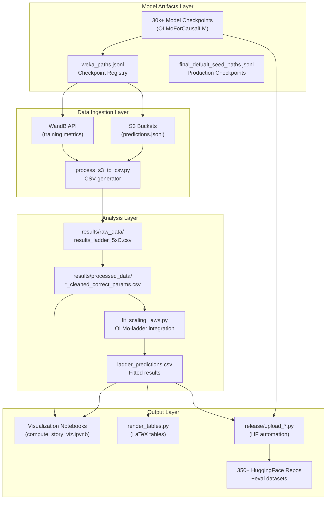
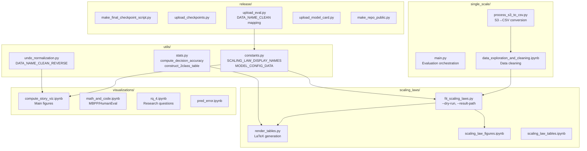
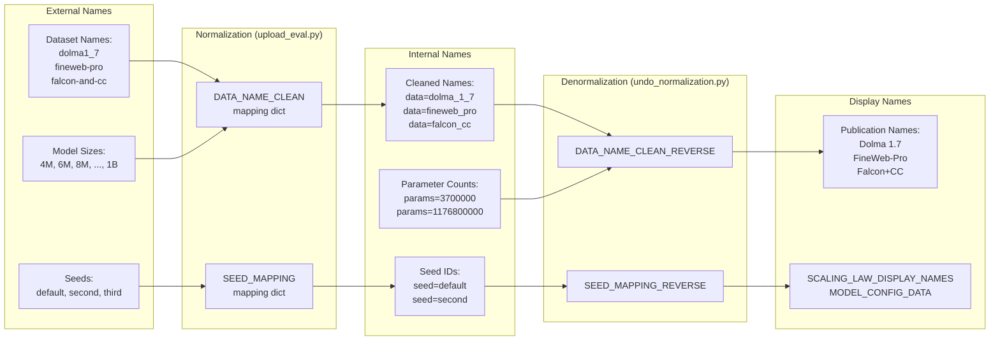
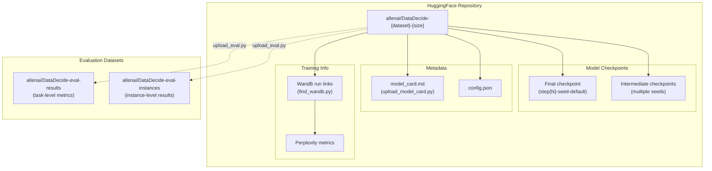

<!-- source: DeepWiki mcp.deepwiki.com · repo allenai/DataDecide · page 1 Overview · fetched 2026-10-26 -->

# Overview

<details>
<summary>Relevant source files</summary>

The following files were used as context for generating this wiki page:

- [README.md](README.md)

</details>


This document provides an introduction to the DataDecide repository, a comprehensive system for investigating how dataset composition impacts language model pretraining performance. The repository contains infrastructure for training evaluation, scaling law analysis, and result visualization across 30,000+ model checkpoints.

For detailed information about specific subsystems, see:
- Repository structure and organization: [Repository Structure](#1.1)
- Data recipes and model configurations: [Data Recipes and Model Variants](#1.2)
- Setting up the environment: [Getting Started](#2)
- Evaluation workflows: [Evaluation System](#3)
- Scaling law fitting and analysis: [Scaling Laws Analysis](#4)

## Purpose and Scope

The DataDecide repository addresses a fundamental question in language model development: **how can developers predict which pretraining dataset will perform best without training expensive large-scale models?** This codebase provides:

1. **Model Artifacts**: 30,000+ pretrained model checkpoints (`OLMoForCausalLM`) spanning 25 corpus variants and 14 model sizes (4M to 1B parameters)
2. **Evaluation Infrastructure**: Systems for processing evaluation results from S3 and Weights & Biases
3. **Scaling Law Analysis**: Tooling for fitting 36 different scaling law configurations to predict performance trends
4. **Visualization Tools**: Notebooks for generating publication-ready figures and tables
5. **Distribution System**: Automated HuggingFace upload pipelines for 350+ model repositories

The repository does **not** contain the actual model training code or the raw pretraining data. For data recipe specifications, see the [allenai/DataDecide-data-recipes](https://huggingface.co/datasets/allenai/DataDecide-data-recipes) dataset on HuggingFace.

Sources: [README.md:1-123]()

## Research Scope

DataDecide investigates the impact of dataset composition through systematic ablations:

**Corpus Sources Tested** (25 variants):
- Base corpora: Dolma1.7, C4, FineWeb-Pro/Edu, Falcon, DCLM-Baseline
- Component ablations: Dolma1.7 without code, math/code, Reddit, or Flan
- Quality filtering: Multiple quality classifiers at 3%, 7%, 10%, 20% thresholds
- Mixture experiments: DCLM-Baseline/Dolma1.7 at 25%/75%, 50%/50%, 75%/25%

**Model Scale Coverage** (14 sizes):
```
4M, 6M, 8M, 10M, 14M, 16M, 20M, 60M, 90M, 150M, 300M, 530M, 750M, 1B parameters
```

**Evaluation Benchmarks** (10 OLMES tasks):
- MMLU, HellaSwag, ARC-Challenge, ARC-Easy, PIQA
- CommonsenseQA, Social IQa, OpenBookQA, BoolQ, Winogrande

All models train to a 100:1 token-to-parameter ratio (e.g., 1B parameter model sees 100B tokens).

Sources: [README.md:14-69](), [README.md:73-89]()

## System Architecture

The DataDecide system consists of four major subsystems that process data from raw model checkpoints to published results:



**System Architecture: Data Flow from Model Checkpoints to Published Artifacts**

The architecture follows a linear pipeline pattern:

1. **Model Artifacts Layer**: Trained checkpoints are registered in `weka_paths.jsonl` and `final_defualt_seed_paths.jsonl`
2. **Data Ingestion Layer**: `process_s3_to_csv.py` fetches evaluation predictions from S3 and enriches them with WandB training statistics
3. **Analysis Layer**: Data flows through cleaning (`data_exploration_and_cleaning.ipynb`) to scaling law fitting (`fit_scaling_laws.py`)
4. **Output Layer**: Results are visualized and uploaded to HuggingFace via automated scripts

Sources: [README.md:1-123]()

## Key Components and Code Entities

The repository is organized into specialized directories, each containing scripts and utilities for specific functions:



**Key Components: Directory Structure and Code Entry Points**

| Directory | Primary Functions | Key Entry Points |
|-----------|------------------|------------------|
| `single_scale/` | S3 data processing, per-task evaluation | `main.py`, `process_s3_to_csv.py` |
| `scaling_laws/` | Scaling law fitting, statistical analysis | `fit_scaling_laws.py`, `render_tables.py` |
| `visualizations/` | Figure generation, error analysis | `compute_story_viz.ipynb`, `math_and_code.ipynb` |
| `release/` | HuggingFace upload automation | `upload_eval.py`, `upload_checkpoints.py` |
| `utils/` | Shared constants, data transformations | `constants.py`, `stats.py`, `undo_normalization.py` |
| `results/` | Data storage (raw, processed, outputs) | `raw_data/`, `processed_data/`, `outputs2/` |

Sources: [README.md:1-123]()

## Data Normalization Pattern

A critical architectural pattern is the bidirectional data transformation between internal processing and external presentation:



**Data Normalization Flow: External ↔ Internal ↔ Display Names**

This pattern serves three purposes:
1. **Normalization** (`DATA_NAME_CLEAN`, `SEED_MAPPING` in `upload_eval.py`): Converts HuggingFace repository names to consistent internal identifiers
2. **Processing**: All analysis uses normalized names to ensure consistency
3. **Denormalization** (`DATA_NAME_CLEAN_REVERSE`, `SEED_MAPPING_REVERSE` in `undo_normalization.py`): Converts internal names back to human-readable display names for figures and tables

Sources: [README.md:14-42]()

## Model Repository Structure

Each of the 350 HuggingFace model repositories follows a consistent structure:



**HuggingFace Repository Organization**

The naming convention follows: `allenai/DataDecide-{dataset}-{size}` where:
- `{dataset}`: One of 25 corpus variants (e.g., `dolma1_7`, `fineweb-pro`, `dclm-baseline-qc-10p`)
- `{size}`: Model parameter count (e.g., `4M`, `150M`, `1B`)

Example repositories:
- `allenai/DataDecide-dolma1_7-1B`
- `allenai/DataDecide-fineweb-edu-300M`
- `allenai/DataDecide-dclm-baseline-qc-20p-750M`

Sources: [README.md:14-42](), [README.md:87-89]()

## Training Configuration Summary

All models follow standardized hyperparameter schedules derived from parameter count:

| Model Size | Hidden Dim | Layers | Heads | Batch Size | Learning Rate | Training Steps | Total Tokens |
|-----------|-----------|--------|-------|------------|---------------|----------------|--------------|
| 4M | 64 | 8 | 8 | 32 | 1.4e-02 | 5,725 | 0.4B |
| 10M | 144 | 8 | 8 | 32 | 1.0e-02 | 15,117 | 1.0B |
| 60M | 384 | 16 | 12 | 96 | 5.8e-03 | 29,042 | 5.7B |
| 150M | 768 | 12 | 12 | 192 | 4.2e-03 | 38,157 | 15.0B |
| 300M | 1,024 | 16 | 16 | 320 | 3.3e-03 | 45,787 | 30.0B |
| 530M | 1,344 | 16 | 16 | 448 | 2.8e-03 | 57,786 | 53.0B |
| 1B | 2,048 | 16 | 16 | 704 | 2.1e-03 | 69,369 | 100.0B |

Key observations:
- All models train to 100:1 token-to-parameter ratio
- Learning rate decreases with model size
- Batch size increases with model size
- Hidden dimension and layer count scale with parameter count

The complete hyperparameter table is available in [README.md:93-109]() and programmatically in `utils/constants.py` as `MODEL_CONFIG_DATA`.

Sources: [README.md:93-109]()

## Accessing Repository Artifacts

The DataDecide repository provides three primary access points:

### 1. Model Checkpoints (HuggingFace Hub)

Load models using the `hf_olmo` library:

```python
from hf_olmo import OLMoForCausalLM

# Load final checkpoint
model = OLMoForCausalLM.from_pretrained(
    "allenai/DataDecide-dolma1_7-1B",
    revision="step69369-seed-default"
)
```

Browse all models: [README.md:14-42]() contains links to all 350 model repositories.

### 2. Evaluation Results (HuggingFace Datasets)

```python
from datasets import load_dataset

# Task-level metrics (accuracy, perplexity, etc.)
task_results = load_dataset("allenai/DataDecide-eval-results")

# Instance-level predictions (per-example outputs)
instance_results = load_dataset("allenai/DataDecide-eval-instances")
```

### 3. Local Processing (Clone Repository)

For running evaluations, fitting scaling laws, or generating visualizations:

```bash
git clone https://github.com/allenai/DataDecide
cd DataDecide

# Setup depends on component - see Getting Started (#2)
conda env create -f single_scale/environment.yml  # For evaluation
conda env create -f scaling_laws/environment.yml  # For scaling laws
```

Checkpoint registries for local processing:
- `weka_paths.jsonl`: Comprehensive checkpoint registry
- `final_defualt_seed_paths.jsonl`: Production checkpoint paths

Sources: [README.md:44-52](), [README.md:87-89]()

## Citation

When using DataDecide in research, cite:

```bibtex
@article{MagnussonDataDecide2025,
    title={{DataDecide: How to Predict Best Pretraining Data with Small Experiments}},
    author={Ian Magnusson and Nguyen Tai and Ben Bogin and David Heineman and 
            Jena Hwang and Luca Soldaini and Akshita Bhagia and Jiacheng Liu and 
            Dirk Groeneveld and Oyvind Tafjord and Noah A. Smith and 
            Pang Wei Koh and Jesse Dodge},
    year={2025},
    journal={arXiv preprint},
}
```

Paper: [https://arxiv.org/abs/2504.11393](https://arxiv.org/abs/2504.11393)

Sources: [README.md:111-122]()

---

