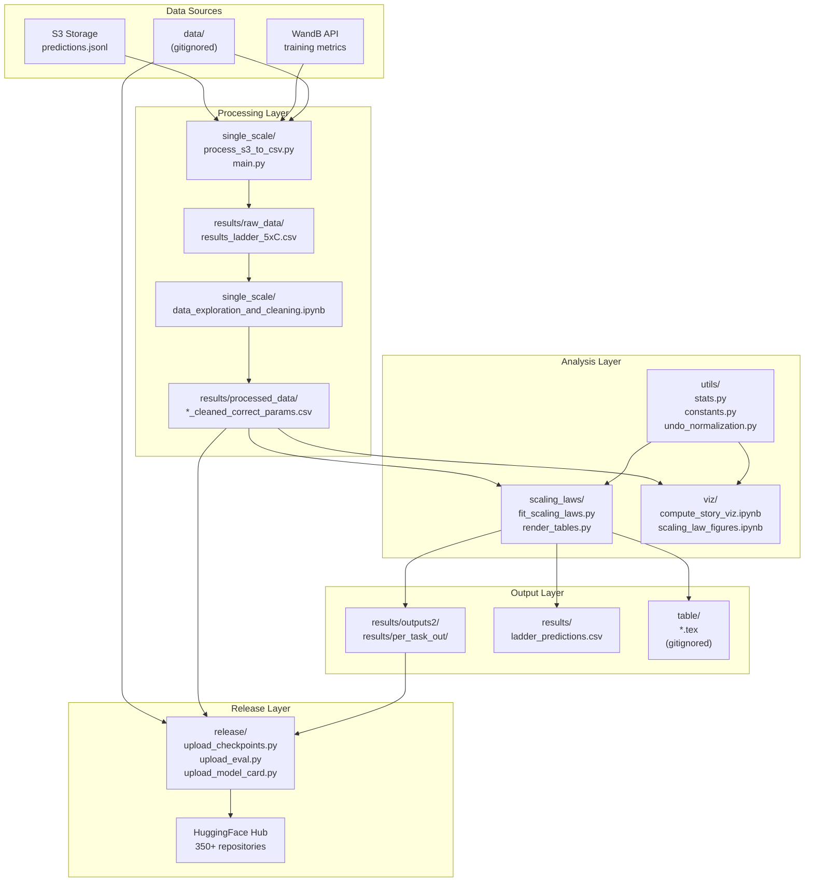
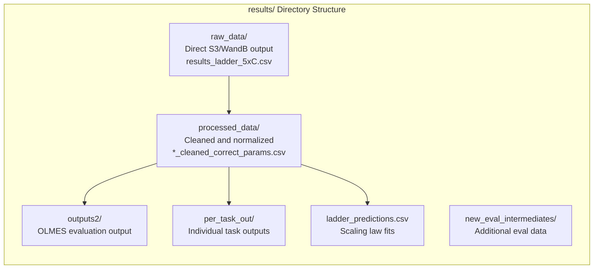
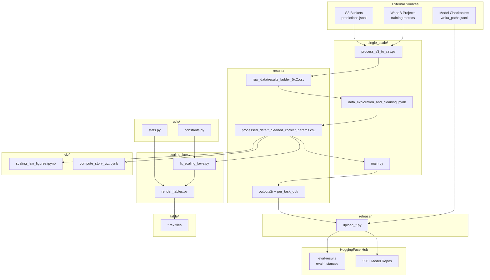

<!-- source: DeepWiki mcp.deepwiki.com · repo allenai/DataDecide · page 1.1 Repository Structure · fetched 2026-10-26 -->

# Repository Structure

Relevant source files

The following files were used as context for generating this wiki page:

- [.gitignore](.gitignore)
- [README.md](README.md)
- [results/readme.md](results/readme.md)
- [viz/pred_error.ipynb](viz/pred_error.ipynb)

This document describes the high-level organization of directories and major components in the DataDecide repository. It provides a map of where different functionality resides and how the directory structure supports the evaluation, analysis, and release workflows.

For details about specific data recipes and model variants, see [Data Recipes and Model Variants](#1.2). For information about accessing the models and evaluation data, see [Accessing Models and Data](#2.2).

---

## Purpose and Scope

The DataDecide repository is organized to support three primary workflows:
1. **Evaluation**: Processing predictions from S3/WandB and computing metrics
2. **Analysis**: Fitting scaling laws and generating statistical summaries
3. **Release**: Uploading models and results to HuggingFace

The directory structure reflects this separation of concerns, with dedicated folders for each workflow stage.

---

## Top-Level Directory Structure

The repository contains the following top-level directories:

| Directory | Purpose | Key Contents |
|-----------|---------|--------------|
| `single_scale/` | Single-scale evaluation pipeline | S3 data processing, per-task analysis scripts |
| `scaling_laws/` | Scaling law fitting and analysis | Fitting scripts, configuration files, analysis notebooks |
| `viz/` | Visualization and presentation | Story visualization, error analysis, math/code notebooks |
| `release/` | HuggingFace upload automation | Upload scripts, model card generation, parallelization tools |
| `results/` | Data storage and intermediate outputs | Raw data, processed data, evaluation outputs |
| `utils/` | Shared utilities and constants | Display name mappings, data normalization, statistical functions |
| `data/` | Input data (gitignored) | Model checkpoints, data recipes |
| `OLMo-ladder/` | External scaling law library (gitignored) | Core fitting algorithms |
| `table/` | LaTeX table outputs (gitignored) | Generated publication tables |

**Sources:** [.gitignore:1-13](), [README.md:1-122]()

---

## Directory Dependency Graph

**Sources:** [.gitignore:1-13](), [results/readme.md:1-18]()

---

## Core Directories

### `single_scale/` - Evaluation Pipeline

Contains scripts for processing evaluation results at single model scales. This is the entry point for converting raw S3 predictions into structured CSV data.

**Key Components:**
- `process_s3_to_csv.py` - Fetches predictions from S3 and enriches with WandB training statistics
- `main.py` - Runs per-task evaluation analysis
- `data_exploration_and_cleaning.ipynb` - Cleans and normalizes raw data

**Outputs:** Produces files in `results/raw_data/` and `results/outputs2/`

**Sources:** [results/readme.md:8-14]()

---

### `scaling_laws/` - Scaling Law Analysis

Contains the core scaling law fitting infrastructure, including scripts to fit 36 different scaling law configurations across all datasets and model sizes.

**Key Components:**
- `fit_scaling_laws.py` - Main fitting script, integrates with OLMo-ladder library
- `render_tables.py` - Generates LaTeX tables for publication
- `scaling_law_figures.ipynb` - Visualization of fitted scaling curves
- `scaling_law_tables.ipynb` - Tabular summaries of scaling law results

**Dependencies:** Requires `OLMo-ladder/` library (external, gitignored)

**Outputs:** Produces `results/ladder_predictions.csv` and `table/*.tex` files

**Sources:** [.gitignore:12](), [results/readme.md:17-18]()

---

### `viz/` - Visualization Notebooks

Contains Jupyter notebooks for creating presentation-ready visualizations and specialized analyses.

**Key Components:**
- `compute_story_viz.ipynb` - Main story visualization with data denormalization
- `math_and_code.ipynb` - Analysis of MBPP and HumanEval benchmarks
- `rq_4.ipynb` - Research question 4 analysis
- `pred_error.ipynb` - Prediction error analysis
- `max_err_to_pred_acc.ipynb` - Maximum error to prediction accuracy mapping

**Dependencies:** Uses `utils/undo_normalization.py` for reversing data transformations

**Sources:** [viz/pred_error.ipynb:1-4]()

---

### `release/` - Distribution Automation

Contains scripts for uploading models and evaluation results to HuggingFace Hub. Handles the distribution of 350+ model repositories.

**Key Components:**
- `upload_checkpoints.py` - Uploads model checkpoints
- `upload_eval.py` - Uploads evaluation results with data normalization
- `upload_model_card.py` - Updates model cards
- `make_repo_public.py` - Sets repository visibility
- `make_final_checkpoint_script.py` - Generates upload scripts

**Parallelization:** Uses GNU Parallel for efficient batch uploads

**Sources:** [README.md:14-42]()

---

### `results/` - Data Storage

Central data repository containing evaluation outputs at various processing stages. This directory is largely gitignored to avoid committing large datasets.

| Subdirectory | Contents | Generated By |
|--------------|----------|--------------|
| `raw_data/` | Raw S3 and WandB results | `single_scale/process_s3_to_csv.py` |
| `processed_data/` | Cleaned and normalized results | `single_scale/data_exploration_and_cleaning.ipynb` |
| `outputs2/` | OLMES suite evaluation outputs | `single_scale/main.py` |
| `per_task_out/` | Per-task evaluation outputs | `single_scale/main.py` with task-specific flags |
| `new_eval_intermediates/` | Additional evaluation data | External `new-evals` repository |
| `ladder_predictions.csv` | Scaling law fitted results | `scaling_laws/fit_scaling_laws.py` |

**Data Retrieval:** These files can be obtained from the Google Drive link referenced in `results/readme.md` or recomputed from source.

**Sources:** [results/readme.md:1-18](), [.gitignore:6-11]()

---

### `utils/` - Shared Utilities

Contains shared utility functions and configuration constants used across the codebase.

**Key Components:**
- `constants.py` - Display names, model configurations, benchmark definitions
- `stats.py` - Statistical analysis functions (`compute_decision_accuracy`, `construct_2class_table`)
- `undo_normalization.py` - Reverses data normalization for presentation
  - `DATA_NAME_CLEAN_REVERSE` - Maps internal names back to descriptive names
  - `SEED_MAPPING_REVERSE` - Maps seed identifiers to display values
  - `undo_changes_to_df()` - Main denormalization function

**Sources:** [README.md:1-122]()

---

## Data Flow Through Directory Structure

The following diagram shows how data flows through the directory structure from raw inputs to final outputs:

**Sources:** [results/readme.md:1-18](), [.gitignore:1-13]()

---

## File Organization Patterns

### Checkpoint Registry Files

The repository uses JSONL files to track model checkpoint locations:

- `weka_paths.jsonl` - Comprehensive registry of all checkpoint paths
- `final_defualt_seed_paths.jsonl` - Production checkpoints for default seed

These files are referenced by both evaluation and release scripts to locate model artifacts.

### Configuration and Metadata

- `README.md` - Main repository documentation with model links (350+ HuggingFace repositories)
- `.gitignore` - Excludes large data directories and generated outputs
- Environment files (not shown) - Conda environment specifications for different components

**Sources:** [README.md:1-122](), [.gitignore:1-13]()

---

## Ignored Directories

The following directories are excluded from version control but are essential for operation:

| Directory | Purpose | Size Characteristics |
|-----------|---------|---------------------|
| `data/` | Input data and checkpoints | Large (30k+ checkpoints) |
| `results/outputs2/` | OLMES evaluation outputs | Large (350 models × 10 benchmarks) |
| `results/per_task_out/` | Per-task evaluation outputs | Large (350 models × individual tasks) |
| `results/processed_data/` | Cleaned CSV files | Medium |
| `results/raw_data/` | Raw S3/WandB data | Medium |
| `OLMo-ladder/` | External scaling law library | Small (dependency) |
| `table/` | Generated LaTeX tables | Small |

These directories must be populated either by downloading from the Google Drive link or by running the processing scripts.

**Sources:** [.gitignore:1-13](), [results/readme.md:1-18]()

---

