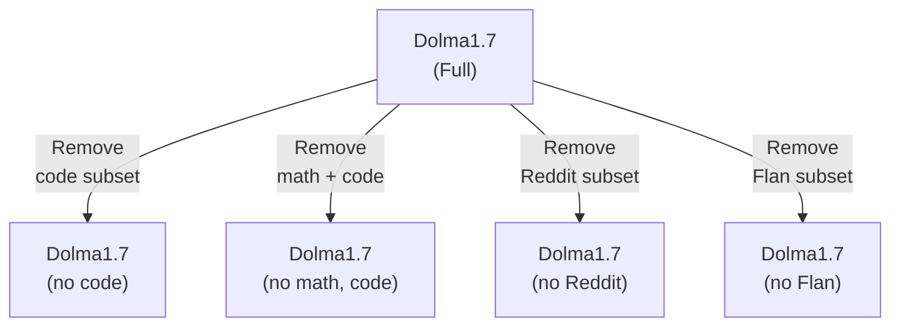
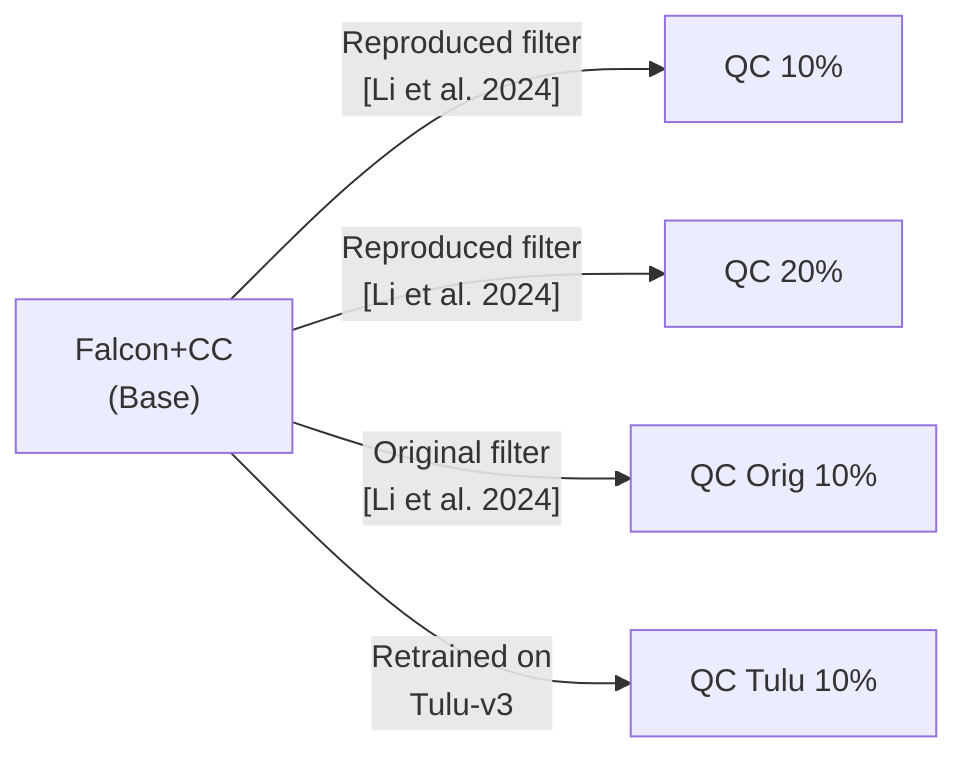
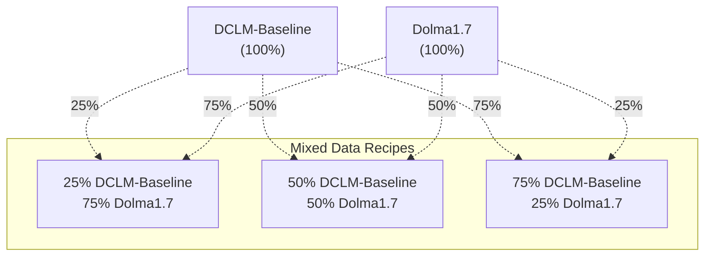
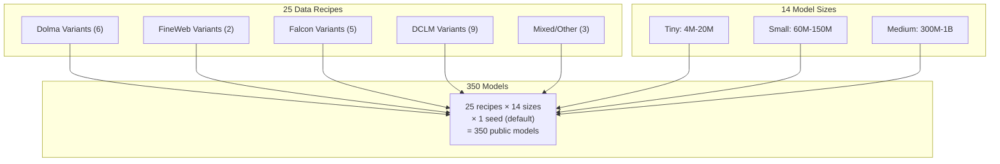
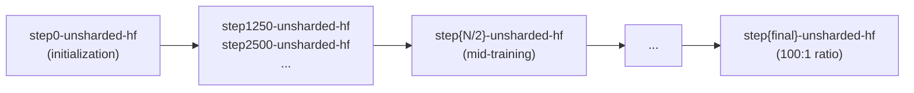

<!-- source: DeepWiki mcp.deepwiki.com · repo allenai/DataDecide · page 1.2 Data Recipes and Model Variants · fetched 2026-10-26 -->

# Data Recipes and Model Variants

<details>
<summary>Relevant source files</summary>

The following files were used as context for generating this wiki page:

- [README.md](README.md)
- [checkpoints/final_defualt_seed_paths.jsonl](checkpoints/final_defualt_seed_paths.jsonl)
- [checkpoints/weka_paths.jsonl](checkpoints/weka_paths.jsonl)

</details>


This page documents the 25 data corpora variants (data recipes) and 14 model sizes that comprise the DataDecide experimental matrix, resulting in 350 unique model configurations (25 datasets × 14 sizes × 1 default seed publicly released).

**Scope**: This page covers the data recipe taxonomy, model size specifications, and their combinations. For information about accessing the models, see [Accessing Models and Data](#2.2). For evaluation metrics and benchmarks, see [Single-Scale Evaluation](#3.1).

---

## Data Recipe Taxonomy

The 25 data recipes fall into five major categories: base corpora, ablation variants, quality-filtered variants, mixed combinations, and enhanced versions.

### Base Corpora

Five foundational datasets serve as starting points for variants:

| Recipe | Source | Description | Key Characteristics |
|--------|--------|-------------|---------------------|
| **Dolma1.7** | [Soldaini et al., 2024] | 2.3T-token corpus for open research | Balanced mix of web, code, math, social media, instruction data |
| **C4** | [Raffel et al., 2019] | Colossal Clean Crawled Corpus | Heuristically filtered April 2019 Common Crawl |
| **FineWeb-Pro** | [Zhou et al., 2024] | Model-driven cleaned web corpus | Advanced quality filtering on FineWeb |
| **FineWeb-Edu** | [Ben Allal et al., 2024] | Educational content focused | Deduplicated educational web pages |
| **Falcon** | [Penedo et al., 2023] | RefinedWeb corpus | Aggressively filtered/deduplicated Common Crawl through June 2023 |

Sources: [README.md:60-66]()

### Ablation Variants

Dolma1.7 is systematically ablated to remove specific data sources:



**Ablation Configurations:**
- **Dolma1.7 (no code)**: Removes all code-related content
- **Dolma1.7 (no math, code)**: Removes both mathematical and code content
- **Dolma1.7 (no Reddit)**: Removes social media discussions
- **Dolma1.7 (no Flan)**: Removes instruction-tuning data

Sources: [README.md:60]()

### Quality-Filtered Variants

Multiple quality filtering strategies are applied to base corpora:

#### Falcon+CC Quality Control Variants



| Variant | Filter Method | Retention Rate |
|---------|--------------|----------------|
| Falcon+CC (QC 10%) | Reproduced classifier from [Li et al. 2024] | Top 10% |
| Falcon+CC (QC 20%) | Reproduced classifier from [Li et al. 2024] | Top 20% |
| Falcon+CC (QC Orig 10%) | Original classifier from [Li et al. 2024] | Top 10% |
| Falcon+CC (QC Tulu 10%) | Classifier retrained on Tulu-v3 pre-release | Top 10% |

Sources: [README.md:66]()

#### DCLM-Baseline Quality Control Variants

The DCLM-Baseline corpus (state-of-the-art Common Crawl with optimized deduplication and cleaning) has six quality-filtered variants:

| Variant | Primary Filter | Secondary Filter | Description |
|---------|---------------|------------------|-------------|
| DCLM-Baseline (QC 7% FW2) | DCLM classifier (top 7%) | FineWeb-edu 2+ score | Dual-filter approach |
| DCLM-Baseline (QC 7% FW3) | DCLM classifier (top 7%) | FineWeb-edu 3+ score | Stricter dual-filter |
| DCLM-Baseline (QC FW 3%) | FineWeb-edu classifier | N/A | Top 3% by educational quality |
| DCLM-Baseline (QC FW 10%) | FineWeb-edu classifier | N/A | Top 10% by educational quality |
| DCLM-Baseline (QC 10%) | Reproduced DCLM classifier | N/A | Top 10% by DCLM quality metric |
| DCLM-Baseline (QC 20%) | Reproduced DCLM classifier | N/A | Top 20% by DCLM quality metric |

Sources: [README.md:67]()

### Mixed Combinations

Three fractional mixing ratios combine DCLM-Baseline with Dolma1.7:



Sources: [README.md:68]()

### Enhanced Dolma Variant

- **Dolma1.6++**: Dolma 1.6 augmented with additional sources from Dolma 1.7 (RedPajama's arxiv subset, openwebmath, algebraic stack, flan, starcoder, falcon)

Sources: [README.md:61]()

---

## Model Size Configuration

The DataDecide suite includes 14 model sizes ranging from 4M to 1B parameters, each optimized with size-appropriate hyperparameters.

### Model Size Progression

```mermaid
graph LR
    S4M["4M"]
    S6M["6M"]
    S8M["8M"]
    S10M["10M"]
    S14M["14M"]
    S16M["16M"]
    S20M["20M"]
    S60M["60M"]
    S90M["90M"]
    S150M["150M"]
    S300M["300M"]
    S530M["530M"]
    S750M["750M"]
    S1B["1B"]
    
    S4M --> S6M --> S8M --> S10M --> S14M --> S16M --> S20M
    S20M --> S60M --> S90M --> S150M --> S300M --> S530M --> S750M --> S1B
    
    style S4M fill:#f9f9f9
    style S1B fill:#f9f9f9
```



### Hyperparameter Specifications

All models are trained with a token-to-parameter ratio of 100:1 (e.g., 1B parameters → 100B tokens).

| Model Size | Parameters | Hidden Dim | Heads | Layers | Batch Size | Learning Rate | Training Steps | Tokens |
|------------|------------|------------|-------|--------|------------|---------------|----------------|--------|
| 4M | 3.7M | 64 | 8 | 8 | 32 | 1.4e-02 | 5,725 | 0.4B |
| 6M | 6.0M | 96 | 8 | 8 | 32 | 1.2e-02 | 9,182 | 0.6B |
| 8M | 8.5M | 128 | 8 | 8 | 32 | 1.1e-02 | 13,039 | 0.9B |
| 10M | 9.9M | 144 | 8 | 8 | 32 | 1.0e-02 | 15,117 | 1.0B |
| 14M | 14.4M | 192 | 8 | 8 | 32 | 9.2e-03 | 21,953 | 1.4B |
| 16M | 16.0M | 208 | 8 | 8 | 32 | 8.9e-03 | 24,432 | 1.6B |
| 20M | 19.1M | 192 | 8 | 16 | 64 | 8.4e-03 | 14,584 | 1.9B |
| 60M | 57.1M | 384 | 12 | 16 | 96 | 5.8e-03 | 29,042 | 5.7B |
| 90M | 97.9M | 528 | 12 | 16 | 160 | 4.9e-03 | 29,901 | 9.8B |
| 150M | 151.9M | 768 | 12 | 12 | 192 | 4.2e-03 | 38,157 | 15.0B |
| 300M | 320.0M | 1,024 | 16 | 16 | 320 | 3.3e-03 | 45,787 | 30.0B |
| 530M | 530.1M | 1,344 | 16 | 16 | 448 | 2.8e-03 | 57,786 | 53.0B |
| 750M | 681.3M | 1,536 | 16 | 16 | 576 | 2.5e-03 | 63,589 | 75.0B |
| 1B | 1176.8M | 2,048 | 16 | 16 | 704 | 2.1e-03 | 69,369 | 100.0B |

**Architecture Notes:**
- All models use 8-layer depth initially, transitioning to 12-16 layers for larger sizes
- Attention head count scales from 8 (small models) to 16 (large models)
- Learning rate follows inverse square root scaling with model size
- Batch size increases with model size to maintain training efficiency

Sources: [README.md:94-109]()

---

## The Model Matrix: 350 Public Models

The complete experimental design crosses 25 data recipes with 14 model sizes, creating 350 publicly released models (using the default seed).

### HuggingFace Naming Convention

Models follow the pattern: `allenai/DataDecide-{dataset_name}-{size}`

**Dataset Name Mapping:**
- Internal names use underscores and abbreviated formats (e.g., `dolma1_7`, `dclm_baseline`)
- Quality control variants append filter type (e.g., `falcon-and-cc-qc-10p`)
- Mixed datasets use explicit proportions (e.g., `dclm-baseline-50p-dolma1.7-50p`)

**Example Model URLs:**
```
allenai/DataDecide-dolma1_7-4M
allenai/DataDecide-dolma1_7-1B
allenai/DataDecide-falcon-and-cc-qc-10p-300M
allenai/DataDecide-dclm-baseline-50p-dolma1.7-50p-530M
```

Sources: [README.md:14-42]()

### Complete Recipe × Size Matrix



**Additional Training Runs:**
- Each configuration has 3 random seeds (seeds: default, 14, 15)
- Total checkpoints exceed 30,000 across all seeds and intermediate steps
- Intermediate checkpoints saved at regular intervals (every ~1,250 steps for small models, every ~1,250-2,500 steps for large models)

Sources: [README.md:12](), [README.md:15]()

---

## Checkpoint Registry System

The codebase maintains comprehensive checkpoint tracking through JSONL registry files.

### Registry File Structure

**Primary Registry: `weka_paths.jsonl`**

Each line contains:
```json
{
  "checkpoints_location": "weka://oe-eval-default/ai2-llm/checkpoints/OLMo-ladder/davidh/{model_name}",
  "revisions": ["step{N}-unsharded-hf", ...],
  "model_name": "{dataset}-{size}-{seed}"
}
```

**Example Entry:**
```json
{
  "checkpoints_location": "weka://oe-eval-default/ai2-llm/checkpoints/OLMo-ladder/davidh/dolma17-60M-5xC-15",
  "revisions": ["step6250-unsharded-hf", "step3750-unsharded-hf", ..., "step29042-unsharded-hf"],
  "model_name": "dolma17-60M-15"
}
```

Sources: [checkpoints/weka_paths.jsonl:61-65]()

### Model Naming in Registry

Internal checkpoint names differ from public HuggingFace names:

**Mapping Pattern:**
```
Internal: {dataset_shortname}-{size}-{suffix}
Public:   DataDecide-{dataset_name}-{size}

Examples:
dolma17-60M-15 → DataDecide-dolma1_7-60M
falcon_and_cc_tulu_qc_top10-90M-14 → DataDecide-falcon-and-cc-qc-tulu-10p-90M
dclm_fw_top3-20M-15 → DataDecide-dclm-baseline-qc-fw-3p-20M
```

**Seed Suffixes:**
- Default seed: `-6198` or base name
- Seed 14: `-14` suffix
- Seed 15: `-15` suffix
- Training configuration suffix: `-5xC` (5× compute budget)

Sources: [checkpoints/weka_paths.jsonl:1-10]()

### Checkpoint Revisions

Each model has multiple checkpoint revisions representing different training steps:



**Checkpoint Naming:**
- Format: `step{step_number}-unsharded-hf`
- Final step varies by model size (e.g., 5,725 for 4M, 69,369 for 1B)
- Intermediate checkpoints saved at ~1,250 step intervals
- All checkpoints converted to HuggingFace format (`-hf` suffix)
- Unsharded format for direct loading

Sources: [checkpoints/weka_paths.jsonl:1-10]()

---

## Data Recipe Details Reference

### Complete Recipe List with Code Identifiers

| Public Name | Internal Identifier | Category | Base Source |
|-------------|-------------------|----------|-------------|
| dolma1_7 | `dolma17` | Base | Dolma 1.7 |
| dolma1_7-no-code | `no_code` | Ablation | Dolma 1.7 |
| dolma1_7-no-math-code | `no_math_no_code` | Ablation | Dolma 1.7 |
| dolma1_7-no-reddit | `no_reddit` | Ablation | Dolma 1.7 |
| dolma1_7-no-flan | `no_flan` | Ablation | Dolma 1.7 |
| dolma1_6plus | `dolma16plus` | Enhanced | Dolma 1.6++ |
| c4 | `c4` | Base | C4 |
| fineweb-pro | `fineweb_pro` | Base | FineWeb-Pro |
| fineweb-edu | `fineweb_edu` | Base | FineWeb-Edu |
| falcon | `falcon` | Base | Falcon RefinedWeb |
| falcon-and-cc | `falcon_and_cc` | Base | Falcon + CC |
| falcon-and-cc-qc-10p | `falcon_and_cc_qc_top10p` | Quality Control | Falcon + CC |
| falcon-and-cc-qc-20p | `falcon_and_cc_qc_top20p` | Quality Control | Falcon + CC |
| falcon-and-cc-qc-orig-10p | `falcon_and_cc_eli5_oh_top10p` | Quality Control | Falcon + CC |
| falcon-and-cc-qc-tulu-10p | `falcon_and_cc_tulu_qc_top10` | Quality Control | Falcon + CC |
| dclm-baseline | `dclm_baseline` | Base | DCLM-Baseline |
| dclm-baseline-qc-7p-fw2 | `dclm_ft7percentile_fw2` | Quality Control | DCLM-Baseline |
| dclm-baseline-qc-7p-fw3 | `dclm_ft7percentile_fw3` | Quality Control | DCLM-Baseline |
| dclm-baseline-qc-fw-3p | `dclm_fw_top3` | Quality Control | DCLM-Baseline |
| dclm-baseline-qc-fw-10p | `dclm_fw_top10` | Quality Control | DCLM-Baseline |
| dclm-baseline-qc-10p | `pos_eli5_oh_neg_dclm_refinedweb_steps_2000_lr3e4_top20p` | Quality Control | DCLM-Baseline |
| dclm-baseline-qc-20p | `dclm_qc_top20p` | Quality Control | DCLM-Baseline |
| dclm-baseline-25p-dolma1.7-75p | `dolma17-25p-DCLM-baseline-75p` | Mixed | Mix |
| dclm-baseline-50p-dolma1.7-50p | `dolma17-50p-DCLM-baseline-50p` | Mixed | Mix |
| dclm-baseline-75p-dolma1.7-25p | `dolma17-75p-DCLM-baseline-25p` | Mixed | Mix |

Sources: [README.md:18-42](), [checkpoints/weka_paths.jsonl:1-100]()

---

## Loading Models from Registry

Models can be loaded using the HuggingFace Hub with specific revisions:

```python
from hf_olmo import OLMoForCausalLM

# Load a specific checkpoint revision
model = OLMoForCausalLM.from_pretrained(
    "allenai/DataDecide-dolma1_7-1B",
    revision="step69369-seed-default"  # Final checkpoint
)
```

**Revision Format:**
- Default seed final: `step{N}-seed-default`
- Seed 14 final: `step{N}-seed-14`
- Seed 15 final: `step{N}-seed-15`
- Intermediate: `step{N}-unsharded-hf`

Sources: [README.md:49-52]()

---

