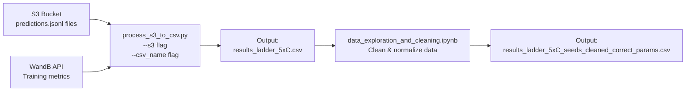
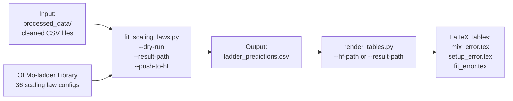

<!-- source: DeepWiki mcp.deepwiki.com · repo allenai/DataDecide · page 2 Getting Started · fetched 2026-10-26 -->

# Getting Started

<details>
<summary>Relevant source files</summary>

The following files were used as context for generating this wiki page:

- [requirements.txt](requirements.txt)
- [scaling_laws/README.md](scaling_laws/README.md)
- [single_scale/process_s3_to_csv.py](single_scale/process_s3_to_csv.py)
- [single_scale/readme.md](single_scale/readme.md)
- [single_scale/requirements.txt](single_scale/requirements.txt)
- [viz/readme.md](viz/readme.md)

</details>


This page provides installation instructions and initial setup for working with the DataDecide codebase. It covers environment configuration, dependency installation, and basic workflows to verify your setup. For detailed information about specific components, see [Evaluation System](#3), [Scaling Laws Analysis](#4), or [Visualization](#5).

## Prerequisites

Before setting up the DataDecide repository, ensure you have the following:

| Requirement | Purpose | Notes |
|-------------|---------|-------|
| **Python 3.10-3.11** | Runtime environment | Different components require different versions |
| **Conda** | Environment management | Miniconda or Anaconda |
| **Git LFS** | Large file tracking | Required for `.ipynb` files |
| **AWS Credentials** | S3 data access | For accessing evaluation results |
| **WandB Account** | Training metrics | For fetching perplexity and loss data |
| **HuggingFace Account** | Model and dataset access | For downloading models and uploading results |

**Sources:** [scaling_laws/README.md:6](), [viz/readme.md:1-9]()

## Component Architecture

The DataDecide repository is organized into three primary components, each with its own environment and dependencies:

```mermaid
graph TB
    subgraph SingleScale["Single-Scale Evaluation Component"]
        SS_ENV["conda env:<br/>DataDecide-single-scale<br/>Python 3.11"]
        SS_REQ["single_scale/requirements.txt"]
        SS_MAIN["single_scale/main.py"]
        SS_PROC["single_scale/process_s3_to_csv.py"]
        SS_CLEAN["single_scale/data_exploration_and_cleaning.ipynb"]
    end
    
    subgraph ScalingLaws["Scaling Laws Component"]
        SL_ENV["conda env:<br/>DataDecide-scaling-laws<br/>Python 3.10-3.11"]
        SL_REQ["scaling_laws/requirements.txt<br/>(via root requirements.txt)"]
        SL_FIT["scaling_laws/fit_scaling_laws.py"]
        SL_RENDER["scaling_laws/render_tables.py"]
        SL_NB["scaling_laws/notebooks/*.ipynb"]
    end
    
    subgraph Viz["Visualization Component"]
        VIZ_ENV["conda env:<br/>DataDecide-viz<br/>Python 3.10"]
        VIZ_REQ["viz/requirements.txt"]
        VIZ_STORY["viz/compute_story_viz.ipynb"]
        VIZ_MATH["viz/math_and_code.ipynb"]
        VIZ_SL["viz/scaling_law_*.ipynb"]
    end
    
    SS_ENV --> SS_REQ
    SS_REQ --> SS_MAIN
    SS_REQ --> SS_PROC
    SS_REQ --> SS_CLEAN
    
    SL_ENV --> SL_REQ
    SL_REQ --> SL_FIT
    SL_REQ --> SL_RENDER
    SL_REQ --> SL_NB
    
    VIZ_ENV --> VIZ_REQ
    VIZ_REQ --> VIZ_STORY
    VIZ_REQ --> VIZ_MATH
    VIZ_REQ --> VIZ_SL
```



**Diagram: Component Organization and Entry Points**

Each component can be set up independently depending on your needs. Most users will start with either the single-scale evaluation or scaling laws analysis.

**Sources:** [single_scale/readme.md:1-6](), [scaling_laws/README.md:1-58](), [viz/readme.md:1-9]()

## Environment Setup

### Single-Scale Evaluation Environment

This environment is used for processing evaluation results from S3, computing metrics, and performing per-task analysis.

```bash
# Create and activate environment
conda create -n DataDecide-single-scale python=3.11
conda activate DataDecide-single-scale

# Install dependencies
cd single_scale
pip install -r requirements.txt
```

**Key dependencies installed:**
- `ai2-olmo` - OLMo model implementation
- `lm_eval==0.4.3` - Language model evaluation framework
- `torch>=2.4,<2.5` - PyTorch for model loading
- `boto3` - AWS S3 access
- `wandb` - Weights & Biases integration
- `transformers>=4.45.0` - HuggingFace transformers

**Sources:** [single_scale/readme.md:1-6](), [single_scale/requirements.txt:1-29]()

### Scaling Laws Environment

This environment is used for fitting scaling law curves and generating analysis tables.

```bash
# Create and activate environment
conda create -n DataDecide-scaling-laws python=3.11
conda activate DataDecide-scaling-laws

# Install Git LFS (required for notebook files)
git lfs install  # or: brew install git-lfs

# Install dependencies from root directory
pip install -r requirements.txt

# Optional: Install OLMo-ladder locally for development
git clone -b datados https://github.com/allenai/OLMo-ladder OLMo-ladder
cd OLMo-ladder
pip install -e ".[plotting]"
```

**Key dependencies installed:**
- `ladder[plotting]` - Scaling law fitting algorithms (from OLMo-ladder)
- `pandas`, `numpy` - Data manipulation
- `matplotlib`, `plotly` - Visualization
- `huggingface_hub` - HuggingFace integration
- `datasets` - HuggingFace datasets library

**Sources:** [scaling_laws/README.md:6-30](), [requirements.txt:1-45]()

### Visualization Environment

This environment is used for creating publication-ready figures and interactive visualizations.

```bash
# Create and activate environment
conda create -n DataDecide-viz python=3.10
conda activate DataDecide-viz

# Install dependencies
cd viz
pip install -r requirements.txt
```

**Sources:** [viz/readme.md:1-9]()

## Quick Start Workflows

### Workflow 1: Process S3 Evaluation Results

This workflow fetches evaluation results from S3 and enriches them with WandB training statistics.



**Diagram: S3 Data Processing Workflow**

```bash
# Activate environment
conda activate DataDecide-single-scale

# Process results from S3
cd single_scale
python process_s3_to_csv.py \
    --s3 s3://ai2-llm/eval-results/downstream/eval-for-consistent-ranking-preemption-fixed \
    --csv_name "results_ladder_5xC.csv"

# Clean the data (run notebook)
jupyter notebook data_exploration_and_cleaning.ipynb
# Set DIRTY_OUT = False to generate cleaned data
# Set DIRTY_OUT = True to generate dirty data for some visualizations
```

The `process_s3_to_csv.py` script performs the following operations:

1. **S3 Discovery** - Calls `get_prediction_paths()` to scan S3 bucket [process_s3_to_csv.py:64-90]()
2. **Path Parsing** - Uses `parse_train_name()` to extract metadata from paths [process_s3_to_csv.py:177-210]()
3. **Metric Computation** - Calls `compute_metrics_from_file()` for each prediction file [process_s3_to_csv.py:98]()
4. **WandB Enrichment** - Fetches training stats via `fetch_wandb_data()` [process_s3_to_csv.py:223-248]()
5. **Compute Calculation** - Applies `calc_compute()` to determine FLOPs [process_s3_to_csv.py:165-175]()

**Sources:** [single_scale/readme.md:8-19](), [single_scale/process_s3_to_csv.py:1-624]()

### Workflow 2: Fit Scaling Laws

This workflow fits scaling law curves to the processed evaluation results.



**Diagram: Scaling Law Fitting Workflow**

```bash
# Activate environment
conda activate DataDecide-scaling-laws

cd scaling_laws

# Test with dry-run (uses subset of results)
python fit_scaling_laws.py \
    --result-path ladder_predictions_dry_run.csv \
    --dry-run

# Fit on all metrics
python fit_scaling_laws.py \
    --result-path ladder_predictions.csv

# Fit and push results to HuggingFace
python fit_scaling_laws.py \
    --result-path ladder_predictions.csv \
    --push-to-hf allenai/DataDecide-eval-results

# Render tables using the fitted results
python render_tables.py \
    --result-path ladder_predictions.csv
```

The `fit_scaling_laws.py` script:
- Loads processed evaluation data
- Fits 36 different scaling law configurations (2-param, 3-param, 5-param variants)
- Uses the OLMo-ladder library for curve fitting
- Outputs predictions to CSV
- Optionally pushes results to HuggingFace

**Sources:** [scaling_laws/README.md:21-49]()

### Workflow 3: Generate Visualizations

This workflow creates figures and interactive plots from the scaling law fits.

```bash
# Activate environment
conda activate DataDecide-viz

cd viz

# Launch Jupyter to run visualization notebooks
jupyter notebook

# Key notebooks to run:
# - compute_story_viz.ipynb: Main story visualization
# - math_and_code.ipynb: MBPP and HumanEval analysis
# - scaling_law_figures.ipynb: Scaling law curve plots
# - scaling_law_tables.ipynb: Interactive table rendering
```

**Sources:** [scaling_laws/README.md:51-58]()

## Accessing Models and Data

### HuggingFace Model Repository

The DataDecide project provides 350+ pretrained models on HuggingFace Hub:

```python
from transformers import AutoModelForCausalLM, AutoTokenizer

# Example: Load a specific checkpoint
model_name = "allenai/DataDecide-dolma-1B"
model = AutoModelForCausalLM.from_pretrained(model_name)
tokenizer = AutoTokenizer.from_pretrained(model_name)
```

**Model naming convention:**
```
allenai/DataDecide-{dataset}-{size}
```

Where:
- `{dataset}` is one of 25 data corpora (e.g., `dolma`, `fineweb`, `DCLM`)
- `{size}` is one of 14 model sizes (`4M`, `7.5M`, `15M`, `30M`, `60M`, `150M`, `300M`, `530M`, `750M`, `1B`)

For the complete list of available models, see [Overview](#1).

### Evaluation Results Datasets

Evaluation results are available as HuggingFace datasets:

```python
from datasets import load_dataset

# Load task-level evaluation results
eval_results = load_dataset("allenai/DataDecide-eval-results")

# Load instance-level predictions
eval_instances = load_dataset("allenai/DataDecide-eval-instances")

# Load scaling law predictions
ladder_predictions = load_dataset("allenai/DataDecide-eval-results", data_files="ladder_predictions.csv")
```

**Sources:** Based on high-level system architecture diagrams

## Verification Steps

After setting up your environment, verify the installation:

### Verify Single-Scale Environment

```bash
conda activate DataDecide-single-scale
python -c "import torch; import transformers; import lm_eval; print('Single-scale environment OK')"
```

### Verify Scaling Laws Environment

```bash
conda activate DataDecide-scaling-laws

# Test scaling law fitting on subset
cd scaling_laws
python fit_scaling_laws.py --dry-run

# Expected output: ladder_predictions_dry_run.csv
# Should complete without errors
```

### Verify Visualization Environment

```bash
conda activate DataDecide-viz

# Test notebook execution
cd viz
jupyter nbconvert --execute --to notebook --inplace compute_story_viz.ipynb --ExecutePreprocessor.timeout=600
```

**Sources:** [scaling_laws/README.md:9-13]()

## Common Setup Issues

| Issue | Solution |
|-------|----------|
| **Git LFS not installed** | Run `brew install git-lfs` (macOS) or `apt-get install git-lfs` (Linux), then `git lfs install` |
| **CUDA version mismatch** | Ensure PyTorch version matches your CUDA version: `pip install torch==2.4.0+cu118` |
| **WandB authentication error** | Run `wandb login` and enter your API key |
| **S3 access denied** | Configure AWS credentials: `aws configure` |
| **HuggingFace rate limiting** | Authenticate with: `huggingface-cli login` |
| **NumPy version conflict** | Ensure `numpy<2` is installed as specified in requirements |

## Next Steps

After completing the setup:

1. **For evaluation workflows**, proceed to [Single-Scale Evaluation](#3.1) to run predictions
2. **For scaling law analysis**, see [Scaling Law Fitting](#4.1) for detailed configuration options
3. **For visualization**, explore [Story Visualization](#5.1) and [Scaling Law Visualization](#4.4)
4. **For data release**, consult [Upload Pipeline](#6.1) for HuggingFace distribution

**Sources:** [single_scale/readme.md:1-39](), [scaling_laws/README.md:1-58](), [viz/readme.md:1-9]()

---

