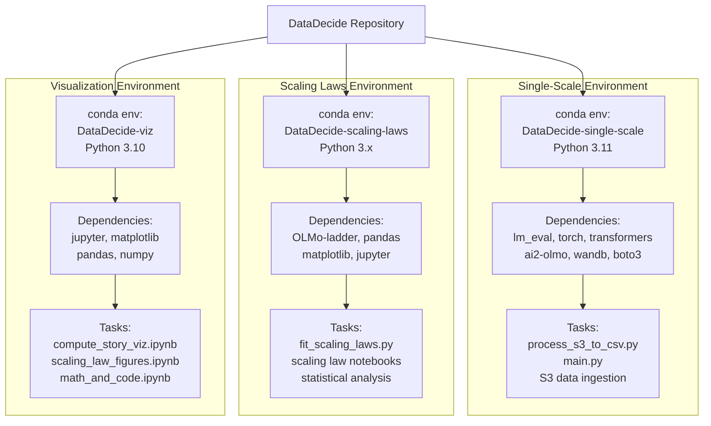
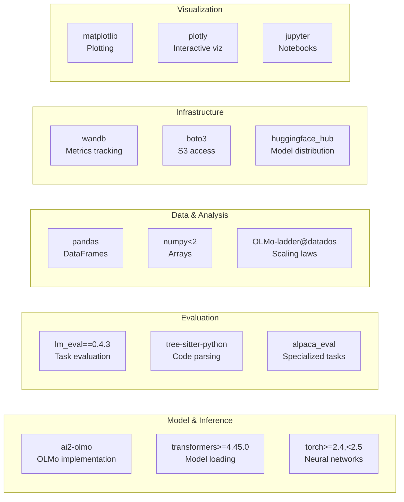
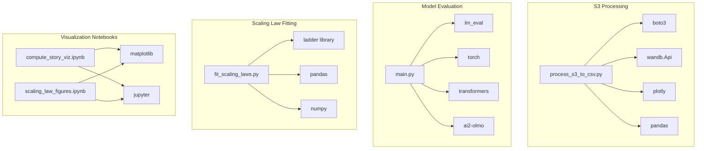
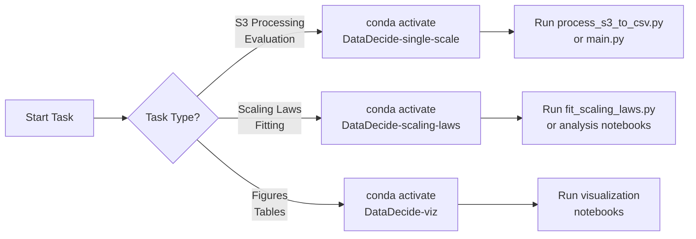

<!-- source: DeepWiki mcp.deepwiki.com · repo allenai/DataDecide · page 2.1 Environment Setup · fetched 2026-10-26 -->

# Environment Setup

<details>
<summary>Relevant source files</summary>

The following files were used as context for generating this wiki page:

- [requirements.txt](requirements.txt)
- [scaling_laws/requirements.txt](scaling_laws/requirements.txt)
- [single_scale/process_s3_to_csv.py](single_scale/process_s3_to_csv.py)
- [single_scale/readme.md](single_scale/readme.md)
- [single_scale/requirements.txt](single_scale/requirements.txt)
- [viz/readme.md](viz/readme.md)

</details>


## Purpose and Scope

This document describes the conda environment creation and dependency installation for the three main components of the DataDecide repository. The repository requires separate Python environments for distinct analysis workflows: single-scale evaluation, scaling laws analysis, and visualization. Each environment has specific dependency requirements optimized for its computational tasks.

For information about accessing pretrained models and evaluation datasets after environment setup, see [Accessing Models and Data](#2.2). For running single-scale evaluations, see [Single-Scale Evaluation](#3.1). For fitting scaling laws, see [Scaling Law Fitting](#4.1).

## Environment Architecture

The DataDecide codebase uses a multi-environment architecture to isolate dependencies and prevent version conflicts:



**Sources:** [single_scale/readme.md:1-6](), [viz/readme.md:1-9](), [scaling_laws/requirements.txt:1-9]()

## Single-Scale Environment

The single-scale environment is used for processing evaluation results from S3, computing metrics, and running model predictions. It requires Python 3.11 and includes dependencies for model inference and data processing.

### Environment Creation

```bash
conda create -n DataDecide-single-scale python=3.11
conda activate DataDecide-single-scale
pip install -r single_scale/requirements.txt
```

### Key Dependencies

| Package | Version Constraint | Purpose |
|---------|-------------------|---------|
| `lm_eval` | `==0.4.3` | Language model evaluation framework (EleutherAI) |
| `torch` | `>=2.4,<2.5` | PyTorch for model inference |
| `transformers` | `>=4.45.0` | HuggingFace model loading and tokenization |
| `ai2-olmo` | from GitHub main | AI2's OLMo model implementations |
| `wandb` | latest | Weights & Biases integration for training metrics |
| `boto3` | latest | AWS S3 access for evaluation results |
| `omegaconf` | `==2.4.0.dev3` | Configuration management |
| `numpy` | `<2` | Numerical operations (pinned for compatibility) |

### Specialized Dependencies

The single-scale environment includes task-specific packages:

- **Code evaluation**: `tree_sitter`, `tree_sitter_python` for parsing code in MBPP/HumanEval tasks
- **API integrations**: `beaker-py`, `beaker-gantry` for Beaker cluster integration
- **Evaluation tools**: `alpaca_eval`, `litellm` for specific benchmark tasks
- **Visualization**: `plotly`, `seaborn` for generating interactive plots in [process_s3_to_csv.py:254-497]()

**Sources:** [single_scale/readme.md:1-6](), [single_scale/requirements.txt:1-29](), [single_scale/process_s3_to_csv.py:1-31]()

## Scaling Laws Environment

The scaling laws environment is designed for fitting scaling law curves and statistical analysis. It uses the OLMo-ladder library for fitting various scaling law formulations.

### Environment Creation

```bash
conda create -n DataDecide-scaling-laws python=3.10
conda activate DataDecide-scaling-laws
pip install -r scaling_laws/requirements.txt
```

Note: The README does not specify Python version explicitly; Python 3.10 is recommended for compatibility with OLMo-ladder.

### Key Dependencies

| Package | Version | Purpose |
|---------|---------|---------|
| `ladder[plotting]` | from GitHub@datados | OLMo-ladder scaling law fitting library |
| `pandas` | latest | DataFrame operations for results processing |
| `numpy` | latest | Numerical computations |
| `matplotlib` | latest | Plotting fitted curves |
| `jupyter` | latest | Interactive notebook execution |
| `ipywidgets` | latest | Interactive notebook widgets |
| `pyarrow` | latest | Efficient data serialization |
| `tqdm` | latest | Progress bars for batch operations |

### OLMo-ladder Integration

The environment installs OLMo-ladder from the `datados` branch with plotting extras:

```
git+https://github.com/allenai/OLMo-ladder@datados#egg=ladder[plotting]
```

This provides the core scaling law fitting algorithms used by [fit_scaling_laws.py]() and related analysis notebooks.

**Sources:** [scaling_laws/requirements.txt:1-9]()

## Visualization Environment

The visualization environment is optimized for running Jupyter notebooks that generate figures and tables for publication. It uses Python 3.10 for stability with notebook kernels.

### Environment Creation

```bash
conda create -n DataDecide-viz python=3.10
conda activate DataDecide-viz
pip install -r viz/requirements.txt
```

### Key Dependencies

The visualization environment shares requirements with the root repository. Key packages include:

| Package | Purpose |
|---------|---------|
| `jupyter` | Notebook execution environment |
| `matplotlib` | Static plot generation |
| `pandas` | Data manipulation |
| `numpy` | Numerical operations |
| `ipywidgets` | Interactive visualization controls |

Additional dependencies from root requirements.txt may be needed for specific visualization tasks.

**Sources:** [viz/readme.md:1-9]()

## Root Requirements

The root [requirements.txt:1-45]() contains a comprehensive set of dependencies that combines packages from all three environments. This file can be used for a unified environment if separate environments are not required:

```bash
conda create -n DataDecide python=3.10
conda activate DataDecide
pip install -r requirements.txt
```

### Notable Root Dependencies



**Sources:** [requirements.txt:1-45]()

## Dependency Relationships

The following diagram maps how different components use specific dependencies:



**Sources:** [single_scale/process_s3_to_csv.py:13-30](), [requirements.txt:1-45]()

## Version Pinning Strategy

The repository uses strategic version pinning to ensure reproducibility:

| Constraint | Packages | Reason |
|------------|----------|--------|
| `==` (exact) | `lm_eval==0.4.3`, `omegaconf==2.4.0.dev3` | API stability for evaluation |
| `>=` (minimum) | `transformers>=4.45.0` | Required features from recent versions |
| `>=,<` (range) | `torch>=2.4,<2.5` | Compatibility window |
| `<` (maximum) | `numpy<2` | Breaking changes in numpy 2.0 |
| Latest | `pandas`, `wandb`, `boto3` | Stable APIs, benefit from updates |

**Note:** The `omegaconf` version `2.4.0.dev3` is a development release, which may require special installation handling.

**Sources:** [single_scale/requirements.txt:1-29](), [requirements.txt:1-45]()

## Environment Verification

After installing each environment, verify the installation with these checks:

### Single-Scale Environment

```bash
conda activate DataDecide-single-scale
python -c "import torch; import transformers; import lm_eval; print('✓ Core dependencies loaded')"
python -c "import boto3; import wandb; print('✓ Infrastructure dependencies loaded')"
python -c "from olmes.tasks.oe_eval_tasks import TASK_REGISTRY; print(f'✓ {len(TASK_REGISTRY)} tasks registered')"
```

### Scaling Laws Environment

```bash
conda activate DataDecide-scaling-laws
python -c "import ladder; import pandas; import matplotlib; print('✓ Scaling laws environment ready')"
jupyter --version  # Verify Jupyter installation
```

### Visualization Environment

```bash
conda activate DataDecide-viz
python -c "import jupyter; import matplotlib; import pandas; print('✓ Visualization environment ready')"
jupyter notebook --version  # Verify notebook capability
```

**Sources:** [single_scale/process_s3_to_csv.py:29]()

## Common Installation Issues

### Issue: OLMo-ladder Installation Failure

The OLMo-ladder package is installed from a GitHub branch, which may fail if git is not configured or network issues occur.

**Solution:**
```bash
# Install git if needed
conda install git

# Manually clone and install
git clone https://github.com/allenai/OLMo-ladder.git
cd OLMo-ladder
git checkout datados
pip install -e ".[plotting]"
```

### Issue: NumPy Version Conflicts

NumPy 2.0 introduced breaking changes. The repository pins `numpy<2` but some dependencies may try to upgrade.

**Solution:**
```bash
# After installation, verify numpy version
python -c "import numpy; print(numpy.__version__)"

# If >= 2.0, downgrade
pip install "numpy<2" --force-reinstall
```

### Issue: PyTorch CUDA Version Mismatch

The torch constraint `>=2.4,<2.5` may install CPU-only version.

**Solution:**
```bash
# For CUDA 11.8
pip install torch==2.4.0 --index-url https://download.pytorch.org/whl/cu118

# For CUDA 12.1
pip install torch==2.4.0 --index-url https://download.pytorch.org/whl/cu121
```

### Issue: omegaconf Development Version

The exact version `omegaconf==2.4.0.dev3` may not be available on PyPI.

**Solution:**
```bash
# Install from source
pip install git+https://github.com/omry/omegaconf.git@2.4_branch
```

**Sources:** [single_scale/requirements.txt:6-11](), [requirements.txt:9-14]()

## Environment Activation Workflow

The typical workflow involves switching between environments based on the task:



**Sources:** [single_scale/readme.md:1-38](), [viz/readme.md:1-9]()

---

