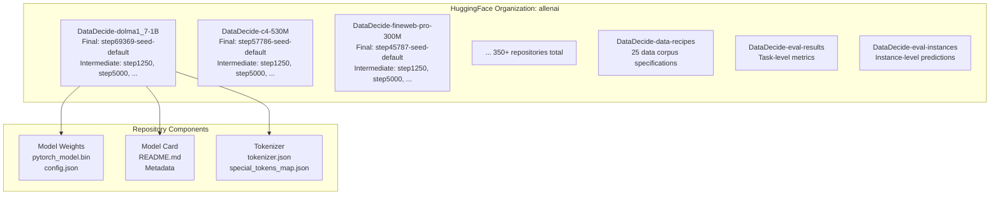
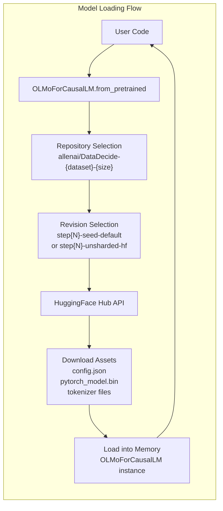
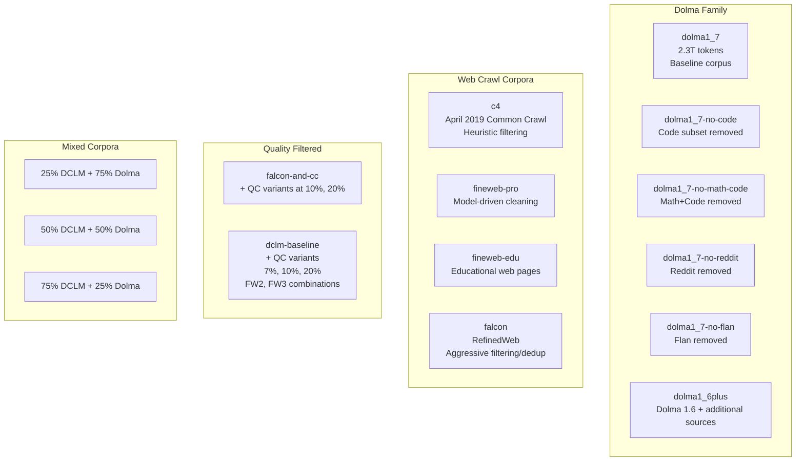
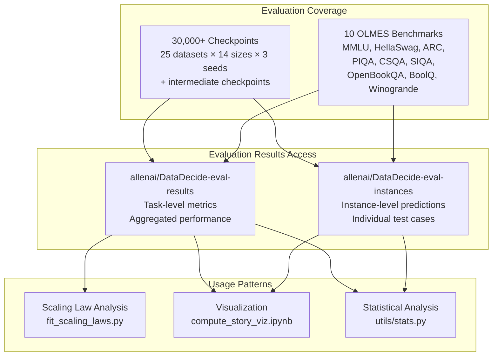
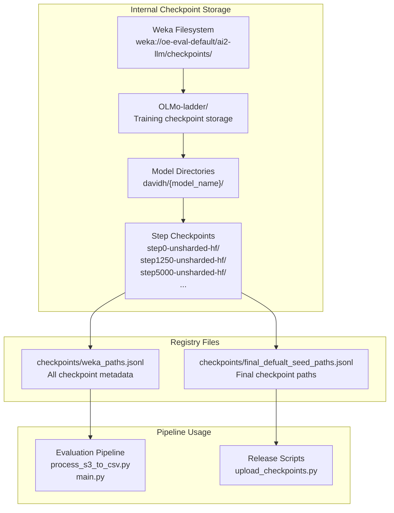
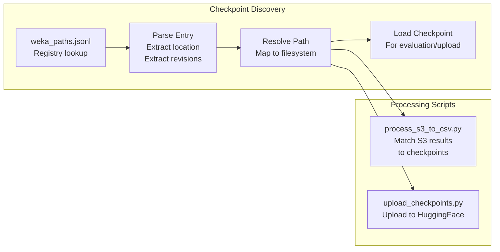
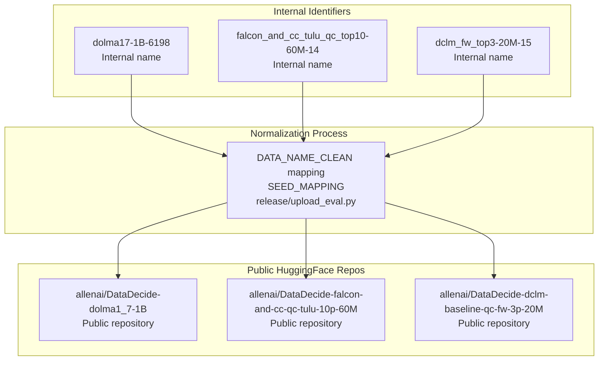

<!-- source: DeepWiki mcp.deepwiki.com · repo allenai/DataDecide · page 2.2 Accessing Models and Data · fetched 2026-10-26 -->

# Accessing Models and Data

<details>
<summary>Relevant source files</summary>

The following files were used as context for generating this wiki page:

- [README.md](README.md)
- [checkpoints/final_defualt_seed_paths.jsonl](checkpoints/final_defualt_seed_paths.jsonl)
- [checkpoints/weka_paths.jsonl](checkpoints/weka_paths.jsonl)

</details>


## Purpose and Scope

This page explains how to access the 350+ pretrained models and evaluation data released as part of the DataDecide project. It covers the HuggingFace repository structure, model loading procedures, data recipe access, and evaluation results retrieval.

For information about setting up your local environment to work with these models, see [Environment Setup](#2.1). For details about the evaluation pipeline that generated the results, see [Evaluation System](#3).

---

## HuggingFace Repository Structure

The DataDecide project releases models through a structured set of HuggingFace repositories following a consistent naming convention.

### Repository Naming Convention

All model repositories follow the pattern: `allenai/DataDecide-{dataset}-{size}`

**Dataset identifiers** include:
- `dolma1_7` - Dolma 1.7 baseline
- `dolma1_7-no-code` - Dolma 1.7 with code subset removed
- `dolma1_7-no-math-code` - Dolma 1.7 without math and code
- `dolma1_7-no-reddit` - Dolma 1.7 without Reddit
- `dolma1_7-no-flan` - Dolma 1.7 without Flan
- `dolma1_6plus` - Dolma 1.6++
- `c4` - C4 dataset
- `fineweb-pro` - FineWeb-Pro
- `fineweb-edu` - FineWeb-Edu
- `falcon` - Falcon RefinedWeb
- `falcon-and-cc` - Falcon + Common Crawl (with various QC variants)
- `dclm-baseline` - DCLM-Baseline (with various QC variants)
- Mixed datasets following pattern `dclm-baseline-{X}p-dolma1.7-{Y}p` for mixing proportions

**Size identifiers**: `4M`, `6M`, `8M`, `10M`, `14M`, `16M`, `20M`, `60M`, `90M`, `150M`, `300M`, `530M`, `750M`, `1B`

### Checkpoint Revisions

Each model repository contains multiple checkpoint revisions representing different training steps. Revisions follow the pattern: `step{N}-seed-{seed}` or `step{N}-unsharded-hf`.

**Common revision naming:**
- Final checkpoint: `step{N}-seed-default` (e.g., `step69369-seed-default` for 1B model)
- Intermediate checkpoints: `step{N}-unsharded-hf` (e.g., `step1250-unsharded-hf`, `step5000-unsharded-hf`)



**Sources:** [README.md:14-42]()

---

## Loading Models from HuggingFace

### Basic Model Loading

Models can be loaded using the `OLMoForCausalLM` class from the `ai2-olmo` package:

```python
from hf_olmo import OLMoForCausalLM  # pip install ai2-olmo

# Load final checkpoint
olmo = OLMoForCausalLM.from_pretrained(
    "allenai/DataDecide-dolma1_7-1B", 
    revision="step69369-seed-default"
)

# Load intermediate checkpoint
olmo_intermediate = OLMoForCausalLM.from_pretrained(
    "allenai/DataDecide-dolma1_7-1B", 
    revision="step5000-unsharded-hf"
)
```

### Model Size and Training Step Mapping

The following table shows the relationship between model sizes and their final training steps:

| Model Size | Parameters | Training Steps | Tokens Trained | Batch Size | Learning Rate |
|------------|------------|----------------|----------------|------------|---------------|
| 4M         | 3.7M       | 5,725          | 0.4B           | 32         | 1.4e-02       |
| 6M         | 6.0M       | 9,182          | 0.6B           | 32         | 1.2e-02       |
| 8M         | 8.5M       | 13,039         | 0.9B           | 32         | 1.1e-02       |
| 10M        | 9.9M       | 15,117         | 1.0B           | 32         | 1.0e-02       |
| 14M        | 14.4M      | 21,953         | 1.4B           | 32         | 9.2e-03       |
| 16M        | 16.0M      | 24,432         | 1.6B           | 32         | 8.9e-03       |
| 20M        | 19.1M      | 14,584         | 1.9B           | 64         | 8.4e-03       |
| 60M        | 57.1M      | 29,042         | 5.7B           | 96         | 5.8e-03       |
| 90M        | 97.9M      | 29,901         | 9.8B           | 160        | 4.9e-03       |
| 150M       | 151.9M     | 38,157         | 15.0B          | 192        | 4.2e-03       |
| 300M       | 320.0M     | 45,787         | 30.0B          | 320        | 3.3e-03       |
| 530M       | 530.1M     | 57,786         | 53.0B          | 448        | 2.8e-03       |
| 750M       | 681.3M     | 63,589         | 75.0B          | 576        | 2.5e-03       |
| 1B         | 1176.8M    | 69,369         | 100.0B         | 704        | 2.1e-03       |

All models follow a token-to-parameter ratio of 100:1 (e.g., 1B parameters trained on 100B tokens).



**Sources:** [README.md:44-52](), [README.md:92-109]()

---

## Data Recipes

The 25 data corpora used for pretraining are documented and released separately from the model checkpoints.

### Data Recipe Repository

All data recipes are available at: **`allenai/DataDecide-data-recipes`**

This repository contains specifications for each of the 25 corpus variants, including:
- Source dataset information
- Preprocessing steps
- Deduplication strategies
- Quality filtering parameters
- Subset compositions (for ablation studies)

### Data Corpus Categories



**Sources:** [README.md:54-68]()

### Data Recipe Details

| Category | Recipe Name | Description |
|----------|-------------|-------------|
| **Dolma Variants** | Dolma1.7 | 2.3T-token corpus, full version |
| | Dolma1.7 (no code) | Dolma without code subset |
| | Dolma1.7 (no math, code) | Dolma without math and code |
| | Dolma1.7 (no Reddit) | Dolma without Reddit |
| | Dolma1.7 (no Flan) | Dolma without Flan |
| | Dolma1.6++ | Dolma 1.6 + arxiv, openwebmath, algebraic stack, flan, starcoder, falcon |
| **Web Corpora** | C4 | April 2019 Common Crawl, heuristically filtered |
| | FineWeb-Pro | Model-driven data cleaning on FineWeb |
| | FineWeb-Edu | Educational web pages from SmoLLM-Corpus |
| | Falcon | RefinedWeb through June 2023, aggressively filtered |
| **Quality Filtered** | Falcon+CC (QC 10%) | Falcon+CC filtered to top 10% documents |
| | Falcon+CC (QC 20%) | Falcon+CC filtered to top 20% documents |
| | Falcon+CC (QC Orig 10%) | Using original quality classifier |
| | Falcon+CC (QC Tulu 10%) | Using Tulu-v3 retrained classifier |
| | DCLM-Baseline | SOTA Common Crawl with best dedup/cleaning |
| | DCLM-Baseline (QC variants) | Multiple quality filtering strategies |
| **Mixed** | λ% DCLM + (1-λ)% Dolma | Fractional combinations for λ ∈ {25%, 50%, 75%} |

---

## Evaluation Results

Evaluation results are released as separate HuggingFace datasets for programmatic access and analysis.

### Evaluation Datasets

**Two datasets are available:**

1. **Task-level metrics**: `allenai/DataDecide-eval-results`
   - Aggregated performance metrics per task and checkpoint
   - Suitable for scaling law analysis and benchmark comparisons

2. **Instance-level results**: `allenai/DataDecide-eval-instances`
   - Individual predictions for each test instance
   - Enables fine-grained error analysis

### Evaluated Benchmarks

All checkpoints are evaluated on the OLMES suite of 10 multiple-choice question answering benchmarks:

| Benchmark | Description |
|-----------|-------------|
| MMLU | Massive multitask language understanding |
| HellaSwag | Commonsense reasoning about physical situations |
| ARC-Challenge | Grade-school science questions (challenge set) |
| ARC-Easy | Grade-school science questions (easy set) |
| PIQA | Physical interaction question answering |
| CommonsenseQA | Commonsense knowledge reasoning |
| Social IQa | Social interaction reasoning |
| OpenBookQA | Open-book question answering |
| BoolQ | Boolean questions from natural questions |
| Winogrande | Pronoun resolution requiring world knowledge |



**Sources:** [README.md:71-89]()

### Loading Evaluation Results

```python
from datasets import load_dataset

# Load task-level metrics
task_results = load_dataset("allenai/DataDecide-eval-results")

# Load instance-level predictions
instance_results = load_dataset("allenai/DataDecide-eval-instances")
```

---

## Checkpoint Registry (Internal)

The DataDecide repository maintains internal checkpoint registries for tracking model locations and managing the evaluation pipeline. These are primarily for internal use but document the complete checkpoint structure.

### Registry Files

Two primary registry files track checkpoint locations:

1. **`checkpoints/weka_paths.jsonl`** - Comprehensive checkpoint registry
   - Maps internal checkpoint paths to model identifiers
   - Contains all intermediate checkpoint revisions
   - Used by evaluation pipeline for checkpoint discovery

2. **`checkpoints/final_defualt_seed_paths.jsonl`** - Production checkpoint registry (referenced but not shown)
   - Contains paths to final checkpoints for each model
   - Used by release scripts for HuggingFace upload

### Registry Entry Structure

Each line in `weka_paths.jsonl` is a JSON object with the following structure:

```json
{
  "checkpoints_location": "weka://oe-eval-default/ai2-llm/checkpoints/OLMo-ladder/davidh/{model_name}",
  "revisions": ["step5725-unsharded-hf", "step5000-unsharded-hf", "step3750-unsharded-hf", ...],
  "model_name": "{dataset}-{size}-{seed}"
}
```

**Field descriptions:**
- `checkpoints_location`: Internal storage path (Weka filesystem)
- `revisions`: List of available checkpoint steps in descending order
- `model_name`: Internal model identifier combining dataset, size, and seed



**Sources:** [checkpoints/weka_paths.jsonl:1-10]()

### Registry Naming Conventions

**Internal model names** follow the pattern: `{dataset}-{size}-{seed}`

Examples:
- `dolma17-1B-6198` (Dolma 1.7, 1B parameters, seed 6198)
- `falcon-60M-14` (Falcon, 60M parameters, seed 14)
- `dclm_fw_top3-20M-15` (DCLM FW top 3%, 20M parameters, seed 15)

**Seed identifiers:**
- `6198` - Default seed
- `14` - Seed 1
- `15` - Seed 2

These internal names are mapped to public HuggingFace repository names during the release process through normalization defined in `release/upload_eval.py`.

### Checkpoint Discovery Flow



**Sources:** [checkpoints/weka_paths.jsonl:1-133]()

---

## Model-to-Repository Mapping

The following diagram illustrates how internal checkpoint names map to public HuggingFace repository names:



This mapping is handled automatically by the release scripts during the upload process. For details on the normalization process, see [Data Normalization for Release](#6.2).

**Sources:** [checkpoints/weka_paths.jsonl:1-133](), [README.md:14-42]()

---

