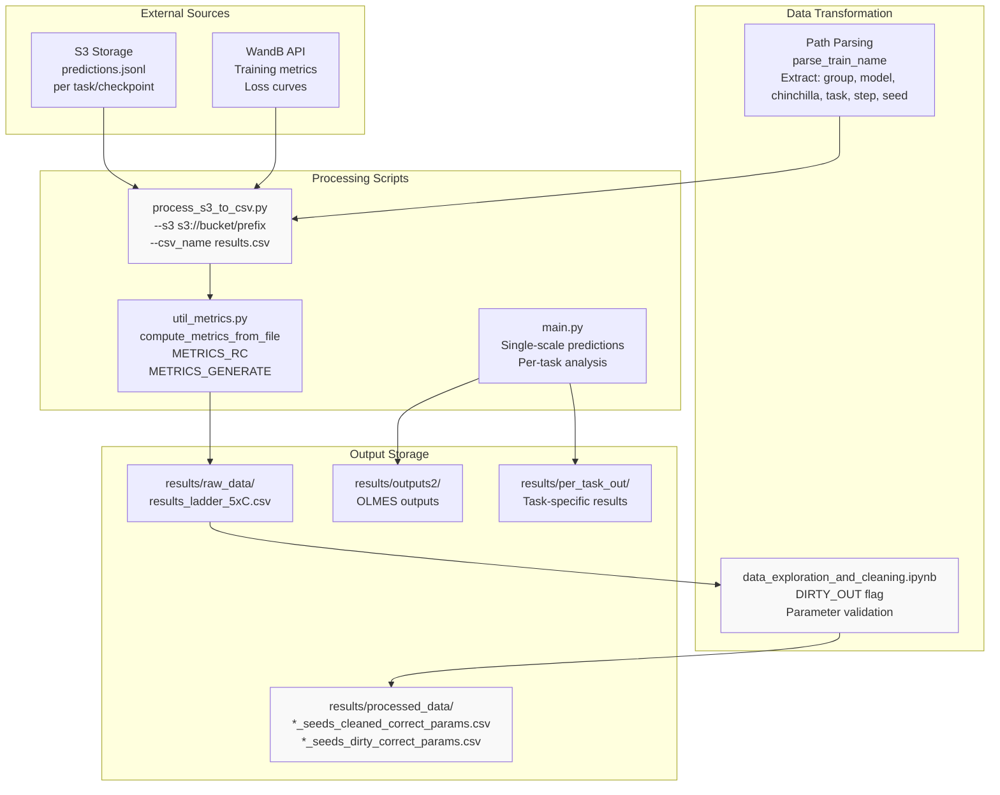
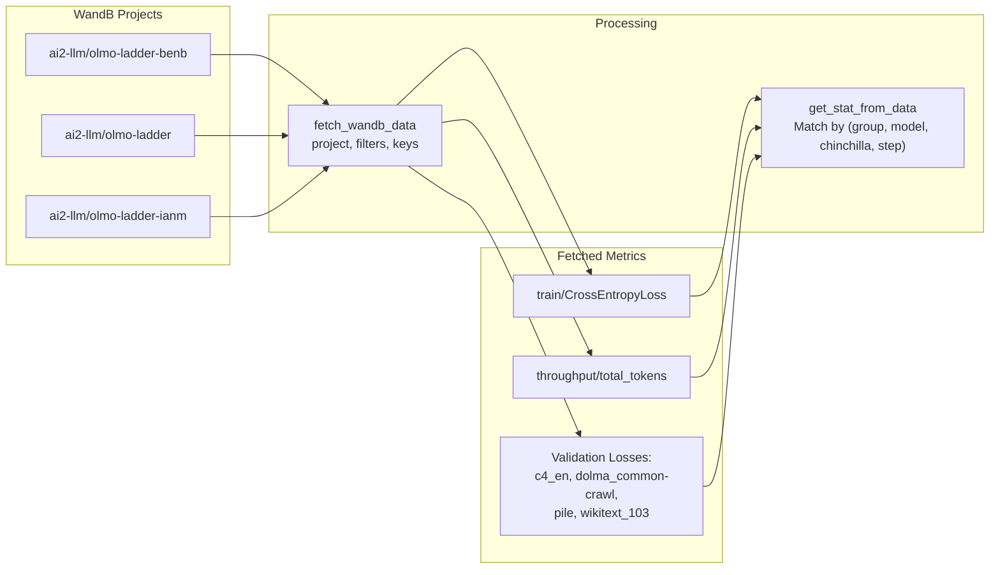
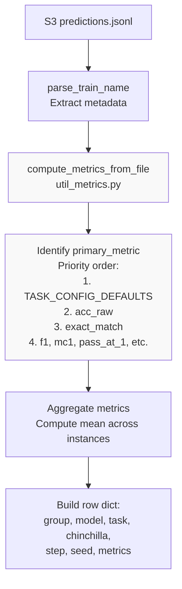
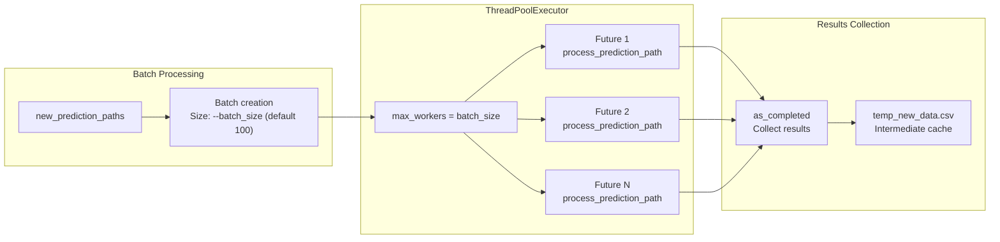
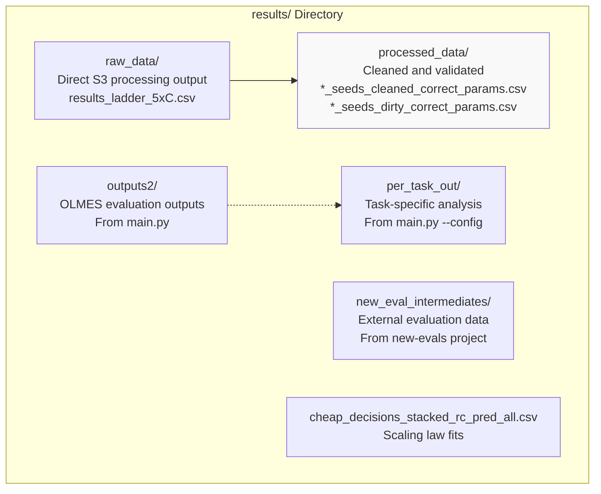
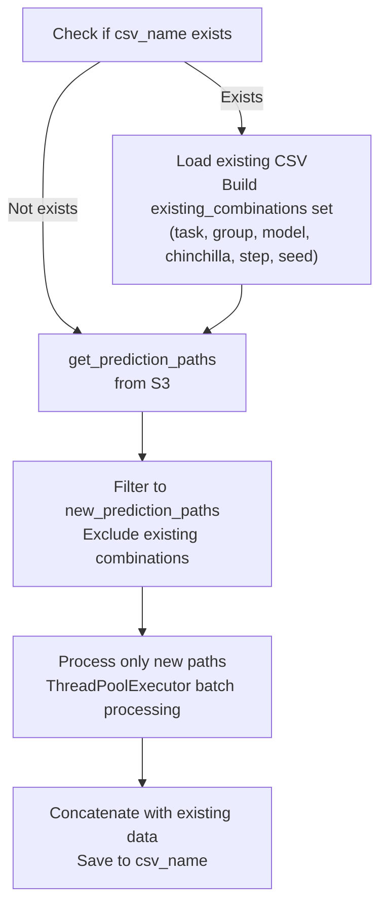
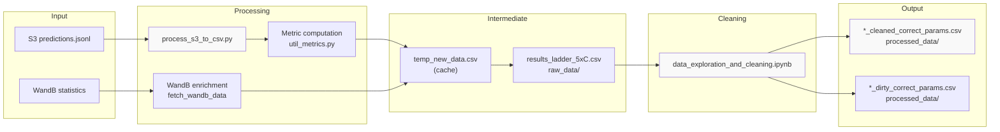

<!-- source: DeepWiki mcp.deepwiki.com · repo allenai/DataDecide · page 3 Evaluation System · fetched 2026-10-26 -->

# Evaluation System

<details>
<summary>Relevant source files</summary>

The following files were used as context for generating this wiki page:

- [.gitignore](.gitignore)
- [requirements.txt](requirements.txt)
- [results/readme.md](results/readme.md)
- [single_scale/process_s3_to_csv.py](single_scale/process_s3_to_csv.py)
- [single_scale/readme.md](single_scale/readme.md)
- [single_scale/requirements.txt](single_scale/requirements.txt)
- [viz/pred_error.ipynb](viz/pred_error.ipynb)

</details>


The Evaluation System is responsible for ingesting, processing, and organizing evaluation results from the 30k+ model checkpoints trained across 25 data corpora. It fetches raw predictions from S3 storage, enriches them with training statistics from WandB, computes evaluation metrics, and produces cleaned datasets for downstream analysis.

For information about scaling law analysis using these processed results, see [Scaling Laws Analysis](#4). For details on how results are uploaded to HuggingFace, see [Release and Distribution](#6).

## Overview

The evaluation pipeline transforms raw model predictions into structured, analysis-ready datasets through three primary stages:

1. **Data Ingestion**: Fetch predictions from S3 and training statistics from WandB
2. **Metric Computation**: Calculate task-level performance metrics from predictions
3. **Data Cleaning**: Normalize and validate the processed results

The system processes evaluation data for RC (reading comprehension) tasks across multiple checkpoints, model sizes, and data recipes, producing CSV files that serve as the foundation for all downstream analysis.



**Sources**: [single_scale/process_s3_to_csv.py](), [single_scale/readme.md:1-39](), [results/readme.md:1-18]()

## Data Ingestion Architecture

### S3 Bucket Organization

The system expects S3 buckets to follow a hierarchical structure where predictions are organized by model configuration and checkpoint:

```
s3://bucket/prefix/
  ├── {group}-{model}-{chinchilla}[-{seed}]/
  │   ├── step{N}/
  │   │   ├── {task}/predictions.jsonl
  │   │   └── ...
  │   └── step{M}/
  │       ├── all_olmes_rc_tasks/
  │       │   ├── task-001-{task_name}-predictions.jsonl
  │       │   └── ...
```

The `get_prediction_paths` function traverses this structure to identify all `predictions.jsonl` files for processing.

**Sources**: [single_scale/process_s3_to_csv.py:64-90]()

### Path Parsing and Metadata Extraction

The `parse_train_name` function extracts critical metadata from S3 paths:

| Component | Pattern | Example | Description |
|-----------|---------|---------|-------------|
| `group` | Data recipe name | `no_math_no_code` | Dataset variant identifier |
| `model` | Size with unit | `150M`, `1B` | Model parameter count |
| `chinchilla` | Multiplier | `5xC` | Training token multiplier |
| `task` | Task name | `mmlu`, `hellaswag` | Evaluation task |
| `step` | Integer | `500` | Training step number |
| `seed` | Integer (optional) | `0`, `1`, `2` | Random seed for training |

The parsing logic handles both formats: with explicit seed (`{group}-{model}-{chinchilla}-{seed}`) and without seed (`{group}-{model}-{chinchilla}`).

**Sources**: [single_scale/process_s3_to_csv.py:177-210]()

### WandB Integration

Training statistics are fetched from WandB projects using the `fetch_wandb_data` function, which queries runs based on display names matching the pattern `{group}-{model}-{chinchilla}`:



The system automatically selects the appropriate WandB project based on the data recipe and chinchilla multiplier, as defined in the conditional logic at [single_scale/process_s3_to_csv.py:569-579]().

**Sources**: [single_scale/process_s3_to_csv.py:36-58](), [single_scale/process_s3_to_csv.py:223-248](), [single_scale/process_s3_to_csv.py:563-587]()

## Metric Computation Pipeline

### Processing Workflow

The `process_prediction_path` function implements the core processing logic for each predictions file:



The `TASK_REGISTRY` from `olmes.tasks.oe_eval_tasks` provides task-specific configuration including the primary metric to use for each task.

**Sources**: [single_scale/process_s3_to_csv.py:92-146]()

### Metric Types

The system computes multiple metric variants from raw predictions:

| Metric | Description | Source |
|--------|-------------|--------|
| `primary_metric` | Task-specific main metric (e.g., accuracy, F1, exact match) | Task config |
| `acc_raw` | Raw accuracy (uncalibrated) | Always computed |
| `acc_per_char` | Character-level accuracy | Always computed |
| `acc_per_token` | Token-level accuracy | Always computed |
| `acc_uncond` | Unconditional accuracy | Always computed |
| Task-specific | `exact_match`, `f1`, `mc1`, `pass_at_1`, etc. | Task-dependent |

These metrics are computed by `compute_metrics_from_file` in `util_metrics.py` and stored in a dictionary that gets packed into the `metrics` column.

**Sources**: [single_scale/process_s3_to_csv.py:98-146]()

### Compute Calculation

The `calc_compute` function calculates FLOPs using the standard formula:

```
compute = 6 × num_parameters × tokens
```

Where:
- `num_parameters` is extracted from the model size string (e.g., "150M" → 150,000,000)
- `tokens` comes from the `throughput/total_tokens` metric in WandB

**Sources**: [single_scale/process_s3_to_csv.py:165-175]()

## Parallel Processing

The system uses `ThreadPoolExecutor` for efficient parallel processing of S3 files:



The batch size is configurable via the `--batch_size` argument and is also used to configure the boto3 `max_pool_connections` for optimal S3 throughput.

**Sources**: [single_scale/process_s3_to_csv.py:500-559]()

## Data Cleaning and Validation

### Notebook Workflow

The `data_exploration_and_cleaning.ipynb` notebook performs data validation and produces two output variants:

| Output File | Description | Control Flag |
|-------------|-------------|--------------|
| `*_seeds_cleaned_correct_params.csv` | Validated data with corrected parameters | Default |
| `*_seeds_dirty_correct_params.csv` | Includes problematic data for diagnostics | `DIRTY_OUT = True` |

Both output variants are required: the cleaned version for analysis and the dirty version for certain visualizations that need to show the full data landscape.

**Sources**: [single_scale/readme.md:15-19](), [results/readme.md:11-12]()

### Data Type Schema

The processing pipeline enforces a strict data type schema defined in the `dtypes` dictionary:

```python
dtypes = {
    "group": str,           # Data recipe name
    "model": str,           # Model size
    "task": str,            # Task name
    "chinchilla": str,      # Training multiplier
    "step": int,            # Training step
    "tokens": float,        # Total tokens processed
    "compute": float,       # FLOPs
    "metrics": object,      # Dictionary of metrics
    # WandB statistics (all float)
    "train/CrossEntropyLoss": float,
    "eval/c4_en-validation/CrossEntropyLoss": float,
    # ... additional validation losses
}
```

**Sources**: [single_scale/process_s3_to_csv.py:48-58]()

## Results Directory Structure

The `results/` directory organizes outputs by processing stage:



**Sources**: [results/readme.md:1-18](), [.gitignore:6-13]()

## Single-Scale Prediction Workflow

### Running Evaluations

The `main.py` script executes single-scale predictions and per-task analysis:

```bash
# Basic single-scale predictions
python main.py

# Per-task analysis with generated configs
sh create_per_task_configs.sh config.yaml per_task_configs
ls per_task_configs/*.yaml | parallel --progress python main.py --config {}
```

The workflow generates individual YAML configuration files for each task, then processes them in parallel using GNU Parallel.

**Sources**: [single_scale/readme.md:22-38]()

### Configuration Generation

Per-task configs are created by the `create_per_task_configs.sh` script, which takes a base `config.yaml` and generates task-specific variants in the `per_task_configs/` directory. Each generated config targets a specific evaluation task.

**Sources**: [single_scale/readme.md:29-38]()

## Incremental Update Strategy

The system implements an incremental update mechanism to avoid reprocessing existing results:



The `existing_combinations` set tracks which (task, group, model, chinchilla, step, seed) tuples have already been processed, allowing the script to skip redundant S3 fetches.

**Sources**: [single_scale/process_s3_to_csv.py:510-541]()

## Command-Line Interface

The `process_s3_to_csv.py` script accepts the following arguments:

| Argument | Type | Default | Description |
|----------|------|---------|-------------|
| `--s3` | str | Required | Full S3 path (e.g., `s3://bucket/prefix/`) |
| `--csv_name` | str | `results_ladder_5xC.csv` | Output CSV filename |
| `--no_refresh` | flag | False | Skip S3 refresh, use existing data only |
| `--batch_size` | int | 100 | Parallel processing batch size |

Example usage:

```bash
python process_s3_to_csv.py \
    --s3 s3://ai2-llm/eval-results/downstream/eval-for-consistent-ranking-preemption-fixed \
    --csv_name "results_ladder_5xC.csv" \
    --batch_size 200
```

**Sources**: [single_scale/process_s3_to_csv.py:615-624](), [single_scale/readme.md:8-13]()

## Interactive Visualization Output

In addition to CSV output, the processing script generates interactive Plotly HTML visualizations:

- `{s3_name}_olmes_curves_task_filter.html`: Multi-model comparison across all metrics
- `{s3_name}_olmes_curves_last_step_task_filter.html`: Latest checkpoint comparison

These visualizations include dropdown filters for task suite selection and display scaling curves across different model sizes and data recipes.

**Sources**: [single_scale/process_s3_to_csv.py:254-497]()

## Data Flow Summary



**Sources**: [single_scale/process_s3_to_csv.py:1-624](), [single_scale/readme.md:1-39](), [results/readme.md:1-18]()

---

