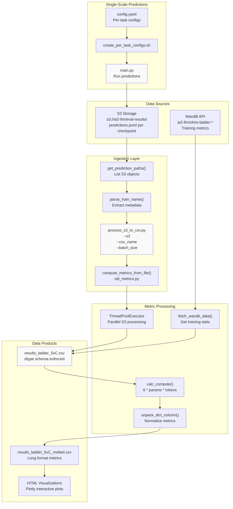
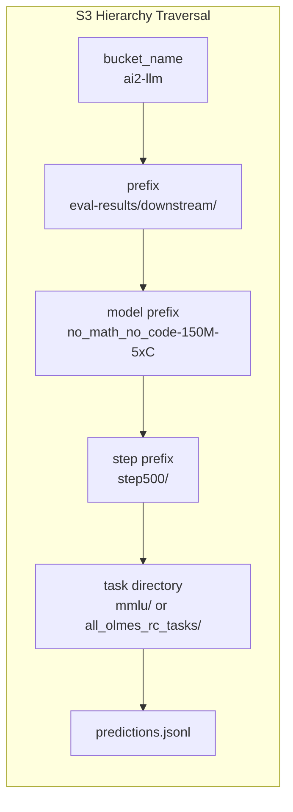
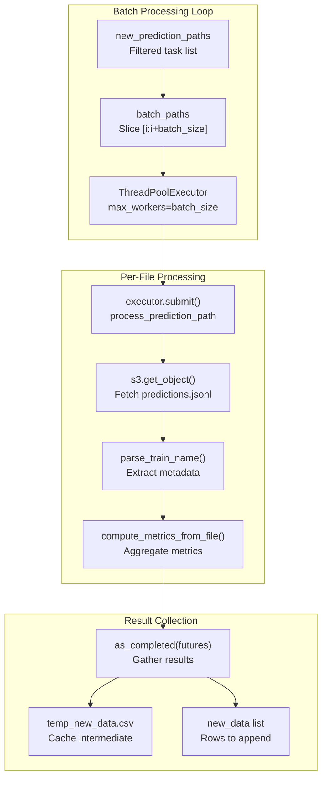
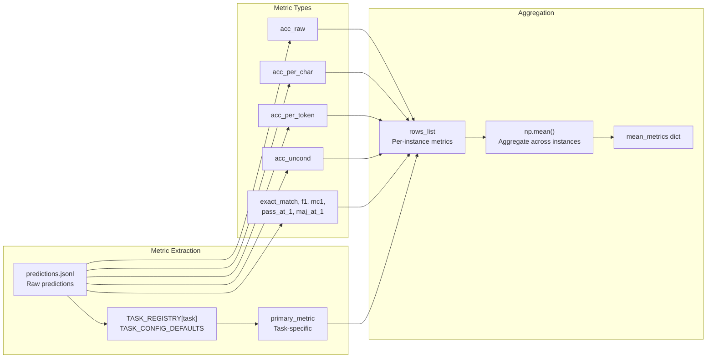
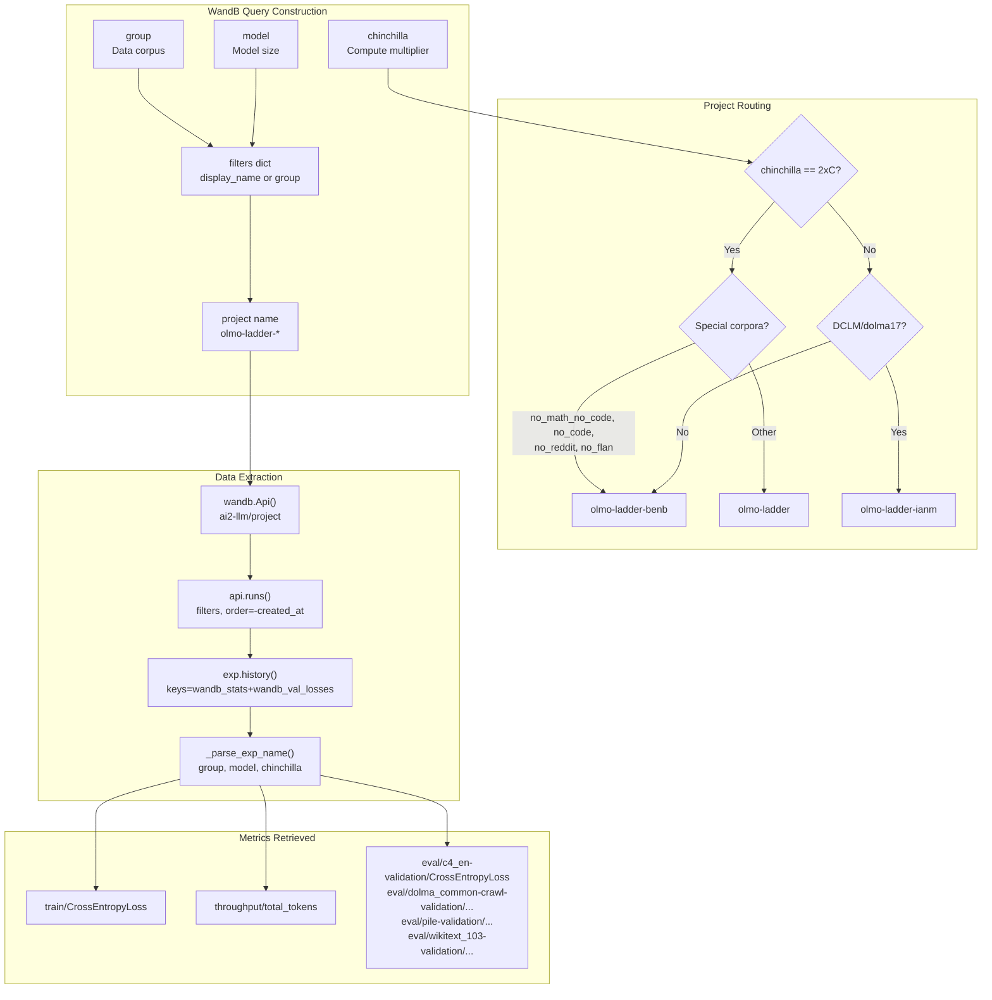
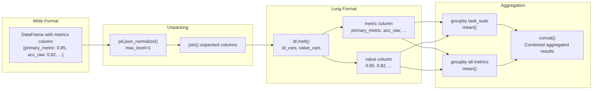
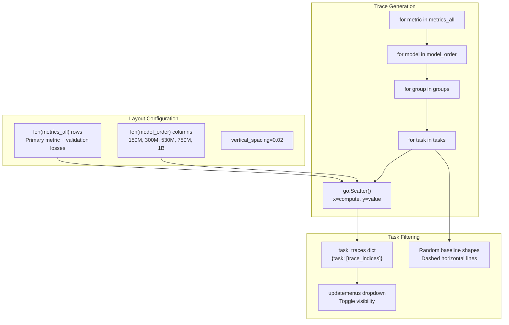
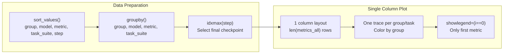
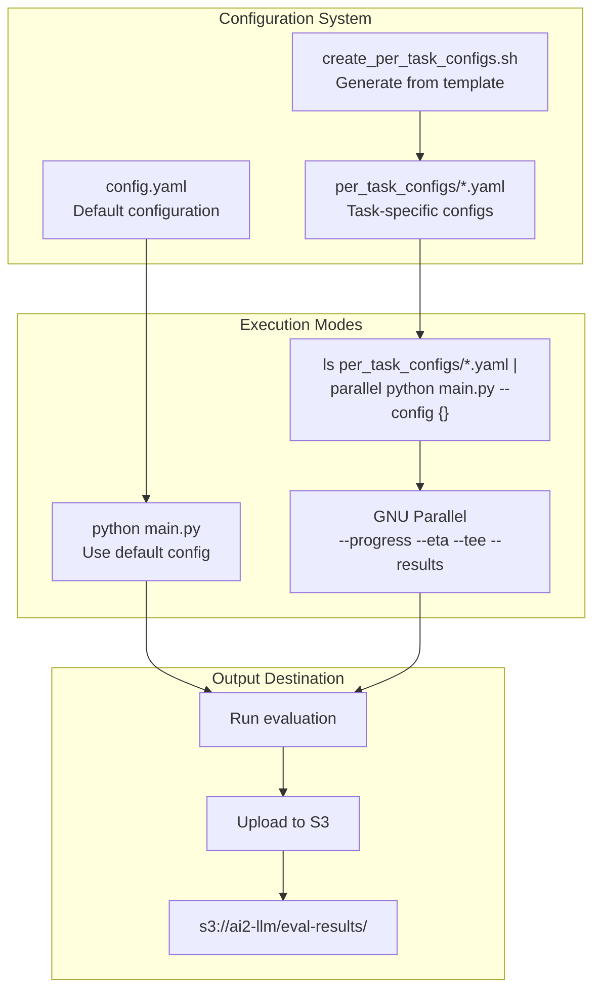
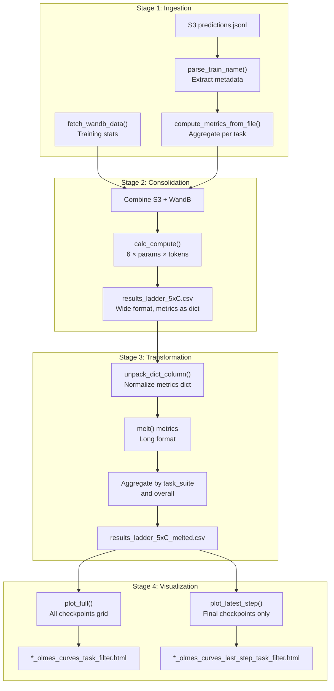

<!-- source: DeepWiki mcp.deepwiki.com · repo allenai/DataDecide · page 3.1 Single-Scale Evaluation · fetched 2026-10-26 -->

# Single-Scale Evaluation

<details>
<summary>Relevant source files</summary>

The following files were used as context for generating this wiki page:

- [requirements.txt](requirements.txt)
- [single_scale/process_s3_to_csv.py](single_scale/process_s3_to_csv.py)
- [single_scale/readme.md](single_scale/readme.md)
- [single_scale/requirements.txt](single_scale/requirements.txt)

</details>


## Purpose and Scope

The Single-Scale Evaluation system processes and analyzes model evaluation results at individual training checkpoints without fitting scaling laws or making cross-scale predictions. This system ingests raw prediction files from S3, enriches them with training metrics from WandB, computes evaluation metrics per task, and generates interactive visualizations for exploratory analysis.

For scaling law fitting and cross-scale prediction analysis, see [Scaling Laws Analysis](#4). For data cleaning and preprocessing details, see [Data Cleaning and Processing](#3.3). For S3 ingestion details, see [S3 Data Processing](#3.2).

## System Architecture

The single-scale evaluation workflow consists of three main stages: data ingestion from S3 and WandB, metric computation and aggregation, and per-task analysis with visualization.



**Sources:** [single_scale/readme.md:1-39](), [single_scale/process_s3_to_csv.py:1-625]()

## Data Ingestion Pipeline

### S3 Path Parsing and Discovery

The `process_s3_to_csv.py` script discovers evaluation results by traversing the S3 bucket hierarchy. The path structure follows the pattern:

```
s3://<bucket>/<prefix>/<group>-<model>-<chinchilla>[-seed]/step<N>/<task>/predictions.jsonl
```



The `parse_train_name()` function extracts structured metadata from these paths:

| Field | Pattern | Example |
|-------|---------|---------|
| `group` | Data corpus identifier | `no_math_no_code` |
| `model` | Model size with unit | `150M`, `1B` |
| `chinchilla` | Training compute multiplier | `5xC`, `2xC` |
| `step` | Training checkpoint step | `500`, `1000` |
| `seed` | Random seed (optional) | `0`, `1`, `2` |
| `task` | Evaluation task name | `mmlu`, `hellaswag` |

**Sources:** [single_scale/process_s3_to_csv.py:64-90](), [single_scale/process_s3_to_csv.py:177-210]()

### Parallel Processing Architecture

The system uses `ThreadPoolExecutor` for concurrent S3 file processing with configurable batch sizes:



**Sources:** [single_scale/process_s3_to_csv.py:543-559](), [single_scale/process_s3_to_csv.py:92-146]()

### Metric Computation

The `compute_metrics_from_file()` function processes prediction files and aggregates metrics according to task-specific configurations:



The system attempts to identify the primary metric in this order:
1. `task_config.get("primary_metric")`
2. `acc_raw`, `exact_match`, `f1`, `mc1`, `pass_at_1`, `prompt_level_loose_acc`, `maj_at_1`

**Sources:** [single_scale/process_s3_to_csv.py:92-146](), [single_scale/process_s3_to_csv.py:103-135]()

## WandB Integration

### Training Metrics Enrichment

After collecting evaluation metrics from S3, the system fetches training statistics from WandB to compute training cost and enrich the dataset:



The `fetch_wandb_data()` function returns a dictionary keyed by `(group, model, chinchilla, step)` tuples containing all requested metrics. The system then applies these to the DataFrame using `get_stat_from_data()`.

**Sources:** [single_scale/process_s3_to_csv.py:223-252](), [single_scale/process_s3_to_csv.py:564-586](), [single_scale/process_s3_to_csv.py:36-46]()

### Compute Calculation

Training compute (FLOPs) is calculated using the standard formula for transformer models:

```
compute = 6 × num_parameters × tokens
```

The `calc_compute()` function parses model size strings (e.g., `"150M"`, `"1B"`) and multiplies by the training tokens retrieved from WandB:

| Model Size | Parameters | Tokens (5xC) | Compute (FLOPs) |
|------------|------------|--------------|-----------------|
| `150M` | 150,000,000 | varies | 6 × 150M × tokens |
| `1B` | 1,000,000,000 | varies | 6 × 1B × tokens |

**Sources:** [single_scale/process_s3_to_csv.py:165-175](), [single_scale/process_s3_to_csv.py:589-592]()

## Data Schema and Type System

### Primary DataFrame Schema

The system enforces a strict dtype schema to ensure consistent data representation:

```python
dtypes = {
    "group": str,           # Data corpus identifier
    "model": str,           # Model size (e.g., "150M", "1B")
    "task": str,            # Evaluation task name
    "chinchilla": str,      # Training compute (e.g., "5xC")
    "step": int,            # Training checkpoint step
    "tokens": float,        # Total tokens trained
    "compute": float,       # Compute in FLOPs
    "metrics": object,      # Dictionary of metric values
    # WandB validation losses
    "eval/c4_en-validation/CrossEntropyLoss": float,
    "eval/dolma_common-crawl-validation/CrossEntropyLoss": float,
    "eval/pile-validation/CrossEntropyLoss": float,
    "eval/wikitext_103-validation/CrossEntropyLoss": float,
    # WandB training stats
    "train/CrossEntropyLoss": float,
    "throughput/total_tokens": float
}
```

**Sources:** [single_scale/process_s3_to_csv.py:48-58]()

### Metric Unpacking and Melting

The `unpack_dict_column()` function transforms the nested `metrics` dictionary column into individual columns using `pd.json_normalize()`:



The melted format enables metric-wise aggregation across different task suites and models.

**Sources:** [single_scale/process_s3_to_csv.py:148-163](), [single_scale/process_s3_to_csv.py:285-311]()

## Visualization System

### Interactive Plotly Dashboards

The system generates two primary HTML visualizations using Plotly with task-based dropdown filtering:

#### Full Training Curves Visualization

The `plot_full()` function creates a grid of subplots showing all metrics across all model sizes:



Each data mix (corpus) receives a unique color from an HSV palette with 200 random colors shuffled to maximize visual distinction.

**Sources:** [single_scale/process_s3_to_csv.py:314-392](), [single_scale/process_s3_to_csv.py:275-283]()

#### Latest Step Visualization

The `plot_latest_step()` function shows only the final checkpoint for each model configuration:



This visualization enables comparison across data mixes at their maximum training duration without the clutter of intermediate checkpoints.

**Sources:** [single_scale/process_s3_to_csv.py:395-474]()

### Color Mapping and Task Grouping

Data mixes are assigned consistent colors across all visualizations:

```python
# 200 colors from HSV palette, randomly shuffled
colors = sns.color_palette("hsv", 200)
random.shuffle(colors)
palette = [mcolors.rgb2hex(c) for c in colors[:len(groups)]]
color_map = {group: palette[i % len(palette)] for i, group in enumerate(groups)}
```

Tasks are grouped into suites for aggregation using the `task_groups` mapping from `util_metrics.py`.

**Sources:** [single_scale/process_s3_to_csv.py:275-283](), [single_scale/process_s3_to_csv.py:606]()

## Single-Scale Prediction Runner

### Main Prediction Script

The `main.py` script runs single-scale predictions on specific model checkpoints. The workflow supports both single-task and per-task configuration modes:



**Sources:** [single_scale/readme.md:21-38]()

### Per-Task Configuration Generation

The `create_per_task_configs.sh` script generates individual YAML configuration files for each evaluation task:

```bash
sh create_per_task_configs.sh config.yaml per_task_configs
```

This creates separate config files in `per_task_configs/` directory, enabling parallel execution across tasks using GNU Parallel with job logging and resume capability.

**Sources:** [single_scale/readme.md:29-32]()

## Data Flow Summary

The complete data flow from S3 to visualization:



**Sources:** [single_scale/process_s3_to_csv.py:500-609]()

## Environment Setup

The single-scale evaluation system requires Python 3.11 and specific dependencies for evaluation and visualization:

### Conda Environment Creation

```bash
conda create -n DataDecide-single-scale python=3.11
conda activate DataDecide-single-scale
pip install -r single_scale/requirements.txt
```

### Key Dependencies

| Package | Purpose |
|---------|---------|
| `lm_eval==0.4.3` | Evaluation framework |
| `ai2-olmo @ git+...` | OLMo model implementation |
| `torch>=2.4,<2.5` | PyTorch for model inference |
| `transformers>=4.45.0` | HuggingFace transformers |
| `wandb` | WandB API client |
| `boto3` | AWS S3 client |
| `plotly` | Interactive visualizations |
| `omegaconf==2.4.0.dev3` | Configuration management |

**Sources:** [single_scale/readme.md:1-6](), [single_scale/requirements.txt:1-29]()

## Usage Examples

### Processing Results from S3

```bash
python process_s3_to_csv.py \
    --s3 s3://ai2-llm/eval-results/downstream/eval-for-consistent-ranking-preemption-fixed \
    --csv_name "results_ladder_5xC.csv" \
    --batch_size 100
```

Common S3 paths:
- `s3://ai2-llm/eval-results/downstream/eval-for-consistent-ranking`
- `s3://ai2-llm/eval-results/downstream/eval-for-consistent-ranking-preemption-fixed`
- `s3://ai2-llm/checkpoints/benb/results_oe-eval-internal_ladder_oldstylehf`

**Sources:** [single_scale/readme.md:8-13](), [single_scale/process_s3_to_csv.py:4-11]()

### Incremental Updates

The system automatically detects existing data and only processes new checkpoints:

```bash
# Skip S3 refresh, just regenerate plots from existing CSV
python process_s3_to_csv.py \
    --s3 s3://ai2-llm/eval-results/downstream/... \
    --csv_name "results_ladder_5xC.csv" \
    --no_refresh
```

Existing combinations are tracked using `(task, group, model, chinchilla, step, seed)` tuples to avoid duplicate processing.

**Sources:** [single_scale/process_s3_to_csv.py:510-524](), [single_scale/process_s3_to_csv.py:619]()

### Running Per-Task Predictions

```bash
# Generate task-specific configs
sh create_per_task_configs.sh config.yaml per_task_configs

# Run all tasks in parallel with GNU Parallel
ls per_task_configs/*.yaml | parallel \
    --progress --eta --tee --results logs_dir \
    python main.py --config {}
```

**Sources:** [single_scale/readme.md:29-38]()

## Output Files

### CSV Outputs

| File | Format | Contents |
|------|--------|----------|
| `results_ladder_5xC.csv` | Wide | One row per (task, checkpoint), metrics in dict column |
| `results_ladder_5xC_melted.csv` | Long | One row per (task, checkpoint, metric) |
| `temp_new_data.csv` | Wide | Intermediate cache of newly processed data |

### HTML Visualizations

| File | Description |
|------|-------------|
| `<prefix>_olmes_curves_task_filter.html` | Grid of all metrics × models with task dropdown |
| `<prefix>_olmes_curves_last_step_task_filter.html` | Single column showing only final checkpoints |

Both visualizations include:
- Interactive task filtering via dropdown menu
- Color-coded data mixes (one color per corpus)
- Random baseline indicators for `primary_metric`
- Hover tooltips with exact values

**Sources:** [single_scale/process_s3_to_csv.py:391-392](), [single_scale/process_s3_to_csv.py:473-474](), [single_scale/process_s3_to_csv.py:494]()

## Task Configuration and Metrics

### Task Registry Integration

The system uses `TASK_REGISTRY` from `olmes.tasks.oe_eval_tasks` to access task-specific configurations. Each task defines:

- `TASK_CONFIG_DEFAULTS`: Configuration dictionary
- `primary_metric`: The canonical metric for the task
- Additional task-specific parameters

### Metric Fallback Chain

When `primary_metric` is not explicitly defined in task config, the system searches for metrics in this priority order:

1. `primary_metric` (from config)
2. `acc_raw`
3. `exact_match` (or `em`)
4. `f1`
5. `mc1`
6. `pass_at_1`
7. `prompt_level_loose_acc`
8. `maj_at_1`

All metrics are also normalized to standard names (e.g., `em` → `exact_match`).

**Sources:** [single_scale/process_s3_to_csv.py:103-122]()

### Random Baselines

The system displays random baseline performance for certain tasks, retrieved from `RANDOM_BASELINES` in `util_metrics.py`. These are rendered as dashed horizontal lines in the visualizations.

**Sources:** [single_scale/process_s3_to_csv.py:349-362]()

## Filtering and Data Selection

### Chinchilla Multiplier Filtering

By default, the system filters to only `5xC` (5× Chinchilla-optimal compute) checkpoints:

```python
df = df[df["chinchilla"] == "5xC"]
```

This reduces the dataset size while maintaining consistent compute budgets across model sizes.

**Sources:** [single_scale/process_s3_to_csv.py:526-527]()

### Task Filtering

Only tasks present in `RC_TASKS` (read from `../all_olmes_rc_tasks.txt`) are processed. This excludes generation tasks and focuses on reading comprehension evaluations.

**Sources:** [single_scale/process_s3_to_csv.py:60](), [single_scale/process_s3_to_csv.py:536-539]()

### Step 0 Handling

Initial checkpoints (step 0) receive special handling with compute and token counts set to 0.0:

```python
df.loc[df['step'] == 0, 'compute'] = 0.0
df.loc[df['step'] == 0, 'tokens'] = 0.0
```

**Sources:** [single_scale/process_s3_to_csv.py:604-605]()

---

