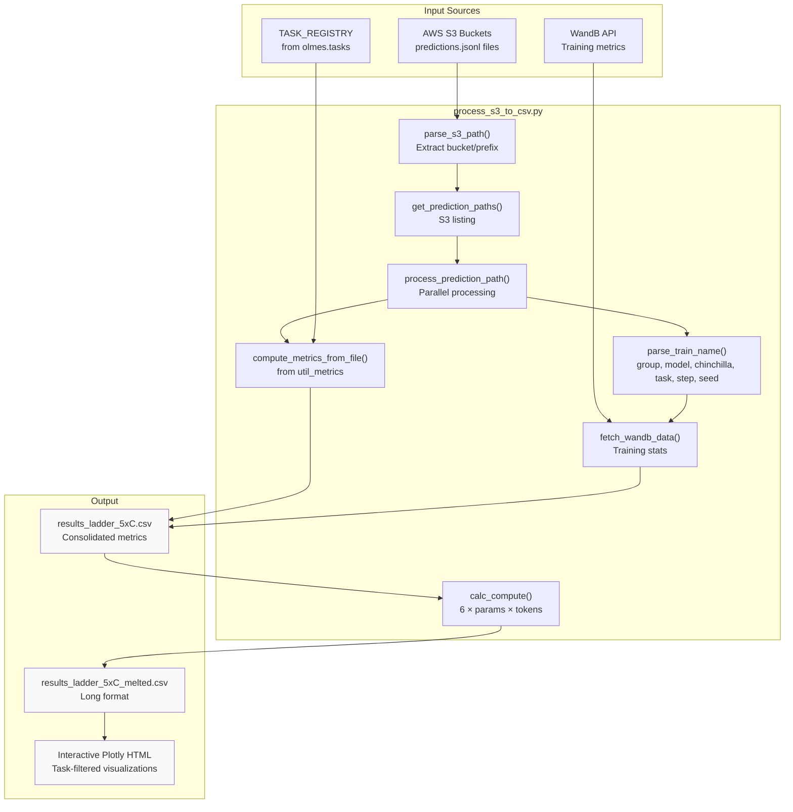
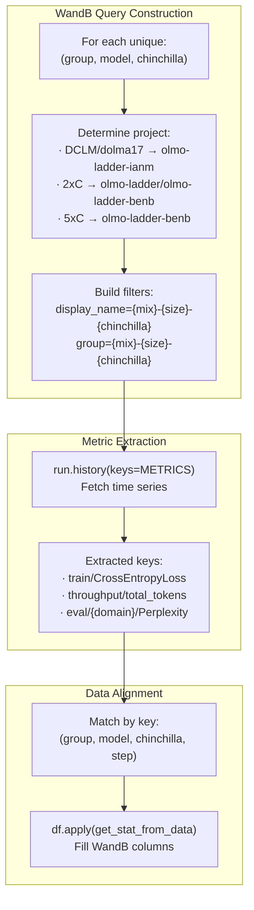

<!-- source: DeepWiki mcp.deepwiki.com · repo allenai/DataDecide · page 3.2 S3 Data Processing · fetched 2026-10-26 -->

# S3 Data Processing

<details>
<summary>Relevant source files</summary>

The following files were used as context for generating this wiki page:

- [perplexity_metrics_by_group.csv](perplexity_metrics_by_group.csv)
- [release/find_wandb.py](release/find_wandb.py)
- [release/loss_curves.ipynb](release/loss_curves.ipynb)
- [requirements.txt](requirements.txt)
- [single_scale/process_s3_to_csv.py](single_scale/process_s3_to_csv.py)
- [single_scale/readme.md](single_scale/readme.md)
- [single_scale/requirements.txt](single_scale/requirements.txt)

</details>


## Purpose and Scope

This page documents the S3 data processing pipeline implemented in `process_s3_to_csv.py`, which serves as the primary data ingestion mechanism for the DataDecide evaluation system. The script fetches model prediction results from AWS S3 storage, computes evaluation metrics, enriches the data with training statistics from Weights & Biases (WandB), and outputs structured CSV files for downstream analysis.

For information about data cleaning and normalization after S3 processing, see [Data Cleaning and Processing](#3.3). For details on running single-scale predictions that produce the S3 data, see [Single-Scale Evaluation](#3.1).

## Overview

The S3 data processing pipeline serves three primary functions:

1. **Discovery**: Scans S3 buckets to locate `predictions.jsonl` files across all model checkpoints
2. **Metric Computation**: Processes prediction files to compute task-specific evaluation metrics
3. **Enrichment**: Augments evaluation data with training statistics from WandB runs

The script operates in parallel to efficiently process thousands of checkpoint results, outputting a consolidated CSV file that maps model configurations, training steps, and evaluation metrics into a unified dataset.

**Sources:** [single_scale/process_s3_to_csv.py:1-624](), [single_scale/readme.md:8-13]()

## Architecture



**Sources:** [single_scale/process_s3_to_csv.py:64-624]()

## Input Sources

### S3 Bucket Structure

The script expects S3 paths following a specific directory hierarchy:

```
s3://bucket/prefix/
  ├── {group}-{model}-{chinchilla}[-{seed}]/
  │   ├── step{N}/
  │   │   ├── all_olmes_rc_tasks/
  │   │   │   └── task-{id}-{task_name}-predictions.jsonl
  │   │   └── {task}/
  │   │       └── predictions.jsonl
```

The `get_prediction_paths()` function traverses this structure to locate all prediction files:

| S3 Path Component | Parsed Field | Example |
|------------------|--------------|---------|
| `{group}` | Data recipe name | `falcon_and_cc_tulu_qc_top10` |
| `{model}` | Model size | `60M`, `150M`, `1B` |
| `{chinchilla}` | Training budget | `5xC`, `2xC` |
| `{seed}` | Random seed (optional) | `14`, `15` |
| `step{N}` | Training step | `step1250`, `step5000` |
| `{task}` | Evaluation task | `mmlu`, `arc_easy` |

**Sources:** [single_scale/process_s3_to_csv.py:64-90](), [single_scale/process_s3_to_csv.py:177-210]()

### WandB Projects

Training statistics are fetched from three WandB projects:

- `ai2-llm/olmo-ladder-benb` - Primary project for most data recipes
- `ai2-llm/olmo-ladder-ianm` - DCLM and dolma17 variants
- `ai2-llm/olmo-ladder` - Legacy 2xC experiments

The script uses display names and group filters to match WandB runs to S3 checkpoints:

```python
filters = {"display_name": f"{mix}-{size}-{chinchilla}"}
filters.update({"group": f"{mix}-{size}-{chinchilla}"})
```

**Sources:** [single_scale/process_s3_to_csv.py:223-248](), [single_scale/process_s3_to_csv.py:564-583]()

## Data Extraction Process

```mermaid
graph LR
    subgraph "S3 Discovery"
        LIST["s3.list_objects_v2()<br/>Recursive listing"]
        FILTER["Filter patterns<br/>all_olmes_rc_tasks/<br/>predictions.jsonl"]
    end
    
    subgraph "Parallel Processing"
        EXECUTOR["ThreadPoolExecutor<br/>max_workers=batch_size"]
        BATCH["Batch processing<br/>default: 100 files"]
    end
    
    subgraph "Path Parsing"
        REGEX["Regex extraction<br/>group, model, chinchilla<br/>step, seed, task"]
        VALIDATE["Validation<br/>∙ Model: \\d+[M|B]<br/>∙ Chinchilla: \\d+xC<br/>∙ Seed: \\d+"]
    end
    
    subgraph "Metric Computation"
        READ["Read predictions.jsonl<br/>from S3 GetObject"]
        COMPUTE["compute_metrics_from_file()<br/>Task-specific metrics"]
        AGGREGATE["Mean aggregation<br/>across instances"]
    end
    
    LIST --> FILTER
    FILTER --> EXECUTOR
    EXECUTOR --> BATCH
    BATCH --> REGEX
    REGEX --> VALIDATE
    VALIDATE --> READ
    READ --> COMPUTE
    COMPUTE --> AGGREGATE
```



**Sources:** [single_scale/process_s3_to_csv.py:92-146](), [single_scale/process_s3_to_csv.py:500-551]()

### Path Parsing Logic

The `parse_train_name()` function extracts structured metadata from S3 paths using regular expressions:

```python
# Example path structure
path = "checkpoints/benb/olmo-150M-no_math_no_code-5xC-14/step5000/all_olmes_rc_tasks/task-42-mmlu-predictions.jsonl"

# Extraction pattern
group_model_chinchilla = path.rsplit('-', 3)
# Result: ['olmo-150M-no_math_no_code', '5xC', '14']
```

The function handles both seeded and unseeded checkpoint paths:
- With seed: `{group}-{model}-{chinchilla}-{seed}` → parsed as 4 components
- Without seed: `{group}-{model}-{chinchilla}` → parsed as 3 components

**Sources:** [single_scale/process_s3_to_csv.py:177-210]()

### Metric Computation

The script delegates metric computation to `compute_metrics_from_file()` from `util_metrics`, which:

1. Parses the predictions JSONL content
2. Identifies the task's primary metric from `TASK_REGISTRY`
3. Computes instance-level metrics
4. Aggregates to mean values

The primary metric is determined by checking in order:
- `task_config.primary_metric`
- `acc_raw`
- `exact_match`
- `f1`
- `mc1`
- `pass_at_1`
- `prompt_level_loose_acc`
- `maj_at_1`

**Sources:** [single_scale/process_s3_to_csv.py:98-146]()

## WandB Integration



**Sources:** [single_scale/process_s3_to_csv.py:223-248](), [single_scale/process_s3_to_csv.py:564-586]()

### Fetched Metrics

The script fetches two categories of WandB metrics:

**Training Statistics:**
```python
wandb_stats = [
    "train/CrossEntropyLoss",
    "throughput/total_tokens"
]
```

**Validation Perplexities:**
```python
wandb_val_losses = [
    'eval/c4_en-validation/CrossEntropyLoss',
    'eval/dolma_common-crawl-validation/CrossEntropyLoss',
    'eval/pile-validation/CrossEntropyLoss',
    'eval/wikitext_103-validation/CrossEntropyLoss',
]
```

**Sources:** [single_scale/process_s3_to_csv.py:36-46]()

### Data Alignment

The `get_stat_from_data()` function matches evaluation results to WandB statistics:

```python
def get_stat_from_data(row, data, stat_name):
    key = (row['group'], row['model'], row['chinchilla'], int(row['step']))
    return data.get(key, {}).get(stat_name, np.nan)
```

This creates a lookup table indexed by `(group, model, chinchilla, step)` that allows efficient retrieval of training statistics for each evaluation checkpoint.

**Sources:** [single_scale/process_s3_to_csv.py:250-252]()

## Data Transformation

### Compute Calculation

The script calculates total compute (in FLOPs) using the Chinchilla scaling law formula:

```python
def calc_compute(model_size_str: str, tokens: int):
    # Parse size (e.g., "150M" → 150,000,000)
    scale = 1e6 if model_size_str[-1].lower() == "m" else 1e9
    num_parameters = int(float(model_size_str[:-1]) * scale)
    
    # Compute = 6 × parameters × tokens
    return 6 * num_parameters * tokens
```

This assumes approximately 6 FLOPs per parameter per token for transformer training.

**Sources:** [single_scale/process_s3_to_csv.py:165-175]()

### DataFrame Structure

The output CSV follows this schema:

| Column | Type | Source | Description |
|--------|------|--------|-------------|
| `group` | str | S3 path | Data recipe identifier |
| `model` | str | S3 path | Model size (e.g., "60M") |
| `task` | str | S3 path | Evaluation task name |
| `chinchilla` | str | S3 path | Training budget (e.g., "5xC") |
| `step` | int | S3 path | Training checkpoint step |
| `seed` | int | S3 path | Random seed (nullable) |
| `tokens` | float | WandB | `throughput/total_tokens` |
| `compute` | float | Calculated | 6 × params × tokens |
| `metrics` | object | S3 predictions | Dict of task metrics |
| `train/CrossEntropyLoss` | float | WandB | Training loss |
| `eval/{domain}/CrossEntropyLoss` | float | WandB | Validation perplexities |

**Sources:** [single_scale/process_s3_to_csv.py:48-58](), [single_scale/process_s3_to_csv.py:589-592]()

### Metric Unpacking

For visualization, the nested `metrics` dictionary is unpacked into individual columns:

```python
def unpack_dict_column(df, col_name):
    temp = pd.json_normalize(df[col_name], max_level=1)
    temp = temp.reset_index(drop=True)
    df = df.reset_index(drop=True).drop(columns=[col_name]).join(temp)
    return df
```

This transforms:
```
metrics: {"primary_metric": 0.45, "acc_raw": 0.42, ...}
```

Into:
```
primary_metric: 0.45, acc_raw: 0.42, ...
```

**Sources:** [single_scale/process_s3_to_csv.py:148-163]()

## Output Formats

### Primary CSV Output

The main output file (`results_ladder_5xC.csv`) contains one row per `(group, model, task, step, seed)` combination:

```
group,model,task,chinchilla,step,seed,tokens,compute,metrics,train/CrossEntropyLoss,...
falcon_and_cc_tulu_qc_top10,60M,mmlu,5xC,5000,14,1.2e10,4.32e15,"{""primary_metric"": 0.45}",2.3,...
```

The script implements incremental updates:
1. Load existing CSV if present
2. Track processed combinations as set of tuples
3. Filter S3 paths to only new combinations
4. Process new data in parallel batches
5. Concatenate and save

**Sources:** [single_scale/process_s3_to_csv.py:510-597]()

### Melted Format

The script also produces a melted (long-format) CSV for visualization:

```python
df_melted = df_filtered.melt(
    id_vars=["group", "model", "task_suite", "tokens", "compute", "step"],
    value_vars=metrics_all,
    var_name="metric", 
    value_name="value"
).dropna(subset=["value"])
```

This transforms wide format (one column per metric) into long format (one row per metric value), facilitating faceted plotting.

**Sources:** [single_scale/process_s3_to_csv.py:294-296](), [single_scale/process_s3_to_csv.py:491-494]()

### Interactive Visualizations

The script generates two Plotly HTML files:

1. **`{prefix}_olmes_curves_task_filter.html`**: Full training curves across all model sizes and metrics with task filtering
2. **`{prefix}_olmes_curves_last_step_task_filter.html`**: Final checkpoint performance for each model

Both visualizations include:
- Dropdown menus for task suite filtering
- Color-coded data recipe traces
- Random baseline overlays for primary metrics
- Synchronized compute (FLOPs) x-axis

**Sources:** [single_scale/process_s3_to_csv.py:254-497]()

## Usage

### Basic Execution

```bash
python process_s3_to_csv.py \
    --s3 s3://ai2-llm/eval-results/downstream/eval-for-consistent-ranking-preemption-fixed \
    --csv_name "results_ladder_5xC.csv"
```

**Sources:** [single_scale/readme.md:8-13]()

### Command-Line Arguments

| Argument | Type | Default | Description |
|----------|------|---------|-------------|
| `--s3` | str | required | Full S3 path (e.g., `s3://bucket/prefix/`) |
| `--csv_name` | str | `results_ladder_5xC.csv` | Output CSV filename |
| `--no_refresh` | flag | False | Skip S3 fetch, use cached CSV only |
| `--batch_size` | int | 100 | Parallel processing batch size |

**Sources:** [single_scale/process_s3_to_csv.py:616-621]()

### Incremental Updates

The script supports incremental processing by:

1. Loading the existing CSV file if present
2. Building a set of existing `(task, group, model, chinchilla, step, seed)` tuples
3. Filtering new S3 paths that don't match existing combinations
4. Processing only new data
5. Appending to the existing DataFrame

This allows efficient updates when new checkpoints are added without reprocessing the entire dataset.

**Sources:** [single_scale/process_s3_to_csv.py:510-551]()

### Typical S3 Paths

Common S3 paths used in the DataDecide project:

- `s3://ai2-llm/eval-results/downstream/eval-for-consistent-ranking`
- `s3://ai2-llm/eval-results/downstream/eval-for-consistent-ranking-preemption-fixed`
- `s3://ai2-llm/checkpoints/benb/results_oe-eval-internal_ladder_oldstylehf`

**Sources:** [single_scale/process_s3_to_csv.py:8-12]()

### Performance Tuning

The script uses `ThreadPoolExecutor` for parallel S3 downloads and metric computation. The `batch_size` parameter controls parallelism:

- **Default**: 100 concurrent threads
- **Higher values**: Faster processing but higher memory usage
- **Lower values**: Reduced memory footprint but slower execution

The boto3 client is configured with matching connection pooling:

```python
config = Config(max_pool_connections=batch_size)
s3 = boto3.client('s3', config=config)
```

**Sources:** [single_scale/process_s3_to_csv.py:500-551]()

## Dependencies

Key Python packages required:

| Package | Purpose |
|---------|---------|
| `boto3` | AWS S3 client |
| `wandb` | WandB API access |
| `pandas` | DataFrame operations |
| `plotly` | Interactive visualizations |
| `tqdm` | Progress bars |
| `olmes` | Task registry access |

**Sources:** [single_scale/requirements.txt:1-29]()

---

