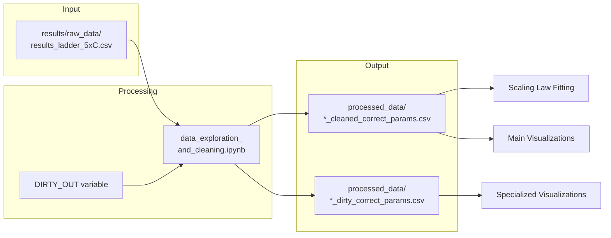
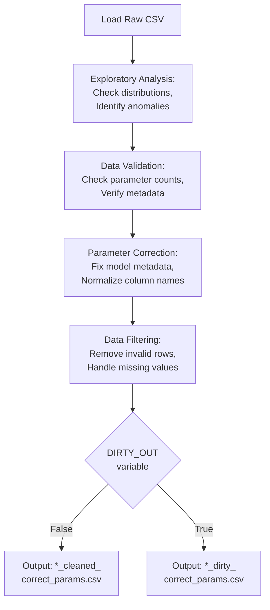
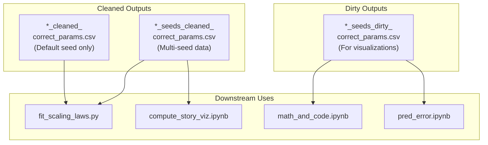
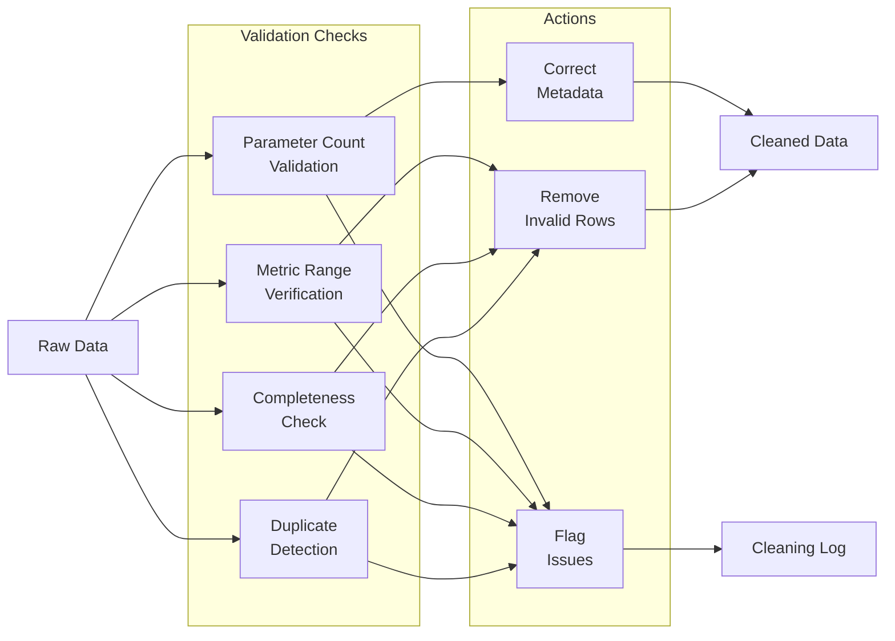
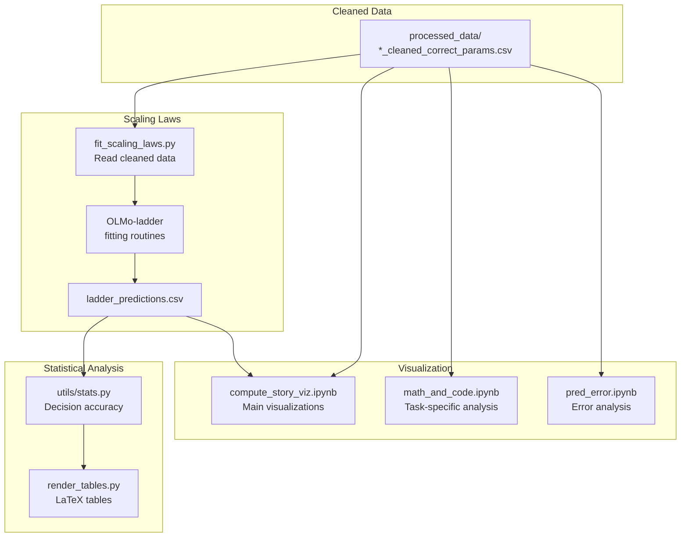
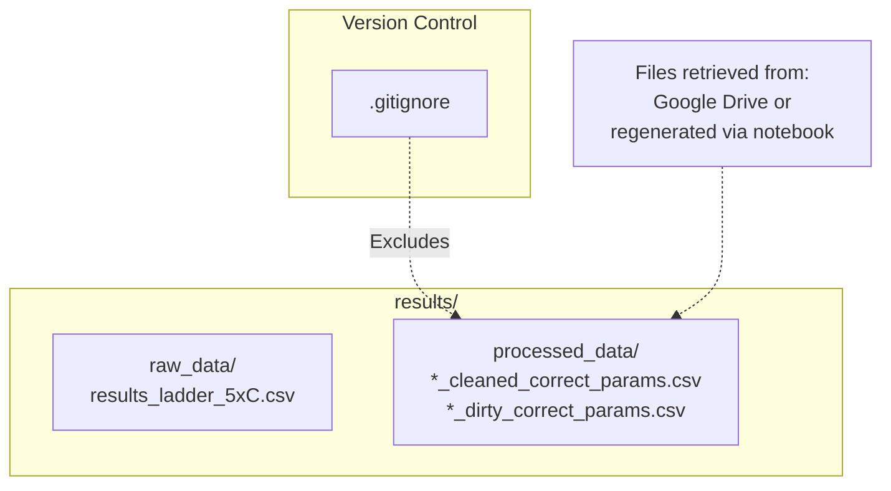

<!-- source: DeepWiki mcp.deepwiki.com · repo allenai/DataDecide · page 3.3 Data Cleaning and Processing · fetched 2026-10-26 -->

# Data Cleaning and Processing

<details>
<summary>Relevant source files</summary>

The following files were used as context for generating this wiki page:

- [.gitignore](.gitignore)
- [requirements.txt](requirements.txt)
- [results/readme.md](results/readme.md)
- [single_scale/process_s3_to_csv.py](single_scale/process_s3_to_csv.py)
- [single_scale/readme.md](single_scale/readme.md)
- [single_scale/requirements.txt](single_scale/requirements.txt)
- [viz/pred_error.ipynb](viz/pred_error.ipynb)

</details>


**Purpose and Scope**: This page describes the data cleaning and transformation workflow that processes raw evaluation results from S3 into analysis-ready datasets. The cleaning pipeline handles data validation, parameter correction, normalization, and generates multiple output variants for different downstream uses.

For information about how raw data is initially ingested from S3, see [S3 Data Processing](#3.2). For details on how cleaned data is stored and managed, see [Results Management](#3.4).

## Overview

The data cleaning process sits between raw S3 data ingestion and all downstream analysis. It transforms the raw CSV output from `process_s3_to_csv.py` into cleaned, validated datasets that serve as the foundation for scaling law fitting, visualization, and statistical analysis.

**Data Cleaning Pipeline**



Sources: [single_scale/readme.md:15-19](), [results/readme.md:11-14]()

## Input Data Structure

The cleaning process expects input from the raw data file generated by S3 processing. This file contains evaluation metrics across multiple dimensions.

**Raw Data Schema**

| Column | Type | Description |
|--------|------|-------------|
| `group` | str | Data corpus identifier (e.g., "no_math_no_code") |
| `model` | str | Model size (e.g., "150M", "1B") |
| `task` | str | Evaluation task name |
| `chinchilla` | str | Training compute budget (e.g., "5xC") |
| `step` | int | Training checkpoint step |
| `seed` | int/None | Random seed for training run |
| `metrics` | object | Dictionary of task-specific metrics |
| `tokens` | float | Total tokens processed |
| `compute` | float | Total FLOPs used |
| Various WandB stats | float | Training and validation losses |

The raw data file typically contains all checkpoint evaluations across 25 data corpora, 14 model sizes, and multiple training seeds.

Sources: [single_scale/process_s3_to_csv.py:48-58]()

## The Cleaning Notebook

The cleaning process is implemented in the `data_exploration_and_cleaning.ipynb` notebook. This notebook performs exploratory analysis, identifies data quality issues, and applies transformations to produce cleaned outputs.

**Notebook Execution Flow**



**Running the Cleaning Notebook**

The notebook must be executed to generate the cleaned output files. Two execution modes are available:

1. **Standard Mode** (DIRTY_OUT = False): Generates fully cleaned data for analysis
2. **Dirty Mode** (DIRTY_OUT = True): Generates partially cleaned data for certain visualizations

```
# Standard execution produces:
results_ladder_5xC_seeds_cleaned_correct_params.csv

# With DIRTY_OUT=True produces:
results_ladder_5xC_seeds_dirty_correct_params.csv
```

Sources: [single_scale/readme.md:15-19]()

## Output Files and Variants

The cleaning process generates multiple output variants to serve different downstream requirements.

**Output File Structure**



**File Variants**

| Filename Pattern | Description | Primary Use Case |
|------------------|-------------|------------------|
| `*_seeds_cleaned_correct_params.csv` | Cleaned data with all seeds | Multi-seed scaling law analysis |
| `*_cleaned_correct_params.csv` | Cleaned data, default seed only | Single-seed scaling law fitting |
| `*_seeds_dirty_correct_params.csv` | Partially cleaned data | Specialized visualizations requiring raw metric values |

Sources: [single_scale/readme.md:15-19](), [results/readme.md:11-14]()

## Data Transformations Applied

The cleaning notebook applies several transformations to ensure data quality and consistency.

**Parameter Correction**

The cleaning process corrects model parameter counts and metadata that may have been incorrectly specified during training or evaluation. This involves:

- Validating parameter counts against expected model sizes
- Correcting mismatched model size labels
- Standardizing naming conventions for data corpora

**Data Normalization**

Column names and values are normalized to ensure consistency:

- Group names are standardized (e.g., removing underscores, fixing capitalization)
- Model size strings are normalized (e.g., "150M" vs "150m")
- Task names are validated against known task registries

**Quality Filtering**

Invalid or incomplete rows are identified and handled:

- Rows with missing critical metadata are removed
- Checkpoints with incomplete evaluation results are flagged
- Duplicate entries are deduplicated based on (group, model, task, step, seed) keys

**Metric Validation**

Metrics are validated to ensure they fall within expected ranges and formats:

- Primary metrics are verified to exist for each task
- Metric values are checked for NaN or infinite values
- Multi-seed aggregations are computed and validated

Sources: [single_scale/process_s3_to_csv.py:135-163]()

## Data Quality Checks

The cleaning process implements several quality checks to ensure the output data is suitable for analysis.

**Quality Check Pipeline**



Sources: [single_scale/process_s3_to_csv.py:92-146]()

## Integration with Downstream Systems

The cleaned data files serve as the canonical input for all downstream analysis and visualization systems.

**Downstream Data Flow**



The cleaning process ensures that:
- All downstream systems receive data in a consistent format
- Parameter counts are accurate for compute calculations
- Metric names are standardized across tasks
- Multi-seed data is properly aggregated where needed

Sources: [results/readme.md:1-18](), [single_scale/readme.md:1-39]()

## File Location and Storage

Cleaned data files are stored in the `results/processed_data/` directory and are excluded from version control due to their size.

**Storage Organization**



The processed data can be obtained in two ways:
1. Downloaded from the shared Google Drive location
2. Regenerated by running the cleaning notebook on raw data

Sources: [.gitignore:8](), [results/readme.md:1-18]()

---

