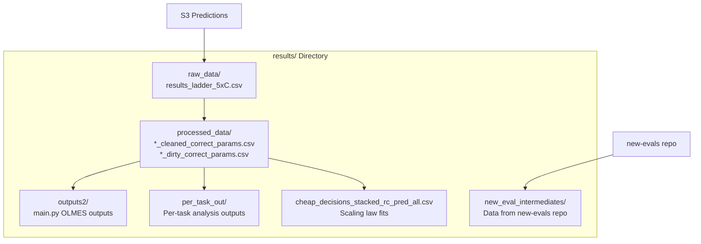
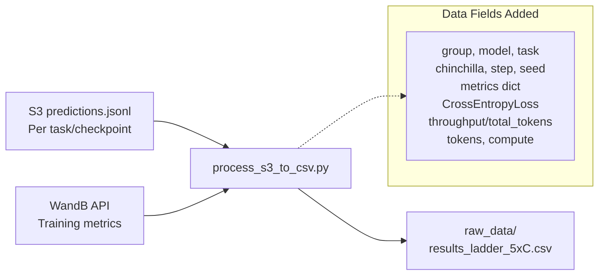
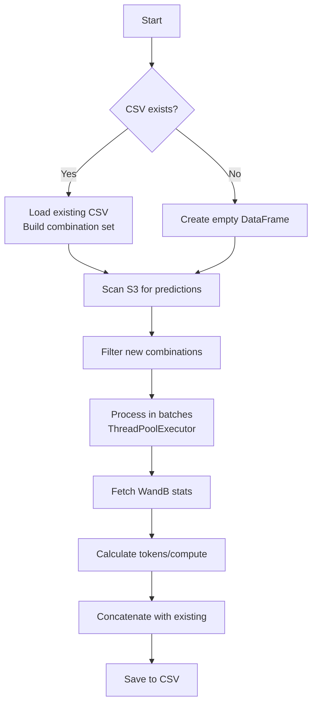
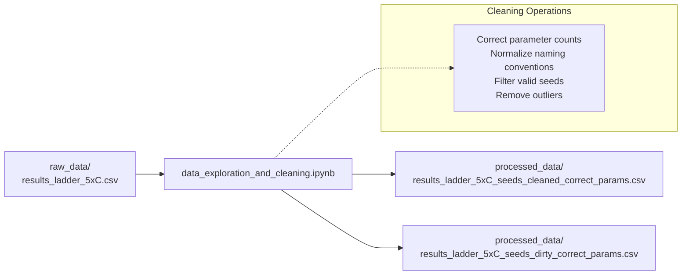
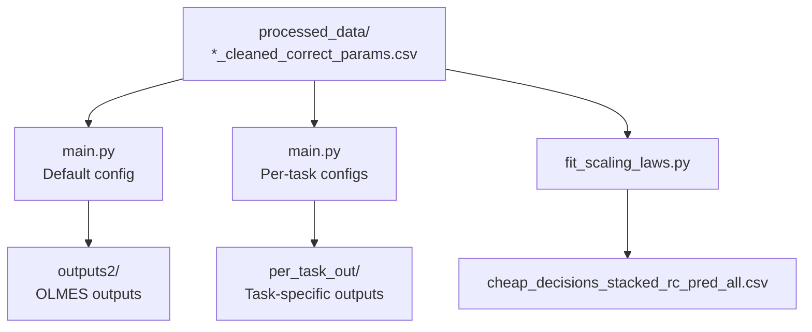
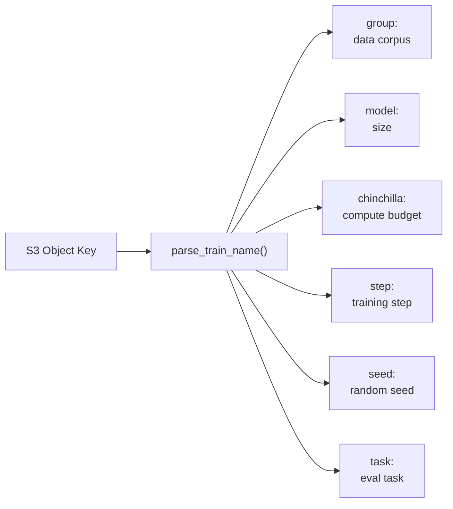
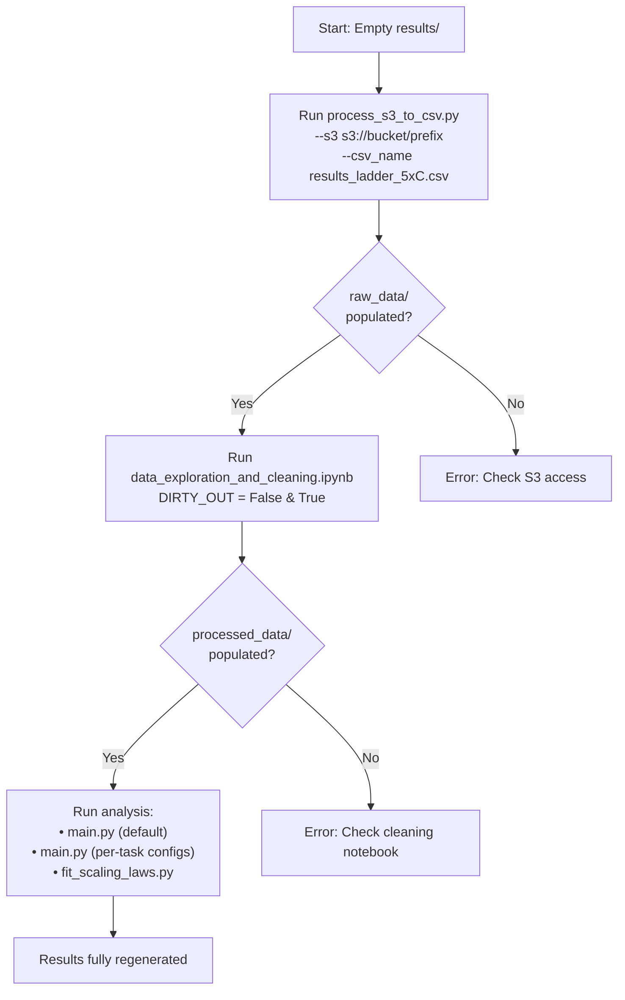
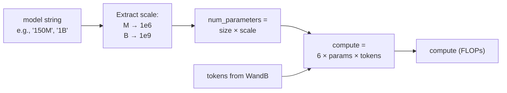
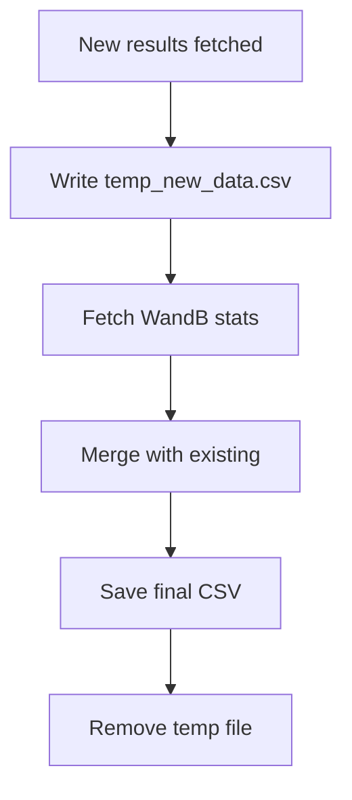

<!-- source: DeepWiki mcp.deepwiki.com · repo allenai/DataDecide · page 3.4 Results Management · fetched 2026-10-26 -->

# Results Management

<details>
<summary>Relevant source files</summary>

The following files were used as context for generating this wiki page:

- [.gitignore](.gitignore)
- [requirements.txt](requirements.txt)
- [results/readme.md](results/readme.md)
- [single_scale/process_s3_to_csv.py](single_scale/process_s3_to_csv.py)
- [single_scale/readme.md](single_scale/readme.md)
- [single_scale/requirements.txt](single_scale/requirements.txt)
- [viz/pred_error.ipynb](viz/pred_error.ipynb)

</details>


## Purpose and Scope

The Results Management system governs the organization, storage, and version control of evaluation data throughout the DataDecide pipeline. This system manages the complete lifecycle of results from raw S3 predictions through to cleaned datasets ready for scaling law analysis and visualization.

For information about S3 data ingestion, see [S3 Data Processing](#3.2). For scaling law fitting that consumes processed results, see [Scaling Law Fitting](#4.1). For visualization of results data, see [Story Visualization](#5.1).

---

## Results Directory Structure

The `results/` directory contains multiple subdirectories representing different stages of data processing. All subdirectories are excluded from version control to avoid storing large generated files in the repository.

### Directory Organization



**Sources:** [results/readme.md:1-18](), [.gitignore:6-11]()

| Directory | Contents | Generated By | Purpose |
|-----------|----------|--------------|---------|
| `raw_data/` | `results_ladder_5xC.csv` | `process_s3_to_csv.py` | Raw evaluation metrics fetched from S3 and enriched with WandB training statistics |
| `processed_data/` | `*_cleaned_correct_params.csv`<br/>`*_dirty_correct_params.csv` | `data_exploration_and_cleaning.ipynb` | Cleaned datasets with corrected parameter counts and normalized naming |
| `outputs2/` | OLMES analysis outputs | `main.py` (default config) | Single-scale evaluation results for OLMES benchmark suite |
| `per_task_out/` | Per-task analysis files | `main.py` (per-task configs) | Individual task-level evaluation outputs |
| `new_eval_intermediates/` | Math/code analysis data | External [new-evals](https://github.com/davidheineman/new-evals) | Specialized benchmarks (MBPP, HumanEval) for research questions |
| Root | `cheap_decisions_stacked_rc_pred_all.csv` | `fit_scaling_laws.py` | Fitted scaling law predictions |

**Sources:** [results/readme.md:7-18]()

---

## Data Flow and Processing Stages

### Stage 1: Raw Data Ingestion

The `process_s3_to_csv.py` script creates the initial `raw_data/results_ladder_5xC.csv` file by:
- Scanning S3 prefixes for `predictions.jsonl` files
- Extracting evaluation metrics from prediction files
- Enriching with WandB training statistics
- Computing derived fields (tokens, compute)



**Sources:** [single_scale/process_s3_to_csv.py:1-12](), [single_scale/readme.md:8-13]()

The script uses parallel processing with configurable batch sizes and maintains an incremental update pattern:



**Sources:** [single_scale/process_s3_to_csv.py:500-597]()

Key data types maintained throughout:

| Column | Type | Description |
|--------|------|-------------|
| `group` | str | Data corpus identifier (e.g., "no_math_no_code", "dolma17") |
| `model` | str | Model size (e.g., "150M", "1B") |
| `task` | str | Evaluation task name |
| `chinchilla` | str | Training compute budget (e.g., "5xC") |
| `step` | int | Training step number |
| `tokens` | float | Total tokens processed |
| `compute` | float | Total FLOPs (6 × params × tokens) |
| `metrics` | object | Dictionary of task-specific metrics |

**Sources:** [single_scale/process_s3_to_csv.py:48-58]()

### Stage 2: Data Cleaning and Normalization

The `data_exploration_and_cleaning.ipynb` notebook transforms raw data into cleaned datasets:



**Sources:** [single_scale/readme.md:15-19](), [results/readme.md:12-13]()

Two output variants are produced:
- **Cleaned datasets**: For scaling law fitting and statistical analysis
- **Dirty datasets**: With `DIRTY_OUT = True` flag for certain visualizations requiring unfiltered data

**Sources:** [single_scale/readme.md:17-19]()

### Stage 3: Analysis Outputs

Processed data feeds into two analysis pathways:



**Sources:** [results/readme.md:7-18](), [single_scale/readme.md:21-38]()

---

## File Naming Conventions

### Raw Data Files

Raw data files follow the pattern: `results_ladder_{compute_budget}.csv`
- Example: `results_ladder_5xC.csv` contains all evaluations at 5× Chinchilla compute budget

**Sources:** [single_scale/process_s3_to_csv.py:4](), [single_scale/readme.md:12]()

### Processed Data Files

Processed files include metadata about cleaning and parameter corrections:
- Pattern: `results_ladder_{compute_budget}_seeds_{clean_status}_correct_params.csv`
- Examples:
  - `results_ladder_5xC_seeds_cleaned_correct_params.csv`
  - `results_ladder_5xC_seeds_dirty_correct_params.csv`

The `correct_params` suffix indicates that model parameter counts have been verified and corrected.

**Sources:** [single_scale/readme.md:17-19]()

### Per-Task Configuration Files

Per-task analysis generates separate configuration files:
```bash
sh create_per_task_configs.sh config.yaml per_task_configs
# Generates: per_task_configs/*.yaml
```

Each configuration file targets a specific evaluation task, enabling parallel processing.

**Sources:** [single_scale/readme.md:29-38]()

---

## Version Control Strategy

### Git Exclusions

All results directories are excluded from version control to prevent repository bloat:

```
/results/outputs2/
/results/per_task_out/
/results/processed_data/
/results/raw_data/
/results/new_eval_intermediates/
/results/cheap_decisions_stacked_rc_pred_all.csv
```

**Sources:** [.gitignore:6-11]()

### Data Provenance Tracking

While results are not version controlled, data provenance is maintained through:

1. **S3 Path Parsing**: Extracting metadata from S3 object keys
   - Pattern: `{prefix}/{group}-{model}-{chinchilla}[-{seed}]/step{step}/{task}/predictions.jsonl`
   - Example: `checkpoints/benb/olmo-150M-no_math_no_code-5xC-1/step500/mmlu/predictions.jsonl`



**Sources:** [single_scale/process_s3_to_csv.py:177-210]()

2. **WandB Experiment Linking**: Matching evaluation results to training runs
   - Key: `(group, model, chinchilla, step)`
   - Fetches: Training loss, validation losses, token counts

**Sources:** [single_scale/process_s3_to_csv.py:223-248]()

3. **Checkpoint Registry**: External tracking files (see [Checkpoint Registry](#7.3))
   - `weka_paths.jsonl`: Comprehensive checkpoint inventory
   - `final_defualt_seed_paths.jsonl`: Production checkpoint subset

---

## Data Retrieval and Regeneration

### Retrieval from External Storage

Pre-computed results can be retrieved from Google Drive:
- Location: [Google Drive folder](https://drive.google.com/drive/folders/1weYlEOlHrA_fzT2OsRa40uLc4EKTGz1D?usp=share_link)
- Contains all subdirectories: `raw_data/`, `processed_data/`, `outputs2/`, `per_task_out/`

**Sources:** [results/readme.md:3]()

### Regeneration Workflow

Results can be fully regenerated following this sequence:



**Sources:** [single_scale/readme.md:1-38](), [results/readme.md:1-18]()

### Incremental Updates

The `process_s3_to_csv.py` script supports incremental updates by:
1. Loading existing CSV if present
2. Building a set of existing combinations: `(task, group, model, chinchilla, step, seed)`
3. Fetching only new S3 predictions not in the existing set
4. Appending new results and saving

To skip S3 refresh and only plot existing data:
```bash
python process_s3_to_csv.py --s3 s3://bucket/prefix --no_refresh
```

**Sources:** [single_scale/process_s3_to_csv.py:6](), [single_scale/process_s3_to_csv.py:510-541]()

---

## Compute Budget Calculation

The system calculates FLOPs (compute) using the standard formula for transformer training:
```
compute = 6 × num_parameters × tokens
```

Implementation in `calc_compute()`:



**Sources:** [single_scale/process_s3_to_csv.py:165-176]()

This computed value is stored in the `compute` column and used throughout the system for:
- X-axis in scaling law plots
- Sorting and filtering results
- Scaling law fitting

---

## Data Schema Evolution

### Metrics Dictionary Structure

The `metrics` column contains a nested dictionary varying by task type:

**Reading Comprehension Tasks:**
- `primary_metric`: Task-specific main metric
- `acc_raw`: Raw accuracy
- `acc_per_char`: Character-normalized accuracy  
- `acc_per_token`: Token-normalized accuracy
- `acc_uncond`: Unconditional accuracy

**Sources:** [single_scale/process_s3_to_csv.py:103-134]()

Primary metric selection hierarchy:
1. Task config `primary_metric` field
2. First available from: `["acc_raw", "exact_match", "f1", "mc1", "pass_at_1", "prompt_level_loose_acc", "maj_at_1"]`

**Sources:** [single_scale/process_s3_to_csv.py:106-118]()

### WandB Statistics Integration

Additional columns fetched from WandB runs:

| Column | Source | Description |
|--------|--------|-------------|
| `train/CrossEntropyLoss` | Training metrics | Training loss at checkpoint |
| `throughput/total_tokens` | Training metrics | Total tokens processed |
| `eval/c4_en-validation/CrossEntropyLoss` | Validation metrics | C4 validation loss |
| `eval/dolma_common-crawl-validation/CrossEntropyLoss` | Validation metrics | Dolma CC validation loss |
| `eval/pile-validation/CrossEntropyLoss` | Validation metrics | Pile validation loss |
| `eval/wikitext_103-validation/CrossEntropyLoss` | Validation metrics | WikiText-103 validation loss |

**Sources:** [single_scale/process_s3_to_csv.py:36-46]()

---

## Batch Processing Configuration

The S3 processing script supports configurable parallelism:

```bash
python process_s3_to_csv.py \
    --s3 s3://bucket/prefix \
    --csv_name results_ladder_5xC.csv \
    --batch_size 100  # Default: 100 parallel connections
```

The batch size controls:
- ThreadPoolExecutor max workers
- S3 client max pool connections  
- Number of simultaneous S3 downloads

**Sources:** [single_scale/process_s3_to_csv.py:500-506](), [single_scale/process_s3_to_csv.py:620]()

Temporary caching prevents data loss during long-running processes:


**Sources:** [single_scale/process_s3_to_csv.py:554-613]()

---

