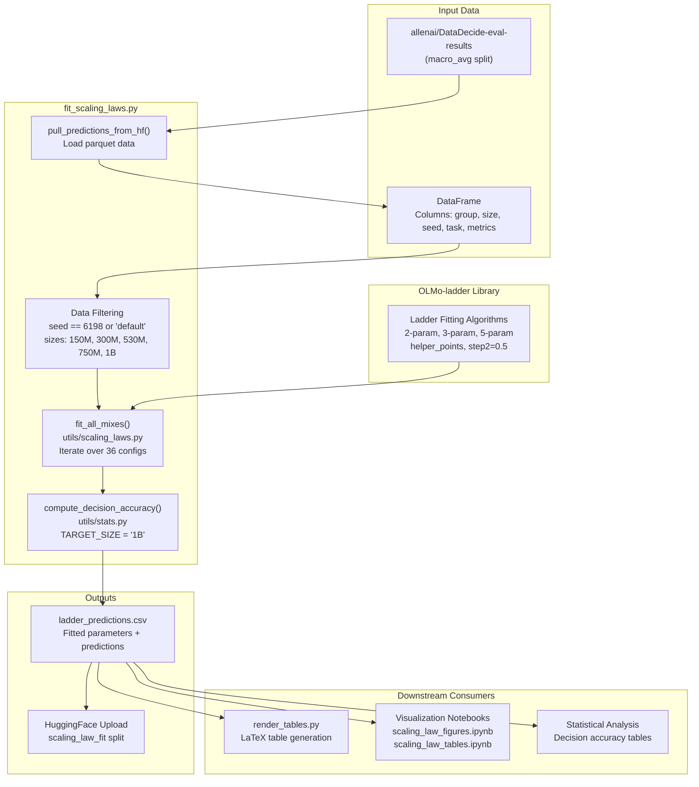
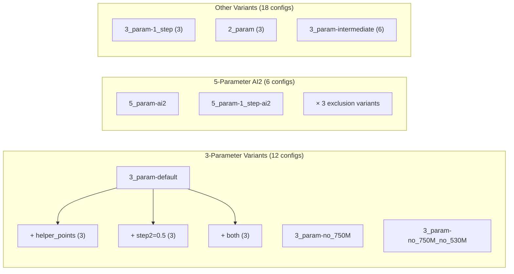

<!-- source: DeepWiki mcp.deepwiki.com · repo allenai/DataDecide · page 4 Scaling Laws Analysis · fetched 2026-10-26 -->

# Scaling Laws Analysis

<details>
<summary>Relevant source files</summary>

The following files were used as context for generating this wiki page:

- [scaling_laws/README.md](scaling_laws/README.md)
- [scaling_laws/fit_scaling_laws.py](scaling_laws/fit_scaling_laws.py)
- [scaling_laws/utils/constants/__init__.py](scaling_laws/utils/constants/__init__.py)

</details>


## Purpose and Scope

The Scaling Laws Analysis system fits mathematical models to evaluate how model performance changes with compute scale. This system processes evaluation results from 30,000+ model checkpoints across 25 data corpora and 14 model sizes to predict performance at larger scales and determine which dataset choices yield better outcomes.

This page provides an overview of the scaling laws analysis pipeline. For detailed information about specific components, see:
- **Fitting process**: [Scaling Law Fitting](#4.1)
- **Statistical utilities**: [Statistical Analysis](#4.2)
- **LaTeX table generation**: [Table Generation](#4.3)
- **Interactive visualizations**: [Scaling Law Visualization](#4.4)
- **Data processing and evaluation**: [Evaluation System](#3)

**Sources:** [scaling_laws/README.md:1-58]()

## System Overview

The scaling laws system fits power law models to predict how model performance scales with compute (FLOPs). The primary workflow consists of:

1. **Data Ingestion**: Load processed evaluation results from HuggingFace
2. **Scaling Law Fitting**: Fit 36 different scaling law configurations using OLMo-ladder
3. **Prediction Generation**: Produce performance predictions at target scale (1B parameters)
4. **Statistical Analysis**: Compute decision accuracy metrics
5. **Output Generation**: Create CSV predictions, LaTeX tables, and visualizations

The system answers the core research question: **Given evaluation results at smaller scales (150M-750M parameters), which dataset will perform best at 1B parameters?**

**Sources:** [scaling_laws/README.md:1-58](), [scaling_laws/fit_scaling_laws.py:1-203]()

## System Architecture

The following diagram shows the major components and their relationships:



**Sources:** [scaling_laws/fit_scaling_laws.py:1-203](), [scaling_laws/README.md:21-49]()

## Scaling Law Configurations

The system evaluates 36 different scaling law configurations defined in `SCALING_LAW_CONFIGS`. These configurations vary across multiple dimensions:

### Configuration Categories

| Category | Variants | Description |
|----------|----------|-------------|
| **Base Setup** | `3_param`, `5_param-ai2`, `2_param` | Number of parameters in scaling law equation |
| **Model Exclusions** | `default`, `no_750M`, `no_750M_no_530M` | Which training sizes to exclude from fitting |
| **Helper Points** | `default`, `helper_points` | Whether to use intermediate points in fitting |
| **Step 2 Data** | `default`, `step2=0.5` | Percentage of data used in second fitting step |
| **Fitting Steps** | `default`, `1_step` | Single-step vs. two-step fitting procedure |
| **Intermediate Features** | `default`, `intermediate` | Use metric as intermediate (FLOPs → metric → primary_metric) |

### Complete Configuration List

The 36 configurations in [scaling_laws/fit_scaling_laws.py:30-80]():



Each configuration name follows the pattern:
```
{n_param}-{exclusions}-{modifiers}
```

Examples:
- `3_param-default`: Standard 3-parameter fit using all sizes
- `3_param-no_750M-helper_points`: 3-parameter fit excluding 750M, with helper points
- `5_param-ai2-no_750M_no_530M`: AI2 5-parameter fit excluding 750M and 530M

**Sources:** [scaling_laws/fit_scaling_laws.py:30-80]()

## Data Flow Pipeline

The following diagram maps the data transformation process from raw evaluation results to final predictions:

```mermaid
graph TB
    subgraph "Input Processing"
        START["HF Dataset Load<br/>pull_predictions_from_hf()"]
        PARQUET["Parquet File<br/>local cache"]
        LOAD["pd.read_parquet()<br/>~30k+ rows"]
    end
    
    subgraph "Data Preparation"
        SEED_FILTER["Filter: seed == 6198 | 'default'<br/>Line 118"]
        COL_RENAME["Restore Column Names<br/>params → size<br/>data → group<br/>Lines 121-128"]
        SIZE_FILTER["Filter Sizes<br/>Keep: 150M, 300M, 530M, 750M, 1B<br/>Line 132"]
        EXTRACT["Extract Metadata<br/>MIXES, SIZES, MULT, MODELS, TASKS<br/>Lines 134-138"]
    end
    
    subgraph "Fitting Loop"
        LOOP_START["for each mix × task × setup × metric"]
        FIT["fit_all_mixes()<br/>utils/scaling_laws.py"]
        LADDER_CALL["OLMo-ladder fitting<br/>Returns: fitted params, predictions"]
        RESULTS_ACC["Accumulate Results<br/>DataFrame with predictions"]
    end
    
    subgraph "Post-Processing"
        FINITE_CHECK["Remove NaN Predictions<br/>np.isfinite(step_1_pred)<br/>Line 170"]
        DECISION_ACC["compute_decision_accuracy()<br/>TARGET_SIZE = '1B'<br/>Line 172"]
    end
    
    subgraph "Output"
        CSV["ladder_predictions.csv<br/>Columns: mix, task, setup,<br/>fitted_params, predictions,<br/>decision_accuracy"]
        HF_PUSH["Optional: push_parquet_to_hf()<br/>scaling_law_fit split"]
    end
    
    START --> PARQUET
    PARQUET --> LOAD
    LOAD --> SEED_FILTER
    SEED_FILTER --> COL_RENAME
    COL_RENAME --> SIZE_FILTER
    SIZE_FILTER --> EXTRACT
    EXTRACT --> LOOP_START
    LOOP_START --> FIT
    FIT --> LADDER_CALL
    LADDER_CALL --> RESULTS_ACC
    RESULTS_ACC --> FINITE_CHECK
    FINITE_CHECK --> DECISION_ACC
    DECISION_ACC --> CSV
    CSV --> HF_PUSH
```



**Sources:** [scaling_laws/fit_scaling_laws.py:112-203]()

## Core Components

### fit_scaling_laws.py

The main entry point for scaling law fitting. Key functions:

| Function | Purpose | Key Parameters |
|----------|---------|----------------|
| `run_ladder_fits()` | Orchestrates entire fitting pipeline | `data_path`, `results_path`, `dry_run` |
| `generate_setups()` | (Commented out) Alternative configuration generator | `setup_types`, `model_sizes` |
| Command line interface | Supports dry-run, HF push, custom paths | `--dry-run`, `--push-to-hf`, `--result-path` |

**Execution modes:**

1. **Dry Run** [scaling_laws/fit_scaling_laws.py:146-156]()
   - Tests with 2 mixes, 2 tasks, 3 metrics
   - Fast validation of setup

2. **Full Run** [scaling_laws/fit_scaling_laws.py:158-167]()
   - All mixes, tasks, setups
   - All metrics in `ALL_METRICS`

**Sources:** [scaling_laws/fit_scaling_laws.py:1-203]()

### Constants and Metrics

The system uses centralized constants from [scaling_laws/utils/constants/__init__.py:1-46]():

| Constant | Purpose | Count |
|----------|---------|-------|
| `ALL_METRICS` | Metrics to fit scaling laws for | 16 metrics |
| `REVERSED_METRICS` | Metrics where lower is better | 6 metrics |
| `DATA_DIR`, `PLOT_DIR`, `TABLE_DIR` | Output directory paths | 3 directories |

**Metric Categories:**
- **Primary metrics**: `primary_metric`, `acc_raw`, `acc_per_token`, `acc_per_char`
- **Probability metrics**: `correct_prob`, `total_prob`, `norm_correct_prob` (+ per-token, per-char variants)
- **Margin metrics**: `margin`, `margin_per_token`, `margin_per_char`

**Sources:** [scaling_laws/utils/constants/__init__.py:14-21]()

## Integration with OLMo-ladder

The system uses the OLMo-ladder library (branch: `datados`) for the actual curve fitting algorithms:

```mermaid
graph LR
    subgraph "DataDecide"
        CONFIG["36 Configurations<br/>SCALING_LAW_CONFIGS"]
        FIT_ALL["fit_all_mixes()<br/>utils/scaling_laws.py"]
        DATA["Evaluation Data<br/>group, size, task, metrics"]
    end
    
    subgraph "OLMo-ladder Library"
        LADDER_FIT["Ladder Fitting API<br/>2-param: E = a × C^(-b)<br/>3-param: E = a × C^(-b) + c<br/>5-param: Full AI2 equation"]
        HELPER["Helper Points<br/>Intermediate scale points"]
        STEP2["Step 2 Filtering<br/>Subset of data for 2nd pass"]
    end
    
    subgraph "Outputs"
        PARAMS["Fitted Parameters<br/>a, b, c, ...]
        PRED["Predictions<br/>Performance at 1B"]
    end
    
    CONFIG --> FIT_ALL
    DATA --> FIT_ALL
    FIT_ALL --> LADDER_FIT
    HELPER --> LADDER_FIT
    STEP2 --> LADDER_FIT
    LADDER_FIT --> PARAMS
    LADDER_FIT --> PRED
```

**Installation:** The README specifies installing OLMo-ladder from the `datados` branch for local development [scaling_laws/README.md:26-30]().

**Sources:** [scaling_laws/README.md:21-49](), [scaling_laws/fit_scaling_laws.py:9]()

## Command Line Usage

### Quick Start Examples

```bash
# Test with subset of data
python fit_scaling_laws.py --dry-run

# Fit all scaling laws and save locally
python fit_scaling_laws.py --result-path ladder_predictions.csv

# Fit and upload to HuggingFace
python fit_scaling_laws.py \
  --result-path ladder_predictions.csv \
  --push-to-hf allenai/DataDecide-eval-results
```

### Parameter Reference

| Parameter | Default | Description |
|-----------|---------|-------------|
| `--data-path` | `allenai/DataDecide-eval-results` | HuggingFace dataset containing evaluation results |
| `--result-path` | `ladder_predictions.csv` | Output CSV path for fitted predictions |
| `--dry-run` | False | Run on 2 mixes, 2 tasks for testing |
| `--push-to-hf` | None | Optional HF dataset name to upload results |

**Sources:** [scaling_laws/README.md:32-49](), [scaling_laws/fit_scaling_laws.py:177-203]()

## Output Format

The system generates `ladder_predictions.csv` containing:

**Key Columns:**
- **Grouping**: `group` (data mix), `task`, `setup` (config name), `y_metric`
- **Fitted Parameters**: Depends on scaling law (e.g., `a`, `b`, `c` for 3-param)
- **Predictions**: `step_1_pred`, `step_2_pred` (if applicable)
- **Decision Metrics**: From `compute_decision_accuracy()` comparing predicted vs. actual performance

This CSV is consumed by:
- [render_tables.py](#4.3) for LaTeX table generation
- [scaling_law_figures.ipynb](#4.4) for visualization
- [scaling_law_tables.ipynb](#4.4) for interactive analysis
- Statistical analysis notebooks

**Sources:** [scaling_laws/fit_scaling_laws.py:170-174](), [scaling_laws/README.md:44-58]()

## Directory Structure

```
scaling_laws/
├── fit_scaling_laws.py          # Main fitting script
├── render_tables.py             # LaTeX table generation
├── README.md                     # Documentation and workflow
├── utils/
│   ├── constants/               # Metrics, display names
│   ├── scaling_laws.py          # fit_all_mixes() implementation
│   ├── stats.py                 # Statistical utilities
│   └── plotting.py              # Visualization helpers
├── remote/
│   └── hf.py                    # HuggingFace data loading
├── notebooks/
│   ├── example_results.ipynb    # Training curve examples
│   ├── scaling_law_figures.ipynb # Paper figures
│   ├── scaling_law_tables.ipynb  # Interactive tables
│   └── math_and_code.ipynb      # MBPP/HumanEval analysis
└── data/                        # Output directory (created)
    └── ladder_predictions.csv   # Fitted results
```

**Sources:** [scaling_laws/README.md:16-19]()

---

