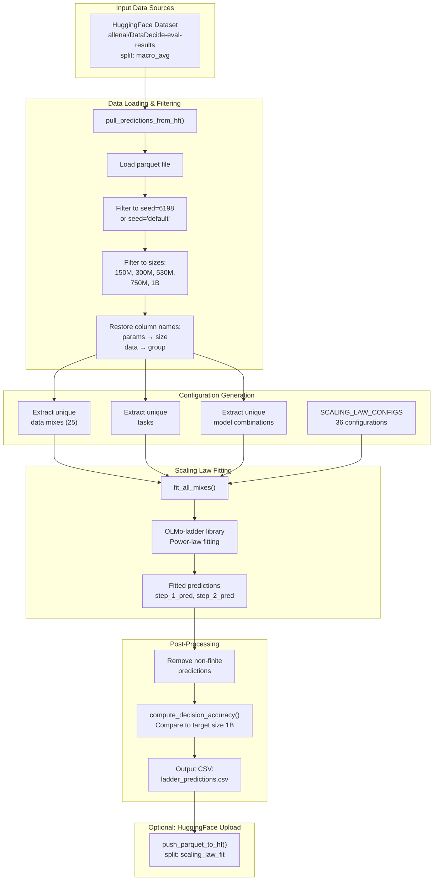
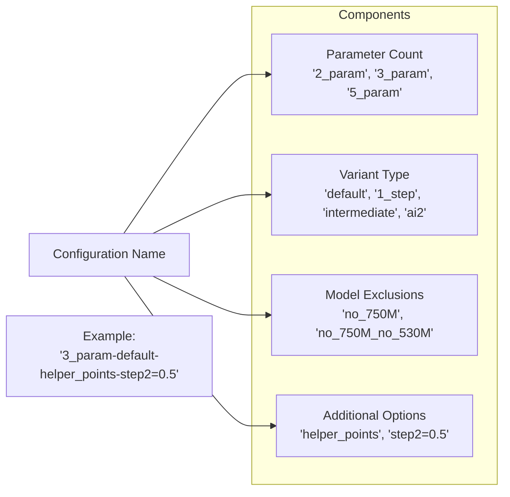
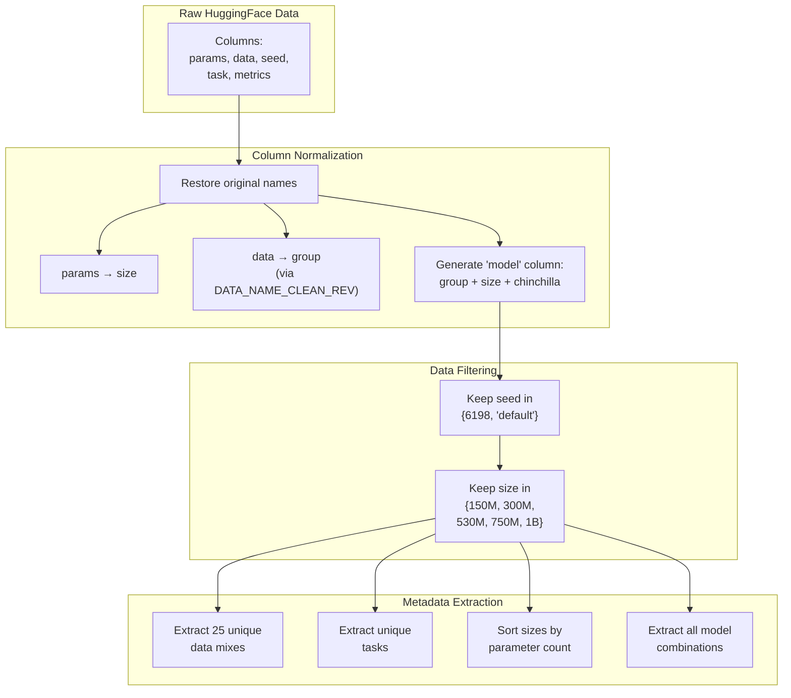
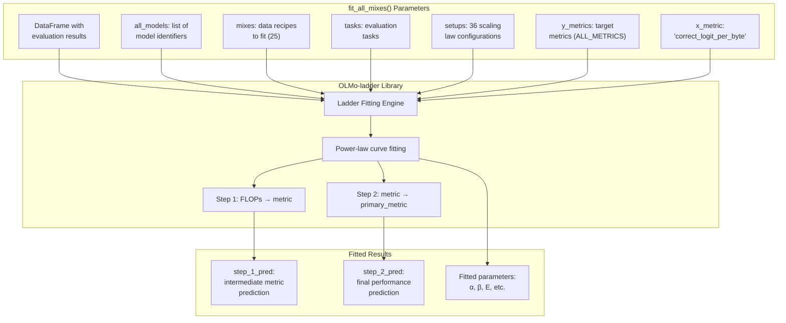
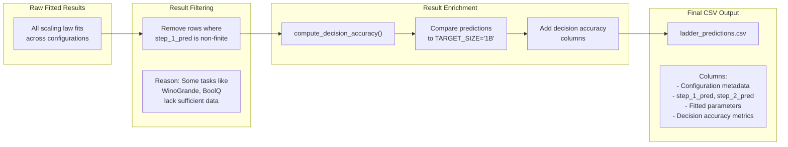

<!-- source: DeepWiki mcp.deepwiki.com · repo allenai/DataDecide · page 4.1 Scaling Law Fitting · fetched 2026-10-26 -->

# Scaling Law Fitting

<details>
<summary>Relevant source files</summary>

The following files were used as context for generating this wiki page:

- [scaling_laws/README.md](scaling_laws/README.md)
- [scaling_laws/fit_scaling_laws.py](scaling_laws/fit_scaling_laws.py)
- [scaling_laws/utils/constants/__init__.py](scaling_laws/utils/constants/__init__.py)

</details>


## Purpose and Scope

This document covers the scaling law fitting system implemented in `fit_scaling_laws.py`, which fits 36 different scaling law configurations to evaluate how well different functional forms predict model performance at larger scales. The system integrates with the OLMo-ladder library to fit power-law relationships between compute (FLOPs), model performance on intermediate metrics, and final task performance.

For statistical analysis of the fitted results, see [Statistical Analysis](#4.2). For visualization of the fitted curves, see [Scaling Law Visualization](#4.4). For information on how evaluation data is prepared before fitting, see [Data Cleaning and Processing](#3.3).

---

## Core Workflow

The scaling law fitting process follows this pipeline:



**Sources:** [scaling_laws/fit_scaling_laws.py:112-175]()

---

## Scaling Law Configuration System

The system defines 36 different scaling law configurations, organized into families based on their functional form and data inclusion criteria:

### Configuration Families

| Family | Parameters | Variants | Line Range |
|--------|-----------|----------|------------|
| 3-parameter (default) | FLOPs → metric | 12 variants (default, no_750M, no_750M_no_530M) × 4 options | [31-49]() |
| 5-parameter AI2 | Full AI2 scaling law | 3 variants | [52-54]() |
| 5-parameter 1-step AI2 | Single-step AI2 | 3 variants | [57-59]() |
| 3-parameter 1-step | Single-step FLOPs | 3 variants | [62-64]() |
| 2-parameter | FLOPs without bias E | 3 variants | [67-69]() |
| 3-parameter intermediate | FLOPs → metric → primary_metric | 6 variants (3 sizes × 2 options) | [72-79]() |

### Configuration Naming Convention



### Configuration Options Explained

| Option | Purpose | Example Configs |
|--------|---------|----------------|
| `default` | Standard fitting using all available model sizes | `3_param-default` |
| `no_750M` | Exclude 750M model from fitting to test extrapolation | `3_param-no_750M` |
| `no_750M_no_530M` | Exclude both 750M and 530M models | `3_param-no_750M_no_530M` |
| `helper_points` | Include additional data points in fitting | `3_param-default-helper_points` |
| `step2=0.5` | Use only 50% of points for step 2 fitting | `3_param-default-step2=0.5` |
| `1_step` | Single-step fitting instead of two-step | `3_param-1_step` |
| `intermediate` | Use intermediate metric as feature | `3_param-intermediate-default` |
| `ai2` | Use full AI2 scaling law formulation | `5_param-ai2` |

**Sources:** [scaling_laws/fit_scaling_laws.py:30-80]()

---

## Command-Line Interface

### Basic Usage

```bash
# Quick test on subset of data
python fit_scaling_laws.py --dry-run

# Fit all configurations on full dataset
python fit_scaling_laws.py --result-path ladder_predictions.csv

# Fit and upload results to HuggingFace
python fit_scaling_laws.py \
    --result-path ladder_predictions.csv \
    --push-to-hf allenai/DataDecide-eval-results
```

### Command-Line Arguments

| Argument | Type | Default | Description |
|----------|------|---------|-------------|
| `--data-path` | str | `allenai/DataDecide-eval-results` | HuggingFace dataset to load evaluation results from |
| `--result-path` | str | `ladder_predictions.csv` | Output path for fitted predictions CSV |
| `--dry-run` | flag | False | Run on subset of data (2 mixes, 2 tasks, 3 metrics) for testing |
| `--push-to-hf` | str | None | HuggingFace dataset name to push results (optional) |

**Sources:** [scaling_laws/fit_scaling_laws.py:177-203](), [scaling_laws/README.md:35-48]()

---

## Data Processing Pipeline

### Input Data Transformation



**Sources:** [scaling_laws/fit_scaling_laws.py:118-142]()

### Dry-Run vs Full Execution

| Mode | Mixes | Tasks | Metrics | Purpose |
|------|-------|-------|---------|---------|
| Dry-run | 2 | 2 | 3 (`primary_metric`, `acc_per_char`, `correct_prob_per_char`) | Fast testing |
| Full | 25 | All | 16 (ALL_METRICS) | Complete analysis |

**Sources:** [scaling_laws/fit_scaling_laws.py:146-167]()

---

## Integration with OLMo-ladder Library

The system uses the OLMo-ladder library for the actual curve fitting. The integration occurs through the `fit_all_mixes()` function:



### Optional Local Installation

For development purposes, the OLMo-ladder library can be installed locally:

```bash
git clone -b datados https://github.com/allenai/OLMo-ladder OLMo-ladder
cd OLMo-ladder
pip install -e ".[plotting]"
```

**Sources:** [scaling_laws/README.md:23-30](), [scaling_laws/fit_scaling_laws.py:9]()

---

## Output Format and Post-Processing

### Output Structure

The `run_ladder_fits()` function produces a CSV file with the following transformations:



### Key Output Columns

| Column Category | Examples | Description |
|----------------|----------|-------------|
| Configuration | `setup`, `y_metric`, `x_metric` | Which scaling law config was used |
| Predictions | `step_1_pred`, `step_2_pred` | Predicted performance values |
| Metadata | `mix`, `task`, `size` | Data recipe, evaluation task, model size |
| Decision Metrics | Accuracy columns | Added by `compute_decision_accuracy()` |

**Sources:** [scaling_laws/fit_scaling_laws.py:169-175](), [scaling_laws/fit_scaling_laws.py:82]()

---

## Metrics and Intermediate Features

### Supported Metrics

The system fits scaling laws across 16 different performance metrics defined in `ALL_METRICS`:

| Metric Category | Metrics |
|----------------|---------|
| Primary | `primary_metric` |
| Probability-based | `correct_prob`, `correct_prob_per_token`, `correct_prob_per_char`, `total_prob`, `total_prob_per_token`, `total_prob_per_char` |
| Normalized probability | `norm_correct_prob`, `norm_correct_prob_per_token`, `norm_correct_prob_per_char` |
| Margin-based | `margin`, `margin_per_token`, `margin_per_char` |
| Accuracy-based | `acc_raw`, `acc_per_token`, `acc_per_char` |

### Intermediate Feature

All configurations use `correct_logit_per_byte` as the intermediate metric (`x_metric`) for two-step fitting:
- **Step 1**: FLOPs → `correct_logit_per_byte`
- **Step 2**: `correct_logit_per_byte` → target metric (e.g., `primary_metric`)

**Sources:** [scaling_laws/utils/constants/__init__.py:18-21](), [scaling_laws/fit_scaling_laws.py:155-156](), [scaling_laws/fit_scaling_laws.py:165]()

---

## Advanced Configuration Generation

The system includes a `generate_setups()` function for programmatically creating configurations that exclude different combinations of model sizes:

```python
# Example: generate configurations excluding progressively larger models
setups = generate_setups(['3_param-intermediate'], ['150M', '300M', '530M', '750M', '1B'])
# Result:
# - 3_param-intermediate-no_1B
# - 3_param-intermediate-no_750M_no_1B
# - 3_param-intermediate-no_530M_no_750M_no_1B
# ... etc
```

This function is currently unused in favor of the explicit `SCALING_LAW_CONFIGS` list, but provides flexibility for future experimentation.

**Sources:** [scaling_laws/fit_scaling_laws.py:84-110](), [scaling_laws/fit_scaling_laws.py:143-144]()

---

