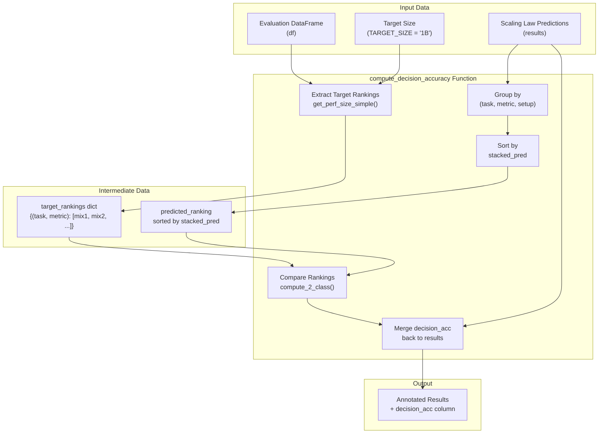
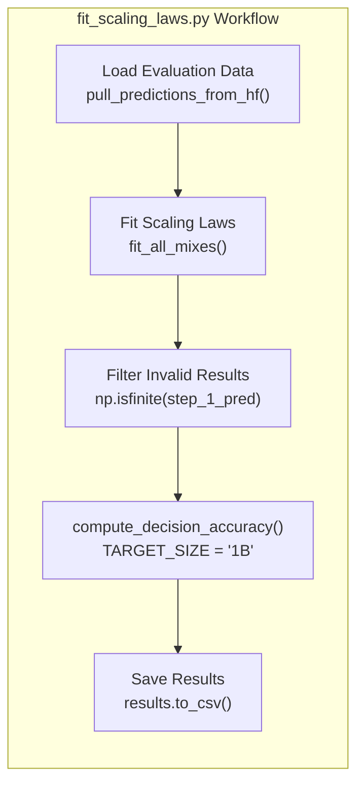
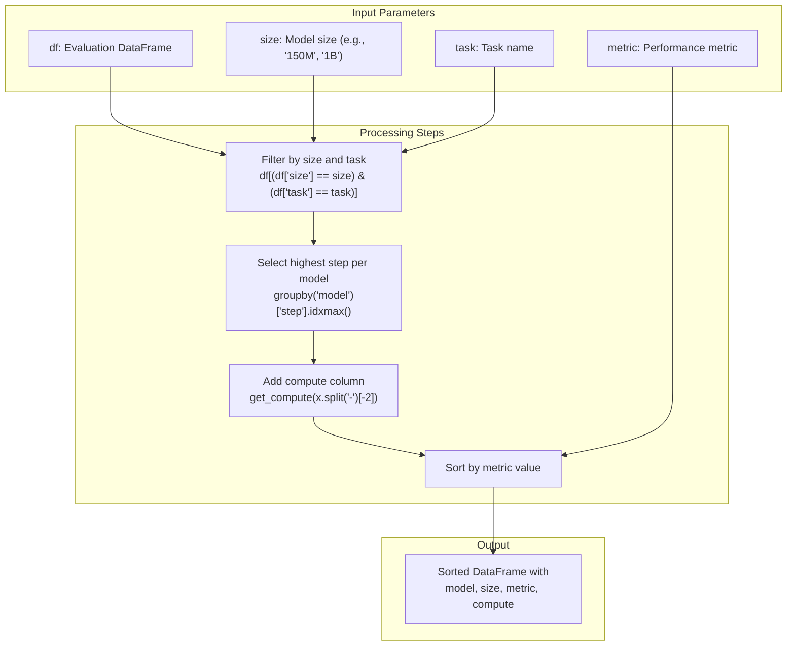
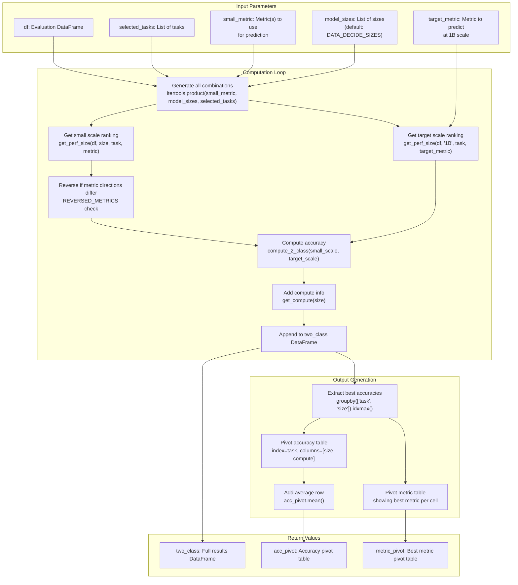
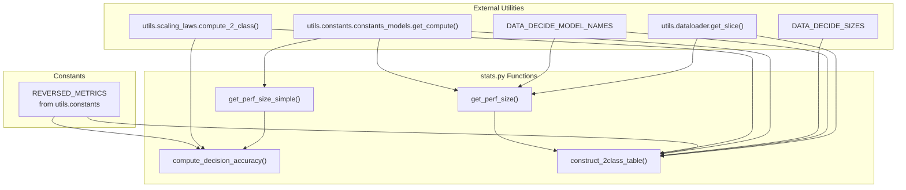

<!-- source: DeepWiki mcp.deepwiki.com · repo allenai/DataDecide · page 4.2 Statistical Analysis · fetched 2026-10-26 -->

# Statistical Analysis

<details>
<summary>Relevant source files</summary>

The following files were used as context for generating this wiki page:

- [scaling_laws/fit_scaling_laws.py](scaling_laws/fit_scaling_laws.py)
- [scaling_laws/utils/constants/__init__.py](scaling_laws/utils/constants/__init__.py)
- [scaling_laws/utils/stats.py](scaling_laws/utils/stats.py)

</details>


## Purpose and Scope

This page documents the statistical analysis utilities used to evaluate scaling law predictions in the DataDecide system. The primary focus is on computing **decision accuracy** metrics that measure how well scaling law predictions match actual model performance rankings at the target scale (1B parameters). These utilities are located in [scaling_laws/utils/stats.py]() and are invoked as a post-processing step after scaling law fitting.

For information about the scaling law fitting process itself, see [Scaling Law Fitting](#4.1). For visualization of these statistical results, see [Table Generation](#4.3) and [Scaling Law Visualization](#4.4).

---

## Overview

The statistical analysis system provides three main capabilities:

| Function | Purpose | Primary Output |
|----------|---------|----------------|
| `get_perf_size()` / `get_perf_size_simple()` | Extract model performance at a specific size and task | Ranked list of data mixtures |
| `compute_decision_accuracy()` | Compute how well predictions match actual rankings | DataFrame with `decision_acc` column |
| `construct_2class_table()` | Analyze predictive power of metrics at different scales | Pivot tables with accuracy values |

These functions work together to answer the critical question: **Can we use small-scale model performance to predict which data mixture will perform best at larger scales?**

**Sources:** [scaling_laws/utils/stats.py:1-156]()

---

## Decision Accuracy Computation

### Workflow



The `compute_decision_accuracy()` function computes a percentage indicating how well scaling law predictions match actual performance rankings at the target scale. The process involves:

1. **Extract Ground Truth Rankings**: For each (task, metric) pair, obtain the actual ranking of data mixtures at the target size by calling `get_perf_size_simple(df, target_size, task, metric)['group']` [scaling_laws/utils/stats.py:48-50]()

2. **Group Predictions**: Group the scaling law results by (task, metric, setup) [scaling_laws/utils/stats.py:52]()

3. **Generate Predicted Rankings**: For each group, sort mixtures by their `stacked_pred` value to create a predicted ranking [scaling_laws/utils/stats.py:59]()

4. **Handle Metric Direction**: Reverse the predicted ranking if the metric is in `REVERSED_METRICS` (e.g., perplexity-like metrics where lower is better) [scaling_laws/utils/stats.py:62-63]()

5. **Compute Accuracy**: Call `compute_2_class(predicted_ranking, target_ranking)` to compute pairwise accuracy, multiply by 100 to get percentage [scaling_laws/utils/stats.py:65-67]()

6. **Merge Back**: Merge the decision accuracy scores back into the results DataFrame [scaling_laws/utils/stats.py:76-83]()

**Sources:** [scaling_laws/utils/stats.py:46-85](), [scaling_laws/fit_scaling_laws.py:172]()

### Integration with Fit Pipeline



The decision accuracy computation is invoked at line 172 of `fit_scaling_laws.py`, immediately before saving the final results. This ensures that every scaling law prediction includes a `decision_acc` metric indicating its quality.

**Sources:** [scaling_laws/fit_scaling_laws.py:112-174]()

---

## Performance Extraction Functions

### get_perf_size_simple()

The simpler performance extraction function operates as follows:



This function returns a DataFrame containing all models at a specific size, sorted by their performance on the specified metric. It automatically selects the highest training step for each model [scaling_laws/utils/stats.py:37-38]() and adds a `compute` column based on the model size [scaling_laws/utils/stats.py:40]().

**Sources:** [scaling_laws/utils/stats.py:32-43]()

### get_perf_size()

The more comprehensive `get_perf_size()` function includes additional aggregation logic:

- Filters to only include models in `DATA_DECIDE_MODEL_NAMES` [scaling_laws/utils/stats.py:14]()
- Supports both single task (string) and multiple tasks (list) [scaling_laws/utils/stats.py:15-18]()
- Aggregates numerical columns by mean and non-numerical by first value [scaling_laws/utils/stats.py:21-23]()
- Adds a `task_name = 'aggregate'` column when aggregating [scaling_laws/utils/stats.py:24]()
- Includes `compute` column derived from model size [scaling_laws/utils/stats.py:27]()

**Sources:** [scaling_laws/utils/stats.py:11-29]()

---

## Two-Class Accuracy Analysis

### construct_2class_table()

The `construct_2class_table()` function computes predictive accuracy across multiple combinations of metrics, model sizes, and tasks. This analysis answers: **"How accurately can we predict 1B performance using metric X at size Y?"**



**Key Implementation Details:**

1. **Combination Generation**: Creates all combinations of (metric, size, task) using `itertools.product()` [scaling_laws/utils/stats.py:94]()

2. **Metric Direction Handling**: Reverses the small scale ranking if the metric direction differs from the target metric (e.g., using bits-per-byte to predict accuracy) [scaling_laws/utils/stats.py:114]()

3. **Compute Tracking**: Stores the compute budget associated with each size for later analysis [scaling_laws/utils/stats.py:126-129]()

4. **Best Metric Selection**: For each (task, size) combination, identifies which metric achieved the highest accuracy [scaling_laws/utils/stats.py:145-146]()

5. **Pivot Table Generation**: Creates structured tables with tasks as rows and (size, compute) as columns [scaling_laws/utils/stats.py:149-150]()

6. **Averaging**: Adds an average row to show overall predictive power across tasks [scaling_laws/utils/stats.py:153]()

**Sources:** [scaling_laws/utils/stats.py:88-156]()

### Return Value Structure

The function returns a tuple of three DataFrames:

| Return Value | Type | Description |
|--------------|------|-------------|
| `two_class` | DataFrame | Raw results with columns: metric, size, step, task, accuracy, compute |
| `acc_pivot` | DataFrame | Pivot table of accuracy values (tasks × sizes) with average row |
| `metric_pivot` | DataFrame | Pivot table showing which metric was best for each (task, size) |

**Sources:** [scaling_laws/utils/stats.py:145-155]()

---

## Metric Direction Handling

The system maintains a list of "reversed" metrics where lower values are better (e.g., perplexity, bits-per-byte). This is defined in `REVERSED_METRICS`:

```python
REVERSED_METRICS = [
    'margin_per_byte', 'norm_correct_prob_per_byte', 'correct_prob_per_byte', 
    'correct_logit_per_byte', 'logits_per_byte_corr', 'correct_prob_per_char',
]
```

When comparing rankings:
- If the small metric is reversed but the target metric is not, the small scale ranking is reversed [scaling_laws/utils/stats.py:114]()
- In `compute_decision_accuracy()`, the predicted ranking is reversed if the metric is in `REVERSED_METRICS` [scaling_laws/utils/stats.py:62-63]()

This ensures accurate comparisons regardless of whether "higher is better" or "lower is better" for a given metric.

**Sources:** [scaling_laws/utils/constants/__init__.py:14-16](), [scaling_laws/utils/stats.py:62-63](), [scaling_laws/utils/stats.py:114]()

---

## Data Dependencies



The statistical analysis functions depend on several external utilities:

- **`get_slice()`**: Filters the evaluation DataFrame by task [scaling_laws/utils/stats.py:5]()
- **`get_compute()`**: Converts model size to compute budget [scaling_laws/utils/stats.py:6]()
- **`compute_2_class()`**: Core pairwise ranking comparison algorithm [scaling_laws/utils/stats.py:8]()
- **`DATA_DECIDE_MODEL_NAMES`**: Canonical list of model names [scaling_laws/utils/stats.py:6]()
- **`DATA_DECIDE_SIZES`**: Canonical list of model sizes [scaling_laws/utils/stats.py:6]()

**Sources:** [scaling_laws/utils/stats.py:1-9]()

---

## Usage Examples

### Computing Decision Accuracy in fit_scaling_laws.py

The typical usage pattern in the scaling law fitting pipeline:

```python
# After fitting scaling laws
results = fit_all_mixes(df, all_models=MODELS, mixes=MIXES, ...)

# Filter invalid predictions
results = results[np.isfinite(results['step_1_pred'])].reset_index(drop=True)

# Compute decision accuracy against 1B target
results = compute_decision_accuracy(df, results, TARGET_SIZE='1B')

# Save annotated results
results.to_csv(results_path, index=False)
```

This pattern is implemented at [scaling_laws/fit_scaling_laws.py:170-174]().

### Analyzing Two-Class Accuracy

For detailed analysis of which metrics are most predictive at different scales:

```python
# Compute 2-class accuracy for all combinations
two_class_df, accuracy_pivot, metric_pivot = construct_2class_table(
    df=evaluation_data,
    selected_tasks=['arc_challenge', 'hellaswag', 'winogrande'],
    small_metric=['primary_metric', 'correct_prob_per_byte'],
    target_metric='primary_metric',
    model_sizes=['150M', '300M', '530M', '750M']
)

# accuracy_pivot shows predictive accuracy
# metric_pivot shows which metric was best for each (task, size)
```

**Sources:** [scaling_laws/utils/stats.py:88-156]()

---

