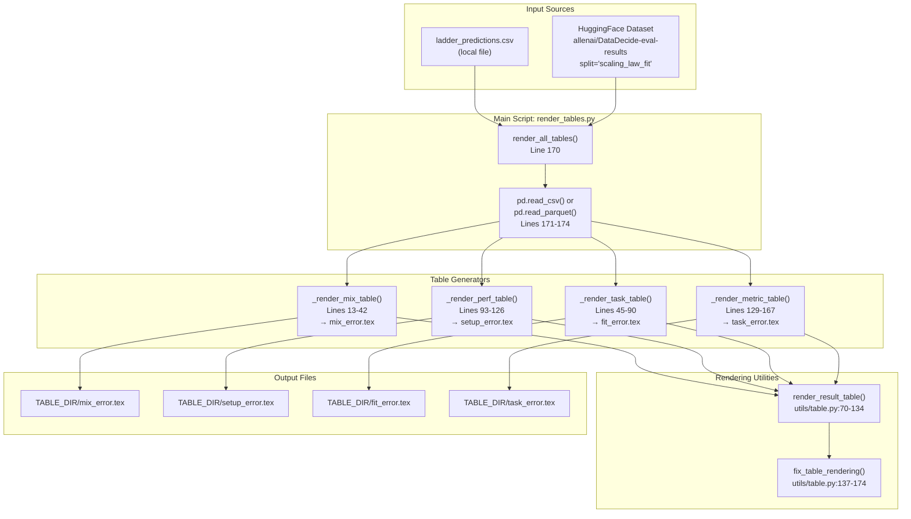
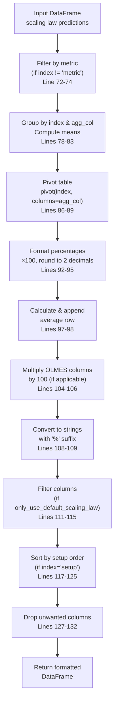
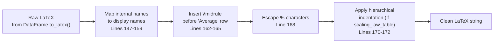
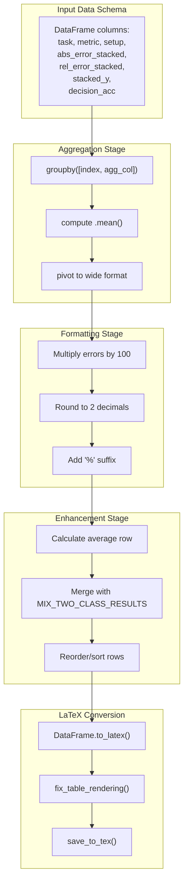

<!-- source: DeepWiki mcp.deepwiki.com · repo allenai/DataDecide · page 4.3 Table Generation · fetched 2026-10-26 -->

# Table Generation

<details>
<summary>Relevant source files</summary>

The following files were used as context for generating this wiki page:

- [scaling_laws/README.md](scaling_laws/README.md)
- [scaling_laws/render_tables.py](scaling_laws/render_tables.py)
- [scaling_laws/utils/table.py](scaling_laws/utils/table.py)

</details>


## Purpose and Scope

This page describes the table generation system that transforms scaling law predictions into publication-ready LaTeX tables. The system takes fitted scaling law results (from [Scaling Law Fitting](#4.1)) and statistical analysis outputs (from [Statistical Analysis](#4.2)) to generate four primary tables documenting prediction accuracy across data recipes, tasks, and scaling law configurations.

For information about the visualizations of scaling laws, see [Scaling Law Visualization](#4.4). For interactive exploration of these results, see [Advanced Notebooks](#4.5).

**Sources:** [scaling_laws/README.md:12-48](), [scaling_laws/render_tables.py:1-195]()

---

## Overview

The table generation system is implemented in `render_tables.py` and produces four main LaTeX output files:

| Table File | Content | Key Function |
|------------|---------|--------------|
| `mix_error.tex` | Prediction errors for all 25 data recipes | `_render_mix_table()` |
| `setup_error.tex` | Comparison of scaling law setup configurations | `_render_perf_table()` |
| `fit_error.tex` | Per-task prediction errors with decision accuracy | `_render_task_table()` |
| `task_error.tex` | Decision accuracy across metrics and tasks | `_render_metric_table()` |

All tables are saved to the `TABLE_DIR` directory as defined in `utils/constants.py`.

**Sources:** [scaling_laws/render_tables.py:8-179]()

---

## System Architecture

The following diagram shows the data flow through the table generation pipeline:



**Sources:** [scaling_laws/render_tables.py:170-195](), [scaling_laws/utils/table.py:70-174]()

---

## Command-Line Interface

The script provides two modes of operation:

### Local Results File
```bash
python render_tables.py --result-path ladder_predictions.csv
```

### HuggingFace Remote Dataset
```bash
python render_tables.py --hf-path allenai/DataDecide-eval-results
```

The `--hf-path` option triggers `pull_predictions_from_hf()` to download the `scaling_law_fit` split from the specified dataset.

**Sources:** [scaling_laws/render_tables.py:182-195](), [scaling_laws/README.md:44-48]()

---

## Table Generation Functions

### Data Recipe Error Table (_render_mix_table)

This function generates `mix_error.tex`, showing prediction errors for all 25 data recipes.

**Key Operations:**
1. Calls `render_result_table(results, 'mix', only_use_default_scaling_law=True)`
2. Computes average OLMES performance across all data recipes
3. Renames columns for publication-ready formatting
4. Applies LaTeX formatting with custom caption and column widths

**Column Transformations:**
```
'Abs Error default' → 'Error'
'Abs Error -750M' → 'Error w/o 750M'
'Abs Error -750M -530M' → 'Error w/o 750M, 530M'
'Rel Error default' → '% Error'
```

**Sources:** [scaling_laws/render_tables.py:13-42]()

---

### Scaling Law Setup Comparison Table (_render_perf_table)

This function generates `setup_error.tex`, comparing different scaling law configurations.

**Key Operations:**
1. Calls `render_result_table(results, index='setup', agg_col='metric', include_decision_acc=True)`
2. Drops the `stacked_y_primary_metric` column
3. Formats as LaTeX with setup-specific styling

The table shows which scaling law setup (e.g., 2-param vs 3-param vs 5-param) achieves the lowest prediction errors.

**Sources:** [scaling_laws/render_tables.py:93-126]()

---

### Per-Task Error Table (_render_task_table)

This function generates `fit_error.tex`, showing per-task prediction errors.

**Key Operations:**
1. Calls `render_result_table(results, 'task', only_use_default_scaling_law=True)`
2. Merges decision accuracy data from `MIX_TWO_CLASS_RESULTS` constant
3. Reorders index to place `olmes_10_macro_avg` at bottom
4. Formats percentages and applies midrule before OLMES average

**Special Processing:**
- Decision accuracy is retrieved from `utils/constants/constants_recepies.py::MIX_TWO_CLASS_RESULTS`
- Averages are computed separately for OLMES and decision accuracy
- NaN values are replaced with '--' for missing data

**Sources:** [scaling_laws/render_tables.py:45-90]()

---

### Metric Decision Accuracy Table (_render_metric_table)

This function generates `task_error.tex`, showing decision accuracy across all metrics.

**Key Operations:**
1. Filters for `3_param-default` setup
2. Creates pivot table with tasks as rows and metrics as columns
3. Applies task name transformations using `TASK_NAME_LATEX`
4. Formats as tiny LaTeX table with abbreviated column names

**Column Name Abbreviations:**
```
'CommonsenseQA' → 'CSQA'
'OpenBookQA' → 'OBQA'
'ARC-Challenge' → 'ARC-C'
'ARC-Easy' → 'ARC-E'
```

**Sources:** [scaling_laws/render_tables.py:129-167]()

---

## Core Rendering Process

The following diagram shows the detailed function call flow within `render_result_table()`:



**Sources:** [scaling_laws/utils/table.py:70-134]()

---

## LaTeX Formatting and Post-Processing

### fix_table_rendering Function

The `fix_table_rendering()` function applies multiple transformations to clean up the pandas-generated LaTeX:



**Name Mapping Sources:**
- `DATA_NAME_LATEX` - Maps internal data recipe names to publication names
- `SETUP_NAME_LATEX` - Maps setup identifiers to formatted names
- `TASK_NAME_LATEX` - Maps task identifiers to readable names

**Sources:** [scaling_laws/utils/table.py:137-174]()

---

## LaTeX Table Specifications

Each table generator applies specific formatting parameters to `DataFrame.to_latex()`:

### Mix Error Table
```python
column_format='p{0.3\\textwidth}p{0.06\\textwidth}...'  # 8 columns total
label="tab:mix-errors"
```

### Setup Error Table
```python
column_format='p{0.4\\textwidth}p{0.08\\textwidth}p{0.08\\textwidth}p{0.11\\textwidth}'
label="tab:setup-errors"
```

### Task Error Table
```python
column_format='p{0.15\\textwidth}p{0.06\\textwidth}...'  # 8 columns total
label="tab:task-errors"
```

### Metric Error Table
```python
column_format='p{0.15\\textwidth}' + 'p{0.04\\textwidth}' * num_columns
label="tab:metric-errors"
```

All tables use the `table*` environment for full-width display and include `\small`, `\centering`, and custom captions.

**Sources:** [scaling_laws/render_tables.py:29-157]()

---

## Output File Management

The `save_to_tex()` function handles file output:

```python
def save_to_tex(out_str, filename):
    output_path = Path(TABLE_DIR) / filename
    with open(output_path, 'w') as f:
        f.write(out_str)
```

**Output Files:**
- `TABLE_DIR/mix_error.tex` - Data recipe comparison
- `TABLE_DIR/setup_error.tex` - Scaling law setup comparison
- `TABLE_DIR/fit_error.tex` - Per-task errors
- `TABLE_DIR/task_error.tex` - Per-metric decision accuracy

The `TABLE_DIR` constant is defined in `utils/constants.py` and typically points to a results output directory.

**Sources:** [scaling_laws/render_tables.py:8-11]()

---

## Data Processing Pipeline

The following diagram shows the complete data transformation pipeline:



**Sources:** [scaling_laws/utils/table.py:70-134](), [scaling_laws/render_tables.py:13-179]()

---

## Usage Examples

### Generate All Tables from Local File
```bash
cd scaling_laws
python render_tables.py --result-path ladder_predictions.csv
```

### Generate All Tables from HuggingFace
```bash
python render_tables.py --hf-path allenai/DataDecide-eval-results
```

### Output
The script prints each table to stdout and saves them to:
- `TABLE_DIR/mix_error.tex`
- `TABLE_DIR/setup_error.tex`
- `TABLE_DIR/fit_error.tex`
- `TABLE_DIR/task_error.tex`

**Sources:** [scaling_laws/README.md:44-48]()

---

## Key Dependencies

| Module | Usage |
|--------|-------|
| `pandas` | DataFrame operations and LaTeX conversion |
| `utils.table.render_result_table` | Core table rendering logic |
| `utils.table.fix_table_rendering` | LaTeX cleanup and formatting |
| `utils.constants.DATA_NAME_LATEX` | Data recipe display names |
| `utils.constants.SETUP_NAME_LATEX` | Scaling law setup display names |
| `utils.constants.TASK_NAME_LATEX` | Task display names |
| `utils.constants.constants_recepies.MIX_TWO_CLASS_RESULTS` | Decision accuracy data |
| `remote.hf.pull_predictions_from_hf` | HuggingFace dataset retrieval |

**Sources:** [scaling_laws/render_tables.py:1-6](), [scaling_laws/utils/table.py:1-3]()

---

