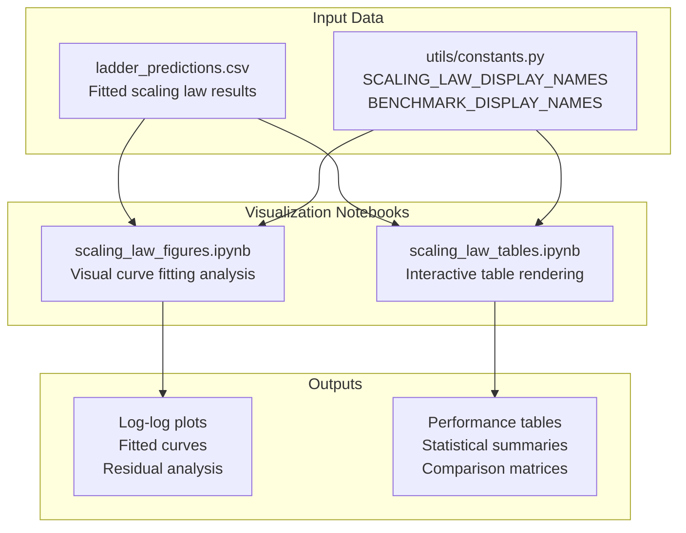
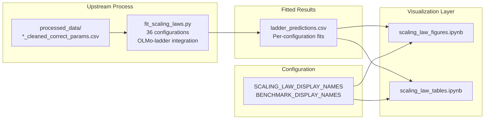
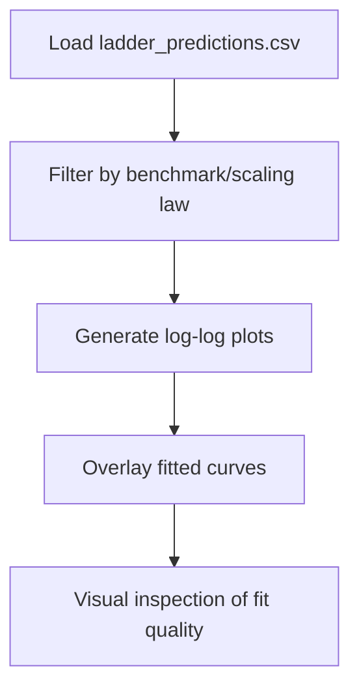
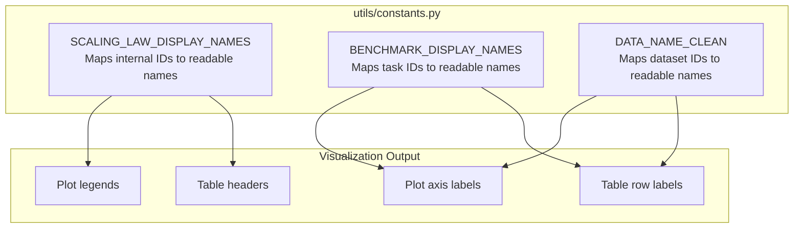
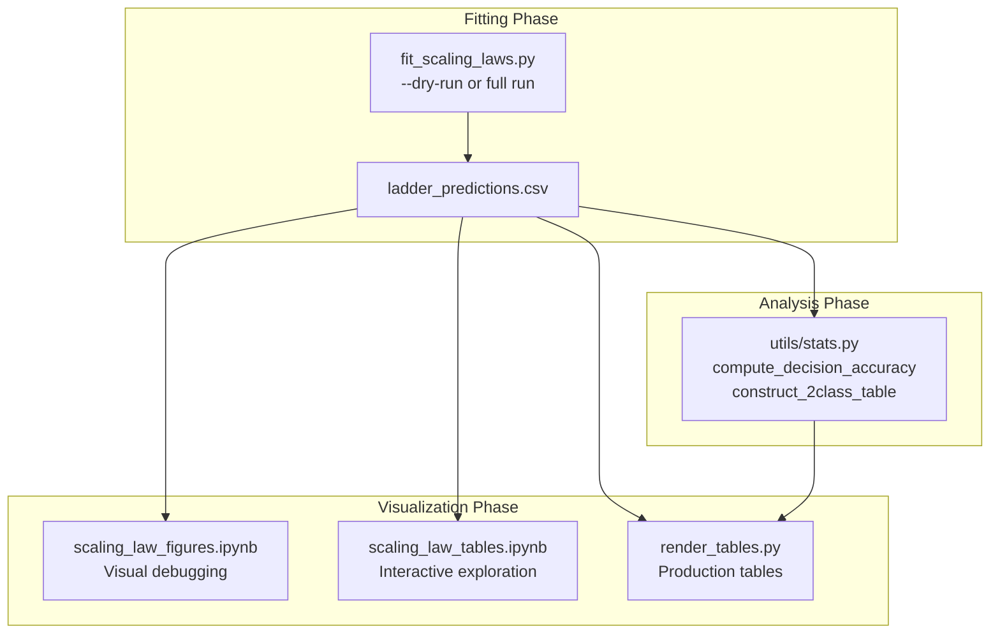

<!-- source: DeepWiki mcp.deepwiki.com · repo allenai/DataDecide · page 4.4 Scaling Law Visualization · fetched 2026-10-26 -->

# Scaling Law Visualization

Relevant source files

The following files were used as context for generating this wiki page:

- [scaling_laws/README.md](scaling_laws/README.md)
- [scaling_laws/notebooks/scaling_law_figures.ipynb](scaling_laws/notebooks/scaling_law_figures.ipynb)
- [scaling_laws/notebooks/scaling_law_tables.ipynb](scaling_laws/notebooks/scaling_law_tables.ipynb)

## Purpose and Scope

This document describes the visual analysis system for scaling law fits in the DataDecide repository. It covers the two primary Jupyter notebooks used to inspect and validate scaling law predictions: `scaling_law_figures.ipynb` for generating publication-quality visualizations of fitted curves, and `scaling_law_tables.ipynb` for interactive table rendering and exploration.

These notebooks consume the output from the scaling law fitting process (see [Scaling Law Fitting](#4.1)) and provide interactive tools for debugging and analyzing the quality of fits. For automated LaTeX table generation used in publication workflows, see [Table Generation](#4.3).

**Sources:** [scaling_laws/README.md:52-58]()

## Overview

The scaling law visualization system provides two complementary approaches to inspecting fitted scaling laws:

| Notebook | Primary Purpose | Output Type | Typical Use Case |
|----------|----------------|-------------|------------------|
| `scaling_law_figures.ipynb` | Visual curve inspection | Log-log plots, fitted curves | Debugging fit quality, identifying outliers |
| `scaling_law_tables.ipynb` | Tabular data exploration | Performance tables, statistical summaries | Interactive data analysis, validation |

Both notebooks operate on the same input data (`ladder_predictions.csv`) produced by `fit_scaling_laws.py` and leverage shared configuration from `utils/constants.py` for consistent display naming.

**Sources:** [scaling_laws/README.md:52-58]()

## System Architecture

**Sources:** [scaling_laws/README.md:52-58](), System Architecture Diagram 4

## Data Flow Pipeline

The visualization notebooks sit at the end of the scaling law analysis pipeline, consuming fitted results and producing human-readable outputs:

**Sources:** System Architecture Diagrams 2 and 4, [scaling_laws/README.md:1-58]()

## scaling_law_figures.ipynb

This notebook provides visual inspection of scaling law curve fits. It renders log-log plots showing the relationship between model size (compute/parameters) and performance metrics, overlaid with fitted scaling law curves.

### Primary Functions

The notebook enables:

1. **Curve Fit Visualization**: Generates log-log plots displaying actual evaluation results against fitted scaling law predictions
2. **Residual Analysis**: Visualizes prediction errors to identify systematic biases in fits
3. **Multi-configuration Comparison**: Compares different scaling law formulations (2-parameter, 3-parameter, 5-parameter variants)
4. **Outlier Detection**: Identifies data points with poor fits or anomalous behavior

### Typical Workflow

The notebook is designed for interactive debugging of scaling law fits. When a particular configuration shows poor performance in statistical analysis, this notebook allows visual inspection to diagnose whether the issue stems from:

- Insufficient data points at certain scales
- Systematic deviation from assumed scaling law form
- Outliers or noisy measurements
- Incorrect parameter initialization in fitting

**Sources:** [scaling_laws/README.md:56](), [scaling_laws/notebooks/scaling_law_figures.ipynb:1-3]()

## scaling_law_tables.ipynb

This notebook provides an interactive version of the table rendering functionality implemented in `render_tables.py`. It allows exploratory analysis of scaling law predictions in tabular format.

### Primary Functions

The notebook supports:

1. **Interactive Table Generation**: Dynamically creates performance comparison tables across datasets and model sizes
2. **Statistical Summary Computation**: Calculates aggregate metrics like mean, median, and standard deviation across configurations
3. **Comparative Analysis**: Enables side-by-side comparison of different scaling law formulations
4. **Data Export**: Prepares formatted tables for inclusion in analysis reports

### Comparison with render_tables.py

| Aspect | scaling_law_tables.ipynb | render_tables.py |
|--------|--------------------------|------------------|
| Execution Mode | Interactive (Jupyter) | Batch (CLI) |
| Output Format | In-notebook display | LaTeX files (.tex) |
| Flexibility | High - can modify queries interactively | Fixed - predefined table structures |
| Use Case | Exploration and validation | Automated publication pipeline |

The notebook serves as a development environment for prototyping table structures before implementing them in the production `render_tables.py` script.

**Sources:** [scaling_laws/README.md:57](), [scaling_laws/notebooks/scaling_law_tables.ipynb:1-3]()

## Input Data Structure

Both notebooks consume `ladder_predictions.csv`, which contains fitted scaling law predictions with the following structure:

| Column Type | Description | Example Values |
|-------------|-------------|----------------|
| Identifier Columns | Dataset, model size, benchmark, scaling law type | `data`, `model_config`, `task`, `scaling_law` |
| Fit Parameters | Fitted coefficients from scaling law | Depends on 2/3/5 parameter model |
| Prediction Columns | Predicted performance at various scales | `pred_4M`, `pred_8M`, ..., `pred_1B` |
| Actual Performance | Ground truth evaluation results | `actual_4M`, `actual_8M`, ..., `actual_1B` |
| Error Metrics | Prediction accuracy statistics | `rmse`, `mae`, `max_error` |

**Sources:** System Architecture Diagram 2

## Configuration Dependencies

Both notebooks rely on constants defined in `utils/constants.py` to ensure consistent naming across visualizations:

This configuration-driven approach ensures that internal identifiers (e.g., `sl_2param_v1`) are consistently mapped to publication-ready names (e.g., "2-Parameter Scaling Law") across all visualizations.

**Sources:** System Architecture Diagram 4, [scaling_laws/README.md:1-58]()

## Execution Workflow

### Running scaling_law_figures.ipynb

1. Ensure `ladder_predictions.csv` exists (generated via `fit_scaling_laws.py`)
2. Install notebook dependencies: `pip install -r requirements.txt`
3. Enable Git LFS: `git lfs install` (notebooks are tracked with LFS)
4. Launch Jupyter: `jupyter notebook`
5. Open `scaling_laws/notebooks/scaling_law_figures.ipynb`
6. Execute cells interactively to generate visualizations

### Running scaling_law_tables.ipynb

1. Follow steps 1-4 from above
2. Open `scaling_laws/notebooks/scaling_law_tables.ipynb`
3. Modify filtering criteria as needed for specific analysis
4. Execute cells to generate interactive tables

**Sources:** [scaling_laws/README.md:3-13]()

## Integration with Analysis Pipeline

The visualization notebooks integrate with the broader scaling laws analysis system:

Typical usage pattern:

1. **Initial Fitting**: Run `fit_scaling_laws.py --dry-run` to fit on a data subset
2. **Visual Inspection**: Use `scaling_law_figures.ipynb` to check fit quality
3. **Statistical Validation**: Use `scaling_law_tables.ipynb` to explore performance metrics
4. **Full Fitting**: If satisfied, run full fitting: `fit_scaling_laws.py --result-path ladder_predictions.csv`
5. **Production Tables**: Generate publication tables: `render_tables.py --result-path ladder_predictions.csv`

**Sources:** [scaling_laws/README.md:34-49](), System Architecture Diagram 2

## Common Use Cases

### Debugging Poor Fits

When scaling law fits show high error rates:

1. Load `ladder_predictions.csv` in `scaling_law_figures.ipynb`
2. Filter to problematic benchmark/dataset combination
3. Generate log-log plots to visualize actual vs. predicted
4. Examine residuals for systematic bias
5. Adjust fitting parameters or exclude outliers if justified

### Validating Scaling Law Selection

To compare different scaling law formulations:

1. Use `scaling_law_tables.ipynb` to generate comparison tables
2. Sort by error metrics (RMSE, MAE)
3. Identify which scaling law type (2-param, 3-param, 5-param) performs best for each benchmark
4. Use `scaling_law_figures.ipynb` to visually confirm the superiority of selected model

### Preparing Publication Figures

To create publication-ready visualizations:

1. Use `scaling_law_figures.ipynb` to prototype figure layouts
2. Select specific dataset/benchmark combinations of interest
3. Export high-resolution plots
4. Refine styling for publication standards

**Sources:** [scaling_laws/README.md:52-58]()

## Related Systems

- **[Scaling Law Fitting](#4.1)**: Describes `fit_scaling_laws.py` which generates the input data for these notebooks
- **[Statistical Analysis](#4.2)**: Details the statistical utilities that complement visual analysis
- **[Table Generation](#4.3)**: Covers `render_tables.py`, the automated production version of table rendering
- **[System Constants](#7.1)**: Documents the configuration constants used for display naming
- **[Advanced Notebooks](#4.5)**: Describes additional specialized analysis notebooks in the scaling laws system

**Sources:** Table of Contents

---

