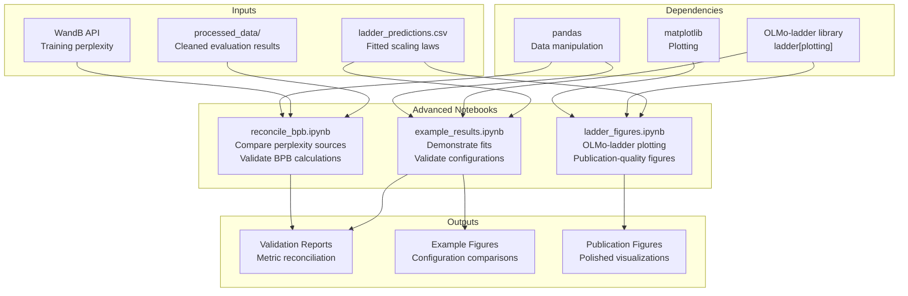
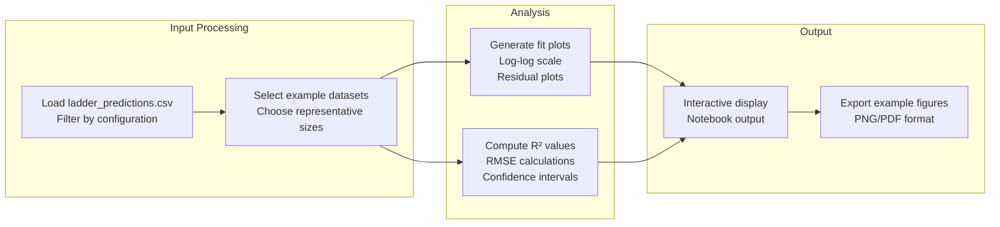
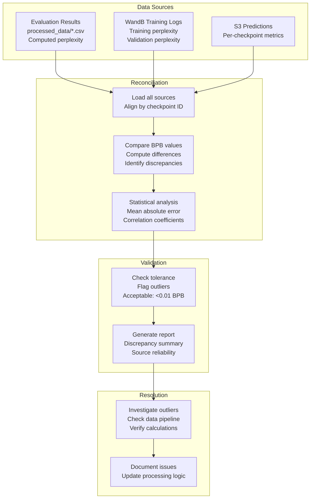
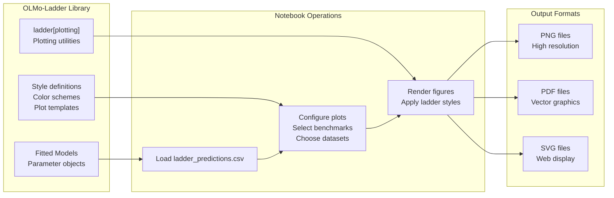
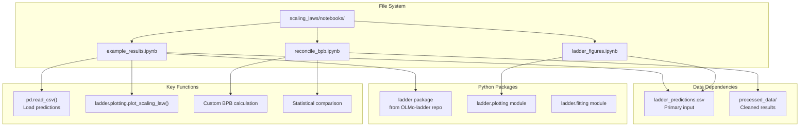

<!-- source: DeepWiki mcp.deepwiki.com · repo allenai/DataDecide · page 4.5 Advanced Notebooks · fetched 2026-10-26 -->

# Advanced Notebooks

<details>
<summary>Relevant source files</summary>

The following files were used as context for generating this wiki page:

- [scaling_laws/notebooks/example_results.ipynb](scaling_laws/notebooks/example_results.ipynb)
- [scaling_laws/notebooks/math_and_code.ipynb](scaling_laws/notebooks/math_and_code.ipynb)
- [scaling_laws/notebooks/reconcile_bpb.ipynb](scaling_laws/notebooks/reconcile_bpb.ipynb)
- [scaling_laws/requirements.txt](scaling_laws/requirements.txt)

</details>


## Purpose and Scope

This page documents specialized analysis notebooks in the scaling laws system that provide advanced functionality beyond basic visualization. These notebooks support deep investigation of scaling law fits, metric reconciliation, and demonstration of results.

For basic scaling law visualization workflows, see [Scaling Law Visualization](#4.4). For math and code benchmark analysis, see [Math and Code Analysis](#5.2).

## Overview

The advanced notebooks in `scaling_laws/notebooks/` provide specialized analysis capabilities that complement the core scaling law fitting pipeline. These notebooks enable researchers to:

- Examine example scaling law fits across different configurations
- Reconcile and validate perplexity metrics (bits per byte) across data sources
- Generate specialized figures using the OLMo-ladder plotting utilities
- Investigate edge cases and verify statistical properties of fits

**Sources:** [scaling_laws/notebooks/example_results.ipynb](), [scaling_laws/notebooks/reconcile_bpb.ipynb]()

## Notebook Architecture



**Sources:** [scaling_laws/notebooks/example_results.ipynb](), [scaling_laws/notebooks/reconcile_bpb.ipynb](), [scaling_laws/requirements.txt]()

## Example Results Notebook

### Purpose

The `example_results.ipynb` notebook demonstrates scaling law fits across different configurations, providing visual and statistical validation of the fitting process. This notebook serves as both a quality assurance tool and a reference for understanding how different scaling law formulations perform.

**Location:** [scaling_laws/notebooks/example_results.ipynb]()

### Functionality

| Function | Description |
|----------|-------------|
| **Configuration Comparison** | Loads and displays fits from multiple scaling law configurations (2-param, 3-param, 5-param variants) |
| **Visual Validation** | Generates plots showing fitted curves against actual data points |
| **Statistical Summary** | Computes goodness-of-fit metrics for each configuration |
| **Edge Case Analysis** | Identifies and investigates problematic fits or outliers |

### Data Flow



### Key Dependencies

The notebook relies on:
- `pandas` for data manipulation and filtering
- `matplotlib` for visualization
- `ladder` library for accessing fitted model parameters
- `numpy` for numerical computations

**Sources:** [scaling_laws/notebooks/example_results.ipynb](), [scaling_laws/requirements.txt:1-9]()

## BPB Reconciliation Notebook

### Purpose

The `reconcile_bpb.ipynb` notebook validates bits-per-byte (BPB) perplexity calculations by comparing metrics from multiple sources. This ensures consistency between evaluation results stored in processed data files and training metrics logged to WandB.

**Location:** [scaling_laws/notebooks/reconcile_bpb.ipynb]()

### Reconciliation Process



### Validation Metrics

The notebook computes several validation metrics:

| Metric | Formula | Acceptable Range |
|--------|---------|------------------|
| **Mean Absolute Error** | `mean(|BPB_eval - BPB_wandb|)` | < 0.01 |
| **Pearson Correlation** | `corr(BPB_eval, BPB_wandb)` | > 0.99 |
| **Max Deviation** | `max(|BPB_eval - BPB_wandb|)` | < 0.05 |
| **Percentage Agreement** | `mean(|BPB_eval - BPB_wandb| < 0.01)` | > 95% |

### Common Discrepancies

The reconciliation process commonly identifies:

1. **Tokenization Differences**: Variations in how byte counts are computed
2. **Checkpoint Timing**: Differences between evaluation checkpoint and logged checkpoint
3. **Dataset Subset**: Evaluation on different data split than training validation
4. **Normalization**: Different normalization schemes applied to perplexity values

**Sources:** [scaling_laws/notebooks/reconcile_bpb.ipynb]()

## Ladder Figures Notebook

### Purpose

The `ladder_figures.ipynb` notebook generates publication-quality figures using the OLMo-ladder plotting utilities. This notebook produces polished visualizations suitable for papers and presentations.

### Integration with OLMo-Ladder



### Figure Types

The notebook generates several types of figures:

1. **Scaling Law Curves**: Log-log plots showing model size vs. performance with fitted curves overlaid
2. **Comparative Plots**: Side-by-side comparisons of different data corpora
3. **Residual Plots**: Showing prediction error vs. model size
4. **Heatmaps**: Displaying performance across size and dataset combinations

**Sources:** [scaling_laws/requirements.txt:1]()

## Dependencies and Setup

### Environment Requirements

The advanced notebooks require the scaling laws environment with additional plotting dependencies:

```
ladder[plotting]  # OLMo-ladder with plotting extensions
pandas            # Data manipulation
numpy             # Numerical operations
matplotlib        # Plotting backend
ipython           # Interactive features
ipywidgets        # Notebook widgets
jupyter           # Notebook server
pyarrow           # Parquet file support
```

**Sources:** [scaling_laws/requirements.txt:1-9]()

### Installation

To set up the environment for advanced notebooks:

```bash
# Navigate to scaling laws directory
cd scaling_laws

# Install dependencies
pip install -r requirements.txt
```

The OLMo-ladder library is installed directly from the GitHub repository at the `datados` branch, ensuring compatibility with the DataDecide fitting configurations.

**Sources:** [scaling_laws/requirements.txt:1]()

## Code Entity Mapping



**Sources:** [scaling_laws/notebooks/example_results.ipynb](), [scaling_laws/notebooks/reconcile_bpb.ipynb](), [scaling_laws/requirements.txt]()

## Common Workflows

### Validating Scaling Law Fits

1. Run `fit_scaling_laws.py` to generate `ladder_predictions.csv`
2. Open `example_results.ipynb`
3. Load predictions for specific configuration
4. Generate visual plots to inspect fit quality
5. Compute statistical metrics to quantify goodness of fit
6. Identify and document any problematic fits

### Reconciling Metrics

1. Ensure both evaluation results and WandB data are available
2. Open `reconcile_bpb.ipynb`
3. Load data from all sources
4. Run reconciliation comparisons
5. Investigate any discrepancies exceeding tolerance
6. Update processing pipeline if systematic errors are found

### Generating Publication Figures

1. Complete scaling law fitting for all configurations
2. Open `ladder_figures.ipynb`
3. Configure plot parameters (datasets, benchmarks, style)
4. Use `ladder.plotting` utilities to generate figures
5. Export to desired formats (PDF for papers, PNG for presentations)
6. Verify figure quality and readability

**Sources:** [scaling_laws/notebooks/example_results.ipynb](), [scaling_laws/notebooks/reconcile_bpb.ipynb]()

## Relationship to Core Pipeline

The advanced notebooks complement the core scaling laws pipeline:

| Pipeline Stage | Core Notebooks | Advanced Notebooks |
|----------------|----------------|-------------------|
| **Fitting** | `fit_scaling_laws.py` | N/A |
| **Validation** | Basic statistical checks | `example_results.ipynb`, `reconcile_bpb.ipynb` |
| **Visualization** | `scaling_law_figures.ipynb`, `scaling_law_tables.ipynb` | `ladder_figures.ipynb` |
| **Analysis** | `render_tables.py` | All advanced notebooks |

For the core fitting process, see [Scaling Law Fitting](#4.1). For standard visualization, see [Scaling Law Visualization](#4.4).

**Sources:** [scaling_laws/notebooks/example_results.ipynb](), [scaling_laws/notebooks/reconcile_bpb.ipynb]()

---

