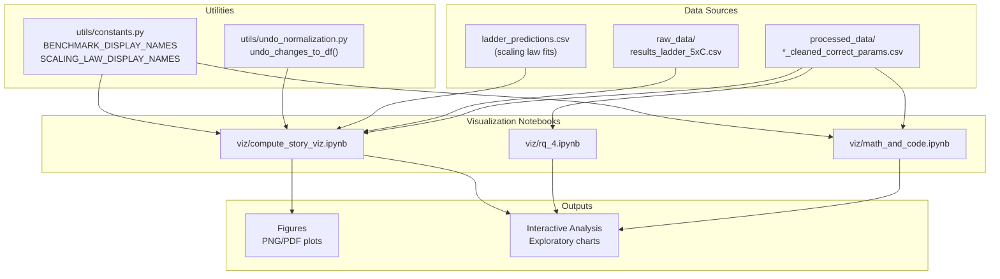
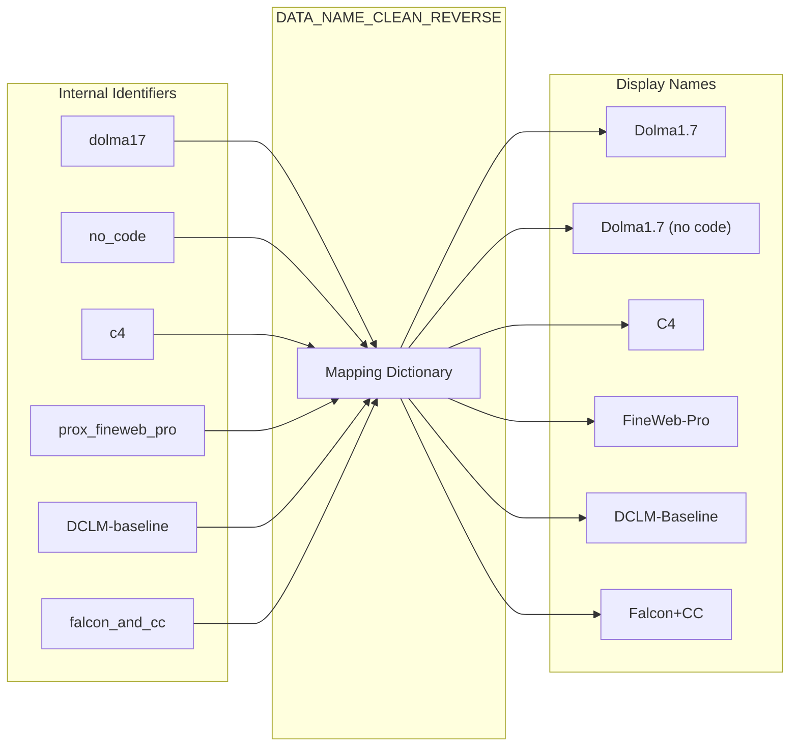
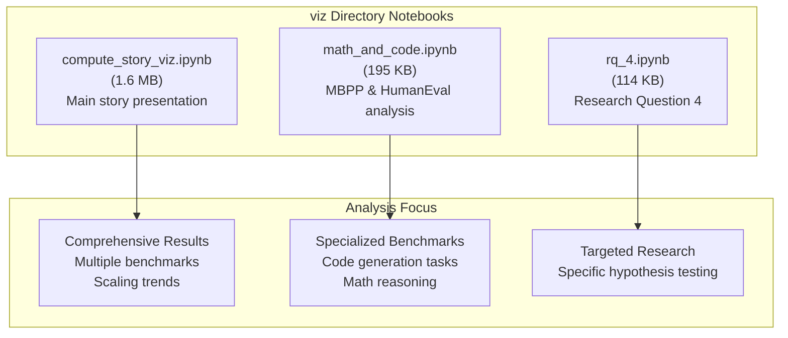
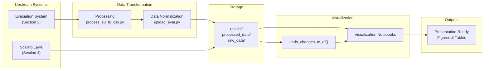

<!-- source: DeepWiki mcp.deepwiki.com · repo allenai/DataDecide · page 5 Visualization · fetched 2026-10-26 -->

# Visualization

<details>
<summary>Relevant source files</summary>

The following files were used as context for generating this wiki page:

- [utils/undo_normalization.py](utils/undo_normalization.py)
- [viz/compute_story_viz.ipynb](viz/compute_story_viz.ipynb)
- [viz/math_and_code.ipynb](viz/math_and_code.ipynb)
- [viz/requirements.txt](viz/requirements.txt)
- [viz/rq_4.ipynb](viz/rq_4.ipynb)

</details>


## Purpose and Scope

The visualization system provides tools for presenting evaluation results and analysis findings through interactive notebooks. This system transforms processed evaluation data and scaling law predictions into publication-ready figures, tables, and exploratory visualizations.

This page covers the core visualization infrastructure in the `viz/` directory. For scaling law-specific visualizations, see [Scaling Law Visualization](#4.4). For the underlying data transformations and constants, see [System Constants](#7.1).

**Sources:** Based on repository structure analysis and Diagram 4 from high-level systems overview.

---

## Visualization Ecosystem Overview

The visualization system consists of Jupyter notebooks that consume data from multiple sources and produce visualizations for different analytical purposes. The system includes utilities for reversing data normalization to create human-readable outputs.



**Diagram: Visualization System Data Flow**

The system follows a pattern of consuming normalized internal data and optionally reversing transformations for presentation using `undo_changes_to_df()`.

**Sources:** [viz/compute_story_viz.ipynb:1-4](), [viz/math_and_code.ipynb:1-4](), [viz/rq_4.ipynb:1-4](), [utils/undo_normalization.py:1-54]()

---

## Data Denormalization

The visualization system uses a denormalization utility to convert internal data representations back to human-readable formats. This is implemented in `utils/undo_normalization.py`.

### Denormalization Function

The `undo_changes_to_df()` function reverses three transformations applied during data processing:

| Transformation | Internal Format | Display Format |
|----------------|----------------|----------------|
| Column Renaming | `params`, `data` | `model`, `group` |
| Dataset Names | Cleaned identifiers (e.g., `dolma17`) | Descriptive names (e.g., `Dolma1.7`) |
| Random Seeds | Numeric values (6198, 14, 15, 4, 5) | Descriptive labels (`default`, `small aux 2`, etc.) |

**Sources:** [utils/undo_normalization.py:1-14]()

### Dataset Name Mappings

The function includes a comprehensive mapping from internal identifiers to display names:



**Diagram: Dataset Name Denormalization**

The complete mapping includes 25 dataset variants covering base corpora (Dolma, C4, FineWeb, Falcon, DCLM) and quality-controlled variants.

**Sources:** [utils/undo_normalization.py:15-42]()

### Seed Mapping

Random seed values are mapped to descriptive labels:

| Numeric Seed | Descriptive Label |
|--------------|-------------------|
| 6198 | `default` |
| 14 | `small aux 2` |
| 15 | `small aux 3` |
| 4 | `large aux 2` |
| 5 | `large aux 3` |

**Sources:** [utils/undo_normalization.py:44-52]()

---

## Visualization Notebooks

### Core Analysis Notebooks

The `viz/` directory contains three primary notebooks for different analytical purposes:



**Diagram: Visualization Notebook Organization**

**Sources:** [viz/compute_story_viz.ipynb:1-4](), [viz/math_and_code.ipynb:1-4](), [viz/rq_4.ipynb:1-4]()

### Notebook Purposes

| Notebook | Size | Primary Focus |
|----------|------|---------------|
| `compute_story_viz.ipynb` | 1.6 MB | Main story visualization; comprehensive results presentation using denormalized data |
| `math_and_code.ipynb` | 195 KB | Specialized analysis of MBPP (code generation) and HumanEval benchmarks |
| `rq_4.ipynb` | 114 KB | Analysis for Research Question 4; targeted hypothesis testing |

The notebooks are stored in Git LFS due to their embedded outputs and visualizations.

**Sources:** [viz/compute_story_viz.ipynb:1-4](), [viz/math_and_code.ipynb:1-4](), [viz/rq_4.ipynb:1-4]()

---

## Dependencies and Environment

### Python Dependencies

The visualization system requires the following packages specified in `viz/requirements.txt`:

| Package | Purpose |
|---------|---------|
| `pandas` | Data manipulation and analysis |
| `matplotlib` | Plotting and figure generation |
| `Jinja2` | Template rendering for dynamic content |
| `scipy` | Statistical computations |
| `datasets` | HuggingFace datasets integration |

**Sources:** [viz/requirements.txt:1-5]()

### Environment Setup

To set up the visualization environment:

```bash
# Create and activate conda environment
conda create -n datadecide-viz python=3.10
conda activate datadecide-viz

# Install dependencies
pip install -r viz/requirements.txt
```

The visualization environment is separate from the evaluation and scaling laws environments to minimize dependency conflicts.

**Sources:** [viz/requirements.txt:1-5]()

---

## Integration with Other Systems

### Data Pipeline Integration



**Diagram: Visualization System Integration**

The visualization layer sits at the end of the data pipeline, consuming processed results and optionally applying denormalization for human-readable outputs. It integrates with:

- **Evaluation System** ([Section 3](#3)): Consumes processed evaluation results
- **Scaling Laws** ([Section 4](#4)): Uses fitted scaling law predictions
- **Configuration System** ([Section 7](#7)): Leverages display name constants

**Sources:** [utils/undo_normalization.py:1-54](), based on system architecture diagrams

---

## Typical Workflow

The visualization workflow follows these steps:

1. **Data Preparation**: Load processed data from `results/processed_data/` or `results/raw_data/`
2. **Optional Denormalization**: Apply `undo_changes_to_df()` for presentation outputs
3. **Visualization Generation**: Create plots using matplotlib and pandas
4. **Export**: Save figures as PNG/PDF for publication

### Example Usage Pattern

```python
import pandas as pd
from utils.undo_normalization import undo_changes_to_df

# Load processed data
df = pd.read_csv('results/processed_data/some_cleaned_correct_params.csv')

# Denormalize for presentation
df_display = undo_changes_to_df(df.copy())

# Now 'model' and 'group' columns contain human-readable names
# Generate visualizations using df_display
```

**Sources:** [utils/undo_normalization.py:1-54]()

---

## Relationship to Child Pages

This section provides the overview of the visualization ecosystem. Detailed documentation for specific visualization types is available in:

- **[Story Visualization](#5.1)**: Main narrative visualizations using `compute_story_viz.ipynb`
- **[Math and Code Analysis](#5.2)**: Specialized benchmark analysis with `math_and_code.ipynb` and `rq_4.ipynb`
- **[Error Analysis Visualizations](#5.3)**: Prediction error analysis notebooks

For scaling law-specific visualizations (figures and tables), see [Scaling Law Visualization](#4.4).

**Sources:** Based on table of contents structure

---

