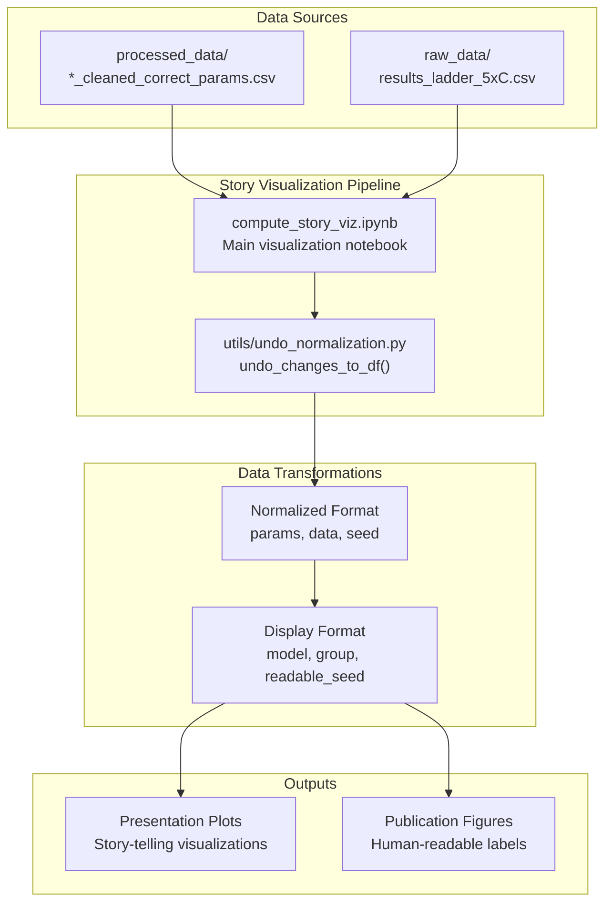
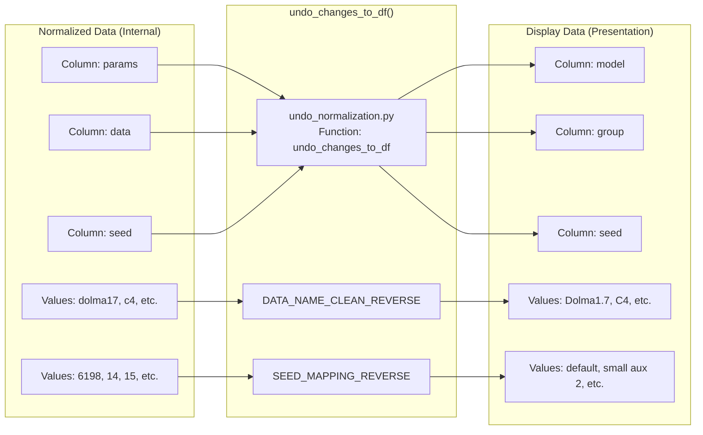
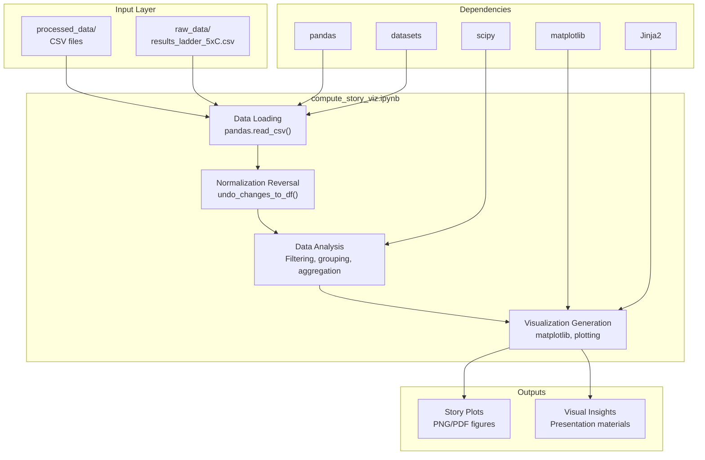
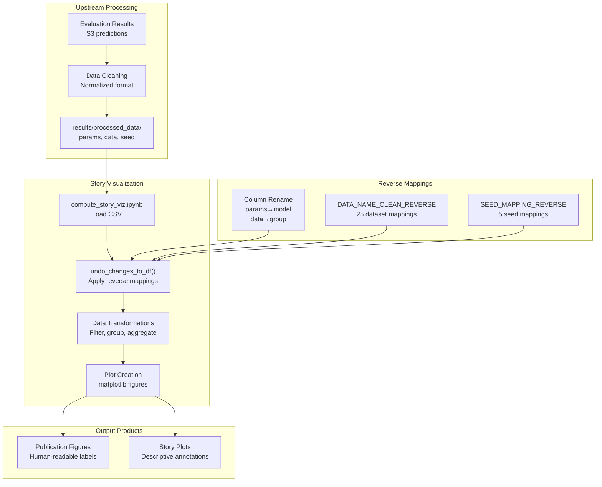

<!-- source: DeepWiki mcp.deepwiki.com · repo allenai/DataDecide · page 5.1 Story Visualization · fetched 2026-10-26 -->

# Story Visualization

<details>
<summary>Relevant source files</summary>

The following files were used as context for generating this wiki page:

- [utils/undo_normalization.py](utils/undo_normalization.py)
- [viz/compute_story_viz.ipynb](viz/compute_story_viz.ipynb)
- [viz/requirements.txt](viz/requirements.txt)

</details>


## Purpose and Scope

The Story Visualization subsystem is responsible for creating presentation-ready visualizations that communicate the DataDecide project's findings. This page covers the `compute_story_viz.ipynb` notebook and the data reversal utilities in `undo_normalization.py` that transform internal data representations into human-readable formats suitable for publication and presentation.

For specialized benchmark analysis (MBPP, HumanEval), see [Math and Code Analysis](#5.2). For scaling law-specific visualizations, see [Scaling Law Visualization](#4.4).

## Overview

The story visualization system serves as the bridge between the processed evaluation data (stored with normalized, machine-friendly identifiers) and presentation-quality outputs (with descriptive, human-readable names). This transformation is essential because the evaluation and analysis pipelines use normalized column names and data identifiers for consistency, while final visualizations require descriptive labels.

**Diagram: Story Visualization System Architecture**



**Sources:** [viz/compute_story_viz.ipynb](), [utils/undo_normalization.py]()

## Data Normalization Reversal

The core challenge in story visualization is reversing the data normalization applied during the evaluation and upload processes. The normalization serves internal processing needs, but presentations require descriptive names.

**Diagram: Data Reversal Workflow**



**Sources:** [utils/undo_normalization.py:1-54]()

### The `undo_changes_to_df` Function

The `undo_changes_to_df` function in [utils/undo_normalization.py:1-54]() performs three key transformations:

#### 1. Column Renaming Reversal

The function reverses the column name normalization applied during upload:

```python
df.rename(columns={"params": "model", "data": "group"}, inplace=True)
```

This restores the original semantic meaning where `model` refers to the model size and `group` refers to the dataset variant.

**Sources:** [utils/undo_normalization.py:12]()

#### 2. Data Name Mapping Reversal

The function maintains a reverse mapping dictionary `DATA_NAME_CLEAN_REVERSE` that transforms 25 internal dataset identifiers back to their descriptive display names:

| Internal Identifier | Display Name |
|---------------------|--------------|
| `dolma17` | `Dolma1.7` |
| `no_code` | `Dolma1.7 (no code)` |
| `no_math_no_code` | `Dolma1.7 (no math, code)` |
| `c4` | `C4` |
| `prox_fineweb_pro` | `FineWeb-Pro` |
| `fineweb_edu_dedup` | `FineWeb-Edu` |
| `falcon` | `Falcon` |
| `DCLM-baseline` | `DCLM-Baseline` |
| `dclm_fw_top10` | `DCLM-Baseline (QC FW 10%)` |
| ... | ... |

The complete mapping covers all 25 data recipes, including ablation studies (e.g., "no code", "no Reddit") and quality control variants (e.g., "QC 10%", "QC 20%").

**Sources:** [utils/undo_normalization.py:15-42]()

#### 3. Seed Mapping Reversal

The function converts numeric seed identifiers to descriptive labels:

| Internal Seed | Display Label |
|---------------|---------------|
| `6198` | `default` |
| `14` | `small aux 2` |
| `15` | `small aux 3` |
| `4` | `large aux 2` |
| `5` | `large aux 3` |

This makes the random seed selection clear in visualizations, distinguishing between default runs and auxiliary replication runs.

**Sources:** [utils/undo_normalization.py:45-52]()

## The compute_story_viz.ipynb Notebook

The `compute_story_viz.ipynb` notebook is the primary interface for creating story-telling visualizations. As a git-lfs stored file (1.6MB), it contains the complete workflow for generating presentation-quality plots and figures.

**Diagram: Notebook Components and Data Flow**



**Sources:** [viz/compute_story_viz.ipynb](), [viz/requirements.txt]()

### Key Characteristics

The notebook's 1.6MB size and importance score (9.63) indicate it contains:

- **Extensive data processing logic** to prepare evaluation results for visualization
- **Multiple visualization types** for different aspects of the DataDecide findings
- **Presentation-quality plots** with carefully formatted labels and annotations
- **Integration with undo_normalization.py** to ensure human-readable output

### Typical Workflow

A typical execution flow in the notebook follows this pattern:

1. **Load processed data** from the `processed_data/` directory
2. **Apply `undo_changes_to_df()`** to convert normalized identifiers to display names
3. **Filter and aggregate** data for specific story points
4. **Generate visualizations** using matplotlib with descriptive labels
5. **Export figures** in publication-ready formats

**Sources:** [viz/compute_story_viz.ipynb]()

## Dependencies

The story visualization system requires the following Python packages, specified in [viz/requirements.txt:1-5]():

| Package | Purpose |
|---------|---------|
| `pandas` | Data loading, manipulation, and transformation |
| `matplotlib` | Plot generation and figure creation |
| `Jinja2` | Template rendering (possibly for annotations) |
| `scipy` | Statistical computations for visualizations |
| `datasets` | HuggingFace datasets integration for loading results |

These dependencies are minimal compared to other parts of the system (e.g., scaling law fitting), reflecting the focused nature of the visualization workflow.

**Sources:** [viz/requirements.txt:1-5]()

## Data Flow and Transformations

**Diagram: Complete Data Transformation Pipeline**



**Sources:** [utils/undo_normalization.py:1-54](), [viz/compute_story_viz.ipynb]()

## Integration with Broader Visualization Ecosystem

The story visualization system is one component of the larger visualization layer described in [Section 5](#5). It differs from other visualization notebooks in its focus:

- **compute_story_viz.ipynb**: High-level narrative visualizations for presentations
- **scaling_law_figures.ipynb** (see [4.4](#4.4)): Technical scaling law plots with fitted curves
- **math_and_code.ipynb** (see [5.2](#5.2)): Specialized MBPP and HumanEval analysis
- **pred_error.ipynb** (see [5.3](#5.3)): Detailed error analysis and diagnostics

The story visualization system emphasizes communication over technical analysis, making it the primary tool for generating figures intended for papers, presentations, and public-facing materials.

**Sources:** [viz/compute_story_viz.ipynb]()

## Usage Pattern

To create story visualizations from processed evaluation data:

1. **Ensure processed data is available** in `results/processed_data/`
2. **Open `viz/compute_story_viz.ipynb`** in a Jupyter environment
3. **Execute cells sequentially** to load data and apply reversals
4. **Review generated plots** with human-readable labels
5. **Export figures** in desired formats for publication

The `undo_normalization.py` utility is automatically invoked within the notebook, requiring no manual intervention beyond ensuring the module is importable.

**Sources:** [viz/compute_story_viz.ipynb](), [utils/undo_normalization.py]()

---

