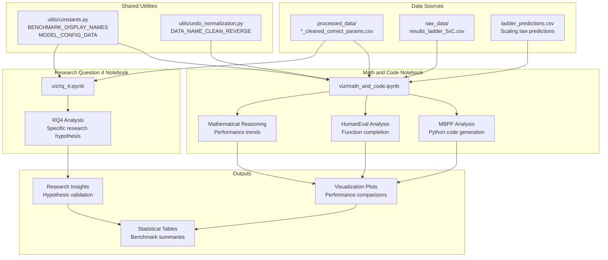
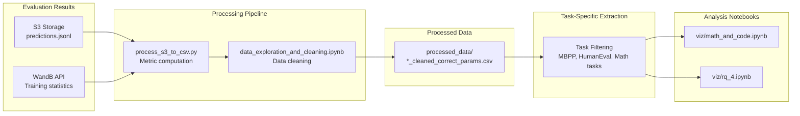
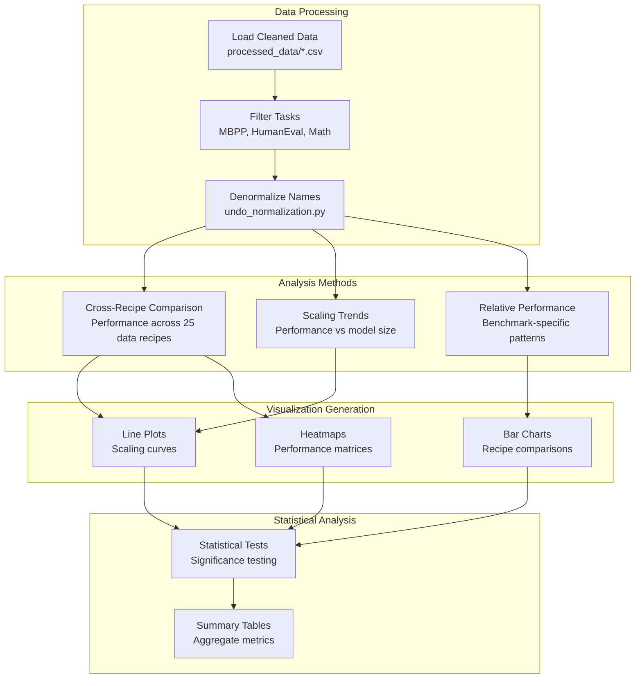
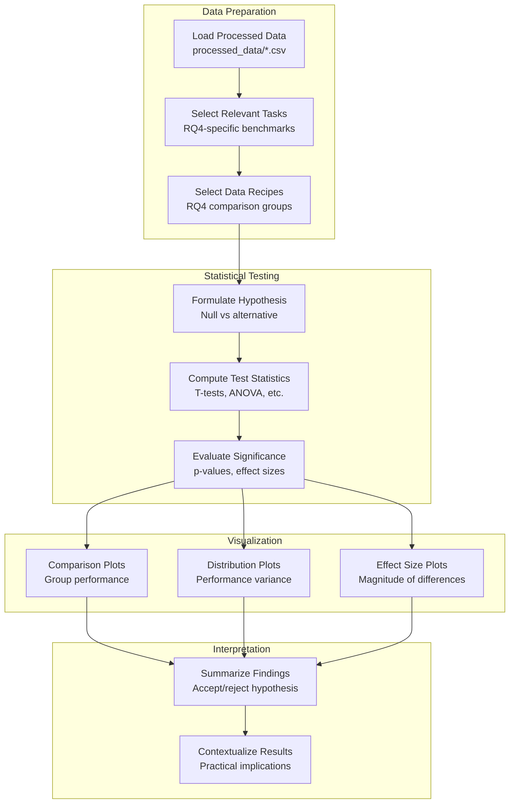
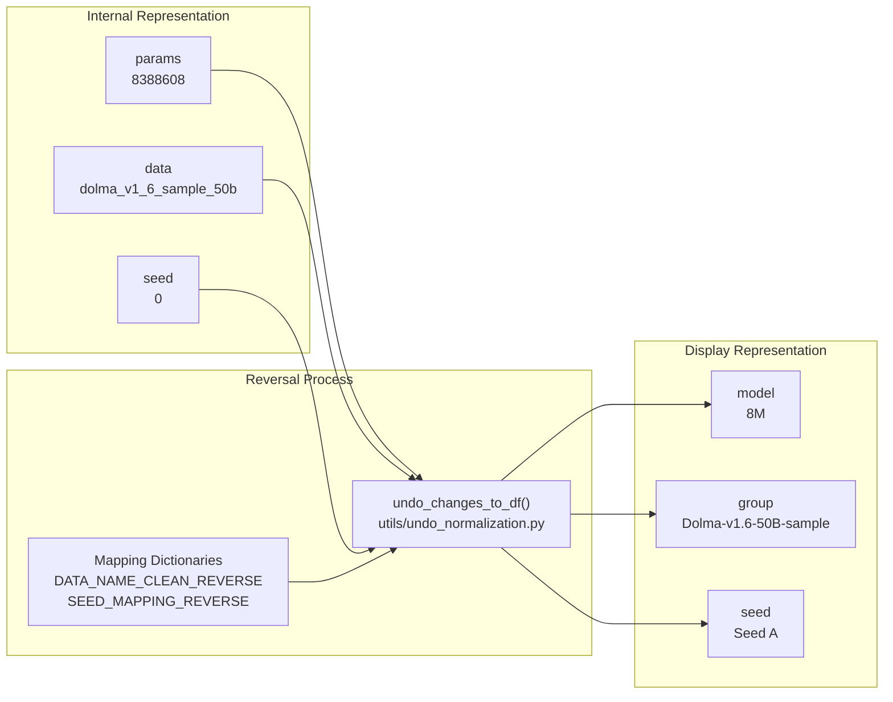
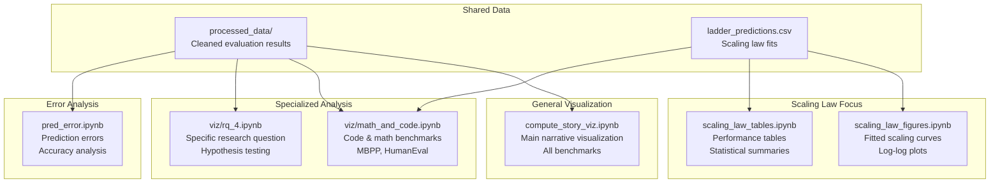

<!-- source: DeepWiki mcp.deepwiki.com · repo allenai/DataDecide · page 5.2 Math and Code Analysis · fetched 2026-10-26 -->

# Math and Code Analysis

<details>
<summary>Relevant source files</summary>

The following files were used as context for generating this wiki page:

- [viz/math_and_code.ipynb](viz/math_and_code.ipynb)
- [viz/rq_4.ipynb](viz/rq_4.ipynb)

</details>


## Purpose and Scope

This page documents the specialized analysis notebooks for mathematical and code generation benchmarks within the DataDecide visualization ecosystem. These notebooks provide focused examination of model performance on MBPP (Mostly Basic Python Problems) and HumanEval benchmarks, which measure code generation capabilities, as well as analysis addressing specific research questions.

The two primary notebooks covered here are:
- `viz/math_and_code.ipynb`: Analyzes performance trends on code and mathematical reasoning tasks
- `viz/rq_4.ipynb`: Addresses Research Question 4 from the DataDecide research

For general visualization workflows and the main story presentation, see [Story Visualization](#5.1). For scaling law visualizations, see [Scaling Law Visualization](#4.4). For error analysis, see [Error Analysis Visualizations](#5.3).

Sources: viz/math_and_code.ipynb, viz/rq_4.ipynb

## Overview

### Notebook Architecture



Sources: viz/math_and_code.ipynb, viz/rq_4.ipynb

### Notebook Storage and Access

Both notebooks are stored using Git Large File Storage (LFS) due to their size and embedded outputs:

| Notebook | Size | LFS OID |
|----------|------|---------|
| `viz/math_and_code.ipynb` | 195,204 bytes | `3e542d1b5bb8040a645f15e3b627c325c0ac6f3a785d4665c278f47cfa3448b5` |
| `viz/rq_4.ipynb` | 113,941 bytes | `4b22f99c56b042cc60781a5a87ca315d7da96d24b91efce951695fd067c14f85` |

To access the actual notebook contents, ensure Git LFS is installed and properly configured:

```bash
git lfs pull
```

Sources: viz/math_and_code.ipynb, viz/rq_4.ipynb

## Data Flow and Dependencies

### Input Data Pipeline



The math and code analysis notebooks consume cleaned evaluation data from the `processed_data/` directory. This data includes:

- **Task-level metrics**: Accuracy scores for MBPP, HumanEval, and mathematical reasoning benchmarks
- **Model metadata**: Parameter counts, training compute, dataset composition
- **Training statistics**: Loss curves, convergence metrics from WandB
- **Scaling law predictions**: Fitted performance trends from `ladder_predictions.csv`

Sources: viz/math_and_code.ipynb, viz/rq_4.ipynb

## Math and Code Notebook

### Primary Analyses

The `viz/math_and_code.ipynb` notebook focuses on three key benchmark categories:

#### Code Generation Benchmarks

| Benchmark | Task Type | Evaluation Metric | Description |
|-----------|-----------|-------------------|-------------|
| **MBPP** | Code generation | Pass@k accuracy | Mostly Basic Python Problems - requires generating complete Python functions |
| **HumanEval** | Function completion | Pass@k accuracy | Human-authored programming problems with test cases |

#### Mathematical Reasoning Tasks

The notebook analyzes performance on mathematical reasoning benchmarks to understand how different data recipes impact numerical and logical reasoning capabilities.

Sources: viz/math_and_code.ipynb

### Visualization Types



Sources: viz/math_and_code.ipynb

### Integration with Display Constants

The notebook leverages centralized configuration from `utils/constants.py`:

- **`BENCHMARK_DISPLAY_NAMES`**: Maps internal benchmark identifiers to presentation-ready names
- **`MODEL_CONFIG_DATA`**: Provides model size specifications and compute budgets
- **`DATA_NAME_CLEAN_REVERSE`**: Reverses normalization to obtain human-readable dataset names

This ensures consistency between the math/code analysis and other visualization notebooks in the repository.

Sources: viz/math_and_code.ipynb, utils/constants.py

## Research Question 4 Notebook

### Purpose and Scope

The `viz/rq_4.ipynb` notebook addresses a specific research question from the DataDecide investigation. While the exact research question requires examining the notebook content, RQ4 notebooks typically focus on:

- **Hypothesis validation**: Testing specific claims about dataset impact on model performance
- **Comparative analysis**: Examining differences between data recipe categories
- **Statistical significance**: Determining whether observed differences are meaningful

Sources: viz/rq_4.ipynb

### Analysis Workflow



Sources: viz/rq_4.ipynb

## Data Transformation and Normalization

### Reversal of Normalization

Both notebooks utilize `utils/undo_normalization.py` to convert internal data representations back to presentation-ready formats:



This transformation is critical for generating publication-ready visualizations where clarity and readability are paramount.

Sources: viz/math_and_code.ipynb, viz/rq_4.ipynb, utils/undo_normalization.py

## Relationship to Other Visualization Notebooks

### Specialization vs General Purpose



The math and code analysis notebooks serve a complementary role:

- **`compute_story_viz.ipynb`**: Provides broad overview across all benchmarks for the main research narrative
- **`viz/math_and_code.ipynb`**: Deep dive into code generation and mathematical reasoning performance
- **`viz/rq_4.ipynb`**: Focused hypothesis testing for specific research claims
- **Scaling law notebooks**: Emphasize fitted trends rather than raw benchmark performance

Sources: viz/math_and_code.ipynb, viz/rq_4.ipynb

## Common Patterns and Best Practices

### Data Loading Pattern

Both notebooks follow a consistent pattern for loading and preparing data:

1. **Load cleaned data**: Read CSV files from `processed_data/` directory
2. **Filter tasks**: Select relevant benchmarks (MBPP, HumanEval, math tasks)
3. **Denormalize**: Convert internal identifiers to display names using `undo_normalization.py`
4. **Join metadata**: Merge with model configuration data from `utils/constants.py`

### Visualization Standards

The notebooks adhere to repository-wide visualization standards:

- **Display names**: Use `BENCHMARK_DISPLAY_NAMES` for consistent labeling
- **Model sizes**: Reference `MODEL_CONFIG_DATA` for size specifications
- **Color schemes**: Likely consistent with other visualization notebooks
- **Figure dimensions**: Standardized for publication requirements

Sources: viz/math_and_code.ipynb, viz/rq_4.ipynb, utils/constants.py, utils/undo_normalization.py

## Execution Environment

### Required Dependencies

The notebooks require the visualization-specific conda environment:

```bash
conda create -n datadecide-viz python=3.10
conda activate datadecide-viz
pip install -r requirements-viz.txt
```

Expected dependencies include:
- **pandas**: Data manipulation
- **matplotlib/seaborn**: Visualization generation
- **scipy/numpy**: Statistical analysis
- **jupyter**: Notebook execution

### Running the Notebooks

To execute the notebooks:

```bash
cd viz/
jupyter notebook math_and_code.ipynb
# or
jupyter notebook rq_4.ipynb
```

For non-interactive execution:

```bash
jupyter nbconvert --to notebook --execute math_and_code.ipynb
jupyter nbconvert --to notebook --execute rq_4.ipynb
```

Sources: viz/math_and_code.ipynb, viz/rq_4.ipynb

## Output and Results

### Expected Outputs

The notebooks generate several types of outputs:

| Output Type | Description | Usage |
|-------------|-------------|-------|
| **Performance plots** | Line/bar charts showing benchmark performance across recipes and sizes | Publication figures |
| **Statistical tables** | Summary statistics and hypothesis test results | Manuscript tables |
| **Diagnostic plots** | Distribution plots, residual analysis | Validation and QA |
| **Embedded visualizations** | Inline plots within the notebook cells | Interactive exploration |

### Integration with Publication Pipeline

Outputs from these notebooks feed into:
- Research paper figures and tables
- Supplementary materials
- Documentation examples
- Presentation slides

Sources: viz/math_and_code.ipynb, viz/rq_4.ipynb

## File References

Primary files for this analysis system:

- [viz/math_and_code.ipynb](): Main code and math analysis notebook (195KB, Git LFS)
- [viz/rq_4.ipynb](): Research Question 4 analysis notebook (114KB, Git LFS)
- Referenced utilities from [utils/constants.py]()
- Referenced utilities from [utils/undo_normalization.py]()

Data sources:
- Processed evaluation results from `processed_data/` directory
- Raw results from `raw_data/` directory
- Scaling law predictions from `ladder_predictions.csv`

For detailed information on data processing pipelines that generate the inputs to these notebooks, see [Data Cleaning and Processing](#3.3) and [Results Management](#3.4).

---

