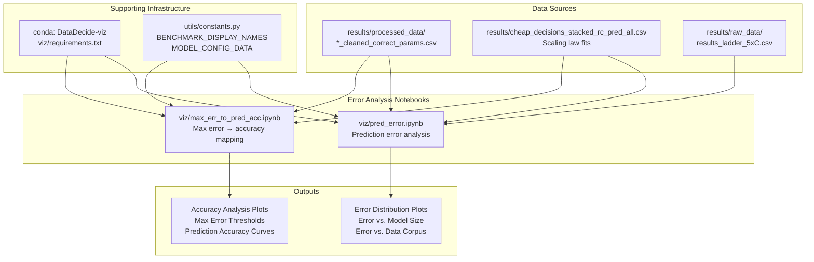
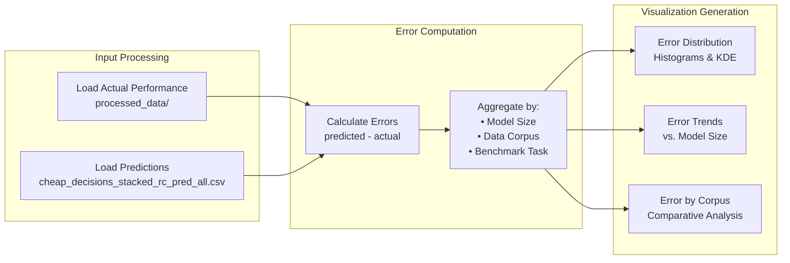
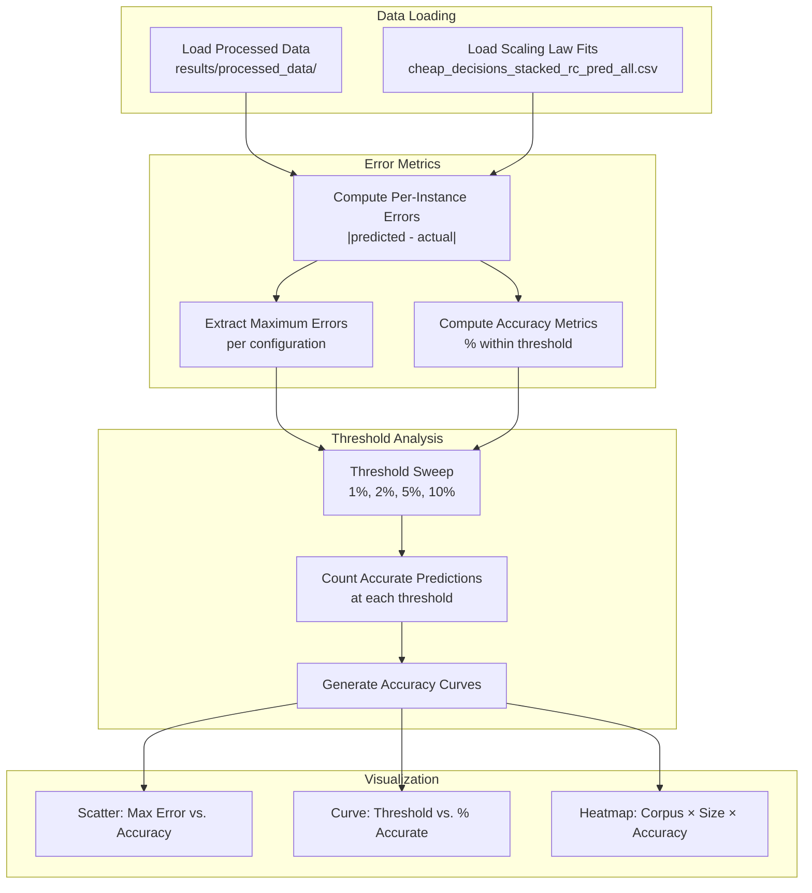
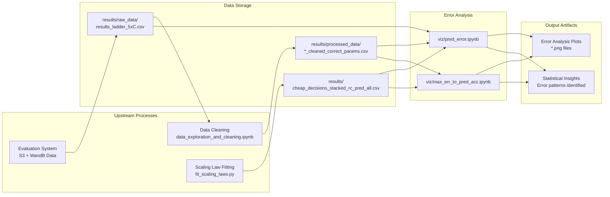

<!-- source: DeepWiki mcp.deepwiki.com · repo allenai/DataDecide · page 5.3 Error Analysis Visualizations · fetched 2026-10-26 -->

# Error Analysis Visualizations

<details>
<summary>Relevant source files</summary>

The following files were used as context for generating this wiki page:

- [.gitignore](.gitignore)
- [results/readme.md](results/readme.md)
- [viz/pred_error.ipynb](viz/pred_error.ipynb)
- [viz/readme.md](viz/readme.md)

</details>


## Purpose and Scope

This document describes the error analysis visualization system in the DataDecide repository. These visualizations analyze prediction errors and accuracy patterns across different model sizes, data corpora, and evaluation benchmarks. The primary notebooks are `pred_error.ipynb` and `max_err_to_pred_acc.ipynb`, which process evaluation results to identify error patterns, quantify prediction accuracy, and visualize the relationship between scaling behavior and error characteristics.

For general visualization workflows, see [Visualization](#5). For scaling law-specific visualizations, see [Scaling Law Visualization](#4.4). For high-level story visualizations, see [Story Visualization](#5.1).

**Sources:** [viz/readme.md:1-9](), [results/readme.md:1-18]()

## Error Analysis Components

The error analysis system consists of two primary notebooks that consume processed evaluation data to analyze different aspects of prediction errors:

| Component | Location | Primary Function |
|-----------|----------|------------------|
| Prediction Error Notebook | `viz/pred_error.ipynb` | Analyzes prediction errors across tasks and model configurations |
| Max Error to Prediction Accuracy | `viz/max_err_to_pred_acc.ipynb` | Maps maximum error values to prediction accuracy metrics |

Both notebooks operate on processed data from the evaluation pipeline and produce visualizations that help identify systematic error patterns in scaling law predictions.

**Sources:** [viz/pred_error.ipynb:1-4](), [results/readme.md:11-14]()

## System Architecture



**Sources:** [viz/readme.md:1-9](), [results/readme.md:11-18](), [.gitignore:6-10]()

## Prediction Error Analysis

The `pred_error.ipynb` notebook performs comprehensive analysis of prediction errors generated by scaling law fits. This notebook investigates how accurately scaling laws predict model performance at different scales and identifies systematic biases or patterns in prediction errors.

### Data Dependencies

The prediction error notebook consumes multiple data sources:

| Data Source | Purpose |
|-------------|---------|
| `results/processed_data/*_cleaned_correct_params.csv` | Cleaned evaluation results with actual model performance |
| `results/cheap_decisions_stacked_rc_pred_all.csv` | Scaling law predictions for comparison |
| `results/raw_data/results_ladder_5xC.csv` | Original evaluation data for validation |

### Analysis Components



The notebook computes prediction errors by comparing scaling law predictions against actual evaluation results, then aggregates and visualizes these errors across different dimensions of the experimental design.

**Sources:** [viz/pred_error.ipynb:1-4](), [results/readme.md:11-18]()

## Max Error to Prediction Accuracy Analysis

The `max_err_to_pred_acc.ipynb` notebook analyzes the relationship between maximum prediction errors and overall prediction accuracy. This analysis helps establish error tolerance thresholds and understand how prediction accuracy degrades with increasing error magnitudes.

### Analysis Workflow



This notebook quantifies how prediction accuracy varies with error magnitude, enabling researchers to set appropriate error tolerance levels for decision-making based on scaling law predictions.

**Sources:** [results/readme.md:11-18](), [.gitignore:6-10]()

## Environment Setup

The error analysis visualizations require the DataDecide-viz conda environment:

```bash
# Environment creation
conda create -n DataDecide-viz python=3.10
conda activate DataDecide-viz
pip install -r viz/requirements.txt
```

### Required Dependencies

The visualization notebooks depend on standard data science and plotting libraries installed via `viz/requirements.txt`. These include packages for data manipulation, statistical analysis, and visualization generation.

**Sources:** [viz/readme.md:3-9]()

## Data Flow and Dependencies



The error analysis notebooks consume data from multiple stages of the pipeline:

1. **Raw evaluation data** from `results/raw_data/` for baseline comparison
2. **Cleaned processed data** from `results/processed_data/` for actual performance metrics
3. **Scaling law predictions** from `results/cheap_decisions_stacked_rc_pred_all.csv` for error computation

**Sources:** [results/readme.md:1-18](), [.gitignore:6-10]()

## Integration with Visualization Ecosystem

The error analysis notebooks are part of the broader visualization ecosystem alongside other analysis components:

| Component | Focus | Relationship to Error Analysis |
|-----------|-------|-------------------------------|
| `compute_story_viz.ipynb` | High-level story visualization | Uses error analysis insights for narrative |
| `math_and_code.ipynb` | Specialized benchmark analysis | May reference error patterns for specific tasks |
| `scaling_law_figures.ipynb` | Scaling law visualization | Complements error analysis with fit quality plots |
| `pred_error.ipynb` | Prediction error patterns | Core error analysis component |
| `max_err_to_pred_acc.ipynb` | Error-accuracy relationship | Core error analysis component |

**Sources:** [results/readme.md:1-18](), [viz/readme.md:1-9]()

## Common Analysis Patterns

### Error Computation Pattern

Error analysis notebooks typically follow this pattern for computing prediction errors:

1. **Load actual performance**: Read cleaned evaluation results from `results/processed_data/`
2. **Load predictions**: Read scaling law predictions from `results/cheap_decisions_stacked_rc_pred_all.csv`
3. **Join datasets**: Merge on keys (model size, data corpus, benchmark task)
4. **Compute errors**: Calculate `predicted_value - actual_value` or absolute/relative variants
5. **Aggregate**: Group by relevant dimensions (size, corpus, task)
6. **Visualize**: Generate plots showing error distributions and patterns

### Accuracy Threshold Pattern

For accuracy analysis, notebooks apply threshold-based evaluation:

1. **Define thresholds**: Set acceptable error margins (e.g., 1%, 5%, 10%)
2. **Count accurate predictions**: For each threshold, count predictions within tolerance
3. **Compute accuracy rate**: Calculate `accurate_predictions / total_predictions`
4. **Generate curves**: Plot accuracy vs. threshold or accuracy vs. max error

**Sources:** [results/readme.md:11-18]()

## Results Storage and Outputs

Error analysis visualizations are not tracked in the repository due to `.gitignore` settings:

```
# From .gitignore
*.png
*.pdf
```

Generated plots and figures from `pred_error.ipynb` and `max_err_to_pred_acc.ipynb` remain in the local working directory but are excluded from version control. This approach keeps the repository focused on code while allowing researchers to regenerate visualizations as needed.

**Sources:** [.gitignore:1-13]()

---

