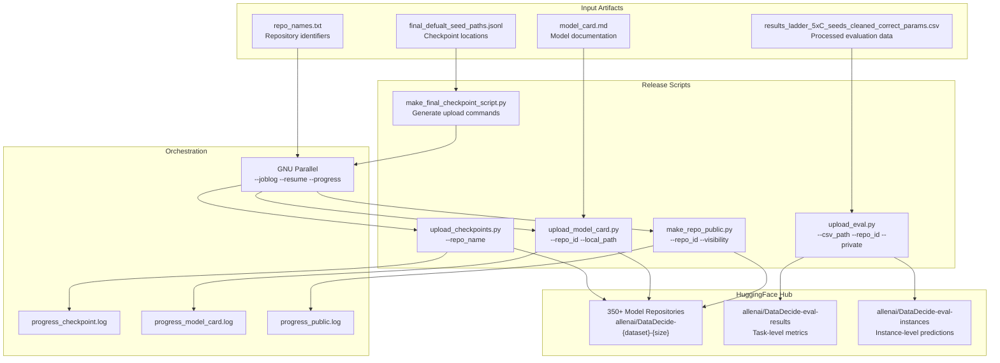
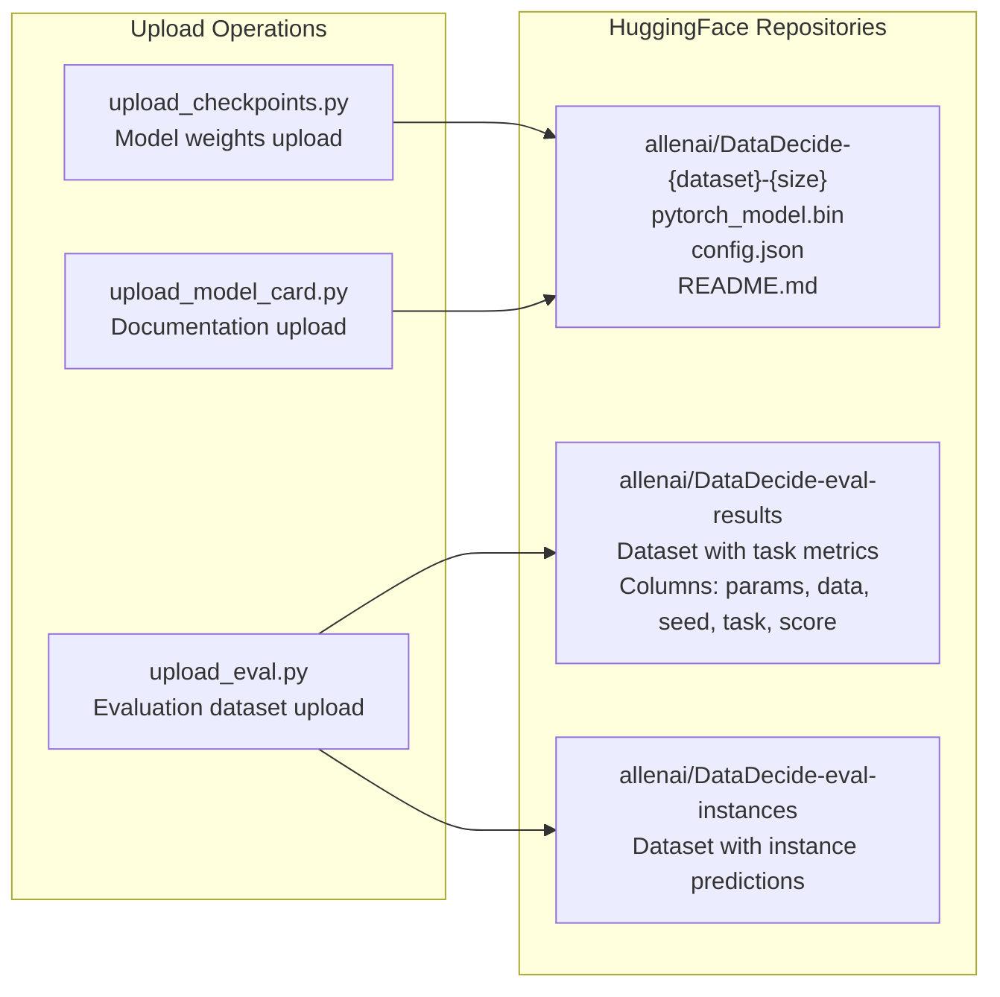
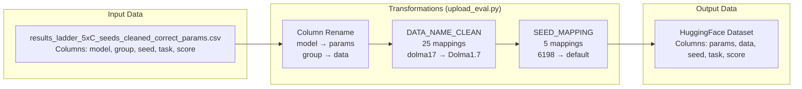

<!-- source: DeepWiki mcp.deepwiki.com · repo allenai/DataDecide · page 6 Release and Distribution · fetched 2026-10-26 -->

# Release and Distribution

<details>
<summary>Relevant source files</summary>

The following files were used as context for generating this wiki page:

- [release/make_repo_public.py](release/make_repo_public.py)
- [release/readme.md](release/readme.md)
- [release/upload_eval.py](release/upload_eval.py)
- [release/upload_model_card.py](release/upload_model_card.py)

</details>


## Purpose and Scope

This document describes the automated release and distribution system that uploads DataDecide artifacts to the HuggingFace Hub. The system manages the publication of 350+ model repositories, evaluation results datasets, and model cards through a parallelized workflow controlled by GNU Parallel.

The release system handles three primary artifact types:
- **Model checkpoints**: 14 model sizes across 25 data corpora
- **Evaluation results**: Task-level metrics and instance-level predictions
- **Model cards**: Documentation and metadata for each model

For details on data normalization transformations during upload, see [Data Normalization for Release](#6.2). For model card generation and repository visibility control, see [Repository Management](#6.3). For checkpoint registry management, see [Checkpoint Registry](#7.3).

**Sources:** [release/readme.md:1-36]()

---

## Release Workflow Overview

The release process follows a sequential workflow defined in [release/readme.md]() that executes five primary stages. Each stage uses GNU Parallel to process repositories in batches, with job logging to enable resume capabilities.

### Sequential Execution Stages

| Stage | Script | Parallelization | Purpose |
|-------|--------|-----------------|---------|
| 1. Final Checkpoint Selection | `make_final_checkpoint_script.py` | N/A | Generates upload script for default seed checkpoints |
| 2. Checkpoint Upload | `final_checkpoint_upload_script.sh` | `-j1` (serial) | Uploads model checkpoints to HuggingFace |
| 3. Model Card Upload | `upload_model_card.py` | `-j10` (parallel) | Uploads README.md to each repository |
| 4. Evaluation Upload | `upload_eval.py` | N/A (single run) | Uploads evaluation datasets |
| 5. Visibility Update | `make_repo_public.py` | `-j10` (parallel) | Changes repositories from private to public |

Each stage is executed with `--resume` flags to allow recovery from interruptions without re-processing completed items.

**Sources:** [release/readme.md:9-36]()

---

## System Architecture

The following diagram illustrates the relationships between release scripts, input artifacts, and HuggingFace Hub destinations.

### Release System Component Map



**Sources:** [release/readme.md:9-36](), [release/upload_eval.py:1-102](), [release/upload_model_card.py:1-48](), [release/make_repo_public.py:1-34]()

---

## GNU Parallel Orchestration

The release system uses GNU Parallel to manage batch uploads efficiently. The `parallel` command provides job logging, progress tracking, and automatic resume capabilities for handling interruptions during long-running upload operations.

### Parallel Command Patterns

All parallel executions follow a consistent pattern defined in [release/readme.md]():

```bash
parallel --joblog <logfile> --resume --progress <options> <command> < <input_file>
```

#### Checkpoint Upload (Serial Execution)
```bash
parallel --joblog progress.log --resume --progress -j1 < final_checkpoint_upload_script.sh
```
- **Parallelization**: `-j1` (serial execution to avoid overwhelming storage systems)
- **Input**: Shell script generated by `make_final_checkpoint_script.py`

#### Model Card Upload (Parallel Execution)
```bash
parallel --joblog progress_model_card.log --resume --progress -j10 \
    python upload_model_card.py --repo_id allenai/{} < repo_names.txt
```
- **Parallelization**: `-j10` (10 concurrent uploads)
- **Input**: `repo_names.txt` containing repository identifiers
- **Variable substitution**: `{}` replaced with each line from input file

#### Repository Visibility Update
```bash
parallel --joblog progress_public.log --resume --progress \
    python make_repo_public.py --repo_id allenai/{} < repo_names.txt
```
- **Default parallelization**: System-determined based on CPU cores
- **Resume capability**: `--resume` allows restarting from last completed job

**Sources:** [release/readme.md:11-36]()

---

## HuggingFace Hub Distribution

The release system distributes artifacts to three primary HuggingFace Hub destinations, each serving a distinct purpose in the DataDecide ecosystem.

### Distribution Targets



### Model Repository Structure
Each of the 350+ model repositories follows the naming convention `allenai/DataDecide-{dataset}-{size}` and contains:
- Model checkpoint files (weights, configuration)
- `README.md` (model card with metadata)
- Training configuration details

### Evaluation Datasets
The evaluation results are published to two dedicated dataset repositories:
- **`allenai/DataDecide-eval-results`**: Aggregated task-level metrics with normalized column names
- **`allenai/DataDecide-eval-instances`**: Instance-level predictions for detailed analysis

**Sources:** [release/upload_eval.py:84-87](), [release/readme.md:17-36]()

---

## Data Transformation Pipeline

The `upload_eval.py` script performs critical data transformations before uploading evaluation results to ensure consistency across the HuggingFace Hub. This transformation normalizes internal identifiers to human-readable names.

### Transformation Operations



### Column Renaming
The transformation renames columns to align with external naming conventions:
- `model` → `params` (indicates parameter count)
- `group` → `data` (indicates dataset name)

Implementation: [release/upload_eval.py:25]()

### Data Name Normalization
The `DATA_NAME_CLEAN` dictionary maps 25 internal dataset identifiers to human-readable display names:

| Internal Identifier | Display Name |
|---------------------|--------------|
| `dolma17` | Dolma1.7 |
| `no_code` | Dolma1.7 (no code) |
| `prox_fineweb_pro` | FineWeb-Pro |
| `DCLM-baseline` | DCLM-Baseline |
| `falcon_and_cc_eli5_oh_top10p` | Falcon+CC (QC 10%) |

Full mapping: [release/upload_eval.py:28-54]()

### Seed Value Mapping
The `SEED_MAPPING` dictionary normalizes random seed identifiers:

| Numeric Seed | Display Name |
|--------------|--------------|
| 6198 | default |
| 14 | small aux 2 |
| 15 | small aux 3 |
| 4 | large aux 2 |
| 5 | large aux 3 |

Implementation: [release/upload_eval.py:58-64]()

**Sources:** [release/upload_eval.py:22-66]()

---

## Environment Requirements

The release system requires specific dependencies and authentication credentials to function properly.

### Dependencies
The release scripts require the following packages:
- `git-lfs`: For handling large model checkpoint files
- `huggingface_hub`: Python library for HuggingFace Hub API interactions
- `datasets`: For creating and uploading HuggingFace datasets
- `pandas`: For CSV data processing

Installation: [release/readme.md:3-6]()

### Authentication
All upload operations require a HuggingFace authentication token set as an environment variable:
```bash
export HF_TOKEN=<your_token>
```

The token is validated before execution in each script:
- [release/upload_eval.py:93-94]()
- [release/upload_model_card.py:39-40]()
- [release/make_repo_public.py:26-27]()

**Sources:** [release/readme.md:3-6](), [release/upload_eval.py:93-94]()

---

## Privacy Management

The release workflow supports staged publication through privacy controls. Repositories can be created as private during initial upload and later made public through the `make_repo_public.py` script.

### Privacy Workflow

1. **Initial Upload (Private)**
   ```bash
   python upload_eval.py --private
   ```
   Creates repositories with restricted access for validation.

2. **Visibility Update (Public)**
   ```bash
   python make_repo_public.py --repo_id allenai/{repo_name} --visibility public
   ```
   Updates repository visibility after validation.

The `update_repo_visibility()` function in `make_repo_public.py` uses the HuggingFace API to toggle repository privacy:
[release/make_repo_public.py:5-16]()

**Sources:** [release/readme.md:28-36](), [release/make_repo_public.py:5-16](), [release/upload_eval.py:89]()

---

