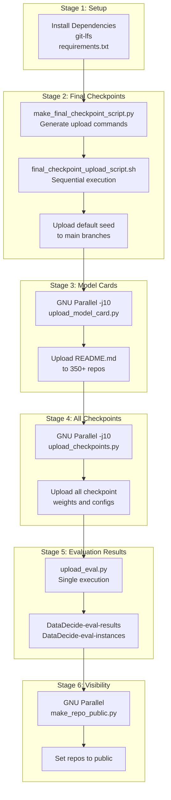
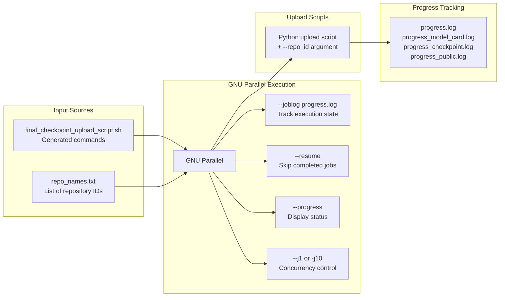
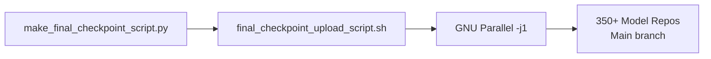
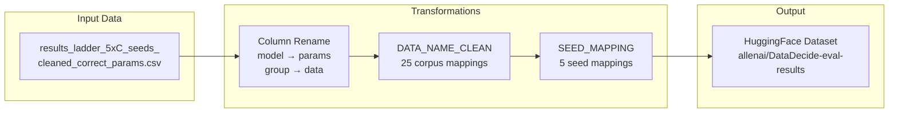
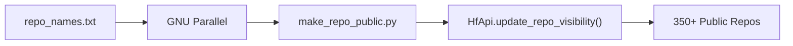

<!-- source: DeepWiki mcp.deepwiki.com · repo allenai/DataDecide · page 6.1 Upload Pipeline · fetched 2026-10-26 -->

# Upload Pipeline

<details>
<summary>Relevant source files</summary>

The following files were used as context for generating this wiki page:

- [release/make_repo_public.py](release/make_repo_public.py)
- [release/readme.md](release/readme.md)
- [release/upload_eval.py](release/upload_eval.py)
- [release/upload_model_card.py](release/upload_model_card.py)

</details>


## Purpose and Scope

The Upload Pipeline system orchestrates the sequential release of DataDecide artifacts to HuggingFace Hub. This system manages the distribution of 350+ model repositories, evaluation datasets, and model cards through a carefully sequenced set of upload operations. The pipeline uses GNU Parallel for efficient batch processing and includes robust progress tracking and resumability features.

This page covers the overall workflow orchestration and execution. For details on data transformations during upload, see [Data Normalization for Release](#6.2). For repository-specific operations like model card updates, see [Repository Management](#6.3).

**Sources:** [release/readme.md:1-36]()

## Workflow Overview

The upload pipeline follows a strict sequential order defined in the release directory's orchestration script. The workflow ensures that all artifacts are uploaded in the correct sequence with proper dependencies.



**Sequential Execution Order:**

| Stage | Script | Parallelization | Purpose |
|-------|--------|----------------|---------|
| 1 | Setup commands | N/A | Install git-lfs and Python dependencies |
| 2 | `make_final_checkpoint_script.py` | -j1 (serial) | Upload default seed checkpoints to main branches |
| 3 | `upload_model_card.py` | -j10 (parallel) | Reupload model cards to all repositories |
| 4 | `upload_checkpoints.py` | -j10 (parallel) | Upload checkpoint weights to all repositories |
| 5 | `upload_eval.py` | Single run | Upload evaluation results to central datasets |
| 6 | `make_repo_public.py` | Parallel | Change repository visibility to public |

**Sources:** [release/readme.md:1-36]()

## Parallel Execution System

The pipeline leverages GNU Parallel for efficient batch processing of repository operations. Each stage uses different parallelization strategies based on the operation's characteristics and resource requirements.



### Parallel Execution Patterns

**Pattern 1: Shell Script Input (Stage 2)**
```bash
parallel --joblog progress.log --resume --progress -j1 < final_checkpoint_upload_script.sh
```
- Reads commands from shell script
- Serial execution (`-j1`) to prevent S3 throttling
- Each command is a complete upload operation

**Pattern 2: Repository List Input (Stages 3-6)**
```bash
parallel --joblog progress_model_card.log --resume --progress -j10 \
    python upload_model_card.py --repo_id allenai/{} < repo_names.txt
```
- Reads repository names from `repo_names.txt`
- Parallel execution (`-j10`) for independent operations
- `{}` placeholder substituted with each line from input file

### Resumability Features

The `--resume` flag enables fault-tolerant execution:
- Skips jobs already completed (tracked in joblog)
- Continues from point of failure
- Safe to interrupt and restart
- No duplicate uploads for completed repositories

**Sources:** [release/readme.md:10-36]()

## Upload Stages

### Stage 1: Environment Setup

Initial setup installs required dependencies for HuggingFace operations.

```bash
sudo apt-get install git-lfs
pip install -r requirements.txt
```

**Dependencies:**
- `git-lfs`: For large file storage support (model checkpoints)
- Python packages: `huggingface_hub`, `datasets`, `pandas` (specified in requirements.txt)

**Sources:** [release/readme.md:2-6]()

### Stage 2: Final Checkpoints Upload

Uploads default seed checkpoints to the main branch of each model repository.



**Execution:**
- Script generator: `make_final_checkpoint_script.py`
- Generated output: `final_checkpoint_upload_script.sh`
- Execution: Serial (`-j1`) to manage resource constraints
- Progress log: `progress.log`

This stage establishes the baseline model versions before adding auxiliary seeds.

**Sources:** [release/readme.md:9-13]()

### Stage 3: Model Card Upload

Updates README.md files across all model repositories with standardized documentation.

**Script:** `upload_model_card.py`

**Command-line interface:**
```bash
python upload_model_card.py --repo_id allenai/{repo_name}
```

**Parameters:**
- `--local_path`: Local model card file (default: `model_card.md`)
- `--repo_path`: Destination in repo (default: `README.md`)
- `--repo_id`: Target repository (required)
- `--branch`: Target branch (default: `main`)

**Key Functions:**
- `upload_model_card()` [release/upload_model_card.py:5-27](): Uploads file using HfApi

**Execution pattern:**
- Parallel: `-j10` for concurrent uploads
- Input: `repo_names.txt` (list of repository identifiers)
- Progress log: `progress_model_card.log`

**Sources:** [release/readme.md:15-19](), [release/upload_model_card.py:1-48]()

### Stage 4: Checkpoint Upload

Uploads model checkpoint weights and configuration files for all training seeds and sizes.

**Script:** `upload_checkpoints.py`

**Command-line interface:**
```bash
python upload_checkpoints.py --repo_name {repo_name}
```

**Execution pattern:**
- Parallel: `-j10` for concurrent uploads
- Input: `repo_names.txt`
- Progress log: `progress_checkpoint.log`

This stage handles the bulk of the data transfer, uploading the actual model weights for all variants (14 sizes × 25 datasets × multiple seeds).

**Sources:** [release/readme.md:21-24]()

### Stage 5: Evaluation Results Upload

Uploads processed evaluation results to centralized HuggingFace datasets.

**Script:** `upload_eval.py`



**Key Function:**
- `process_and_upload_results()` [release/upload_eval.py:7-72](): Loads CSV, transforms data, uploads to HF Hub

**Data Transformations:**
- Column renaming: `model` → `params`, `group` → `data`
- Data name mapping via `DATA_NAME_CLEAN` [release/upload_eval.py:28-54]()
- Seed mapping via `SEED_MAPPING` [release/upload_eval.py:58-64]()

**Command-line interface:**
```bash
python upload_eval.py --private
```

**Parameters:**
- `--csv_path`: Source CSV file (default: `../results/processed_data/results_ladder_5xC_seeds_cleaned_correct_params.csv`)
- `--repo_id`: Target dataset (default: `allenai/DataDecide-eval-results`)
- `--private`: Create as private repository (flag)

**Execution:**
- Single run (not parallelized)
- Creates/updates two datasets: `eval-results` and `eval-instances`

For detailed information on the data transformations, see [Data Normalization for Release](#6.2).

**Sources:** [release/readme.md:27-30](), [release/upload_eval.py:1-102]()

### Stage 6: Repository Visibility

Changes repository visibility from private to public, making models accessible to the community.

**Script:** `make_repo_public.py`



**Key Function:**
- `update_repo_visibility()` [release/make_repo_public.py:5-16](): Updates repository privacy settings

**Command-line interface:**
```bash
python make_repo_public.py --repo_id allenai/{repo_name}
```

**Parameters:**
- `--repo_id`: Target repository (required)
- `--visibility`: `public` or `private` (default: `public`)

**Execution pattern:**
- Parallel execution using GNU Parallel
- Progress log: `progress_public.log`

**Sources:** [release/readme.md:32-36](), [release/make_repo_public.py:1-34]()

## Progress Management and Resumability

All parallel execution stages implement comprehensive progress tracking through joblog files.

### Joblog Files

| Joblog File | Associated Stage | Contents |
|------------|------------------|----------|
| `progress.log` | Final checkpoints | Execution status per command |
| `progress_model_card.log` | Model cards | Upload status per repository |
| `progress_checkpoint.log` | Checkpoints | Transfer status per repository |
| `progress_public.log` | Visibility changes | Update status per repository |

### Joblog Format

Each joblog tracks:
- Sequence number
- Command executed
- Exit code
- Start time
- Duration
- Host information

### Resume Mechanism

The `--resume` flag in GNU Parallel:
1. Reads existing joblog
2. Identifies completed jobs (exit code 0)
3. Skips completed entries
4. Continues with remaining work

**Example recovery workflow:**
```bash
# Initial run interrupted
parallel --joblog progress.log --resume --progress -j10 \
    python upload_model_card.py --repo_id allenai/{} < repo_names.txt

# Resume from interruption point (same command)
parallel --joblog progress.log --resume --progress -j10 \
    python upload_model_card.py --repo_id allenai/{} < repo_names.txt
```

**Sources:** [release/readme.md:10-36]()

## Authentication and Configuration

### Environment Variables

All upload scripts require HuggingFace authentication via environment variable:

```bash
export HF_TOKEN="your_huggingface_token"
```

**Token verification:**
- Each script checks: `hf_token = os.getenv("HF_TOKEN")`
- Assertion ensures token exists: `assert hf_token is not None`
- Used for all HfApi operations

### Script-Level Configuration

Each upload script accepts configuration through command-line arguments and defaults:

**upload_model_card.py:**
- Default local path: `model_card.md`
- Default repo path: `README.md`
- Default branch: `main`

**upload_eval.py:**
- Default CSV path: `../results/processed_data/results_ladder_5xC_seeds_cleaned_correct_params.csv`
- Default repo ID: `allenai/DataDecide-eval-results`
- Privacy: Controlled by `--private` flag

**make_repo_public.py:**
- Default visibility: `public`
- Supports toggle to `private` via `--visibility` argument

**Sources:** [release/upload_model_card.py:39-40](), [release/upload_eval.py:93-94](), [release/make_repo_public.py:26-27]()

## Input Files

### repo_names.txt

Plain text file containing one repository name per line. Used as input to parallel execution stages.

**Format:**
```
DataDecide-dolma17-4M
DataDecide-dolma17-8M
DataDecide-c4-4M
...
```

**Usage:**
- Fed to GNU Parallel via stdin redirection (`< repo_names.txt`)
- Each line substituted into `{}` placeholder
- Supports 350+ repository names

### final_checkpoint_upload_script.sh

Generated shell script containing upload commands for default seed checkpoints.

**Generation:**
- Created by: `make_final_checkpoint_script.py`
- Contains: Complete upload commands with full paths
- Execution: Serial (`-j1`) via GNU Parallel

**Sources:** [release/readme.md:12-18]()

## Output Artifacts

### HuggingFace Model Repositories

**Count:** 350+ repositories

**Naming pattern:** `allenai/DataDecide-{dataset}-{size}`

**Contents per repository:**
- Model checkpoint weights (PyTorch)
- Configuration files
- README.md (model card)
- Metadata

### HuggingFace Datasets

**DataDecide-eval-results:**
- Processed evaluation metrics
- Task-level performance scores
- Aggregated across all models

**DataDecide-eval-instances:**
- Instance-level predictions
- Detailed per-example results

**Sources:** [release/upload_eval.py:84-87]()

---

