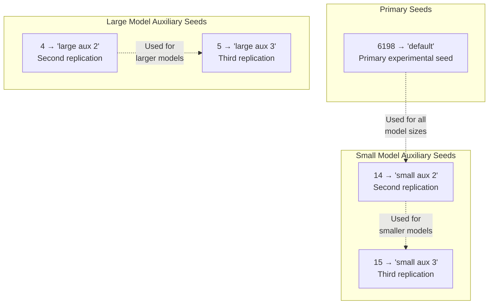
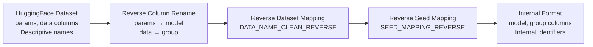
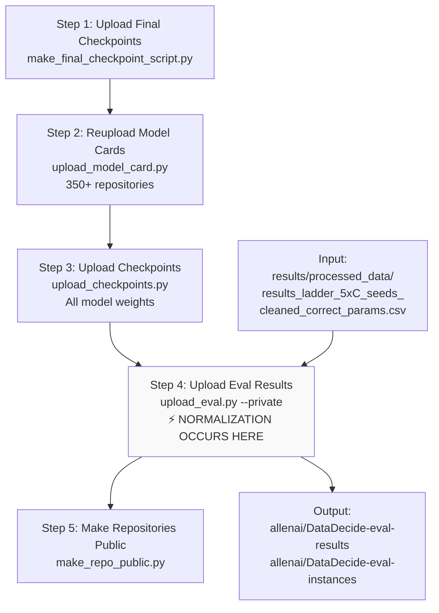

<!-- source: DeepWiki mcp.deepwiki.com · repo allenai/DataDecide · page 6.2 Data Normalization for Release · fetched 2026-10-26 -->

# Data Normalization for Release

<details>
<summary>Relevant source files</summary>

The following files were used as context for generating this wiki page:

- [release/make_repo_public.py](release/make_repo_public.py)
- [release/readme.md](release/readme.md)
- [release/upload_eval.py](release/upload_eval.py)
- [release/upload_model_card.py](release/upload_model_card.py)
- [utils/undo_normalization.py](utils/undo_normalization.py)
- [viz/compute_story_viz.ipynb](viz/compute_story_viz.ipynb)
- [viz/requirements.txt](viz/requirements.txt)

</details>


## Purpose and Scope

This page details the data normalization process that transforms internal evaluation results into human-readable formats for HuggingFace distribution. The normalization occurs during the evaluation results upload phase of the release pipeline and ensures that published datasets use consistent, descriptive naming conventions.

For information about the broader upload workflow, see [Upload Pipeline](#6.1). For visualization-specific data reversal, see [Story Visualization](#5.1).

## Overview

Data normalization is performed by the `process_and_upload_results` function in [release/upload_eval.py:7-101](). This transformation prepares processed evaluation data for public consumption by:

1. Renaming columns to more precise terminology
2. Mapping internal dataset identifiers to human-readable names
3. Converting numeric seed values to descriptive labels

The normalization is unidirectional during release but can be reversed for internal analysis using utilities in [utils/undo_normalization.py:1-54]().

**Sources:** [release/upload_eval.py:1-102](), [release/readme.md:1-36]()

## Normalization Workflow

```mermaid
graph LR
    INPUT["Processed CSV<br/>results_ladder_5xC_seeds_<br/>cleaned_correct_params.csv"]
    
    LOAD["Load DataFrame<br/>pd.read_csv()"]
    
    RENAME["Column Renaming<br/>model → params<br/>group → data"]
    
    DATA_MAP["Dataset Name Mapping<br/>DATA_NAME_CLEAN<br/>25 corpus variants"]
    
    SEED_MAP["Seed Value Mapping<br/>SEED_MAPPING<br/>5 seed variants"]
    
    CONVERT["Convert to HF Dataset<br/>Dataset.from_pandas()"]
    
    UPLOAD["Push to HuggingFace<br/>allenai/DataDecide-eval-results"]
    
    INPUT --> LOAD
    LOAD --> RENAME
    RENAME --> DATA_MAP
    DATA_MAP --> SEED_MAP
    SEED_MAP --> CONVERT
    CONVERT --> UPLOAD
```



**Normalization Pipeline Flow**

The normalization occurs in a sequential pipeline where each transformation builds on the previous one, ensuring data consistency before upload to HuggingFace Hub.

**Sources:** [release/upload_eval.py:7-72]()

## Column Renaming

The first transformation renames two critical columns to align with the semantic meaning of the data:

| Original Column | Normalized Column | Rationale |
|----------------|-------------------|-----------|
| `model` | `params` | The column represents parameter count (4M, 8M, etc.), not model architecture |
| `group` | `data` | The column represents the dataset/corpus used for training |

This renaming is performed at [release/upload_eval.py:25]():

```python
df.rename(columns={"model": "params", "group": "data"}, inplace=True)
```

**Sources:** [release/upload_eval.py:24-25]()

## Dataset Name Mapping

The `DATA_NAME_CLEAN` dictionary maps internal dataset identifiers to publication-ready display names. This mapping is defined at [release/upload_eval.py:28-54]().

### Mapping Categories

The 25 dataset mappings fall into several categories:

#### Base Corpora
| Internal Name | Display Name |
|--------------|--------------|
| `dolma17` | `Dolma1.7` |
| `dolma-v1-6-and-sources-baseline` | `Dolma1.6++` |
| `c4` | `C4` |
| `falcon` | `Falcon` |
| `DCLM-baseline` | `DCLM-Baseline` |

#### FineWeb Variants
| Internal Name | Display Name |
|--------------|--------------|
| `prox_fineweb_pro` | `FineWeb-Pro` |
| `fineweb_edu_dedup` | `FineWeb-Edu` |

#### Dolma Ablations
| Internal Name | Display Name |
|--------------|--------------|
| `no_code` | `Dolma1.7 (no code)` |
| `no_math_no_code` | `Dolma1.7 (no math, code)` |
| `no_reddit` | `Dolma1.7 (no Reddit)` |
| `no_flan` | `Dolma1.7 (no Flan)` |

#### DCLM Mixtures
| Internal Name | Display Name |
|--------------|--------------|
| `dolma17-75p-DCLM-baseline-25p` | `DCLM-Baseline 25% / Dolma 75%` |
| `dolma17-50p-DCLM-baseline-50p` | `DCLM-Baseline 50% / Dolma 50%` |
| `dolma17-25p-DCLM-baseline-75p` | `DCLM-Baseline 75% / Dolma 25%` |

#### Quality-Controlled Variants
| Internal Name | Display Name |
|--------------|--------------|
| `falcon_and_cc_eli5_oh_top10p` | `Falcon+CC (QC 10%)` |
| `falcon_and_cc_eli5_oh_top20p` | `Falcon+CC (QC 20%)` |
| `pos_eli5_oh_neg_dclm_refinedweb_steps_2000_lr3e4_top10p` | `DCLM-Baseline (QC 10%)` |
| `dclm_ft7percentile_fw2` | `DCLM-Baseline (QC 7%, FW2)` |

The mapping is applied at [release/upload_eval.py:55]():

```python
df['data'] = df['data'].map(DATA_NAME_CLEAN)
```

**Sources:** [release/upload_eval.py:28-55]()

## Seed Value Mapping

The `SEED_MAPPING` dictionary converts numeric seed identifiers to human-readable labels that indicate their role in the experimental design. This mapping is defined at [release/upload_eval.py:58-64]().

### Seed Categories



**Seed Mapping Structure**

The seed mapping distinguishes between:
- **Default seed (6198)**: Used across all experiments as the primary seed
- **Small auxiliary seeds (14, 15)**: Additional replications for smaller model sizes
- **Large auxiliary seeds (4, 5)**: Additional replications for larger model sizes

The mapping is applied at [release/upload_eval.py:65]():

```python
df['seed'] = df['seed'].map(SEED_MAPPING)
```

**Sources:** [release/upload_eval.py:58-65]()

## Reverse Normalization

The `undo_changes_to_df` function in [utils/undo_normalization.py:1-54]() provides reverse mappings for internal analysis and visualization.

### Reverse Transformation Process



**Reverse Normalization Pipeline**

The reverse mappings are constructed by inverting the original dictionaries at [utils/undo_normalization.py:15-41]() and [utils/undo_normalization.py:45-51]():

```python
DATA_NAME_CLEAN_REVERSE = {v: k for k, v in DATA_NAME_CLEAN.items()}
SEED_MAPPING_REVERSE = {v: k for k, v in SEED_MAPPING.items()}
```

This allows notebooks like [viz/compute_story_viz.ipynb]() to load published datasets and convert them back to internal naming conventions for analysis that requires matching against other internal data sources.

**Sources:** [utils/undo_normalization.py:1-54]()

## Integration with Release Pipeline

The normalization step is executed as part of the sequential release workflow documented in [release/readme.md:1-36]().

### Position in Release Sequence



**Release Pipeline Integration**

The normalization is executed via [release/readme.md:27-30]():

```bash
python upload_eval.py --private
```

This command:
1. Loads the processed CSV from [release/upload_eval.py:80]()
2. Applies all normalization transformations
3. Creates a HuggingFace `Dataset` object at [release/upload_eval.py:68]()
4. Uploads to `allenai/DataDecide-eval-results` at [release/upload_eval.py:71]()

The `--private` flag ensures the dataset is initially private, allowing verification before Step 5 makes all repositories public.

**Sources:** [release/readme.md:27-30](), [release/upload_eval.py:74-101]()

## Command-Line Interface

The `upload_eval.py` script accepts the following arguments:

| Argument | Default | Description |
|----------|---------|-------------|
| `--csv_path` | `../results/processed_data/results_ladder_5xC_seeds_cleaned_correct_params.csv` | Path to input CSV file |
| `--repo_id` | `allenai/DataDecide-eval-results` | Target HuggingFace repository |
| `--private` | `False` | Whether to create private repository |

The script requires the `HF_TOKEN` environment variable to be set for authentication at [release/upload_eval.py:93-94]().

**Sources:** [release/upload_eval.py:76-101]()

## Data Consistency

The normalization ensures that:

1. **Column names** are semantically accurate (`params` for parameter count, `data` for dataset name)
2. **Dataset names** are human-readable and match publication conventions
3. **Seed labels** clearly indicate experimental design (default vs. auxiliary replications)
4. **Reversibility** is maintained through inverse mappings for internal use

This consistency allows external users to easily understand and work with the published data while maintaining compatibility with internal analysis workflows.

**Sources:** [release/upload_eval.py:7-101](), [utils/undo_normalization.py:1-54]()

---

