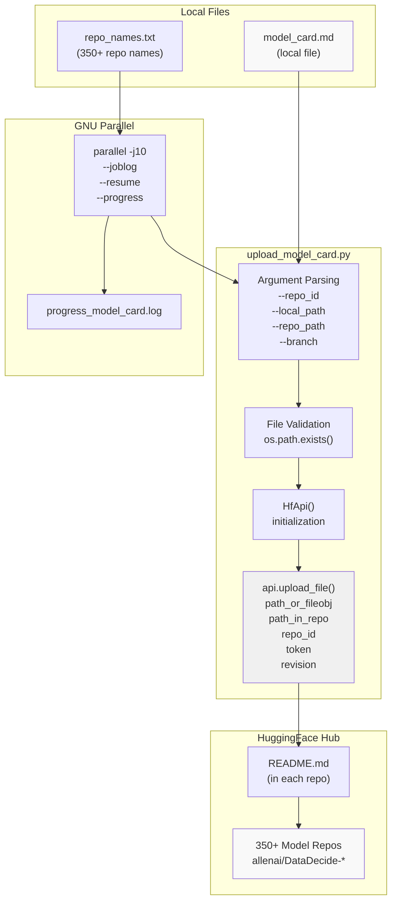
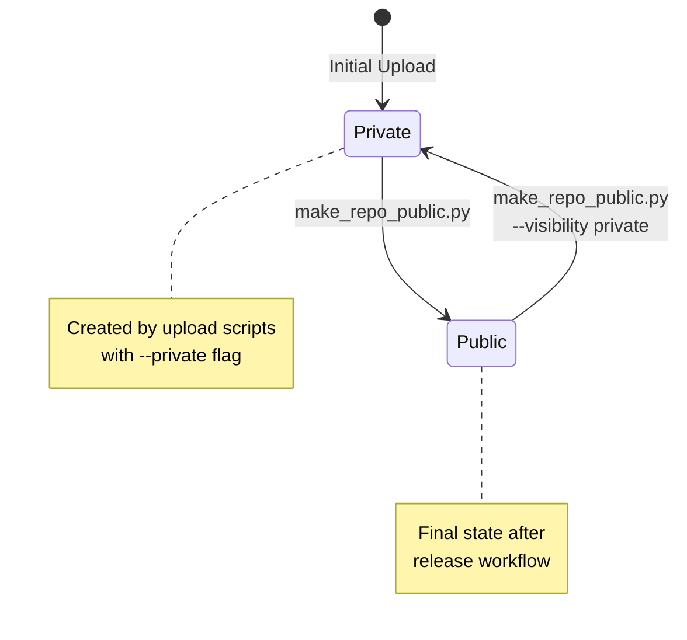
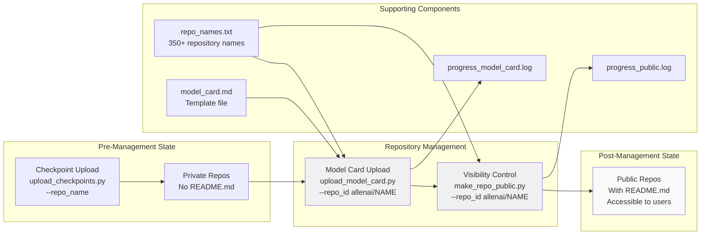
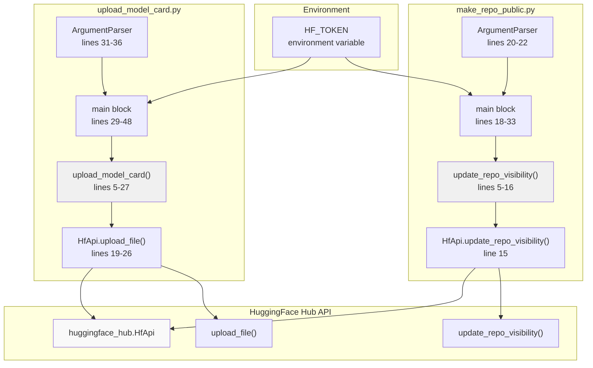

<!-- source: DeepWiki mcp.deepwiki.com · repo allenai/DataDecide · page 6.3 Repository Management · fetched 2026-10-26 -->

# Repository Management

<details>
<summary>Relevant source files</summary>

The following files were used as context for generating this wiki page:

- [release/make_repo_public.py](release/make_repo_public.py)
- [release/readme.md](release/readme.md)
- [release/upload_eval.py](release/upload_eval.py)
- [release/upload_model_card.py](release/upload_model_card.py)

</details>


This page covers repository-level management operations performed on HuggingFace Hub after model checkpoints have been uploaded. Specifically, it documents:
- Model card (README.md) updates via `upload_model_card.py`
- Repository visibility control via `make_repo_public.py`

These operations manage metadata and access control for the 350+ HuggingFace model repositories created during the release process. For information about the overall upload workflow, see [Upload Pipeline](#6.1). For data normalization during evaluation uploads, see [Data Normalization for Release](#6.2).

---

## Model Card Management

Model cards provide documentation for each model repository on HuggingFace Hub. The `upload_model_card.py` script automates the upload of standardized model cards to all 350+ repositories.

### Upload Process

The script uploads a local `model_card.md` file to the `README.md` location in each HuggingFace repository. This operation is performed using the HuggingFace Hub API.

**Script Location**: [release/upload_model_card.py:1-48]()

**Core Function**: The `upload_model_card()` function handles the upload operation:

| Parameter | Type | Default | Description |
|-----------|------|---------|-------------|
| `repo_id` | str | (required) | HuggingFace repository ID (e.g., `allenai/DataDecide-dolma17-4M`) |
| `token` | str | (required) | HuggingFace authentication token from `HF_TOKEN` environment variable |
| `local_path` | str | `"model_card.md"` | Local path to the model card file |
| `repo_path` | str | `"README.md"` | Destination path in the repository |
| `branch` | str | `"main"` | Target branch for upload |

The function performs validation and upload: [release/upload_model_card.py:16-27]()

```
1. Check if local_path exists
2. Initialize HfApi instance
3. Call api.upload_file() with specified parameters
4. Print success confirmation
```

### Parallel Execution

Model card uploads are executed in parallel across all repositories using GNU Parallel:

```bash
parallel --joblog progress_model_card.log --resume --progress -j10 \
  python upload_model_card.py --repo_id allenai/{} < repo_names.txt
```

**Key Options**:
- `--joblog progress_model_card.log`: Log execution progress for each repository
- `--resume`: Skip already-completed uploads
- `-j10`: Run 10 concurrent uploads

The `repo_names.txt` file contains the list of repository suffixes (one per line), which are substituted into the `allenai/{}` template.

### Model Card Upload Workflow



**Sources**: [release/upload_model_card.py:1-48](), [release/readme.md:15-19]()

---

## Repository Visibility Control

The `make_repo_public.py` script manages repository visibility on HuggingFace Hub, transitioning repositories from private to public after all upload operations are complete.

### Visibility Update Process

**Script Location**: [release/make_repo_public.py:1-34]()

**Core Function**: The `update_repo_visibility()` function controls repository access:

| Parameter | Type | Default | Description |
|-----------|------|---------|-------------|
| `repo_id` | str | (required) | HuggingFace repository ID |
| `token` | str | (required) | HuggingFace authentication token |
| `visibility` | str | `"public"` | Target visibility: `"public"` or `"private"` |

The function uses the HuggingFace Hub API to update visibility: [release/make_repo_public.py:14-16]()

```
1. Initialize HfApi instance
2. Call api.update_repo_visibility() with visibility parameter
3. Print confirmation message
```

**Implementation Detail**: The `visibility` parameter is converted to the `private` boolean parameter expected by the API: [release/make_repo_public.py:15]()
- `visibility="public"` → `private=False`
- `visibility="private"` → `private=True`

### Parallel Execution

Visibility updates are executed in parallel across all repositories:

```bash
parallel --joblog progress_public.log --resume --progress \
  python make_repo_public.py --repo_id allenai/{} < repo_names.txt
```

The script runs without a parallelism limit (`-j` not specified), allowing maximum concurrency for this lightweight operation.

### Repository Visibility State Transition



**Sources**: [release/make_repo_public.py:1-34](), [release/readme.md:32-36]()

---

## Integration in Release Workflow

Repository management operations are executed as distinct steps in the sequential release workflow defined in [release/readme.md:1-36](). These operations occur after checkpoint uploads but affect repository metadata and access control.

### Workflow Sequence

The release workflow executes repository management tasks at specific stages:

| Step | Operation | Parallelism | Purpose |
|------|-----------|-------------|---------|
| 1 | Upload final checkpoints | `-j1` | Upload model weights to default branch |
| **2** | **Upload model cards** | **`-j10`** | **Add README.md to each repository** |
| 3 | Upload checkpoints | `-j10` | Upload additional checkpoint variants |
| 4 | Upload eval metrics | (single) | Create evaluation datasets |
| **5** | **Make repositories public** | **(unlimited)** | **Change visibility from private to public** |

### Repository Management Workflow Diagram



**Sources**: [release/readme.md:1-36]()

### Job Logs and Resume Capability

Both repository management scripts utilize GNU Parallel's job logging and resume features:

**Model Card Job Log**: `progress_model_card.log`
- Records completion status for each repository
- Enables `--resume` to skip already-processed repositories
- Tracks start time, end time, and exit status

**Visibility Job Log**: `progress_public.log`
- Records visibility update status
- Allows resumption after interruptions
- Provides progress tracking for large-scale operations

This logging mechanism ensures that repository management operations can be safely interrupted and resumed, particularly important when managing 350+ repositories.

---

## Code Entity Reference

The following diagram maps repository management components to their code entities:



**Sources**: [release/upload_model_card.py:1-48](), [release/make_repo_public.py:1-34]()

---

## Error Handling

Both repository management scripts implement basic error handling:

### File Validation

`upload_model_card.py` validates that the local model card file exists before attempting upload: [release/upload_model_card.py:16-17]()

```python
if not os.path.exists(local_path):
    raise FileNotFoundError(f"The file {local_path} does not exist.")
```

### Environment Variable Validation

Both scripts ensure the `HF_TOKEN` environment variable is set:

**upload_model_card.py**: [release/upload_model_card.py:39-40]()
```python
hf_token = os.getenv("HF_TOKEN")
assert hf_token is not None, "Please set the HF_TOKEN environment variable."
```

**make_repo_public.py**: [release/make_repo_public.py:26-27]()
```python
hf_token = os.getenv("HF_TOKEN")
assert hf_token is not None, "Please set the HF_TOKEN environment variable."
```

### GNU Parallel Error Recovery

The `--resume` flag in parallel execution commands ensures that:
- Failed operations can be retried without re-processing successful ones
- Network interruptions don't require restarting the entire batch
- Job logs maintain an accurate record of completion status

**Sources**: [release/upload_model_card.py:16-17,39-40](), [release/make_repo_public.py:26-27](), [release/readme.md:15-19,32-36]()

---

## Usage Examples

### Uploading Model Cards to All Repositories

```bash
# Generate repository list (done once)
# repo_names.txt contains entries like:
#   DataDecide-dolma17-4M
#   DataDecide-dolma17-8M
#   ...

# Upload model cards in parallel
parallel --joblog progress_model_card.log --resume --progress -j10 \
  python upload_model_card.py --repo_id allenai/{} < repo_names.txt
```

### Making All Repositories Public

```bash
# Change all repositories from private to public
parallel --joblog progress_public.log --resume --progress \
  python make_repo_public.py --repo_id allenai/{} < repo_names.txt
```

### Making a Single Repository Private Again

```bash
# Revert a specific repository to private
python make_repo_public.py \
  --repo_id allenai/DataDecide-dolma17-1B \
  --visibility private
```

### Updating Model Card for a Single Repository

```bash
# Upload updated model card to one repository
python upload_model_card.py \
  --repo_id allenai/DataDecide-dolma17-1B \
  --local_path updated_model_card.md
```

**Sources**: [release/readme.md:15-19,32-36](), [release/upload_model_card.py:29-48](), [release/make_repo_public.py:18-33]()

---

