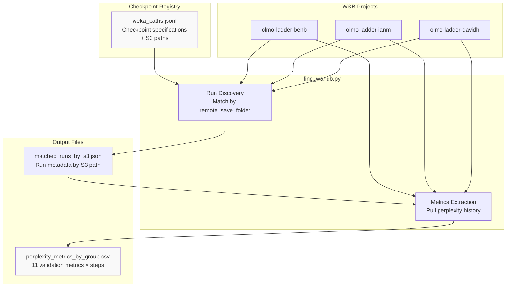
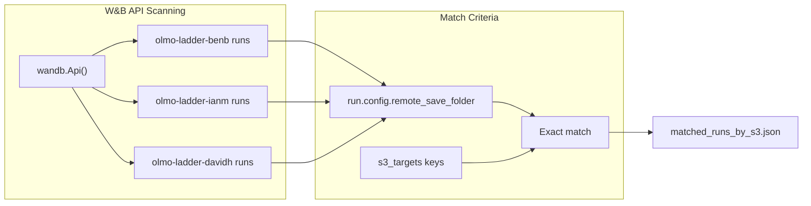
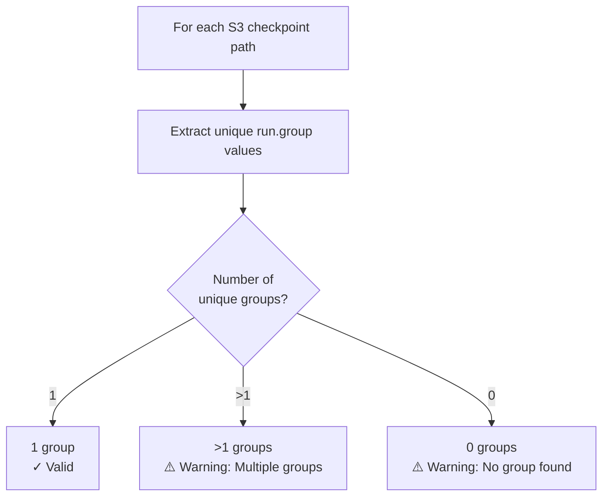
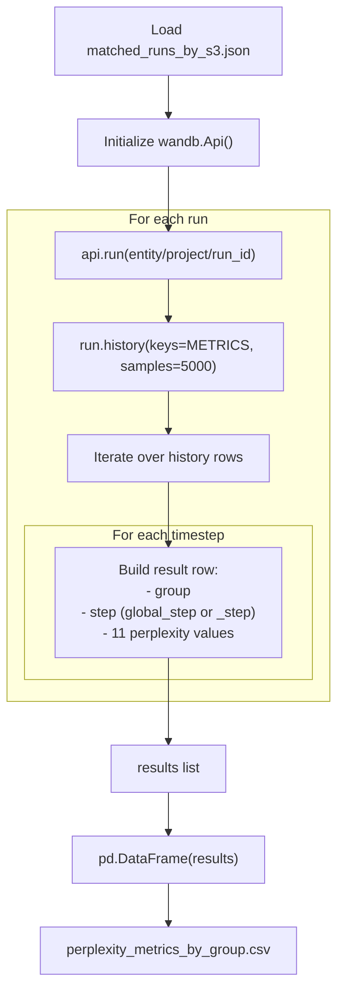
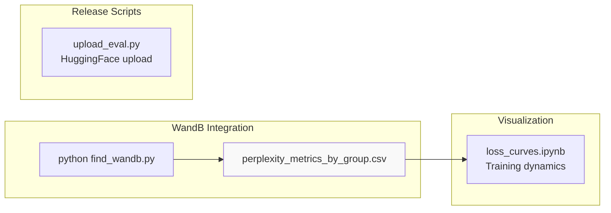

<!-- source: DeepWiki mcp.deepwiki.com · repo allenai/DataDecide · page 6.4 WandB Integration · fetched 2026-10-26 -->

# WandB Integration

<details>
<summary>Relevant source files</summary>

The following files were used as context for generating this wiki page:

- [perplexity_metrics_by_group.csv](perplexity_metrics_by_group.csv)
- [release/find_wandb.py](release/find_wandb.py)
- [release/loss_curves.ipynb](release/loss_curves.ipynb)
- [release/make_repo_public.py](release/make_repo_public.py)
- [release/readme.md](release/readme.md)
- [release/upload_eval.py](release/upload_eval.py)
- [release/upload_model_card.py](release/upload_model_card.py)

</details>


## Purpose and Scope

The WandB Integration system extracts training metrics from Weights & Biases (W&B) runs and associates them with model checkpoints. This system is implemented primarily in [release/find_wandb.py]() and produces perplexity metrics that are used in the release pipeline and evaluation analysis.

This page covers the automated extraction of metrics from W&B. For information about uploading evaluation results to HuggingFace, see [Data Normalization for Release](#6.2). For the broader release workflow, see [Upload Pipeline](#6.1).

## System Overview

The WandB integration performs two primary tasks:

1. **Run Discovery**: Matches W&B training runs to model checkpoints by comparing S3 storage paths
2. **Metrics Extraction**: Retrieves perplexity metrics across 11 validation datasets for all training steps

This process bridges the gap between distributed training runs tracked in W&B and the checkpoint registry used by the evaluation system.



**Sources**: [release/find_wandb.py:1-122]()

## Run Discovery Process

### Checkpoint Path Normalization

The discovery process begins by loading checkpoint specifications and normalizing storage paths from Weka to S3 format:

| Step | Operation | Code Location |
|------|-----------|---------------|
| 1. Load specs | Read checkpoint metadata from JSONL | [release/find_wandb.py:13-17]() |
| 2. Build lookup | Create `s3_targets` dictionary | [release/find_wandb.py:20-26]() |
| 3. Path normalization | Replace `weka://oe-eval-default/` with `s3://` | [release/find_wandb.py:21]() |

The `s3_targets` dictionary structure:
```python
{
  "s3://path/to/checkpoint": {
    "model_name": "model-size-dataset-seed",
    "runs": []  # Populated during discovery
  }
}
```

**Sources**: [release/find_wandb.py:13-26]()

### W&B Project Scanning

The system scans three W&B projects for matching runs:



For each run, the following metadata is captured when a match is found:

| Field | Description | Source |
|-------|-------------|--------|
| `run_id` | W&B run identifier | `run.id` |
| `run_name` | Human-readable run name | `run.name` |
| `project` | W&B project name | `run.project` |
| `group` | W&B group (dataset-size combination) | `run.group` |
| `url` | W&B run URL | `run.url` |

**Sources**: [release/find_wandb.py:29-51]()

### Group Validation

After discovering runs, the system validates that each checkpoint has exactly one associated group:



This validation ensures consistency in the checkpoint-to-run mapping, as each model should have a single associated group identifier.

**Sources**: [release/find_wandb.py:58-64]()

## Metrics Extraction

### Perplexity Metrics Configuration

The system extracts 11 perplexity metrics from different validation datasets:

| Metric Key | Validation Dataset |
|------------|-------------------|
| `eval/wikitext_103-validation/Perplexity` | WikiText-103 |
| `eval/pile-validation/Perplexity` | The Pile |
| `eval/m2d2_s2orc-validation/Perplexity` | M2D2 S2ORC |
| `eval/ice-validation/Perplexity` | ICE |
| `eval/dolma_wiki-validation/Perplexity` | Dolma Wikipedia |
| `eval/dolma_stack-validation/Perplexity` | Dolma Stack |
| `eval/dolma_reddit-validation/Perplexity` | Dolma Reddit |
| `eval/dolma_pes2o-validation/Perplexity` | Dolma PES2O |
| `eval/dolma_common-crawl-validation/Perplexity` | Dolma Common Crawl |
| `eval/dolma_books-validation/Perplexity` | Dolma Books |
| `eval/c4_en-validation/Perplexity` | C4 English |

**Sources**: [release/find_wandb.py:76-88]()

### Extraction Process



The extraction uses `run.history()` with `samples=5000` to retrieve the full training history for each metric. Each row in the output CSV represents one training step for one model group.

**Sources**: [release/find_wandb.py:90-120]()

## Output Files

### matched_runs_by_s3.json

This intermediate file maps S3 checkpoint paths to W&B run metadata:

```json
{
  "s3://path/to/checkpoint": {
    "model_name": "dataset-size-seed",
    "runs": [
      {
        "run_id": "abc123",
        "run_name": "dataset-size-seed",
        "project": "olmo-ladder-benb",
        "group": "dataset-60M-5xC-14",
        "url": "https://wandb.ai/ai2-llm/..."
      }
    ]
  }
}
```

**Sources**: [release/find_wandb.py:52-56]()

### perplexity_metrics_by_group.csv

The primary output containing perplexity metrics for all training steps:

| Column | Type | Description |
|--------|------|-------------|
| `group` | string | Model group identifier (e.g., "falcon_and_cc_tulu_qc_top10-60M-5xC-14") |
| `step` | float | Training step number |
| `eval/wikitext_103-validation/Perplexity` | float | Perplexity on WikiText-103 |
| ... | float | (9 additional perplexity columns) |
| `eval/c4_en-validation/Perplexity` | float | Perplexity on C4 |

This CSV contains the complete perplexity history for all model configurations across all validation datasets, enabling loss curve visualization and training dynamics analysis.

**Sources**: [release/find_wandb.py:115-120](), [perplexity_metrics_by_group.csv:1-2]()

## Integration with Release Pipeline

The WandB integration is executed as a standalone step in the release process:



The extracted perplexity metrics serve two purposes:

1. **Visualization**: Used by notebooks like [release/loss_curves.ipynb]() to create training loss visualizations
2. **Documentation**: Provides validation metrics that can be included in model documentation

Note that this data is separate from the downstream evaluation results uploaded to HuggingFace by [upload_eval.py](), which focuses on task-specific evaluation metrics rather than training perplexities.

**Sources**: [release/readme.md:1-36](), [release/find_wandb.py:1-122]()

## Configuration

### Environment Variables

| Variable | Purpose | Required |
|----------|---------|----------|
| `WANDB_API_KEY` | Authentication for W&B API access | Yes |

**Sources**: [release/find_wandb.py:10]()

### Constants

| Constant | Value | Location |
|----------|-------|----------|
| `ENTITY` | `"ai2-llm"` | [release/find_wandb.py:9]() |
| `INPUT_JSON` | `"matched_runs_by_s3.json"` | [release/find_wandb.py:74]() |
| `OUTPUT_CSV` | `"perplexity_metrics_by_group.csv"` | [release/find_wandb.py:75]() |

### Project List

The system scans these W&B projects:
- `olmo-ladder-benb`
- `olmo-ladder-ianm`
- `olmo-ladder-davidh`

**Sources**: [release/find_wandb.py:30]()

## Error Handling

The system includes error handling at two levels:

1. **Project Access**: If a W&B project is inaccessible, a warning is printed and scanning continues with remaining projects
2. **Metrics Fetch**: If metrics cannot be fetched for a specific run, the error is logged and processing continues with the next run

This ensures the script can complete even with partial W&B access or incomplete run data.

**Sources**: [release/find_wandb.py:49-50](), [release/find_wandb.py:114-115]()

---

