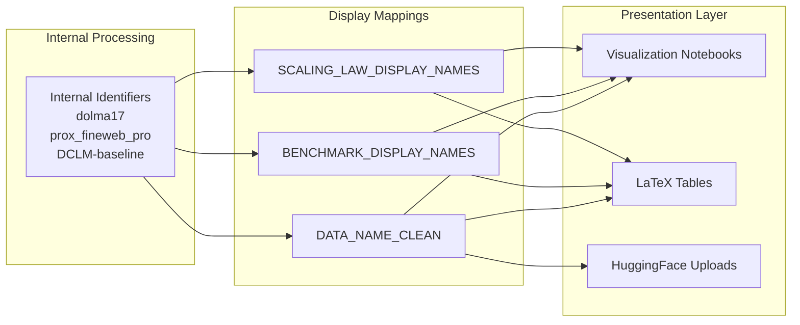
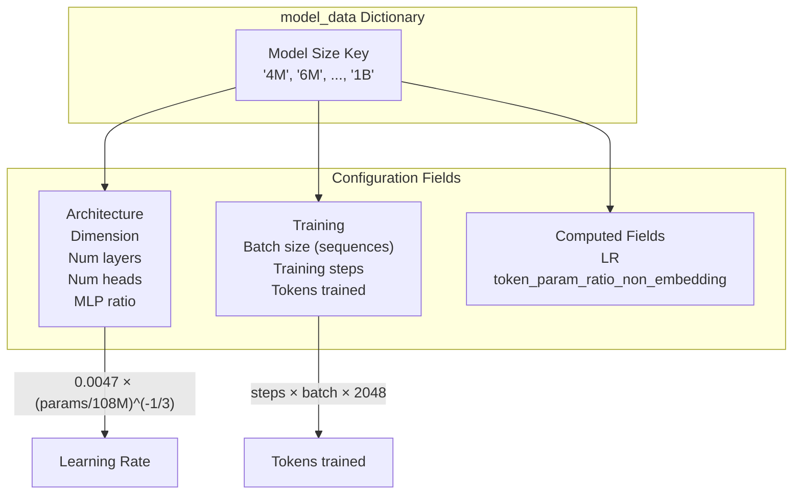
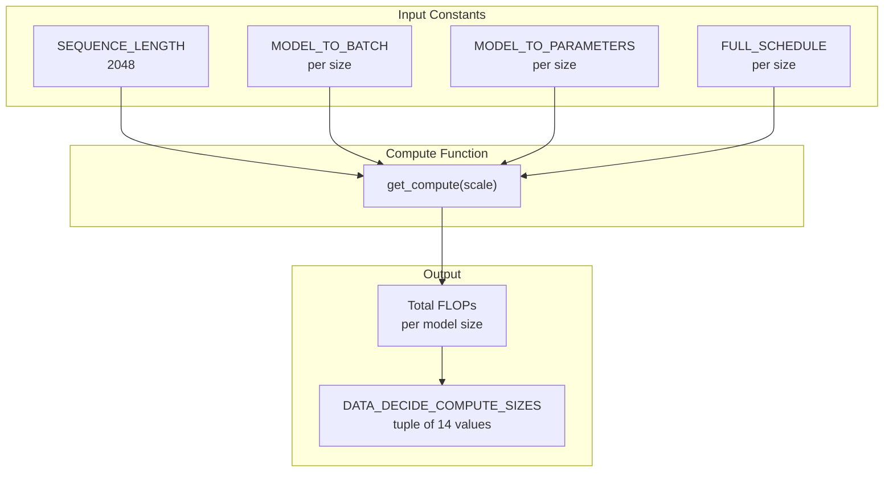

<!-- source: DeepWiki mcp.deepwiki.com · repo allenai/DataDecide · page 7 Configuration and Constants · fetched 2026-10-26 -->

# Configuration and Constants

<details>
<summary>Relevant source files</summary>

The following files were used as context for generating this wiki page:

- [scaling_laws/utils/constants/constants_models.py](scaling_laws/utils/constants/constants_models.py)
- [utils/constants.py](utils/constants.py)
- [viz/table_gen.ipynb](viz/table_gen.ipynb)

</details>


This page documents the centralized configuration system used throughout the DataDecide repository. These constants define model specifications, dataset mappings, benchmark identifiers, and display formatting conventions that ensure consistency across evaluation, scaling law analysis, and visualization pipelines.

For checkpoint file path registries, see [Checkpoint Registry](#7.3). For model-specific training configurations used in the OLMo training pipeline, those are external to this repository.

## Overview

The DataDecide repository uses two primary constants files:

- [utils/constants.py]() - Main constants for visualization, evaluation, and model specifications
- [scaling_laws/utils/constants/constants_models.py]() - Scaling laws-specific model definitions and compute calculations

These files provide a single source of truth for:
- Mapping internal identifiers to human-readable display names
- Defining model architecture parameters across 14 model sizes
- Specifying training schedules and resource allocations
- Computing total FLOPs for each model configuration

## Display Name Mappings

The repository uses internal identifiers for datasets, benchmarks, and scaling law configurations during processing, then maps them to presentation-ready names for visualization and publication.

### Scaling Law Display Names

The `SCALING_LAW_DISPLAY_NAMES` dictionary maps scaling law configuration identifiers to their display representations:

| Internal ID | Display Name |
|------------|--------------|
| `3_param` | 3-parameter |
| `3_param-helper_points` | 3-parameter with helper points |
| `3_param-step2=0.5` | 3-parameter step 2 fit with >50 % checkpoints |
| `3_param-helper_points-step2=0.5` | 3-parameter with helpers and >50 % checkpoints |
| `5_param-ai2` | 5-parameter |
| `5_param-1_step-ai2` | 5-parameter, single step |
| `3_param-1_step` | 3-parameter, single step |
| `2_param` | 2-parameter |

These names are used when rendering scaling law fit results in tables and figures.

**Sources:** [utils/constants.py:1-10]()

### Benchmark Display Names

The `BENCHMARK_DISPLAY_NAMES` dictionary provides human-readable names for evaluation benchmarks:

| Internal ID | Display Name |
|------------|--------------|
| `arc_challenge` | ARC Challenge |
| `arc_easy` | ARC Easy |
| `boolq` | BoolQ |
| `csqa` | CommonsenseQA |
| `hellaswag` | HellaSwag |
| `openbookqa` | OpenBookQA |
| `piqa` | PIQA |
| `socialiqa` | SocialIQA |
| `winogrande` | WinoGrande |
| `mmlu` | MMLU |
| `minerva` | Minerva |
| `gsm8k` | GSM8K |
| `mbpp` | MBPP |
| `humaneval` | HumanEval |

**Sources:** [utils/constants.py:12-27]()

### Dataset Display Names

The `DATA_NAME_CLEAN` dictionary maps 25 data corpus identifiers to display names. This mapping is crucial for the data normalization process used during HuggingFace uploads and visualization:

**Example Mappings:**
- `dolma17` → "Dolma1.7"
- `no_code` → "Dolma1.7 (no code)"
- `no_math_no_code` → "Dolma1.7 (no math, code)"
- `prox_fineweb_pro` → "FineWeb-Pro"
- `DCLM-baseline` → "DCLM-Baseline"
- `falcon_and_cc_eli5_oh_top10p` → "Falcon+CC (QC 10%)"

This mapping includes baseline corpora (Dolma, C4, FineWeb), ablation variants (no code, no math), quality-curated mixtures, and corpus blends.

**Sources:** [utils/constants.py:29-55]()



**Sources:** [utils/constants.py:1-55]()

## Model Architecture Constants

### Model Size Specifications

The `MODEL_TO_PARAMS` dictionary defines non-embedding parameter counts for each of the 14 model sizes:

| Model Size | Parameters | Architecture Notes |
|-----------|-----------|-------------------|
| 4M | 3,744,832 | 64 dim, 8 layers, 8 heads |
| 6M | 6,010,464 | 96 dim, 8 layers, 8 heads |
| 8M | 8,538,240 | 128 dim, 8 layers, 8 heads |
| 10M | 9,900,432 | 144 dim, 8 layers, 8 heads |
| 14M | 14,380,224 | 192 dim, 8 layers, 8 heads |
| 16M | 16,004,560 | 208 dim, 8 layers, 8 heads |
| 20M | 19,101,888 | 192 dim, 16 layers, 8 heads |
| 60M | 57,078,144 | 384 dim, 16 layers, 12 heads |
| 90M | 97,946,640 | 528 dim, 16 layers, 12 heads |
| 150M | 151,898,880 | 768 dim, 12 layers, 12 heads |
| 300M | 319,980,544 | 1024 dim, 16 layers, 16 heads |
| 530M | 530,074,944 | 1344 dim, 16 layers, 16 heads |
| 750M | 681,297,408 | 1536 dim, 16 layers, 16 heads |
| 1B | 1,176,832,000 | 2048 dim, 16 layers, 16 heads |

**Sources:** [utils/constants.py:105-121]()

### Comprehensive Model Configuration

The `MODEL_CONFIG_DATA` dictionary (derived from `model_data`) contains complete specifications for each model size:



Each model configuration includes:
- **Architecture:** Dimension, MLP ratio, number of heads, number of layers
- **Training:** Batch size (in sequences), training steps
- **Derived:** Sequence length (2048), tokens trained, token-to-parameter ratio, learning rate

The learning rate is computed using the formula: `LR = 0.0047 * (non_embedding_params / 108000000) ** (-1/3)`

**Sources:** [utils/constants.py:124-270]()

## Training Configuration

### Training Schedule

The `FULL_SCHEDULE_LAST_STEP_PER_MODEL` dictionary defines the final training step for each model size. These values represent the minimum step across seeds to ensure all models in a size category completed training:

```python
{
    "4M": 5725,   # min from {5745, 5725, 5735}
    "20M": 14584, # min from {14584, 14594}
    "60M": 29042, # min from {29042, 29052, 29062}
    ...
}
```

**Sources:** [utils/constants.py:70-85]()

### Batch Size Configuration

The `MODEL_TO_BATCH` dictionary specifies the batch size in sequences for each model size. Batch sizes increase with model size to maintain efficient GPU utilization:

| Model Range | Batch Size |
|------------|-----------|
| 4M - 16M | 32 |
| 20M | 64 |
| 60M | 96 |
| 90M | 160 |
| 150M | 192 |
| 300M | 320 |
| 530M | 448 |
| 750M | 576 |
| 1B | 704 |

**Sources:** [utils/constants.py:87-102]()

### Sequence Length

All models use a fixed sequence length defined by `SEQUENCE_LENGTH = 2048`. This constant is used in token count calculations throughout the repository.

**Sources:** [utils/constants.py:254]()

## Task and Benchmark Definitions

The `TASKS` list defines the core evaluation benchmarks used in single-scale analysis:

```python
TASKS = [
    "arc_challenge",
    "arc_easy",
    "boolq",
    "csqa",
    "hellaswag",
    "openbookqa",
    "piqa",
    "socialiqa",
    "winogrande",
    "mmlu",
]
```

This list drives the evaluation loop in [single_scale/main.py]() and determines which metrics are processed from S3 predictions. Additional specialized benchmarks (Minerva, GSM8K, MBPP, HumanEval) are included in `BENCHMARK_DISPLAY_NAMES` but may be evaluated separately.

**Sources:** [utils/constants.py:57-68]()

## Model Registry Constants

### Complete Model List

The `DATA_DECIDE_MODEL_NAMES` list in [scaling_laws/utils/constants/constants_models.py]() enumerates all 350+ model configurations in the DataDecide suite. Each entry follows the naming pattern:

```
{dataset}-{size}-{schedule}-{seed}
```

Examples:
- `dolma17-4M-5xC`
- `DCLM-baseline-150M-5xC-2`
- `falcon_and_cc_eli5_oh_top10p-1B-5xC-2`

**Sources:** [scaling_laws/utils/constants/constants_models.py:1-227]()

### Model Size Enumeration

The `DATA_DECIDE_SIZES` list provides an ordered enumeration of the 14 model sizes:

```python
DATA_DECIDE_SIZES = ['4M', '6M', '8M', '10M', '14M', '16M', '20M', 
                     '60M', '90M', '150M', '300M', '530M', '750M', '1B']
```

This ordering is used extensively in scaling law fitting and visualization.

**Sources:** [scaling_laws/utils/constants/constants_models.py:229]()

## Compute and Resource Constants

### Compute Calculation Function

The `get_compute()` function calculates total FLOPs for a given model size using the formula:

```
FLOPs = 2048 × 6 × batch_size × num_params × training_steps
```

Where:
- `2048` is the sequence length
- `6` is the FLOPs multiplier (forward + backward pass)
- Other values come from `MODEL_TO_BATCH`, `MODEL_TO_PARAMETERS`, and `FULL_SCHEDULE`

**Sources:** [scaling_laws/utils/constants/constants_models.py:283-284]()

### Compute Size Tuple

The `DATA_DECIDE_COMPUTE_SIZES` tuple contains pre-computed FLOPs for all 14 model sizes in ascending order. This tuple is used in scaling law analysis to map model sizes to compute budgets.

**Sources:** [scaling_laws/utils/constants/constants_models.py:286]()



**Sources:** [scaling_laws/utils/constants/constants_models.py:283-286]()

## Constants Usage Across the Repository

The constants defined in these files are imported and used throughout the codebase:

| Constant Category | Primary Users | Purpose |
|------------------|---------------|---------|
| Display Name Mappings | Visualization notebooks, table generation | Converting internal IDs to publication-ready names |
| Model Architecture | Scaling law fitting, compute calculations | Parameter counts and model specifications |
| Training Configuration | Evaluation processing, checkpoint validation | Training schedules and batch sizes |
| Task Definitions | Single-scale evaluation, S3 processing | Determining which benchmarks to evaluate |
| Model Registry | Release scripts, HuggingFace uploads | Enumerating all model configurations |
| Compute Constants | Scaling law analysis, FLOPs calculations | Compute budget analysis |

**Sources:** [utils/constants.py:1-270](), [scaling_laws/utils/constants/constants_models.py:1-287]()

## Cross-File Consistency

The repository maintains two parallel constant definitions in `utils/constants.py` and `scaling_laws/utils/constants/constants_models.py`. Key overlapping constants include:

- `MODEL_TO_BATCH` (both files)
- `MODEL_TO_PARAMS` vs. `MODEL_TO_PARAMETERS` (same values, different names)
- `FULL_SCHEDULE_LAST_STEP_PER_MODEL` vs. `FULL_SCHEDULE` (same values)

This redundancy exists because the scaling laws module was designed to be potentially standalone. When using constants, prefer importing from `utils/constants.py` for general use and from `scaling_laws/utils/constants/constants_models.py` for scaling-law-specific analysis.

**Sources:** [utils/constants.py:70-102](), [scaling_laws/utils/constants/constants_models.py:231-263]()

---

