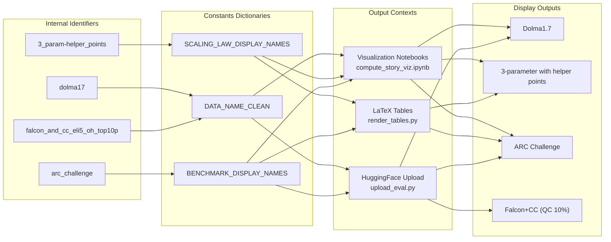
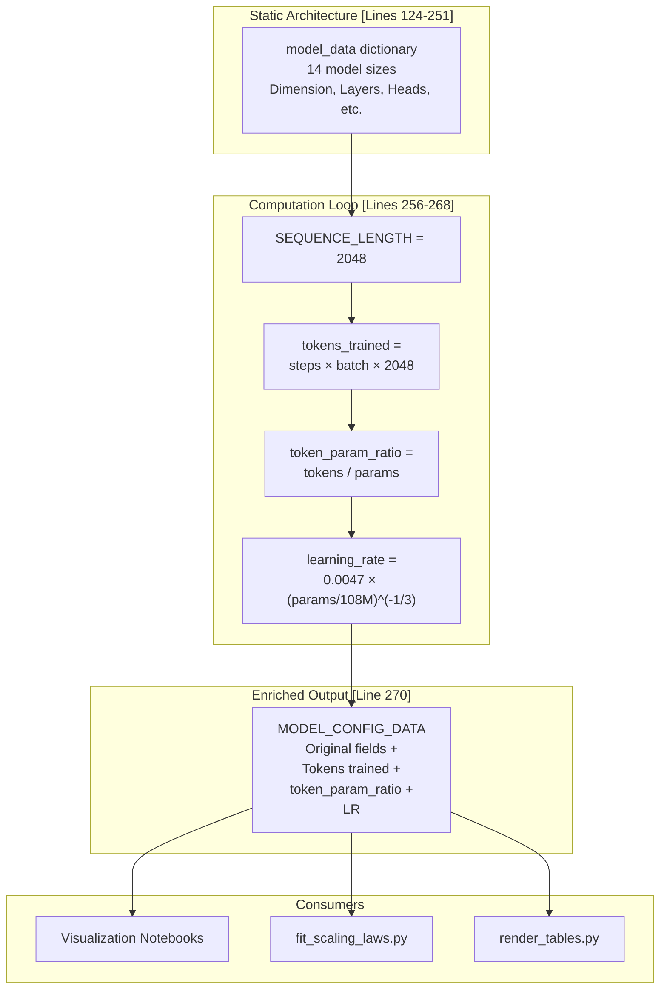

<!-- source: DeepWiki mcp.deepwiki.com · repo allenai/DataDecide · page 7.1 System Constants · fetched 2026-10-26 -->

# System Constants

<details>
<summary>Relevant source files</summary>

The following files were used as context for generating this wiki page:

- [utils/constants.py](utils/constants.py)
- [viz/table_gen.ipynb](viz/table_gen.ipynb)

</details>


This document describes the centralized constants and configuration system defined in [utils/constants.py](). This file serves as the single source of truth for display name mappings, model architecture specifications, training parameters, and evaluation task definitions used throughout the DataDecide repository. These constants ensure consistency across data processing, visualization, scaling law analysis, and release automation.

For model-level configuration utilities including `DATA_DECIDE_MODEL_NAMES` and `get_compute()`, see [Model Configurations](#7.2). For checkpoint file path registries, see [Checkpoint Registry](#7.3).

---

## Display Name Mappings

The constants file defines three primary mapping dictionaries that translate internal identifiers to human-readable names for presentation in visualizations, tables, and published datasets.

### SCALING_LAW_DISPLAY_NAMES

This dictionary maps scaling law configuration identifiers to their display names for use in figures and tables.

| Internal Identifier | Display Name | Description |
|---------------------|--------------|-------------|
| `3_param` | 3-parameter | Standard 3-parameter scaling law |
| `3_param-helper_points` | 3-parameter with helper points | 3-parameter with additional data points |
| `3_param-step2=0.5` | 3-parameter step 2 fit with >50 % checkpoints | Fit using majority of checkpoints |
| `3_param-helper_points-step2=0.5` | 3-parameter with helpers and >50 % checkpoints | Combined approach |
| `5_param-ai2` | 5-parameter | Standard 5-parameter scaling law |
| `5_param-1_step-ai2` | 5-parameter, single step | Single-step optimization |
| `3_param-1_step` | 3-parameter, single step | Single-step optimization |
| `2_param` | 2-parameter | Simple 2-parameter scaling law |

**Sources:** [utils/constants.py:1-10]()

### BENCHMARK_DISPLAY_NAMES

This dictionary standardizes task identifiers to their canonical display names across all evaluation outputs.

```python
{
    "arc_challenge": "ARC Challenge",
    "arc_easy": "ARC Easy",
    "boolq": "BoolQ",
    "csqa": "CommonsenseQA",
    "hellaswag": "HellaSwag",
    "openbookqa": "OpenBookQA",
    "piqa": "PIQA",
    "socialiqa": "SocialIQA",
    "winogrande": "WinoGrande",
    "mmlu": "MMLU",
    "minerva": "Minerva",
    "gsm8k": "GSM8K",
    "mbpp": "MBPP",
    "humaneval": "HumanEval"
}
```

**Sources:** [utils/constants.py:12-27]()

### DATA_NAME_CLEAN

This dictionary maps internal data corpus identifiers to presentation-ready names. This is critical for the data normalization/denormalization pipeline used in uploads and visualizations.

**Key Mappings:**

| Internal ID | Clean Name | Category |
|-------------|------------|----------|
| `dolma17` | Dolma1.7 | Base corpus |
| `no_code` | Dolma1.7 (no code) | Ablation |
| `no_math_no_code` | Dolma1.7 (no math, code) | Ablation |
| `prox_fineweb_pro` | FineWeb-Pro | Alternative corpus |
| `fineweb_edu_dedup` | FineWeb-Edu | Alternative corpus |
| `falcon` | Falcon | Alternative corpus |
| `DCLM-baseline` | DCLM-Baseline | Alternative corpus |
| `falcon_and_cc_eli5_oh_top10p` | Falcon+CC (QC 10%) | Quality-filtered variant |
| `dolma17-50p-DCLM-baseline-50p` | DCLM-Baseline 50% / Dolma 50% | Mixture |

**Sources:** [utils/constants.py:29-55]()

---

## Display Name Mapping Architecture

The following diagram illustrates how internal identifiers flow through the display name mapping system to produce human-readable outputs.



**Sources:** [utils/constants.py:1-55]()

---

## Task Configuration

### TASKS List

The `TASKS` list defines the standard evaluation benchmark suite used throughout the project. This list excludes specialized tasks like math (GSM8K, Minerva) and code (MBPP, HumanEval), which are handled separately.

```python
TASKS = [
    "arc_challenge",
    "arc_easy",
    "boolq",
    "csqa",
    "hellaswag",
    "openbookqa",
    "piqa",
    "socialiqa",
    "winogrande",
    "mmlu",
]
```

This 10-task subset is used as the default evaluation suite in scaling law fitting and single-scale analysis. Math and code tasks are analyzed separately in specialized notebooks (see [Math and Code Analysis](#5.2)).

**Sources:** [utils/constants.py:57-68]()

---

## Model Architecture Constants

The constants file defines several lookup tables for model size specifications. These constants ensure consistency between training, evaluation, and analysis components.

### MODEL_TO_PARAMS

Maps model size identifiers to their non-embedding parameter counts. These values are used for scaling law computation and display.

| Model Size | Non-Embedding Parameters |
|------------|-------------------------|
| 4M | 3,744,832 |
| 6M | 6,010,464 |
| 8M | 8,538,240 |
| 10M | 9,900,432 |
| 14M | 14,380,224 |
| 16M | 16,004,560 |
| 20M | 19,101,888 |
| 60M | 57,078,144 |
| 90M | 97,946,640 |
| 150M | 151,898,880 |
| 300M | 319,980,544 |
| 530M | 530,074,944 |
| 750M | 681,297,408 |
| 1B | 1,176,832,000 |

**Sources:** [utils/constants.py:105-121]()

### MODEL_TO_BATCH

Maps model sizes to their training batch sizes (in sequences). Batch sizes increase with model size to maintain training efficiency.

**Sources:** [utils/constants.py:87-102]()

### FULL_SCHEDULE_LAST_STEP_PER_MODEL

Defines the final training step for each model size. Values represent the minimum step across all seeds to ensure consistent evaluation points.

```python
{
    "4M": 5725,   # min from {5745, 5725, 5735}
    "60M": 29042, # min from {29042, 29052, 29062}
    "1B": 69369,
    # ...
}
```

**Sources:** [utils/constants.py:70-85]()

---

## Model Configuration Data Structure

The `model_data` dictionary provides comprehensive architectural specifications for each model size. This data structure is dynamically enriched with computed training statistics.

### Model Configuration Schema

Each model size entry contains:

**Static Architecture Fields:**
- `Dimension`: Hidden dimension size
- `MLP ratio`: Multiplier for MLP hidden size
- `Num heads`: Number of attention heads
- `Num layers`: Number of transformer layers
- `Batch size (sequences)`: Training batch size
- `Training steps`: Total training steps
- `Model size (non-embedding)`: Parameter count (non-embedding)

**Computed Training Fields:**
- `Sequence Length`: Fixed at 2048 tokens
- `Tokens trained`: `training_steps × batch_size × 2048`
- `token_param_ratio_non_embedding`: Tokens-to-parameters ratio
- `LR`: Learning rate computed as `0.0047 × (params / 108M)^(-1/3)`

### Example Configuration: 150M Model

```python
{
    "Batch size (sequences)": 192,
    "Dimension": 768,
    "MLP ratio": 8,
    "Model size (non-embedding)": 151898880,
    "Num heads": 12,
    "Num layers": 12,
    "Training steps": 38157,
    "Sequence Length": 2048,
    "Tokens trained": 14983946176,
    "token_param_ratio_non_embedding": 98.63,
    "LR": 0.00407...
}
```

**Sources:** [utils/constants.py:124-270]()

---

## Model Configuration Computation Pipeline

The following diagram illustrates how static architecture specifications are enriched with computed training statistics to produce `MODEL_CONFIG_DATA`.



**Sources:** [utils/constants.py:254-270]()

---

## Constant Usage Patterns

The constants defined in this file are imported and used throughout the repository in several key contexts:

### 1. Visualization Layer

Notebooks import display name mappings to convert internal identifiers to presentation-ready strings:

```python
from utils.constants import (
    BENCHMARK_DISPLAY_NAMES,
    DATA_NAME_CLEAN,
    SCALING_LAW_DISPLAY_NAMES
)
```

These are used in [compute_story_viz.ipynb]() and other visualization notebooks to generate plots and tables with human-readable labels.

### 2. Release Automation

The [upload_eval.py]() script uses `DATA_NAME_CLEAN` as part of its normalization pipeline to ensure consistent naming in HuggingFace datasets. This mapping is essential for the bidirectional transformation documented in [Data Normalization for Release](#6.2).

### 3. Scaling Law Analysis

The [fit_scaling_laws.py]() script and related utilities import `MODEL_CONFIG_DATA` to access parameter counts, batch sizes, and training steps for scaling law fitting. The `TASKS` list defines the default evaluation suite.

### 4. Table Generation

The [render_tables.py]() script uses `SCALING_LAW_DISPLAY_NAMES` and `BENCHMARK_DISPLAY_NAMES` to generate LaTeX tables with properly formatted names.

**Sources:** [utils/constants.py:1-270]()

---

## Constants Cross-Reference Table

This table summarizes the primary use cases for each major constant definition:

| Constant Name | Type | Primary Use Case | Related Pages |
|---------------|------|------------------|---------------|
| `SCALING_LAW_DISPLAY_NAMES` | dict | Scaling law visualization and table generation | [4.3](#4.3), [4.4](#4.4) |
| `BENCHMARK_DISPLAY_NAMES` | dict | Task name formatting in outputs | [5.1](#5.1), [6.2](#6.2) |
| `DATA_NAME_CLEAN` | dict | Data corpus name normalization | [6.2](#6.2), [5.1](#5.1) |
| `TASKS` | list | Default evaluation task suite | [4.1](#4.1), [3.1](#3.1) |
| `MODEL_TO_PARAMS` | dict | Parameter count lookups | [4.1](#4.1), [7.2](#7.2) |
| `MODEL_TO_BATCH` | dict | Batch size specifications | [7.2](#7.2) |
| `FULL_SCHEDULE_LAST_STEP_PER_MODEL` | dict | Training endpoint identification | [3.2](#3.2), [4.1](#4.1) |
| `MODEL_CONFIG_DATA` | dict | Complete model specifications | [4.1](#4.1), [5.1](#5.1), [4.3](#4.3) |

**Sources:** [utils/constants.py:1-270]()

---

