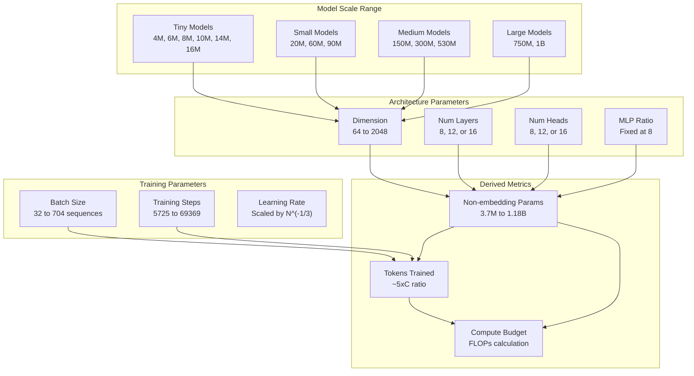
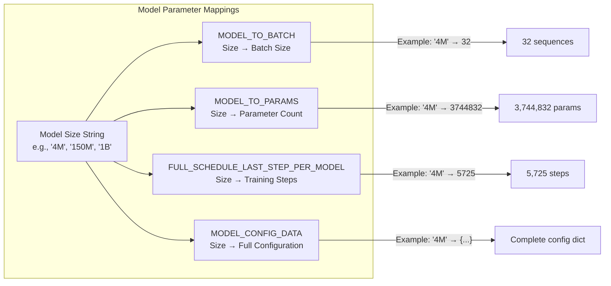
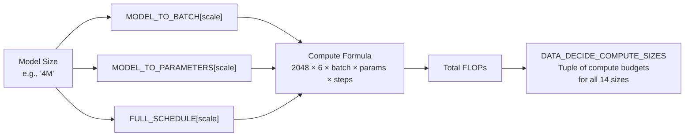
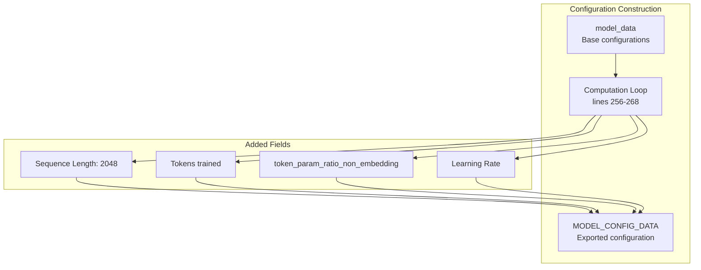
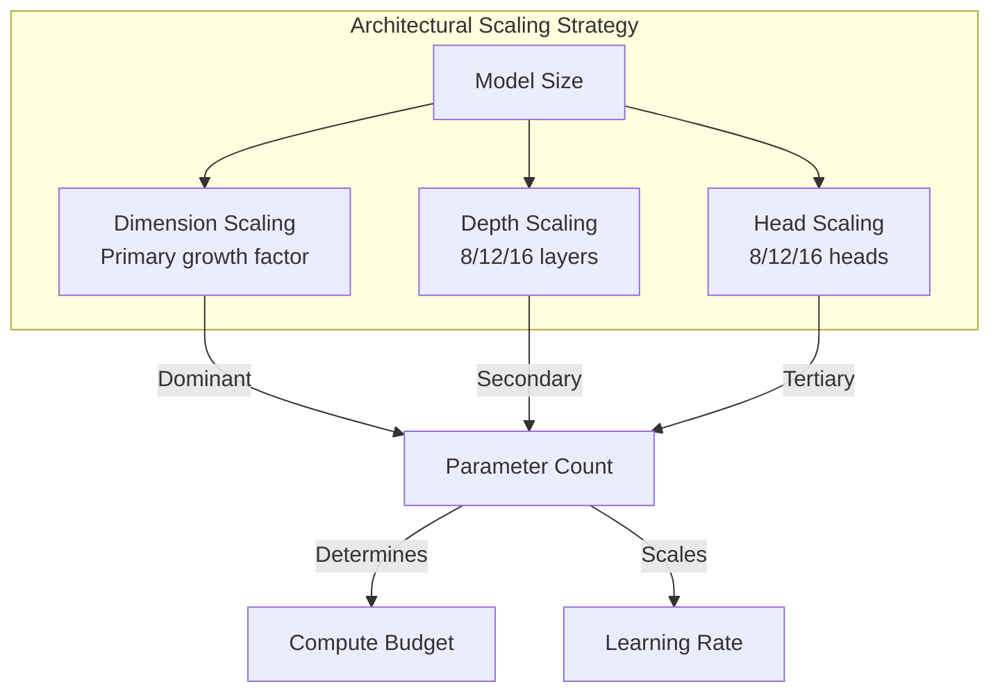

<!-- source: DeepWiki mcp.deepwiki.com · repo allenai/DataDecide · page 7.2 Model Configurations · fetched 2026-10-26 -->

# Model Configurations

<details>
<summary>Relevant source files</summary>

The following files were used as context for generating this wiki page:

- [scaling_laws/utils/constants/constants_models.py](scaling_laws/utils/constants/constants_models.py)
- [utils/constants.py](utils/constants.py)
- [viz/table_gen.ipynb](viz/table_gen.ipynb)

</details>


This page documents the model specification system that defines the 14 model sizes and their architectural, training, and compute parameters. These configurations are centralized in `utils/constants.py` and `scaling_laws/utils/constants/constants_models.py` and are used throughout the evaluation, scaling laws, and visualization pipelines.

For information about display name mappings and data recipe names, see [System Constants](#7.1). For checkpoint file paths and registry management, see [Checkpoint Registry](#7.3).

## Model Size Specifications

The DataDecide repository trains models at 14 different parameter scales, ranging from 4M to 1B parameters. Each size has a fixed architecture configuration that determines its structure.

### Architecture Overview



**Sources:** [utils/constants.py:124-251](), [scaling_laws/utils/constants/constants_models.py:229-286]()

### Complete Model Specifications

The primary configuration source is `MODEL_CONFIG_DATA` in `utils/constants.py`, which contains comprehensive specifications for all 14 model sizes:

| Model Size | Non-embedding Params | Dimension | Layers | Heads | MLP Ratio | Batch Size | Training Steps | Sequence Length |
|------------|---------------------|-----------|--------|-------|-----------|------------|----------------|-----------------|
| 4M         | 3,744,832          | 64        | 8      | 8     | 8         | 32         | 5,725          | 2048            |
| 6M         | 6,010,464          | 96        | 8      | 8     | 8         | 32         | 9,182          | 2048            |
| 8M         | 8,538,240          | 128       | 8      | 8     | 8         | 32         | 13,039         | 2048            |
| 10M        | 9,900,432          | 144       | 8      | 8     | 8         | 32         | 15,117         | 2048            |
| 14M        | 14,380,224         | 192       | 8      | 8     | 8         | 32         | 21,953         | 2048            |
| 16M        | 16,004,560         | 208       | 8      | 8     | 8         | 32         | 24,432         | 2048            |
| 20M        | 19,101,888         | 192       | 16     | 8     | 8         | 64         | 14,584         | 2048            |
| 60M        | 57,078,144         | 384       | 16     | 12    | 8         | 96         | 29,042         | 2048            |
| 90M        | 97,946,640         | 528       | 16     | 12    | 8         | 160        | 29,901         | 2048            |
| 150M       | 151,898,880        | 768       | 12     | 12    | 8         | 192        | 38,157         | 2048            |
| 300M       | 319,980,544        | 1024      | 16     | 16    | 8         | 320        | 45,787         | 2048            |
| 530M       | 530,074,944        | 1344      | 16     | 16    | 8         | 448        | 57,786         | 2048            |
| 750M       | 681,297,408        | 1536      | 16     | 16    | 8         | 576        | 63,589         | 2048            |
| 1B         | 1,176,832,000      | 2048      | 16     | 16    | 8         | 704        | 69,369         | 2048            |

**Sources:** [utils/constants.py:124-251]()

### Configuration Dictionaries

Three parallel dictionary structures map model size strings to their parameters:



**Sources:** [utils/constants.py:70-121](), [scaling_laws/utils/constants/constants_models.py:231-281]()

## Training Configuration

### Batch Size Scaling

Batch sizes increase with model size to maintain training efficiency. The `MODEL_TO_BATCH` dictionary defines batch sizes in sequences (not tokens):

- **Tiny models (4M-16M):** 32 sequences
- **Small models (20M-90M):** 64-160 sequences (increases with size)
- **Medium models (150M-530M):** 192-448 sequences
- **Large models (750M-1B):** 576-704 sequences

With a fixed sequence length of 2048 tokens, the actual token batch size is `batch_size * 2048`.

**Sources:** [utils/constants.py:87-102](), [scaling_laws/utils/constants/constants_models.py:248-263]()

### Training Steps and Schedule

The `FULL_SCHEDULE_LAST_STEP_PER_MODEL` (also named `FULL_SCHEDULE`) dictionary specifies the final training step for each model size. These values represent the minimum step value across all seeds for that size:

```python
# Example from utils/constants.py:70-85
FULL_SCHEDULE_LAST_STEP_PER_MODEL = {
    "4M": 5725,    # min step value from {5745, 5725, 5735}
    "20M": 14584,  # min step value from {14584, 14594}
    "60M": 29042,  # min step value from {29042, 29052, 29062}
    "1B": 69369,
    # ... other sizes
}
```

The comment annotations indicate that the system uses the minimum step across seeds to ensure all models in a size category have at least that many steps.

**Sources:** [utils/constants.py:70-85](), [scaling_laws/utils/constants/constants_models.py:231-246]()

### Learning Rate Calculation

Learning rates are automatically computed based on model size using a scaling law formula. This computation happens in [utils/constants.py:256-268]():

```python
learning_rate = 0.0047 * (non_embedding_params / 108000000) ** (-1 / 3)
```

The formula scales the learning rate inversely with the cube root of parameter count, normalized to a reference size of 108M parameters. This ensures smaller models use larger learning rates and larger models use smaller learning rates.

**Sources:** [utils/constants.py:256-268]()

## Derived Metrics

### Tokens Trained Calculation

Each model configuration includes a `"Tokens trained"` field computed as:

```
tokens_trained = training_steps × batch_size × sequence_length
```

With sequence length fixed at 2048, this determines the total number of tokens each model sees during training. The `token_param_ratio_non_embedding` field is also computed:

```
token_param_ratio = tokens_trained / non_embedding_params
```

This ratio is approximately 5× for all models (the "5xC" notation in model names), meaning each model is trained on roughly 5 times its parameter count in tokens.

**Sources:** [utils/constants.py:254-268]()

### Compute Budget Calculation

The `get_compute()` function in `scaling_laws/utils/constants/constants_models.py` calculates the total compute budget in FLOPs for a given model size:



The formula at [scaling_laws/utils/constants/constants_models.py:283-284]():

```python
def get_compute(scale):
    return 2048 * 6 * MODEL_TO_BATCH[scale] * MODEL_TO_PARAMETERS[scale] * FULL_SCHEDULE[scale]
```

The factor of 6 represents the FLOPs per parameter per token in a forward pass for a Transformer model.

**Sources:** [scaling_laws/utils/constants/constants_models.py:283-286]()

## Model Naming Convention

### Complete Model Inventory

The `DATA_DECIDE_MODEL_NAMES` list in `scaling_laws/utils/constants/constants_models.py` contains 350+ model variant names. Each name follows a consistent pattern:

```
{dataset}-{size}-{schedule}-{seed}
```

Components:
- **dataset:** One of 25 data recipes (e.g., `dolma17`, `c4`, `DCLM-baseline`, `falcon_and_cc`)
- **size:** One of 14 model sizes (e.g., `4M`, `150M`, `1B`)
- **schedule:** Training schedule indicator (typically `5xC` for 5× compute optimal)
- **seed:** Random seed number (typically `2` or omitted for seed 0)

Examples:
- `baseline-150M-5xC-2` - Baseline dataset, 150M params, 5xC schedule, seed 2
- `c4-4M-5xC` - C4 dataset, 4M params, 5xC schedule, seed 0 (implicit)
- `dolma17-75p-DCLM-baseline-25p-1B-5xC-2` - Mixed dataset, 1B params, seed 2

**Sources:** [scaling_laws/utils/constants/constants_models.py:1-227]()

### Size Enumeration

The `DATA_DECIDE_SIZES` list provides the canonical ordering of model sizes:

```python
DATA_DECIDE_SIZES = ['4M', '6M', '8M', '10M', '14M', '16M', '20M', 
                     '60M', '90M', '150M', '300M', '530M', '750M', '1B']
```

This list is used throughout the codebase for iterating over model sizes in consistent order and for indexing operations.

**Sources:** [scaling_laws/utils/constants/constants_models.py:229]()

## Configuration Access Patterns

### Primary Configuration Dictionary

The `MODEL_CONFIG_DATA` dictionary is the primary source of model specifications. It is constructed from `model_data` after enrichment with computed fields:



**Sources:** [utils/constants.py:124-270]()

### Example Usage Pattern

To access configuration for a specific model size:

```python
# Get complete configuration
config = MODEL_CONFIG_DATA["150M"]
# Access: config["Dimension"], config["Num layers"], etc.

# Get specific parameters
params = MODEL_TO_PARAMS["150M"]      # → 151898880
batch = MODEL_TO_BATCH["150M"]        # → 192
steps = FULL_SCHEDULE_LAST_STEP_PER_MODEL["150M"]  # → 38157

# Calculate tokens trained
tokens = steps * batch * 2048  # → 15,049,293,824 tokens
```

### Duplicate Definitions

Note that parameter mappings exist in both locations:
- `utils/constants.py`: `MODEL_TO_PARAMS`, `MODEL_TO_BATCH`, `FULL_SCHEDULE_LAST_STEP_PER_MODEL`
- `scaling_laws/utils/constants/constants_models.py`: `MODEL_TO_PARAMETERS`, `MODEL_TO_BATCH`, `FULL_SCHEDULE`

The values are identical; the duplication exists for module independence. The scaling laws module uses its own constants file to avoid dependencies on the main utils module.

**Sources:** [utils/constants.py:70-121](), [scaling_laws/utils/constants/constants_models.py:231-281]()

## Architecture Design Patterns

### Transformer Architecture Constraints

All models follow consistent architectural patterns:

1. **Fixed MLP Ratio:** All models use MLP ratio of 8 (MLP hidden dimension = 8 × model dimension)
2. **Head-Dimension Relationship:** Number of heads is chosen so that dimension is divisible by number of heads
3. **Layer Depth:** Smaller models (≤16M) use 8 layers; larger models use 12 or 16 layers
4. **Attention Heads:** Scaled from 8 heads (tiny models) to 16 heads (large models)



**Sources:** [utils/constants.py:124-251]()

---

**Summary:** This configuration system provides a centralized, programmatic way to define and access model specifications across the DataDecide codebase. The 14 model sizes span 3 orders of magnitude in parameter count while maintaining consistent architectural patterns and compute-optimal training schedules.

---

