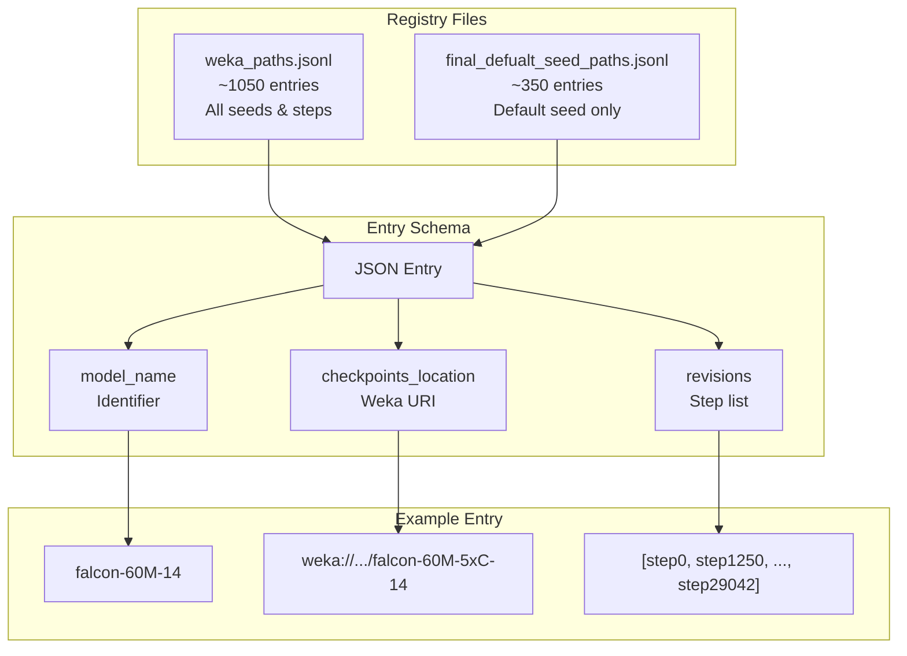
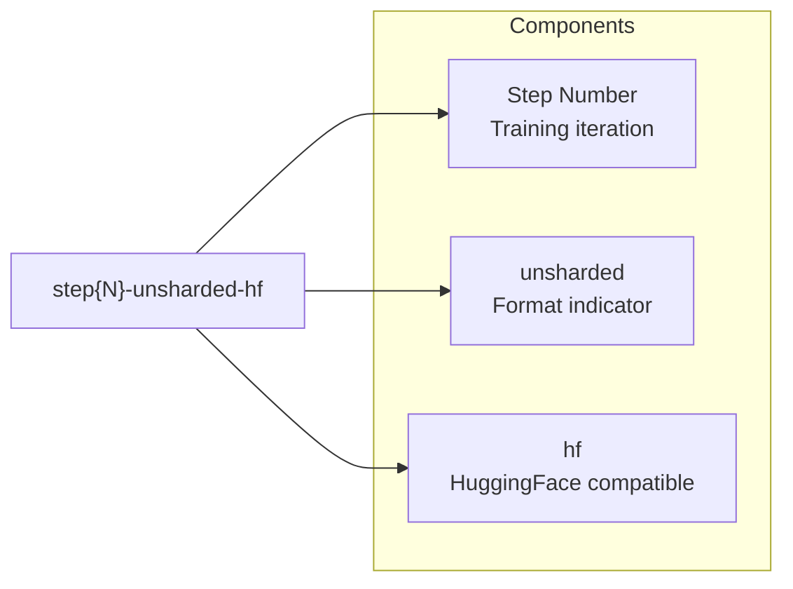
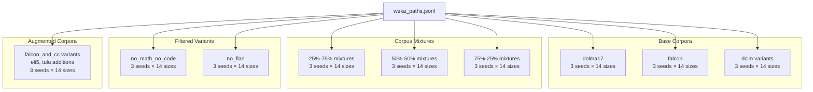
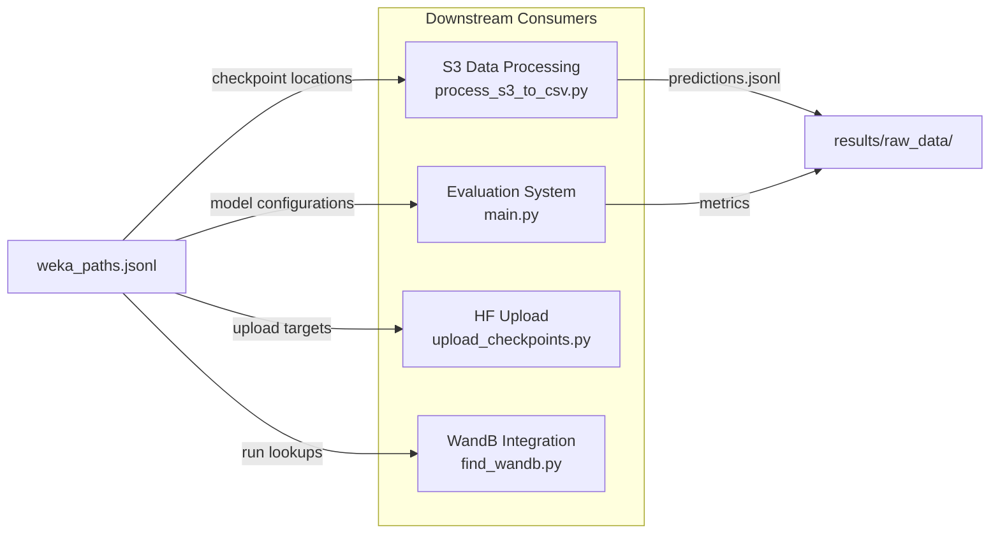
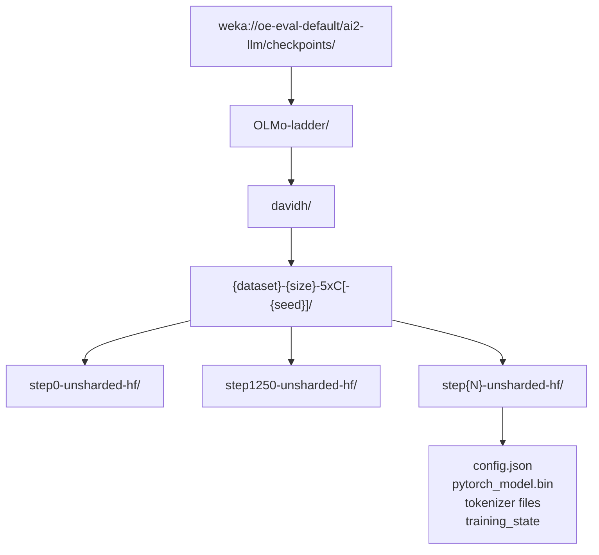

<!-- source: DeepWiki mcp.deepwiki.com · repo allenai/DataDecide · page 7.3 Checkpoint Registry · fetched 2026-10-26 -->

# Checkpoint Registry

<details>
<summary>Relevant source files</summary>

The following files were used as context for generating this wiki page:

- [checkpoints/final_defualt_seed_paths.jsonl](checkpoints/final_defualt_seed_paths.jsonl)
- [checkpoints/weka_paths.jsonl](checkpoints/weka_paths.jsonl)

</details>


## Overview

The Checkpoint Registry is a catalog system that tracks all 30,000+ model checkpoints produced during the DataDecide pretraining experiments. It maintains metadata about checkpoint locations, training steps, and model configurations across 25 data corpora, 14 model sizes, and 3 random seeds. The registry enables downstream systems to discover and access checkpoints stored on the Weka distributed filesystem.

For information about how checkpoints are used in evaluation, see [Single-Scale Evaluation](#3.1). For checkpoint upload to HuggingFace, see [Upload Pipeline](#6.1).

**Sources:** [checkpoints/weka_paths.jsonl]()

## Registry Files

The checkpoint registry consists of two JSONL files located in the `checkpoints/` directory:

| File | Purpose | Scope |
|------|---------|-------|
| `weka_paths.jsonl` | Comprehensive registry | All checkpoints across all seeds and configurations |
| `final_defualt_seed_paths.jsonl` | Production subset | Final checkpoints for the default seed only |

The comprehensive registry (`weka_paths.jsonl`) contains entries for every model configuration trained in the DataDecide experiments, including all intermediate checkpoint steps. The production subset contains only the final checkpoints used for release and analysis.

**Sources:** [checkpoints/weka_paths.jsonl]()

## Entry Schema

Each line in the registry files is a JSON object with the following structure:

```json
{
  "checkpoints_location": "weka://oe-eval-default/ai2-llm/checkpoints/OLMo-ladder/davidh/{model}-{size}-5xC[-{seed}]",
  "revisions": ["step0-unsharded-hf", "step1250-unsharded-hf", ...],
  "model_name": "{dataset}-{size}-{seed}"
}
```

### Field Descriptions

| Field | Type | Description |
|-------|------|-------------|
| `checkpoints_location` | string | Weka filesystem URI pointing to the checkpoint directory |
| `revisions` | array[string] | List of checkpoint revisions (training steps) available for this model |
| `model_name` | string | Human-readable identifier combining dataset, size, and seed |

The `revisions` array lists all available training checkpoints, typically saved at regular intervals (e.g., every 1,250 steps) plus the final checkpoint when training completes.

**Sources:** [checkpoints/weka_paths.jsonl:1-10]()

## Registry Structure Diagram



**Sources:** [checkpoints/weka_paths.jsonl:1-165]()

## Naming Conventions

### Model Name Format

Model names follow the pattern: `{dataset}-{size}[-{seed}]`

**Dataset Component:**
- Base corpora: `dolma17`, `falcon`, `dclm_fw_top3`, `dclm_ft7percentile_fw3`
- Mixtures: `dolma17-25p-DCLM-baseline-75p`, `dolma17-50p-DCLM-baseline-50p`, `dolma17-75p-DCLM-baseline-25p`
- Augmented: `falcon_and_cc`, `falcon_and_cc_tulu_qc_top10`, `falcon_and_cc_eli5_oh_top10p`, `falcon_and_cc_eli5_oh_top20p`
- Filtered: `no_math_no_code`, `no_flan`
- Special: `pos_eli5_oh_neg_dclm_refinedweb_steps_2000_lr3e4_top20p`

**Size Component:**
- `4M`: ~4 million parameters
- `20M`: ~20 million parameters
- `60M`: ~60 million parameters
- `90M`: ~90 million parameters
- Additional sizes likely include 150M, 300M, 500M, 750M, 1B

**Seed Component:**
- `6198`: Default/primary seed
- `14`: Secondary seed
- `15`: Tertiary seed
- When omitted, defaults to seed `6198`

### Checkpoint Location Format

Checkpoint locations use the pattern:

```
weka://oe-eval-default/ai2-llm/checkpoints/OLMo-ladder/davidh/{dataset}-{size}-5xC[-{seed}]
```

The `5xC` suffix indicates training for 5× the compute budget (Chinchilla-optimal scaling).

**Sources:** [checkpoints/weka_paths.jsonl:1-50]()

## Revision Naming Pattern

Checkpoint revisions follow a consistent naming scheme:



**Common Step Intervals:**

| Model Size | Step Interval | Final Steps |
|------------|---------------|-------------|
| 4M | 1,250 | ~5,725-5,735 |
| 20M | 1,250 | ~14,584-14,594 |
| 60M | 1,250 | ~29,042-29,052 |
| 90M | 1,250 | ~29,901 |

The final step varies slightly across runs due to training completion criteria.

**Sources:** [checkpoints/weka_paths.jsonl:1-10]()

## Data Organization

### Dataset Distribution



**Total Checkpoint Entries:** The registry contains approximately 1,050 entries (25 datasets × 3 seeds × 14 sizes), with each entry tracking 6-25 checkpoint steps, resulting in 30,000+ individual checkpoint files.

**Sources:** [checkpoints/weka_paths.jsonl]()

## Integration with Pipeline

The checkpoint registry serves as the authoritative source for checkpoint discovery throughout the DataDecide pipeline:



**Usage Pattern:**

1. **S3 Processing:** Reads registry to identify checkpoint locations and fetch corresponding evaluation predictions from S3
2. **Evaluation:** Uses model names to organize and aggregate evaluation results
3. **Upload Scripts:** Iterates over registry entries to upload checkpoints and model cards to HuggingFace
4. **WandB Integration:** Maps checkpoint locations to WandB run IDs for fetching training metrics

**Sources:** [checkpoints/weka_paths.jsonl]()

## Registry Entry Examples

### Base Corpus Entry

```json
{
  "checkpoints_location": "weka://oe-eval-default/ai2-llm/checkpoints/OLMo-ladder/davidh/falcon-60M-5xC",
  "revisions": [
    "step0-unsharded-hf",
    "step1250-unsharded-hf",
    "step2500-unsharded-hf",
    ...
    "step29042-unsharded-hf",
    "step29052-unsharded-hf"
  ],
  "model_name": "falcon-60M-6198"
}
```

This entry represents:
- **Dataset:** Falcon RefinedWeb
- **Size:** 60M parameters
- **Seed:** 6198 (default)
- **Training:** 5× compute budget (~29,000 steps)

### Mixture Entry

```json
{
  "checkpoints_location": "weka://oe-eval-default/ai2-llm/checkpoints/OLMo-ladder/davidh/dolma17-50p-DCLM-baseline-50p-90M-5xC-15",
  "revisions": [
    "step0-unsharded-hf",
    "step1250-unsharded-hf",
    ...
    "step29901-unsharded-hf"
  ],
  "model_name": "dolma17-50p-DCLM-baseline-50p-90M-15"
}
```

This entry represents:
- **Dataset:** 50% Dolma v1.7 + 50% DCLM baseline
- **Size:** 90M parameters
- **Seed:** 15
- **Training:** 5× compute budget (~30,000 steps)

### Filtered Corpus Entry

```json
{
  "checkpoints_location": "weka://oe-eval-default/ai2-llm/checkpoints/OLMo-ladder/davidh/no_math_no_code-20M-5xC-14",
  "revisions": [
    "step0-unsharded-hf",
    "step1250-unsharded-hf",
    ...
    "step14584-unsharded-hf"
  ],
  "model_name": "no_math_no_code-20M-14"
}
```

This entry represents:
- **Dataset:** Dolma with math and code domains removed
- **Size:** 20M parameters
- **Seed:** 14
- **Training:** 5× compute budget (~14,500 steps)

**Sources:** [checkpoints/weka_paths.jsonl:28-31](), [checkpoints/weka_paths.jsonl:52-58](), [checkpoints/weka_paths.jsonl:131]()

## Checkpoint Step Distribution

The number of checkpoint steps varies by model size due to different training token budgets:

| Model Size | Approx. Tokens | Training Steps | Checkpoint Count |
|------------|----------------|----------------|------------------|
| 4M | 2B | ~5,700 | 6 |
| 20M | 7B | ~14,500 | 13 |
| 60M | 25B | ~29,000 | 25 |
| 90M | 32B | ~30,000 | 25 |

Checkpoints are saved at regular intervals (typically every 1,250 steps) plus initialization (step 0) and final completion steps.

**Sources:** [checkpoints/weka_paths.jsonl:6-12](), [checkpoints/weka_paths.jsonl:25-31]()

## Weka Filesystem Structure

The checkpoint registry points to a hierarchical directory structure on the Weka distributed filesystem:



Each revision directory contains:
- `config.json`: Model architecture configuration
- `pytorch_model.bin`: Model weights
- Tokenizer files: `tokenizer.json`, `tokenizer_config.json`, etc.
- Training state: Optimizer state and RNG states (for resumption)

**Sources:** [checkpoints/weka_paths.jsonl:1]()

## Registry Maintenance

The checkpoint registry files are generated during the model training process and remain static after training completes. They serve as an immutable record of trained checkpoints.

**Key Properties:**
- **Immutability:** Registry entries are not modified after creation
- **Completeness:** All trained checkpoints are registered
- **Consistency:** Model naming follows strict conventions
- **Traceability:** Checkpoint locations map directly to filesystem paths

The registry enables reproducible analysis by providing a stable reference to all experimental artifacts.

**Sources:** [checkpoints/weka_paths.jsonl]()

---

