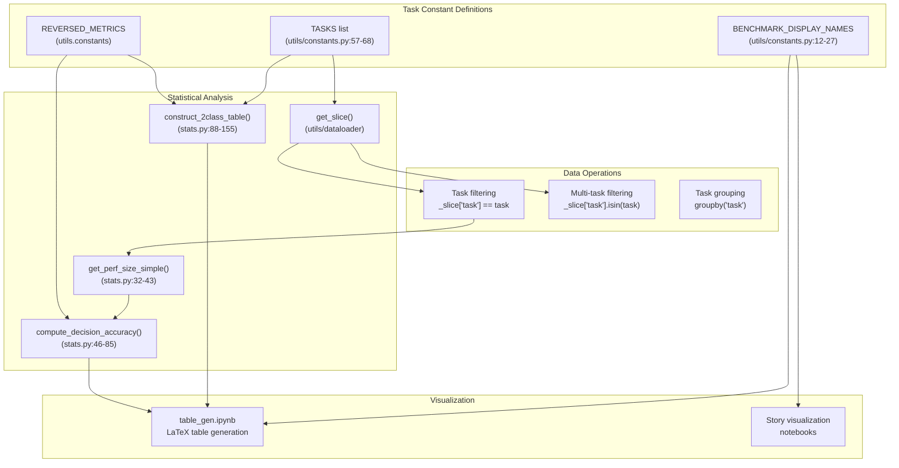
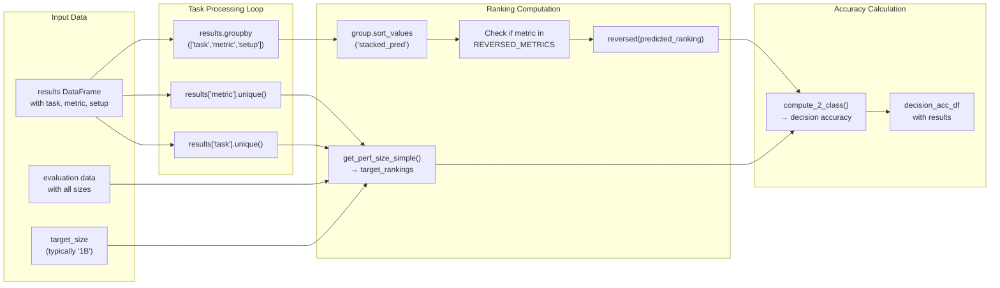
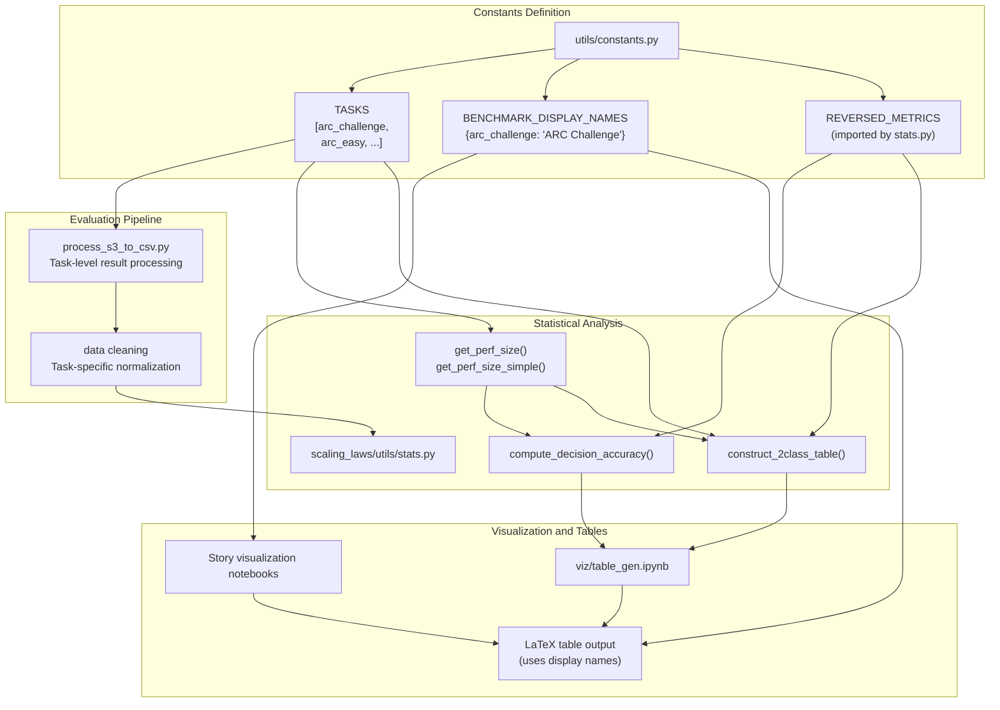

<!-- source: DeepWiki mcp.deepwiki.com · repo allenai/DataDecide · page 7.4 Task Constants · fetched 2026-10-26 -->

# Task Constants

<details>
<summary>Relevant source files</summary>

The following files were used as context for generating this wiki page:

- [scaling_laws/utils/stats.py](scaling_laws/utils/stats.py)
- [utils/constants.py](utils/constants.py)
- [viz/table_gen.ipynb](viz/table_gen.ipynb)

</details>


This page documents the task-specific constants and configurations used throughout the DataDecide evaluation system. These constants define which benchmarks are evaluated, how they are displayed, and how they are processed in statistical analysis.

For general system constants including scaling law display names, data recipe mappings, and model configurations, see [System Constants](#7.1). For model-specific configurations, see [Model Configurations](#7.2).

## Purpose and Scope

Task constants serve three primary functions in the DataDecide codebase:
1. Define the canonical set of evaluation benchmarks used across the project
2. Map internal task identifiers to human-readable display names for visualization and publication
3. Specify task-specific processing requirements such as metric reversal behavior

These constants are centralized in `utils/constants.py` and consumed by the evaluation pipeline, statistical analysis modules, and visualization notebooks.

## Core Task Definitions

### Primary Task List

The `TASKS` constant defines the core set of evaluation benchmarks used throughout the DataDecide project:

[utils/constants.py:57-68]()

```python
TASKS = [
    "arc_challenge",
    "arc_easy",
    "boolq",
    "csqa",
    "hellaswag",
    "openbookqa",
    "piqa",
    "socialiqa",
    "winogrande",
    "mmlu",
]
```

This list represents 10 standard NLP benchmarks that form the basis of single-scale evaluation. Note that this list does not include math benchmarks (GSM8K, Minerva) or code benchmarks (MBPP, HumanEval), which are handled separately in specialized analysis notebooks (see [Math and Code Analysis](#5.2)).

**Sources:** [utils/constants.py:57-68]()

### Task Display Names

The `BENCHMARK_DISPLAY_NAMES` dictionary maps internal task identifiers to publication-ready display names:

[utils/constants.py:12-27]()

| Internal Identifier | Display Name |
|---------------------|--------------|
| `arc_challenge` | ARC Challenge |
| `arc_easy` | ARC Easy |
| `boolq` | BoolQ |
| `csqa` | CommonsenseQA |
| `hellaswag` | HellaSwag |
| `openbookqa` | OpenBookQA |
| `piqa` | PIQA |
| `socialiqa` | SocialIQA |
| `winogrande` | WinoGrande |
| `mmlu` | MMLU |
| `minerva` | Minerva |
| `gsm8k` | GSM8K |
| `mbpp` | MBPP |
| `humaneval` | HumanEval |

The display names follow standard benchmark capitalization conventions and are used in:
- Visualization notebooks for generating plots and tables
- LaTeX table generation via `render_tables.py`
- HuggingFace dataset uploads for consistent presentation

**Sources:** [utils/constants.py:12-27]()

## Task-Metric Processing Configuration

### Metric Reversal Behavior

Some evaluation metrics use reversed scoring where lower values indicate better performance (e.g., perplexity, cross-entropy loss). The `REVERSED_METRICS` constant (referenced in `scaling_laws/utils/stats.py` but imported from `utils.constants`) specifies which metrics require reversal when computing rankings.

This is critical for decision accuracy computation, as shown in the `compute_decision_accuracy` function:

[scaling_laws/utils/stats.py:62-64]()

```python
if metric in REVERSED_METRICS and metric not in REVERSED_METRICS:
    predicted_ranking = list(reversed(predicted_ranking))
```

Similarly, in `construct_2class_table`:

[scaling_laws/utils/stats.py:114]()

```python
if metric in REVERSED_METRICS and target_metric not in REVERSED_METRICS: 
    small_scale = reversed(small_scale)
```

**Sources:** [scaling_laws/utils/stats.py:7](), [scaling_laws/utils/stats.py:62-64](), [scaling_laws/utils/stats.py:114]()

## Task Usage Patterns

### Task Filtering and Selection

The evaluation system uses task identifiers for filtering data in multiple contexts:



**Sources:** [scaling_laws/utils/stats.py:1-156](), [utils/constants.py:57-68]()

### Task-Specific Performance Retrieval

The `get_perf_size_simple` function demonstrates the canonical pattern for retrieving task-specific performance data:

[scaling_laws/utils/stats.py:32-43]()

Key operations:
1. **Task filtering:** `_slice = _slice[((_slice['size'] == size)) & (_slice['task'] == task)]`
2. **Step selection:** `_slice = _slice.loc[_slice.groupby('model')['step'].idxmax()]` - selects highest step per model
3. **Sorting:** `_slice = _slice.sort_values(metric, ignore_index=True)` - orders by metric for ranking

This pattern is used extensively in decision accuracy computation and two-class accuracy analysis.

**Sources:** [scaling_laws/utils/stats.py:32-43]()

## Integration with Statistical Analysis

### Decision Accuracy Computation

Task constants play a central role in computing decision accuracy, which measures how well small-scale performance predicts large-scale rankings:



**Sources:** [scaling_laws/utils/stats.py:46-85]()

### Two-Class Accuracy Table Construction

The `construct_2class_table` function creates comprehensive accuracy tables across task-size-metric combinations:

[scaling_laws/utils/stats.py:88-155]()

Key steps:
1. **Generate combinations:** `combinations = list(itertools.product(small_metric, model_sizes, selected_tasks))`
2. **Iterate over tasks:** For each (metric, size, task) combination, compute accuracy
3. **Task-specific slicing:** `_slice = get_slice(df, task=task)`
4. **Performance comparison:** Compare small-scale vs. target-scale (1B) rankings
5. **Pivot table creation:** `acc_pivot = best_acc_df.pivot(index='task', columns=['size', 'compute'], values='accuracy')`

The resulting pivot tables use task identifiers as the index, enabling per-task accuracy analysis across different model sizes.

**Sources:** [scaling_laws/utils/stats.py:88-155]()

## Task Constant Flow Through System



**Sources:** [utils/constants.py:12-68](), [scaling_laws/utils/stats.py:1-156](), [viz/table_gen.ipynb:1-4]()

## Task Categories and Grouping

While the `TASKS` constant defines the core benchmark set, the codebase supports flexible task grouping:

### Single Task Processing
Used when analyzing individual benchmark performance:
```python
_slice = _slice[_slice['task'] == task]
```
[scaling_laws/utils/stats.py:16]()

### Multi-Task Processing
Used for aggregate analysis across benchmark subsets:
```python
elif isinstance(task, list):
    _slice = _slice[_slice['task'].isin(task)]
```
[scaling_laws/utils/stats.py:17-18]()

### Task Aggregation
When computing aggregate metrics across tasks:
```python
_slice = _slice.groupby('model', as_index=False).agg(...)
_slice['task_name'] = 'aggregate'
```
[scaling_laws/utils/stats.py:23-24]()

This flexibility allows the same statistical functions to operate on individual tasks, task subsets, or aggregated task groups.

**Sources:** [scaling_laws/utils/stats.py:11-29]()

## Summary Table

| Constant Name | Location | Purpose | Primary Consumers |
|---------------|----------|---------|-------------------|
| `TASKS` | [utils/constants.py:57-68]() | Core evaluation benchmark list | S3 processing, statistical analysis, filtering operations |
| `BENCHMARK_DISPLAY_NAMES` | [utils/constants.py:12-27]() | Internal to human-readable mapping | Visualization notebooks, LaTeX table generation |
| `REVERSED_METRICS` | `utils.constants` (imported) | Metrics requiring reversed ranking | Decision accuracy, two-class accuracy computation |

**Sources:** [utils/constants.py:1-271](), [scaling_laws/utils/stats.py:1-156]()

---

