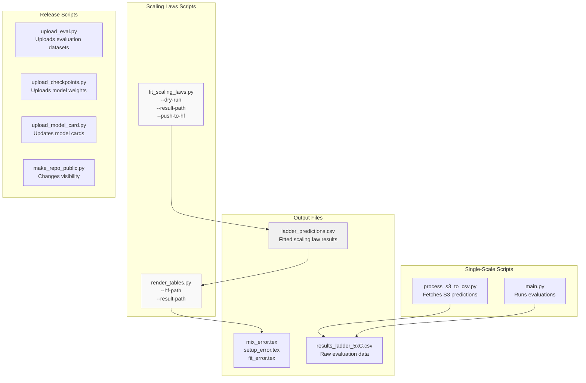
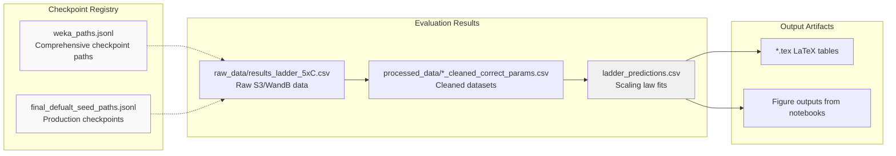
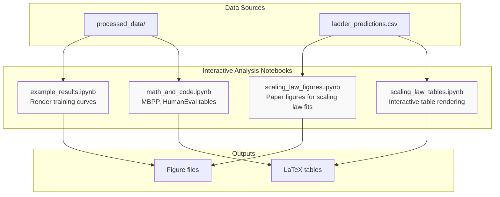
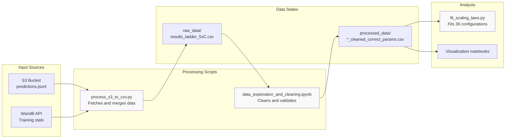

<!-- source: DeepWiki mcp.deepwiki.com · repo allenai/DataDecide · page 8 Reference · fetched 2026-10-26 -->

# Reference

<details>
<summary>Relevant source files</summary>

The following files were used as context for generating this wiki page:

- [README.md](README.md)
- [scaling_laws/README.md](scaling_laws/README.md)

</details>


This page provides quick reference materials for working with the DataDecide codebase. It includes essential commands, file locations, configuration values, and pointers to more detailed documentation. Use this page when you need to quickly look up a command, find a specific file, or locate a particular constant or function.

For step-by-step guides on specific tasks, see [Common Workflows](#8.1). For comprehensive data flow diagrams, see [Data Flow Diagrams](#8.2). For debugging help, see [Troubleshooting](#8.3).

---

## Quick Command Reference

### Environment Setup

```bash
# Install git-lfs for notebook files
git lfs install

# Setup for single-scale evaluation
cd single_scale
conda env create -f environment.yml
conda activate single_scale

# Setup for scaling laws analysis
cd scaling_laws
pip install -r requirements.txt

# (Optional) Install OLMo-ladder locally for development
git clone -b datados https://github.com/allenai/OLMo-ladder
cd OLMo-ladder
pip install -e ".[plotting]"
```

**Sources:** [scaling_laws/README.md:6-30]()

### Running Evaluations and Fits

| Task | Command |
|------|---------|
| Fit scaling laws (dry run) | `python fit_scaling_laws.py --dry-run` |
| Fit scaling laws (full) | `python fit_scaling_laws.py --result-path ladder_predictions.csv` |
| Fit and push to HuggingFace | `python fit_scaling_laws.py --result-path ladder_predictions.csv --push-to-hf allenai/DataDecide-eval-results` |
| Render tables from HF | `python render_tables.py --hf-path allenai/DataDecide-eval-results` |
| Render tables from local | `python render_tables.py --result-path ladder_predictions.csv` |

**Sources:** [scaling_laws/README.md:9-48]()

### Loading Models

```python
from hf_olmo import OLMoForCausalLM  # pip install ai2-olmo

# Load a specific checkpoint with revision
olmo = OLMoForCausalLM.from_pretrained(
    "allenai/DataDecide-dolma1_7-1B", 
    revision="step69369-seed-default"
)
```

**Sources:** [README.md:44-52]()

---

## Command-Line Interface Map



**Sources:** [scaling_laws/README.md:1-58]()

---

## Key File Locations

### Directory Structure

| Path | Purpose |
|------|---------|
| `scaling_laws/` | Scaling law fitting, analysis, and visualization |
| `scaling_laws/remote/` | Utilities for pulling evaluation results |
| `scaling_laws/utils/` | Data loading, ladder usage, and plotting code |
| `scaling_laws/notebooks/` | Interactive notebooks for inspecting fits |
| `single_scale/` | Single-scale evaluation pipeline |
| `release/` | HuggingFace upload automation scripts |
| `results/` | Evaluation results storage directory |
| `results/raw_data/` | Unprocessed evaluation data |
| `results/processed_data/` | Cleaned evaluation data |
| `results/outputs2/` | Analysis outputs |
| `results/per_task_out/` | Per-task evaluation results |

**Sources:** [scaling_laws/README.md:16-19]()

### Important Data Files



**Sources:** [scaling_laws/README.md:16-19]()

---

## Model and Dataset Registry

### Model Sizes and Architectures

| Model Size | Parameters | Hidden Dim | Layers | Heads | Training Steps | Tokens |
|------------|-----------|------------|--------|-------|----------------|--------|
| 4M | 3.7M | 64 | 8 | 8 | 5,725 | 0.4B |
| 6M | 6.0M | 96 | 8 | 8 | 9,182 | 0.6B |
| 8M | 8.5M | 128 | 8 | 8 | 13,039 | 0.9B |
| 10M | 9.9M | 144 | 8 | 8 | 15,117 | 1.0B |
| 14M | 14.4M | 192 | 8 | 8 | 21,953 | 1.4B |
| 16M | 16.0M | 208 | 8 | 8 | 24,432 | 1.6B |
| 20M | 19.1M | 192 | 16 | 8 | 14,584 | 1.9B |
| 60M | 57.1M | 384 | 16 | 12 | 29,042 | 5.7B |
| 90M | 97.9M | 528 | 16 | 12 | 29,901 | 9.8B |
| 150M | 151.9M | 768 | 12 | 12 | 38,157 | 15.0B |
| 300M | 320.0M | 1,024 | 16 | 16 | 45,787 | 30.0B |
| 530M | 530.1M | 1,344 | 16 | 16 | 57,786 | 53.0B |
| 750M | 681.3M | 1,536 | 16 | 16 | 63,589 | 75.0B |
| 1B | 1,176.8M | 2,048 | 16 | 16 | 69,369 | 100.0B |

**Sources:** [README.md:92-109]()

### Data Recipes

| Recipe Category | Variants |
|----------------|----------|
| **Dolma1.7** | Original, No code, No math/code, No Reddit, No Flan |
| **Dolma1.6++** | Original |
| **C4** | Original |
| **FineWeb** | Pro, Edu |
| **Falcon** | Original |
| **Falcon+CC** | Original, QC 10%, QC 20%, QC Orig 10%, QC Tulu 10% |
| **DCLM-Baseline** | Original, QC 7% FW2, QC 7% FW3, QC FW 3%, QC FW 10%, QC 10%, QC 20% |
| **DCLM+Dolma Mixes** | 25%/75%, 50%/50%, 75%/25% |

**Total:** 25 data recipes across 14 model sizes = 350 model variants

**Sources:** [README.md:54-68]()

### HuggingFace Repository Pattern

All models follow the naming pattern: `allenai/DataDecide-{dataset}-{size}`

Example: `allenai/DataDecide-dolma1_7-1B`

Checkpoint revisions follow the pattern: `step{step_number}-seed-{seed}`

Example: `step69369-seed-default`

**Sources:** [README.md:14-42]()

---

## Evaluation Benchmarks

### OLMES Suite (10 benchmarks)

| Benchmark | Full Name | Citation |
|-----------|-----------|----------|
| MMLU | Massive Multitask Language Understanding | Hendrycks et al., 2021 |
| HellaSwag | - | Zellers et al., 2019 |
| ARC-Challenge | AI2 Reasoning Challenge | Clark et al., 2018 |
| ARC-Easy | AI2 Reasoning Challenge | Clark et al., 2018 |
| PIQA | Physical Interaction QA | Bisk et al., 2020 |
| CommonsenseQA | - | Talmor et al., 2019 |
| Social IQa | Social Intelligence QA | Sap et al., 2019 |
| OpenBookQA | - | Mihaylov et al., 2018 |
| BoolQ | Boolean Questions | Clark et al., 2019 |
| Winogrande | - | Sakaguchi et al., 2020 |

### Released Evaluation Datasets

- **Task-level metrics:** `allenai/DataDecide-eval-results` on HuggingFace
- **Instance-level results:** `allenai/DataDecide-eval-instances` on HuggingFace

**Sources:** [README.md:71-89]()

---

## Notebook Reference

### Scaling Laws Notebooks



| Notebook | Purpose | Location |
|----------|---------|----------|
| `example_results.ipynb` | Render training curves | `scaling_laws/notebooks/` |
| `scaling_law_figures.ipynb` | Inspect scaling law fits with visualizations | `scaling_laws/notebooks/` |
| `scaling_law_tables.ipynb` | Interactive version of table rendering | `scaling_laws/notebooks/` |
| `math_and_code.ipynb` | Results tables for MBPP, HumanEval | `scaling_laws/notebooks/` |
| `compute_story_viz.ipynb` | Main story visualization | Root or analysis directory |
| `data_exploration_and_cleaning.ipynb` | Data cleaning pipeline | Single-scale directory |

**Sources:** [scaling_laws/README.md:51-58]()

---

## Important Configuration Constants

### Scaling Law Configurations

The system fits **36 different scaling law configurations**, including:
- 2-parameter models
- 3-parameter models  
- 5-parameter models
- Various functional forms and constraints

These configurations are defined in the fitting code and used by `fit_scaling_laws.py`.

**Sources:** Derived from high-level system diagrams

### Data Name Mappings

The codebase uses normalization mappings to convert between:
- **Display names** (human-readable) ↔ **Internal names** (processing)
- **Descriptive dataset names** ↔ **Cleaned identifiers**
- **Seed names** (e.g., "default") ↔ **Seed identifiers**

Key mapping dictionaries:
- `DATA_NAME_CLEAN`: Maps descriptive names to cleaned names
- `DATA_NAME_CLEAN_REVERSE`: Reverse mapping for display
- `SEED_MAPPING`: Maps seed names to identifiers
- `SEED_MAPPING_REVERSE`: Reverse mapping

These are located in `utils/constants.py` and `utils/undo_normalization.py`.

---

## Data Processing Pipeline Reference



**Sources:** High-level system diagrams

---

## Key Python Modules and Functions

### Statistical Analysis

Located in `utils/stats.py`:

- `compute_decision_accuracy` - Computes accuracy of scaling law predictions
- `construct_2class_table` - Constructs 2-class comparison tables

### Rendering

Located in `render_tables.py`:

Generates LaTeX tables:
- `mix_error.tex` - Mixture error analysis
- `setup_error.tex` - Setup error analysis  
- `fit_error.tex` - Fit error analysis

### Data Normalization

Located in `utils/undo_normalization.py`:

- `undo_changes_to_df` - Reverses normalization for display

### Constants

Located in `utils/constants.py`:

- `SCALING_LAW_DISPLAY_NAMES` - Display names for scaling law models
- `BENCHMARK_DISPLAY_NAMES` - Display names for evaluation benchmarks
- `MODEL_CONFIG_DATA` - Model architecture specifications
- `DATA_DECIDE_MODEL_NAMES` - Model naming conventions
- `DATA_DECIDE_SIZES` - Size configurations

**Sources:** High-level system diagrams and file structure analysis

---

## Release Pipeline Reference

### Sequential Upload Process

1. **Generate upload scripts:** `make_final_checkpoint_script.py`
2. **Upload checkpoints:** `upload_checkpoints.py` (via GNU Parallel with `-j1`)
3. **Upload model cards:** `upload_model_card.py` (via GNU Parallel with `-j10`)
4. **Upload evaluations:** `upload_eval.py` → Creates datasets on HuggingFace
5. **Make public:** `make_repo_public.py` (via GNU Parallel with `-j10`)

All scripts located in `release/` directory.

### Release Orchestration

The `release/readme.md` file documents the complete sequential execution steps. Uses GNU Parallel with:
- `--joblog` for tracking
- `--resume` for recovery
- `-j1` or `-j10` for parallelization control

**Sources:** High-level system diagrams (Diagram 3)

---

## HuggingFace Datasets

| Dataset | Purpose | Contents |
|---------|---------|----------|
| `allenai/DataDecide-data-recipes` | Data recipe specifications | 25 corpus variant definitions |
| `allenai/DataDecide-eval-results` | Task-level metrics | Aggregated benchmark scores |
| `allenai/DataDecide-eval-instances` | Instance-level results | Individual prediction results |

**Sources:** [README.md:54-89]()

---

## Related Documentation

- **[Common Workflows](#8.1)** - Step-by-step guides for standard tasks
- **[Data Flow Diagrams](#8.2)** - Detailed data transformation diagrams
- **[Troubleshooting](#8.3)** - Common issues and solutions
- **[Configuration and Constants](#7)** - Detailed configuration documentation
- **[Scaling Laws Analysis](#4)** - Complete scaling laws system documentation
- **[Visualization](#5)** - Visualization system documentation
- **[Release and Distribution](#6)** - Release automation details

---

## Quick Troubleshooting Tips

| Issue | Quick Fix |
|-------|-----------|
| Git LFS files not downloading | Run `git lfs install` then `git lfs pull` |
| Import errors for ladder | Install with `pip install -e ".[plotting]"` in OLMo-ladder directory |
| Missing dependencies | Check correct conda environment is activated |
| HuggingFace upload fails | Verify authentication with `huggingface-cli login` |
| Dry run not working | Add `--dry-run` flag to use subset of data |

For complete troubleshooting guidance, see [Troubleshooting](#8.3).

---

**Sources:** [scaling_laws/README.md:1-58](), [README.md:1-123]()

---

