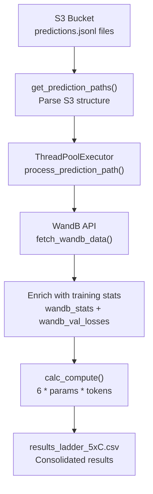
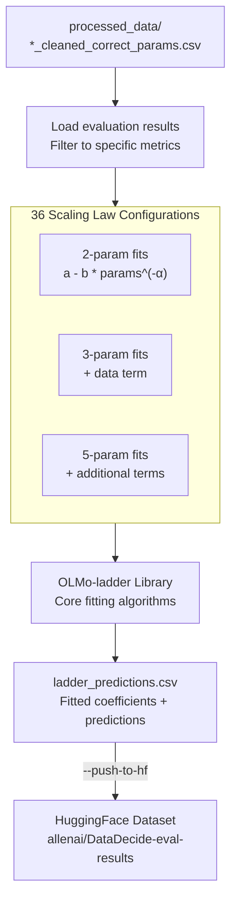
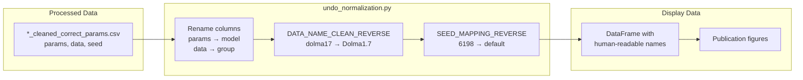
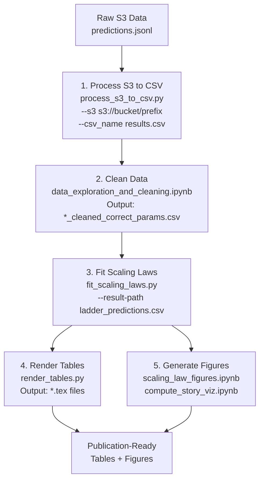

<!-- source: DeepWiki mcp.deepwiki.com · repo allenai/DataDecide · page 8.1 Common Workflows · fetched 2026-10-26 -->

# Common Workflows

<details>
<summary>Relevant source files</summary>

The following files were used as context for generating this wiki page:

- [requirements.txt](requirements.txt)
- [scaling_laws/README.md](scaling_laws/README.md)
- [single_scale/process_s3_to_csv.py](single_scale/process_s3_to_csv.py)
- [single_scale/readme.md](single_scale/readme.md)
- [single_scale/requirements.txt](single_scale/requirements.txt)
- [utils/undo_normalization.py](utils/undo_normalization.py)
- [viz/compute_story_viz.ipynb](viz/compute_story_viz.ipynb)
- [viz/requirements.txt](viz/requirements.txt)

</details>


This page provides step-by-step guides for the most common workflows in the DataDecide repository. Each workflow includes the specific commands to run, relevant configuration options, and expected outputs. For detailed information about individual components, see the respective system pages: [Evaluation System](#3), [Scaling Laws Analysis](#4), [Visualization](#5), and [Release and Distribution](#6).

## Purpose and Scope

This reference covers practical workflows for:
- Processing evaluation results from S3 storage
- Cleaning and normalizing data for analysis
- Fitting scaling laws to model performance data
- Generating visualizations and tables for publication
- Running single-scale predictions and per-task analysis

For system architecture and data flow patterns, see [Data Flow Diagrams](#8.2). For troubleshooting specific errors, see [Troubleshooting](#8.3).

---

## Workflow 1: Processing Raw Evaluation Data from S3

This workflow processes raw prediction files stored in S3, enriches them with WandB training statistics, and outputs a consolidated CSV file.

### Setup Environment

```bash
conda create -n DataDecide-single-scale python=3.11
conda activate DataDecide-single-scale
pip install -r single_scale/requirements.txt
```

**Sources:** [single_scale/readme.md:1-6]()

### Run S3 Processing

```bash
cd single_scale
python process_s3_to_csv.py \
    --s3 s3://ai2-llm/eval-results/downstream/eval-for-consistent-ranking-preemption-fixed \
    --csv_name "results_ladder_5xC.csv" \
    --batch_size 100
```

**Key Parameters:**
- `--s3`: S3 path containing prediction files organized by `{group}/{model}/{step}/{task}/predictions.jsonl`
- `--csv_name`: Output CSV file name (default: `results_ladder_5xC.csv`)
- `--no_refresh`: Skip downloading from S3 and use existing local data
- `--batch_size`: Number of parallel S3 file downloads (default: 100)

**Sources:** [single_scale/readme.md:8-13](), [single_scale/process_s3_to_csv.py:1-12]()

### Process Flow Diagram



**Sources:** [single_scale/process_s3_to_csv.py:64-90](), [single_scale/process_s3_to_csv.py:223-248](), [single_scale/process_s3_to_csv.py:165-175]()

### Key Data Transformations

The `process_prediction_path()` function extracts evaluation metrics from each prediction file:

| Step | Function | Output |
|------|----------|--------|
| Parse path | `parse_train_name()` | Extract `group`, `model`, `chinchilla`, `task`, `step`, `seed` |
| Compute metrics | `compute_metrics_from_file()` | Task-specific metrics (accuracy, F1, etc.) |
| Aggregate | Mean over instances | `mean_metrics` dictionary |
| Enrich | `fetch_wandb_data()` | Training loss, validation losses, token count |
| Calculate | `calc_compute()` | FLOP count = 6 × params × tokens |

**Sources:** [single_scale/process_s3_to_csv.py:92-146](), [single_scale/process_s3_to_csv.py:177-210]()

---

## Workflow 2: Data Cleaning and Normalization

After processing S3 data, the next step is cleaning and normalizing the results for analysis.

### Run Data Cleaning Notebook

```bash
# Open and run the notebook
jupyter notebook single_scale/data_exploration_and_cleaning.ipynb
```

**Key Operations:**
1. Load `results_ladder_5xC.csv`
2. Filter to valid checkpoints with correct parameter counts
3. Output `results_ladder_5xC_seeds_cleaned_correct_params.csv`
4. Optionally set `DIRTY_OUT = True` to generate `results_ladder_5xC_seeds_dirty_correct_params.csv` for visualizations

**Sources:** [single_scale/readme.md:15-19]()

### Normalization Mappings

The cleaning process applies several normalization mappings that are later reversed for display:

```mermaid
flowchart LR
    subgraph "Data Processing"
        Raw["Raw Names<br/>dolma17, no_code, etc."]
        Norm["Normalized Names<br/>Dolma1.7, Dolma1.7 (no code)"]
    end
    
    subgraph "Display"
        Display["Human-Readable<br/>For figures and tables"]
    end
    
    Raw -->|"DATA_NAME_CLEAN"| Norm
    Norm -->|"DATA_NAME_CLEAN_REVERSE"| Display
```

**Common Normalizations:**
- `dolma17` → `Dolma1.7`
- `no_code` → `Dolma1.7 (no code)`
- `DCLM-baseline` → `DCLM-Baseline`
- Seeds: `6198` → `"default"`, `14` → `"small aux 2"`, etc.

**Sources:** [utils/undo_normalization.py:15-42](), [utils/undo_normalization.py:44-51]()

---

## Workflow 3: Fitting Scaling Laws

This workflow fits 36 different scaling law configurations to the cleaned evaluation data.

### Setup Scaling Laws Environment

```bash
git lfs install  # Required for .ipynb files
pip install -r scaling_laws/requirements.txt

# Optional: Install OLMo-ladder locally for development
git clone -b datados https://github.com/allenai/OLMo-ladder OLMo-ladder
cd OLMo-ladder
pip install -e ".[plotting]"
```

**Sources:** [scaling_laws/README.md:6-29]()

### Run Scaling Law Fits

```bash
cd scaling_laws

# Test with dry-run on subset of data
python fit_scaling_laws.py --dry-run --result-path ladder_predictions_dry_run.csv

# Fit on all data
python fit_scaling_laws.py --result-path ladder_predictions.csv

# Fit and push results to HuggingFace
python fit_scaling_laws.py \
    --result-path ladder_predictions.csv \
    --push-to-hf allenai/DataDecide-eval-results
```

**Command Options:**
- `--dry-run`: Use subset of results for testing
- `--result-path`: Output CSV file for fitted predictions
- `--push-to-hf`: Upload results to specified HuggingFace dataset

**Sources:** [scaling_laws/README.md:34-42]()

### Scaling Law Configuration Matrix

The `fit_scaling_laws.py` script fits 36 configurations across multiple dimensions:

| Configuration Type | Count | Description |
|-------------------|-------|-------------|
| Parameter forms | 3 | 2-param, 3-param, 5-param variants |
| Fitting methods | 12 | Different algorithmic approaches |
| Aggregation levels | 3 | Per-task, task-suite, overall |

**Key Scaling Law Functions:**
- 2-parameter: `a - b * params^(-α)`
- 3-parameter: `a - b * params^(-α) - c * data^(-β)`
- 5-parameter: Extended forms with additional terms

**Sources:** [scaling_laws/README.md:21-48]()

### Scaling Law Fitting Pipeline



**Sources:** [scaling_laws/README.md:21-42]()

---

## Workflow 4: Generating Tables and Visualizations

After fitting scaling laws, generate publication-ready tables and figures.

### Render LaTeX Tables

```bash
cd scaling_laws

# Using published HuggingFace results
python render_tables.py --hf-path allenai/DataDecide-eval-results

# Using local predictions
python render_tables.py --result-path ladder_predictions.csv
```

**Output Files:**
- `mix_error.tex`: Error rates across data mixtures
- `setup_error.tex`: Error rates by experimental setup
- `fit_error.tex`: Fitting quality metrics

**Sources:** [scaling_laws/README.md:44-48]()

### Statistical Analysis Functions

The `render_tables.py` script uses utilities from `utils/stats.py`:

| Function | Purpose | Input | Output |
|----------|---------|-------|--------|
| `compute_decision_accuracy()` | Calculate prediction accuracy | Fitted predictions, ground truth | Accuracy metrics |
| `construct_2class_table()` | Build confusion matrix | Predictions, labels | 2×2 table |
| Statistical tests | Significance testing | Multiple model comparisons | p-values |

**Sources:** [scaling_laws/README.md:44-48]()

### Generate Scaling Law Figures

```bash
# Open interactive notebooks
cd scaling_laws/notebooks

# View scaling law curve fits
jupyter notebook scaling_law_figures.ipynb

# Generate performance tables
jupyter notebook scaling_law_tables.ipynb

# Inspect example results
jupyter notebook example_results.ipynb
```

**Notebooks:**
- `example_results.ipynb`: Renders training curves for individual experiments
- `scaling_law_figures.ipynb`: Generates paper figures showing fitted scaling law curves
- `scaling_law_tables.ipynb`: Interactive version of table generation
- `math_and_code.ipynb`: Specialized analysis for MBPP, HumanEval benchmarks

**Sources:** [scaling_laws/README.md:52-58]()

---

## Workflow 5: Creating Story Visualizations

Generate presentation-ready visualizations with proper denormalization.

### Setup Visualization Environment

```bash
pip install -r viz/requirements.txt
```

**Sources:** [viz/requirements.txt:1-5]()

### Run Story Visualization

```bash
cd viz
jupyter notebook compute_story_viz.ipynb
```

**Key Steps in Notebook:**
1. Load processed data from `../results/processed_data/`
2. Apply `undo_changes_to_df()` to reverse normalization
3. Generate plots using `SCALING_LAW_DISPLAY_NAMES` and `BENCHMARK_DISPLAY_NAMES`
4. Output figures for publication

**Sources:** [viz/compute_story_viz.ipynb:1-4]()

### Denormalization Pipeline



**Sources:** [utils/undo_normalization.py:1-54]()

---

## Workflow 6: Running Single-Scale Predictions

Execute predictions for specific model sizes or tasks.

### Run Single-Scale Analysis

```bash
cd single_scale
python main.py
```

This runs single-scale predictions using the default configuration.

**Sources:** [single_scale/readme.md:21-25]()

### Per-Task Analysis

For detailed per-task analysis, generate and run individual task configurations:

```bash
cd single_scale

# Generate individual config files for each task
sh create_per_task_configs.sh config.yaml per_task_configs

# Run all configs with GNU parallel
ls per_task_configs/*.yaml | parallel --progress --eta --tee --results logs_dir python main.py --config {}
```

**Options:**
- `--progress`: Show progress bar
- `--eta`: Display estimated time to completion
- `--tee`: Print output to both terminal and log files
- `--results logs_dir`: Store logs in specified directory

**Sources:** [single_scale/readme.md:27-38]()

---

## Workflow 7: Complete End-to-End Analysis

This workflow combines all steps for a complete analysis from raw data to publication figures.

### Step-by-Step Pipeline



**Sources:** [single_scale/readme.md:1-38](), [scaling_laws/README.md:1-58]()

### Environment Management

Different steps require different conda environments:

| Step | Environment | Requirements File |
|------|-------------|------------------|
| S3 Processing | `DataDecide-single-scale` | `single_scale/requirements.txt` |
| Data Cleaning | `DataDecide-single-scale` | `single_scale/requirements.txt` |
| Scaling Laws | `DataDecide-scaling` | `scaling_laws/requirements.txt` |
| Visualization | `DataDecide-viz` | `viz/requirements.txt` |

**Sources:** [single_scale/requirements.txt:1-29](), [viz/requirements.txt:1-5](), [requirements.txt:1-45]()

---

## Workflow 8: Working with HuggingFace Data

Accessing and using published evaluation results from HuggingFace.

### Load Evaluation Results

```python
from datasets import load_dataset

# Load task-level results
eval_results = load_dataset("allenai/DataDecide-eval-results", split="train")

# Load instance-level predictions
eval_instances = load_dataset("allenai/DataDecide-eval-instances", split="train")

# Load scaling law predictions
ladder_predictions = load_dataset("allenai/DataDecide-eval-results", "ladder_predictions")
```

### Use in Scaling Law Workflows

```bash
# Render tables using HuggingFace data
cd scaling_laws
python render_tables.py --hf-path allenai/DataDecide-eval-results
```

This bypasses the need to run `fit_scaling_laws.py` locally by using pre-computed fits.

**Sources:** [scaling_laws/README.md:44-48]()

---

## Quick Reference: Common Commands

### Data Processing
```bash
# Process new S3 results
python single_scale/process_s3_to_csv.py --s3 s3://bucket/prefix --csv_name results.csv

# Skip S3 refresh, use cached data
python single_scale/process_s3_to_csv.py --s3 s3://bucket/prefix --no_refresh
```

### Scaling Laws
```bash
# Quick test with subset
python scaling_laws/fit_scaling_laws.py --dry-run

# Full fit with HF upload
python scaling_laws/fit_scaling_laws.py --result-path ladder_predictions.csv --push-to-hf allenai/DataDecide-eval-results

# Generate tables from HF
python scaling_laws/render_tables.py --hf-path allenai/DataDecide-eval-results
```

### Single-Scale Evaluation
```bash
# Run default config
python single_scale/main.py

# Run per-task analysis with parallel processing
ls single_scale/per_task_configs/*.yaml | parallel python single_scale/main.py --config {}
```

**Sources:** [single_scale/readme.md:1-38](), [scaling_laws/README.md:1-58]()

---

