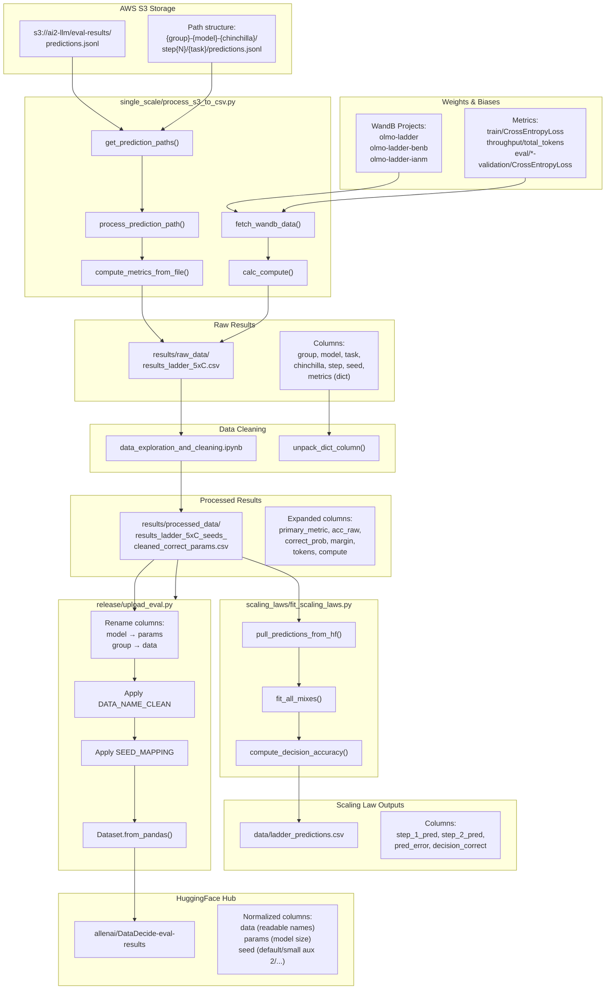
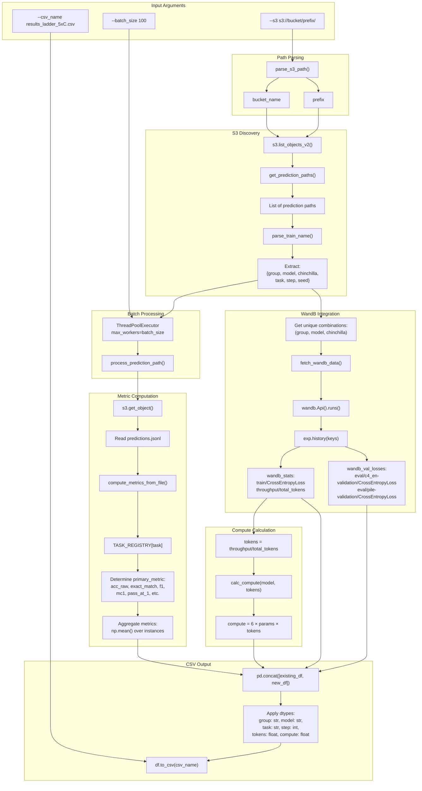
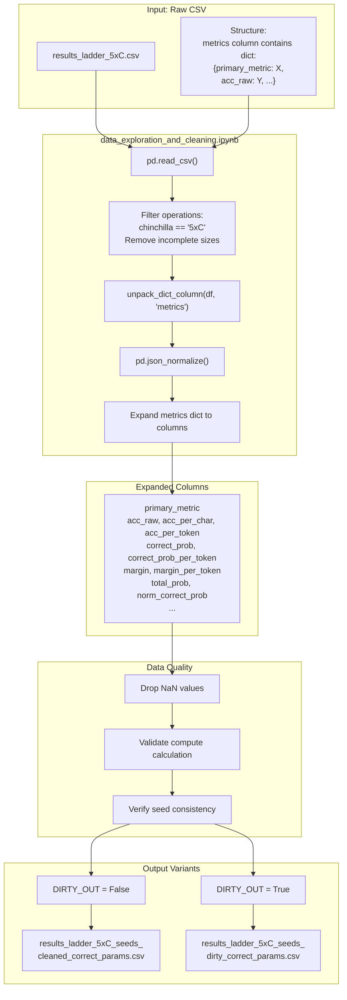
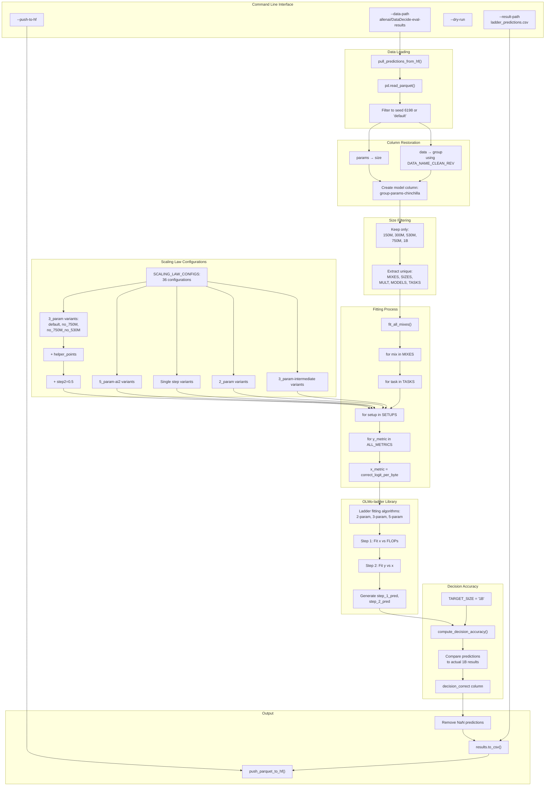
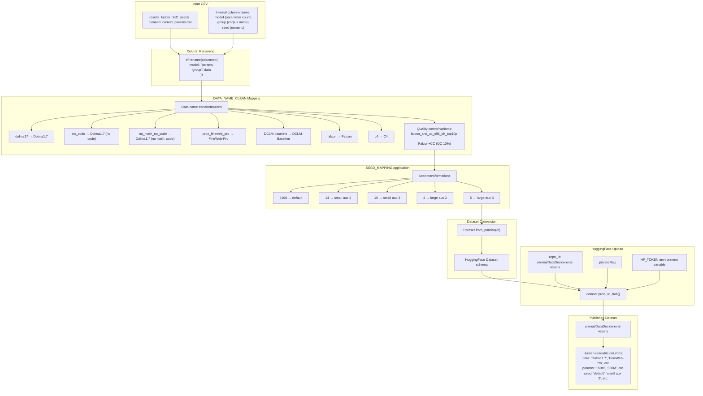
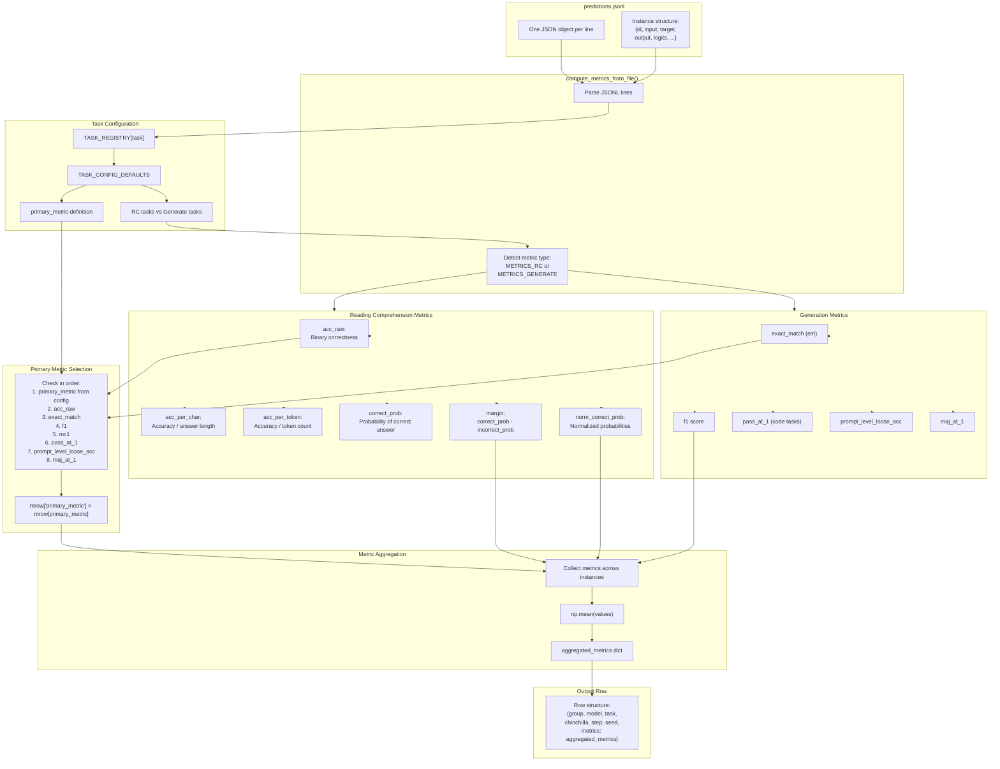
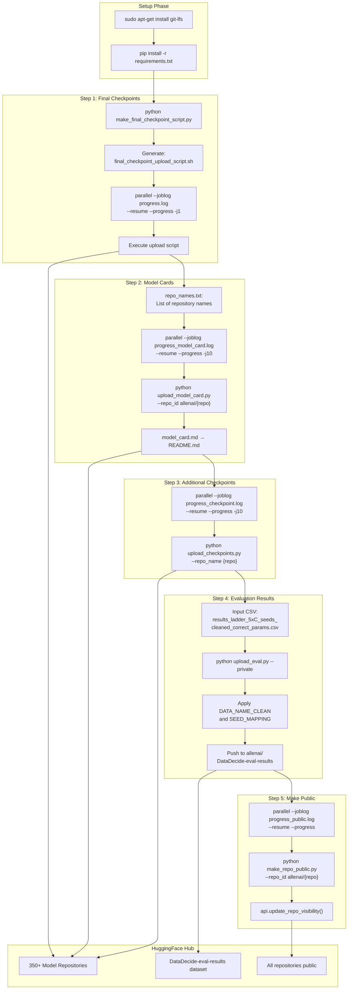

<!-- source: DeepWiki mcp.deepwiki.com · repo allenai/DataDecide · page 8.2 Data Flow Diagrams · fetched 2026-10-26 -->

# Data Flow Diagrams

Relevant source files

The following files were used as context for generating this wiki page:

- [release/make_repo_public.py](release/make_repo_public.py)
- [release/readme.md](release/readme.md)
- [release/upload_eval.py](release/upload_eval.py)
- [release/upload_model_card.py](release/upload_model_card.py)
- [requirements.txt](requirements.txt)
- [scaling_laws/fit_scaling_laws.py](scaling_laws/fit_scaling_laws.py)
- [scaling_laws/utils/constants/__init__.py](scaling_laws/utils/constants/__init__.py)
- [single_scale/process_s3_to_csv.py](single_scale/process_s3_to_csv.py)
- [single_scale/readme.md](single_scale/readme.md)
- [single_scale/requirements.txt](single_scale/requirements.txt)

This page provides comprehensive data flow diagrams showing how data transforms through the DataDecide system, from raw model predictions stored in S3 to final published artifacts on HuggingFace. These diagrams map system components to specific code entities (functions, files, data structures) to help developers trace data transformations through the codebase.

For information about the evaluation system architecture, see [Evaluation System](#3). For details about the scaling laws analysis, see [Scaling Laws Analysis](#4). For release pipeline workflows, see [Release and Distribution](#6).

## Overall Data Transformation Pipeline

The following diagram shows the complete data journey from raw predictions to published artifacts, with actual file names and key transformations.

**Sources:** [single_scale/process_s3_to_csv.py:1-625](), [scaling_laws/fit_scaling_laws.py:1-203](), [release/upload_eval.py:1-102]()

## S3 Ingestion Pipeline Details

This diagram shows the detailed flow of how raw predictions are fetched from S3, enriched with WandB metrics, and converted to CSV format.

**Sources:** [single_scale/process_s3_to_csv.py:64-253](), [single_scale/process_s3_to_csv.py:500-614]()

## Data Cleaning and Transformation

This diagram shows how raw CSV data is cleaned and transformed into analysis-ready format.

**Sources:** [single_scale/readme.md:15-19](), [single_scale/process_s3_to_csv.py:148-163]()

## Scaling Law Fitting Pipeline

This diagram details how processed evaluation results are fit to scaling laws using multiple configurations.

**Sources:** [scaling_laws/fit_scaling_laws.py:30-203]()

## Data Normalization for HuggingFace Release

This diagram shows the data transformations applied when uploading evaluation results to HuggingFace.

**Sources:** [release/upload_eval.py:7-102]()

## Metric Computation Flow

This diagram shows how metrics are computed from raw prediction files.

**Sources:** [single_scale/process_s3_to_csv.py:92-146]()

## Release Orchestration Flow

This diagram shows the sequential steps in the HuggingFace release process.

**Sources:** [release/readme.md:1-36](), [release/upload_eval.py:7-102](), [release/make_repo_public.py:5-33](), [release/upload_model_card.py:5-48]()

## Visualization Data Flow

This diagram shows how processed data feeds into various visualization notebooks.

```mermaid
graph TB
    subgraph SOURCES["Data Sources"]
        PROC_DATA["results/processed_data/<br/>*_cleaned_correct_params.csv"]
        LADDER_PRED["data/ladder_predictions.csv"]
        RAW_DATA["results/raw_data/<br/>results_ladder_5xC.csv"]
    end
    
    subgraph CONSTANTS["Shared Constants"]
        CONST_FILE["utils/constants.py"]
        SL_NAMES["SCALING_LAW_DISPLAY_NAMES"]
        BENCH_NAMES["BENCHMARK_DISPLAY_NAMES"]
        MODEL_CFG["MODEL_CONFIG_DATA"]
        DATA_CLEAN_REV["DATA_NAME_CLEAN_REVERSE"]
        SEED_REV["SEED_MAPPING_REVERSE"]
    end
    
    subgraph UNDO["Data Reversal"]
        UNDO_NORM["utils/undo_normalization.py"]
        UNDO_FUNC["undo_changes_to_df()"]
        REVERSE_DATA["Reverse data normalization:<br/>params → model<br/>data → group"]
    end
    
    subgraph STORY["Story Visualization"]
        STORY_NB["compute_story_viz.ipynb"]
        LOAD_STORY["Load processed CSV"]
        APPLY_UNDO["Apply undo_changes_to_df()"]
        GEN_PLOTS["Generate main story plots"]
    end
    
    subgraph MATH_CODE["Math & Code Analysis"]
        MATH_NB["math_and_code.ipynb"]
        MBPP_FILTER["Filter to MBPP tasks"]
        HUMANEVAL_FILTER["Filter to HumanEval tasks"]
        ANALYZE["Specialized analysis"]
    end
    
    subgraph RQ4["Research Question 4"]
        RQ4_NB["rq_4.ipynb"]
        RQ4_ANALYSIS["Research question analysis"]
    end
    
    subgraph SL_VIZ["Scaling Law Visualizations"]
        SL_FIG["scaling_law_figures.ipynb"]
        SL_TABLE["scaling_law_tables.ipynb"]
        LOAD_LADDER["Load ladder_predictions.csv"]
        LOG_PLOTS["Generate log-log plots"]
        PERF_TABLES["Generate performance tables"]
    end
    
    subgraph ERROR_VIZ["Error Analysis"]
        PRED_ERR["pred_error.ipynb"]
        MAX_ERR["max_err_to_pred_acc.ipynb"]
        ERR_ANALYSIS["Analyze prediction errors"]
    end
    
    PROC_DATA --> LOAD_STORY
    CONST_FILE --> SL_NAMES
    CONST_FILE --> BENCH_NAMES
    CONST_FILE --> MODEL_CFG
    
    UNDO_NORM --> UNDO_FUNC
    DATA_CLEAN_REV --> UNDO_FUNC
    SEED_REV --> UNDO_FUNC
    
    LOAD_STORY --> APPLY_UNDO
    UNDO_FUNC --> APPLY_UNDO
    APPLY_UNDO --> GEN_PLOTS
    SL_NAMES --> GEN_PLOTS
    BENCH_NAMES --> GEN_PLOTS
    
    PROC_DATA --> MBPP_FILTER
    MBPP_FILTER --> HUMANEVAL_FILTER
    HUMANEVAL_FILTER --> ANALYZE
    
    PROC_DATA --> RQ4_ANALYSIS
    
    LADDER_PRED --> LOAD_LADDER
    LOAD_LADDER --> LOG_PLOTS
    LOAD_LADDER --> PERF_TABLES
    MODEL_CFG --> LOG_PLOTS
    SL_NAMES --> PERF_TABLES
    
    PROC_DATA --> ERR_ANALYSIS
    LADDER_PRED --> ERR_ANALYSIS
```

**Sources:** [scaling_laws/utils/constants/__init__.py:1-46]()

## Complete Metric Schema

The following table shows all metrics computed and how they flow through the system:

| Metric Family | Specific Metrics | Computed In | Stored In | Used By |
|---------------|------------------|-------------|-----------|---------|
| **Accuracy** | `acc_raw`, `acc_per_char`, `acc_per_token`, `acc_uncond` | `compute_metrics_from_file()` | `metrics` dict | All analysis notebooks |
| **Probability** | `correct_prob`, `correct_prob_per_token`, `correct_prob_per_char` | `compute_metrics_from_file()` | `metrics` dict | Scaling law fitting |
| **Margin** | `margin`, `margin_per_token`, `margin_per_char` | `compute_metrics_from_file()` | `metrics` dict | Error analysis |
| **Total Probability** | `total_prob`, `total_prob_per_token`, `total_prob_per_char` | `compute_metrics_from_file()` | `metrics` dict | Statistical analysis |
| **Normalized** | `norm_correct_prob`, `norm_correct_prob_per_token`, `norm_correct_prob_per_char` | `compute_metrics_from_file()` | `metrics` dict | Comparative analysis |
| **Generation** | `exact_match`, `f1`, `pass_at_1`, `maj_at_1` | `compute_metrics_from_file()` | `metrics` dict | Code/QA tasks |
| **Training** | `train/CrossEntropyLoss` | `fetch_wandb_data()` | Direct columns | Learning curves |
| **Validation** | `eval/*-validation/CrossEntropyLoss` | `fetch_wandb_data()` | Direct columns | Validation analysis |
| **Compute** | `throughput/total_tokens`, `compute` | `fetch_wandb_data()`, `calc_compute()` | Direct columns | Scaling laws |
| **Primary** | `primary_metric` | Set based on task config | `metrics` dict | Main comparisons |

**Sources:** [scaling_laws/utils/constants/__init__.py:14-21]()

---

