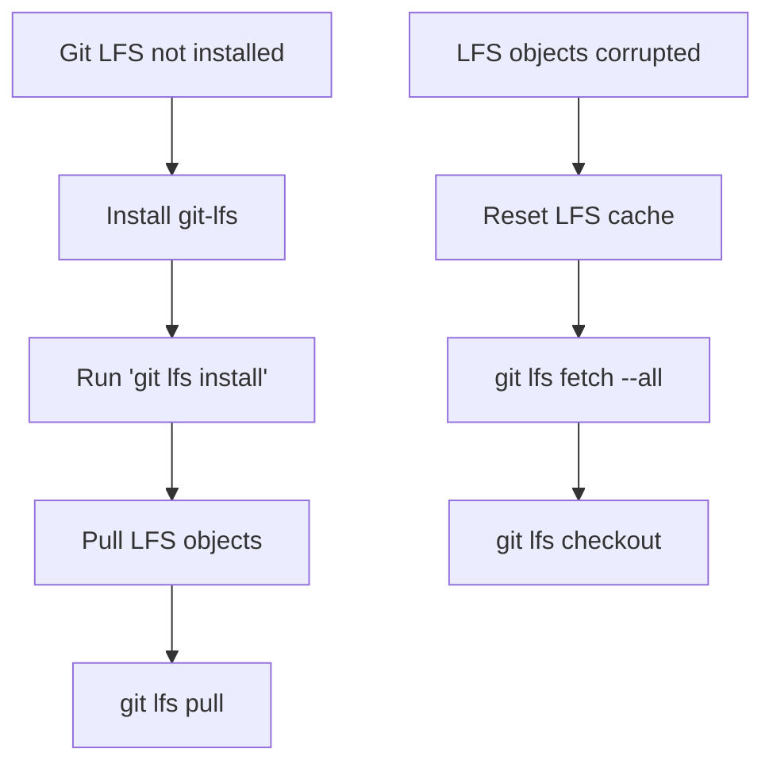
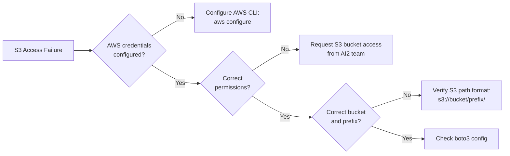
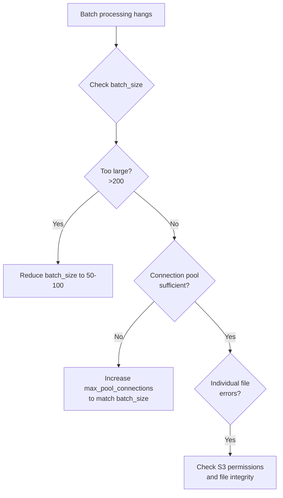
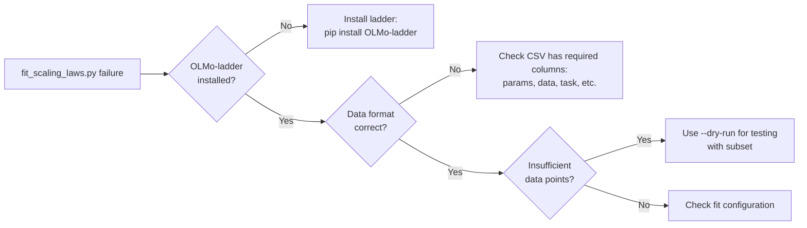
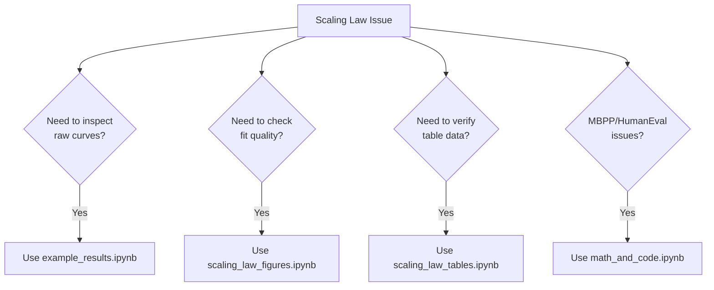
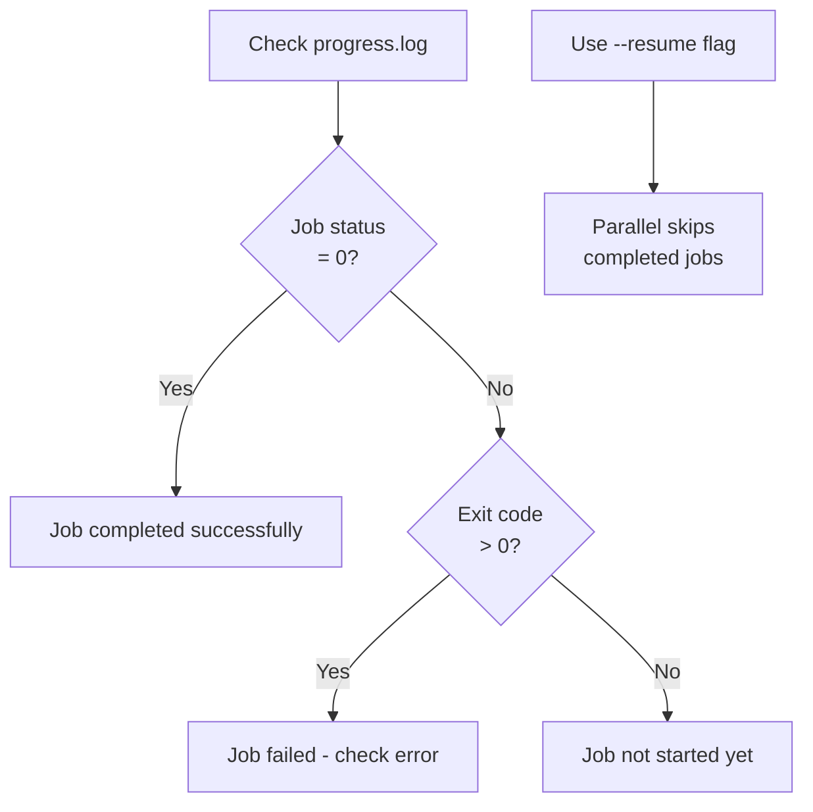
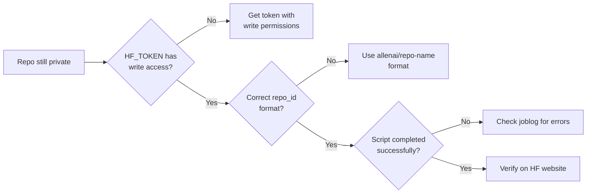
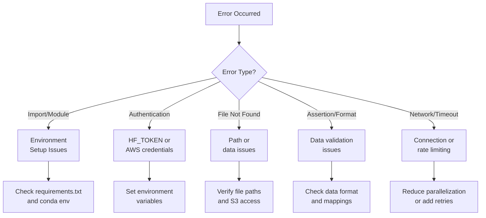

<!-- source: DeepWiki mcp.deepwiki.com · repo allenai/DataDecide · page 8.3 Troubleshooting · fetched 2026-10-26 -->

# Troubleshooting

<details>
<summary>Relevant source files</summary>

The following files were used as context for generating this wiki page:

- [release/make_repo_public.py](release/make_repo_public.py)
- [release/readme.md](release/readme.md)
- [release/upload_eval.py](release/upload_eval.py)
- [release/upload_model_card.py](release/upload_model_card.py)
- [requirements.txt](requirements.txt)
- [scaling_laws/README.md](scaling_laws/README.md)
- [single_scale/process_s3_to_csv.py](single_scale/process_s3_to_csv.py)
- [single_scale/readme.md](single_scale/readme.md)
- [single_scale/requirements.txt](single_scale/requirements.txt)

</details>


This page provides solutions to common issues encountered when working with the DataDecide codebase. It covers environment setup problems, data processing errors, scaling law fitting failures, and release pipeline issues.

For general workflows and setup instructions, see [Common Workflows](#8.1). For understanding data transformations, see [Data Flow Diagrams](#8.2).

---

## Environment Setup Issues

### Conda Environment Creation Failures

**Problem**: Environment creation fails with dependency conflicts or version mismatches.

**Solution**: The repository uses three separate environments for different components:

1. **Single-scale evaluation**: Use [single_scale/requirements.txt:1-29]()
2. **Visualization**: Use [requirements.txt:1-45]()
3. **Scaling laws**: Use [scaling_laws/README.md:26-29]() for optional OLMo-ladder editing

**Common Issues**:

| Issue | Symptom | Solution |
|-------|---------|----------|
| NumPy version conflict | `numpy<2` requirement fails | Explicitly install `numpy<2` before other packages |
| PyTorch compatibility | CUDA version mismatch | Install PyTorch 2.4.x first: `pip install 'torch>=2.4,<2.5'` |
| OLMo installation | GitHub clone fails | Ensure git credentials are configured: `git config --global credential.helper store` |
| omegaconf version | `omegaconf==2.4.0.dev3` not found | Install from source or use latest stable version |

**Step-by-step fix**:

```bash
# 1. Create fresh environment
conda create -n DataDecide-single-scale python=3.11
conda activate DataDecide-single-scale

# 2. Install PyTorch first (prevents conflicts)
pip install 'torch>=2.4,<2.5'

# 3. Install numpy constraint
pip install 'numpy<2'

# 4. Install remaining requirements
pip install -r single_scale/requirements.txt
```

**Diagnosis**: [single_scale/readme.md:1-6]()

Sources: [single_scale/readme.md:1-6](), [single_scale/requirements.txt:1-29](), [requirements.txt:1-45]()

---

### Git LFS Issues

**Problem**: Jupyter notebooks fail to load or show binary content.

**Symptom**: `.ipynb` files appear as pointer files or binary data instead of JSON.

**Solution**:



**Commands**:

```bash
# Install git-lfs (Ubuntu/Debian)
sudo apt-get install git-lfs

# Install git-lfs (macOS)
brew install git-lfs

# Initialize and pull
git lfs install
git lfs pull
```

**Verification**: Check that `.ipynb` files start with `{` not `version https://git-lfs.github.com`

Sources: [scaling_laws/README.md:6](), [release/readme.md:4]()

---

## Data Processing Issues

### S3 Access Failures

**Problem**: `process_s3_to_csv.py` fails with authentication or permission errors.

**Common Error Messages**:

```
botocore.exceptions.NoCredentialsError: Unable to locate credentials
botocore.exceptions.ClientError: An error occurred (403) when calling the ListObjectsV2 operation: Forbidden
```

**Diagnosis Flow**:



**Solutions**:

1. **Configure AWS credentials**:
   ```bash
   aws configure
   # Enter Access Key ID, Secret Access Key, and region
   ```

2. **Verify S3 path format**: [single_scale/process_s3_to_csv.py:212-220]()
   - Must start with `s3://`
   - Must include bucket name and prefix
   - Prefix should end with `/`

3. **Test access**:
   ```bash
   aws s3 ls s3://ai2-llm/eval-results/downstream/
   ```

Sources: [single_scale/process_s3_to_csv.py:212-220](), [single_scale/readme.md:8-13]()

---

### WandB Authentication Failures

**Problem**: Script fails when fetching training statistics from Weights & Biases.

**Error Message**:
```
wandb.errors.UsageError: api_key not configured (no-tty)
```

**Solution**:

```bash
# Login to WandB
wandb login

# Or set API key directly
export WANDB_API_KEY=your_api_key_here
```

**WandB Project Mapping**: [single_scale/process_s3_to_csv.py:569-580]()

The script fetches from different projects based on data mix:
- `olmo-ladder-benb`: Default for most mixes
- `olmo-ladder`: For 2xC models
- `olmo-ladder-ianm`: For DCLM and dolma17 variants

**Verification**:
```python
import wandb
api = wandb.Api()
runs = api.runs("ai2-llm/olmo-ladder-benb")
print(f"Successfully connected. Found {len(runs)} runs.")
```

Sources: [single_scale/process_s3_to_csv.py:62](), [single_scale/process_s3_to_csv.py:223-248](), [single_scale/process_s3_to_csv.py:569-580]()

---

### Data Cleaning Failures

**Problem**: `data_exploration_and_cleaning.ipynb` produces incorrect or incomplete cleaned data.

**Required Outputs**:
1. `results_ladder_5xC_seeds_cleaned_correct_params.csv` (clean version)
2. `results_ladder_5xC_seeds_dirty_correct_params.csv` (dirty version for visualizations)

**Common Issues**:

| Issue | Cause | Solution |
|-------|-------|----------|
| Missing `dirty` output | `DIRTY_OUT` variable not set | Run notebook with `DIRTY_OUT = True` |
| Parameter mismatches | Old checkpoint registry used | Verify against latest `weka_paths.jsonl` |
| Duplicate entries | Same checkpoint processed twice | Check for duplicate S3 paths in input |
| Missing metrics | Task evaluation failed | Check task names against `RC_TASKS` list |

**Validation Script**:

```python
import pandas as pd

# Load cleaned data
df = pd.read_csv("results_ladder_5xC_seeds_cleaned_correct_params.csv")

# Check required columns
required_cols = ['data', 'params', 'task', 'step', 'seed', 'tokens', 'compute']
missing = set(required_cols) - set(df.columns)
if missing:
    print(f"ERROR: Missing columns: {missing}")

# Verify seeds are mapped correctly
expected_seeds = ['default', 'small aux 2', 'small aux 3', 'large aux 2', 'large aux 3']
actual_seeds = df['seed'].unique()
print(f"Seeds found: {actual_seeds}")
```

Sources: [single_scale/readme.md:15-19](), [release/upload_eval.py:58-65]()

---

### Processing Parallelization Issues

**Problem**: ThreadPoolExecutor hangs or crashes during batch processing.

**Symptom**: Script freezes at "Processing batches" step in [single_scale/process_s3_to_csv.py:544-551]()

**Diagnosis**:



**Solutions**:

1. **Reduce batch size**: [single_scale/process_s3_to_csv.py:620]()
   ```bash
   python process_s3_to_csv.py --s3 s3://bucket/prefix/ --batch_size 50
   ```

2. **Increase connection pool**: [single_scale/process_s3_to_csv.py:503-506]()
   - The script automatically sets `max_pool_connections` to match batch size
   - If issues persist, reduce batch_size further

3. **Monitor progress with cache**:
   - Script caches partial results to `temp_new_data.csv` [single_scale/process_s3_to_csv.py:554-559]()
   - Can resume from cache if process crashes

Sources: [single_scale/process_s3_to_csv.py:500-614](), [single_scale/readme.md:8-13]()

---

## Scaling Laws Issues

### Fitting Failures

**Problem**: `fit_scaling_laws.py` crashes or produces invalid fits.

**Common Error Scenarios**:



**Required Columns**: The input CSV must contain:
- `params` (model size)
- `data` (dataset name)
- `task` (benchmark name)
- `primary_metric` (task performance)
- `compute` (FLOPs)
- `tokens` (training tokens)

**Solutions**:

1. **Test with dry-run first**: [scaling_laws/README.md:35-36]()
   ```bash
   python fit_scaling_laws.py --dry-run
   ```

2. **Install OLMo-ladder locally for debugging**: [scaling_laws/README.md:26-30]()
   ```bash
   git clone -b datados https://github.com/allenai/OLMo-ladder OLMo-ladder
   cd OLMo-ladder
   pip install -e ".[plotting]"
   ```

3. **Verify data format**:
   ```python
   import pandas as pd
   df = pd.read_csv("results_ladder_5xC_seeds_cleaned_correct_params.csv")
   
   # Check for NaN values that break fitting
   print(df[['params', 'data', 'task', 'primary_metric']].isna().sum())
   ```

Sources: [scaling_laws/README.md:21-49]()

---

### Rendering Table Failures

**Problem**: `render_tables.py` fails to generate LaTeX tables.

**Common Issues**:

| Error | Cause | Solution |
|-------|-------|----------|
| `FileNotFoundError: ladder_predictions.csv` | Fits not run yet | Run `fit_scaling_laws.py` first |
| `KeyError` in data access | Column name mismatch | Verify data uses normalized names from `upload_eval.py` |
| LaTeX syntax errors | Special characters in data names | Check DATA_NAME_CLEAN mapping |
| Empty tables | No data for configuration | Verify fit configuration includes desired tasks |

**Solutions**:

1. **Using HuggingFace results**: [scaling_laws/README.md:45]()
   ```bash
   python render_tables.py --hf-path allenai/DataDecide-eval-results
   ```

2. **Using local results**: [scaling_laws/README.md:48]()
   ```bash
   python render_tables.py --result-path ladder_predictions.csv
   ```

3. **Verify output files**:
   - `mix_error.tex`
   - `setup_error.tex`
   - `fit_error.tex`

Sources: [scaling_laws/README.md:44-49]()

---

### Notebook Debugging

**Problem**: Scaling law notebooks produce unexpected visualizations or errors.

**Available Notebooks for Debugging**: [scaling_laws/README.md:51-58]()



**Common Fixes**:

1. **Curves not appearing**: Verify data has multiple checkpoints per model
2. **Fit looks wrong**: Check if data points span sufficient compute range
3. **Missing tasks**: Verify task names match those in `BENCHMARK_DISPLAY_NAMES`

Sources: [scaling_laws/README.md:51-58]()

---

## Release and Upload Issues

### HuggingFace Authentication

**Problem**: Upload scripts fail with authentication errors.

**Error Message**:
```
AssertionError: Please set the HF_TOKEN environment variable.
```

**Solution**:

```bash
# Set HF_TOKEN environment variable
export HF_TOKEN=hf_your_token_here

# Or add to ~/.bashrc for persistence
echo 'export HF_TOKEN=hf_your_token_here' >> ~/.bashrc
source ~/.bashrc
```

**Verification**: [release/upload_eval.py:93-94](), [release/make_repo_public.py:26-27](), [release/upload_model_card.py:39-40]()

All release scripts check for `HF_TOKEN` environment variable.

Sources: [release/upload_eval.py:93-94](), [release/make_repo_public.py:26-27](), [release/upload_model_card.py:39-40]()

---

### Data Normalization Issues

**Problem**: Uploaded evaluation results have incorrect column names or data mappings.

**Expected Transformations**: [release/upload_eval.py:24-65]()

1. **Column Renaming**:
   - `model` → `params`
   - `group` → `data`

2. **Data Name Mapping**: [release/upload_eval.py:28-54]()
   - Maps internal names (e.g., `dolma17`) to display names (e.g., `Dolma1.7`)
   - 25 total mappings defined in `DATA_NAME_CLEAN`

3. **Seed Mapping**: [release/upload_eval.py:58-64]()
   - Maps numeric seeds to descriptive names
   - `6198` → `"default"`
   - `14` → `"small aux 2"`
   - etc.

**Validation Script**:

```python
import pandas as pd

df = pd.read_csv("results_ladder_5xC_seeds_cleaned_correct_params.csv")

# Check column names
print("Columns before upload:", df.columns.tolist())
# Should include 'model' and 'group'

# After upload (from HF dataset):
from datasets import load_dataset
ds = load_dataset("allenai/DataDecide-eval-results")
print("Columns after upload:", ds['train'].column_names)
# Should include 'params' and 'data'
```

Sources: [release/upload_eval.py:7-101]()

---

### GNU Parallel Job Management

**Problem**: Parallel upload jobs fail or hang.

**Release Workflow**: [release/readme.md:9-36]()

The release process uses `parallel` with job logging and resume capability.

**Job Log Analysis**:



**Common Issues**:

| Issue | Symptom | Solution |
|-------|---------|----------|
| Job hangs indefinitely | No new log entries | Kill and restart with `--resume` |
| Rate limiting | 429 errors in logs | Reduce parallelization: `-j1` instead of `-j10` |
| Incomplete uploads | Some repos missing files | Check `progress.log` for failed jobs, re-run those |
| Network timeout | Connection reset errors | Add retry logic or run with `-j1` |

**Commands**: [release/readme.md:12](), [release/readme.md:18](), [release/readme.md:23]()

```bash
# Resume failed checkpoint uploads
parallel --joblog progress_checkpoint.log --resume --progress -j10 \
  python upload_checkpoints.py --repo_name {} < repo_names.txt

# Check progress
tail -f progress_checkpoint.log

# Count successes (exit code 0)
grep $'\t0\t' progress_checkpoint.log | wc -l
```

Sources: [release/readme.md:1-36]()

---

### Repository Visibility Issues

**Problem**: Repositories remain private after running `make_repo_public.py`.

**Diagnosis**:



**Verification**: [release/make_repo_public.py:14-16]()

```bash
# Check if script ran successfully for a specific repo
grep "allenai/DataDecide-dolma17-150M" progress_public.log

# Output should show exit code 0
```

**Manual Fix**:

If parallel execution fails, run individually:

```bash
python make_repo_public.py --repo_id allenai/DataDecide-dolma17-150M
```

Sources: [release/make_repo_public.py:1-34](), [release/readme.md:32-36]()

---

## Common Error Messages

### "Task not in RC_TASKS"

**Full Error**: `Skipping results for: {task}`

**Location**: [single_scale/process_s3_to_csv.py:100]()

**Cause**: Task evaluation file found but task name not in the reading comprehension tasks list.

**Solution**: Verify task is defined in `all_olmes_rc_tasks.txt` [single_scale/process_s3_to_csv.py:60]()

---

### "Invalid model name format"

**Full Error**: `AssertionError: Invalid model name format: {model_name}`

**Location**: [single_scale/process_s3_to_csv.py:183](), [single_scale/process_s3_to_csv.py:194]()

**Expected Format**: `{dataset}-{size}-{chinchilla}[-{seed}]`

Example valid names:
- `dolma17-150M-5xC`
- `dolma17-150M-5xC-6198`
- `DCLM-baseline-1B-5xC-14`

**Solution**: Verify S3 path structure matches expected format [single_scale/process_s3_to_csv.py:177-210]()

---

### "No primary metric found"

**Full Error**: `Skipping task {task} due to missing primary metric: {metrics}`

**Location**: [single_scale/process_s3_to_csv.py:118-120]()

**Cause**: Task configuration doesn't specify primary metric and common metrics not found.

**Checked Metrics Order**: [single_scale/process_s3_to_csv.py:106-117]()
1. `primary_metric` (from task config)
2. `acc_raw`
3. `exact_match`
4. `f1`
5. `mc1`
6. `pass_at_1`
7. `prompt_level_loose_acc`
8. `maj_at_1`

**Solution**: Verify predictions file contains at least one of these metrics.

---

### Memory Issues with Large Datasets

**Problem**: Scripts crash with `MemoryError` or system becomes unresponsive.

**Common Locations**:
- Loading full CSV in pandas: [single_scale/process_s3_to_csv.py:513]()
- JSON normalization: [single_scale/process_s3_to_csv.py:154]()
- Melting DataFrames: [single_scale/process_s3_to_csv.py:293]()

**Solutions**:

1. **Process in chunks**:
   ```python
   # Instead of reading entire CSV
   for chunk in pd.read_csv(csv_path, chunksize=10000):
       process_chunk(chunk)
   ```

2. **Filter early**: [single_scale/process_s3_to_csv.py:526-527]()
   - Script filters to `5xC` only to reduce memory
   - Apply additional filters if needed

3. **Use `--dry-run`**: [scaling_laws/README.md:10](), [scaling_laws/README.md:35-36]()
   - Tests on subset of data
   - Validates pipeline before full run

Sources: [single_scale/process_s3_to_csv.py:500-614](), [scaling_laws/README.md:10]()

---

## Quick Reference: Error to Solution Mapping



Sources: All sections above