# Page: Overview

# Overview

<details>
<summary>Relevant source files</summary>

The following files were used as context for generating this wiki page:

- [README.md](README.md)

</details>


This document provides an introduction to the DataDecide repository, a comprehensive system for investigating how dataset composition impacts language model pretraining performance. The repository contains infrastructure for training evaluation, scaling law analysis, and result visualization across 30,000+ model checkpoints.

For detailed information about specific subsystems, see:
- Repository structure and organization: [Repository Structure](#1.1)
- Data recipes and model configurations: [Data Recipes and Model Variants](#1.2)
- Setting up the environment: [Getting Started](#2)
- Evaluation workflows: [Evaluation System](#3)
- Scaling law fitting and analysis: [Scaling Laws Analysis](#4)

## Purpose and Scope

The DataDecide repository addresses a fundamental question in language model development: **how can developers predict which pretraining dataset will perform best without training expensive large-scale models?** This codebase provides:

1. **Model Artifacts**: 30,000+ pretrained model checkpoints (`OLMoForCausalLM`) spanning 25 corpus variants and 14 model sizes (4M to 1B parameters)
2. **Evaluation Infrastructure**: Systems for processing evaluation results from S3 and Weights & Biases
3. **Scaling Law Analysis**: Tooling for fitting 36 different scaling law configurations to predict performance trends
4. **Visualization Tools**: Notebooks for generating publication-ready figures and tables
5. **Distribution System**: Automated HuggingFace upload pipelines for 350+ model repositories

The repository does **not** contain the actual model training code or the raw pretraining data. For data recipe specifications, see the [allenai/DataDecide-data-recipes](https://huggingface.co/datasets/allenai/DataDecide-data-recipes) dataset on HuggingFace.

Sources: [README.md:1-123]()

## Research Scope

DataDecide investigates the impact of dataset composition through systematic ablations:

**Corpus Sources Tested** (25 variants):
- Base corpora: Dolma1.7, C4, FineWeb-Pro/Edu, Falcon, DCLM-Baseline
- Component ablations: Dolma1.7 without code, math/code, Reddit, or Flan
- Quality filtering: Multiple quality classifiers at 3%, 7%, 10%, 20% thresholds
- Mixture experiments: DCLM-Baseline/Dolma1.7 at 25%/75%, 50%/50%, 75%/25%

**Model Scale Coverage** (14 sizes):
```
4M, 6M, 8M, 10M, 14M, 16M, 20M, 60M, 90M, 150M, 300M, 530M, 750M, 1B parameters
```

**Evaluation Benchmarks** (10 OLMES tasks):
- MMLU, HellaSwag, ARC-Challenge, ARC-Easy, PIQA
- CommonsenseQA, Social IQa, OpenBookQA, BoolQ, Winogrande

All models train to a 100:1 token-to-parameter ratio (e.g., 1B parameter model sees 100B tokens).

Sources: [README.md:14-69](), [README.md:73-89]()

## System Architecture

The DataDecide system consists of four major subsystems that process data from raw model checkpoints to published results:

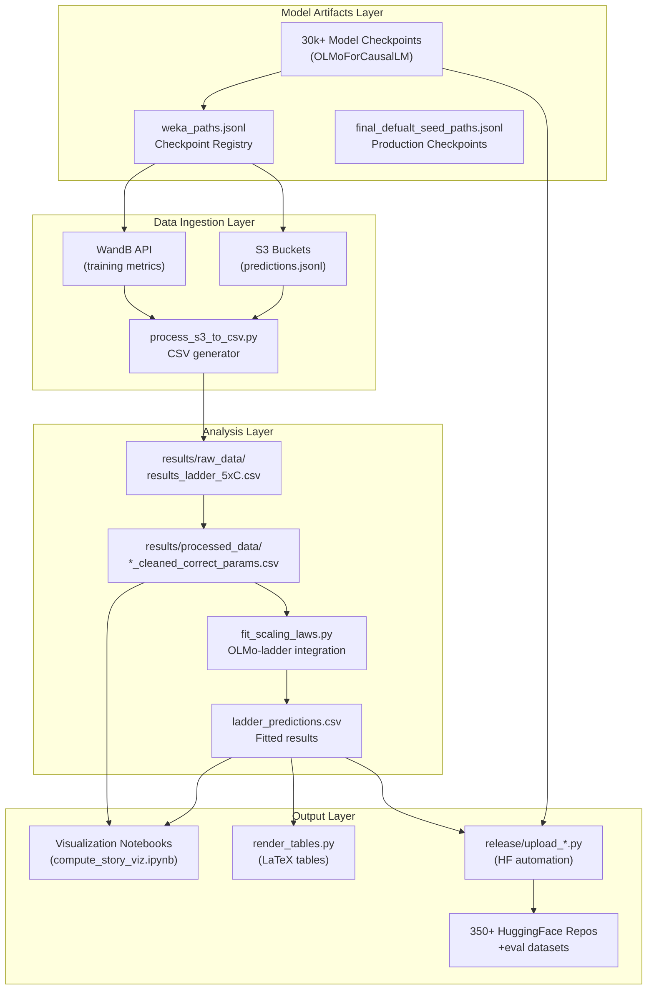

**System Architecture: Data Flow from Model Checkpoints to Published Artifacts**

The architecture follows a linear pipeline pattern:

1. **Model Artifacts Layer**: Trained checkpoints are registered in `weka_paths.jsonl` and `final_defualt_seed_paths.jsonl`
2. **Data Ingestion Layer**: `process_s3_to_csv.py` fetches evaluation predictions from S3 and enriches them with WandB training statistics
3. **Analysis Layer**: Data flows through cleaning (`data_exploration_and_cleaning.ipynb`) to scaling law fitting (`fit_scaling_laws.py`)
4. **Output Layer**: Results are visualized and uploaded to HuggingFace via automated scripts

Sources: [README.md:1-123]()

## Key Components and Code Entities

The repository is organized into specialized directories, each containing scripts and utilities for specific functions:

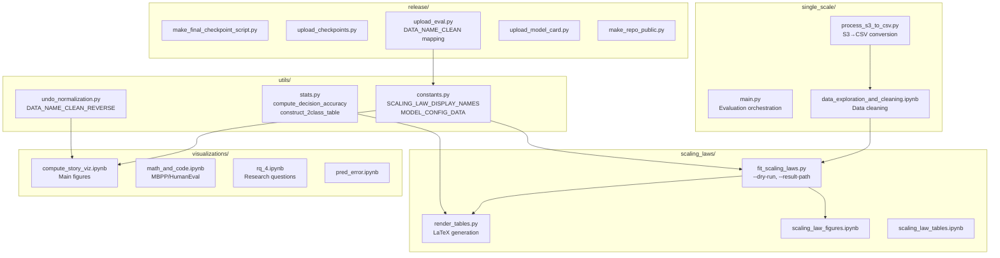

**Key Components: Directory Structure and Code Entry Points**

| Directory | Primary Functions | Key Entry Points |
|-----------|------------------|------------------|
| `single_scale/` | S3 data processing, per-task evaluation | `main.py`, `process_s3_to_csv.py` |
| `scaling_laws/` | Scaling law fitting, statistical analysis | `fit_scaling_laws.py`, `render_tables.py` |
| `visualizations/` | Figure generation, error analysis | `compute_story_viz.ipynb`, `math_and_code.ipynb` |
| `release/` | HuggingFace upload automation | `upload_eval.py`, `upload_checkpoints.py` |
| `utils/` | Shared constants, data transformations | `constants.py`, `stats.py`, `undo_normalization.py` |
| `results/` | Data storage (raw, processed, outputs) | `raw_data/`, `processed_data/`, `outputs2/` |

Sources: [README.md:1-123]()

## Data Normalization Pattern

A critical architectural pattern is the bidirectional data transformation between internal processing and external presentation:

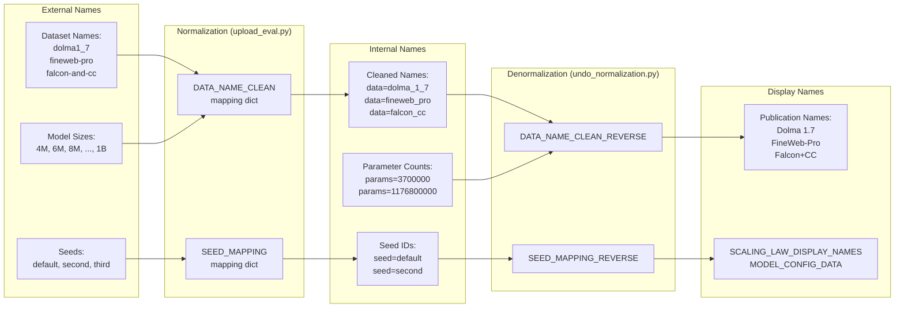

**Data Normalization Flow: External ↔ Internal ↔ Display Names**

This pattern serves three purposes:
1. **Normalization** (`DATA_NAME_CLEAN`, `SEED_MAPPING` in `upload_eval.py`): Converts HuggingFace repository names to consistent internal identifiers
2. **Processing**: All analysis uses normalized names to ensure consistency
3. **Denormalization** (`DATA_NAME_CLEAN_REVERSE`, `SEED_MAPPING_REVERSE` in `undo_normalization.py`): Converts internal names back to human-readable display names for figures and tables

Sources: [README.md:14-42]()

## Model Repository Structure

Each of the 350 HuggingFace model repositories follows a consistent structure:

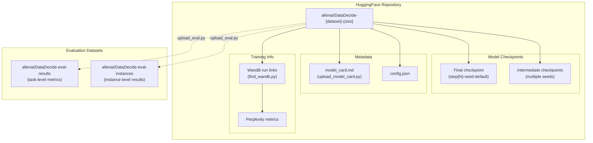

**HuggingFace Repository Organization**

The naming convention follows: `allenai/DataDecide-{dataset}-{size}` where:
- `{dataset}`: One of 25 corpus variants (e.g., `dolma1_7`, `fineweb-pro`, `dclm-baseline-qc-10p`)
- `{size}`: Model parameter count (e.g., `4M`, `150M`, `1B`)

Example repositories:
- `allenai/DataDecide-dolma1_7-1B`
- `allenai/DataDecide-fineweb-edu-300M`
- `allenai/DataDecide-dclm-baseline-qc-20p-750M`

Sources: [README.md:14-42](), [README.md:87-89]()

## Training Configuration Summary

All models follow standardized hyperparameter schedules derived from parameter count:

| Model Size | Hidden Dim | Layers | Heads | Batch Size | Learning Rate | Training Steps | Total Tokens |
|-----------|-----------|--------|-------|------------|---------------|----------------|--------------|
| 4M | 64 | 8 | 8 | 32 | 1.4e-02 | 5,725 | 0.4B |
| 10M | 144 | 8 | 8 | 32 | 1.0e-02 | 15,117 | 1.0B |
| 60M | 384 | 16 | 12 | 96 | 5.8e-03 | 29,042 | 5.7B |
| 150M | 768 | 12 | 12 | 192 | 4.2e-03 | 38,157 | 15.0B |
| 300M | 1,024 | 16 | 16 | 320 | 3.3e-03 | 45,787 | 30.0B |
| 530M | 1,344 | 16 | 16 | 448 | 2.8e-03 | 57,786 | 53.0B |
| 1B | 2,048 | 16 | 16 | 704 | 2.1e-03 | 69,369 | 100.0B |

Key observations:
- All models train to 100:1 token-to-parameter ratio
- Learning rate decreases with model size
- Batch size increases with model size
- Hidden dimension and layer count scale with parameter count

The complete hyperparameter table is available in [README.md:93-109]() and programmatically in `utils/constants.py` as `MODEL_CONFIG_DATA`.

Sources: [README.md:93-109]()

## Accessing Repository Artifacts

The DataDecide repository provides three primary access points:

### 1. Model Checkpoints (HuggingFace Hub)

Load models using the `hf_olmo` library:

```python
from hf_olmo import OLMoForCausalLM

# Load final checkpoint
model = OLMoForCausalLM.from_pretrained(
    "allenai/DataDecide-dolma1_7-1B",
    revision="step69369-seed-default"
)
```

Browse all models: [README.md:14-42]() contains links to all 350 model repositories.

### 2. Evaluation Results (HuggingFace Datasets)

```python
from datasets import load_dataset

# Task-level metrics (accuracy, perplexity, etc.)
task_results = load_dataset("allenai/DataDecide-eval-results")

# Instance-level predictions (per-example outputs)
instance_results = load_dataset("allenai/DataDecide-eval-instances")
```

### 3. Local Processing (Clone Repository)

For running evaluations, fitting scaling laws, or generating visualizations:

```bash
git clone https://github.com/allenai/DataDecide
cd DataDecide

# Setup depends on component - see Getting Started (#2)
conda env create -f single_scale/environment.yml  # For evaluation
conda env create -f scaling_laws/environment.yml  # For scaling laws
```

Checkpoint registries for local processing:
- `weka_paths.jsonl`: Comprehensive checkpoint registry
- `final_defualt_seed_paths.jsonl`: Production checkpoint paths

Sources: [README.md:44-52](), [README.md:87-89]()

## Citation

When using DataDecide in research, cite:

```bibtex
@article{MagnussonDataDecide2025,
    title={{DataDecide: How to Predict Best Pretraining Data with Small Experiments}},
    author={Ian Magnusson and Nguyen Tai and Ben Bogin and David Heineman and 
            Jena Hwang and Luca Soldaini and Akshita Bhagia and Jiacheng Liu and 
            Dirk Groeneveld and Oyvind Tafjord and Noah A. Smith and 
            Pang Wei Koh and Jesse Dodge},
    year={2025},
    journal={arXiv preprint},
}
```

Paper: [https://arxiv.org/abs/2504.11393](https://arxiv.org/abs/2504.11393)

Sources: [README.md:111-122]()

---

# Page: Repository Structure

# Repository Structure

<details>
<summary>Relevant source files</summary>

The following files were used as context for generating this wiki page:

- [.gitignore](.gitignore)
- [README.md](README.md)
- [results/readme.md](results/readme.md)
- [viz/pred_error.ipynb](viz/pred_error.ipynb)

</details>


This document describes the high-level organization of directories and major components in the DataDecide repository. It provides a map of where different functionality resides and how the directory structure supports the evaluation, analysis, and release workflows.

For details about specific data recipes and model variants, see [Data Recipes and Model Variants](#1.2). For information about accessing the models and evaluation data, see [Accessing Models and Data](#2.2).

---

## Purpose and Scope

The DataDecide repository is organized to support three primary workflows:
1. **Evaluation**: Processing predictions from S3/WandB and computing metrics
2. **Analysis**: Fitting scaling laws and generating statistical summaries
3. **Release**: Uploading models and results to HuggingFace

The directory structure reflects this separation of concerns, with dedicated folders for each workflow stage.

---

## Top-Level Directory Structure

The repository contains the following top-level directories:

| Directory | Purpose | Key Contents |
|-----------|---------|--------------|
| `single_scale/` | Single-scale evaluation pipeline | S3 data processing, per-task analysis scripts |
| `scaling_laws/` | Scaling law fitting and analysis | Fitting scripts, configuration files, analysis notebooks |
| `viz/` | Visualization and presentation | Story visualization, error analysis, math/code notebooks |
| `release/` | HuggingFace upload automation | Upload scripts, model card generation, parallelization tools |
| `results/` | Data storage and intermediate outputs | Raw data, processed data, evaluation outputs |
| `utils/` | Shared utilities and constants | Display name mappings, data normalization, statistical functions |
| `data/` | Input data (gitignored) | Model checkpoints, data recipes |
| `OLMo-ladder/` | External scaling law library (gitignored) | Core fitting algorithms |
| `table/` | LaTeX table outputs (gitignored) | Generated publication tables |

**Sources:** [.gitignore:1-13](), [README.md:1-122]()

---

## Directory Dependency Graph

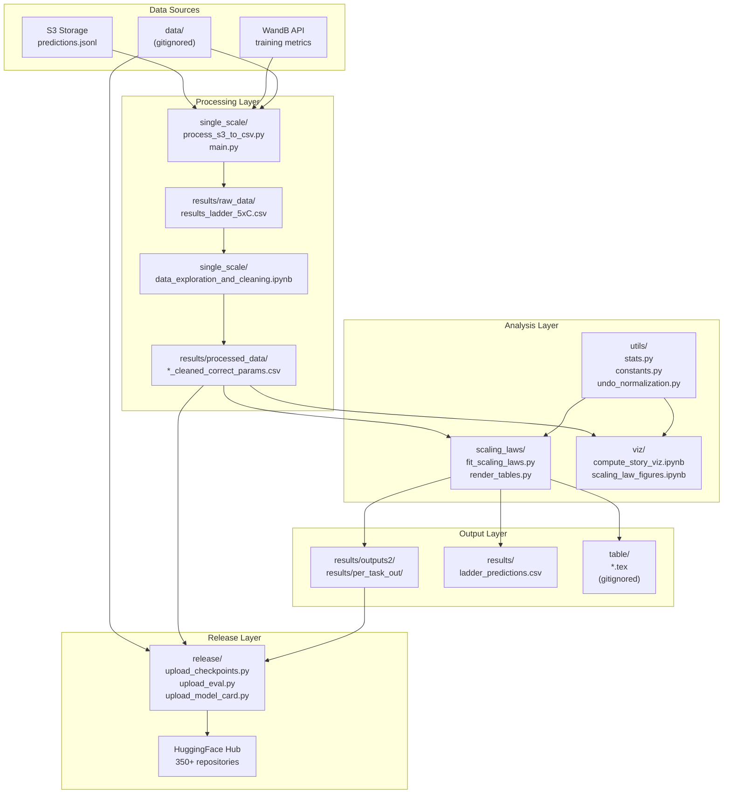

**Sources:** [.gitignore:1-13](), [results/readme.md:1-18]()

---

## Core Directories

### `single_scale/` - Evaluation Pipeline

Contains scripts for processing evaluation results at single model scales. This is the entry point for converting raw S3 predictions into structured CSV data.

**Key Components:**
- `process_s3_to_csv.py` - Fetches predictions from S3 and enriches with WandB training statistics
- `main.py` - Runs per-task evaluation analysis
- `data_exploration_and_cleaning.ipynb` - Cleans and normalizes raw data

**Outputs:** Produces files in `results/raw_data/` and `results/outputs2/`

**Sources:** [results/readme.md:8-14]()

---

### `scaling_laws/` - Scaling Law Analysis

Contains the core scaling law fitting infrastructure, including scripts to fit 36 different scaling law configurations across all datasets and model sizes.

**Key Components:**
- `fit_scaling_laws.py` - Main fitting script, integrates with OLMo-ladder library
- `render_tables.py` - Generates LaTeX tables for publication
- `scaling_law_figures.ipynb` - Visualization of fitted scaling curves
- `scaling_law_tables.ipynb` - Tabular summaries of scaling law results

**Dependencies:** Requires `OLMo-ladder/` library (external, gitignored)

**Outputs:** Produces `results/ladder_predictions.csv` and `table/*.tex` files

**Sources:** [.gitignore:12](), [results/readme.md:17-18]()

---

### `viz/` - Visualization Notebooks

Contains Jupyter notebooks for creating presentation-ready visualizations and specialized analyses.

**Key Components:**
- `compute_story_viz.ipynb` - Main story visualization with data denormalization
- `math_and_code.ipynb` - Analysis of MBPP and HumanEval benchmarks
- `rq_4.ipynb` - Research question 4 analysis
- `pred_error.ipynb` - Prediction error analysis
- `max_err_to_pred_acc.ipynb` - Maximum error to prediction accuracy mapping

**Dependencies:** Uses `utils/undo_normalization.py` for reversing data transformations

**Sources:** [viz/pred_error.ipynb:1-4]()

---

### `release/` - Distribution Automation

Contains scripts for uploading models and evaluation results to HuggingFace Hub. Handles the distribution of 350+ model repositories.

**Key Components:**
- `upload_checkpoints.py` - Uploads model checkpoints
- `upload_eval.py` - Uploads evaluation results with data normalization
- `upload_model_card.py` - Updates model cards
- `make_repo_public.py` - Sets repository visibility
- `make_final_checkpoint_script.py` - Generates upload scripts

**Parallelization:** Uses GNU Parallel for efficient batch uploads

**Sources:** [README.md:14-42]()

---

### `results/` - Data Storage

Central data repository containing evaluation outputs at various processing stages. This directory is largely gitignored to avoid committing large datasets.

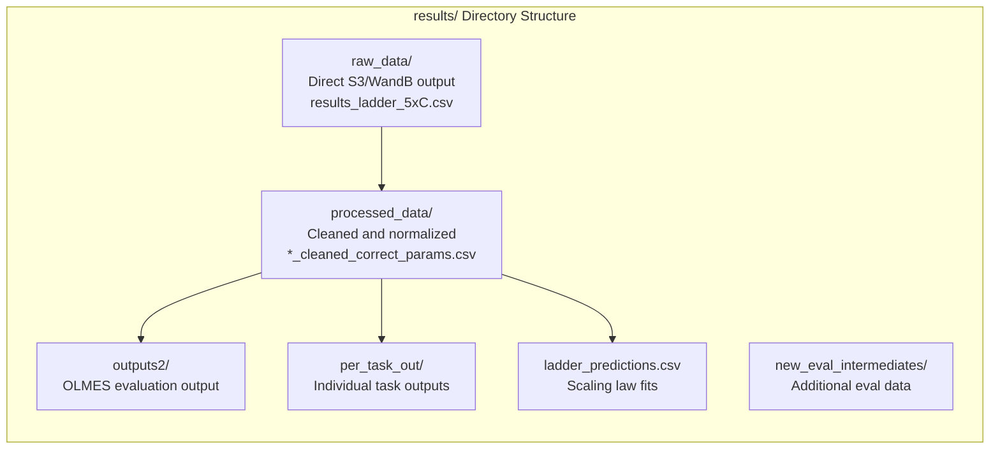

| Subdirectory | Contents | Generated By |
|--------------|----------|--------------|
| `raw_data/` | Raw S3 and WandB results | `single_scale/process_s3_to_csv.py` |
| `processed_data/` | Cleaned and normalized results | `single_scale/data_exploration_and_cleaning.ipynb` |
| `outputs2/` | OLMES suite evaluation outputs | `single_scale/main.py` |
| `per_task_out/` | Per-task evaluation outputs | `single_scale/main.py` with task-specific flags |
| `new_eval_intermediates/` | Additional evaluation data | External `new-evals` repository |
| `ladder_predictions.csv` | Scaling law fitted results | `scaling_laws/fit_scaling_laws.py` |

**Data Retrieval:** These files can be obtained from the Google Drive link referenced in `results/readme.md` or recomputed from source.

**Sources:** [results/readme.md:1-18](), [.gitignore:6-11]()

---

### `utils/` - Shared Utilities

Contains shared utility functions and configuration constants used across the codebase.

**Key Components:**
- `constants.py` - Display names, model configurations, benchmark definitions
- `stats.py` - Statistical analysis functions (`compute_decision_accuracy`, `construct_2class_table`)
- `undo_normalization.py` - Reverses data normalization for presentation
  - `DATA_NAME_CLEAN_REVERSE` - Maps internal names back to descriptive names
  - `SEED_MAPPING_REVERSE` - Maps seed identifiers to display values
  - `undo_changes_to_df()` - Main denormalization function

**Sources:** [README.md:1-122]()

---

## Data Flow Through Directory Structure

The following diagram shows how data flows through the directory structure from raw inputs to final outputs:

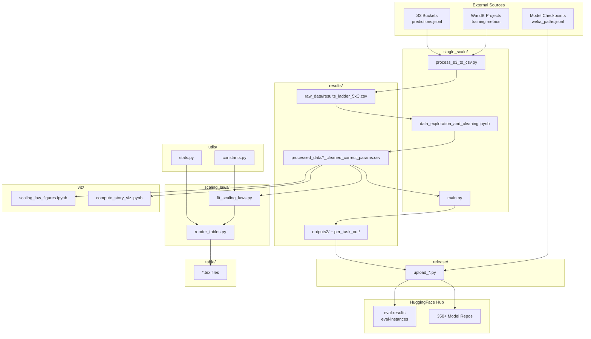

**Sources:** [results/readme.md:1-18](), [.gitignore:1-13]()

---

## File Organization Patterns

### Checkpoint Registry Files

The repository uses JSONL files to track model checkpoint locations:

- `weka_paths.jsonl` - Comprehensive registry of all checkpoint paths
- `final_defualt_seed_paths.jsonl` - Production checkpoints for default seed

These files are referenced by both evaluation and release scripts to locate model artifacts.

### Configuration and Metadata

- `README.md` - Main repository documentation with model links (350+ HuggingFace repositories)
- `.gitignore` - Excludes large data directories and generated outputs
- Environment files (not shown) - Conda environment specifications for different components

**Sources:** [README.md:1-122](), [.gitignore:1-13]()

---

## Ignored Directories

The following directories are excluded from version control but are essential for operation:

| Directory | Purpose | Size Characteristics |
|-----------|---------|---------------------|
| `data/` | Input data and checkpoints | Large (30k+ checkpoints) |
| `results/outputs2/` | OLMES evaluation outputs | Large (350 models × 10 benchmarks) |
| `results/per_task_out/` | Per-task evaluation outputs | Large (350 models × individual tasks) |
| `results/processed_data/` | Cleaned CSV files | Medium |
| `results/raw_data/` | Raw S3/WandB data | Medium |
| `OLMo-ladder/` | External scaling law library | Small (dependency) |
| `table/` | Generated LaTeX tables | Small |

These directories must be populated either by downloading from the Google Drive link or by running the processing scripts.

**Sources:** [.gitignore:1-13](), [results/readme.md:1-18]()

---

# Page: Data Recipes and Model Variants

# Data Recipes and Model Variants

<details>
<summary>Relevant source files</summary>

The following files were used as context for generating this wiki page:

- [README.md](README.md)
- [checkpoints/final_defualt_seed_paths.jsonl](checkpoints/final_defualt_seed_paths.jsonl)
- [checkpoints/weka_paths.jsonl](checkpoints/weka_paths.jsonl)

</details>


This page documents the 25 data corpora variants (data recipes) and 14 model sizes that comprise the DataDecide experimental matrix, resulting in 350 unique model configurations (25 datasets × 14 sizes × 1 default seed publicly released).

**Scope**: This page covers the data recipe taxonomy, model size specifications, and their combinations. For information about accessing the models, see [Accessing Models and Data](#2.2). For evaluation metrics and benchmarks, see [Single-Scale Evaluation](#3.1).

---

## Data Recipe Taxonomy

The 25 data recipes fall into five major categories: base corpora, ablation variants, quality-filtered variants, mixed combinations, and enhanced versions.

### Base Corpora

Five foundational datasets serve as starting points for variants:

| Recipe | Source | Description | Key Characteristics |
|--------|--------|-------------|---------------------|
| **Dolma1.7** | [Soldaini et al., 2024] | 2.3T-token corpus for open research | Balanced mix of web, code, math, social media, instruction data |
| **C4** | [Raffel et al., 2019] | Colossal Clean Crawled Corpus | Heuristically filtered April 2019 Common Crawl |
| **FineWeb-Pro** | [Zhou et al., 2024] | Model-driven cleaned web corpus | Advanced quality filtering on FineWeb |
| **FineWeb-Edu** | [Ben Allal et al., 2024] | Educational content focused | Deduplicated educational web pages |
| **Falcon** | [Penedo et al., 2023] | RefinedWeb corpus | Aggressively filtered/deduplicated Common Crawl through June 2023 |

Sources: [README.md:60-66]()

### Ablation Variants

Dolma1.7 is systematically ablated to remove specific data sources:

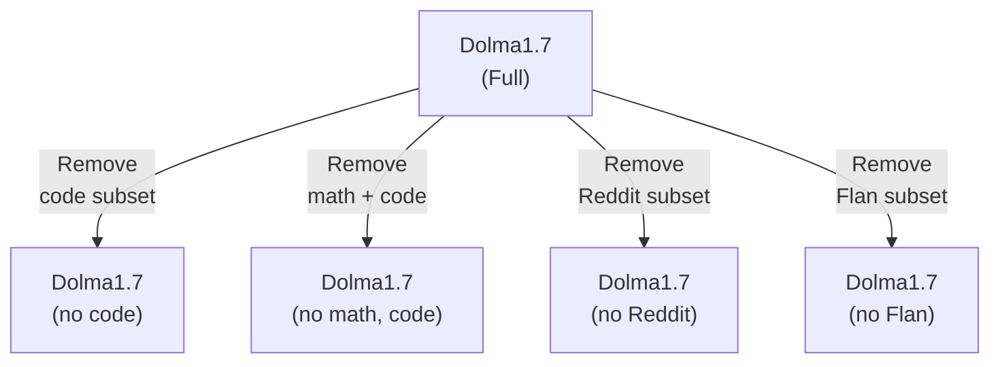

**Ablation Configurations:**
- **Dolma1.7 (no code)**: Removes all code-related content
- **Dolma1.7 (no math, code)**: Removes both mathematical and code content
- **Dolma1.7 (no Reddit)**: Removes social media discussions
- **Dolma1.7 (no Flan)**: Removes instruction-tuning data

Sources: [README.md:60]()

### Quality-Filtered Variants

Multiple quality filtering strategies are applied to base corpora:

#### Falcon+CC Quality Control Variants

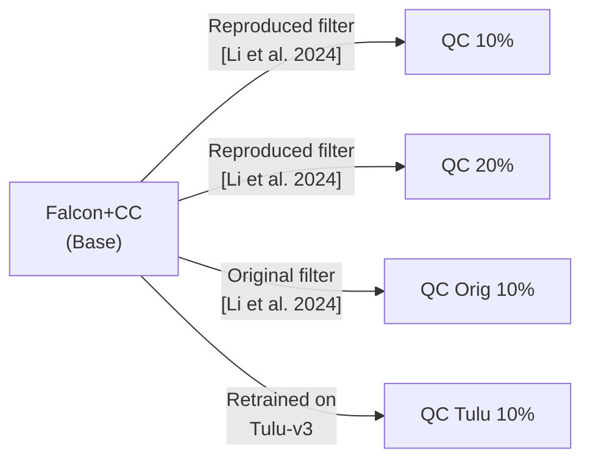

| Variant | Filter Method | Retention Rate |
|---------|--------------|----------------|
| Falcon+CC (QC 10%) | Reproduced classifier from [Li et al. 2024] | Top 10% |
| Falcon+CC (QC 20%) | Reproduced classifier from [Li et al. 2024] | Top 20% |
| Falcon+CC (QC Orig 10%) | Original classifier from [Li et al. 2024] | Top 10% |
| Falcon+CC (QC Tulu 10%) | Classifier retrained on Tulu-v3 pre-release | Top 10% |

Sources: [README.md:66]()

#### DCLM-Baseline Quality Control Variants

The DCLM-Baseline corpus (state-of-the-art Common Crawl with optimized deduplication and cleaning) has six quality-filtered variants:

| Variant | Primary Filter | Secondary Filter | Description |
|---------|---------------|------------------|-------------|
| DCLM-Baseline (QC 7% FW2) | DCLM classifier (top 7%) | FineWeb-edu 2+ score | Dual-filter approach |
| DCLM-Baseline (QC 7% FW3) | DCLM classifier (top 7%) | FineWeb-edu 3+ score | Stricter dual-filter |
| DCLM-Baseline (QC FW 3%) | FineWeb-edu classifier | N/A | Top 3% by educational quality |
| DCLM-Baseline (QC FW 10%) | FineWeb-edu classifier | N/A | Top 10% by educational quality |
| DCLM-Baseline (QC 10%) | Reproduced DCLM classifier | N/A | Top 10% by DCLM quality metric |
| DCLM-Baseline (QC 20%) | Reproduced DCLM classifier | N/A | Top 20% by DCLM quality metric |

Sources: [README.md:67]()

### Mixed Combinations

Three fractional mixing ratios combine DCLM-Baseline with Dolma1.7:

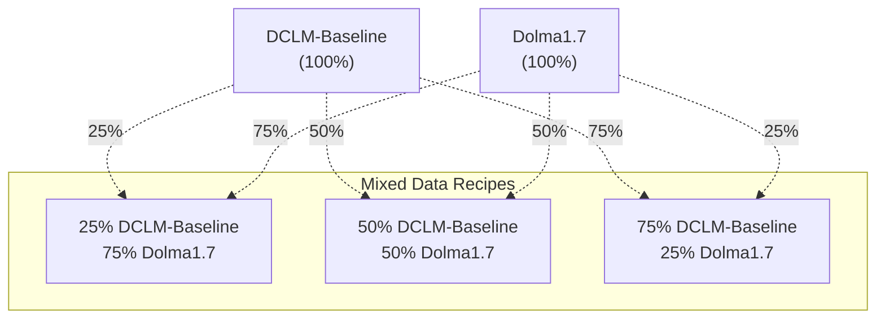

Sources: [README.md:68]()

### Enhanced Dolma Variant

- **Dolma1.6++**: Dolma 1.6 augmented with additional sources from Dolma 1.7 (RedPajama's arxiv subset, openwebmath, algebraic stack, flan, starcoder, falcon)

Sources: [README.md:61]()

---

## Model Size Configuration

The DataDecide suite includes 14 model sizes ranging from 4M to 1B parameters, each optimized with size-appropriate hyperparameters.

### Model Size Progression


### Hyperparameter Specifications

All models are trained with a token-to-parameter ratio of 100:1 (e.g., 1B parameters → 100B tokens).

| Model Size | Parameters | Hidden Dim | Heads | Layers | Batch Size | Learning Rate | Training Steps | Tokens |
|------------|------------|------------|-------|--------|------------|---------------|----------------|--------|
| 4M | 3.7M | 64 | 8 | 8 | 32 | 1.4e-02 | 5,725 | 0.4B |
| 6M | 6.0M | 96 | 8 | 8 | 32 | 1.2e-02 | 9,182 | 0.6B |
| 8M | 8.5M | 128 | 8 | 8 | 32 | 1.1e-02 | 13,039 | 0.9B |
| 10M | 9.9M | 144 | 8 | 8 | 32 | 1.0e-02 | 15,117 | 1.0B |
| 14M | 14.4M | 192 | 8 | 8 | 32 | 9.2e-03 | 21,953 | 1.4B |
| 16M | 16.0M | 208 | 8 | 8 | 32 | 8.9e-03 | 24,432 | 1.6B |
| 20M | 19.1M | 192 | 8 | 16 | 64 | 8.4e-03 | 14,584 | 1.9B |
| 60M | 57.1M | 384 | 12 | 16 | 96 | 5.8e-03 | 29,042 | 5.7B |
| 90M | 97.9M | 528 | 12 | 16 | 160 | 4.9e-03 | 29,901 | 9.8B |
| 150M | 151.9M | 768 | 12 | 12 | 192 | 4.2e-03 | 38,157 | 15.0B |
| 300M | 320.0M | 1,024 | 16 | 16 | 320 | 3.3e-03 | 45,787 | 30.0B |
| 530M | 530.1M | 1,344 | 16 | 16 | 448 | 2.8e-03 | 57,786 | 53.0B |
| 750M | 681.3M | 1,536 | 16 | 16 | 576 | 2.5e-03 | 63,589 | 75.0B |
| 1B | 1176.8M | 2,048 | 16 | 16 | 704 | 2.1e-03 | 69,369 | 100.0B |

**Architecture Notes:**
- All models use 8-layer depth initially, transitioning to 12-16 layers for larger sizes
- Attention head count scales from 8 (small models) to 16 (large models)
- Learning rate follows inverse square root scaling with model size
- Batch size increases with model size to maintain training efficiency

Sources: [README.md:94-109]()

---

## The Model Matrix: 350 Public Models

The complete experimental design crosses 25 data recipes with 14 model sizes, creating 350 publicly released models (using the default seed).

### HuggingFace Naming Convention

Models follow the pattern: `allenai/DataDecide-{dataset_name}-{size}`

**Dataset Name Mapping:**
- Internal names use underscores and abbreviated formats (e.g., `dolma1_7`, `dclm_baseline`)
- Quality control variants append filter type (e.g., `falcon-and-cc-qc-10p`)
- Mixed datasets use explicit proportions (e.g., `dclm-baseline-50p-dolma1.7-50p`)

**Example Model URLs:**
```
allenai/DataDecide-dolma1_7-4M
allenai/DataDecide-dolma1_7-1B
allenai/DataDecide-falcon-and-cc-qc-10p-300M
allenai/DataDecide-dclm-baseline-50p-dolma1.7-50p-530M
```

Sources: [README.md:14-42]()

### Complete Recipe × Size Matrix

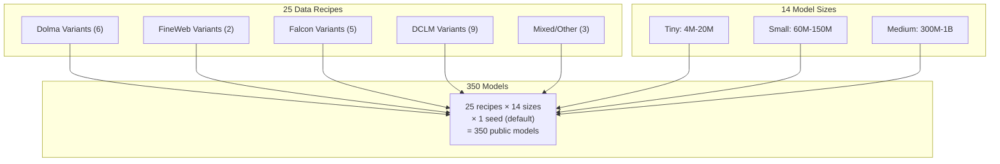

**Additional Training Runs:**
- Each configuration has 3 random seeds (seeds: default, 14, 15)
- Total checkpoints exceed 30,000 across all seeds and intermediate steps
- Intermediate checkpoints saved at regular intervals (every ~1,250 steps for small models, every ~1,250-2,500 steps for large models)

Sources: [README.md:12](), [README.md:15]()

---

## Checkpoint Registry System

The codebase maintains comprehensive checkpoint tracking through JSONL registry files.

### Registry File Structure

**Primary Registry: `weka_paths.jsonl`**

Each line contains:
```json
{
  "checkpoints_location": "weka://oe-eval-default/ai2-llm/checkpoints/OLMo-ladder/davidh/{model_name}",
  "revisions": ["step{N}-unsharded-hf", ...],
  "model_name": "{dataset}-{size}-{seed}"
}
```

**Example Entry:**
```json
{
  "checkpoints_location": "weka://oe-eval-default/ai2-llm/checkpoints/OLMo-ladder/davidh/dolma17-60M-5xC-15",
  "revisions": ["step6250-unsharded-hf", "step3750-unsharded-hf", ..., "step29042-unsharded-hf"],
  "model_name": "dolma17-60M-15"
}
```

Sources: [checkpoints/weka_paths.jsonl:61-65]()

### Model Naming in Registry

Internal checkpoint names differ from public HuggingFace names:

**Mapping Pattern:**
```
Internal: {dataset_shortname}-{size}-{suffix}
Public:   DataDecide-{dataset_name}-{size}

Examples:
dolma17-60M-15 → DataDecide-dolma1_7-60M
falcon_and_cc_tulu_qc_top10-90M-14 → DataDecide-falcon-and-cc-qc-tulu-10p-90M
dclm_fw_top3-20M-15 → DataDecide-dclm-baseline-qc-fw-3p-20M
```

**Seed Suffixes:**
- Default seed: `-6198` or base name
- Seed 14: `-14` suffix
- Seed 15: `-15` suffix
- Training configuration suffix: `-5xC` (5× compute budget)

Sources: [checkpoints/weka_paths.jsonl:1-10]()

### Checkpoint Revisions

Each model has multiple checkpoint revisions representing different training steps:

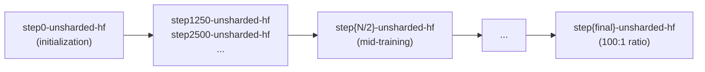

**Checkpoint Naming:**
- Format: `step{step_number}-unsharded-hf`
- Final step varies by model size (e.g., 5,725 for 4M, 69,369 for 1B)
- Intermediate checkpoints saved at ~1,250 step intervals
- All checkpoints converted to HuggingFace format (`-hf` suffix)
- Unsharded format for direct loading

Sources: [checkpoints/weka_paths.jsonl:1-10]()

---

## Data Recipe Details Reference

### Complete Recipe List with Code Identifiers

| Public Name | Internal Identifier | Category | Base Source |
|-------------|-------------------|----------|-------------|
| dolma1_7 | `dolma17` | Base | Dolma 1.7 |
| dolma1_7-no-code | `no_code` | Ablation | Dolma 1.7 |
| dolma1_7-no-math-code | `no_math_no_code` | Ablation | Dolma 1.7 |
| dolma1_7-no-reddit | `no_reddit` | Ablation | Dolma 1.7 |
| dolma1_7-no-flan | `no_flan` | Ablation | Dolma 1.7 |
| dolma1_6plus | `dolma16plus` | Enhanced | Dolma 1.6++ |
| c4 | `c4` | Base | C4 |
| fineweb-pro | `fineweb_pro` | Base | FineWeb-Pro |
| fineweb-edu | `fineweb_edu` | Base | FineWeb-Edu |
| falcon | `falcon` | Base | Falcon RefinedWeb |
| falcon-and-cc | `falcon_and_cc` | Base | Falcon + CC |
| falcon-and-cc-qc-10p | `falcon_and_cc_qc_top10p` | Quality Control | Falcon + CC |
| falcon-and-cc-qc-20p | `falcon_and_cc_qc_top20p` | Quality Control | Falcon + CC |
| falcon-and-cc-qc-orig-10p | `falcon_and_cc_eli5_oh_top10p` | Quality Control | Falcon + CC |
| falcon-and-cc-qc-tulu-10p | `falcon_and_cc_tulu_qc_top10` | Quality Control | Falcon + CC |
| dclm-baseline | `dclm_baseline` | Base | DCLM-Baseline |
| dclm-baseline-qc-7p-fw2 | `dclm_ft7percentile_fw2` | Quality Control | DCLM-Baseline |
| dclm-baseline-qc-7p-fw3 | `dclm_ft7percentile_fw3` | Quality Control | DCLM-Baseline |
| dclm-baseline-qc-fw-3p | `dclm_fw_top3` | Quality Control | DCLM-Baseline |
| dclm-baseline-qc-fw-10p | `dclm_fw_top10` | Quality Control | DCLM-Baseline |
| dclm-baseline-qc-10p | `pos_eli5_oh_neg_dclm_refinedweb_steps_2000_lr3e4_top20p` | Quality Control | DCLM-Baseline |
| dclm-baseline-qc-20p | `dclm_qc_top20p` | Quality Control | DCLM-Baseline |
| dclm-baseline-25p-dolma1.7-75p | `dolma17-25p-DCLM-baseline-75p` | Mixed | Mix |
| dclm-baseline-50p-dolma1.7-50p | `dolma17-50p-DCLM-baseline-50p` | Mixed | Mix |
| dclm-baseline-75p-dolma1.7-25p | `dolma17-75p-DCLM-baseline-25p` | Mixed | Mix |

Sources: [README.md:18-42](), [checkpoints/weka_paths.jsonl:1-100]()

---

## Loading Models from Registry

Models can be loaded using the HuggingFace Hub with specific revisions:

```python
from hf_olmo import OLMoForCausalLM

# Load a specific checkpoint revision
model = OLMoForCausalLM.from_pretrained(
    "allenai/DataDecide-dolma1_7-1B",
    revision="step69369-seed-default"  # Final checkpoint
)
```

**Revision Format:**
- Default seed final: `step{N}-seed-default`
- Seed 14 final: `step{N}-seed-14`
- Seed 15 final: `step{N}-seed-15`
- Intermediate: `step{N}-unsharded-hf`

Sources: [README.md:49-52]()

---

# Page: Getting Started

# Getting Started

<details>
<summary>Relevant source files</summary>

The following files were used as context for generating this wiki page:

- [requirements.txt](requirements.txt)
- [scaling_laws/README.md](scaling_laws/README.md)
- [single_scale/process_s3_to_csv.py](single_scale/process_s3_to_csv.py)
- [single_scale/readme.md](single_scale/readme.md)
- [single_scale/requirements.txt](single_scale/requirements.txt)
- [viz/readme.md](viz/readme.md)

</details>


This page provides installation instructions and initial setup for working with the DataDecide codebase. It covers environment configuration, dependency installation, and basic workflows to verify your setup. For detailed information about specific components, see [Evaluation System](#3), [Scaling Laws Analysis](#4), or [Visualization](#5).

## Prerequisites

Before setting up the DataDecide repository, ensure you have the following:

| Requirement | Purpose | Notes |
|-------------|---------|-------|
| **Python 3.10-3.11** | Runtime environment | Different components require different versions |
| **Conda** | Environment management | Miniconda or Anaconda |
| **Git LFS** | Large file tracking | Required for `.ipynb` files |
| **AWS Credentials** | S3 data access | For accessing evaluation results |
| **WandB Account** | Training metrics | For fetching perplexity and loss data |
| **HuggingFace Account** | Model and dataset access | For downloading models and uploading results |

**Sources:** [scaling_laws/README.md:6](), [viz/readme.md:1-9]()

## Component Architecture

The DataDecide repository is organized into three primary components, each with its own environment and dependencies:

```mermaid
graph TB
    subgraph SingleScale["Single-Scale Evaluation Component"]
        SS_ENV["conda env:<br/>DataDecide-single-scale<br/>Python 3.11"]
        SS_REQ["single_scale/requirements.txt"]
        SS_MAIN["single_scale/main.py"]
        SS_PROC["single_scale/process_s3_to_csv.py"]
        SS_CLEAN["single_scale/data_exploration_and_cleaning.ipynb"]
    end
    
    subgraph ScalingLaws["Scaling Laws Component"]
        SL_ENV["conda env:<br/>DataDecide-scaling-laws<br/>Python 3.10-3.11"]
        SL_REQ["scaling_laws/requirements.txt<br/>(via root requirements.txt)"]
        SL_FIT["scaling_laws/fit_scaling_laws.py"]
        SL_RENDER["scaling_laws/render_tables.py"]
        SL_NB["scaling_laws/notebooks/*.ipynb"]
    end
    
    subgraph Viz["Visualization Component"]
        VIZ_ENV["conda env:<br/>DataDecide-viz<br/>Python 3.10"]
        VIZ_REQ["viz/requirements.txt"]
        VIZ_STORY["viz/compute_story_viz.ipynb"]
        VIZ_MATH["viz/math_and_code.ipynb"]
        VIZ_SL["viz/scaling_law_*.ipynb"]
    end
    
    SS_ENV --> SS_REQ
    SS_REQ --> SS_MAIN
    SS_REQ --> SS_PROC
    SS_REQ --> SS_CLEAN
    
    SL_ENV --> SL_REQ
    SL_REQ --> SL_FIT
    SL_REQ --> SL_RENDER
    SL_REQ --> SL_NB
    
    VIZ_ENV --> VIZ_REQ
    VIZ_REQ --> VIZ_STORY
    VIZ_REQ --> VIZ_MATH
    VIZ_REQ --> VIZ_SL
```

**Diagram: Component Organization and Entry Points**

Each component can be set up independently depending on your needs. Most users will start with either the single-scale evaluation or scaling laws analysis.

**Sources:** [single_scale/readme.md:1-6](), [scaling_laws/README.md:1-58](), [viz/readme.md:1-9]()

## Environment Setup

### Single-Scale Evaluation Environment

This environment is used for processing evaluation results from S3, computing metrics, and performing per-task analysis.

```bash
# Create and activate environment
conda create -n DataDecide-single-scale python=3.11
conda activate DataDecide-single-scale

# Install dependencies
cd single_scale
pip install -r requirements.txt
```

**Key dependencies installed:**
- `ai2-olmo` - OLMo model implementation
- `lm_eval==0.4.3` - Language model evaluation framework
- `torch>=2.4,<2.5` - PyTorch for model loading
- `boto3` - AWS S3 access
- `wandb` - Weights & Biases integration
- `transformers>=4.45.0` - HuggingFace transformers

**Sources:** [single_scale/readme.md:1-6](), [single_scale/requirements.txt:1-29]()

### Scaling Laws Environment

This environment is used for fitting scaling law curves and generating analysis tables.

```bash
# Create and activate environment
conda create -n DataDecide-scaling-laws python=3.11
conda activate DataDecide-scaling-laws

# Install Git LFS (required for notebook files)
git lfs install  # or: brew install git-lfs

# Install dependencies from root directory
pip install -r requirements.txt

# Optional: Install OLMo-ladder locally for development
git clone -b datados https://github.com/allenai/OLMo-ladder OLMo-ladder
cd OLMo-ladder
pip install -e ".[plotting]"
```

**Key dependencies installed:**
- `ladder[plotting]` - Scaling law fitting algorithms (from OLMo-ladder)
- `pandas`, `numpy` - Data manipulation
- `matplotlib`, `plotly` - Visualization
- `huggingface_hub` - HuggingFace integration
- `datasets` - HuggingFace datasets library

**Sources:** [scaling_laws/README.md:6-30](), [requirements.txt:1-45]()

### Visualization Environment

This environment is used for creating publication-ready figures and interactive visualizations.

```bash
# Create and activate environment
conda create -n DataDecide-viz python=3.10
conda activate DataDecide-viz

# Install dependencies
cd viz
pip install -r requirements.txt
```

**Sources:** [viz/readme.md:1-9]()

## Quick Start Workflows

### Workflow 1: Process S3 Evaluation Results

This workflow fetches evaluation results from S3 and enriches them with WandB training statistics.

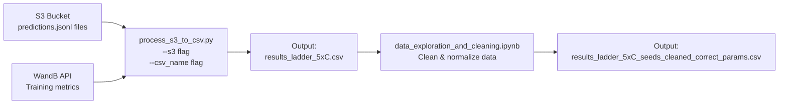

**Diagram: S3 Data Processing Workflow**

```bash
# Activate environment
conda activate DataDecide-single-scale

# Process results from S3
cd single_scale
python process_s3_to_csv.py \
    --s3 s3://ai2-llm/eval-results/downstream/eval-for-consistent-ranking-preemption-fixed \
    --csv_name "results_ladder_5xC.csv"

# Clean the data (run notebook)
jupyter notebook data_exploration_and_cleaning.ipynb
# Set DIRTY_OUT = False to generate cleaned data
# Set DIRTY_OUT = True to generate dirty data for some visualizations
```

The `process_s3_to_csv.py` script performs the following operations:

1. **S3 Discovery** - Calls `get_prediction_paths()` to scan S3 bucket [process_s3_to_csv.py:64-90]()
2. **Path Parsing** - Uses `parse_train_name()` to extract metadata from paths [process_s3_to_csv.py:177-210]()
3. **Metric Computation** - Calls `compute_metrics_from_file()` for each prediction file [process_s3_to_csv.py:98]()
4. **WandB Enrichment** - Fetches training stats via `fetch_wandb_data()` [process_s3_to_csv.py:223-248]()
5. **Compute Calculation** - Applies `calc_compute()` to determine FLOPs [process_s3_to_csv.py:165-175]()

**Sources:** [single_scale/readme.md:8-19](), [single_scale/process_s3_to_csv.py:1-624]()

### Workflow 2: Fit Scaling Laws

This workflow fits scaling law curves to the processed evaluation results.

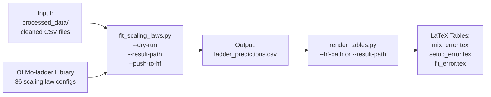

**Diagram: Scaling Law Fitting Workflow**

```bash
# Activate environment
conda activate DataDecide-scaling-laws

cd scaling_laws

# Test with dry-run (uses subset of results)
python fit_scaling_laws.py \
    --result-path ladder_predictions_dry_run.csv \
    --dry-run

# Fit on all metrics
python fit_scaling_laws.py \
    --result-path ladder_predictions.csv

# Fit and push results to HuggingFace
python fit_scaling_laws.py \
    --result-path ladder_predictions.csv \
    --push-to-hf allenai/DataDecide-eval-results

# Render tables using the fitted results
python render_tables.py \
    --result-path ladder_predictions.csv
```

The `fit_scaling_laws.py` script:
- Loads processed evaluation data
- Fits 36 different scaling law configurations (2-param, 3-param, 5-param variants)
- Uses the OLMo-ladder library for curve fitting
- Outputs predictions to CSV
- Optionally pushes results to HuggingFace

**Sources:** [scaling_laws/README.md:21-49]()

### Workflow 3: Generate Visualizations

This workflow creates figures and interactive plots from the scaling law fits.

```bash
# Activate environment
conda activate DataDecide-viz

cd viz

# Launch Jupyter to run visualization notebooks
jupyter notebook

# Key notebooks to run:
# - compute_story_viz.ipynb: Main story visualization
# - math_and_code.ipynb: MBPP and HumanEval analysis
# - scaling_law_figures.ipynb: Scaling law curve plots
# - scaling_law_tables.ipynb: Interactive table rendering
```

**Sources:** [scaling_laws/README.md:51-58]()

## Accessing Models and Data

### HuggingFace Model Repository

The DataDecide project provides 350+ pretrained models on HuggingFace Hub:

```python
from transformers import AutoModelForCausalLM, AutoTokenizer

# Example: Load a specific checkpoint
model_name = "allenai/DataDecide-dolma-1B"
model = AutoModelForCausalLM.from_pretrained(model_name)
tokenizer = AutoTokenizer.from_pretrained(model_name)
```

**Model naming convention:**
```
allenai/DataDecide-{dataset}-{size}
```

Where:
- `{dataset}` is one of 25 data corpora (e.g., `dolma`, `fineweb`, `DCLM`)
- `{size}` is one of 14 model sizes (`4M`, `7.5M`, `15M`, `30M`, `60M`, `150M`, `300M`, `530M`, `750M`, `1B`)

For the complete list of available models, see [Overview](#1).

### Evaluation Results Datasets

Evaluation results are available as HuggingFace datasets:

```python
from datasets import load_dataset

# Load task-level evaluation results
eval_results = load_dataset("allenai/DataDecide-eval-results")

# Load instance-level predictions
eval_instances = load_dataset("allenai/DataDecide-eval-instances")

# Load scaling law predictions
ladder_predictions = load_dataset("allenai/DataDecide-eval-results", data_files="ladder_predictions.csv")
```

**Sources:** Based on high-level system architecture diagrams

## Verification Steps

After setting up your environment, verify the installation:

### Verify Single-Scale Environment

```bash
conda activate DataDecide-single-scale
python -c "import torch; import transformers; import lm_eval; print('Single-scale environment OK')"
```

### Verify Scaling Laws Environment

```bash
conda activate DataDecide-scaling-laws

# Test scaling law fitting on subset
cd scaling_laws
python fit_scaling_laws.py --dry-run

# Expected output: ladder_predictions_dry_run.csv
# Should complete without errors
```

### Verify Visualization Environment

```bash
conda activate DataDecide-viz

# Test notebook execution
cd viz
jupyter nbconvert --execute --to notebook --inplace compute_story_viz.ipynb --ExecutePreprocessor.timeout=600
```

**Sources:** [scaling_laws/README.md:9-13]()

## Common Setup Issues

| Issue | Solution |
|-------|----------|
| **Git LFS not installed** | Run `brew install git-lfs` (macOS) or `apt-get install git-lfs` (Linux), then `git lfs install` |
| **CUDA version mismatch** | Ensure PyTorch version matches your CUDA version: `pip install torch==2.4.0+cu118` |
| **WandB authentication error** | Run `wandb login` and enter your API key |
| **S3 access denied** | Configure AWS credentials: `aws configure` |
| **HuggingFace rate limiting** | Authenticate with: `huggingface-cli login` |
| **NumPy version conflict** | Ensure `numpy<2` is installed as specified in requirements |

## Next Steps

After completing the setup:

1. **For evaluation workflows**, proceed to [Single-Scale Evaluation](#3.1) to run predictions
2. **For scaling law analysis**, see [Scaling Law Fitting](#4.1) for detailed configuration options
3. **For visualization**, explore [Story Visualization](#5.1) and [Scaling Law Visualization](#4.4)
4. **For data release**, consult [Upload Pipeline](#6.1) for HuggingFace distribution

**Sources:** [single_scale/readme.md:1-39](), [scaling_laws/README.md:1-58](), [viz/readme.md:1-9]()

---

# Page: Environment Setup

# Environment Setup

<details>
<summary>Relevant source files</summary>

The following files were used as context for generating this wiki page:

- [requirements.txt](requirements.txt)
- [scaling_laws/requirements.txt](scaling_laws/requirements.txt)
- [single_scale/process_s3_to_csv.py](single_scale/process_s3_to_csv.py)
- [single_scale/readme.md](single_scale/readme.md)
- [single_scale/requirements.txt](single_scale/requirements.txt)
- [viz/readme.md](viz/readme.md)

</details>


## Purpose and Scope

This document describes the conda environment creation and dependency installation for the three main components of the DataDecide repository. The repository requires separate Python environments for distinct analysis workflows: single-scale evaluation, scaling laws analysis, and visualization. Each environment has specific dependency requirements optimized for its computational tasks.

For information about accessing pretrained models and evaluation datasets after environment setup, see [Accessing Models and Data](#2.2). For running single-scale evaluations, see [Single-Scale Evaluation](#3.1). For fitting scaling laws, see [Scaling Law Fitting](#4.1).

## Environment Architecture

The DataDecide codebase uses a multi-environment architecture to isolate dependencies and prevent version conflicts:

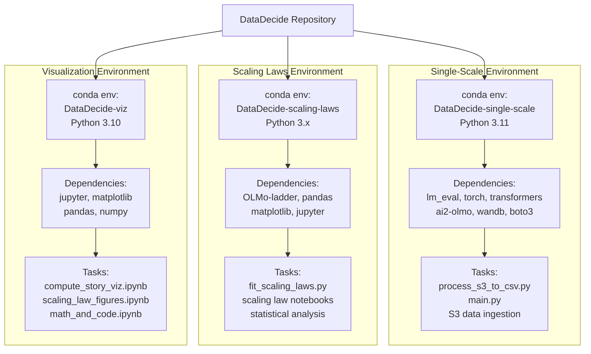

**Sources:** [single_scale/readme.md:1-6](), [viz/readme.md:1-9](), [scaling_laws/requirements.txt:1-9]()

## Single-Scale Environment

The single-scale environment is used for processing evaluation results from S3, computing metrics, and running model predictions. It requires Python 3.11 and includes dependencies for model inference and data processing.

### Environment Creation

```bash
conda create -n DataDecide-single-scale python=3.11
conda activate DataDecide-single-scale
pip install -r single_scale/requirements.txt
```

### Key Dependencies

| Package | Version Constraint | Purpose |
|---------|-------------------|---------|
| `lm_eval` | `==0.4.3` | Language model evaluation framework (EleutherAI) |
| `torch` | `>=2.4,<2.5` | PyTorch for model inference |
| `transformers` | `>=4.45.0` | HuggingFace model loading and tokenization |
| `ai2-olmo` | from GitHub main | AI2's OLMo model implementations |
| `wandb` | latest | Weights & Biases integration for training metrics |
| `boto3` | latest | AWS S3 access for evaluation results |
| `omegaconf` | `==2.4.0.dev3` | Configuration management |
| `numpy` | `<2` | Numerical operations (pinned for compatibility) |

### Specialized Dependencies

The single-scale environment includes task-specific packages:

- **Code evaluation**: `tree_sitter`, `tree_sitter_python` for parsing code in MBPP/HumanEval tasks
- **API integrations**: `beaker-py`, `beaker-gantry` for Beaker cluster integration
- **Evaluation tools**: `alpaca_eval`, `litellm` for specific benchmark tasks
- **Visualization**: `plotly`, `seaborn` for generating interactive plots in [process_s3_to_csv.py:254-497]()

**Sources:** [single_scale/readme.md:1-6](), [single_scale/requirements.txt:1-29](), [single_scale/process_s3_to_csv.py:1-31]()

## Scaling Laws Environment

The scaling laws environment is designed for fitting scaling law curves and statistical analysis. It uses the OLMo-ladder library for fitting various scaling law formulations.

### Environment Creation

```bash
conda create -n DataDecide-scaling-laws python=3.10
conda activate DataDecide-scaling-laws
pip install -r scaling_laws/requirements.txt
```

Note: The README does not specify Python version explicitly; Python 3.10 is recommended for compatibility with OLMo-ladder.

### Key Dependencies

| Package | Version | Purpose |
|---------|---------|---------|
| `ladder[plotting]` | from GitHub@datados | OLMo-ladder scaling law fitting library |
| `pandas` | latest | DataFrame operations for results processing |
| `numpy` | latest | Numerical computations |
| `matplotlib` | latest | Plotting fitted curves |
| `jupyter` | latest | Interactive notebook execution |
| `ipywidgets` | latest | Interactive notebook widgets |
| `pyarrow` | latest | Efficient data serialization |
| `tqdm` | latest | Progress bars for batch operations |

### OLMo-ladder Integration

The environment installs OLMo-ladder from the `datados` branch with plotting extras:

```
git+https://github.com/allenai/OLMo-ladder@datados#egg=ladder[plotting]
```

This provides the core scaling law fitting algorithms used by [fit_scaling_laws.py]() and related analysis notebooks.

**Sources:** [scaling_laws/requirements.txt:1-9]()

## Visualization Environment

The visualization environment is optimized for running Jupyter notebooks that generate figures and tables for publication. It uses Python 3.10 for stability with notebook kernels.

### Environment Creation

```bash
conda create -n DataDecide-viz python=3.10
conda activate DataDecide-viz
pip install -r viz/requirements.txt
```

### Key Dependencies

The visualization environment shares requirements with the root repository. Key packages include:

| Package | Purpose |
|---------|---------|
| `jupyter` | Notebook execution environment |
| `matplotlib` | Static plot generation |
| `pandas` | Data manipulation |
| `numpy` | Numerical operations |
| `ipywidgets` | Interactive visualization controls |

Additional dependencies from root requirements.txt may be needed for specific visualization tasks.

**Sources:** [viz/readme.md:1-9]()

## Root Requirements

The root [requirements.txt:1-45]() contains a comprehensive set of dependencies that combines packages from all three environments. This file can be used for a unified environment if separate environments are not required:

```bash
conda create -n DataDecide python=3.10
conda activate DataDecide
pip install -r requirements.txt
```

### Notable Root Dependencies

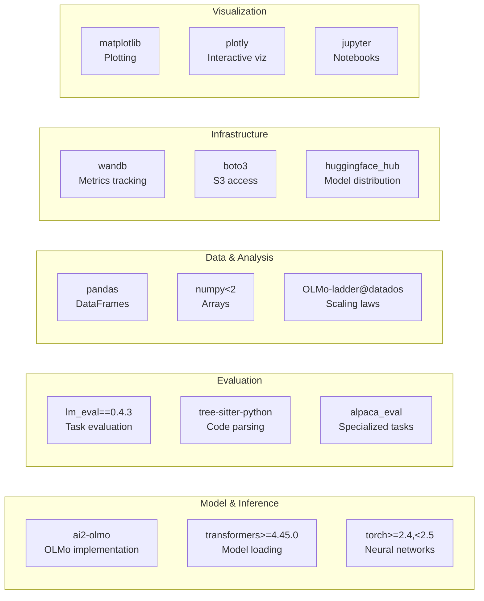

**Sources:** [requirements.txt:1-45]()

## Dependency Relationships

The following diagram maps how different components use specific dependencies:

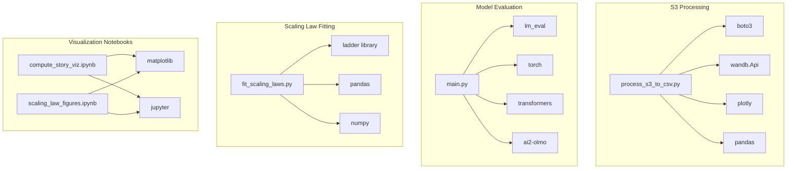

**Sources:** [single_scale/process_s3_to_csv.py:13-30](), [requirements.txt:1-45]()

## Version Pinning Strategy

The repository uses strategic version pinning to ensure reproducibility:

| Constraint | Packages | Reason |
|------------|----------|--------|
| `==` (exact) | `lm_eval==0.4.3`, `omegaconf==2.4.0.dev3` | API stability for evaluation |
| `>=` (minimum) | `transformers>=4.45.0` | Required features from recent versions |
| `>=,<` (range) | `torch>=2.4,<2.5` | Compatibility window |
| `<` (maximum) | `numpy<2` | Breaking changes in numpy 2.0 |
| Latest | `pandas`, `wandb`, `boto3` | Stable APIs, benefit from updates |

**Note:** The `omegaconf` version `2.4.0.dev3` is a development release, which may require special installation handling.

**Sources:** [single_scale/requirements.txt:1-29](), [requirements.txt:1-45]()

## Environment Verification

After installing each environment, verify the installation with these checks:

### Single-Scale Environment

```bash
conda activate DataDecide-single-scale
python -c "import torch; import transformers; import lm_eval; print('✓ Core dependencies loaded')"
python -c "import boto3; import wandb; print('✓ Infrastructure dependencies loaded')"
python -c "from olmes.tasks.oe_eval_tasks import TASK_REGISTRY; print(f'✓ {len(TASK_REGISTRY)} tasks registered')"
```

### Scaling Laws Environment

```bash
conda activate DataDecide-scaling-laws
python -c "import ladder; import pandas; import matplotlib; print('✓ Scaling laws environment ready')"
jupyter --version  # Verify Jupyter installation
```

### Visualization Environment

```bash
conda activate DataDecide-viz
python -c "import jupyter; import matplotlib; import pandas; print('✓ Visualization environment ready')"
jupyter notebook --version  # Verify notebook capability
```

**Sources:** [single_scale/process_s3_to_csv.py:29]()

## Common Installation Issues

### Issue: OLMo-ladder Installation Failure

The OLMo-ladder package is installed from a GitHub branch, which may fail if git is not configured or network issues occur.

**Solution:**
```bash
# Install git if needed
conda install git

# Manually clone and install
git clone https://github.com/allenai/OLMo-ladder.git
cd OLMo-ladder
git checkout datados
pip install -e ".[plotting]"
```

### Issue: NumPy Version Conflicts

NumPy 2.0 introduced breaking changes. The repository pins `numpy<2` but some dependencies may try to upgrade.

**Solution:**
```bash
# After installation, verify numpy version
python -c "import numpy; print(numpy.__version__)"

# If >= 2.0, downgrade
pip install "numpy<2" --force-reinstall
```

### Issue: PyTorch CUDA Version Mismatch

The torch constraint `>=2.4,<2.5` may install CPU-only version.

**Solution:**
```bash
# For CUDA 11.8
pip install torch==2.4.0 --index-url https://download.pytorch.org/whl/cu118

# For CUDA 12.1
pip install torch==2.4.0 --index-url https://download.pytorch.org/whl/cu121
```

### Issue: omegaconf Development Version

The exact version `omegaconf==2.4.0.dev3` may not be available on PyPI.

**Solution:**
```bash
# Install from source
pip install git+https://github.com/omry/omegaconf.git@2.4_branch
```

**Sources:** [single_scale/requirements.txt:6-11](), [requirements.txt:9-14]()

## Environment Activation Workflow

The typical workflow involves switching between environments based on the task:

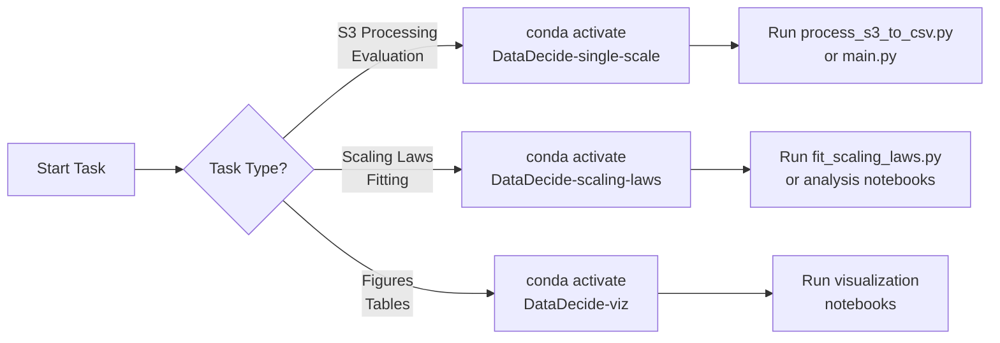

**Sources:** [single_scale/readme.md:1-38](), [viz/readme.md:1-9]()

---

# Page: Accessing Models and Data

# Accessing Models and Data

<details>
<summary>Relevant source files</summary>

The following files were used as context for generating this wiki page:

- [README.md](README.md)
- [checkpoints/final_defualt_seed_paths.jsonl](checkpoints/final_defualt_seed_paths.jsonl)
- [checkpoints/weka_paths.jsonl](checkpoints/weka_paths.jsonl)

</details>


## Purpose and Scope

This page explains how to access the 350+ pretrained models and evaluation data released as part of the DataDecide project. It covers the HuggingFace repository structure, model loading procedures, data recipe access, and evaluation results retrieval.

For information about setting up your local environment to work with these models, see [Environment Setup](#2.1). For details about the evaluation pipeline that generated the results, see [Evaluation System](#3).

---

## HuggingFace Repository Structure

The DataDecide project releases models through a structured set of HuggingFace repositories following a consistent naming convention.

### Repository Naming Convention

All model repositories follow the pattern: `allenai/DataDecide-{dataset}-{size}`

**Dataset identifiers** include:
- `dolma1_7` - Dolma 1.7 baseline
- `dolma1_7-no-code` - Dolma 1.7 with code subset removed
- `dolma1_7-no-math-code` - Dolma 1.7 without math and code
- `dolma1_7-no-reddit` - Dolma 1.7 without Reddit
- `dolma1_7-no-flan` - Dolma 1.7 without Flan
- `dolma1_6plus` - Dolma 1.6++
- `c4` - C4 dataset
- `fineweb-pro` - FineWeb-Pro
- `fineweb-edu` - FineWeb-Edu
- `falcon` - Falcon RefinedWeb
- `falcon-and-cc` - Falcon + Common Crawl (with various QC variants)
- `dclm-baseline` - DCLM-Baseline (with various QC variants)
- Mixed datasets following pattern `dclm-baseline-{X}p-dolma1.7-{Y}p` for mixing proportions

**Size identifiers**: `4M`, `6M`, `8M`, `10M`, `14M`, `16M`, `20M`, `60M`, `90M`, `150M`, `300M`, `530M`, `750M`, `1B`

### Checkpoint Revisions

Each model repository contains multiple checkpoint revisions representing different training steps. Revisions follow the pattern: `step{N}-seed-{seed}` or `step{N}-unsharded-hf`.

**Common revision naming:**
- Final checkpoint: `step{N}-seed-default` (e.g., `step69369-seed-default` for 1B model)
- Intermediate checkpoints: `step{N}-unsharded-hf` (e.g., `step1250-unsharded-hf`, `step5000-unsharded-hf`)

```mermaid
graph TB
    subgraph "HuggingFace Organization: allenai"
        REPO1["DataDecide-dolma1_7-1B<br/>Final: step69369-seed-default<br/>Intermediate: step1250, step5000, ..."]
        REPO2["DataDecide-c4-530M<br/>Final: step57786-seed-default<br/>Intermediate: step1250, step5000, ..."]
        REPO3["DataDecide-fineweb-pro-300M<br/>Final: step45787-seed-default<br/>Intermediate: step1250, step5000, ..."]
        REPO_N["... 350+ repositories total"]
        
        DATA_RECIPES["DataDecide-data-recipes<br/>25 data corpus specifications"]
        EVAL_RESULTS["DataDecide-eval-results<br/>Task-level metrics"]
        EVAL_INSTANCES["DataDecide-eval-instances<br/>Instance-level predictions"]
    end
    
    subgraph "Repository Components"
        MODEL_WEIGHTS["Model Weights<br/>pytorch_model.bin<br/>config.json"]
        MODEL_CARD["Model Card<br/>README.md<br/>Metadata"]
        TOKENIZER["Tokenizer<br/>tokenizer.json<br/>special_tokens_map.json"]
    end
    
    REPO1 --> MODEL_WEIGHTS
    REPO1 --> MODEL_CARD
    REPO1 --> TOKENIZER
```

**Sources:** [README.md:14-42]()

---

## Loading Models from HuggingFace

### Basic Model Loading

Models can be loaded using the `OLMoForCausalLM` class from the `ai2-olmo` package:

```python
from hf_olmo import OLMoForCausalLM  # pip install ai2-olmo

# Load final checkpoint
olmo = OLMoForCausalLM.from_pretrained(
    "allenai/DataDecide-dolma1_7-1B", 
    revision="step69369-seed-default"
)

# Load intermediate checkpoint
olmo_intermediate = OLMoForCausalLM.from_pretrained(
    "allenai/DataDecide-dolma1_7-1B", 
    revision="step5000-unsharded-hf"
)
```

### Model Size and Training Step Mapping

The following table shows the relationship between model sizes and their final training steps:

| Model Size | Parameters | Training Steps | Tokens Trained | Batch Size | Learning Rate |
|------------|------------|----------------|----------------|------------|---------------|
| 4M         | 3.7M       | 5,725          | 0.4B           | 32         | 1.4e-02       |
| 6M         | 6.0M       | 9,182          | 0.6B           | 32         | 1.2e-02       |
| 8M         | 8.5M       | 13,039         | 0.9B           | 32         | 1.1e-02       |
| 10M        | 9.9M       | 15,117         | 1.0B           | 32         | 1.0e-02       |
| 14M        | 14.4M      | 21,953         | 1.4B           | 32         | 9.2e-03       |
| 16M        | 16.0M      | 24,432         | 1.6B           | 32         | 8.9e-03       |
| 20M        | 19.1M      | 14,584         | 1.9B           | 64         | 8.4e-03       |
| 60M        | 57.1M      | 29,042         | 5.7B           | 96         | 5.8e-03       |
| 90M        | 97.9M      | 29,901         | 9.8B           | 160        | 4.9e-03       |
| 150M       | 151.9M     | 38,157         | 15.0B          | 192        | 4.2e-03       |
| 300M       | 320.0M     | 45,787         | 30.0B          | 320        | 3.3e-03       |
| 530M       | 530.1M     | 57,786         | 53.0B          | 448        | 2.8e-03       |
| 750M       | 681.3M     | 63,589         | 75.0B          | 576        | 2.5e-03       |
| 1B         | 1176.8M    | 69,369         | 100.0B         | 704        | 2.1e-03       |

All models follow a token-to-parameter ratio of 100:1 (e.g., 1B parameters trained on 100B tokens).

```mermaid
graph LR
    subgraph "Model Loading Flow"
        USER["User Code"]
        HF_OLMO["OLMoForCausalLM.from_pretrained"]
        HF_HUB["HuggingFace Hub API"]
        
        REPO_SELECT["Repository Selection<br/>allenai/DataDecide-{dataset}-{size}"]
        REV_SELECT["Revision Selection<br/>step{N}-seed-default<br/>or step{N}-unsharded-hf"]
        
        DOWNLOAD["Download Assets<br/>config.json<br/>pytorch_model.bin<br/>tokenizer files"]
        LOAD["Load into Memory<br/>OLMoForCausalLM instance"]
    end
    
    USER --> HF_OLMO
    HF_OLMO --> REPO_SELECT
    REPO_SELECT --> REV_SELECT
    REV_SELECT --> HF_HUB
    HF_HUB --> DOWNLOAD
    DOWNLOAD --> LOAD
    LOAD --> USER
```

**Sources:** [README.md:44-52](), [README.md:92-109]()

---

## Data Recipes

The 25 data corpora used for pretraining are documented and released separately from the model checkpoints.

### Data Recipe Repository

All data recipes are available at: **`allenai/DataDecide-data-recipes`**

This repository contains specifications for each of the 25 corpus variants, including:
- Source dataset information
- Preprocessing steps
- Deduplication strategies
- Quality filtering parameters
- Subset compositions (for ablation studies)

### Data Corpus Categories

```mermaid
graph TB
    subgraph "Dolma Family"
        DOLMA_BASE["dolma1_7<br/>2.3T tokens<br/>Baseline corpus"]
        DOLMA_NO_CODE["dolma1_7-no-code<br/>Code subset removed"]
        DOLMA_NO_MATH_CODE["dolma1_7-no-math-code<br/>Math+Code removed"]
        DOLMA_NO_REDDIT["dolma1_7-no-reddit<br/>Reddit removed"]
        DOLMA_NO_FLAN["dolma1_7-no-flan<br/>Flan removed"]
        DOLMA_PLUS["dolma1_6plus<br/>Dolma 1.6 + additional sources"]
    end
    
    subgraph "Web Crawl Corpora"
        C4["c4<br/>April 2019 Common Crawl<br/>Heuristic filtering"]
        FINEWEB_PRO["fineweb-pro<br/>Model-driven cleaning"]
        FINEWEB_EDU["fineweb-edu<br/>Educational web pages"]
        FALCON["falcon<br/>RefinedWeb<br/>Aggressive filtering/dedup"]
    end
    
    subgraph "Quality Filtered"
        FALCON_CC["falcon-and-cc<br/>+ QC variants at 10%, 20%"]
        DCLM["dclm-baseline<br/>+ QC variants<br/>7%, 10%, 20%<br/>FW2, FW3 combinations"]
    end
    
    subgraph "Mixed Corpora"
        MIX_25["25% DCLM + 75% Dolma"]
        MIX_50["50% DCLM + 50% Dolma"]
        MIX_75["75% DCLM + 25% Dolma"]
    end
```

**Sources:** [README.md:54-68]()

### Data Recipe Details

| Category | Recipe Name | Description |
|----------|-------------|-------------|
| **Dolma Variants** | Dolma1.7 | 2.3T-token corpus, full version |
| | Dolma1.7 (no code) | Dolma without code subset |
| | Dolma1.7 (no math, code) | Dolma without math and code |
| | Dolma1.7 (no Reddit) | Dolma without Reddit |
| | Dolma1.7 (no Flan) | Dolma without Flan |
| | Dolma1.6++ | Dolma 1.6 + arxiv, openwebmath, algebraic stack, flan, starcoder, falcon |
| **Web Corpora** | C4 | April 2019 Common Crawl, heuristically filtered |
| | FineWeb-Pro | Model-driven data cleaning on FineWeb |
| | FineWeb-Edu | Educational web pages from SmoLLM-Corpus |
| | Falcon | RefinedWeb through June 2023, aggressively filtered |
| **Quality Filtered** | Falcon+CC (QC 10%) | Falcon+CC filtered to top 10% documents |
| | Falcon+CC (QC 20%) | Falcon+CC filtered to top 20% documents |
| | Falcon+CC (QC Orig 10%) | Using original quality classifier |
| | Falcon+CC (QC Tulu 10%) | Using Tulu-v3 retrained classifier |
| | DCLM-Baseline | SOTA Common Crawl with best dedup/cleaning |
| | DCLM-Baseline (QC variants) | Multiple quality filtering strategies |
| **Mixed** | λ% DCLM + (1-λ)% Dolma | Fractional combinations for λ ∈ {25%, 50%, 75%} |

---

## Evaluation Results

Evaluation results are released as separate HuggingFace datasets for programmatic access and analysis.

### Evaluation Datasets

**Two datasets are available:**

1. **Task-level metrics**: `allenai/DataDecide-eval-results`
   - Aggregated performance metrics per task and checkpoint
   - Suitable for scaling law analysis and benchmark comparisons

2. **Instance-level results**: `allenai/DataDecide-eval-instances`
   - Individual predictions for each test instance
   - Enables fine-grained error analysis

### Evaluated Benchmarks

All checkpoints are evaluated on the OLMES suite of 10 multiple-choice question answering benchmarks:

| Benchmark | Description |
|-----------|-------------|
| MMLU | Massive multitask language understanding |
| HellaSwag | Commonsense reasoning about physical situations |
| ARC-Challenge | Grade-school science questions (challenge set) |
| ARC-Easy | Grade-school science questions (easy set) |
| PIQA | Physical interaction question answering |
| CommonsenseQA | Commonsense knowledge reasoning |
| Social IQa | Social interaction reasoning |
| OpenBookQA | Open-book question answering |
| BoolQ | Boolean questions from natural questions |
| Winogrande | Pronoun resolution requiring world knowledge |

```mermaid
graph TB
    subgraph "Evaluation Results Access"
        TASK_LEVEL["allenai/DataDecide-eval-results<br/>Task-level metrics<br/>Aggregated performance"]
        INSTANCE_LEVEL["allenai/DataDecide-eval-instances<br/>Instance-level predictions<br/>Individual test cases"]
    end
    
    subgraph "Evaluation Coverage"
        CHECKPOINTS["30,000+ Checkpoints<br/>25 datasets × 14 sizes × 3 seeds<br/>+ intermediate checkpoints"]
        BENCHMARKS["10 OLMES Benchmarks<br/>MMLU, HellaSwag, ARC,<br/>PIQA, CSQA, SIQA,<br/>OpenBookQA, BoolQ, Winogrande"]
    end
    
    subgraph "Usage Patterns"
        SCALING_LAWS["Scaling Law Analysis<br/>fit_scaling_laws.py"]
        VIZ["Visualization<br/>compute_story_viz.ipynb"]
        ANALYSIS["Statistical Analysis<br/>utils/stats.py"]
    end
    
    CHECKPOINTS --> TASK_LEVEL
    CHECKPOINTS --> INSTANCE_LEVEL
    BENCHMARKS --> TASK_LEVEL
    BENCHMARKS --> INSTANCE_LEVEL
    
    TASK_LEVEL --> SCALING_LAWS
    TASK_LEVEL --> VIZ
    TASK_LEVEL --> ANALYSIS
    INSTANCE_LEVEL --> VIZ
    INSTANCE_LEVEL --> ANALYSIS
```

**Sources:** [README.md:71-89]()

### Loading Evaluation Results

```python
from datasets import load_dataset

# Load task-level metrics
task_results = load_dataset("allenai/DataDecide-eval-results")

# Load instance-level predictions
instance_results = load_dataset("allenai/DataDecide-eval-instances")
```

---

## Checkpoint Registry (Internal)

The DataDecide repository maintains internal checkpoint registries for tracking model locations and managing the evaluation pipeline. These are primarily for internal use but document the complete checkpoint structure.

### Registry Files

Two primary registry files track checkpoint locations:

1. **`checkpoints/weka_paths.jsonl`** - Comprehensive checkpoint registry
   - Maps internal checkpoint paths to model identifiers
   - Contains all intermediate checkpoint revisions
   - Used by evaluation pipeline for checkpoint discovery

2. **`checkpoints/final_defualt_seed_paths.jsonl`** - Production checkpoint registry (referenced but not shown)
   - Contains paths to final checkpoints for each model
   - Used by release scripts for HuggingFace upload

### Registry Entry Structure

Each line in `weka_paths.jsonl` is a JSON object with the following structure:

```json
{
  "checkpoints_location": "weka://oe-eval-default/ai2-llm/checkpoints/OLMo-ladder/davidh/{model_name}",
  "revisions": ["step5725-unsharded-hf", "step5000-unsharded-hf", "step3750-unsharded-hf", ...],
  "model_name": "{dataset}-{size}-{seed}"
}
```

**Field descriptions:**
- `checkpoints_location`: Internal storage path (Weka filesystem)
- `revisions`: List of available checkpoint steps in descending order
- `model_name`: Internal model identifier combining dataset, size, and seed

```mermaid
graph TB
    subgraph "Internal Checkpoint Storage"
        WEKA["Weka Filesystem<br/>weka://oe-eval-default/ai2-llm/checkpoints/"]
        
        OLMO_LADDER["OLMo-ladder/<br/>Training checkpoint storage"]
        
        MODEL_DIRS["Model Directories<br/>davidh/{model_name}/"]
        
        STEPS["Step Checkpoints<br/>step0-unsharded-hf/<br/>step1250-unsharded-hf/<br/>step5000-unsharded-hf/<br/>..."]
    end
    
    subgraph "Registry Files"
        WEKA_PATHS["checkpoints/weka_paths.jsonl<br/>All checkpoint metadata"]
        FINAL_PATHS["checkpoints/final_defualt_seed_paths.jsonl<br/>Final checkpoint paths"]
    end
    
    subgraph "Pipeline Usage"
        EVAL_PIPELINE["Evaluation Pipeline<br/>process_s3_to_csv.py<br/>main.py"]
        RELEASE_SCRIPTS["Release Scripts<br/>upload_checkpoints.py"]
    end
    
    WEKA --> OLMO_LADDER
    OLMO_LADDER --> MODEL_DIRS
    MODEL_DIRS --> STEPS
    
    STEPS --> WEKA_PATHS
    STEPS --> FINAL_PATHS
    
    WEKA_PATHS --> EVAL_PIPELINE
    FINAL_PATHS --> RELEASE_SCRIPTS
```

**Sources:** [checkpoints/weka_paths.jsonl:1-10]()

### Registry Naming Conventions

**Internal model names** follow the pattern: `{dataset}-{size}-{seed}`

Examples:
- `dolma17-1B-6198` (Dolma 1.7, 1B parameters, seed 6198)
- `falcon-60M-14` (Falcon, 60M parameters, seed 14)
- `dclm_fw_top3-20M-15` (DCLM FW top 3%, 20M parameters, seed 15)

**Seed identifiers:**
- `6198` - Default seed
- `14` - Seed 1
- `15` - Seed 2

These internal names are mapped to public HuggingFace repository names during the release process through normalization defined in `release/upload_eval.py`.

### Checkpoint Discovery Flow

```mermaid
graph LR
    subgraph "Checkpoint Discovery"
        REGISTRY["weka_paths.jsonl<br/>Registry lookup"]
        
        PARSE["Parse Entry<br/>Extract location<br/>Extract revisions"]
        
        RESOLVE["Resolve Path<br/>Map to filesystem"]
        
        LOAD["Load Checkpoint<br/>For evaluation/upload"]
    end
    
    subgraph "Processing Scripts"
        S3_PROC["process_s3_to_csv.py<br/>Match S3 results<br/>to checkpoints"]
        UPLOAD["upload_checkpoints.py<br/>Upload to HuggingFace"]
    end
    
    REGISTRY --> PARSE
    PARSE --> RESOLVE
    RESOLVE --> S3_PROC
    RESOLVE --> UPLOAD
    RESOLVE --> LOAD
```

**Sources:** [checkpoints/weka_paths.jsonl:1-133]()

---

## Model-to-Repository Mapping

The following diagram illustrates how internal checkpoint names map to public HuggingFace repository names:

```mermaid
graph TB
    subgraph "Internal Identifiers"
        INT1["dolma17-1B-6198<br/>Internal name"]
        INT2["falcon_and_cc_tulu_qc_top10-60M-14<br/>Internal name"]
        INT3["dclm_fw_top3-20M-15<br/>Internal name"]
    end
    
    subgraph "Normalization Process"
        NORMALIZE["DATA_NAME_CLEAN mapping<br/>SEED_MAPPING<br/>release/upload_eval.py"]
    end
    
    subgraph "Public HuggingFace Repos"
        PUB1["allenai/DataDecide-dolma1_7-1B<br/>Public repository"]
        PUB2["allenai/DataDecide-falcon-and-cc-qc-tulu-10p-60M<br/>Public repository"]
        PUB3["allenai/DataDecide-dclm-baseline-qc-fw-3p-20M<br/>Public repository"]
    end
    
    INT1 --> NORMALIZE
    INT2 --> NORMALIZE
    INT3 --> NORMALIZE
    
    NORMALIZE --> PUB1
    NORMALIZE --> PUB2
    NORMALIZE --> PUB3
```

This mapping is handled automatically by the release scripts during the upload process. For details on the normalization process, see [Data Normalization for Release](#6.2).

**Sources:** [checkpoints/weka_paths.jsonl:1-133](), [README.md:14-42]()

---

# Page: Evaluation System

# Evaluation System

<details>
<summary>Relevant source files</summary>

The following files were used as context for generating this wiki page:

- [.gitignore](.gitignore)
- [requirements.txt](requirements.txt)
- [results/readme.md](results/readme.md)
- [single_scale/process_s3_to_csv.py](single_scale/process_s3_to_csv.py)
- [single_scale/readme.md](single_scale/readme.md)
- [single_scale/requirements.txt](single_scale/requirements.txt)
- [viz/pred_error.ipynb](viz/pred_error.ipynb)

</details>


The Evaluation System is responsible for ingesting, processing, and organizing evaluation results from the 30k+ model checkpoints trained across 25 data corpora. It fetches raw predictions from S3 storage, enriches them with training statistics from WandB, computes evaluation metrics, and produces cleaned datasets for downstream analysis.

For information about scaling law analysis using these processed results, see [Scaling Laws Analysis](#4). For details on how results are uploaded to HuggingFace, see [Release and Distribution](#6).

## Overview

The evaluation pipeline transforms raw model predictions into structured, analysis-ready datasets through three primary stages:

1. **Data Ingestion**: Fetch predictions from S3 and training statistics from WandB
2. **Metric Computation**: Calculate task-level performance metrics from predictions
3. **Data Cleaning**: Normalize and validate the processed results

The system processes evaluation data for RC (reading comprehension) tasks across multiple checkpoints, model sizes, and data recipes, producing CSV files that serve as the foundation for all downstream analysis.

```mermaid
graph TB
    subgraph "External Sources"
        S3["S3 Storage<br/>predictions.jsonl<br/>per task/checkpoint"]
        WANDB["WandB API<br/>Training metrics<br/>Loss curves"]
    end
    
    subgraph "Processing Scripts"
        PROCESS["process_s3_to_csv.py<br/>--s3 s3://bucket/prefix<br/>--csv_name results.csv"]
        MAIN["main.py<br/>Single-scale predictions<br/>Per-task analysis"]
        METRICS["util_metrics.py<br/>compute_metrics_from_file<br/>METRICS_RC<br/>METRICS_GENERATE"]
    end
    
    subgraph "Data Transformation"
        CLEAN_NB["data_exploration_and_cleaning.ipynb<br/>DIRTY_OUT flag<br/>Parameter validation"]
        PARSE["Path Parsing<br/>parse_train_name<br/>Extract: group, model, chinchilla, task, step, seed"]
    end
    
    subgraph "Output Storage"
        RAW["results/raw_data/<br/>results_ladder_5xC.csv"]
        PROCESSED["results/processed_data/<br/>*_seeds_cleaned_correct_params.csv<br/>*_seeds_dirty_correct_params.csv"]
        OUTPUTS["results/outputs2/<br/>OLMES outputs"]
        PER_TASK["results/per_task_out/<br/>Task-specific results"]
    end
    
    S3 --> PROCESS
    WANDB --> PROCESS
    PROCESS --> METRICS
    METRICS --> RAW
    
    RAW --> CLEAN_NB
    CLEAN_NB --> PROCESSED
    
    MAIN --> OUTPUTS
    MAIN --> PER_TASK
    
    PARSE --> PROCESS
    
    style PROCESS fill:#f9f9f9
    style CLEAN_NB fill:#f9f9f9
    style PROCESSED fill:#f9f9f9
```

**Sources**: [single_scale/process_s3_to_csv.py](), [single_scale/readme.md:1-39](), [results/readme.md:1-18]()

## Data Ingestion Architecture

### S3 Bucket Organization

The system expects S3 buckets to follow a hierarchical structure where predictions are organized by model configuration and checkpoint:

```
s3://bucket/prefix/
  ├── {group}-{model}-{chinchilla}[-{seed}]/
  │   ├── step{N}/
  │   │   ├── {task}/predictions.jsonl
  │   │   └── ...
  │   └── step{M}/
  │       ├── all_olmes_rc_tasks/
  │       │   ├── task-001-{task_name}-predictions.jsonl
  │       │   └── ...
```

The `get_prediction_paths` function traverses this structure to identify all `predictions.jsonl` files for processing.

**Sources**: [single_scale/process_s3_to_csv.py:64-90]()

### Path Parsing and Metadata Extraction

The `parse_train_name` function extracts critical metadata from S3 paths:

| Component | Pattern | Example | Description |
|-----------|---------|---------|-------------|
| `group` | Data recipe name | `no_math_no_code` | Dataset variant identifier |
| `model` | Size with unit | `150M`, `1B` | Model parameter count |
| `chinchilla` | Multiplier | `5xC` | Training token multiplier |
| `task` | Task name | `mmlu`, `hellaswag` | Evaluation task |
| `step` | Integer | `500` | Training step number |
| `seed` | Integer (optional) | `0`, `1`, `2` | Random seed for training |

The parsing logic handles both formats: with explicit seed (`{group}-{model}-{chinchilla}-{seed}`) and without seed (`{group}-{model}-{chinchilla}`).

**Sources**: [single_scale/process_s3_to_csv.py:177-210]()

### WandB Integration

Training statistics are fetched from WandB projects using the `fetch_wandb_data` function, which queries runs based on display names matching the pattern `{group}-{model}-{chinchilla}`:

```mermaid
graph LR
    subgraph "WandB Projects"
        LADDER_BENB["ai2-llm/olmo-ladder-benb"]
        LADDER["ai2-llm/olmo-ladder"]
        LADDER_IAN["ai2-llm/olmo-ladder-ianm"]
    end
    
    subgraph "Fetched Metrics"
        TRAIN_LOSS["train/CrossEntropyLoss"]
        TOKENS["throughput/total_tokens"]
        VAL_LOSSES["Validation Losses:<br/>c4_en, dolma_common-crawl,<br/>pile, wikitext_103"]
    end
    
    subgraph "Processing"
        FETCH["fetch_wandb_data<br/>project, filters, keys"]
        APPLY["get_stat_from_data<br/>Match by (group, model, chinchilla, step)"]
    end
    
    LADDER_BENB --> FETCH
    LADDER --> FETCH
    LADDER_IAN --> FETCH
    
    FETCH --> TRAIN_LOSS
    FETCH --> TOKENS
    FETCH --> VAL_LOSSES
    
    TRAIN_LOSS --> APPLY
    TOKENS --> APPLY
    VAL_LOSSES --> APPLY
```

The system automatically selects the appropriate WandB project based on the data recipe and chinchilla multiplier, as defined in the conditional logic at [single_scale/process_s3_to_csv.py:569-579]().

**Sources**: [single_scale/process_s3_to_csv.py:36-58](), [single_scale/process_s3_to_csv.py:223-248](), [single_scale/process_s3_to_csv.py:563-587]()

## Metric Computation Pipeline

### Processing Workflow

The `process_prediction_path` function implements the core processing logic for each predictions file:

```mermaid
graph TB
    START["S3 predictions.jsonl"]
    
    PARSE_PATH["parse_train_name<br/>Extract metadata"]
    COMPUTE["compute_metrics_from_file<br/>util_metrics.py"]
    
    PRIMARY["Identify primary_metric<br/>Priority order:<br/>1. TASK_CONFIG_DEFAULTS<br/>2. acc_raw<br/>3. exact_match<br/>4. f1, mc1, pass_at_1, etc."]
    
    AGGREGATE["Aggregate metrics<br/>Compute mean across instances"]
    
    ROW["Build row dict:<br/>group, model, task, chinchilla,<br/>step, seed, metrics"]
    
    START --> PARSE_PATH
    PARSE_PATH --> COMPUTE
    COMPUTE --> PRIMARY
    PRIMARY --> AGGREGATE
    AGGREGATE --> ROW
    
    style COMPUTE fill:#f9f9f9
    style PRIMARY fill:#f9f9f9
```

The `TASK_REGISTRY` from `olmes.tasks.oe_eval_tasks` provides task-specific configuration including the primary metric to use for each task.

**Sources**: [single_scale/process_s3_to_csv.py:92-146]()

### Metric Types

The system computes multiple metric variants from raw predictions:

| Metric | Description | Source |
|--------|-------------|--------|
| `primary_metric` | Task-specific main metric (e.g., accuracy, F1, exact match) | Task config |
| `acc_raw` | Raw accuracy (uncalibrated) | Always computed |
| `acc_per_char` | Character-level accuracy | Always computed |
| `acc_per_token` | Token-level accuracy | Always computed |
| `acc_uncond` | Unconditional accuracy | Always computed |
| Task-specific | `exact_match`, `f1`, `mc1`, `pass_at_1`, etc. | Task-dependent |

These metrics are computed by `compute_metrics_from_file` in `util_metrics.py` and stored in a dictionary that gets packed into the `metrics` column.

**Sources**: [single_scale/process_s3_to_csv.py:98-146]()

### Compute Calculation

The `calc_compute` function calculates FLOPs using the standard formula:

```
compute = 6 × num_parameters × tokens
```

Where:
- `num_parameters` is extracted from the model size string (e.g., "150M" → 150,000,000)
- `tokens` comes from the `throughput/total_tokens` metric in WandB

**Sources**: [single_scale/process_s3_to_csv.py:165-175]()

## Parallel Processing

The system uses `ThreadPoolExecutor` for efficient parallel processing of S3 files:

```mermaid
graph LR
    subgraph "Batch Processing"
        PATHS["new_prediction_paths"]
        BATCH["Batch creation<br/>Size: --batch_size (default 100)"]
    end
    
    subgraph "ThreadPoolExecutor"
        POOL["max_workers = batch_size"]
        FUTURE1["Future 1<br/>process_prediction_path"]
        FUTURE2["Future 2<br/>process_prediction_path"]
        FUTUREN["Future N<br/>process_prediction_path"]
    end
    
    subgraph "Results Collection"
        COMPLETE["as_completed<br/>Collect results"]
        CACHE["temp_new_data.csv<br/>Intermediate cache"]
    end
    
    PATHS --> BATCH
    BATCH --> POOL
    POOL --> FUTURE1
    POOL --> FUTURE2
    POOL --> FUTUREN
    
    FUTURE1 --> COMPLETE
    FUTURE2 --> COMPLETE
    FUTUREN --> COMPLETE
    
    COMPLETE --> CACHE
```

The batch size is configurable via the `--batch_size` argument and is also used to configure the boto3 `max_pool_connections` for optimal S3 throughput.

**Sources**: [single_scale/process_s3_to_csv.py:500-559]()

## Data Cleaning and Validation

### Notebook Workflow

The `data_exploration_and_cleaning.ipynb` notebook performs data validation and produces two output variants:

| Output File | Description | Control Flag |
|-------------|-------------|--------------|
| `*_seeds_cleaned_correct_params.csv` | Validated data with corrected parameters | Default |
| `*_seeds_dirty_correct_params.csv` | Includes problematic data for diagnostics | `DIRTY_OUT = True` |

Both output variants are required: the cleaned version for analysis and the dirty version for certain visualizations that need to show the full data landscape.

**Sources**: [single_scale/readme.md:15-19](), [results/readme.md:11-12]()

### Data Type Schema

The processing pipeline enforces a strict data type schema defined in the `dtypes` dictionary:

```python
dtypes = {
    "group": str,           # Data recipe name
    "model": str,           # Model size
    "task": str,            # Task name
    "chinchilla": str,      # Training multiplier
    "step": int,            # Training step
    "tokens": float,        # Total tokens processed
    "compute": float,       # FLOPs
    "metrics": object,      # Dictionary of metrics
    # WandB statistics (all float)
    "train/CrossEntropyLoss": float,
    "eval/c4_en-validation/CrossEntropyLoss": float,
    # ... additional validation losses
}
```

**Sources**: [single_scale/process_s3_to_csv.py:48-58]()

## Results Directory Structure

The `results/` directory organizes outputs by processing stage:

```mermaid
graph TB
    subgraph "results/ Directory"
        RAW_DIR["raw_data/<br/>Direct S3 processing output<br/>results_ladder_5xC.csv"]
        
        PROC_DIR["processed_data/<br/>Cleaned and validated<br/>*_seeds_cleaned_correct_params.csv<br/>*_seeds_dirty_correct_params.csv"]
        
        OUTPUTS_DIR["outputs2/<br/>OLMES evaluation outputs<br/>From main.py"]
        
        TASK_DIR["per_task_out/<br/>Task-specific analysis<br/>From main.py --config"]
        
        INTERMED_DIR["new_eval_intermediates/<br/>External evaluation data<br/>From new-evals project"]
        
        SL_FILE["cheap_decisions_stacked_rc_pred_all.csv<br/>Scaling law fits"]
    end
    
    RAW_DIR --> PROC_DIR
    OUTPUTS_DIR -.-> TASK_DIR
    
    style PROC_DIR fill:#f9f9f9
```

**Sources**: [results/readme.md:1-18](), [.gitignore:6-13]()

## Single-Scale Prediction Workflow

### Running Evaluations

The `main.py` script executes single-scale predictions and per-task analysis:

```bash
# Basic single-scale predictions
python main.py

# Per-task analysis with generated configs
sh create_per_task_configs.sh config.yaml per_task_configs
ls per_task_configs/*.yaml | parallel --progress python main.py --config {}
```

The workflow generates individual YAML configuration files for each task, then processes them in parallel using GNU Parallel.

**Sources**: [single_scale/readme.md:22-38]()

### Configuration Generation

Per-task configs are created by the `create_per_task_configs.sh` script, which takes a base `config.yaml` and generates task-specific variants in the `per_task_configs/` directory. Each generated config targets a specific evaluation task.

**Sources**: [single_scale/readme.md:29-38]()

## Incremental Update Strategy

The system implements an incremental update mechanism to avoid reprocessing existing results:

```mermaid
graph TB
    CHECK_CSV["Check if csv_name exists"]
    LOAD_EXISTING["Load existing CSV<br/>Build existing_combinations set<br/>(task, group, model, chinchilla, step, seed)"]
    
    FETCH_PATHS["get_prediction_paths<br/>from S3"]
    
    FILTER["Filter to new_prediction_paths<br/>Exclude existing combinations"]
    
    PROCESS["Process only new paths<br/>ThreadPoolExecutor batch processing"]
    
    CONCAT["Concatenate with existing data<br/>Save to csv_name"]
    
    CHECK_CSV -->|Exists| LOAD_EXISTING
    CHECK_CSV -->|Not exists| FETCH_PATHS
    
    LOAD_EXISTING --> FETCH_PATHS
    FETCH_PATHS --> FILTER
    FILTER --> PROCESS
    PROCESS --> CONCAT
```

The `existing_combinations` set tracks which (task, group, model, chinchilla, step, seed) tuples have already been processed, allowing the script to skip redundant S3 fetches.

**Sources**: [single_scale/process_s3_to_csv.py:510-541]()

## Command-Line Interface

The `process_s3_to_csv.py` script accepts the following arguments:

| Argument | Type | Default | Description |
|----------|------|---------|-------------|
| `--s3` | str | Required | Full S3 path (e.g., `s3://bucket/prefix/`) |
| `--csv_name` | str | `results_ladder_5xC.csv` | Output CSV filename |
| `--no_refresh` | flag | False | Skip S3 refresh, use existing data only |
| `--batch_size` | int | 100 | Parallel processing batch size |

Example usage:

```bash
python process_s3_to_csv.py \
    --s3 s3://ai2-llm/eval-results/downstream/eval-for-consistent-ranking-preemption-fixed \
    --csv_name "results_ladder_5xC.csv" \
    --batch_size 200
```

**Sources**: [single_scale/process_s3_to_csv.py:615-624](), [single_scale/readme.md:8-13]()

## Interactive Visualization Output

In addition to CSV output, the processing script generates interactive Plotly HTML visualizations:

- `{s3_name}_olmes_curves_task_filter.html`: Multi-model comparison across all metrics
- `{s3_name}_olmes_curves_last_step_task_filter.html`: Latest checkpoint comparison

These visualizations include dropdown filters for task suite selection and display scaling curves across different model sizes and data recipes.

**Sources**: [single_scale/process_s3_to_csv.py:254-497]()

## Data Flow Summary

```mermaid
graph LR
    subgraph "Input"
        S3_IN["S3 predictions.jsonl"]
        WANDB_IN["WandB statistics"]
    end
    
    subgraph "Processing"
        PROCESS_SCRIPT["process_s3_to_csv.py"]
        METRIC_COMP["Metric computation<br/>util_metrics.py"]
        ENRICHMENT["WandB enrichment<br/>fetch_wandb_data"]
    end
    
    subgraph "Intermediate"
        RAW_CSV["results_ladder_5xC.csv<br/>raw_data/"]
        TEMP["temp_new_data.csv<br/>(cache)"]
    end
    
    subgraph "Cleaning"
        CLEAN_NOTEBOOK["data_exploration_and_cleaning.ipynb"]
    end
    
    subgraph "Output"
        CLEAN_CSV["*_cleaned_correct_params.csv<br/>processed_data/"]
        DIRTY_CSV["*_dirty_correct_params.csv<br/>processed_data/"]
    end
    
    S3_IN --> PROCESS_SCRIPT
    WANDB_IN --> ENRICHMENT
    
    PROCESS_SCRIPT --> METRIC_COMP
    METRIC_COMP --> TEMP
    ENRICHMENT --> TEMP
    TEMP --> RAW_CSV
    
    RAW_CSV --> CLEAN_NOTEBOOK
    CLEAN_NOTEBOOK --> CLEAN_CSV
    CLEAN_NOTEBOOK --> DIRTY_CSV
    
    style PROCESS_SCRIPT fill:#f9f9f9
    style CLEAN_NOTEBOOK fill:#f9f9f9
    style CLEAN_CSV fill:#f9f9f9
```

**Sources**: [single_scale/process_s3_to_csv.py:1-624](), [single_scale/readme.md:1-39](), [results/readme.md:1-18]()

---

# Page: Single-Scale Evaluation

# Single-Scale Evaluation

<details>
<summary>Relevant source files</summary>

The following files were used as context for generating this wiki page:

- [requirements.txt](requirements.txt)
- [single_scale/process_s3_to_csv.py](single_scale/process_s3_to_csv.py)
- [single_scale/readme.md](single_scale/readme.md)
- [single_scale/requirements.txt](single_scale/requirements.txt)

</details>


## Purpose and Scope

The Single-Scale Evaluation system processes and analyzes model evaluation results at individual training checkpoints without fitting scaling laws or making cross-scale predictions. This system ingests raw prediction files from S3, enriches them with training metrics from WandB, computes evaluation metrics per task, and generates interactive visualizations for exploratory analysis.

For scaling law fitting and cross-scale prediction analysis, see [Scaling Laws Analysis](#4). For data cleaning and preprocessing details, see [Data Cleaning and Processing](#3.3). For S3 ingestion details, see [S3 Data Processing](#3.2).

## System Architecture

The single-scale evaluation workflow consists of three main stages: data ingestion from S3 and WandB, metric computation and aggregation, and per-task analysis with visualization.

```mermaid
graph TB
    subgraph "Data Sources"
        S3["S3 Storage<br/>s3://ai2-llm/eval-results/<br/>predictions.jsonl per checkpoint"]
        WANDB["WandB API<br/>ai2-llm/olmo-ladder-*<br/>Training metrics"]
    end
    
    subgraph "Ingestion Layer"
        PROCESS["process_s3_to_csv.py<br/>--s3<br/>--csv_name<br/>--batch_size"]
        PATHS["get_prediction_paths()<br/>List S3 objects"]
        PARSER["parse_train_name()<br/>Extract metadata"]
        METRICS["compute_metrics_from_file()<br/>util_metrics.py"]
    end
    
    subgraph "Metric Processing"
        THREAD["ThreadPoolExecutor<br/>Parallel S3 processing"]
        WANDB_FETCH["fetch_wandb_data()<br/>Get training stats"]
        CALC_C["calc_compute()<br/>6 * params * tokens"]
        UNPACK["unpack_dict_column()<br/>Normalize metrics"]
    end
    
    subgraph "Data Products"
        RAW_CSV["results_ladder_5xC.csv<br/>dtype schema enforced"]
        MELTED["results_ladder_5xC_melted.csv<br/>Long format metrics"]
        VIZ["HTML Visualizations<br/>Plotly interactive plots"]
    end
    
    subgraph "Single-Scale Predictions"
        MAIN["main.py<br/>Run predictions"]
        CONFIG["config.yaml<br/>Per-task configs"]
        CREATE_CONFIGS["create_per_task_configs.sh"]
    end
    
    S3 --> PATHS
    PATHS --> PARSER
    PARSER --> PROCESS
    PROCESS --> METRICS
    METRICS --> THREAD
    WANDB --> WANDB_FETCH
    THREAD --> RAW_CSV
    WANDB_FETCH --> RAW_CSV
    RAW_CSV --> CALC_C
    CALC_C --> UNPACK
    UNPACK --> MELTED
    MELTED --> VIZ
    
    CONFIG --> CREATE_CONFIGS
    CREATE_CONFIGS --> MAIN
    MAIN --> S3
    
    style PROCESS fill:#f9f9f9
    style RAW_CSV fill:#f9f9f9
    style MAIN fill:#f9f9f9
```

**Sources:** [single_scale/readme.md:1-39](), [single_scale/process_s3_to_csv.py:1-625]()

## Data Ingestion Pipeline

### S3 Path Parsing and Discovery

The `process_s3_to_csv.py` script discovers evaluation results by traversing the S3 bucket hierarchy. The path structure follows the pattern:

```
s3://<bucket>/<prefix>/<group>-<model>-<chinchilla>[-seed]/step<N>/<task>/predictions.jsonl
```

```mermaid
graph LR
    subgraph "S3 Hierarchy Traversal"
        BUCKET["bucket_name<br/>ai2-llm"]
        PREFIX["prefix<br/>eval-results/downstream/"]
        MODEL_PREFIX["model prefix<br/>no_math_no_code-150M-5xC"]
        STEP_PREFIX["step prefix<br/>step500/"]
        TASK_DIR["task directory<br/>mmlu/ or all_olmes_rc_tasks/"]
        PRED["predictions.jsonl"]
    end
    
    BUCKET --> PREFIX
    PREFIX --> MODEL_PREFIX
    MODEL_PREFIX --> STEP_PREFIX
    STEP_PREFIX --> TASK_DIR
    TASK_DIR --> PRED
```

The `parse_train_name()` function extracts structured metadata from these paths:

| Field | Pattern | Example |
|-------|---------|---------|
| `group` | Data corpus identifier | `no_math_no_code` |
| `model` | Model size with unit | `150M`, `1B` |
| `chinchilla` | Training compute multiplier | `5xC`, `2xC` |
| `step` | Training checkpoint step | `500`, `1000` |
| `seed` | Random seed (optional) | `0`, `1`, `2` |
| `task` | Evaluation task name | `mmlu`, `hellaswag` |

**Sources:** [single_scale/process_s3_to_csv.py:64-90](), [single_scale/process_s3_to_csv.py:177-210]()

### Parallel Processing Architecture

The system uses `ThreadPoolExecutor` for concurrent S3 file processing with configurable batch sizes:

```mermaid
graph TB
    subgraph "Batch Processing Loop"
        PATHS["new_prediction_paths<br/>Filtered task list"]
        BATCH["batch_paths<br/>Slice [i:i+batch_size]"]
        EXECUTOR["ThreadPoolExecutor<br/>max_workers=batch_size"]
    end
    
    subgraph "Per-File Processing"
        SUBMIT["executor.submit()<br/>process_prediction_path"]
        S3_GET["s3.get_object()<br/>Fetch predictions.jsonl"]
        PARSE["parse_train_name()<br/>Extract metadata"]
        COMPUTE["compute_metrics_from_file()<br/>Aggregate metrics"]
    end
    
    subgraph "Result Collection"
        FUTURES["as_completed(futures)<br/>Gather results"]
        TEMP["temp_new_data.csv<br/>Cache intermediate"]
        NEW_DATA["new_data list<br/>Rows to append"]
    end
    
    PATHS --> BATCH
    BATCH --> EXECUTOR
    EXECUTOR --> SUBMIT
    SUBMIT --> S3_GET
    S3_GET --> PARSE
    PARSE --> COMPUTE
    COMPUTE --> FUTURES
    FUTURES --> TEMP
    FUTURES --> NEW_DATA
```

**Sources:** [single_scale/process_s3_to_csv.py:543-559](), [single_scale/process_s3_to_csv.py:92-146]()

### Metric Computation

The `compute_metrics_from_file()` function processes prediction files and aggregates metrics according to task-specific configurations:

```mermaid
graph LR
    subgraph "Metric Extraction"
        PRED_FILE["predictions.jsonl<br/>Raw predictions"]
        TASK_CONFIG["TASK_REGISTRY[task]<br/>TASK_CONFIG_DEFAULTS"]
        PRIMARY["primary_metric<br/>Task-specific"]
    end
    
    subgraph "Metric Types"
        ACC_RAW["acc_raw"]
        ACC_CHAR["acc_per_char"]
        ACC_TOKEN["acc_per_token"]
        ACC_UNCOND["acc_uncond"]
        TASK_SPECIFIC["exact_match, f1, mc1,<br/>pass_at_1, maj_at_1"]
    end
    
    subgraph "Aggregation"
        ROWS["rows_list<br/>Per-instance metrics"]
        MEAN["np.mean()<br/>Aggregate across instances"]
        OUTPUT["mean_metrics dict"]
    end
    
    PRED_FILE --> TASK_CONFIG
    TASK_CONFIG --> PRIMARY
    PRED_FILE --> ACC_RAW
    PRED_FILE --> ACC_CHAR
    PRED_FILE --> ACC_TOKEN
    PRED_FILE --> ACC_UNCOND
    PRED_FILE --> TASK_SPECIFIC
    
    ACC_RAW --> ROWS
    ACC_CHAR --> ROWS
    ACC_TOKEN --> ROWS
    ACC_UNCOND --> ROWS
    TASK_SPECIFIC --> ROWS
    PRIMARY --> ROWS
    ROWS --> MEAN
    MEAN --> OUTPUT
```

The system attempts to identify the primary metric in this order:
1. `task_config.get("primary_metric")`
2. `acc_raw`, `exact_match`, `f1`, `mc1`, `pass_at_1`, `prompt_level_loose_acc`, `maj_at_1`

**Sources:** [single_scale/process_s3_to_csv.py:92-146](), [single_scale/process_s3_to_csv.py:103-135]()

## WandB Integration

### Training Metrics Enrichment

After collecting evaluation metrics from S3, the system fetches training statistics from WandB to compute training cost and enrich the dataset:

```mermaid
graph TB
    subgraph "WandB Query Construction"
        GROUP["group<br/>Data corpus"]
        MODEL["model<br/>Model size"]
        CHINCH["chinchilla<br/>Compute multiplier"]
        FILTERS["filters dict<br/>display_name or group"]
        PROJECT["project name<br/>olmo-ladder-*"]
    end
    
    subgraph "Project Routing"
        IF_2XC{"chinchilla == 2xC?"}
        IF_SPECIAL{"Special corpora?"}
        IF_DCLM{"DCLM/dolma17?"}
        BENB["olmo-ladder-benb"]
        BASE["olmo-ladder"]
        IANM["olmo-ladder-ianm"]
    end
    
    subgraph "Data Extraction"
        API["wandb.Api()<br/>ai2-llm/project"]
        RUNS["api.runs()<br/>filters, order=-created_at"]
        HISTORY["exp.history()<br/>keys=wandb_stats+wandb_val_losses"]
        PARSE_EXP["_parse_exp_name()<br/>group, model, chinchilla"]
    end
    
    subgraph "Metrics Retrieved"
        TRAIN_LOSS["train/CrossEntropyLoss"]
        TOTAL_TOKENS["throughput/total_tokens"]
        VAL_LOSSES["eval/c4_en-validation/CrossEntropyLoss<br/>eval/dolma_common-crawl-validation/...<br/>eval/pile-validation/...<br/>eval/wikitext_103-validation/..."]
    end
    
    GROUP --> FILTERS
    MODEL --> FILTERS
    CHINCH --> IF_2XC
    IF_2XC -->|Yes| IF_SPECIAL
    IF_2XC -->|No| IF_DCLM
    IF_SPECIAL -->|no_math_no_code, no_code,<br/>no_reddit, no_flan| BENB
    IF_SPECIAL -->|Other| BASE
    IF_DCLM -->|Yes| IANM
    IF_DCLM -->|No| BENB
    
    FILTERS --> PROJECT
    PROJECT --> API
    API --> RUNS
    RUNS --> HISTORY
    HISTORY --> PARSE_EXP
    PARSE_EXP --> TRAIN_LOSS
    PARSE_EXP --> TOTAL_TOKENS
    PARSE_EXP --> VAL_LOSSES
```

The `fetch_wandb_data()` function returns a dictionary keyed by `(group, model, chinchilla, step)` tuples containing all requested metrics. The system then applies these to the DataFrame using `get_stat_from_data()`.

**Sources:** [single_scale/process_s3_to_csv.py:223-252](), [single_scale/process_s3_to_csv.py:564-586](), [single_scale/process_s3_to_csv.py:36-46]()

### Compute Calculation

Training compute (FLOPs) is calculated using the standard formula for transformer models:

```
compute = 6 × num_parameters × tokens
```

The `calc_compute()` function parses model size strings (e.g., `"150M"`, `"1B"`) and multiplies by the training tokens retrieved from WandB:

| Model Size | Parameters | Tokens (5xC) | Compute (FLOPs) |
|------------|------------|--------------|-----------------|
| `150M` | 150,000,000 | varies | 6 × 150M × tokens |
| `1B` | 1,000,000,000 | varies | 6 × 1B × tokens |

**Sources:** [single_scale/process_s3_to_csv.py:165-175](), [single_scale/process_s3_to_csv.py:589-592]()

## Data Schema and Type System

### Primary DataFrame Schema

The system enforces a strict dtype schema to ensure consistent data representation:

```python
dtypes = {
    "group": str,           # Data corpus identifier
    "model": str,           # Model size (e.g., "150M", "1B")
    "task": str,            # Evaluation task name
    "chinchilla": str,      # Training compute (e.g., "5xC")
    "step": int,            # Training checkpoint step
    "tokens": float,        # Total tokens trained
    "compute": float,       # Compute in FLOPs
    "metrics": object,      # Dictionary of metric values
    # WandB validation losses
    "eval/c4_en-validation/CrossEntropyLoss": float,
    "eval/dolma_common-crawl-validation/CrossEntropyLoss": float,
    "eval/pile-validation/CrossEntropyLoss": float,
    "eval/wikitext_103-validation/CrossEntropyLoss": float,
    # WandB training stats
    "train/CrossEntropyLoss": float,
    "throughput/total_tokens": float
}
```

**Sources:** [single_scale/process_s3_to_csv.py:48-58]()

### Metric Unpacking and Melting

The `unpack_dict_column()` function transforms the nested `metrics` dictionary column into individual columns using `pd.json_normalize()`:

```mermaid
graph LR
    subgraph "Wide Format"
        WIDE["DataFrame with metrics column<br/>{primary_metric: 0.85, acc_raw: 0.82, ...}"]
    end
    
    subgraph "Unpacking"
        NORMALIZE["pd.json_normalize()<br/>max_level=1"]
        JOIN["join() unpacked columns"]
    end
    
    subgraph "Long Format"
        MELT["df.melt()<br/>id_vars, value_vars"]
        METRIC_COL["metric column<br/>primary_metric, acc_raw, ..."]
        VALUE_COL["value column<br/>0.85, 0.82, ..."]
    end
    
    subgraph "Aggregation"
        GROUP_TASK["groupby task_suite<br/>mean()"]
        GROUP_ALL["groupby all metrics<br/>mean()"]
        CONCAT["concat()<br/>Combined aggregated results"]
    end
    
    WIDE --> NORMALIZE
    NORMALIZE --> JOIN
    JOIN --> MELT
    MELT --> METRIC_COL
    MELT --> VALUE_COL
    METRIC_COL --> GROUP_TASK
    METRIC_COL --> GROUP_ALL
    VALUE_COL --> GROUP_TASK
    VALUE_COL --> GROUP_ALL
    GROUP_TASK --> CONCAT
    GROUP_ALL --> CONCAT
```

The melted format enables metric-wise aggregation across different task suites and models.

**Sources:** [single_scale/process_s3_to_csv.py:148-163](), [single_scale/process_s3_to_csv.py:285-311]()

## Visualization System

### Interactive Plotly Dashboards

The system generates two primary HTML visualizations using Plotly with task-based dropdown filtering:

#### Full Training Curves Visualization

The `plot_full()` function creates a grid of subplots showing all metrics across all model sizes:

```mermaid
graph TB
    subgraph "Layout Configuration"
        ROWS["len(metrics_all) rows<br/>Primary metric + validation losses"]
        COLS["len(model_order) columns<br/>150M, 300M, 530M, 750M, 1B"]
        SPACING["vertical_spacing=0.02"]
    end
    
    subgraph "Trace Generation"
        METRIC_LOOP["for metric in metrics_all"]
        MODEL_LOOP["for model in model_order"]
        GROUP_LOOP["for group in groups"]
        TASK_LOOP["for task in tasks"]
        SCATTER["go.Scatter()<br/>x=compute, y=value"]
    end
    
    subgraph "Task Filtering"
        TRACES["task_traces dict<br/>{task: [trace_indices]}"]
        DROPDOWN["updatemenus dropdown<br/>Toggle visibility"]
        BASELINE["Random baseline shapes<br/>Dashed horizontal lines"]
    end
    
    ROWS --> SCATTER
    COLS --> SCATTER
    METRIC_LOOP --> MODEL_LOOP
    MODEL_LOOP --> GROUP_LOOP
    GROUP_LOOP --> TASK_LOOP
    TASK_LOOP --> SCATTER
    SCATTER --> TRACES
    TRACES --> DROPDOWN
    TASK_LOOP --> BASELINE
```

Each data mix (corpus) receives a unique color from an HSV palette with 200 random colors shuffled to maximize visual distinction.

**Sources:** [single_scale/process_s3_to_csv.py:314-392](), [single_scale/process_s3_to_csv.py:275-283]()

#### Latest Step Visualization

The `plot_latest_step()` function shows only the final checkpoint for each model configuration:

```mermaid
graph LR
    subgraph "Data Preparation"
        SORT["sort_values()<br/>group, model, metric, task_suite, step"]
        GROUP["groupby()<br/>group, model, metric, task_suite"]
        LATEST["idxmax(step)<br/>Select final checkpoint"]
    end
    
    subgraph "Single Column Plot"
        SINGLE_COL["1 column layout<br/>len(metrics_all) rows"]
        TRACES["One trace per group/task<br/>Color by group"]
        LEGEND["showlegend=(i==0)<br/>Only first metric"]
    end
    
    SORT --> GROUP
    GROUP --> LATEST
    LATEST --> SINGLE_COL
    SINGLE_COL --> TRACES
    TRACES --> LEGEND
```

This visualization enables comparison across data mixes at their maximum training duration without the clutter of intermediate checkpoints.

**Sources:** [single_scale/process_s3_to_csv.py:395-474]()

### Color Mapping and Task Grouping

Data mixes are assigned consistent colors across all visualizations:

```python
# 200 colors from HSV palette, randomly shuffled
colors = sns.color_palette("hsv", 200)
random.shuffle(colors)
palette = [mcolors.rgb2hex(c) for c in colors[:len(groups)]]
color_map = {group: palette[i % len(palette)] for i, group in enumerate(groups)}
```

Tasks are grouped into suites for aggregation using the `task_groups` mapping from `util_metrics.py`.

**Sources:** [single_scale/process_s3_to_csv.py:275-283](), [single_scale/process_s3_to_csv.py:606]()

## Single-Scale Prediction Runner

### Main Prediction Script

The `main.py` script runs single-scale predictions on specific model checkpoints. The workflow supports both single-task and per-task configuration modes:

```mermaid
graph TB
    subgraph "Configuration System"
        DEFAULT["config.yaml<br/>Default configuration"]
        PER_TASK["per_task_configs/*.yaml<br/>Task-specific configs"]
        CREATE["create_per_task_configs.sh<br/>Generate from template"]
    end
    
    subgraph "Execution Modes"
        SINGLE["python main.py<br/>Use default config"]
        BATCH["ls per_task_configs/*.yaml |<br/>parallel python main.py --config {}"]
        GNU["GNU Parallel<br/>--progress --eta --tee --results"]
    end
    
    subgraph "Output Destination"
        EVAL["Run evaluation"]
        UPLOAD["Upload to S3"]
        S3_OUT["s3://ai2-llm/eval-results/"]
    end
    
    DEFAULT --> SINGLE
    CREATE --> PER_TASK
    PER_TASK --> BATCH
    BATCH --> GNU
    SINGLE --> EVAL
    GNU --> EVAL
    EVAL --> UPLOAD
    UPLOAD --> S3_OUT
```

**Sources:** [single_scale/readme.md:21-38]()

### Per-Task Configuration Generation

The `create_per_task_configs.sh` script generates individual YAML configuration files for each evaluation task:

```bash
sh create_per_task_configs.sh config.yaml per_task_configs
```

This creates separate config files in `per_task_configs/` directory, enabling parallel execution across tasks using GNU Parallel with job logging and resume capability.

**Sources:** [single_scale/readme.md:29-32]()

## Data Flow Summary

The complete data flow from S3 to visualization:

```mermaid
graph TB
    subgraph "Stage 1: Ingestion"
        S3_IN["S3 predictions.jsonl"]
        PARSE_S3["parse_train_name()<br/>Extract metadata"]
        COMPUTE_M["compute_metrics_from_file()<br/>Aggregate per task"]
        WANDB_IN["fetch_wandb_data()<br/>Training stats"]
    end
    
    subgraph "Stage 2: Consolidation"
        COMBINE["Combine S3 + WandB"]
        CALC["calc_compute()<br/>6 × params × tokens"]
        CSV_RAW["results_ladder_5xC.csv<br/>Wide format, metrics as dict"]
    end
    
    subgraph "Stage 3: Transformation"
        UNPACK_M["unpack_dict_column()<br/>Normalize metrics dict"]
        MELT_M["melt() metrics<br/>Long format"]
        AGG["Aggregate by task_suite<br/>and overall"]
        CSV_MELT["results_ladder_5xC_melted.csv"]
    end
    
    subgraph "Stage 4: Visualization"
        PLOT_FULL["plot_full()<br/>All checkpoints grid"]
        PLOT_LATEST["plot_latest_step()<br/>Final checkpoints only"]
        HTML_FULL["*_olmes_curves_task_filter.html"]
        HTML_LATEST["*_olmes_curves_last_step_task_filter.html"]
    end
    
    S3_IN --> PARSE_S3
    PARSE_S3 --> COMPUTE_M
    WANDB_IN --> COMBINE
    COMPUTE_M --> COMBINE
    COMBINE --> CALC
    CALC --> CSV_RAW
    
    CSV_RAW --> UNPACK_M
    UNPACK_M --> MELT_M
    MELT_M --> AGG
    AGG --> CSV_MELT
    
    CSV_MELT --> PLOT_FULL
    CSV_MELT --> PLOT_LATEST
    PLOT_FULL --> HTML_FULL
    PLOT_LATEST --> HTML_LATEST
```

**Sources:** [single_scale/process_s3_to_csv.py:500-609]()

## Environment Setup

The single-scale evaluation system requires Python 3.11 and specific dependencies for evaluation and visualization:

### Conda Environment Creation

```bash
conda create -n DataDecide-single-scale python=3.11
conda activate DataDecide-single-scale
pip install -r single_scale/requirements.txt
```

### Key Dependencies

| Package | Purpose |
|---------|---------|
| `lm_eval==0.4.3` | Evaluation framework |
| `ai2-olmo @ git+...` | OLMo model implementation |
| `torch>=2.4,<2.5` | PyTorch for model inference |
| `transformers>=4.45.0` | HuggingFace transformers |
| `wandb` | WandB API client |
| `boto3` | AWS S3 client |
| `plotly` | Interactive visualizations |
| `omegaconf==2.4.0.dev3` | Configuration management |

**Sources:** [single_scale/readme.md:1-6](), [single_scale/requirements.txt:1-29]()

## Usage Examples

### Processing Results from S3

```bash
python process_s3_to_csv.py \
    --s3 s3://ai2-llm/eval-results/downstream/eval-for-consistent-ranking-preemption-fixed \
    --csv_name "results_ladder_5xC.csv" \
    --batch_size 100
```

Common S3 paths:
- `s3://ai2-llm/eval-results/downstream/eval-for-consistent-ranking`
- `s3://ai2-llm/eval-results/downstream/eval-for-consistent-ranking-preemption-fixed`
- `s3://ai2-llm/checkpoints/benb/results_oe-eval-internal_ladder_oldstylehf`

**Sources:** [single_scale/readme.md:8-13](), [single_scale/process_s3_to_csv.py:4-11]()

### Incremental Updates

The system automatically detects existing data and only processes new checkpoints:

```bash
# Skip S3 refresh, just regenerate plots from existing CSV
python process_s3_to_csv.py \
    --s3 s3://ai2-llm/eval-results/downstream/... \
    --csv_name "results_ladder_5xC.csv" \
    --no_refresh
```

Existing combinations are tracked using `(task, group, model, chinchilla, step, seed)` tuples to avoid duplicate processing.

**Sources:** [single_scale/process_s3_to_csv.py:510-524](), [single_scale/process_s3_to_csv.py:619]()

### Running Per-Task Predictions

```bash
# Generate task-specific configs
sh create_per_task_configs.sh config.yaml per_task_configs

# Run all tasks in parallel with GNU Parallel
ls per_task_configs/*.yaml | parallel \
    --progress --eta --tee --results logs_dir \
    python main.py --config {}
```

**Sources:** [single_scale/readme.md:29-38]()

## Output Files

### CSV Outputs

| File | Format | Contents |
|------|--------|----------|
| `results_ladder_5xC.csv` | Wide | One row per (task, checkpoint), metrics in dict column |
| `results_ladder_5xC_melted.csv` | Long | One row per (task, checkpoint, metric) |
| `temp_new_data.csv` | Wide | Intermediate cache of newly processed data |

### HTML Visualizations

| File | Description |
|------|-------------|
| `<prefix>_olmes_curves_task_filter.html` | Grid of all metrics × models with task dropdown |
| `<prefix>_olmes_curves_last_step_task_filter.html` | Single column showing only final checkpoints |

Both visualizations include:
- Interactive task filtering via dropdown menu
- Color-coded data mixes (one color per corpus)
- Random baseline indicators for `primary_metric`
- Hover tooltips with exact values

**Sources:** [single_scale/process_s3_to_csv.py:391-392](), [single_scale/process_s3_to_csv.py:473-474](), [single_scale/process_s3_to_csv.py:494]()

## Task Configuration and Metrics

### Task Registry Integration

The system uses `TASK_REGISTRY` from `olmes.tasks.oe_eval_tasks` to access task-specific configurations. Each task defines:

- `TASK_CONFIG_DEFAULTS`: Configuration dictionary
- `primary_metric`: The canonical metric for the task
- Additional task-specific parameters

### Metric Fallback Chain

When `primary_metric` is not explicitly defined in task config, the system searches for metrics in this priority order:

1. `primary_metric` (from config)
2. `acc_raw`
3. `exact_match` (or `em`)
4. `f1`
5. `mc1`
6. `pass_at_1`
7. `prompt_level_loose_acc`
8. `maj_at_1`

All metrics are also normalized to standard names (e.g., `em` → `exact_match`).

**Sources:** [single_scale/process_s3_to_csv.py:103-122]()

### Random Baselines

The system displays random baseline performance for certain tasks, retrieved from `RANDOM_BASELINES` in `util_metrics.py`. These are rendered as dashed horizontal lines in the visualizations.

**Sources:** [single_scale/process_s3_to_csv.py:349-362]()

## Filtering and Data Selection

### Chinchilla Multiplier Filtering

By default, the system filters to only `5xC` (5× Chinchilla-optimal compute) checkpoints:

```python
df = df[df["chinchilla"] == "5xC"]
```

This reduces the dataset size while maintaining consistent compute budgets across model sizes.

**Sources:** [single_scale/process_s3_to_csv.py:526-527]()

### Task Filtering

Only tasks present in `RC_TASKS` (read from `../all_olmes_rc_tasks.txt`) are processed. This excludes generation tasks and focuses on reading comprehension evaluations.

**Sources:** [single_scale/process_s3_to_csv.py:60](), [single_scale/process_s3_to_csv.py:536-539]()

### Step 0 Handling

Initial checkpoints (step 0) receive special handling with compute and token counts set to 0.0:

```python
df.loc[df['step'] == 0, 'compute'] = 0.0
df.loc[df['step'] == 0, 'tokens'] = 0.0
```

**Sources:** [single_scale/process_s3_to_csv.py:604-605]()

---

# Page: S3 Data Processing

# S3 Data Processing

<details>
<summary>Relevant source files</summary>

The following files were used as context for generating this wiki page:

- [perplexity_metrics_by_group.csv](perplexity_metrics_by_group.csv)
- [release/find_wandb.py](release/find_wandb.py)
- [release/loss_curves.ipynb](release/loss_curves.ipynb)
- [requirements.txt](requirements.txt)
- [single_scale/process_s3_to_csv.py](single_scale/process_s3_to_csv.py)
- [single_scale/readme.md](single_scale/readme.md)
- [single_scale/requirements.txt](single_scale/requirements.txt)

</details>


## Purpose and Scope

This page documents the S3 data processing pipeline implemented in `process_s3_to_csv.py`, which serves as the primary data ingestion mechanism for the DataDecide evaluation system. The script fetches model prediction results from AWS S3 storage, computes evaluation metrics, enriches the data with training statistics from Weights & Biases (WandB), and outputs structured CSV files for downstream analysis.

For information about data cleaning and normalization after S3 processing, see [Data Cleaning and Processing](#3.3). For details on running single-scale predictions that produce the S3 data, see [Single-Scale Evaluation](#3.1).

## Overview

The S3 data processing pipeline serves three primary functions:

1. **Discovery**: Scans S3 buckets to locate `predictions.jsonl` files across all model checkpoints
2. **Metric Computation**: Processes prediction files to compute task-specific evaluation metrics
3. **Enrichment**: Augments evaluation data with training statistics from WandB runs

The script operates in parallel to efficiently process thousands of checkpoint results, outputting a consolidated CSV file that maps model configurations, training steps, and evaluation metrics into a unified dataset.

**Sources:** [single_scale/process_s3_to_csv.py:1-624](), [single_scale/readme.md:8-13]()

## Architecture

```mermaid
graph TB
    subgraph "Input Sources"
        S3["AWS S3 Buckets<br/>predictions.jsonl files"]
        WANDB["WandB API<br/>Training metrics"]
        REGISTRY["TASK_REGISTRY<br/>from olmes.tasks"]
    end
    
    subgraph "process_s3_to_csv.py"
        PARSE["parse_s3_path()<br/>Extract bucket/prefix"]
        DISCOVER["get_prediction_paths()<br/>S3 listing"]
        PROCESS["process_prediction_path()<br/>Parallel processing"]
        PARSE_NAME["parse_train_name()<br/>group, model, chinchilla, task, step, seed"]
        METRICS["compute_metrics_from_file()<br/>from util_metrics"]
        FETCH["fetch_wandb_data()<br/>Training stats"]
        CALC["calc_compute()<br/>6 × params × tokens"]
    end
    
    subgraph "Output"
        CSV["results_ladder_5xC.csv<br/>Consolidated metrics"]
        MELTED["results_ladder_5xC_melted.csv<br/>Long format"]
        PLOTS["Interactive Plotly HTML<br/>Task-filtered visualizations"]
    end
    
    S3 --> PARSE
    PARSE --> DISCOVER
    DISCOVER --> PROCESS
    PROCESS --> PARSE_NAME
    PROCESS --> METRICS
    REGISTRY --> METRICS
    WANDB --> FETCH
    PARSE_NAME --> FETCH
    METRICS --> CSV
    FETCH --> CSV
    CSV --> CALC
    CALC --> MELTED
    MELTED --> PLOTS
    
    style CSV fill:#f9f9f9
    style MELTED fill:#f9f9f9
    style PLOTS fill:#f9f9f9
```

**Sources:** [single_scale/process_s3_to_csv.py:64-624]()

## Input Sources

### S3 Bucket Structure

The script expects S3 paths following a specific directory hierarchy:

```
s3://bucket/prefix/
  ├── {group}-{model}-{chinchilla}[-{seed}]/
  │   ├── step{N}/
  │   │   ├── all_olmes_rc_tasks/
  │   │   │   └── task-{id}-{task_name}-predictions.jsonl
  │   │   └── {task}/
  │   │       └── predictions.jsonl
```

The `get_prediction_paths()` function traverses this structure to locate all prediction files:

| S3 Path Component | Parsed Field | Example |
|------------------|--------------|---------|
| `{group}` | Data recipe name | `falcon_and_cc_tulu_qc_top10` |
| `{model}` | Model size | `60M`, `150M`, `1B` |
| `{chinchilla}` | Training budget | `5xC`, `2xC` |
| `{seed}` | Random seed (optional) | `14`, `15` |
| `step{N}` | Training step | `step1250`, `step5000` |
| `{task}` | Evaluation task | `mmlu`, `arc_easy` |

**Sources:** [single_scale/process_s3_to_csv.py:64-90](), [single_scale/process_s3_to_csv.py:177-210]()

### WandB Projects

Training statistics are fetched from three WandB projects:

- `ai2-llm/olmo-ladder-benb` - Primary project for most data recipes
- `ai2-llm/olmo-ladder-ianm` - DCLM and dolma17 variants
- `ai2-llm/olmo-ladder` - Legacy 2xC experiments

The script uses display names and group filters to match WandB runs to S3 checkpoints:

```python
filters = {"display_name": f"{mix}-{size}-{chinchilla}"}
filters.update({"group": f"{mix}-{size}-{chinchilla}"})
```

**Sources:** [single_scale/process_s3_to_csv.py:223-248](), [single_scale/process_s3_to_csv.py:564-583]()

## Data Extraction Process

```mermaid
graph LR
    subgraph "S3 Discovery"
        LIST["s3.list_objects_v2()<br/>Recursive listing"]
        FILTER["Filter patterns<br/>all_olmes_rc_tasks/<br/>predictions.jsonl"]
    end
    
    subgraph "Parallel Processing"
        EXECUTOR["ThreadPoolExecutor<br/>max_workers=batch_size"]
        BATCH["Batch processing<br/>default: 100 files"]
    end
    
    subgraph "Path Parsing"
        REGEX["Regex extraction<br/>group, model, chinchilla<br/>step, seed, task"]
        VALIDATE["Validation<br/>∙ Model: \\d+[M|B]<br/>∙ Chinchilla: \\d+xC<br/>∙ Seed: \\d+"]
    end
    
    subgraph "Metric Computation"
        READ["Read predictions.jsonl<br/>from S3 GetObject"]
        COMPUTE["compute_metrics_from_file()<br/>Task-specific metrics"]
        AGGREGATE["Mean aggregation<br/>across instances"]
    end
    
    LIST --> FILTER
    FILTER --> EXECUTOR
    EXECUTOR --> BATCH
    BATCH --> REGEX
    REGEX --> VALIDATE
    VALIDATE --> READ
    READ --> COMPUTE
    COMPUTE --> AGGREGATE
```

**Sources:** [single_scale/process_s3_to_csv.py:92-146](), [single_scale/process_s3_to_csv.py:500-551]()

### Path Parsing Logic

The `parse_train_name()` function extracts structured metadata from S3 paths using regular expressions:

```python
# Example path structure
path = "checkpoints/benb/olmo-150M-no_math_no_code-5xC-14/step5000/all_olmes_rc_tasks/task-42-mmlu-predictions.jsonl"

# Extraction pattern
group_model_chinchilla = path.rsplit('-', 3)
# Result: ['olmo-150M-no_math_no_code', '5xC', '14']
```

The function handles both seeded and unseeded checkpoint paths:
- With seed: `{group}-{model}-{chinchilla}-{seed}` → parsed as 4 components
- Without seed: `{group}-{model}-{chinchilla}` → parsed as 3 components

**Sources:** [single_scale/process_s3_to_csv.py:177-210]()

### Metric Computation

The script delegates metric computation to `compute_metrics_from_file()` from `util_metrics`, which:

1. Parses the predictions JSONL content
2. Identifies the task's primary metric from `TASK_REGISTRY`
3. Computes instance-level metrics
4. Aggregates to mean values

The primary metric is determined by checking in order:
- `task_config.primary_metric`
- `acc_raw`
- `exact_match`
- `f1`
- `mc1`
- `pass_at_1`
- `prompt_level_loose_acc`
- `maj_at_1`

**Sources:** [single_scale/process_s3_to_csv.py:98-146]()

## WandB Integration

```mermaid
graph TB
    subgraph "WandB Query Construction"
        GROUP["For each unique:<br/>(group, model, chinchilla)"]
        PROJECT["Determine project:<br/>∙ DCLM/dolma17 → olmo-ladder-ianm<br/>∙ 2xC → olmo-ladder/olmo-ladder-benb<br/>∙ 5xC → olmo-ladder-benb"]
        FILTERS["Build filters:<br/>display_name={mix}-{size}-{chinchilla}<br/>group={mix}-{size}-{chinchilla}"]
    end
    
    subgraph "Metric Extraction"
        HISTORY["run.history(keys=METRICS)<br/>Fetch time series"]
        KEYS["Extracted keys:<br/>∙ train/CrossEntropyLoss<br/>∙ throughput/total_tokens<br/>∙ eval/{domain}/Perplexity"]
    end
    
    subgraph "Data Alignment"
        MATCH["Match by key:<br/>(group, model, chinchilla, step)"]
        APPLY["df.apply(get_stat_from_data)<br/>Fill WandB columns"]
    end
    
    GROUP --> PROJECT
    PROJECT --> FILTERS
    FILTERS --> HISTORY
    HISTORY --> KEYS
    KEYS --> MATCH
    MATCH --> APPLY
```

**Sources:** [single_scale/process_s3_to_csv.py:223-248](), [single_scale/process_s3_to_csv.py:564-586]()

### Fetched Metrics

The script fetches two categories of WandB metrics:

**Training Statistics:**
```python
wandb_stats = [
    "train/CrossEntropyLoss",
    "throughput/total_tokens"
]
```

**Validation Perplexities:**
```python
wandb_val_losses = [
    'eval/c4_en-validation/CrossEntropyLoss',
    'eval/dolma_common-crawl-validation/CrossEntropyLoss',
    'eval/pile-validation/CrossEntropyLoss',
    'eval/wikitext_103-validation/CrossEntropyLoss',
]
```

**Sources:** [single_scale/process_s3_to_csv.py:36-46]()

### Data Alignment

The `get_stat_from_data()` function matches evaluation results to WandB statistics:

```python
def get_stat_from_data(row, data, stat_name):
    key = (row['group'], row['model'], row['chinchilla'], int(row['step']))
    return data.get(key, {}).get(stat_name, np.nan)
```

This creates a lookup table indexed by `(group, model, chinchilla, step)` that allows efficient retrieval of training statistics for each evaluation checkpoint.

**Sources:** [single_scale/process_s3_to_csv.py:250-252]()

## Data Transformation

### Compute Calculation

The script calculates total compute (in FLOPs) using the Chinchilla scaling law formula:

```python
def calc_compute(model_size_str: str, tokens: int):
    # Parse size (e.g., "150M" → 150,000,000)
    scale = 1e6 if model_size_str[-1].lower() == "m" else 1e9
    num_parameters = int(float(model_size_str[:-1]) * scale)
    
    # Compute = 6 × parameters × tokens
    return 6 * num_parameters * tokens
```

This assumes approximately 6 FLOPs per parameter per token for transformer training.

**Sources:** [single_scale/process_s3_to_csv.py:165-175]()

### DataFrame Structure

The output CSV follows this schema:

| Column | Type | Source | Description |
|--------|------|--------|-------------|
| `group` | str | S3 path | Data recipe identifier |
| `model` | str | S3 path | Model size (e.g., "60M") |
| `task` | str | S3 path | Evaluation task name |
| `chinchilla` | str | S3 path | Training budget (e.g., "5xC") |
| `step` | int | S3 path | Training checkpoint step |
| `seed` | int | S3 path | Random seed (nullable) |
| `tokens` | float | WandB | `throughput/total_tokens` |
| `compute` | float | Calculated | 6 × params × tokens |
| `metrics` | object | S3 predictions | Dict of task metrics |
| `train/CrossEntropyLoss` | float | WandB | Training loss |
| `eval/{domain}/CrossEntropyLoss` | float | WandB | Validation perplexities |

**Sources:** [single_scale/process_s3_to_csv.py:48-58](), [single_scale/process_s3_to_csv.py:589-592]()

### Metric Unpacking

For visualization, the nested `metrics` dictionary is unpacked into individual columns:

```python
def unpack_dict_column(df, col_name):
    temp = pd.json_normalize(df[col_name], max_level=1)
    temp = temp.reset_index(drop=True)
    df = df.reset_index(drop=True).drop(columns=[col_name]).join(temp)
    return df
```

This transforms:
```
metrics: {"primary_metric": 0.45, "acc_raw": 0.42, ...}
```

Into:
```
primary_metric: 0.45, acc_raw: 0.42, ...
```

**Sources:** [single_scale/process_s3_to_csv.py:148-163]()

## Output Formats

### Primary CSV Output

The main output file (`results_ladder_5xC.csv`) contains one row per `(group, model, task, step, seed)` combination:

```
group,model,task,chinchilla,step,seed,tokens,compute,metrics,train/CrossEntropyLoss,...
falcon_and_cc_tulu_qc_top10,60M,mmlu,5xC,5000,14,1.2e10,4.32e15,"{""primary_metric"": 0.45}",2.3,...
```

The script implements incremental updates:
1. Load existing CSV if present
2. Track processed combinations as set of tuples
3. Filter S3 paths to only new combinations
4. Process new data in parallel batches
5. Concatenate and save

**Sources:** [single_scale/process_s3_to_csv.py:510-597]()

### Melted Format

The script also produces a melted (long-format) CSV for visualization:

```python
df_melted = df_filtered.melt(
    id_vars=["group", "model", "task_suite", "tokens", "compute", "step"],
    value_vars=metrics_all,
    var_name="metric", 
    value_name="value"
).dropna(subset=["value"])
```

This transforms wide format (one column per metric) into long format (one row per metric value), facilitating faceted plotting.

**Sources:** [single_scale/process_s3_to_csv.py:294-296](), [single_scale/process_s3_to_csv.py:491-494]()

### Interactive Visualizations

The script generates two Plotly HTML files:

1. **`{prefix}_olmes_curves_task_filter.html`**: Full training curves across all model sizes and metrics with task filtering
2. **`{prefix}_olmes_curves_last_step_task_filter.html`**: Final checkpoint performance for each model

Both visualizations include:
- Dropdown menus for task suite filtering
- Color-coded data recipe traces
- Random baseline overlays for primary metrics
- Synchronized compute (FLOPs) x-axis

**Sources:** [single_scale/process_s3_to_csv.py:254-497]()

## Usage

### Basic Execution

```bash
python process_s3_to_csv.py \
    --s3 s3://ai2-llm/eval-results/downstream/eval-for-consistent-ranking-preemption-fixed \
    --csv_name "results_ladder_5xC.csv"
```

**Sources:** [single_scale/readme.md:8-13]()

### Command-Line Arguments

| Argument | Type | Default | Description |
|----------|------|---------|-------------|
| `--s3` | str | required | Full S3 path (e.g., `s3://bucket/prefix/`) |
| `--csv_name` | str | `results_ladder_5xC.csv` | Output CSV filename |
| `--no_refresh` | flag | False | Skip S3 fetch, use cached CSV only |
| `--batch_size` | int | 100 | Parallel processing batch size |

**Sources:** [single_scale/process_s3_to_csv.py:616-621]()

### Incremental Updates

The script supports incremental processing by:

1. Loading the existing CSV file if present
2. Building a set of existing `(task, group, model, chinchilla, step, seed)` tuples
3. Filtering new S3 paths that don't match existing combinations
4. Processing only new data
5. Appending to the existing DataFrame

This allows efficient updates when new checkpoints are added without reprocessing the entire dataset.

**Sources:** [single_scale/process_s3_to_csv.py:510-551]()

### Typical S3 Paths

Common S3 paths used in the DataDecide project:

- `s3://ai2-llm/eval-results/downstream/eval-for-consistent-ranking`
- `s3://ai2-llm/eval-results/downstream/eval-for-consistent-ranking-preemption-fixed`
- `s3://ai2-llm/checkpoints/benb/results_oe-eval-internal_ladder_oldstylehf`

**Sources:** [single_scale/process_s3_to_csv.py:8-12]()

### Performance Tuning

The script uses `ThreadPoolExecutor` for parallel S3 downloads and metric computation. The `batch_size` parameter controls parallelism:

- **Default**: 100 concurrent threads
- **Higher values**: Faster processing but higher memory usage
- **Lower values**: Reduced memory footprint but slower execution

The boto3 client is configured with matching connection pooling:

```python
config = Config(max_pool_connections=batch_size)
s3 = boto3.client('s3', config=config)
```

**Sources:** [single_scale/process_s3_to_csv.py:500-551]()

## Dependencies

Key Python packages required:

| Package | Purpose |
|---------|---------|
| `boto3` | AWS S3 client |
| `wandb` | WandB API access |
| `pandas` | DataFrame operations |
| `plotly` | Interactive visualizations |
| `tqdm` | Progress bars |
| `olmes` | Task registry access |

**Sources:** [single_scale/requirements.txt:1-29]()

---

# Page: Data Cleaning and Processing

# Data Cleaning and Processing

<details>
<summary>Relevant source files</summary>

The following files were used as context for generating this wiki page:

- [.gitignore](.gitignore)
- [requirements.txt](requirements.txt)
- [results/readme.md](results/readme.md)
- [single_scale/process_s3_to_csv.py](single_scale/process_s3_to_csv.py)
- [single_scale/readme.md](single_scale/readme.md)
- [single_scale/requirements.txt](single_scale/requirements.txt)
- [viz/pred_error.ipynb](viz/pred_error.ipynb)

</details>


**Purpose and Scope**: This page describes the data cleaning and transformation workflow that processes raw evaluation results from S3 into analysis-ready datasets. The cleaning pipeline handles data validation, parameter correction, normalization, and generates multiple output variants for different downstream uses.

For information about how raw data is initially ingested from S3, see [S3 Data Processing](#3.2). For details on how cleaned data is stored and managed, see [Results Management](#3.4).

## Overview

The data cleaning process sits between raw S3 data ingestion and all downstream analysis. It transforms the raw CSV output from `process_s3_to_csv.py` into cleaned, validated datasets that serve as the foundation for scaling law fitting, visualization, and statistical analysis.

**Data Cleaning Pipeline**

```mermaid
graph LR
    subgraph "Input"
        RAW["results/raw_data/<br/>results_ladder_5xC.csv"]
    end
    
    subgraph "Processing"
        NB["data_exploration_<br/>and_cleaning.ipynb"]
        VAR["DIRTY_OUT variable"]
    end
    
    subgraph "Output"
        CLEAN["processed_data/<br/>*_cleaned_correct_params.csv"]
        DIRTY["processed_data/<br/>*_dirty_correct_params.csv"]
    end
    
    RAW --> NB
    VAR --> NB
    NB --> CLEAN
    NB --> DIRTY
    
    CLEAN --> SL["Scaling Law Fitting"]
    CLEAN --> VIZ["Main Visualizations"]
    DIRTY --> SPEC_VIZ["Specialized Visualizations"]
```

Sources: [single_scale/readme.md:15-19](), [results/readme.md:11-14]()

## Input Data Structure

The cleaning process expects input from the raw data file generated by S3 processing. This file contains evaluation metrics across multiple dimensions.

**Raw Data Schema**

| Column | Type | Description |
|--------|------|-------------|
| `group` | str | Data corpus identifier (e.g., "no_math_no_code") |
| `model` | str | Model size (e.g., "150M", "1B") |
| `task` | str | Evaluation task name |
| `chinchilla` | str | Training compute budget (e.g., "5xC") |
| `step` | int | Training checkpoint step |
| `seed` | int/None | Random seed for training run |
| `metrics` | object | Dictionary of task-specific metrics |
| `tokens` | float | Total tokens processed |
| `compute` | float | Total FLOPs used |
| Various WandB stats | float | Training and validation losses |

The raw data file typically contains all checkpoint evaluations across 25 data corpora, 14 model sizes, and multiple training seeds.

Sources: [single_scale/process_s3_to_csv.py:48-58]()

## The Cleaning Notebook

The cleaning process is implemented in the `data_exploration_and_cleaning.ipynb` notebook. This notebook performs exploratory analysis, identifies data quality issues, and applies transformations to produce cleaned outputs.

**Notebook Execution Flow**

```mermaid
graph TB
    START["Load Raw CSV"]
    EXPLORE["Exploratory Analysis:<br/>Check distributions,<br/>Identify anomalies"]
    VALIDATE["Data Validation:<br/>Check parameter counts,<br/>Verify metadata"]
    CORRECT["Parameter Correction:<br/>Fix model metadata,<br/>Normalize column names"]
    FILTER["Data Filtering:<br/>Remove invalid rows,<br/>Handle missing values"]
    BRANCH{"DIRTY_OUT<br/>variable"}
    CLEAN["Output: *_cleaned_<br/>correct_params.csv"]
    DIRTY["Output: *_dirty_<br/>correct_params.csv"]
    
    START --> EXPLORE
    EXPLORE --> VALIDATE
    VALIDATE --> CORRECT
    CORRECT --> FILTER
    FILTER --> BRANCH
    BRANCH -->|False| CLEAN
    BRANCH -->|True| DIRTY
```

**Running the Cleaning Notebook**

The notebook must be executed to generate the cleaned output files. Two execution modes are available:

1. **Standard Mode** (DIRTY_OUT = False): Generates fully cleaned data for analysis
2. **Dirty Mode** (DIRTY_OUT = True): Generates partially cleaned data for certain visualizations

```
# Standard execution produces:
results_ladder_5xC_seeds_cleaned_correct_params.csv

# With DIRTY_OUT=True produces:
results_ladder_5xC_seeds_dirty_correct_params.csv
```

Sources: [single_scale/readme.md:15-19]()

## Output Files and Variants

The cleaning process generates multiple output variants to serve different downstream requirements.

**Output File Structure**

```mermaid
graph TB
    subgraph "Cleaned Outputs"
        SEEDS_CLEAN["*_seeds_cleaned_<br/>correct_params.csv<br/>(Multi-seed data)"]
        DEFAULT_CLEAN["*_cleaned_<br/>correct_params.csv<br/>(Default seed only)"]
    end
    
    subgraph "Dirty Outputs"
        SEEDS_DIRTY["*_seeds_dirty_<br/>correct_params.csv<br/>(For visualizations)"]
    end
    
    subgraph "Downstream Uses"
        FIT["fit_scaling_laws.py"]
        STORY["compute_story_viz.ipynb"]
        MATH["math_and_code.ipynb"]
        ERROR["pred_error.ipynb"]
    end
    
    SEEDS_CLEAN --> FIT
    SEEDS_CLEAN --> STORY
    DEFAULT_CLEAN --> FIT
    SEEDS_DIRTY --> MATH
    SEEDS_DIRTY --> ERROR
```

**File Variants**

| Filename Pattern | Description | Primary Use Case |
|------------------|-------------|------------------|
| `*_seeds_cleaned_correct_params.csv` | Cleaned data with all seeds | Multi-seed scaling law analysis |
| `*_cleaned_correct_params.csv` | Cleaned data, default seed only | Single-seed scaling law fitting |
| `*_seeds_dirty_correct_params.csv` | Partially cleaned data | Specialized visualizations requiring raw metric values |

Sources: [single_scale/readme.md:15-19](), [results/readme.md:11-14]()

## Data Transformations Applied

The cleaning notebook applies several transformations to ensure data quality and consistency.

**Parameter Correction**

The cleaning process corrects model parameter counts and metadata that may have been incorrectly specified during training or evaluation. This involves:

- Validating parameter counts against expected model sizes
- Correcting mismatched model size labels
- Standardizing naming conventions for data corpora

**Data Normalization**

Column names and values are normalized to ensure consistency:

- Group names are standardized (e.g., removing underscores, fixing capitalization)
- Model size strings are normalized (e.g., "150M" vs "150m")
- Task names are validated against known task registries

**Quality Filtering**

Invalid or incomplete rows are identified and handled:

- Rows with missing critical metadata are removed
- Checkpoints with incomplete evaluation results are flagged
- Duplicate entries are deduplicated based on (group, model, task, step, seed) keys

**Metric Validation**

Metrics are validated to ensure they fall within expected ranges and formats:

- Primary metrics are verified to exist for each task
- Metric values are checked for NaN or infinite values
- Multi-seed aggregations are computed and validated

Sources: [single_scale/process_s3_to_csv.py:135-163]()

## Data Quality Checks

The cleaning process implements several quality checks to ensure the output data is suitable for analysis.

**Quality Check Pipeline**

```mermaid
graph LR
    INPUT["Raw Data"]
    
    subgraph "Validation Checks"
        CHECK1["Parameter Count<br/>Validation"]
        CHECK2["Metric Range<br/>Verification"]
        CHECK3["Completeness<br/>Check"]
        CHECK4["Duplicate<br/>Detection"]
    end
    
    subgraph "Actions"
        CORRECT["Correct<br/>Metadata"]
        REMOVE["Remove<br/>Invalid Rows"]
        FLAG["Flag<br/>Issues"]
    end
    
    OUTPUT["Cleaned Data"]
    LOG["Cleaning Log"]
    
    INPUT --> CHECK1
    INPUT --> CHECK2
    INPUT --> CHECK3
    INPUT --> CHECK4
    
    CHECK1 --> CORRECT
    CHECK2 --> REMOVE
    CHECK3 --> REMOVE
    CHECK4 --> REMOVE
    
    CORRECT --> OUTPUT
    REMOVE --> OUTPUT
    CHECK1 --> FLAG
    CHECK2 --> FLAG
    CHECK3 --> FLAG
    CHECK4 --> FLAG
    
    FLAG --> LOG
```

Sources: [single_scale/process_s3_to_csv.py:92-146]()

## Integration with Downstream Systems

The cleaned data files serve as the canonical input for all downstream analysis and visualization systems.

**Downstream Data Flow**

```mermaid
graph TB
    subgraph "Cleaned Data"
        CLEAN["processed_data/<br/>*_cleaned_correct_params.csv"]
    end
    
    subgraph "Scaling Laws"
        FIT["fit_scaling_laws.py<br/>Read cleaned data"]
        LADDER["OLMo-ladder<br/>fitting routines"]
        PRED["ladder_predictions.csv"]
    end
    
    subgraph "Visualization"
        STORY["compute_story_viz.ipynb<br/>Main visualizations"]
        MATH["math_and_code.ipynb<br/>Task-specific analysis"]
        ERROR["pred_error.ipynb<br/>Error analysis"]
    end
    
    subgraph "Statistical Analysis"
        STATS["utils/stats.py<br/>Decision accuracy"]
        TABLES["render_tables.py<br/>LaTeX tables"]
    end
    
    CLEAN --> FIT
    FIT --> LADDER
    LADDER --> PRED
    PRED --> STORY
    
    CLEAN --> STORY
    CLEAN --> MATH
    CLEAN --> ERROR
    
    PRED --> STATS
    STATS --> TABLES
```

The cleaning process ensures that:
- All downstream systems receive data in a consistent format
- Parameter counts are accurate for compute calculations
- Metric names are standardized across tasks
- Multi-seed data is properly aggregated where needed

Sources: [results/readme.md:1-18](), [single_scale/readme.md:1-39]()

## File Location and Storage

Cleaned data files are stored in the `results/processed_data/` directory and are excluded from version control due to their size.

**Storage Organization**

```mermaid
graph TB
    subgraph "results/"
        RAW["raw_data/<br/>results_ladder_5xC.csv"]
        PROC["processed_data/<br/>*_cleaned_correct_params.csv<br/>*_dirty_correct_params.csv"]
    end
    
    subgraph "Version Control"
        GIT[".gitignore"]
    end
    
    GIT -.->|"Excludes"| PROC
    
    NOTE["Files retrieved from:<br/>Google Drive or<br/>regenerated via notebook"]
    NOTE -.-> PROC
```

The processed data can be obtained in two ways:
1. Downloaded from the shared Google Drive location
2. Regenerated by running the cleaning notebook on raw data

Sources: [.gitignore:8](), [results/readme.md:1-18]()

---

# Page: Results Management

# Results Management

<details>
<summary>Relevant source files</summary>

The following files were used as context for generating this wiki page:

- [.gitignore](.gitignore)
- [requirements.txt](requirements.txt)
- [results/readme.md](results/readme.md)
- [single_scale/process_s3_to_csv.py](single_scale/process_s3_to_csv.py)
- [single_scale/readme.md](single_scale/readme.md)
- [single_scale/requirements.txt](single_scale/requirements.txt)
- [viz/pred_error.ipynb](viz/pred_error.ipynb)

</details>


## Purpose and Scope

The Results Management system governs the organization, storage, and version control of evaluation data throughout the DataDecide pipeline. This system manages the complete lifecycle of results from raw S3 predictions through to cleaned datasets ready for scaling law analysis and visualization.

For information about S3 data ingestion, see [S3 Data Processing](#3.2). For scaling law fitting that consumes processed results, see [Scaling Law Fitting](#4.1). For visualization of results data, see [Story Visualization](#5.1).

---

## Results Directory Structure

The `results/` directory contains multiple subdirectories representing different stages of data processing. All subdirectories are excluded from version control to avoid storing large generated files in the repository.

### Directory Organization

```mermaid
graph TB
    subgraph "results/ Directory"
        RAW["raw_data/<br/>results_ladder_5xC.csv"]
        PROC["processed_data/<br/>*_cleaned_correct_params.csv<br/>*_dirty_correct_params.csv"]
        OUT2["outputs2/<br/>main.py OLMES outputs"]
        TASK["per_task_out/<br/>Per-task analysis outputs"]
        INTER["new_eval_intermediates/<br/>Data from new-evals repo"]
        SL["cheap_decisions_stacked_rc_pred_all.csv<br/>Scaling law fits"]
    end
    
    S3[S3 Predictions] --> RAW
    RAW --> PROC
    PROC --> OUT2
    PROC --> TASK
    PROC --> SL
    EXTERNAL[new-evals repo] --> INTER
```

**Sources:** [results/readme.md:1-18](), [.gitignore:6-11]()

| Directory | Contents | Generated By | Purpose |
|-----------|----------|--------------|---------|
| `raw_data/` | `results_ladder_5xC.csv` | `process_s3_to_csv.py` | Raw evaluation metrics fetched from S3 and enriched with WandB training statistics |
| `processed_data/` | `*_cleaned_correct_params.csv`<br/>`*_dirty_correct_params.csv` | `data_exploration_and_cleaning.ipynb` | Cleaned datasets with corrected parameter counts and normalized naming |
| `outputs2/` | OLMES analysis outputs | `main.py` (default config) | Single-scale evaluation results for OLMES benchmark suite |
| `per_task_out/` | Per-task analysis files | `main.py` (per-task configs) | Individual task-level evaluation outputs |
| `new_eval_intermediates/` | Math/code analysis data | External [new-evals](https://github.com/davidheineman/new-evals) | Specialized benchmarks (MBPP, HumanEval) for research questions |
| Root | `cheap_decisions_stacked_rc_pred_all.csv` | `fit_scaling_laws.py` | Fitted scaling law predictions |

**Sources:** [results/readme.md:7-18]()

---

## Data Flow and Processing Stages

### Stage 1: Raw Data Ingestion

The `process_s3_to_csv.py` script creates the initial `raw_data/results_ladder_5xC.csv` file by:
- Scanning S3 prefixes for `predictions.jsonl` files
- Extracting evaluation metrics from prediction files
- Enriching with WandB training statistics
- Computing derived fields (tokens, compute)

```mermaid
graph LR
    S3_PRED["S3 predictions.jsonl<br/>Per task/checkpoint"] --> PROC["process_s3_to_csv.py"]
    WANDB["WandB API<br/>Training metrics"] --> PROC
    PROC --> RAW["raw_data/<br/>results_ladder_5xC.csv"]
    
    subgraph "Data Fields Added"
        FIELDS["group, model, task<br/>chinchilla, step, seed<br/>metrics dict<br/>CrossEntropyLoss<br/>throughput/total_tokens<br/>tokens, compute"]
    end
    
    PROC -.-> FIELDS
```

**Sources:** [single_scale/process_s3_to_csv.py:1-12](), [single_scale/readme.md:8-13]()

The script uses parallel processing with configurable batch sizes and maintains an incremental update pattern:

```mermaid
graph TB
    START[Start] --> CHECK{CSV exists?}
    CHECK -->|Yes| LOAD[Load existing CSV<br/>Build combination set]
    CHECK -->|No| CREATE[Create empty DataFrame]
    LOAD --> SCAN[Scan S3 for predictions]
    CREATE --> SCAN
    SCAN --> FILTER[Filter new combinations]
    FILTER --> BATCH[Process in batches<br/>ThreadPoolExecutor]
    BATCH --> WANDB_FETCH[Fetch WandB stats]
    WANDB_FETCH --> CALC[Calculate tokens/compute]
    CALC --> CONCAT[Concatenate with existing]
    CONCAT --> SAVE[Save to CSV]
```

**Sources:** [single_scale/process_s3_to_csv.py:500-597]()

Key data types maintained throughout:

| Column | Type | Description |
|--------|------|-------------|
| `group` | str | Data corpus identifier (e.g., "no_math_no_code", "dolma17") |
| `model` | str | Model size (e.g., "150M", "1B") |
| `task` | str | Evaluation task name |
| `chinchilla` | str | Training compute budget (e.g., "5xC") |
| `step` | int | Training step number |
| `tokens` | float | Total tokens processed |
| `compute` | float | Total FLOPs (6 × params × tokens) |
| `metrics` | object | Dictionary of task-specific metrics |

**Sources:** [single_scale/process_s3_to_csv.py:48-58]()

### Stage 2: Data Cleaning and Normalization

The `data_exploration_and_cleaning.ipynb` notebook transforms raw data into cleaned datasets:

```mermaid
graph LR
    RAW["raw_data/<br/>results_ladder_5xC.csv"] --> NOTEBOOK["data_exploration_and_cleaning.ipynb"]
    
    NOTEBOOK --> CLEAN["processed_data/<br/>results_ladder_5xC_seeds_cleaned_correct_params.csv"]
    NOTEBOOK --> DIRTY["processed_data/<br/>results_ladder_5xC_seeds_dirty_correct_params.csv"]
    
    subgraph "Cleaning Operations"
        OPS["Correct parameter counts<br/>Normalize naming conventions<br/>Filter valid seeds<br/>Remove outliers"]
    end
    
    NOTEBOOK -.-> OPS
```

**Sources:** [single_scale/readme.md:15-19](), [results/readme.md:12-13]()

Two output variants are produced:
- **Cleaned datasets**: For scaling law fitting and statistical analysis
- **Dirty datasets**: With `DIRTY_OUT = True` flag for certain visualizations requiring unfiltered data

**Sources:** [single_scale/readme.md:17-19]()

### Stage 3: Analysis Outputs

Processed data feeds into two analysis pathways:

```mermaid
graph TB
    PROC["processed_data/<br/>*_cleaned_correct_params.csv"] --> MAIN1["main.py<br/>Default config"]
    PROC --> MAIN2["main.py<br/>Per-task configs"]
    PROC --> FIT["fit_scaling_laws.py"]
    
    MAIN1 --> OUT2["outputs2/<br/>OLMES outputs"]
    MAIN2 --> TASK_OUT["per_task_out/<br/>Task-specific outputs"]
    FIT --> SL_FITS["cheap_decisions_stacked_rc_pred_all.csv"]
```

**Sources:** [results/readme.md:7-18](), [single_scale/readme.md:21-38]()

---

## File Naming Conventions

### Raw Data Files

Raw data files follow the pattern: `results_ladder_{compute_budget}.csv`
- Example: `results_ladder_5xC.csv` contains all evaluations at 5× Chinchilla compute budget

**Sources:** [single_scale/process_s3_to_csv.py:4](), [single_scale/readme.md:12]()

### Processed Data Files

Processed files include metadata about cleaning and parameter corrections:
- Pattern: `results_ladder_{compute_budget}_seeds_{clean_status}_correct_params.csv`
- Examples:
  - `results_ladder_5xC_seeds_cleaned_correct_params.csv`
  - `results_ladder_5xC_seeds_dirty_correct_params.csv`

The `correct_params` suffix indicates that model parameter counts have been verified and corrected.

**Sources:** [single_scale/readme.md:17-19]()

### Per-Task Configuration Files

Per-task analysis generates separate configuration files:
```bash
sh create_per_task_configs.sh config.yaml per_task_configs
# Generates: per_task_configs/*.yaml
```

Each configuration file targets a specific evaluation task, enabling parallel processing.

**Sources:** [single_scale/readme.md:29-38]()

---

## Version Control Strategy

### Git Exclusions

All results directories are excluded from version control to prevent repository bloat:

```
/results/outputs2/
/results/per_task_out/
/results/processed_data/
/results/raw_data/
/results/new_eval_intermediates/
/results/cheap_decisions_stacked_rc_pred_all.csv
```

**Sources:** [.gitignore:6-11]()

### Data Provenance Tracking

While results are not version controlled, data provenance is maintained through:

1. **S3 Path Parsing**: Extracting metadata from S3 object keys
   - Pattern: `{prefix}/{group}-{model}-{chinchilla}[-{seed}]/step{step}/{task}/predictions.jsonl`
   - Example: `checkpoints/benb/olmo-150M-no_math_no_code-5xC-1/step500/mmlu/predictions.jsonl`

```mermaid
graph LR
    S3_PATH["S3 Object Key"] --> PARSE["parse_train_name()"]
    PARSE --> GROUP["group:<br/>data corpus"]
    PARSE --> MODEL["model:<br/>size"]
    PARSE --> CHIN["chinchilla:<br/>compute budget"]
    PARSE --> STEP["step:<br/>training step"]
    PARSE --> SEED["seed:<br/>random seed"]
    PARSE --> TASK["task:<br/>eval task"]
```

**Sources:** [single_scale/process_s3_to_csv.py:177-210]()

2. **WandB Experiment Linking**: Matching evaluation results to training runs
   - Key: `(group, model, chinchilla, step)`
   - Fetches: Training loss, validation losses, token counts

**Sources:** [single_scale/process_s3_to_csv.py:223-248]()

3. **Checkpoint Registry**: External tracking files (see [Checkpoint Registry](#7.3))
   - `weka_paths.jsonl`: Comprehensive checkpoint inventory
   - `final_defualt_seed_paths.jsonl`: Production checkpoint subset

---

## Data Retrieval and Regeneration

### Retrieval from External Storage

Pre-computed results can be retrieved from Google Drive:
- Location: [Google Drive folder](https://drive.google.com/drive/folders/1weYlEOlHrA_fzT2OsRa40uLc4EKTGz1D?usp=share_link)
- Contains all subdirectories: `raw_data/`, `processed_data/`, `outputs2/`, `per_task_out/`

**Sources:** [results/readme.md:3]()

### Regeneration Workflow

Results can be fully regenerated following this sequence:

```mermaid
graph TB
    START["Start: Empty results/"] --> S3_PROC["Run process_s3_to_csv.py<br/>--s3 s3://bucket/prefix<br/>--csv_name results_ladder_5xC.csv"]
    
    S3_PROC --> RAW_CHECK{raw_data/<br/>populated?}
    RAW_CHECK -->|Yes| CLEAN["Run data_exploration_and_cleaning.ipynb<br/>DIRTY_OUT = False & True"]
    
    CLEAN --> PROC_CHECK{processed_data/<br/>populated?}
    PROC_CHECK -->|Yes| ANALYSIS["Run analysis:<br/>• main.py (default)<br/>• main.py (per-task configs)<br/>• fit_scaling_laws.py"]
    
    ANALYSIS --> COMPLETE["Results fully regenerated"]
    
    RAW_CHECK -->|No| ERROR1[Error: Check S3 access]
    PROC_CHECK -->|No| ERROR2[Error: Check cleaning notebook]
```

**Sources:** [single_scale/readme.md:1-38](), [results/readme.md:1-18]()

### Incremental Updates

The `process_s3_to_csv.py` script supports incremental updates by:
1. Loading existing CSV if present
2. Building a set of existing combinations: `(task, group, model, chinchilla, step, seed)`
3. Fetching only new S3 predictions not in the existing set
4. Appending new results and saving

To skip S3 refresh and only plot existing data:
```bash
python process_s3_to_csv.py --s3 s3://bucket/prefix --no_refresh
```

**Sources:** [single_scale/process_s3_to_csv.py:6](), [single_scale/process_s3_to_csv.py:510-541]()

---

## Compute Budget Calculation

The system calculates FLOPs (compute) using the standard formula for transformer training:
```
compute = 6 × num_parameters × tokens
```

Implementation in `calc_compute()`:

```mermaid
graph LR
    MODEL_STR["model string<br/>e.g., '150M', '1B'"] --> PARSE_UNIT["Extract scale:<br/>M → 1e6<br/>B → 1e9"]
    PARSE_UNIT --> PARAMS["num_parameters =<br/>size × scale"]
    PARAMS --> FORMULA["compute =<br/>6 × params × tokens"]
    TOKENS["tokens from WandB"] --> FORMULA
    FORMULA --> OUTPUT["compute (FLOPs)"]
```

**Sources:** [single_scale/process_s3_to_csv.py:165-176]()

This computed value is stored in the `compute` column and used throughout the system for:
- X-axis in scaling law plots
- Sorting and filtering results
- Scaling law fitting

---

## Data Schema Evolution

### Metrics Dictionary Structure

The `metrics` column contains a nested dictionary varying by task type:

**Reading Comprehension Tasks:**
- `primary_metric`: Task-specific main metric
- `acc_raw`: Raw accuracy
- `acc_per_char`: Character-normalized accuracy  
- `acc_per_token`: Token-normalized accuracy
- `acc_uncond`: Unconditional accuracy

**Sources:** [single_scale/process_s3_to_csv.py:103-134]()

Primary metric selection hierarchy:
1. Task config `primary_metric` field
2. First available from: `["acc_raw", "exact_match", "f1", "mc1", "pass_at_1", "prompt_level_loose_acc", "maj_at_1"]`

**Sources:** [single_scale/process_s3_to_csv.py:106-118]()

### WandB Statistics Integration

Additional columns fetched from WandB runs:

| Column | Source | Description |
|--------|--------|-------------|
| `train/CrossEntropyLoss` | Training metrics | Training loss at checkpoint |
| `throughput/total_tokens` | Training metrics | Total tokens processed |
| `eval/c4_en-validation/CrossEntropyLoss` | Validation metrics | C4 validation loss |
| `eval/dolma_common-crawl-validation/CrossEntropyLoss` | Validation metrics | Dolma CC validation loss |
| `eval/pile-validation/CrossEntropyLoss` | Validation metrics | Pile validation loss |
| `eval/wikitext_103-validation/CrossEntropyLoss` | Validation metrics | WikiText-103 validation loss |

**Sources:** [single_scale/process_s3_to_csv.py:36-46]()

---

## Batch Processing Configuration

The S3 processing script supports configurable parallelism:

```bash
python process_s3_to_csv.py \
    --s3 s3://bucket/prefix \
    --csv_name results_ladder_5xC.csv \
    --batch_size 100  # Default: 100 parallel connections
```

The batch size controls:
- ThreadPoolExecutor max workers
- S3 client max pool connections  
- Number of simultaneous S3 downloads

**Sources:** [single_scale/process_s3_to_csv.py:500-506](), [single_scale/process_s3_to_csv.py:620]()

Temporary caching prevents data loss during long-running processes:
```mermaid
graph TB
    NEW_DATA[New results fetched] --> CACHE["Write temp_new_data.csv"]
    CACHE --> WANDB["Fetch WandB stats"]
    WANDB --> MERGE["Merge with existing"]
    MERGE --> SAVE["Save final CSV"]
    SAVE --> CLEANUP["Remove temp file"]
```

**Sources:** [single_scale/process_s3_to_csv.py:554-613]()

---

# Page: Scaling Laws Analysis

# Scaling Laws Analysis

<details>
<summary>Relevant source files</summary>

The following files were used as context for generating this wiki page:

- [scaling_laws/README.md](scaling_laws/README.md)
- [scaling_laws/fit_scaling_laws.py](scaling_laws/fit_scaling_laws.py)
- [scaling_laws/utils/constants/__init__.py](scaling_laws/utils/constants/__init__.py)

</details>


## Purpose and Scope

The Scaling Laws Analysis system fits mathematical models to evaluate how model performance changes with compute scale. This system processes evaluation results from 30,000+ model checkpoints across 25 data corpora and 14 model sizes to predict performance at larger scales and determine which dataset choices yield better outcomes.

This page provides an overview of the scaling laws analysis pipeline. For detailed information about specific components, see:
- **Fitting process**: [Scaling Law Fitting](#4.1)
- **Statistical utilities**: [Statistical Analysis](#4.2)
- **LaTeX table generation**: [Table Generation](#4.3)
- **Interactive visualizations**: [Scaling Law Visualization](#4.4)
- **Data processing and evaluation**: [Evaluation System](#3)

**Sources:** [scaling_laws/README.md:1-58]()

## System Overview

The scaling laws system fits power law models to predict how model performance scales with compute (FLOPs). The primary workflow consists of:

1. **Data Ingestion**: Load processed evaluation results from HuggingFace
2. **Scaling Law Fitting**: Fit 36 different scaling law configurations using OLMo-ladder
3. **Prediction Generation**: Produce performance predictions at target scale (1B parameters)
4. **Statistical Analysis**: Compute decision accuracy metrics
5. **Output Generation**: Create CSV predictions, LaTeX tables, and visualizations

The system answers the core research question: **Given evaluation results at smaller scales (150M-750M parameters), which dataset will perform best at 1B parameters?**

**Sources:** [scaling_laws/README.md:1-58](), [scaling_laws/fit_scaling_laws.py:1-203]()

## System Architecture

The following diagram shows the major components and their relationships:

```mermaid
graph TB
    subgraph "Input Data"
        HF_DATA["allenai/DataDecide-eval-results<br/>(macro_avg split)"]
        DF["DataFrame<br/>Columns: group, size, seed, task, metrics"]
    end
    
    subgraph "fit_scaling_laws.py"
        PULL["pull_predictions_from_hf()<br/>Load parquet data"]
        FILTER["Data Filtering<br/>seed == 6198 or 'default'<br/>sizes: 150M, 300M, 530M, 750M, 1B"]
        FIT_ALL["fit_all_mixes()<br/>utils/scaling_laws.py<br/>Iterate over 36 configs"]
        COMPUTE_ACC["compute_decision_accuracy()<br/>utils/stats.py<br/>TARGET_SIZE = '1B'"]
    end
    
    subgraph "OLMo-ladder Library"
        LADDER["Ladder Fitting Algorithms<br/>2-param, 3-param, 5-param<br/>helper_points, step2=0.5"]
    end
    
    subgraph "Outputs"
        PRED_CSV["ladder_predictions.csv<br/>Fitted parameters + predictions"]
        HF_OUT["HuggingFace Upload<br/>scaling_law_fit split"]
    end
    
    subgraph "Downstream Consumers"
        RENDER["render_tables.py<br/>LaTeX table generation"]
        VIZ["Visualization Notebooks<br/>scaling_law_figures.ipynb<br/>scaling_law_tables.ipynb"]
        STATS_OUT["Statistical Analysis<br/>Decision accuracy tables"]
    end
    
    HF_DATA --> PULL
    PULL --> DF
    DF --> FILTER
    FILTER --> FIT_ALL
    LADDER --> FIT_ALL
    FIT_ALL --> COMPUTE_ACC
    COMPUTE_ACC --> PRED_CSV
    PRED_CSV --> HF_OUT
    PRED_CSV --> RENDER
    PRED_CSV --> VIZ
    PRED_CSV --> STATS_OUT
```

**Sources:** [scaling_laws/fit_scaling_laws.py:1-203](), [scaling_laws/README.md:21-49]()

## Scaling Law Configurations

The system evaluates 36 different scaling law configurations defined in `SCALING_LAW_CONFIGS`. These configurations vary across multiple dimensions:

### Configuration Categories

| Category | Variants | Description |
|----------|----------|-------------|
| **Base Setup** | `3_param`, `5_param-ai2`, `2_param` | Number of parameters in scaling law equation |
| **Model Exclusions** | `default`, `no_750M`, `no_750M_no_530M` | Which training sizes to exclude from fitting |
| **Helper Points** | `default`, `helper_points` | Whether to use intermediate points in fitting |
| **Step 2 Data** | `default`, `step2=0.5` | Percentage of data used in second fitting step |
| **Fitting Steps** | `default`, `1_step` | Single-step vs. two-step fitting procedure |
| **Intermediate Features** | `default`, `intermediate` | Use metric as intermediate (FLOPs → metric → primary_metric) |

### Complete Configuration List

The 36 configurations in [scaling_laws/fit_scaling_laws.py:30-80]():

```mermaid
graph LR
    subgraph "3-Parameter Variants (12 configs)"
        A["3_param-default"]
        B["3_param-no_750M"]
        C["3_param-no_750M_no_530M"]
        A1["+ helper_points (3)"]
        A2["+ step2=0.5 (3)"]
        A3["+ both (3)"]
    end
    
    subgraph "5-Parameter AI2 (6 configs)"
        D["5_param-ai2"]
        E["5_param-1_step-ai2"]
        D1["× 3 exclusion variants"]
    end
    
    subgraph "Other Variants (18 configs)"
        F["3_param-1_step (3)"]
        G["2_param (3)"]
        H["3_param-intermediate (6)"]
    end
    
    A --> A1
    A --> A2
    A --> A3
```

Each configuration name follows the pattern:
```
{n_param}-{exclusions}-{modifiers}
```

Examples:
- `3_param-default`: Standard 3-parameter fit using all sizes
- `3_param-no_750M-helper_points`: 3-parameter fit excluding 750M, with helper points
- `5_param-ai2-no_750M_no_530M`: AI2 5-parameter fit excluding 750M and 530M

**Sources:** [scaling_laws/fit_scaling_laws.py:30-80]()

## Data Flow Pipeline

The following diagram maps the data transformation process from raw evaluation results to final predictions:

```mermaid
graph TB
    subgraph "Input Processing"
        START["HF Dataset Load<br/>pull_predictions_from_hf()"]
        PARQUET["Parquet File<br/>local cache"]
        LOAD["pd.read_parquet()<br/>~30k+ rows"]
    end
    
    subgraph "Data Preparation"
        SEED_FILTER["Filter: seed == 6198 | 'default'<br/>Line 118"]
        COL_RENAME["Restore Column Names<br/>params → size<br/>data → group<br/>Lines 121-128"]
        SIZE_FILTER["Filter Sizes<br/>Keep: 150M, 300M, 530M, 750M, 1B<br/>Line 132"]
        EXTRACT["Extract Metadata<br/>MIXES, SIZES, MULT, MODELS, TASKS<br/>Lines 134-138"]
    end
    
    subgraph "Fitting Loop"
        LOOP_START["for each mix × task × setup × metric"]
        FIT["fit_all_mixes()<br/>utils/scaling_laws.py"]
        LADDER_CALL["OLMo-ladder fitting<br/>Returns: fitted params, predictions"]
        RESULTS_ACC["Accumulate Results<br/>DataFrame with predictions"]
    end
    
    subgraph "Post-Processing"
        FINITE_CHECK["Remove NaN Predictions<br/>np.isfinite(step_1_pred)<br/>Line 170"]
        DECISION_ACC["compute_decision_accuracy()<br/>TARGET_SIZE = '1B'<br/>Line 172"]
    end
    
    subgraph "Output"
        CSV["ladder_predictions.csv<br/>Columns: mix, task, setup,<br/>fitted_params, predictions,<br/>decision_accuracy"]
        HF_PUSH["Optional: push_parquet_to_hf()<br/>scaling_law_fit split"]
    end
    
    START --> PARQUET
    PARQUET --> LOAD
    LOAD --> SEED_FILTER
    SEED_FILTER --> COL_RENAME
    COL_RENAME --> SIZE_FILTER
    SIZE_FILTER --> EXTRACT
    EXTRACT --> LOOP_START
    LOOP_START --> FIT
    FIT --> LADDER_CALL
    LADDER_CALL --> RESULTS_ACC
    RESULTS_ACC --> FINITE_CHECK
    FINITE_CHECK --> DECISION_ACC
    DECISION_ACC --> CSV
    CSV --> HF_PUSH
```

**Sources:** [scaling_laws/fit_scaling_laws.py:112-203]()

## Core Components

### fit_scaling_laws.py

The main entry point for scaling law fitting. Key functions:

| Function | Purpose | Key Parameters |
|----------|---------|----------------|
| `run_ladder_fits()` | Orchestrates entire fitting pipeline | `data_path`, `results_path`, `dry_run` |
| `generate_setups()` | (Commented out) Alternative configuration generator | `setup_types`, `model_sizes` |
| Command line interface | Supports dry-run, HF push, custom paths | `--dry-run`, `--push-to-hf`, `--result-path` |

**Execution modes:**

1. **Dry Run** [scaling_laws/fit_scaling_laws.py:146-156]()
   - Tests with 2 mixes, 2 tasks, 3 metrics
   - Fast validation of setup

2. **Full Run** [scaling_laws/fit_scaling_laws.py:158-167]()
   - All mixes, tasks, setups
   - All metrics in `ALL_METRICS`

**Sources:** [scaling_laws/fit_scaling_laws.py:1-203]()

### Constants and Metrics

The system uses centralized constants from [scaling_laws/utils/constants/__init__.py:1-46]():

| Constant | Purpose | Count |
|----------|---------|-------|
| `ALL_METRICS` | Metrics to fit scaling laws for | 16 metrics |
| `REVERSED_METRICS` | Metrics where lower is better | 6 metrics |
| `DATA_DIR`, `PLOT_DIR`, `TABLE_DIR` | Output directory paths | 3 directories |

**Metric Categories:**
- **Primary metrics**: `primary_metric`, `acc_raw`, `acc_per_token`, `acc_per_char`
- **Probability metrics**: `correct_prob`, `total_prob`, `norm_correct_prob` (+ per-token, per-char variants)
- **Margin metrics**: `margin`, `margin_per_token`, `margin_per_char`

**Sources:** [scaling_laws/utils/constants/__init__.py:14-21]()

## Integration with OLMo-ladder

The system uses the OLMo-ladder library (branch: `datados`) for the actual curve fitting algorithms:

```mermaid
graph LR
    subgraph "DataDecide"
        CONFIG["36 Configurations<br/>SCALING_LAW_CONFIGS"]
        FIT_ALL["fit_all_mixes()<br/>utils/scaling_laws.py"]
        DATA["Evaluation Data<br/>group, size, task, metrics"]
    end
    
    subgraph "OLMo-ladder Library"
        LADDER_FIT["Ladder Fitting API<br/>2-param: E = a × C^(-b)<br/>3-param: E = a × C^(-b) + c<br/>5-param: Full AI2 equation"]
        HELPER["Helper Points<br/>Intermediate scale points"]
        STEP2["Step 2 Filtering<br/>Subset of data for 2nd pass"]
    end
    
    subgraph "Outputs"
        PARAMS["Fitted Parameters<br/>a, b, c, ...]
        PRED["Predictions<br/>Performance at 1B"]
    end
    
    CONFIG --> FIT_ALL
    DATA --> FIT_ALL
    FIT_ALL --> LADDER_FIT
    HELPER --> LADDER_FIT
    STEP2 --> LADDER_FIT
    LADDER_FIT --> PARAMS
    LADDER_FIT --> PRED
```

**Installation:** The README specifies installing OLMo-ladder from the `datados` branch for local development [scaling_laws/README.md:26-30]().

**Sources:** [scaling_laws/README.md:21-49](), [scaling_laws/fit_scaling_laws.py:9]()

## Command Line Usage

### Quick Start Examples

```bash
# Test with subset of data
python fit_scaling_laws.py --dry-run

# Fit all scaling laws and save locally
python fit_scaling_laws.py --result-path ladder_predictions.csv

# Fit and upload to HuggingFace
python fit_scaling_laws.py \
  --result-path ladder_predictions.csv \
  --push-to-hf allenai/DataDecide-eval-results
```

### Parameter Reference

| Parameter | Default | Description |
|-----------|---------|-------------|
| `--data-path` | `allenai/DataDecide-eval-results` | HuggingFace dataset containing evaluation results |
| `--result-path` | `ladder_predictions.csv` | Output CSV path for fitted predictions |
| `--dry-run` | False | Run on 2 mixes, 2 tasks for testing |
| `--push-to-hf` | None | Optional HF dataset name to upload results |

**Sources:** [scaling_laws/README.md:32-49](), [scaling_laws/fit_scaling_laws.py:177-203]()

## Output Format

The system generates `ladder_predictions.csv` containing:

**Key Columns:**
- **Grouping**: `group` (data mix), `task`, `setup` (config name), `y_metric`
- **Fitted Parameters**: Depends on scaling law (e.g., `a`, `b`, `c` for 3-param)
- **Predictions**: `step_1_pred`, `step_2_pred` (if applicable)
- **Decision Metrics**: From `compute_decision_accuracy()` comparing predicted vs. actual performance

This CSV is consumed by:
- [render_tables.py](#4.3) for LaTeX table generation
- [scaling_law_figures.ipynb](#4.4) for visualization
- [scaling_law_tables.ipynb](#4.4) for interactive analysis
- Statistical analysis notebooks

**Sources:** [scaling_laws/fit_scaling_laws.py:170-174](), [scaling_laws/README.md:44-58]()

## Directory Structure

```
scaling_laws/
├── fit_scaling_laws.py          # Main fitting script
├── render_tables.py             # LaTeX table generation
├── README.md                     # Documentation and workflow
├── utils/
│   ├── constants/               # Metrics, display names
│   ├── scaling_laws.py          # fit_all_mixes() implementation
│   ├── stats.py                 # Statistical utilities
│   └── plotting.py              # Visualization helpers
├── remote/
│   └── hf.py                    # HuggingFace data loading
├── notebooks/
│   ├── example_results.ipynb    # Training curve examples
│   ├── scaling_law_figures.ipynb # Paper figures
│   ├── scaling_law_tables.ipynb  # Interactive tables
│   └── math_and_code.ipynb      # MBPP/HumanEval analysis
└── data/                        # Output directory (created)
    └── ladder_predictions.csv   # Fitted results
```

**Sources:** [scaling_laws/README.md:16-19]()

---

# Page: Scaling Law Fitting

# Scaling Law Fitting

<details>
<summary>Relevant source files</summary>

The following files were used as context for generating this wiki page:

- [scaling_laws/README.md](scaling_laws/README.md)
- [scaling_laws/fit_scaling_laws.py](scaling_laws/fit_scaling_laws.py)
- [scaling_laws/utils/constants/__init__.py](scaling_laws/utils/constants/__init__.py)

</details>


## Purpose and Scope

This document covers the scaling law fitting system implemented in `fit_scaling_laws.py`, which fits 36 different scaling law configurations to evaluate how well different functional forms predict model performance at larger scales. The system integrates with the OLMo-ladder library to fit power-law relationships between compute (FLOPs), model performance on intermediate metrics, and final task performance.

For statistical analysis of the fitted results, see [Statistical Analysis](#4.2). For visualization of the fitted curves, see [Scaling Law Visualization](#4.4). For information on how evaluation data is prepared before fitting, see [Data Cleaning and Processing](#3.3).

---

## Core Workflow

The scaling law fitting process follows this pipeline:

```mermaid
graph TB
    subgraph Input["Input Data Sources"]
        HF["HuggingFace Dataset<br/>allenai/DataDecide-eval-results<br/>split: macro_avg"]
    end
    
    subgraph Load["Data Loading & Filtering"]
        PULL["pull_predictions_from_hf()"]
        PARQUET["Load parquet file"]
        SEED_FILTER["Filter to seed=6198<br/>or seed='default'"]
        SIZE_FILTER["Filter to sizes:<br/>150M, 300M, 530M,<br/>750M, 1B"]
        COL_RESTORE["Restore column names:<br/>params → size<br/>data → group"]
    end
    
    subgraph Config["Configuration Generation"]
        CONFIGS["SCALING_LAW_CONFIGS<br/>36 configurations"]
        MIXES["Extract unique<br/>data mixes (25)"]
        TASKS["Extract unique<br/>tasks"]
        MODELS["Extract unique<br/>model combinations"]
    end
    
    subgraph Fitting["Scaling Law Fitting"]
        FIT_ALL["fit_all_mixes()"]
        LADDER["OLMo-ladder library<br/>Power-law fitting"]
        RESULTS["Fitted predictions<br/>step_1_pred, step_2_pred"]
    end
    
    subgraph Analysis["Post-Processing"]
        FINITE_FILTER["Remove non-finite<br/>predictions"]
        DECISION["compute_decision_accuracy()<br/>Compare to target size 1B"]
        CSV["Output CSV:<br/>ladder_predictions.csv"]
    end
    
    subgraph Optional["Optional: HuggingFace Upload"]
        PUSH["push_parquet_to_hf()<br/>split: scaling_law_fit"]
    end
    
    HF --> PULL
    PULL --> PARQUET
    PARQUET --> SEED_FILTER
    SEED_FILTER --> SIZE_FILTER
    SIZE_FILTER --> COL_RESTORE
    
    COL_RESTORE --> MIXES
    COL_RESTORE --> TASKS
    COL_RESTORE --> MODELS
    
    MIXES --> FIT_ALL
    TASKS --> FIT_ALL
    MODELS --> FIT_ALL
    CONFIGS --> FIT_ALL
    
    FIT_ALL --> LADDER
    LADDER --> RESULTS
    
    RESULTS --> FINITE_FILTER
    FINITE_FILTER --> DECISION
    DECISION --> CSV
    
    CSV --> PUSH
```

**Sources:** [scaling_laws/fit_scaling_laws.py:112-175]()

---

## Scaling Law Configuration System

The system defines 36 different scaling law configurations, organized into families based on their functional form and data inclusion criteria:

### Configuration Families

| Family | Parameters | Variants | Line Range |
|--------|-----------|----------|------------|
| 3-parameter (default) | FLOPs → metric | 12 variants (default, no_750M, no_750M_no_530M) × 4 options | [31-49]() |
| 5-parameter AI2 | Full AI2 scaling law | 3 variants | [52-54]() |
| 5-parameter 1-step AI2 | Single-step AI2 | 3 variants | [57-59]() |
| 3-parameter 1-step | Single-step FLOPs | 3 variants | [62-64]() |
| 2-parameter | FLOPs without bias E | 3 variants | [67-69]() |
| 3-parameter intermediate | FLOPs → metric → primary_metric | 6 variants (3 sizes × 2 options) | [72-79]() |

### Configuration Naming Convention

```mermaid
graph LR
    CONFIG["Configuration Name"]
    
    subgraph Components
        PARAM["Parameter Count<br/>'2_param', '3_param', '5_param'"]
        VARIANT["Variant Type<br/>'default', '1_step', 'intermediate', 'ai2'"]
        EXCLUSION["Model Exclusions<br/>'no_750M', 'no_750M_no_530M'"]
        OPTIONS["Additional Options<br/>'helper_points', 'step2=0.5'"]
    end
    
    CONFIG --> PARAM
    CONFIG --> VARIANT
    CONFIG --> EXCLUSION
    CONFIG --> OPTIONS
    
    EXAMPLE["Example:<br/>'3_param-default-helper_points-step2=0.5'"]
```

### Configuration Options Explained

| Option | Purpose | Example Configs |
|--------|---------|----------------|
| `default` | Standard fitting using all available model sizes | `3_param-default` |
| `no_750M` | Exclude 750M model from fitting to test extrapolation | `3_param-no_750M` |
| `no_750M_no_530M` | Exclude both 750M and 530M models | `3_param-no_750M_no_530M` |
| `helper_points` | Include additional data points in fitting | `3_param-default-helper_points` |
| `step2=0.5` | Use only 50% of points for step 2 fitting | `3_param-default-step2=0.5` |
| `1_step` | Single-step fitting instead of two-step | `3_param-1_step` |
| `intermediate` | Use intermediate metric as feature | `3_param-intermediate-default` |
| `ai2` | Use full AI2 scaling law formulation | `5_param-ai2` |

**Sources:** [scaling_laws/fit_scaling_laws.py:30-80]()

---

## Command-Line Interface

### Basic Usage

```bash
# Quick test on subset of data
python fit_scaling_laws.py --dry-run

# Fit all configurations on full dataset
python fit_scaling_laws.py --result-path ladder_predictions.csv

# Fit and upload results to HuggingFace
python fit_scaling_laws.py \
    --result-path ladder_predictions.csv \
    --push-to-hf allenai/DataDecide-eval-results
```

### Command-Line Arguments

| Argument | Type | Default | Description |
|----------|------|---------|-------------|
| `--data-path` | str | `allenai/DataDecide-eval-results` | HuggingFace dataset to load evaluation results from |
| `--result-path` | str | `ladder_predictions.csv` | Output path for fitted predictions CSV |
| `--dry-run` | flag | False | Run on subset of data (2 mixes, 2 tasks, 3 metrics) for testing |
| `--push-to-hf` | str | None | HuggingFace dataset name to push results (optional) |

**Sources:** [scaling_laws/fit_scaling_laws.py:177-203](), [scaling_laws/README.md:35-48]()

---

## Data Processing Pipeline

### Input Data Transformation

```mermaid
graph TB
    subgraph RawData["Raw HuggingFace Data"]
        RAW_COLS["Columns:<br/>params, data, seed,<br/>task, metrics"]
    end
    
    subgraph ColumnMapping["Column Normalization"]
        RESTORE["Restore original names"]
        PARAMS_SIZE["params → size"]
        DATA_GROUP["data → group<br/>(via DATA_NAME_CLEAN_REV)"]
        MODEL_GEN["Generate 'model' column:<br/>group + size + chinchilla"]
    end
    
    subgraph Filtering["Data Filtering"]
        SEED["Keep seed in<br/>{6198, 'default'}"]
        SIZE["Keep size in<br/>{150M, 300M,<br/>530M, 750M, 1B}"]
    end
    
    subgraph Extraction["Metadata Extraction"]
        UNIQUE_MIXES["Extract 25 unique<br/>data mixes"]
        UNIQUE_TASKS["Extract unique<br/>tasks"]
        UNIQUE_SIZES["Sort sizes by<br/>parameter count"]
        UNIQUE_MODELS["Extract all model<br/>combinations"]
    end
    
    RAW_COLS --> RESTORE
    RESTORE --> PARAMS_SIZE
    RESTORE --> DATA_GROUP
    RESTORE --> MODEL_GEN
    
    MODEL_GEN --> SEED
    SEED --> SIZE
    
    SIZE --> UNIQUE_MIXES
    SIZE --> UNIQUE_TASKS
    SIZE --> UNIQUE_SIZES
    SIZE --> UNIQUE_MODELS
```

**Sources:** [scaling_laws/fit_scaling_laws.py:118-142]()

### Dry-Run vs Full Execution

| Mode | Mixes | Tasks | Metrics | Purpose |
|------|-------|-------|---------|---------|
| Dry-run | 2 | 2 | 3 (`primary_metric`, `acc_per_char`, `correct_prob_per_char`) | Fast testing |
| Full | 25 | All | 16 (ALL_METRICS) | Complete analysis |

**Sources:** [scaling_laws/fit_scaling_laws.py:146-167]()

---

## Integration with OLMo-ladder Library

The system uses the OLMo-ladder library for the actual curve fitting. The integration occurs through the `fit_all_mixes()` function:

```mermaid
graph TB
    subgraph Input["fit_all_mixes() Parameters"]
        DF["DataFrame with<br/>evaluation results"]
        MODELS["all_models: list of<br/>model identifiers"]
        MIXES["mixes: data recipes<br/>to fit (25)"]
        TASKS["tasks: evaluation<br/>tasks"]
        SETUPS["setups: 36 scaling<br/>law configurations"]
        Y_METRICS["y_metrics: target<br/>metrics (ALL_METRICS)"]
        X_METRIC["x_metric:<br/>'correct_logit_per_byte'"]
    end
    
    subgraph OLMoLadder["OLMo-ladder Library"]
        LADDER_FIT["Ladder Fitting Engine"]
        POWER_LAW["Power-law curve fitting"]
        STEP1["Step 1: FLOPs → metric"]
        STEP2["Step 2: metric → primary_metric"]
    end
    
    subgraph Output["Fitted Results"]
        STEP1_PRED["step_1_pred:<br/>intermediate metric<br/>prediction"]
        STEP2_PRED["step_2_pred:<br/>final performance<br/>prediction"]
        PARAMS["Fitted parameters:<br/>α, β, E, etc."]
    end
    
    DF --> LADDER_FIT
    MODELS --> LADDER_FIT
    MIXES --> LADDER_FIT
    TASKS --> LADDER_FIT
    SETUPS --> LADDER_FIT
    Y_METRICS --> LADDER_FIT
    X_METRIC --> LADDER_FIT
    
    LADDER_FIT --> POWER_LAW
    POWER_LAW --> STEP1
    POWER_LAW --> STEP2
    
    STEP1 --> STEP1_PRED
    STEP2 --> STEP2_PRED
    POWER_LAW --> PARAMS
```

### Optional Local Installation

For development purposes, the OLMo-ladder library can be installed locally:

```bash
git clone -b datados https://github.com/allenai/OLMo-ladder OLMo-ladder
cd OLMo-ladder
pip install -e ".[plotting]"
```

**Sources:** [scaling_laws/README.md:23-30](), [scaling_laws/fit_scaling_laws.py:9]()

---

## Output Format and Post-Processing

### Output Structure

The `run_ladder_fits()` function produces a CSV file with the following transformations:

```mermaid
graph LR
    subgraph RawResults["Raw Fitted Results"]
        ALL_FITS["All scaling law fits<br/>across configurations"]
    end
    
    subgraph Filtering["Result Filtering"]
        FINITE["Remove rows where<br/>step_1_pred is non-finite"]
        REASON["Reason: Some tasks like<br/>WinoGrande, BoolQ<br/>lack sufficient data"]
    end
    
    subgraph Enrichment["Result Enrichment"]
        ACCURACY["compute_decision_accuracy()"]
        TARGET["Compare predictions<br/>to TARGET_SIZE='1B'"]
        METRICS["Add decision accuracy<br/>columns"]
    end
    
    subgraph Output["Final CSV Output"]
        CSV["ladder_predictions.csv"]
        COLUMNS["Columns:<br/>- Configuration metadata<br/>- step_1_pred, step_2_pred<br/>- Fitted parameters<br/>- Decision accuracy metrics"]
    end
    
    ALL_FITS --> FINITE
    FINITE --> ACCURACY
    ACCURACY --> TARGET
    TARGET --> METRICS
    METRICS --> CSV
```

### Key Output Columns

| Column Category | Examples | Description |
|----------------|----------|-------------|
| Configuration | `setup`, `y_metric`, `x_metric` | Which scaling law config was used |
| Predictions | `step_1_pred`, `step_2_pred` | Predicted performance values |
| Metadata | `mix`, `task`, `size` | Data recipe, evaluation task, model size |
| Decision Metrics | Accuracy columns | Added by `compute_decision_accuracy()` |

**Sources:** [scaling_laws/fit_scaling_laws.py:169-175](), [scaling_laws/fit_scaling_laws.py:82]()

---

## Metrics and Intermediate Features

### Supported Metrics

The system fits scaling laws across 16 different performance metrics defined in `ALL_METRICS`:

| Metric Category | Metrics |
|----------------|---------|
| Primary | `primary_metric` |
| Probability-based | `correct_prob`, `correct_prob_per_token`, `correct_prob_per_char`, `total_prob`, `total_prob_per_token`, `total_prob_per_char` |
| Normalized probability | `norm_correct_prob`, `norm_correct_prob_per_token`, `norm_correct_prob_per_char` |
| Margin-based | `margin`, `margin_per_token`, `margin_per_char` |
| Accuracy-based | `acc_raw`, `acc_per_token`, `acc_per_char` |

### Intermediate Feature

All configurations use `correct_logit_per_byte` as the intermediate metric (`x_metric`) for two-step fitting:
- **Step 1**: FLOPs → `correct_logit_per_byte`
- **Step 2**: `correct_logit_per_byte` → target metric (e.g., `primary_metric`)

**Sources:** [scaling_laws/utils/constants/__init__.py:18-21](), [scaling_laws/fit_scaling_laws.py:155-156](), [scaling_laws/fit_scaling_laws.py:165]()

---

## Advanced Configuration Generation

The system includes a `generate_setups()` function for programmatically creating configurations that exclude different combinations of model sizes:

```python
# Example: generate configurations excluding progressively larger models
setups = generate_setups(['3_param-intermediate'], ['150M', '300M', '530M', '750M', '1B'])
# Result:
# - 3_param-intermediate-no_1B
# - 3_param-intermediate-no_750M_no_1B
# - 3_param-intermediate-no_530M_no_750M_no_1B
# ... etc
```

This function is currently unused in favor of the explicit `SCALING_LAW_CONFIGS` list, but provides flexibility for future experimentation.

**Sources:** [scaling_laws/fit_scaling_laws.py:84-110](), [scaling_laws/fit_scaling_laws.py:143-144]()

---

# Page: Statistical Analysis

# Statistical Analysis

<details>
<summary>Relevant source files</summary>

The following files were used as context for generating this wiki page:

- [scaling_laws/fit_scaling_laws.py](scaling_laws/fit_scaling_laws.py)
- [scaling_laws/utils/constants/__init__.py](scaling_laws/utils/constants/__init__.py)
- [scaling_laws/utils/stats.py](scaling_laws/utils/stats.py)

</details>


## Purpose and Scope

This page documents the statistical analysis utilities used to evaluate scaling law predictions in the DataDecide system. The primary focus is on computing **decision accuracy** metrics that measure how well scaling law predictions match actual model performance rankings at the target scale (1B parameters). These utilities are located in [scaling_laws/utils/stats.py]() and are invoked as a post-processing step after scaling law fitting.

For information about the scaling law fitting process itself, see [Scaling Law Fitting](#4.1). For visualization of these statistical results, see [Table Generation](#4.3) and [Scaling Law Visualization](#4.4).

---

## Overview

The statistical analysis system provides three main capabilities:

| Function | Purpose | Primary Output |
|----------|---------|----------------|
| `get_perf_size()` / `get_perf_size_simple()` | Extract model performance at a specific size and task | Ranked list of data mixtures |
| `compute_decision_accuracy()` | Compute how well predictions match actual rankings | DataFrame with `decision_acc` column |
| `construct_2class_table()` | Analyze predictive power of metrics at different scales | Pivot tables with accuracy values |

These functions work together to answer the critical question: **Can we use small-scale model performance to predict which data mixture will perform best at larger scales?**

**Sources:** [scaling_laws/utils/stats.py:1-156]()

---

## Decision Accuracy Computation

### Workflow

```mermaid
graph TB
    subgraph "Input Data"
        DF["Evaluation DataFrame<br/>(df)"]
        RESULTS["Scaling Law Predictions<br/>(results)"]
        TARGET["Target Size<br/>(TARGET_SIZE = '1B')"]
    end
    
    subgraph "compute_decision_accuracy Function"
        EXTRACT["Extract Target Rankings<br/>get_perf_size_simple()"]
        GROUP["Group by<br/>(task, metric, setup)"]
        SORT_PRED["Sort by<br/>stacked_pred"]
        COMPARE["Compare Rankings<br/>compute_2_class()"]
        MERGE["Merge decision_acc<br/>back to results"]
    end
    
    subgraph "Intermediate Data"
        TARGET_RANK["target_rankings dict<br/>{(task, metric): [mix1, mix2, ...]}"]
        PRED_RANK["predicted_ranking<br/>sorted by stacked_pred"]
    end
    
    subgraph "Output"
        ANNOTATED["Annotated Results<br/>+ decision_acc column"]
    end
    
    DF --> EXTRACT
    TARGET --> EXTRACT
    EXTRACT --> TARGET_RANK
    
    RESULTS --> GROUP
    GROUP --> SORT_PRED
    SORT_PRED --> PRED_RANK
    
    TARGET_RANK --> COMPARE
    PRED_RANK --> COMPARE
    COMPARE --> MERGE
    
    RESULTS --> MERGE
    MERGE --> ANNOTATED
```

The `compute_decision_accuracy()` function computes a percentage indicating how well scaling law predictions match actual performance rankings at the target scale. The process involves:

1. **Extract Ground Truth Rankings**: For each (task, metric) pair, obtain the actual ranking of data mixtures at the target size by calling `get_perf_size_simple(df, target_size, task, metric)['group']` [scaling_laws/utils/stats.py:48-50]()

2. **Group Predictions**: Group the scaling law results by (task, metric, setup) [scaling_laws/utils/stats.py:52]()

3. **Generate Predicted Rankings**: For each group, sort mixtures by their `stacked_pred` value to create a predicted ranking [scaling_laws/utils/stats.py:59]()

4. **Handle Metric Direction**: Reverse the predicted ranking if the metric is in `REVERSED_METRICS` (e.g., perplexity-like metrics where lower is better) [scaling_laws/utils/stats.py:62-63]()

5. **Compute Accuracy**: Call `compute_2_class(predicted_ranking, target_ranking)` to compute pairwise accuracy, multiply by 100 to get percentage [scaling_laws/utils/stats.py:65-67]()

6. **Merge Back**: Merge the decision accuracy scores back into the results DataFrame [scaling_laws/utils/stats.py:76-83]()

**Sources:** [scaling_laws/utils/stats.py:46-85](), [scaling_laws/fit_scaling_laws.py:172]()

### Integration with Fit Pipeline

```mermaid
graph LR
    subgraph "fit_scaling_laws.py Workflow"
        LOAD["Load Evaluation Data<br/>pull_predictions_from_hf()"]
        FIT["Fit Scaling Laws<br/>fit_all_mixes()"]
        FILTER["Filter Invalid Results<br/>np.isfinite(step_1_pred)"]
        COMPUTE_ACC["compute_decision_accuracy()<br/>TARGET_SIZE = '1B'"]
        SAVE["Save Results<br/>results.to_csv()"]
    end
    
    LOAD --> FIT
    FIT --> FILTER
    FILTER --> COMPUTE_ACC
    COMPUTE_ACC --> SAVE
```

The decision accuracy computation is invoked at line 172 of `fit_scaling_laws.py`, immediately before saving the final results. This ensures that every scaling law prediction includes a `decision_acc` metric indicating its quality.

**Sources:** [scaling_laws/fit_scaling_laws.py:112-174]()

---

## Performance Extraction Functions

### get_perf_size_simple()

The simpler performance extraction function operates as follows:

```mermaid
graph TB
    subgraph "Input Parameters"
        DF_IN["df: Evaluation DataFrame"]
        SIZE_IN["size: Model size (e.g., '150M', '1B')"]
        TASK_IN["task: Task name"]
        METRIC_IN["metric: Performance metric"]
    end
    
    subgraph "Processing Steps"
        SLICE1["Filter by size and task<br/>df[(df['size'] == size) & (df['task'] == task)]"]
        MAXSTEP["Select highest step per model<br/>groupby('model')['step'].idxmax()"]
        ADDCOMP["Add compute column<br/>get_compute(x.split('-')[-2])"]
        SORT["Sort by metric value"]
    end
    
    subgraph "Output"
        RANKED["Sorted DataFrame with<br/>model, size, metric, compute"]
    end
    
    DF_IN --> SLICE1
    SIZE_IN --> SLICE1
    TASK_IN --> SLICE1
    SLICE1 --> MAXSTEP
    MAXSTEP --> ADDCOMP
    ADDCOMP --> SORT
    METRIC_IN --> SORT
    SORT --> RANKED
```

This function returns a DataFrame containing all models at a specific size, sorted by their performance on the specified metric. It automatically selects the highest training step for each model [scaling_laws/utils/stats.py:37-38]() and adds a `compute` column based on the model size [scaling_laws/utils/stats.py:40]().

**Sources:** [scaling_laws/utils/stats.py:32-43]()

### get_perf_size()

The more comprehensive `get_perf_size()` function includes additional aggregation logic:

- Filters to only include models in `DATA_DECIDE_MODEL_NAMES` [scaling_laws/utils/stats.py:14]()
- Supports both single task (string) and multiple tasks (list) [scaling_laws/utils/stats.py:15-18]()
- Aggregates numerical columns by mean and non-numerical by first value [scaling_laws/utils/stats.py:21-23]()
- Adds a `task_name = 'aggregate'` column when aggregating [scaling_laws/utils/stats.py:24]()
- Includes `compute` column derived from model size [scaling_laws/utils/stats.py:27]()

**Sources:** [scaling_laws/utils/stats.py:11-29]()

---

## Two-Class Accuracy Analysis

### construct_2class_table()

The `construct_2class_table()` function computes predictive accuracy across multiple combinations of metrics, model sizes, and tasks. This analysis answers: **"How accurately can we predict 1B performance using metric X at size Y?"**

```mermaid
graph TB
    subgraph "Input Parameters"
        DF_2C["df: Evaluation DataFrame"]
        TASKS["selected_tasks: List of tasks"]
        SMALL_M["small_metric: Metric(s) to use<br/>for prediction"]
        TARGET_M["target_metric: Metric to predict<br/>at 1B scale"]
        SIZES["model_sizes: List of sizes<br/>(default: DATA_DECIDE_SIZES)"]
    end
    
    subgraph "Computation Loop"
        COMBO["Generate all combinations<br/>itertools.product(small_metric, model_sizes, selected_tasks)"]
        SMALL_SCALE["Get small scale ranking<br/>get_perf_size(df, size, task, metric)"]
        TARGET_SCALE["Get target scale ranking<br/>get_perf_size(df, '1B', task, target_metric)"]
        REVERSE["Reverse if metric directions differ<br/>REVERSED_METRICS check"]
        ACC_COMP["Compute accuracy<br/>compute_2_class(small_scale, target_scale)"]
        ADD_COMPUTE["Add compute info<br/>get_compute(size)"]
        APPEND["Append to two_class DataFrame"]
    end
    
    subgraph "Output Generation"
        BEST_ACC["Extract best accuracies<br/>groupby(['task', 'size']).idxmax()"]
        PIVOT_ACC["Pivot accuracy table<br/>index=task, columns=[size, compute]"]
        PIVOT_MET["Pivot metric table<br/>showing best metric per cell"]
        AVG_ROW["Add average row<br/>acc_pivot.mean()"]
    end
    
    subgraph "Return Values"
        TWO_CLASS["two_class: Full results DataFrame"]
        ACC_PIVOT["acc_pivot: Accuracy pivot table"]
        MET_PIVOT["metric_pivot: Best metric pivot table"]
    end
    
    DF_2C --> COMBO
    TASKS --> COMBO
    SMALL_M --> COMBO
    SIZES --> COMBO
    
    COMBO --> SMALL_SCALE
    COMBO --> TARGET_SCALE
    SMALL_SCALE --> REVERSE
    REVERSE --> ACC_COMP
    TARGET_SCALE --> ACC_COMP
    TARGET_M --> TARGET_SCALE
    
    ACC_COMP --> ADD_COMPUTE
    ADD_COMPUTE --> APPEND
    
    APPEND --> BEST_ACC
    BEST_ACC --> PIVOT_ACC
    BEST_ACC --> PIVOT_MET
    PIVOT_ACC --> AVG_ROW
    
    AVG_ROW --> ACC_PIVOT
    PIVOT_MET --> MET_PIVOT
    APPEND --> TWO_CLASS
```

**Key Implementation Details:**

1. **Combination Generation**: Creates all combinations of (metric, size, task) using `itertools.product()` [scaling_laws/utils/stats.py:94]()

2. **Metric Direction Handling**: Reverses the small scale ranking if the metric direction differs from the target metric (e.g., using bits-per-byte to predict accuracy) [scaling_laws/utils/stats.py:114]()

3. **Compute Tracking**: Stores the compute budget associated with each size for later analysis [scaling_laws/utils/stats.py:126-129]()

4. **Best Metric Selection**: For each (task, size) combination, identifies which metric achieved the highest accuracy [scaling_laws/utils/stats.py:145-146]()

5. **Pivot Table Generation**: Creates structured tables with tasks as rows and (size, compute) as columns [scaling_laws/utils/stats.py:149-150]()

6. **Averaging**: Adds an average row to show overall predictive power across tasks [scaling_laws/utils/stats.py:153]()

**Sources:** [scaling_laws/utils/stats.py:88-156]()

### Return Value Structure

The function returns a tuple of three DataFrames:

| Return Value | Type | Description |
|--------------|------|-------------|
| `two_class` | DataFrame | Raw results with columns: metric, size, step, task, accuracy, compute |
| `acc_pivot` | DataFrame | Pivot table of accuracy values (tasks × sizes) with average row |
| `metric_pivot` | DataFrame | Pivot table showing which metric was best for each (task, size) |

**Sources:** [scaling_laws/utils/stats.py:145-155]()

---

## Metric Direction Handling

The system maintains a list of "reversed" metrics where lower values are better (e.g., perplexity, bits-per-byte). This is defined in `REVERSED_METRICS`:

```python
REVERSED_METRICS = [
    'margin_per_byte', 'norm_correct_prob_per_byte', 'correct_prob_per_byte', 
    'correct_logit_per_byte', 'logits_per_byte_corr', 'correct_prob_per_char',
]
```

When comparing rankings:
- If the small metric is reversed but the target metric is not, the small scale ranking is reversed [scaling_laws/utils/stats.py:114]()
- In `compute_decision_accuracy()`, the predicted ranking is reversed if the metric is in `REVERSED_METRICS` [scaling_laws/utils/stats.py:62-63]()

This ensures accurate comparisons regardless of whether "higher is better" or "lower is better" for a given metric.

**Sources:** [scaling_laws/utils/constants/__init__.py:14-16](), [scaling_laws/utils/stats.py:62-63](), [scaling_laws/utils/stats.py:114]()

---

## Data Dependencies

```mermaid
graph TB
    subgraph "External Utilities"
        GET_SLICE["utils.dataloader.get_slice()"]
        GET_COMPUTE["utils.constants.constants_models.get_compute()"]
        COMPUTE_2CLASS["utils.scaling_laws.compute_2_class()"]
        MODEL_NAMES["DATA_DECIDE_MODEL_NAMES"]
        MODEL_SIZES["DATA_DECIDE_SIZES"]
    end
    
    subgraph "Constants"
        REVERSED["REVERSED_METRICS<br/>from utils.constants"]
    end
    
    subgraph "stats.py Functions"
        PERF_SIZE["get_perf_size()"]
        PERF_SIMPLE["get_perf_size_simple()"]
        DEC_ACC["compute_decision_accuracy()"]
        TWO_CLASS["construct_2class_table()"]
    end
    
    GET_SLICE --> PERF_SIZE
    MODEL_NAMES --> PERF_SIZE
    GET_COMPUTE --> PERF_SIZE
    
    GET_COMPUTE --> PERF_SIMPLE
    
    PERF_SIMPLE --> DEC_ACC
    COMPUTE_2CLASS --> DEC_ACC
    REVERSED --> DEC_ACC
    
    GET_SLICE --> TWO_CLASS
    MODEL_NAMES --> TWO_CLASS
    MODEL_SIZES --> TWO_CLASS
    GET_COMPUTE --> TWO_CLASS
    REVERSED --> TWO_CLASS
    COMPUTE_2CLASS --> TWO_CLASS
    PERF_SIZE --> TWO_CLASS
```

The statistical analysis functions depend on several external utilities:

- **`get_slice()`**: Filters the evaluation DataFrame by task [scaling_laws/utils/stats.py:5]()
- **`get_compute()`**: Converts model size to compute budget [scaling_laws/utils/stats.py:6]()
- **`compute_2_class()`**: Core pairwise ranking comparison algorithm [scaling_laws/utils/stats.py:8]()
- **`DATA_DECIDE_MODEL_NAMES`**: Canonical list of model names [scaling_laws/utils/stats.py:6]()
- **`DATA_DECIDE_SIZES`**: Canonical list of model sizes [scaling_laws/utils/stats.py:6]()

**Sources:** [scaling_laws/utils/stats.py:1-9]()

---

## Usage Examples

### Computing Decision Accuracy in fit_scaling_laws.py

The typical usage pattern in the scaling law fitting pipeline:

```python
# After fitting scaling laws
results = fit_all_mixes(df, all_models=MODELS, mixes=MIXES, ...)

# Filter invalid predictions
results = results[np.isfinite(results['step_1_pred'])].reset_index(drop=True)

# Compute decision accuracy against 1B target
results = compute_decision_accuracy(df, results, TARGET_SIZE='1B')

# Save annotated results
results.to_csv(results_path, index=False)
```

This pattern is implemented at [scaling_laws/fit_scaling_laws.py:170-174]().

### Analyzing Two-Class Accuracy

For detailed analysis of which metrics are most predictive at different scales:

```python
# Compute 2-class accuracy for all combinations
two_class_df, accuracy_pivot, metric_pivot = construct_2class_table(
    df=evaluation_data,
    selected_tasks=['arc_challenge', 'hellaswag', 'winogrande'],
    small_metric=['primary_metric', 'correct_prob_per_byte'],
    target_metric='primary_metric',
    model_sizes=['150M', '300M', '530M', '750M']
)

# accuracy_pivot shows predictive accuracy
# metric_pivot shows which metric was best for each (task, size)
```

**Sources:** [scaling_laws/utils/stats.py:88-156]()

---

# Page: Table Generation

# Table Generation

<details>
<summary>Relevant source files</summary>

The following files were used as context for generating this wiki page:

- [scaling_laws/README.md](scaling_laws/README.md)
- [scaling_laws/render_tables.py](scaling_laws/render_tables.py)
- [scaling_laws/utils/table.py](scaling_laws/utils/table.py)

</details>


## Purpose and Scope

This page describes the table generation system that transforms scaling law predictions into publication-ready LaTeX tables. The system takes fitted scaling law results (from [Scaling Law Fitting](#4.1)) and statistical analysis outputs (from [Statistical Analysis](#4.2)) to generate four primary tables documenting prediction accuracy across data recipes, tasks, and scaling law configurations.

For information about the visualizations of scaling laws, see [Scaling Law Visualization](#4.4). For interactive exploration of these results, see [Advanced Notebooks](#4.5).

**Sources:** [scaling_laws/README.md:12-48](), [scaling_laws/render_tables.py:1-195]()

---

## Overview

The table generation system is implemented in `render_tables.py` and produces four main LaTeX output files:

| Table File | Content | Key Function |
|------------|---------|--------------|
| `mix_error.tex` | Prediction errors for all 25 data recipes | `_render_mix_table()` |
| `setup_error.tex` | Comparison of scaling law setup configurations | `_render_perf_table()` |
| `fit_error.tex` | Per-task prediction errors with decision accuracy | `_render_task_table()` |
| `task_error.tex` | Decision accuracy across metrics and tasks | `_render_metric_table()` |

All tables are saved to the `TABLE_DIR` directory as defined in `utils/constants.py`.

**Sources:** [scaling_laws/render_tables.py:8-179]()

---

## System Architecture

The following diagram shows the data flow through the table generation pipeline:

```mermaid
graph TB
    subgraph "Input Sources"
        CSV["ladder_predictions.csv<br/>(local file)"]
        HF["HuggingFace Dataset<br/>allenai/DataDecide-eval-results<br/>split='scaling_law_fit'"]
    end
    
    subgraph "Main Script: render_tables.py"
        MAIN["render_all_tables()<br/>Line 170"]
        LOAD["pd.read_csv() or<br/>pd.read_parquet()<br/>Lines 171-174"]
    end
    
    subgraph "Table Generators"
        MIX["_render_mix_table()<br/>Lines 13-42<br/>→ mix_error.tex"]
        PERF["_render_perf_table()<br/>Lines 93-126<br/>→ setup_error.tex"]
        TASK["_render_task_table()<br/>Lines 45-90<br/>→ fit_error.tex"]
        METRIC["_render_metric_table()<br/>Lines 129-167<br/>→ task_error.tex"]
    end
    
    subgraph "Rendering Utilities"
        RENDER_UTIL["render_result_table()<br/>utils/table.py:70-134"]
        FIX_UTIL["fix_table_rendering()<br/>utils/table.py:137-174"]
    end
    
    subgraph "Output Files"
        TEX_MIX["TABLE_DIR/mix_error.tex"]
        TEX_SETUP["TABLE_DIR/setup_error.tex"]
        TEX_FIT["TABLE_DIR/fit_error.tex"]
        TEX_TASK["TABLE_DIR/task_error.tex"]
    end
    
    CSV --> MAIN
    HF --> MAIN
    MAIN --> LOAD
    LOAD --> MIX
    LOAD --> PERF
    LOAD --> TASK
    LOAD --> METRIC
    
    MIX --> RENDER_UTIL
    PERF --> RENDER_UTIL
    TASK --> RENDER_UTIL
    METRIC --> RENDER_UTIL
    
    RENDER_UTIL --> FIX_UTIL
    
    MIX --> TEX_MIX
    PERF --> TEX_SETUP
    TASK --> TEX_FIT
    METRIC --> TEX_TASK
```

**Sources:** [scaling_laws/render_tables.py:170-195](), [scaling_laws/utils/table.py:70-174]()

---

## Command-Line Interface

The script provides two modes of operation:

### Local Results File
```bash
python render_tables.py --result-path ladder_predictions.csv
```

### HuggingFace Remote Dataset
```bash
python render_tables.py --hf-path allenai/DataDecide-eval-results
```

The `--hf-path` option triggers `pull_predictions_from_hf()` to download the `scaling_law_fit` split from the specified dataset.

**Sources:** [scaling_laws/render_tables.py:182-195](), [scaling_laws/README.md:44-48]()

---

## Table Generation Functions

### Data Recipe Error Table (_render_mix_table)

This function generates `mix_error.tex`, showing prediction errors for all 25 data recipes.

**Key Operations:**
1. Calls `render_result_table(results, 'mix', only_use_default_scaling_law=True)`
2. Computes average OLMES performance across all data recipes
3. Renames columns for publication-ready formatting
4. Applies LaTeX formatting with custom caption and column widths

**Column Transformations:**
```
'Abs Error default' → 'Error'
'Abs Error -750M' → 'Error w/o 750M'
'Abs Error -750M -530M' → 'Error w/o 750M, 530M'
'Rel Error default' → '% Error'
```

**Sources:** [scaling_laws/render_tables.py:13-42]()

---

### Scaling Law Setup Comparison Table (_render_perf_table)

This function generates `setup_error.tex`, comparing different scaling law configurations.

**Key Operations:**
1. Calls `render_result_table(results, index='setup', agg_col='metric', include_decision_acc=True)`
2. Drops the `stacked_y_primary_metric` column
3. Formats as LaTeX with setup-specific styling

The table shows which scaling law setup (e.g., 2-param vs 3-param vs 5-param) achieves the lowest prediction errors.

**Sources:** [scaling_laws/render_tables.py:93-126]()

---

### Per-Task Error Table (_render_task_table)

This function generates `fit_error.tex`, showing per-task prediction errors.

**Key Operations:**
1. Calls `render_result_table(results, 'task', only_use_default_scaling_law=True)`
2. Merges decision accuracy data from `MIX_TWO_CLASS_RESULTS` constant
3. Reorders index to place `olmes_10_macro_avg` at bottom
4. Formats percentages and applies midrule before OLMES average

**Special Processing:**
- Decision accuracy is retrieved from `utils/constants/constants_recepies.py::MIX_TWO_CLASS_RESULTS`
- Averages are computed separately for OLMES and decision accuracy
- NaN values are replaced with '--' for missing data

**Sources:** [scaling_laws/render_tables.py:45-90]()

---

### Metric Decision Accuracy Table (_render_metric_table)

This function generates `task_error.tex`, showing decision accuracy across all metrics.

**Key Operations:**
1. Filters for `3_param-default` setup
2. Creates pivot table with tasks as rows and metrics as columns
3. Applies task name transformations using `TASK_NAME_LATEX`
4. Formats as tiny LaTeX table with abbreviated column names

**Column Name Abbreviations:**
```
'CommonsenseQA' → 'CSQA'
'OpenBookQA' → 'OBQA'
'ARC-Challenge' → 'ARC-C'
'ARC-Easy' → 'ARC-E'
```

**Sources:** [scaling_laws/render_tables.py:129-167]()

---

## Core Rendering Process

The following diagram shows the detailed function call flow within `render_result_table()`:

```mermaid
graph TB
    INPUT["Input DataFrame<br/>scaling law predictions"]
    
    FILTER["Filter by metric<br/>(if index != 'metric')<br/>Line 72-74"]
    
    AGG["Group by index & agg_col<br/>Compute means<br/>Lines 78-83"]
    
    PIVOT["Pivot table<br/>pivot(index, columns=agg_col)<br/>Lines 86-89"]
    
    FORMAT_PCT["Format percentages<br/>×100, round to 2 decimals<br/>Lines 92-95"]
    
    AVG_ROW["Calculate & append<br/>average row<br/>Lines 97-98"]
    
    MULTIPLY["Multiply OLMES columns<br/>by 100 (if applicable)<br/>Lines 104-106"]
    
    FORMAT_STR["Convert to strings<br/>with '%' suffix<br/>Lines 108-109"]
    
    FILTER_COLS["Filter columns<br/>(if only_use_default_scaling_law)<br/>Lines 111-115"]
    
    SORT_SETUP["Sort by setup order<br/>(if index='setup')<br/>Lines 117-125"]
    
    DROP_COLS["Drop unwanted columns<br/>Lines 127-132"]
    
    OUTPUT["Return formatted<br/>DataFrame"]
    
    INPUT --> FILTER
    FILTER --> AGG
    AGG --> PIVOT
    PIVOT --> FORMAT_PCT
    FORMAT_PCT --> AVG_ROW
    AVG_ROW --> MULTIPLY
    MULTIPLY --> FORMAT_STR
    FORMAT_STR --> FILTER_COLS
    FILTER_COLS --> SORT_SETUP
    SORT_SETUP --> DROP_COLS
    DROP_COLS --> OUTPUT
```

**Sources:** [scaling_laws/utils/table.py:70-134]()

---

## LaTeX Formatting and Post-Processing

### fix_table_rendering Function

The `fix_table_rendering()` function applies multiple transformations to clean up the pandas-generated LaTeX:

```mermaid
graph LR
    INPUT["Raw LaTeX<br/>from DataFrame.to_latex()"]
    
    NAME_MAP["Map internal names<br/>to display names<br/>Lines 147-159"]
    
    MIDRULE["Insert \\midrule<br/>before 'Average' row<br/>Lines 162-165"]
    
    ESCAPE["Escape % characters<br/>Line 168"]
    
    INDENT["Apply hierarchical<br/>indentation (if scaling_law_table)<br/>Lines 170-172"]
    
    OUTPUT["Clean LaTeX string"]
    
    INPUT --> NAME_MAP
    NAME_MAP --> MIDRULE
    MIDRULE --> ESCAPE
    ESCAPE --> INDENT
    INDENT --> OUTPUT
```

**Name Mapping Sources:**
- `DATA_NAME_LATEX` - Maps internal data recipe names to publication names
- `SETUP_NAME_LATEX` - Maps setup identifiers to formatted names
- `TASK_NAME_LATEX` - Maps task identifiers to readable names

**Sources:** [scaling_laws/utils/table.py:137-174]()

---

## LaTeX Table Specifications

Each table generator applies specific formatting parameters to `DataFrame.to_latex()`:

### Mix Error Table
```python
column_format='p{0.3\\textwidth}p{0.06\\textwidth}...'  # 8 columns total
label="tab:mix-errors"
```

### Setup Error Table
```python
column_format='p{0.4\\textwidth}p{0.08\\textwidth}p{0.08\\textwidth}p{0.11\\textwidth}'
label="tab:setup-errors"
```

### Task Error Table
```python
column_format='p{0.15\\textwidth}p{0.06\\textwidth}...'  # 8 columns total
label="tab:task-errors"
```

### Metric Error Table
```python
column_format='p{0.15\\textwidth}' + 'p{0.04\\textwidth}' * num_columns
label="tab:metric-errors"
```

All tables use the `table*` environment for full-width display and include `\small`, `\centering`, and custom captions.

**Sources:** [scaling_laws/render_tables.py:29-157]()

---

## Output File Management

The `save_to_tex()` function handles file output:

```python
def save_to_tex(out_str, filename):
    output_path = Path(TABLE_DIR) / filename
    with open(output_path, 'w') as f:
        f.write(out_str)
```

**Output Files:**
- `TABLE_DIR/mix_error.tex` - Data recipe comparison
- `TABLE_DIR/setup_error.tex` - Scaling law setup comparison
- `TABLE_DIR/fit_error.tex` - Per-task errors
- `TABLE_DIR/task_error.tex` - Per-metric decision accuracy

The `TABLE_DIR` constant is defined in `utils/constants.py` and typically points to a results output directory.

**Sources:** [scaling_laws/render_tables.py:8-11]()

---

## Data Processing Pipeline

The following diagram shows the complete data transformation pipeline:

```mermaid
graph TB
    subgraph "Input Data Schema"
        COLS["DataFrame columns:<br/>task, metric, setup,<br/>abs_error_stacked,<br/>rel_error_stacked,<br/>stacked_y,<br/>decision_acc"]
    end
    
    subgraph "Aggregation Stage"
        GROUP["groupby([index, agg_col])"]
        MEAN["compute .mean()"]
        PIVOT_OP["pivot to wide format"]
    end
    
    subgraph "Formatting Stage"
        PCT["Multiply errors by 100"]
        ROUND["Round to 2 decimals"]
        STR_FMT["Add '%' suffix"]
    end
    
    subgraph "Enhancement Stage"
        AVG["Calculate average row"]
        CONST_MERGE["Merge with MIX_TWO_CLASS_RESULTS"]
        REORDER["Reorder/sort rows"]
    end
    
    subgraph "LaTeX Conversion"
        TO_LATEX["DataFrame.to_latex()"]
        FIX_RENDER["fix_table_rendering()"]
        SAVE["save_to_tex()"]
    end
    
    COLS --> GROUP
    GROUP --> MEAN
    MEAN --> PIVOT_OP
    PIVOT_OP --> PCT
    PCT --> ROUND
    ROUND --> STR_FMT
    STR_FMT --> AVG
    AVG --> CONST_MERGE
    CONST_MERGE --> REORDER
    REORDER --> TO_LATEX
    TO_LATEX --> FIX_RENDER
    FIX_RENDER --> SAVE
```

**Sources:** [scaling_laws/utils/table.py:70-134](), [scaling_laws/render_tables.py:13-179]()

---

## Usage Examples

### Generate All Tables from Local File
```bash
cd scaling_laws
python render_tables.py --result-path ladder_predictions.csv
```

### Generate All Tables from HuggingFace
```bash
python render_tables.py --hf-path allenai/DataDecide-eval-results
```

### Output
The script prints each table to stdout and saves them to:
- `TABLE_DIR/mix_error.tex`
- `TABLE_DIR/setup_error.tex`
- `TABLE_DIR/fit_error.tex`
- `TABLE_DIR/task_error.tex`

**Sources:** [scaling_laws/README.md:44-48]()

---

## Key Dependencies

| Module | Usage |
|--------|-------|
| `pandas` | DataFrame operations and LaTeX conversion |
| `utils.table.render_result_table` | Core table rendering logic |
| `utils.table.fix_table_rendering` | LaTeX cleanup and formatting |
| `utils.constants.DATA_NAME_LATEX` | Data recipe display names |
| `utils.constants.SETUP_NAME_LATEX` | Scaling law setup display names |
| `utils.constants.TASK_NAME_LATEX` | Task display names |
| `utils.constants.constants_recepies.MIX_TWO_CLASS_RESULTS` | Decision accuracy data |
| `remote.hf.pull_predictions_from_hf` | HuggingFace dataset retrieval |

**Sources:** [scaling_laws/render_tables.py:1-6](), [scaling_laws/utils/table.py:1-3]()

---

# Page: Scaling Law Visualization

# Scaling Law Visualization

<details>
<summary>Relevant source files</summary>

The following files were used as context for generating this wiki page:

- [scaling_laws/README.md](scaling_laws/README.md)
- [scaling_laws/notebooks/scaling_law_figures.ipynb](scaling_laws/notebooks/scaling_law_figures.ipynb)
- [scaling_laws/notebooks/scaling_law_tables.ipynb](scaling_laws/notebooks/scaling_law_tables.ipynb)

</details>


## Purpose and Scope

This document describes the visual analysis system for scaling law fits in the DataDecide repository. It covers the two primary Jupyter notebooks used to inspect and validate scaling law predictions: `scaling_law_figures.ipynb` for generating publication-quality visualizations of fitted curves, and `scaling_law_tables.ipynb` for interactive table rendering and exploration.

These notebooks consume the output from the scaling law fitting process (see [Scaling Law Fitting](#4.1)) and provide interactive tools for debugging and analyzing the quality of fits. For automated LaTeX table generation used in publication workflows, see [Table Generation](#4.3).

**Sources:** [scaling_laws/README.md:52-58]()

## Overview

The scaling law visualization system provides two complementary approaches to inspecting fitted scaling laws:

| Notebook | Primary Purpose | Output Type | Typical Use Case |
|----------|----------------|-------------|------------------|
| `scaling_law_figures.ipynb` | Visual curve inspection | Log-log plots, fitted curves | Debugging fit quality, identifying outliers |
| `scaling_law_tables.ipynb` | Tabular data exploration | Performance tables, statistical summaries | Interactive data analysis, validation |

Both notebooks operate on the same input data (`ladder_predictions.csv`) produced by `fit_scaling_laws.py` and leverage shared configuration from `utils/constants.py` for consistent display naming.

**Sources:** [scaling_laws/README.md:52-58]()

## System Architecture

```mermaid
graph TB
    subgraph "Input Data"
        PRED["ladder_predictions.csv<br/>Fitted scaling law results"]
        CONSTANTS["utils/constants.py<br/>SCALING_LAW_DISPLAY_NAMES<br/>BENCHMARK_DISPLAY_NAMES"]
    end
    
    subgraph "Visualization Notebooks"
        SL_FIG["scaling_law_figures.ipynb<br/>Visual curve fitting analysis"]
        SL_TABLE["scaling_law_tables.ipynb<br/>Interactive table rendering"]
    end
    
    subgraph "Outputs"
        PLOTS["Log-log plots<br/>Fitted curves<br/>Residual analysis"]
        TABLES["Performance tables<br/>Statistical summaries<br/>Comparison matrices"]
    end
    
    PRED --> SL_FIG
    PRED --> SL_TABLE
    CONSTANTS --> SL_FIG
    CONSTANTS --> SL_TABLE
    
    SL_FIG --> PLOTS
    SL_TABLE --> TABLES
```

**Sources:** [scaling_laws/README.md:52-58](), System Architecture Diagram 4

## Data Flow Pipeline

The visualization notebooks sit at the end of the scaling law analysis pipeline, consuming fitted results and producing human-readable outputs:

```mermaid
graph LR
    subgraph "Upstream Process"
        CLEAN["processed_data/<br/>*_cleaned_correct_params.csv"]
        FIT["fit_scaling_laws.py<br/>36 configurations<br/>OLMo-ladder integration"]
    end
    
    subgraph "Fitted Results"
        PREDICTIONS["ladder_predictions.csv<br/>Per-configuration fits"]
    end
    
    subgraph "Visualization Layer"
        VIZ_FIG["scaling_law_figures.ipynb"]
        VIZ_TABLE["scaling_law_tables.ipynb"]
    end
    
    subgraph "Configuration"
        DISPLAY["SCALING_LAW_DISPLAY_NAMES<br/>BENCHMARK_DISPLAY_NAMES"]
    end
    
    CLEAN --> FIT
    FIT --> PREDICTIONS
    PREDICTIONS --> VIZ_FIG
    PREDICTIONS --> VIZ_TABLE
    DISPLAY --> VIZ_FIG
    DISPLAY --> VIZ_TABLE
```

**Sources:** System Architecture Diagrams 2 and 4, [scaling_laws/README.md:1-58]()

## scaling_law_figures.ipynb

This notebook provides visual inspection of scaling law curve fits. It renders log-log plots showing the relationship between model size (compute/parameters) and performance metrics, overlaid with fitted scaling law curves.

### Primary Functions

The notebook enables:

1. **Curve Fit Visualization**: Generates log-log plots displaying actual evaluation results against fitted scaling law predictions
2. **Residual Analysis**: Visualizes prediction errors to identify systematic biases in fits
3. **Multi-configuration Comparison**: Compares different scaling law formulations (2-parameter, 3-parameter, 5-parameter variants)
4. **Outlier Detection**: Identifies data points with poor fits or anomalous behavior

### Typical Workflow

```mermaid
graph TB
    LOAD["Load ladder_predictions.csv"]
    FILTER["Filter by benchmark/scaling law"]
    PLOT["Generate log-log plots"]
    OVERLAY["Overlay fitted curves"]
    ANALYZE["Visual inspection of fit quality"]
    
    LOAD --> FILTER
    FILTER --> PLOT
    PLOT --> OVERLAY
    OVERLAY --> ANALYZE
```

The notebook is designed for interactive debugging of scaling law fits. When a particular configuration shows poor performance in statistical analysis, this notebook allows visual inspection to diagnose whether the issue stems from:

- Insufficient data points at certain scales
- Systematic deviation from assumed scaling law form
- Outliers or noisy measurements
- Incorrect parameter initialization in fitting

**Sources:** [scaling_laws/README.md:56](), [scaling_laws/notebooks/scaling_law_figures.ipynb:1-3]()

## scaling_law_tables.ipynb

This notebook provides an interactive version of the table rendering functionality implemented in `render_tables.py`. It allows exploratory analysis of scaling law predictions in tabular format.

### Primary Functions

The notebook supports:

1. **Interactive Table Generation**: Dynamically creates performance comparison tables across datasets and model sizes
2. **Statistical Summary Computation**: Calculates aggregate metrics like mean, median, and standard deviation across configurations
3. **Comparative Analysis**: Enables side-by-side comparison of different scaling law formulations
4. **Data Export**: Prepares formatted tables for inclusion in analysis reports

### Comparison with render_tables.py

| Aspect | scaling_law_tables.ipynb | render_tables.py |
|--------|--------------------------|------------------|
| Execution Mode | Interactive (Jupyter) | Batch (CLI) |
| Output Format | In-notebook display | LaTeX files (.tex) |
| Flexibility | High - can modify queries interactively | Fixed - predefined table structures |
| Use Case | Exploration and validation | Automated publication pipeline |

The notebook serves as a development environment for prototyping table structures before implementing them in the production `render_tables.py` script.

**Sources:** [scaling_laws/README.md:57](), [scaling_laws/notebooks/scaling_law_tables.ipynb:1-3]()

## Input Data Structure

Both notebooks consume `ladder_predictions.csv`, which contains fitted scaling law predictions with the following structure:

| Column Type | Description | Example Values |
|-------------|-------------|----------------|
| Identifier Columns | Dataset, model size, benchmark, scaling law type | `data`, `model_config`, `task`, `scaling_law` |
| Fit Parameters | Fitted coefficients from scaling law | Depends on 2/3/5 parameter model |
| Prediction Columns | Predicted performance at various scales | `pred_4M`, `pred_8M`, ..., `pred_1B` |
| Actual Performance | Ground truth evaluation results | `actual_4M`, `actual_8M`, ..., `actual_1B` |
| Error Metrics | Prediction accuracy statistics | `rmse`, `mae`, `max_error` |

**Sources:** System Architecture Diagram 2

## Configuration Dependencies

Both notebooks rely on constants defined in `utils/constants.py` to ensure consistent naming across visualizations:

```mermaid
graph TB
    subgraph "utils/constants.py"
        SL_NAMES["SCALING_LAW_DISPLAY_NAMES<br/>Maps internal IDs to readable names"]
        BENCH_NAMES["BENCHMARK_DISPLAY_NAMES<br/>Maps task IDs to readable names"]
        DATA_NAMES["DATA_NAME_CLEAN<br/>Maps dataset IDs to readable names"]
    end
    
    subgraph "Visualization Output"
        AXIS["Plot axis labels"]
        LEGEND["Plot legends"]
        TABLE_HEAD["Table headers"]
        TABLE_ROWS["Table row labels"]
    end
    
    SL_NAMES --> LEGEND
    SL_NAMES --> TABLE_HEAD
    BENCH_NAMES --> AXIS
    BENCH_NAMES --> TABLE_ROWS
    DATA_NAMES --> AXIS
    DATA_NAMES --> TABLE_ROWS
```

This configuration-driven approach ensures that internal identifiers (e.g., `sl_2param_v1`) are consistently mapped to publication-ready names (e.g., "2-Parameter Scaling Law") across all visualizations.

**Sources:** System Architecture Diagram 4, [scaling_laws/README.md:1-58]()

## Execution Workflow

### Running scaling_law_figures.ipynb

1. Ensure `ladder_predictions.csv` exists (generated via `fit_scaling_laws.py`)
2. Install notebook dependencies: `pip install -r requirements.txt`
3. Enable Git LFS: `git lfs install` (notebooks are tracked with LFS)
4. Launch Jupyter: `jupyter notebook`
5. Open `scaling_laws/notebooks/scaling_law_figures.ipynb`
6. Execute cells interactively to generate visualizations

### Running scaling_law_tables.ipynb

1. Follow steps 1-4 from above
2. Open `scaling_laws/notebooks/scaling_law_tables.ipynb`
3. Modify filtering criteria as needed for specific analysis
4. Execute cells to generate interactive tables

**Sources:** [scaling_laws/README.md:3-13]()

## Integration with Analysis Pipeline

The visualization notebooks integrate with the broader scaling laws analysis system:

```mermaid
graph TB
    subgraph "Fitting Phase"
        FIT["fit_scaling_laws.py<br/>--dry-run or full run"]
        OUT["ladder_predictions.csv"]
    end
    
    subgraph "Analysis Phase"
        STATS["utils/stats.py<br/>compute_decision_accuracy<br/>construct_2class_table"]
    end
    
    subgraph "Visualization Phase"
        FIG_NB["scaling_law_figures.ipynb<br/>Visual debugging"]
        TAB_NB["scaling_law_tables.ipynb<br/>Interactive exploration"]
        RENDER["render_tables.py<br/>Production tables"]
    end
    
    FIT --> OUT
    OUT --> STATS
    OUT --> FIG_NB
    OUT --> TAB_NB
    OUT --> RENDER
    
    STATS --> RENDER
```

Typical usage pattern:

1. **Initial Fitting**: Run `fit_scaling_laws.py --dry-run` to fit on a data subset
2. **Visual Inspection**: Use `scaling_law_figures.ipynb` to check fit quality
3. **Statistical Validation**: Use `scaling_law_tables.ipynb` to explore performance metrics
4. **Full Fitting**: If satisfied, run full fitting: `fit_scaling_laws.py --result-path ladder_predictions.csv`
5. **Production Tables**: Generate publication tables: `render_tables.py --result-path ladder_predictions.csv`

**Sources:** [scaling_laws/README.md:34-49](), System Architecture Diagram 2

## Common Use Cases

### Debugging Poor Fits

When scaling law fits show high error rates:

1. Load `ladder_predictions.csv` in `scaling_law_figures.ipynb`
2. Filter to problematic benchmark/dataset combination
3. Generate log-log plots to visualize actual vs. predicted
4. Examine residuals for systematic bias
5. Adjust fitting parameters or exclude outliers if justified

### Validating Scaling Law Selection

To compare different scaling law formulations:

1. Use `scaling_law_tables.ipynb` to generate comparison tables
2. Sort by error metrics (RMSE, MAE)
3. Identify which scaling law type (2-param, 3-param, 5-param) performs best for each benchmark
4. Use `scaling_law_figures.ipynb` to visually confirm the superiority of selected model

### Preparing Publication Figures

To create publication-ready visualizations:

1. Use `scaling_law_figures.ipynb` to prototype figure layouts
2. Select specific dataset/benchmark combinations of interest
3. Export high-resolution plots
4. Refine styling for publication standards

**Sources:** [scaling_laws/README.md:52-58]()

## Related Systems

- **[Scaling Law Fitting](#4.1)**: Describes `fit_scaling_laws.py` which generates the input data for these notebooks
- **[Statistical Analysis](#4.2)**: Details the statistical utilities that complement visual analysis
- **[Table Generation](#4.3)**: Covers `render_tables.py`, the automated production version of table rendering
- **[System Constants](#7.1)**: Documents the configuration constants used for display naming
- **[Advanced Notebooks](#4.5)**: Describes additional specialized analysis notebooks in the scaling laws system

**Sources:** Table of Contents

---

# Page: Advanced Notebooks

# Advanced Notebooks

<details>
<summary>Relevant source files</summary>

The following files were used as context for generating this wiki page:

- [scaling_laws/notebooks/example_results.ipynb](scaling_laws/notebooks/example_results.ipynb)
- [scaling_laws/notebooks/math_and_code.ipynb](scaling_laws/notebooks/math_and_code.ipynb)
- [scaling_laws/notebooks/reconcile_bpb.ipynb](scaling_laws/notebooks/reconcile_bpb.ipynb)
- [scaling_laws/requirements.txt](scaling_laws/requirements.txt)

</details>


## Purpose and Scope

This page documents specialized analysis notebooks in the scaling laws system that provide advanced functionality beyond basic visualization. These notebooks support deep investigation of scaling law fits, metric reconciliation, and demonstration of results.

For basic scaling law visualization workflows, see [Scaling Law Visualization](#4.4). For math and code benchmark analysis, see [Math and Code Analysis](#5.2).

## Overview

The advanced notebooks in `scaling_laws/notebooks/` provide specialized analysis capabilities that complement the core scaling law fitting pipeline. These notebooks enable researchers to:

- Examine example scaling law fits across different configurations
- Reconcile and validate perplexity metrics (bits per byte) across data sources
- Generate specialized figures using the OLMo-ladder plotting utilities
- Investigate edge cases and verify statistical properties of fits

**Sources:** [scaling_laws/notebooks/example_results.ipynb](), [scaling_laws/notebooks/reconcile_bpb.ipynb]()

## Notebook Architecture

```mermaid
graph TB
    subgraph "Inputs"
        LADDER_PRED["ladder_predictions.csv<br/>Fitted scaling laws"]
        PROC_DATA["processed_data/<br/>Cleaned evaluation results"]
        WANDB_DATA["WandB API<br/>Training perplexity"]
    end
    
    subgraph "Advanced Notebooks"
        EXAMPLE["example_results.ipynb<br/>Demonstrate fits<br/>Validate configurations"]
        RECONCILE["reconcile_bpb.ipynb<br/>Compare perplexity sources<br/>Validate BPB calculations"]
        LADDER_FIG["ladder_figures.ipynb<br/>OLMo-ladder plotting<br/>Publication-quality figures"]
    end
    
    subgraph "Dependencies"
        LADDER_LIB["OLMo-ladder library<br/>ladder[plotting]"]
        PANDAS["pandas<br/>Data manipulation"]
        MATPLOTLIB["matplotlib<br/>Plotting"]
    end
    
    subgraph "Outputs"
        VALIDATION["Validation Reports<br/>Metric reconciliation"]
        DEMO_FIGS["Example Figures<br/>Configuration comparisons"]
        PUB_FIGS["Publication Figures<br/>Polished visualizations"]
    end
    
    LADDER_PRED --> EXAMPLE
    LADDER_PRED --> LADDER_FIG
    PROC_DATA --> RECONCILE
    WANDB_DATA --> RECONCILE
    
    LADDER_LIB --> EXAMPLE
    LADDER_LIB --> LADDER_FIG
    PANDAS --> EXAMPLE
    PANDAS --> RECONCILE
    MATPLOTLIB --> LADDER_FIG
    
    EXAMPLE --> VALIDATION
    EXAMPLE --> DEMO_FIGS
    RECONCILE --> VALIDATION
    LADDER_FIG --> PUB_FIGS
```

**Sources:** [scaling_laws/notebooks/example_results.ipynb](), [scaling_laws/notebooks/reconcile_bpb.ipynb](), [scaling_laws/requirements.txt]()

## Example Results Notebook

### Purpose

The `example_results.ipynb` notebook demonstrates scaling law fits across different configurations, providing visual and statistical validation of the fitting process. This notebook serves as both a quality assurance tool and a reference for understanding how different scaling law formulations perform.

**Location:** [scaling_laws/notebooks/example_results.ipynb]()

### Functionality

| Function | Description |
|----------|-------------|
| **Configuration Comparison** | Loads and displays fits from multiple scaling law configurations (2-param, 3-param, 5-param variants) |
| **Visual Validation** | Generates plots showing fitted curves against actual data points |
| **Statistical Summary** | Computes goodness-of-fit metrics for each configuration |
| **Edge Case Analysis** | Identifies and investigates problematic fits or outliers |

### Data Flow

```mermaid
graph LR
    subgraph "Input Processing"
        LOAD["Load ladder_predictions.csv<br/>Filter by configuration"]
        SELECT["Select example datasets<br/>Choose representative sizes"]
    end
    
    subgraph "Analysis"
        PLOT["Generate fit plots<br/>Log-log scale<br/>Residual plots"]
        STATS["Compute R² values<br/>RMSE calculations<br/>Confidence intervals"]
    end
    
    subgraph "Output"
        DISPLAY["Interactive display<br/>Notebook output"]
        EXPORT["Export example figures<br/>PNG/PDF format"]
    end
    
    LOAD --> SELECT
    SELECT --> PLOT
    SELECT --> STATS
    PLOT --> DISPLAY
    STATS --> DISPLAY
    DISPLAY --> EXPORT
```

### Key Dependencies

The notebook relies on:
- `pandas` for data manipulation and filtering
- `matplotlib` for visualization
- `ladder` library for accessing fitted model parameters
- `numpy` for numerical computations

**Sources:** [scaling_laws/notebooks/example_results.ipynb](), [scaling_laws/requirements.txt:1-9]()

## BPB Reconciliation Notebook

### Purpose

The `reconcile_bpb.ipynb` notebook validates bits-per-byte (BPB) perplexity calculations by comparing metrics from multiple sources. This ensures consistency between evaluation results stored in processed data files and training metrics logged to WandB.

**Location:** [scaling_laws/notebooks/reconcile_bpb.ipynb]()

### Reconciliation Process

```mermaid
graph TB
    subgraph "Data Sources"
        EVAL["Evaluation Results<br/>processed_data/*.csv<br/>Computed perplexity"]
        WANDB["WandB Training Logs<br/>Training perplexity<br/>Validation perplexity"]
        S3["S3 Predictions<br/>Per-checkpoint metrics"]
    end
    
    subgraph "Reconciliation"
        LOAD_ALL["Load all sources<br/>Align by checkpoint ID"]
        COMPARE["Compare BPB values<br/>Compute differences<br/>Identify discrepancies"]
        ANALYZE["Statistical analysis<br/>Mean absolute error<br/>Correlation coefficients"]
    end
    
    subgraph "Validation"
        THRESHOLD["Check tolerance<br/>Flag outliers<br/>Acceptable: <0.01 BPB"]
        REPORT["Generate report<br/>Discrepancy summary<br/>Source reliability"]
    end
    
    subgraph "Resolution"
        INVESTIGATE["Investigate outliers<br/>Check data pipeline<br/>Verify calculations"]
        DOCUMENT["Document issues<br/>Update processing logic"]
    end
    
    EVAL --> LOAD_ALL
    WANDB --> LOAD_ALL
    S3 --> LOAD_ALL
    
    LOAD_ALL --> COMPARE
    COMPARE --> ANALYZE
    ANALYZE --> THRESHOLD
    THRESHOLD --> REPORT
    
    REPORT --> INVESTIGATE
    INVESTIGATE --> DOCUMENT
```

### Validation Metrics

The notebook computes several validation metrics:

| Metric | Formula | Acceptable Range |
|--------|---------|------------------|
| **Mean Absolute Error** | `mean(|BPB_eval - BPB_wandb|)` | < 0.01 |
| **Pearson Correlation** | `corr(BPB_eval, BPB_wandb)` | > 0.99 |
| **Max Deviation** | `max(|BPB_eval - BPB_wandb|)` | < 0.05 |
| **Percentage Agreement** | `mean(|BPB_eval - BPB_wandb| < 0.01)` | > 95% |

### Common Discrepancies

The reconciliation process commonly identifies:

1. **Tokenization Differences**: Variations in how byte counts are computed
2. **Checkpoint Timing**: Differences between evaluation checkpoint and logged checkpoint
3. **Dataset Subset**: Evaluation on different data split than training validation
4. **Normalization**: Different normalization schemes applied to perplexity values

**Sources:** [scaling_laws/notebooks/reconcile_bpb.ipynb]()

## Ladder Figures Notebook

### Purpose

The `ladder_figures.ipynb` notebook generates publication-quality figures using the OLMo-ladder plotting utilities. This notebook produces polished visualizations suitable for papers and presentations.

### Integration with OLMo-Ladder

```mermaid
graph LR
    subgraph "OLMo-Ladder Library"
        LADDER_PLOT["ladder[plotting]<br/>Plotting utilities"]
        LADDER_FIT["Fitted Models<br/>Parameter objects"]
        LADDER_STYLE["Style definitions<br/>Color schemes<br/>Plot templates"]
    end
    
    subgraph "Notebook Operations"
        LOAD["Load ladder_predictions.csv"]
        CONFIG["Configure plots<br/>Select benchmarks<br/>Choose datasets"]
        RENDER["Render figures<br/>Apply ladder styles"]
    end
    
    subgraph "Output Formats"
        PNG["PNG files<br/>High resolution"]
        PDF["PDF files<br/>Vector graphics"]
        SVG["SVG files<br/>Web display"]
    end
    
    LADDER_PLOT --> RENDER
    LADDER_FIT --> LOAD
    LADDER_STYLE --> CONFIG
    
    LOAD --> CONFIG
    CONFIG --> RENDER
    
    RENDER --> PNG
    RENDER --> PDF
    RENDER --> SVG
```

### Figure Types

The notebook generates several types of figures:

1. **Scaling Law Curves**: Log-log plots showing model size vs. performance with fitted curves overlaid
2. **Comparative Plots**: Side-by-side comparisons of different data corpora
3. **Residual Plots**: Showing prediction error vs. model size
4. **Heatmaps**: Displaying performance across size and dataset combinations

**Sources:** [scaling_laws/requirements.txt:1]()

## Dependencies and Setup

### Environment Requirements

The advanced notebooks require the scaling laws environment with additional plotting dependencies:

```
ladder[plotting]  # OLMo-ladder with plotting extensions
pandas            # Data manipulation
numpy             # Numerical operations
matplotlib        # Plotting backend
ipython           # Interactive features
ipywidgets        # Notebook widgets
jupyter           # Notebook server
pyarrow           # Parquet file support
```

**Sources:** [scaling_laws/requirements.txt:1-9]()

### Installation

To set up the environment for advanced notebooks:

```bash
# Navigate to scaling laws directory
cd scaling_laws

# Install dependencies
pip install -r requirements.txt
```

The OLMo-ladder library is installed directly from the GitHub repository at the `datados` branch, ensuring compatibility with the DataDecide fitting configurations.

**Sources:** [scaling_laws/requirements.txt:1]()

## Code Entity Mapping

```mermaid
graph TB
    subgraph "File System"
        NB_DIR["scaling_laws/notebooks/"]
        EXAMPLE_FILE["example_results.ipynb"]
        RECONCILE_FILE["reconcile_bpb.ipynb"]
        LADDER_FILE["ladder_figures.ipynb"]
    end
    
    subgraph "Data Dependencies"
        PRED_CSV["ladder_predictions.csv<br/>Primary input"]
        PROC_DIR["processed_data/<br/>Cleaned results"]
    end
    
    subgraph "Python Packages"
        LADDER_PKG["ladder package<br/>from OLMo-ladder repo"]
        LADDER_PLOT_MOD["ladder.plotting module"]
        LADDER_FIT_MOD["ladder.fitting module"]
    end
    
    subgraph "Key Functions"
        LOAD_PRED["pd.read_csv()<br/>Load predictions"]
        PLOT_CURVES["ladder.plotting.plot_scaling_law()"]
        COMPUTE_BPB["Custom BPB calculation"]
        COMPARE_METRICS["Statistical comparison"]
    end
    
    NB_DIR --> EXAMPLE_FILE
    NB_DIR --> RECONCILE_FILE
    NB_DIR --> LADDER_FILE
    
    EXAMPLE_FILE --> PRED_CSV
    RECONCILE_FILE --> PROC_DIR
    LADDER_FILE --> PRED_CSV
    
    EXAMPLE_FILE --> LADDER_PKG
    LADDER_FILE --> LADDER_PLOT_MOD
    
    EXAMPLE_FILE --> LOAD_PRED
    EXAMPLE_FILE --> PLOT_CURVES
    RECONCILE_FILE --> COMPUTE_BPB
    RECONCILE_FILE --> COMPARE_METRICS
```

**Sources:** [scaling_laws/notebooks/example_results.ipynb](), [scaling_laws/notebooks/reconcile_bpb.ipynb](), [scaling_laws/requirements.txt]()

## Common Workflows

### Validating Scaling Law Fits

1. Run `fit_scaling_laws.py` to generate `ladder_predictions.csv`
2. Open `example_results.ipynb`
3. Load predictions for specific configuration
4. Generate visual plots to inspect fit quality
5. Compute statistical metrics to quantify goodness of fit
6. Identify and document any problematic fits

### Reconciling Metrics

1. Ensure both evaluation results and WandB data are available
2. Open `reconcile_bpb.ipynb`
3. Load data from all sources
4. Run reconciliation comparisons
5. Investigate any discrepancies exceeding tolerance
6. Update processing pipeline if systematic errors are found

### Generating Publication Figures

1. Complete scaling law fitting for all configurations
2. Open `ladder_figures.ipynb`
3. Configure plot parameters (datasets, benchmarks, style)
4. Use `ladder.plotting` utilities to generate figures
5. Export to desired formats (PDF for papers, PNG for presentations)
6. Verify figure quality and readability

**Sources:** [scaling_laws/notebooks/example_results.ipynb](), [scaling_laws/notebooks/reconcile_bpb.ipynb]()

## Relationship to Core Pipeline

The advanced notebooks complement the core scaling laws pipeline:

| Pipeline Stage | Core Notebooks | Advanced Notebooks |
|----------------|----------------|-------------------|
| **Fitting** | `fit_scaling_laws.py` | N/A |
| **Validation** | Basic statistical checks | `example_results.ipynb`, `reconcile_bpb.ipynb` |
| **Visualization** | `scaling_law_figures.ipynb`, `scaling_law_tables.ipynb` | `ladder_figures.ipynb` |
| **Analysis** | `render_tables.py` | All advanced notebooks |

For the core fitting process, see [Scaling Law Fitting](#4.1). For standard visualization, see [Scaling Law Visualization](#4.4).

**Sources:** [scaling_laws/notebooks/example_results.ipynb](), [scaling_laws/notebooks/reconcile_bpb.ipynb]()

---

# Page: Visualization

# Visualization

<details>
<summary>Relevant source files</summary>

The following files were used as context for generating this wiki page:

- [utils/undo_normalization.py](utils/undo_normalization.py)
- [viz/compute_story_viz.ipynb](viz/compute_story_viz.ipynb)
- [viz/math_and_code.ipynb](viz/math_and_code.ipynb)
- [viz/requirements.txt](viz/requirements.txt)
- [viz/rq_4.ipynb](viz/rq_4.ipynb)

</details>


## Purpose and Scope

The visualization system provides tools for presenting evaluation results and analysis findings through interactive notebooks. This system transforms processed evaluation data and scaling law predictions into publication-ready figures, tables, and exploratory visualizations.

This page covers the core visualization infrastructure in the `viz/` directory. For scaling law-specific visualizations, see [Scaling Law Visualization](#4.4). For the underlying data transformations and constants, see [System Constants](#7.1).

**Sources:** Based on repository structure analysis and Diagram 4 from high-level systems overview.

---

## Visualization Ecosystem Overview

The visualization system consists of Jupyter notebooks that consume data from multiple sources and produce visualizations for different analytical purposes. The system includes utilities for reversing data normalization to create human-readable outputs.

```mermaid
graph TB
    subgraph "Data Sources"
        PROC["processed_data/<br/>*_cleaned_correct_params.csv"]
        RAW["raw_data/<br/>results_ladder_5xC.csv"]
        LADDER["ladder_predictions.csv<br/>(scaling law fits)"]
    end
    
    subgraph "Visualization Notebooks"
        STORY["viz/compute_story_viz.ipynb"]
        MATH["viz/math_and_code.ipynb"]
        RQ4["viz/rq_4.ipynb"]
    end
    
    subgraph "Utilities"
        UNDO["utils/undo_normalization.py<br/>undo_changes_to_df()"]
        CONSTANTS["utils/constants.py<br/>BENCHMARK_DISPLAY_NAMES<br/>SCALING_LAW_DISPLAY_NAMES"]
    end
    
    subgraph "Outputs"
        FIGURES["Figures<br/>PNG/PDF plots"]
        INTERACTIVE["Interactive Analysis<br/>Exploratory charts"]
    end
    
    PROC --> STORY
    PROC --> MATH
    PROC --> RQ4
    RAW --> STORY
    LADDER --> STORY
    
    UNDO --> STORY
    CONSTANTS --> STORY
    CONSTANTS --> MATH
    
    STORY --> FIGURES
    MATH --> INTERACTIVE
    RQ4 --> INTERACTIVE
    
    STORY --> INTERACTIVE
```

**Diagram: Visualization System Data Flow**

The system follows a pattern of consuming normalized internal data and optionally reversing transformations for presentation using `undo_changes_to_df()`.

**Sources:** [viz/compute_story_viz.ipynb:1-4](), [viz/math_and_code.ipynb:1-4](), [viz/rq_4.ipynb:1-4](), [utils/undo_normalization.py:1-54]()

---

## Data Denormalization

The visualization system uses a denormalization utility to convert internal data representations back to human-readable formats. This is implemented in `utils/undo_normalization.py`.

### Denormalization Function

The `undo_changes_to_df()` function reverses three transformations applied during data processing:

| Transformation | Internal Format | Display Format |
|----------------|----------------|----------------|
| Column Renaming | `params`, `data` | `model`, `group` |
| Dataset Names | Cleaned identifiers (e.g., `dolma17`) | Descriptive names (e.g., `Dolma1.7`) |
| Random Seeds | Numeric values (6198, 14, 15, 4, 5) | Descriptive labels (`default`, `small aux 2`, etc.) |

**Sources:** [utils/undo_normalization.py:1-14]()

### Dataset Name Mappings

The function includes a comprehensive mapping from internal identifiers to display names:

```mermaid
graph LR
    subgraph "Internal Identifiers"
        I1["dolma17"]
        I2["no_code"]
        I3["c4"]
        I4["prox_fineweb_pro"]
        I5["DCLM-baseline"]
        I6["falcon_and_cc"]
    end
    
    subgraph "DATA_NAME_CLEAN_REVERSE"
        MAP["Mapping Dictionary"]
    end
    
    subgraph "Display Names"
        D1["Dolma1.7"]
        D2["Dolma1.7 (no code)"]
        D3["C4"]
        D4["FineWeb-Pro"]
        D5["DCLM-Baseline"]
        D6["Falcon+CC"]
    end
    
    I1 --> MAP
    I2 --> MAP
    I3 --> MAP
    I4 --> MAP
    I5 --> MAP
    I6 --> MAP
    
    MAP --> D1
    MAP --> D2
    MAP --> D3
    MAP --> D4
    MAP --> D5
    MAP --> D6
```

**Diagram: Dataset Name Denormalization**

The complete mapping includes 25 dataset variants covering base corpora (Dolma, C4, FineWeb, Falcon, DCLM) and quality-controlled variants.

**Sources:** [utils/undo_normalization.py:15-42]()

### Seed Mapping

Random seed values are mapped to descriptive labels:

| Numeric Seed | Descriptive Label |
|--------------|-------------------|
| 6198 | `default` |
| 14 | `small aux 2` |
| 15 | `small aux 3` |
| 4 | `large aux 2` |
| 5 | `large aux 3` |

**Sources:** [utils/undo_normalization.py:44-52]()

---

## Visualization Notebooks

### Core Analysis Notebooks

The `viz/` directory contains three primary notebooks for different analytical purposes:

```mermaid
graph TB
    subgraph "viz Directory Notebooks"
        STORY["compute_story_viz.ipynb<br/>(1.6 MB)<br/>Main story presentation"]
        MATH["math_and_code.ipynb<br/>(195 KB)<br/>MBPP & HumanEval analysis"]
        RQ4["rq_4.ipynb<br/>(114 KB)<br/>Research Question 4"]
    end
    
    subgraph "Analysis Focus"
        F1["Comprehensive Results<br/>Multiple benchmarks<br/>Scaling trends"]
        F2["Specialized Benchmarks<br/>Code generation tasks<br/>Math reasoning"]
        F3["Targeted Research<br/>Specific hypothesis testing"]
    end
    
    STORY --> F1
    MATH --> F2
    RQ4 --> F3
```

**Diagram: Visualization Notebook Organization**

**Sources:** [viz/compute_story_viz.ipynb:1-4](), [viz/math_and_code.ipynb:1-4](), [viz/rq_4.ipynb:1-4]()

### Notebook Purposes

| Notebook | Size | Primary Focus |
|----------|------|---------------|
| `compute_story_viz.ipynb` | 1.6 MB | Main story visualization; comprehensive results presentation using denormalized data |
| `math_and_code.ipynb` | 195 KB | Specialized analysis of MBPP (code generation) and HumanEval benchmarks |
| `rq_4.ipynb` | 114 KB | Analysis for Research Question 4; targeted hypothesis testing |

The notebooks are stored in Git LFS due to their embedded outputs and visualizations.

**Sources:** [viz/compute_story_viz.ipynb:1-4](), [viz/math_and_code.ipynb:1-4](), [viz/rq_4.ipynb:1-4]()

---

## Dependencies and Environment

### Python Dependencies

The visualization system requires the following packages specified in `viz/requirements.txt`:

| Package | Purpose |
|---------|---------|
| `pandas` | Data manipulation and analysis |
| `matplotlib` | Plotting and figure generation |
| `Jinja2` | Template rendering for dynamic content |
| `scipy` | Statistical computations |
| `datasets` | HuggingFace datasets integration |

**Sources:** [viz/requirements.txt:1-5]()

### Environment Setup

To set up the visualization environment:

```bash
# Create and activate conda environment
conda create -n datadecide-viz python=3.10
conda activate datadecide-viz

# Install dependencies
pip install -r viz/requirements.txt
```

The visualization environment is separate from the evaluation and scaling laws environments to minimize dependency conflicts.

**Sources:** [viz/requirements.txt:1-5]()

---

## Integration with Other Systems

### Data Pipeline Integration

```mermaid
graph LR
    subgraph "Upstream Systems"
        EVAL["Evaluation System<br/>(Section 3)"]
        SCALE["Scaling Laws<br/>(Section 4)"]
    end
    
    subgraph "Data Transformation"
        NORM["Data Normalization<br/>upload_eval.py"]
        PROC["Processing<br/>process_s3_to_csv.py"]
    end
    
    subgraph "Storage"
        RESULTS["results/<br/>processed_data/<br/>raw_data/"]
    end
    
    subgraph "Visualization"
        UNDO["undo_changes_to_df()"]
        VIZ["Visualization Notebooks"]
    end
    
    subgraph "Outputs"
        PRESENT["Presentation-Ready<br/>Figures & Tables"]
    end
    
    EVAL --> PROC
    PROC --> NORM
    NORM --> RESULTS
    SCALE --> RESULTS
    
    RESULTS --> VIZ
    RESULTS --> UNDO
    UNDO --> VIZ
    VIZ --> PRESENT
```

**Diagram: Visualization System Integration**

The visualization layer sits at the end of the data pipeline, consuming processed results and optionally applying denormalization for human-readable outputs. It integrates with:

- **Evaluation System** ([Section 3](#3)): Consumes processed evaluation results
- **Scaling Laws** ([Section 4](#4)): Uses fitted scaling law predictions
- **Configuration System** ([Section 7](#7)): Leverages display name constants

**Sources:** [utils/undo_normalization.py:1-54](), based on system architecture diagrams

---

## Typical Workflow

The visualization workflow follows these steps:

1. **Data Preparation**: Load processed data from `results/processed_data/` or `results/raw_data/`
2. **Optional Denormalization**: Apply `undo_changes_to_df()` for presentation outputs
3. **Visualization Generation**: Create plots using matplotlib and pandas
4. **Export**: Save figures as PNG/PDF for publication

### Example Usage Pattern

```python
import pandas as pd
from utils.undo_normalization import undo_changes_to_df

# Load processed data
df = pd.read_csv('results/processed_data/some_cleaned_correct_params.csv')

# Denormalize for presentation
df_display = undo_changes_to_df(df.copy())

# Now 'model' and 'group' columns contain human-readable names
# Generate visualizations using df_display
```

**Sources:** [utils/undo_normalization.py:1-54]()

---

## Relationship to Child Pages

This section provides the overview of the visualization ecosystem. Detailed documentation for specific visualization types is available in:

- **[Story Visualization](#5.1)**: Main narrative visualizations using `compute_story_viz.ipynb`
- **[Math and Code Analysis](#5.2)**: Specialized benchmark analysis with `math_and_code.ipynb` and `rq_4.ipynb`
- **[Error Analysis Visualizations](#5.3)**: Prediction error analysis notebooks

For scaling law-specific visualizations (figures and tables), see [Scaling Law Visualization](#4.4).

**Sources:** Based on table of contents structure

---

# Page: Story Visualization

# Story Visualization

<details>
<summary>Relevant source files</summary>

The following files were used as context for generating this wiki page:

- [utils/undo_normalization.py](utils/undo_normalization.py)
- [viz/compute_story_viz.ipynb](viz/compute_story_viz.ipynb)
- [viz/requirements.txt](viz/requirements.txt)

</details>


## Purpose and Scope

The Story Visualization subsystem is responsible for creating presentation-ready visualizations that communicate the DataDecide project's findings. This page covers the `compute_story_viz.ipynb` notebook and the data reversal utilities in `undo_normalization.py` that transform internal data representations into human-readable formats suitable for publication and presentation.

For specialized benchmark analysis (MBPP, HumanEval), see [Math and Code Analysis](#5.2). For scaling law-specific visualizations, see [Scaling Law Visualization](#4.4).

## Overview

The story visualization system serves as the bridge between the processed evaluation data (stored with normalized, machine-friendly identifiers) and presentation-quality outputs (with descriptive, human-readable names). This transformation is essential because the evaluation and analysis pipelines use normalized column names and data identifiers for consistency, while final visualizations require descriptive labels.

**Diagram: Story Visualization System Architecture**

```mermaid
graph TB
    subgraph "Data Sources"
        PROC_DATA["processed_data/<br/>*_cleaned_correct_params.csv"]
        RAW_DATA["raw_data/<br/>results_ladder_5xC.csv"]
    end
    
    subgraph "Story Visualization Pipeline"
        NOTEBOOK["compute_story_viz.ipynb<br/>Main visualization notebook"]
        UNDO["utils/undo_normalization.py<br/>undo_changes_to_df()"]
    end
    
    subgraph "Data Transformations"
        NORM_DATA["Normalized Format<br/>params, data, seed"]
        DISPLAY_DATA["Display Format<br/>model, group, readable_seed"]
    end
    
    subgraph "Outputs"
        PLOTS["Presentation Plots<br/>Story-telling visualizations"]
        FIGURES["Publication Figures<br/>Human-readable labels"]
    end
    
    PROC_DATA --> NOTEBOOK
    RAW_DATA --> NOTEBOOK
    NOTEBOOK --> UNDO
    
    UNDO --> NORM_DATA
    NORM_DATA --> DISPLAY_DATA
    DISPLAY_DATA --> PLOTS
    DISPLAY_DATA --> FIGURES
```

**Sources:** [viz/compute_story_viz.ipynb](), [utils/undo_normalization.py]()

## Data Normalization Reversal

The core challenge in story visualization is reversing the data normalization applied during the evaluation and upload processes. The normalization serves internal processing needs, but presentations require descriptive names.

**Diagram: Data Reversal Workflow**

```mermaid
graph LR
    subgraph "Normalized Data (Internal)"
        N1["Column: params"]
        N2["Column: data"]
        N3["Column: seed"]
        N4["Values: dolma17, c4, etc."]
        N5["Values: 6198, 14, 15, etc."]
    end
    
    subgraph "undo_changes_to_df()"
        FUNC["undo_normalization.py<br/>Function: undo_changes_to_df"]
        MAP1["DATA_NAME_CLEAN_REVERSE"]
        MAP2["SEED_MAPPING_REVERSE"]
    end
    
    subgraph "Display Data (Presentation)"
        D1["Column: model"]
        D2["Column: group"]
        D3["Column: seed"]
        D4["Values: Dolma1.7, C4, etc."]
        D5["Values: default, small aux 2, etc."]
    end
    
    N1 --> FUNC
    N2 --> FUNC
    N3 --> FUNC
    N4 --> MAP1
    N5 --> MAP2
    
    FUNC --> D1
    FUNC --> D2
    FUNC --> D3
    MAP1 --> D4
    MAP2 --> D5
```

**Sources:** [utils/undo_normalization.py:1-54]()

### The `undo_changes_to_df` Function

The `undo_changes_to_df` function in [utils/undo_normalization.py:1-54]() performs three key transformations:

#### 1. Column Renaming Reversal

The function reverses the column name normalization applied during upload:

```python
df.rename(columns={"params": "model", "data": "group"}, inplace=True)
```

This restores the original semantic meaning where `model` refers to the model size and `group` refers to the dataset variant.

**Sources:** [utils/undo_normalization.py:12]()

#### 2. Data Name Mapping Reversal

The function maintains a reverse mapping dictionary `DATA_NAME_CLEAN_REVERSE` that transforms 25 internal dataset identifiers back to their descriptive display names:

| Internal Identifier | Display Name |
|---------------------|--------------|
| `dolma17` | `Dolma1.7` |
| `no_code` | `Dolma1.7 (no code)` |
| `no_math_no_code` | `Dolma1.7 (no math, code)` |
| `c4` | `C4` |
| `prox_fineweb_pro` | `FineWeb-Pro` |
| `fineweb_edu_dedup` | `FineWeb-Edu` |
| `falcon` | `Falcon` |
| `DCLM-baseline` | `DCLM-Baseline` |
| `dclm_fw_top10` | `DCLM-Baseline (QC FW 10%)` |
| ... | ... |

The complete mapping covers all 25 data recipes, including ablation studies (e.g., "no code", "no Reddit") and quality control variants (e.g., "QC 10%", "QC 20%").

**Sources:** [utils/undo_normalization.py:15-42]()

#### 3. Seed Mapping Reversal

The function converts numeric seed identifiers to descriptive labels:

| Internal Seed | Display Label |
|---------------|---------------|
| `6198` | `default` |
| `14` | `small aux 2` |
| `15` | `small aux 3` |
| `4` | `large aux 2` |
| `5` | `large aux 3` |

This makes the random seed selection clear in visualizations, distinguishing between default runs and auxiliary replication runs.

**Sources:** [utils/undo_normalization.py:45-52]()

## The compute_story_viz.ipynb Notebook

The `compute_story_viz.ipynb` notebook is the primary interface for creating story-telling visualizations. As a git-lfs stored file (1.6MB), it contains the complete workflow for generating presentation-quality plots and figures.

**Diagram: Notebook Components and Data Flow**

```mermaid
graph TB
    subgraph "Input Layer"
        CSV1["processed_data/<br/>CSV files"]
        CSV2["raw_data/<br/>results_ladder_5xC.csv"]
    end
    
    subgraph "compute_story_viz.ipynb"
        LOAD["Data Loading<br/>pandas.read_csv()"]
        UNDO_CALL["Normalization Reversal<br/>undo_changes_to_df()"]
        ANALYSIS["Data Analysis<br/>Filtering, grouping, aggregation"]
        VIZ["Visualization Generation<br/>matplotlib, plotting"]
    end
    
    subgraph "Dependencies"
        PANDAS["pandas"]
        MPL["matplotlib"]
        SCIPY["scipy"]
        JINJA["Jinja2"]
        DATASETS["datasets"]
    end
    
    subgraph "Outputs"
        PLOTS["Story Plots<br/>PNG/PDF figures"]
        INSIGHTS["Visual Insights<br/>Presentation materials"]
    end
    
    CSV1 --> LOAD
    CSV2 --> LOAD
    LOAD --> UNDO_CALL
    UNDO_CALL --> ANALYSIS
    ANALYSIS --> VIZ
    
    PANDAS --> LOAD
    MPL --> VIZ
    SCIPY --> ANALYSIS
    JINJA --> VIZ
    DATASETS --> LOAD
    
    VIZ --> PLOTS
    VIZ --> INSIGHTS
```

**Sources:** [viz/compute_story_viz.ipynb](), [viz/requirements.txt]()

### Key Characteristics

The notebook's 1.6MB size and importance score (9.63) indicate it contains:

- **Extensive data processing logic** to prepare evaluation results for visualization
- **Multiple visualization types** for different aspects of the DataDecide findings
- **Presentation-quality plots** with carefully formatted labels and annotations
- **Integration with undo_normalization.py** to ensure human-readable output

### Typical Workflow

A typical execution flow in the notebook follows this pattern:

1. **Load processed data** from the `processed_data/` directory
2. **Apply `undo_changes_to_df()`** to convert normalized identifiers to display names
3. **Filter and aggregate** data for specific story points
4. **Generate visualizations** using matplotlib with descriptive labels
5. **Export figures** in publication-ready formats

**Sources:** [viz/compute_story_viz.ipynb]()

## Dependencies

The story visualization system requires the following Python packages, specified in [viz/requirements.txt:1-5]():

| Package | Purpose |
|---------|---------|
| `pandas` | Data loading, manipulation, and transformation |
| `matplotlib` | Plot generation and figure creation |
| `Jinja2` | Template rendering (possibly for annotations) |
| `scipy` | Statistical computations for visualizations |
| `datasets` | HuggingFace datasets integration for loading results |

These dependencies are minimal compared to other parts of the system (e.g., scaling law fitting), reflecting the focused nature of the visualization workflow.

**Sources:** [viz/requirements.txt:1-5]()

## Data Flow and Transformations

**Diagram: Complete Data Transformation Pipeline**

```mermaid
graph TD
    subgraph "Upstream Processing"
        EVAL["Evaluation Results<br/>S3 predictions"]
        CLEAN["Data Cleaning<br/>Normalized format"]
        STORE["results/processed_data/<br/>params, data, seed"]
    end
    
    subgraph "Story Visualization"
        LOAD_STORY["compute_story_viz.ipynb<br/>Load CSV"]
        REVERSE["undo_changes_to_df()<br/>Apply reverse mappings"]
        TRANSFORM["Data Transformations<br/>Filter, group, aggregate"]
        CREATE["Plot Creation<br/>matplotlib figures"]
    end
    
    subgraph "Reverse Mappings"
        COL_MAP["Column Rename<br/>params→model<br/>data→group"]
        DATA_MAP["DATA_NAME_CLEAN_REVERSE<br/>25 dataset mappings"]
        SEED_MAP["SEED_MAPPING_REVERSE<br/>5 seed mappings"]
    end
    
    subgraph "Output Products"
        FIGURES["Publication Figures<br/>Human-readable labels"]
        PRESENTATIONS["Story Plots<br/>Descriptive annotations"]
    end
    
    EVAL --> CLEAN
    CLEAN --> STORE
    STORE --> LOAD_STORY
    
    LOAD_STORY --> REVERSE
    COL_MAP --> REVERSE
    DATA_MAP --> REVERSE
    SEED_MAP --> REVERSE
    
    REVERSE --> TRANSFORM
    TRANSFORM --> CREATE
    CREATE --> FIGURES
    CREATE --> PRESENTATIONS
```

**Sources:** [utils/undo_normalization.py:1-54](), [viz/compute_story_viz.ipynb]()

## Integration with Broader Visualization Ecosystem

The story visualization system is one component of the larger visualization layer described in [Section 5](#5). It differs from other visualization notebooks in its focus:

- **compute_story_viz.ipynb**: High-level narrative visualizations for presentations
- **scaling_law_figures.ipynb** (see [4.4](#4.4)): Technical scaling law plots with fitted curves
- **math_and_code.ipynb** (see [5.2](#5.2)): Specialized MBPP and HumanEval analysis
- **pred_error.ipynb** (see [5.3](#5.3)): Detailed error analysis and diagnostics

The story visualization system emphasizes communication over technical analysis, making it the primary tool for generating figures intended for papers, presentations, and public-facing materials.

**Sources:** [viz/compute_story_viz.ipynb]()

## Usage Pattern

To create story visualizations from processed evaluation data:

1. **Ensure processed data is available** in `results/processed_data/`
2. **Open `viz/compute_story_viz.ipynb`** in a Jupyter environment
3. **Execute cells sequentially** to load data and apply reversals
4. **Review generated plots** with human-readable labels
5. **Export figures** in desired formats for publication

The `undo_normalization.py` utility is automatically invoked within the notebook, requiring no manual intervention beyond ensuring the module is importable.

**Sources:** [viz/compute_story_viz.ipynb](), [utils/undo_normalization.py]()

---

# Page: Math and Code Analysis

# Math and Code Analysis

<details>
<summary>Relevant source files</summary>

The following files were used as context for generating this wiki page:

- [viz/math_and_code.ipynb](viz/math_and_code.ipynb)
- [viz/rq_4.ipynb](viz/rq_4.ipynb)

</details>


## Purpose and Scope

This page documents the specialized analysis notebooks for mathematical and code generation benchmarks within the DataDecide visualization ecosystem. These notebooks provide focused examination of model performance on MBPP (Mostly Basic Python Problems) and HumanEval benchmarks, which measure code generation capabilities, as well as analysis addressing specific research questions.

The two primary notebooks covered here are:
- `viz/math_and_code.ipynb`: Analyzes performance trends on code and mathematical reasoning tasks
- `viz/rq_4.ipynb`: Addresses Research Question 4 from the DataDecide research

For general visualization workflows and the main story presentation, see [Story Visualization](#5.1). For scaling law visualizations, see [Scaling Law Visualization](#4.4). For error analysis, see [Error Analysis Visualizations](#5.3).

Sources: viz/math_and_code.ipynb, viz/rq_4.ipynb

## Overview

### Notebook Architecture

```mermaid
graph TB
    subgraph "Data Sources"
        PROC["processed_data/<br/>*_cleaned_correct_params.csv"]
        RAW["raw_data/<br/>results_ladder_5xC.csv"]
        SL_FITS["ladder_predictions.csv<br/>Scaling law predictions"]
    end
    
    subgraph "Math and Code Notebook"
        MATH_NB["viz/math_and_code.ipynb"]
        MBPP_ANALYSIS["MBPP Analysis<br/>Python code generation"]
        HUMANEVAL_ANALYSIS["HumanEval Analysis<br/>Function completion"]
        MATH_ANALYSIS["Mathematical Reasoning<br/>Performance trends"]
    end
    
    subgraph "Research Question 4 Notebook"
        RQ4_NB["viz/rq_4.ipynb"]
        RQ4_ANALYSIS["RQ4 Analysis<br/>Specific research hypothesis"]
    end
    
    subgraph "Shared Utilities"
        CONSTANTS["utils/constants.py<br/>BENCHMARK_DISPLAY_NAMES<br/>MODEL_CONFIG_DATA"]
        UNDO["utils/undo_normalization.py<br/>DATA_NAME_CLEAN_REVERSE"]
    end
    
    subgraph "Outputs"
        PLOTS["Visualization Plots<br/>Performance comparisons"]
        TABLES["Statistical Tables<br/>Benchmark summaries"]
        INSIGHTS["Research Insights<br/>Hypothesis validation"]
    end
    
    PROC --> MATH_NB
    PROC --> RQ4_NB
    RAW --> MATH_NB
    SL_FITS --> MATH_NB
    
    CONSTANTS --> MATH_NB
    CONSTANTS --> RQ4_NB
    UNDO --> MATH_NB
    
    MATH_NB --> MBPP_ANALYSIS
    MATH_NB --> HUMANEVAL_ANALYSIS
    MATH_NB --> MATH_ANALYSIS
    
    RQ4_NB --> RQ4_ANALYSIS
    
    MBPP_ANALYSIS --> PLOTS
    HUMANEVAL_ANALYSIS --> PLOTS
    MATH_ANALYSIS --> PLOTS
    RQ4_ANALYSIS --> INSIGHTS
    
    PLOTS --> TABLES
    INSIGHTS --> TABLES
```

Sources: viz/math_and_code.ipynb, viz/rq_4.ipynb

### Notebook Storage and Access

Both notebooks are stored using Git Large File Storage (LFS) due to their size and embedded outputs:

| Notebook | Size | LFS OID |
|----------|------|---------|
| `viz/math_and_code.ipynb` | 195,204 bytes | `3e542d1b5bb8040a645f15e3b627c325c0ac6f3a785d4665c278f47cfa3448b5` |
| `viz/rq_4.ipynb` | 113,941 bytes | `4b22f99c56b042cc60781a5a87ca315d7da96d24b91efce951695fd067c14f85` |

To access the actual notebook contents, ensure Git LFS is installed and properly configured:

```bash
git lfs pull
```

Sources: viz/math_and_code.ipynb, viz/rq_4.ipynb

## Data Flow and Dependencies

### Input Data Pipeline

```mermaid
graph LR
    subgraph "Evaluation Results"
        S3["S3 Storage<br/>predictions.jsonl"]
        WANDB["WandB API<br/>Training statistics"]
    end
    
    subgraph "Processing Pipeline"
        PROC_S3["process_s3_to_csv.py<br/>Metric computation"]
        CLEAN["data_exploration_and_cleaning.ipynb<br/>Data cleaning"]
    end
    
    subgraph "Processed Data"
        CLEANED["processed_data/<br/>*_cleaned_correct_params.csv"]
    end
    
    subgraph "Task-Specific Extraction"
        FILTER["Task Filtering<br/>MBPP, HumanEval, Math tasks"]
    end
    
    subgraph "Analysis Notebooks"
        MATH_CODE["viz/math_and_code.ipynb"]
        RQ4["viz/rq_4.ipynb"]
    end
    
    S3 --> PROC_S3
    WANDB --> PROC_S3
    PROC_S3 --> CLEAN
    CLEAN --> CLEANED
    CLEANED --> FILTER
    FILTER --> MATH_CODE
    FILTER --> RQ4
```

The math and code analysis notebooks consume cleaned evaluation data from the `processed_data/` directory. This data includes:

- **Task-level metrics**: Accuracy scores for MBPP, HumanEval, and mathematical reasoning benchmarks
- **Model metadata**: Parameter counts, training compute, dataset composition
- **Training statistics**: Loss curves, convergence metrics from WandB
- **Scaling law predictions**: Fitted performance trends from `ladder_predictions.csv`

Sources: viz/math_and_code.ipynb, viz/rq_4.ipynb

## Math and Code Notebook

### Primary Analyses

The `viz/math_and_code.ipynb` notebook focuses on three key benchmark categories:

#### Code Generation Benchmarks

| Benchmark | Task Type | Evaluation Metric | Description |
|-----------|-----------|-------------------|-------------|
| **MBPP** | Code generation | Pass@k accuracy | Mostly Basic Python Problems - requires generating complete Python functions |
| **HumanEval** | Function completion | Pass@k accuracy | Human-authored programming problems with test cases |

#### Mathematical Reasoning Tasks

The notebook analyzes performance on mathematical reasoning benchmarks to understand how different data recipes impact numerical and logical reasoning capabilities.

Sources: viz/math_and_code.ipynb

### Visualization Types

```mermaid
graph TB
    subgraph "Data Processing"
        LOAD["Load Cleaned Data<br/>processed_data/*.csv"]
        FILTER_TASKS["Filter Tasks<br/>MBPP, HumanEval, Math"]
        DENORM["Denormalize Names<br/>undo_normalization.py"]
    end
    
    subgraph "Analysis Methods"
        CROSS_RECIPE["Cross-Recipe Comparison<br/>Performance across 25 data recipes"]
        SCALING["Scaling Trends<br/>Performance vs model size"]
        RELATIVE["Relative Performance<br/>Benchmark-specific patterns"]
    end
    
    subgraph "Visualization Generation"
        LINE_PLOTS["Line Plots<br/>Scaling curves"]
        BAR_CHARTS["Bar Charts<br/>Recipe comparisons"]
        HEATMAPS["Heatmaps<br/>Performance matrices"]
    end
    
    subgraph "Statistical Analysis"
        STATS["Statistical Tests<br/>Significance testing"]
        SUMMARY["Summary Tables<br/>Aggregate metrics"]
    end
    
    LOAD --> FILTER_TASKS
    FILTER_TASKS --> DENORM
    DENORM --> CROSS_RECIPE
    DENORM --> SCALING
    DENORM --> RELATIVE
    
    CROSS_RECIPE --> LINE_PLOTS
    SCALING --> LINE_PLOTS
    RELATIVE --> BAR_CHARTS
    CROSS_RECIPE --> HEATMAPS
    
    LINE_PLOTS --> STATS
    BAR_CHARTS --> STATS
    HEATMAPS --> STATS
    STATS --> SUMMARY
```

Sources: viz/math_and_code.ipynb

### Integration with Display Constants

The notebook leverages centralized configuration from `utils/constants.py`:

- **`BENCHMARK_DISPLAY_NAMES`**: Maps internal benchmark identifiers to presentation-ready names
- **`MODEL_CONFIG_DATA`**: Provides model size specifications and compute budgets
- **`DATA_NAME_CLEAN_REVERSE`**: Reverses normalization to obtain human-readable dataset names

This ensures consistency between the math/code analysis and other visualization notebooks in the repository.

Sources: viz/math_and_code.ipynb, utils/constants.py

## Research Question 4 Notebook

### Purpose and Scope

The `viz/rq_4.ipynb` notebook addresses a specific research question from the DataDecide investigation. While the exact research question requires examining the notebook content, RQ4 notebooks typically focus on:

- **Hypothesis validation**: Testing specific claims about dataset impact on model performance
- **Comparative analysis**: Examining differences between data recipe categories
- **Statistical significance**: Determining whether observed differences are meaningful

Sources: viz/rq_4.ipynb

### Analysis Workflow

```mermaid
graph TB
    subgraph "Data Preparation"
        LOAD_RQ4["Load Processed Data<br/>processed_data/*.csv"]
        SELECT_TASKS["Select Relevant Tasks<br/>RQ4-specific benchmarks"]
        SELECT_RECIPES["Select Data Recipes<br/>RQ4 comparison groups"]
    end
    
    subgraph "Statistical Testing"
        FORMULATE["Formulate Hypothesis<br/>Null vs alternative"]
        COMPUTE_STATS["Compute Test Statistics<br/>T-tests, ANOVA, etc."]
        EVAL_SIGNIFICANCE["Evaluate Significance<br/>p-values, effect sizes"]
    end
    
    subgraph "Visualization"
        VIZ_COMPARISON["Comparison Plots<br/>Group performance"]
        VIZ_DISTRIBUTION["Distribution Plots<br/>Performance variance"]
        VIZ_EFFECT["Effect Size Plots<br/>Magnitude of differences"]
    end
    
    subgraph "Interpretation"
        SUMMARIZE["Summarize Findings<br/>Accept/reject hypothesis"]
        CONTEXT["Contextualize Results<br/>Practical implications"]
    end
    
    LOAD_RQ4 --> SELECT_TASKS
    SELECT_TASKS --> SELECT_RECIPES
    SELECT_RECIPES --> FORMULATE
    FORMULATE --> COMPUTE_STATS
    COMPUTE_STATS --> EVAL_SIGNIFICANCE
    
    EVAL_SIGNIFICANCE --> VIZ_COMPARISON
    EVAL_SIGNIFICANCE --> VIZ_DISTRIBUTION
    EVAL_SIGNIFICANCE --> VIZ_EFFECT
    
    VIZ_COMPARISON --> SUMMARIZE
    VIZ_DISTRIBUTION --> SUMMARIZE
    VIZ_EFFECT --> SUMMARIZE
    SUMMARIZE --> CONTEXT
```

Sources: viz/rq_4.ipynb

## Data Transformation and Normalization

### Reversal of Normalization

Both notebooks utilize `utils/undo_normalization.py` to convert internal data representations back to presentation-ready formats:

```mermaid
graph LR
    subgraph "Internal Representation"
        PARAMS["params<br/>8388608"]
        DATA["data<br/>dolma_v1_6_sample_50b"]
        SEED["seed<br/>0"]
    end
    
    subgraph "Reversal Process"
        UNDO_FUNC["undo_changes_to_df()<br/>utils/undo_normalization.py"]
        MAPPINGS["Mapping Dictionaries<br/>DATA_NAME_CLEAN_REVERSE<br/>SEED_MAPPING_REVERSE"]
    end
    
    subgraph "Display Representation"
        MODEL["model<br/>8M"]
        GROUP["group<br/>Dolma-v1.6-50B-sample"]
        SEED_DESC["seed<br/>Seed A"]
    end
    
    PARAMS --> UNDO_FUNC
    DATA --> UNDO_FUNC
    SEED --> UNDO_FUNC
    MAPPINGS --> UNDO_FUNC
    
    UNDO_FUNC --> MODEL
    UNDO_FUNC --> GROUP
    UNDO_FUNC --> SEED_DESC
```

This transformation is critical for generating publication-ready visualizations where clarity and readability are paramount.

Sources: viz/math_and_code.ipynb, viz/rq_4.ipynb, utils/undo_normalization.py

## Relationship to Other Visualization Notebooks

### Specialization vs General Purpose

```mermaid
graph TB
    subgraph "General Visualization"
        STORY["compute_story_viz.ipynb<br/>Main narrative visualization<br/>All benchmarks"]
    end
    
    subgraph "Specialized Analysis"
        MATH_CODE_SPEC["viz/math_and_code.ipynb<br/>Code & math benchmarks<br/>MBPP, HumanEval"]
        RQ4_SPEC["viz/rq_4.ipynb<br/>Specific research question<br/>Hypothesis testing"]
    end
    
    subgraph "Scaling Law Focus"
        SL_FIG["scaling_law_figures.ipynb<br/>Fitted scaling curves<br/>Log-log plots"]
        SL_TABLE["scaling_law_tables.ipynb<br/>Performance tables<br/>Statistical summaries"]
    end
    
    subgraph "Error Analysis"
        PRED_ERR["pred_error.ipynb<br/>Prediction errors<br/>Accuracy analysis"]
    end
    
    subgraph "Shared Data"
        PROC_DATA["processed_data/<br/>Cleaned evaluation results"]
        FITS["ladder_predictions.csv<br/>Scaling law fits"]
    end
    
    PROC_DATA --> STORY
    PROC_DATA --> MATH_CODE_SPEC
    PROC_DATA --> RQ4_SPEC
    PROC_DATA --> PRED_ERR
    
    FITS --> SL_FIG
    FITS --> SL_TABLE
    FITS --> MATH_CODE_SPEC
```

The math and code analysis notebooks serve a complementary role:

- **`compute_story_viz.ipynb`**: Provides broad overview across all benchmarks for the main research narrative
- **`viz/math_and_code.ipynb`**: Deep dive into code generation and mathematical reasoning performance
- **`viz/rq_4.ipynb`**: Focused hypothesis testing for specific research claims
- **Scaling law notebooks**: Emphasize fitted trends rather than raw benchmark performance

Sources: viz/math_and_code.ipynb, viz/rq_4.ipynb

## Common Patterns and Best Practices

### Data Loading Pattern

Both notebooks follow a consistent pattern for loading and preparing data:

1. **Load cleaned data**: Read CSV files from `processed_data/` directory
2. **Filter tasks**: Select relevant benchmarks (MBPP, HumanEval, math tasks)
3. **Denormalize**: Convert internal identifiers to display names using `undo_normalization.py`
4. **Join metadata**: Merge with model configuration data from `utils/constants.py`

### Visualization Standards

The notebooks adhere to repository-wide visualization standards:

- **Display names**: Use `BENCHMARK_DISPLAY_NAMES` for consistent labeling
- **Model sizes**: Reference `MODEL_CONFIG_DATA` for size specifications
- **Color schemes**: Likely consistent with other visualization notebooks
- **Figure dimensions**: Standardized for publication requirements

Sources: viz/math_and_code.ipynb, viz/rq_4.ipynb, utils/constants.py, utils/undo_normalization.py

## Execution Environment

### Required Dependencies

The notebooks require the visualization-specific conda environment:

```bash
conda create -n datadecide-viz python=3.10
conda activate datadecide-viz
pip install -r requirements-viz.txt
```

Expected dependencies include:
- **pandas**: Data manipulation
- **matplotlib/seaborn**: Visualization generation
- **scipy/numpy**: Statistical analysis
- **jupyter**: Notebook execution

### Running the Notebooks

To execute the notebooks:

```bash
cd viz/
jupyter notebook math_and_code.ipynb
# or
jupyter notebook rq_4.ipynb
```

For non-interactive execution:

```bash
jupyter nbconvert --to notebook --execute math_and_code.ipynb
jupyter nbconvert --to notebook --execute rq_4.ipynb
```

Sources: viz/math_and_code.ipynb, viz/rq_4.ipynb

## Output and Results

### Expected Outputs

The notebooks generate several types of outputs:

| Output Type | Description | Usage |
|-------------|-------------|-------|
| **Performance plots** | Line/bar charts showing benchmark performance across recipes and sizes | Publication figures |
| **Statistical tables** | Summary statistics and hypothesis test results | Manuscript tables |
| **Diagnostic plots** | Distribution plots, residual analysis | Validation and QA |
| **Embedded visualizations** | Inline plots within the notebook cells | Interactive exploration |

### Integration with Publication Pipeline

Outputs from these notebooks feed into:
- Research paper figures and tables
- Supplementary materials
- Documentation examples
- Presentation slides

Sources: viz/math_and_code.ipynb, viz/rq_4.ipynb

## File References

Primary files for this analysis system:

- [viz/math_and_code.ipynb](): Main code and math analysis notebook (195KB, Git LFS)
- [viz/rq_4.ipynb](): Research Question 4 analysis notebook (114KB, Git LFS)
- Referenced utilities from [utils/constants.py]()
- Referenced utilities from [utils/undo_normalization.py]()

Data sources:
- Processed evaluation results from `processed_data/` directory
- Raw results from `raw_data/` directory
- Scaling law predictions from `ladder_predictions.csv`

For detailed information on data processing pipelines that generate the inputs to these notebooks, see [Data Cleaning and Processing](#3.3) and [Results Management](#3.4).

---

# Page: Error Analysis Visualizations

# Error Analysis Visualizations

<details>
<summary>Relevant source files</summary>

The following files were used as context for generating this wiki page:

- [.gitignore](.gitignore)
- [results/readme.md](results/readme.md)
- [viz/pred_error.ipynb](viz/pred_error.ipynb)
- [viz/readme.md](viz/readme.md)

</details>


## Purpose and Scope

This document describes the error analysis visualization system in the DataDecide repository. These visualizations analyze prediction errors and accuracy patterns across different model sizes, data corpora, and evaluation benchmarks. The primary notebooks are `pred_error.ipynb` and `max_err_to_pred_acc.ipynb`, which process evaluation results to identify error patterns, quantify prediction accuracy, and visualize the relationship between scaling behavior and error characteristics.

For general visualization workflows, see [Visualization](#5). For scaling law-specific visualizations, see [Scaling Law Visualization](#4.4). For high-level story visualizations, see [Story Visualization](#5.1).

**Sources:** [viz/readme.md:1-9](), [results/readme.md:1-18]()

## Error Analysis Components

The error analysis system consists of two primary notebooks that consume processed evaluation data to analyze different aspects of prediction errors:

| Component | Location | Primary Function |
|-----------|----------|------------------|
| Prediction Error Notebook | `viz/pred_error.ipynb` | Analyzes prediction errors across tasks and model configurations |
| Max Error to Prediction Accuracy | `viz/max_err_to_pred_acc.ipynb` | Maps maximum error values to prediction accuracy metrics |

Both notebooks operate on processed data from the evaluation pipeline and produce visualizations that help identify systematic error patterns in scaling law predictions.

**Sources:** [viz/pred_error.ipynb:1-4](), [results/readme.md:11-14]()

## System Architecture

```mermaid
graph TB
    subgraph "Data Sources"
        PROC_DATA["results/processed_data/<br/>*_cleaned_correct_params.csv"]
        SL_FITS["results/cheap_decisions_stacked_rc_pred_all.csv<br/>Scaling law fits"]
        RAW_DATA["results/raw_data/<br/>results_ladder_5xC.csv"]
    end
    
    subgraph "Error Analysis Notebooks"
        PRED_ERR["viz/pred_error.ipynb<br/>Prediction error analysis"]
        MAX_ERR["viz/max_err_to_pred_acc.ipynb<br/>Max error → accuracy mapping"]
    end
    
    subgraph "Supporting Infrastructure"
        VIZ_ENV["conda: DataDecide-viz<br/>viz/requirements.txt"]
        CONSTANTS["utils/constants.py<br/>BENCHMARK_DISPLAY_NAMES<br/>MODEL_CONFIG_DATA"]
    end
    
    subgraph "Outputs"
        ERR_PLOTS["Error Distribution Plots<br/>Error vs. Model Size<br/>Error vs. Data Corpus"]
        ACC_PLOTS["Accuracy Analysis Plots<br/>Max Error Thresholds<br/>Prediction Accuracy Curves"]
    end
    
    PROC_DATA --> PRED_ERR
    PROC_DATA --> MAX_ERR
    SL_FITS --> PRED_ERR
    SL_FITS --> MAX_ERR
    RAW_DATA --> PRED_ERR
    
    CONSTANTS --> PRED_ERR
    CONSTANTS --> MAX_ERR
    
    VIZ_ENV --> PRED_ERR
    VIZ_ENV --> MAX_ERR
    
    PRED_ERR --> ERR_PLOTS
    MAX_ERR --> ACC_PLOTS
```

**Sources:** [viz/readme.md:1-9](), [results/readme.md:11-18](), [.gitignore:6-10]()

## Prediction Error Analysis

The `pred_error.ipynb` notebook performs comprehensive analysis of prediction errors generated by scaling law fits. This notebook investigates how accurately scaling laws predict model performance at different scales and identifies systematic biases or patterns in prediction errors.

### Data Dependencies

The prediction error notebook consumes multiple data sources:

| Data Source | Purpose |
|-------------|---------|
| `results/processed_data/*_cleaned_correct_params.csv` | Cleaned evaluation results with actual model performance |
| `results/cheap_decisions_stacked_rc_pred_all.csv` | Scaling law predictions for comparison |
| `results/raw_data/results_ladder_5xC.csv` | Original evaluation data for validation |

### Analysis Components

```mermaid
graph LR
    subgraph "Input Processing"
        LOAD_ACTUAL["Load Actual Performance<br/>processed_data/"]
        LOAD_PRED["Load Predictions<br/>cheap_decisions_stacked_rc_pred_all.csv"]
    end
    
    subgraph "Error Computation"
        CALC_ERR["Calculate Errors<br/>predicted - actual"]
        AGG_ERR["Aggregate by:<br/>• Model Size<br/>• Data Corpus<br/>• Benchmark Task"]
    end
    
    subgraph "Visualization Generation"
        DIST_PLOTS["Error Distribution<br/>Histograms & KDE"]
        TREND_PLOTS["Error Trends<br/>vs. Model Size"]
        CORPUS_PLOTS["Error by Corpus<br/>Comparative Analysis"]
    end
    
    LOAD_ACTUAL --> CALC_ERR
    LOAD_PRED --> CALC_ERR
    CALC_ERR --> AGG_ERR
    AGG_ERR --> DIST_PLOTS
    AGG_ERR --> TREND_PLOTS
    AGG_ERR --> CORPUS_PLOTS
```

The notebook computes prediction errors by comparing scaling law predictions against actual evaluation results, then aggregates and visualizes these errors across different dimensions of the experimental design.

**Sources:** [viz/pred_error.ipynb:1-4](), [results/readme.md:11-18]()

## Max Error to Prediction Accuracy Analysis

The `max_err_to_pred_acc.ipynb` notebook analyzes the relationship between maximum prediction errors and overall prediction accuracy. This analysis helps establish error tolerance thresholds and understand how prediction accuracy degrades with increasing error magnitudes.

### Analysis Workflow

```mermaid
graph TB
    subgraph "Data Loading"
        LOAD_DATA["Load Processed Data<br/>results/processed_data/"]
        LOAD_FITS["Load Scaling Law Fits<br/>cheap_decisions_stacked_rc_pred_all.csv"]
    end
    
    subgraph "Error Metrics"
        COMPUTE_ERR["Compute Per-Instance Errors<br/>|predicted - actual|"]
        MAX_ERR["Extract Maximum Errors<br/>per configuration"]
        ACC_METRICS["Compute Accuracy Metrics<br/>% within threshold"]
    end
    
    subgraph "Threshold Analysis"
        THRESHOLD["Threshold Sweep<br/>1%, 2%, 5%, 10%"]
        COUNT_ACC["Count Accurate Predictions<br/>at each threshold"]
        CURVE_GEN["Generate Accuracy Curves"]
    end
    
    subgraph "Visualization"
        SCATTER["Scatter: Max Error vs. Accuracy"]
        CURVE_PLOT["Curve: Threshold vs. % Accurate"]
        HEATMAP["Heatmap: Corpus × Size × Accuracy"]
    end
    
    LOAD_DATA --> COMPUTE_ERR
    LOAD_FITS --> COMPUTE_ERR
    COMPUTE_ERR --> MAX_ERR
    COMPUTE_ERR --> ACC_METRICS
    
    MAX_ERR --> THRESHOLD
    ACC_METRICS --> THRESHOLD
    THRESHOLD --> COUNT_ACC
    COUNT_ACC --> CURVE_GEN
    
    CURVE_GEN --> SCATTER
    CURVE_GEN --> CURVE_PLOT
    CURVE_GEN --> HEATMAP
```

This notebook quantifies how prediction accuracy varies with error magnitude, enabling researchers to set appropriate error tolerance levels for decision-making based on scaling law predictions.

**Sources:** [results/readme.md:11-18](), [.gitignore:6-10]()

## Environment Setup

The error analysis visualizations require the DataDecide-viz conda environment:

```bash
# Environment creation
conda create -n DataDecide-viz python=3.10
conda activate DataDecide-viz
pip install -r viz/requirements.txt
```

### Required Dependencies

The visualization notebooks depend on standard data science and plotting libraries installed via `viz/requirements.txt`. These include packages for data manipulation, statistical analysis, and visualization generation.

**Sources:** [viz/readme.md:3-9]()

## Data Flow and Dependencies

```mermaid
graph LR
    subgraph "Upstream Processes"
        EVAL["Evaluation System<br/>S3 + WandB Data"]
        CLEAN["Data Cleaning<br/>data_exploration_and_cleaning.ipynb"]
        FIT["Scaling Law Fitting<br/>fit_scaling_laws.py"]
    end
    
    subgraph "Data Storage"
        RAW["results/raw_data/<br/>results_ladder_5xC.csv"]
        PROC["results/processed_data/<br/>*_cleaned_correct_params.csv"]
        FITS["results/<br/>cheap_decisions_stacked_rc_pred_all.csv"]
    end
    
    subgraph "Error Analysis"
        PRED_ERR_NB["viz/pred_error.ipynb"]
        MAX_ERR_NB["viz/max_err_to_pred_acc.ipynb"]
    end
    
    subgraph "Output Artifacts"
        PLOTS["Error Analysis Plots<br/>*.png files"]
        INSIGHTS["Statistical Insights<br/>Error patterns identified"]
    end
    
    EVAL --> RAW
    RAW --> CLEAN
    CLEAN --> PROC
    FIT --> FITS
    
    PROC --> PRED_ERR_NB
    PROC --> MAX_ERR_NB
    FITS --> PRED_ERR_NB
    FITS --> MAX_ERR_NB
    RAW --> PRED_ERR_NB
    
    PRED_ERR_NB --> PLOTS
    MAX_ERR_NB --> PLOTS
    PRED_ERR_NB --> INSIGHTS
    MAX_ERR_NB --> INSIGHTS
```

The error analysis notebooks consume data from multiple stages of the pipeline:

1. **Raw evaluation data** from `results/raw_data/` for baseline comparison
2. **Cleaned processed data** from `results/processed_data/` for actual performance metrics
3. **Scaling law predictions** from `results/cheap_decisions_stacked_rc_pred_all.csv` for error computation

**Sources:** [results/readme.md:1-18](), [.gitignore:6-10]()

## Integration with Visualization Ecosystem

The error analysis notebooks are part of the broader visualization ecosystem alongside other analysis components:

| Component | Focus | Relationship to Error Analysis |
|-----------|-------|-------------------------------|
| `compute_story_viz.ipynb` | High-level story visualization | Uses error analysis insights for narrative |
| `math_and_code.ipynb` | Specialized benchmark analysis | May reference error patterns for specific tasks |
| `scaling_law_figures.ipynb` | Scaling law visualization | Complements error analysis with fit quality plots |
| `pred_error.ipynb` | Prediction error patterns | Core error analysis component |
| `max_err_to_pred_acc.ipynb` | Error-accuracy relationship | Core error analysis component |

**Sources:** [results/readme.md:1-18](), [viz/readme.md:1-9]()

## Common Analysis Patterns

### Error Computation Pattern

Error analysis notebooks typically follow this pattern for computing prediction errors:

1. **Load actual performance**: Read cleaned evaluation results from `results/processed_data/`
2. **Load predictions**: Read scaling law predictions from `results/cheap_decisions_stacked_rc_pred_all.csv`
3. **Join datasets**: Merge on keys (model size, data corpus, benchmark task)
4. **Compute errors**: Calculate `predicted_value - actual_value` or absolute/relative variants
5. **Aggregate**: Group by relevant dimensions (size, corpus, task)
6. **Visualize**: Generate plots showing error distributions and patterns

### Accuracy Threshold Pattern

For accuracy analysis, notebooks apply threshold-based evaluation:

1. **Define thresholds**: Set acceptable error margins (e.g., 1%, 5%, 10%)
2. **Count accurate predictions**: For each threshold, count predictions within tolerance
3. **Compute accuracy rate**: Calculate `accurate_predictions / total_predictions`
4. **Generate curves**: Plot accuracy vs. threshold or accuracy vs. max error

**Sources:** [results/readme.md:11-18]()

## Results Storage and Outputs

Error analysis visualizations are not tracked in the repository due to `.gitignore` settings:

```
# From .gitignore
*.png
*.pdf
```

Generated plots and figures from `pred_error.ipynb` and `max_err_to_pred_acc.ipynb` remain in the local working directory but are excluded from version control. This approach keeps the repository focused on code while allowing researchers to regenerate visualizations as needed.

**Sources:** [.gitignore:1-13]()

---

# Page: Release and Distribution

# Release and Distribution

<details>
<summary>Relevant source files</summary>

The following files were used as context for generating this wiki page:

- [release/make_repo_public.py](release/make_repo_public.py)
- [release/readme.md](release/readme.md)
- [release/upload_eval.py](release/upload_eval.py)
- [release/upload_model_card.py](release/upload_model_card.py)

</details>


## Purpose and Scope

This document describes the automated release and distribution system that uploads DataDecide artifacts to the HuggingFace Hub. The system manages the publication of 350+ model repositories, evaluation results datasets, and model cards through a parallelized workflow controlled by GNU Parallel.

The release system handles three primary artifact types:
- **Model checkpoints**: 14 model sizes across 25 data corpora
- **Evaluation results**: Task-level metrics and instance-level predictions
- **Model cards**: Documentation and metadata for each model

For details on data normalization transformations during upload, see [Data Normalization for Release](#6.2). For model card generation and repository visibility control, see [Repository Management](#6.3). For checkpoint registry management, see [Checkpoint Registry](#7.3).

**Sources:** [release/readme.md:1-36]()

---

## Release Workflow Overview

The release process follows a sequential workflow defined in [release/readme.md]() that executes five primary stages. Each stage uses GNU Parallel to process repositories in batches, with job logging to enable resume capabilities.

### Sequential Execution Stages

| Stage | Script | Parallelization | Purpose |
|-------|--------|-----------------|---------|
| 1. Final Checkpoint Selection | `make_final_checkpoint_script.py` | N/A | Generates upload script for default seed checkpoints |
| 2. Checkpoint Upload | `final_checkpoint_upload_script.sh` | `-j1` (serial) | Uploads model checkpoints to HuggingFace |
| 3. Model Card Upload | `upload_model_card.py` | `-j10` (parallel) | Uploads README.md to each repository |
| 4. Evaluation Upload | `upload_eval.py` | N/A (single run) | Uploads evaluation datasets |
| 5. Visibility Update | `make_repo_public.py` | `-j10` (parallel) | Changes repositories from private to public |

Each stage is executed with `--resume` flags to allow recovery from interruptions without re-processing completed items.

**Sources:** [release/readme.md:9-36]()

---

## System Architecture

The following diagram illustrates the relationships between release scripts, input artifacts, and HuggingFace Hub destinations.

### Release System Component Map

```mermaid
graph TB
    subgraph Input["Input Artifacts"]
        CKPT_PATHS["final_defualt_seed_paths.jsonl<br/>Checkpoint locations"]
        REPO_LIST["repo_names.txt<br/>Repository identifiers"]
        MODEL_CARD["model_card.md<br/>Model documentation"]
        EVAL_CSV["results_ladder_5xC_seeds_cleaned_correct_params.csv<br/>Processed evaluation data"]
    end
    
    subgraph Scripts["Release Scripts"]
        MAKE_SCRIPT["make_final_checkpoint_script.py<br/>Generate upload commands"]
        UPLOAD_CKPT["upload_checkpoints.py<br/>--repo_name"]
        UPLOAD_CARD["upload_model_card.py<br/>--repo_id --local_path"]
        UPLOAD_EVAL["upload_eval.py<br/>--csv_path --repo_id --private"]
        MAKE_PUBLIC["make_repo_public.py<br/>--repo_id --visibility"]
    end
    
    subgraph Orchestration["Orchestration"]
        PARALLEL["GNU Parallel<br/>--joblog --resume --progress"]
        JOBLOG_CKPT["progress_checkpoint.log"]
        JOBLOG_CARD["progress_model_card.log"]
        JOBLOG_PUBLIC["progress_public.log"]
    end
    
    subgraph HF["HuggingFace Hub"]
        MODEL_REPOS["350+ Model Repositories<br/>allenai/DataDecide-{dataset}-{size}"]
        EVAL_RESULTS["allenai/DataDecide-eval-results<br/>Task-level metrics"]
        EVAL_INSTANCES["allenai/DataDecide-eval-instances<br/>Instance-level predictions"]
    end
    
    CKPT_PATHS --> MAKE_SCRIPT
    MAKE_SCRIPT --> PARALLEL
    
    REPO_LIST --> PARALLEL
    MODEL_CARD --> UPLOAD_CARD
    EVAL_CSV --> UPLOAD_EVAL
    
    PARALLEL --> UPLOAD_CKPT
    PARALLEL --> UPLOAD_CARD
    PARALLEL --> MAKE_PUBLIC
    
    UPLOAD_CKPT --> JOBLOG_CKPT
    UPLOAD_CARD --> JOBLOG_CARD
    MAKE_PUBLIC --> JOBLOG_PUBLIC
    
    UPLOAD_CKPT --> MODEL_REPOS
    UPLOAD_CARD --> MODEL_REPOS
    UPLOAD_EVAL --> EVAL_RESULTS
    UPLOAD_EVAL --> EVAL_INSTANCES
    MAKE_PUBLIC --> MODEL_REPOS
```

**Sources:** [release/readme.md:9-36](), [release/upload_eval.py:1-102](), [release/upload_model_card.py:1-48](), [release/make_repo_public.py:1-34]()

---

## GNU Parallel Orchestration

The release system uses GNU Parallel to manage batch uploads efficiently. The `parallel` command provides job logging, progress tracking, and automatic resume capabilities for handling interruptions during long-running upload operations.

### Parallel Command Patterns

All parallel executions follow a consistent pattern defined in [release/readme.md]():

```bash
parallel --joblog <logfile> --resume --progress <options> <command> < <input_file>
```

#### Checkpoint Upload (Serial Execution)
```bash
parallel --joblog progress.log --resume --progress -j1 < final_checkpoint_upload_script.sh
```
- **Parallelization**: `-j1` (serial execution to avoid overwhelming storage systems)
- **Input**: Shell script generated by `make_final_checkpoint_script.py`

#### Model Card Upload (Parallel Execution)
```bash
parallel --joblog progress_model_card.log --resume --progress -j10 \
    python upload_model_card.py --repo_id allenai/{} < repo_names.txt
```
- **Parallelization**: `-j10` (10 concurrent uploads)
- **Input**: `repo_names.txt` containing repository identifiers
- **Variable substitution**: `{}` replaced with each line from input file

#### Repository Visibility Update
```bash
parallel --joblog progress_public.log --resume --progress \
    python make_repo_public.py --repo_id allenai/{} < repo_names.txt
```
- **Default parallelization**: System-determined based on CPU cores
- **Resume capability**: `--resume` allows restarting from last completed job

**Sources:** [release/readme.md:11-36]()

---

## HuggingFace Hub Distribution

The release system distributes artifacts to three primary HuggingFace Hub destinations, each serving a distinct purpose in the DataDecide ecosystem.

### Distribution Targets

```mermaid
graph LR
    subgraph Uploads["Upload Operations"]
        CKPT_OP["upload_checkpoints.py<br/>Model weights upload"]
        CARD_OP["upload_model_card.py<br/>Documentation upload"]
        EVAL_OP["upload_eval.py<br/>Evaluation dataset upload"]
    end
    
    subgraph HF_Repos["HuggingFace Repositories"]
        MODEL_REPO["allenai/DataDecide-{dataset}-{size}<br/>pytorch_model.bin<br/>config.json<br/>README.md"]
        EVAL_RESULT["allenai/DataDecide-eval-results<br/>Dataset with task metrics<br/>Columns: params, data, seed, task, score"]
        EVAL_INST["allenai/DataDecide-eval-instances<br/>Dataset with instance predictions"]
    end
    
    CKPT_OP --> MODEL_REPO
    CARD_OP --> MODEL_REPO
    EVAL_OP --> EVAL_RESULT
    EVAL_OP --> EVAL_INST
```

### Model Repository Structure
Each of the 350+ model repositories follows the naming convention `allenai/DataDecide-{dataset}-{size}` and contains:
- Model checkpoint files (weights, configuration)
- `README.md` (model card with metadata)
- Training configuration details

### Evaluation Datasets
The evaluation results are published to two dedicated dataset repositories:
- **`allenai/DataDecide-eval-results`**: Aggregated task-level metrics with normalized column names
- **`allenai/DataDecide-eval-instances`**: Instance-level predictions for detailed analysis

**Sources:** [release/upload_eval.py:84-87](), [release/readme.md:17-36]()

---

## Data Transformation Pipeline

The `upload_eval.py` script performs critical data transformations before uploading evaluation results to ensure consistency across the HuggingFace Hub. This transformation normalizes internal identifiers to human-readable names.

### Transformation Operations

```mermaid
graph LR
    subgraph Input["Input Data"]
        CSV["results_ladder_5xC_seeds_cleaned_correct_params.csv<br/>Columns: model, group, seed, task, score"]
    end
    
    subgraph Transform["Transformations (upload_eval.py)"]
        RENAME["Column Rename<br/>model → params<br/>group → data"]
        DATA_MAP["DATA_NAME_CLEAN<br/>25 mappings<br/>dolma17 → Dolma1.7"]
        SEED_MAP["SEED_MAPPING<br/>5 mappings<br/>6198 → default"]
    end
    
    subgraph Output["Output Data"]
        DATASET["HuggingFace Dataset<br/>Columns: params, data, seed, task, score"]
    end
    
    CSV --> RENAME
    RENAME --> DATA_MAP
    DATA_MAP --> SEED_MAP
    SEED_MAP --> DATASET
```

### Column Renaming
The transformation renames columns to align with external naming conventions:
- `model` → `params` (indicates parameter count)
- `group` → `data` (indicates dataset name)

Implementation: [release/upload_eval.py:25]()

### Data Name Normalization
The `DATA_NAME_CLEAN` dictionary maps 25 internal dataset identifiers to human-readable display names:

| Internal Identifier | Display Name |
|---------------------|--------------|
| `dolma17` | Dolma1.7 |
| `no_code` | Dolma1.7 (no code) |
| `prox_fineweb_pro` | FineWeb-Pro |
| `DCLM-baseline` | DCLM-Baseline |
| `falcon_and_cc_eli5_oh_top10p` | Falcon+CC (QC 10%) |

Full mapping: [release/upload_eval.py:28-54]()

### Seed Value Mapping
The `SEED_MAPPING` dictionary normalizes random seed identifiers:

| Numeric Seed | Display Name |
|--------------|--------------|
| 6198 | default |
| 14 | small aux 2 |
| 15 | small aux 3 |
| 4 | large aux 2 |
| 5 | large aux 3 |

Implementation: [release/upload_eval.py:58-64]()

**Sources:** [release/upload_eval.py:22-66]()

---

## Environment Requirements

The release system requires specific dependencies and authentication credentials to function properly.

### Dependencies
The release scripts require the following packages:
- `git-lfs`: For handling large model checkpoint files
- `huggingface_hub`: Python library for HuggingFace Hub API interactions
- `datasets`: For creating and uploading HuggingFace datasets
- `pandas`: For CSV data processing

Installation: [release/readme.md:3-6]()

### Authentication
All upload operations require a HuggingFace authentication token set as an environment variable:
```bash
export HF_TOKEN=<your_token>
```

The token is validated before execution in each script:
- [release/upload_eval.py:93-94]()
- [release/upload_model_card.py:39-40]()
- [release/make_repo_public.py:26-27]()

**Sources:** [release/readme.md:3-6](), [release/upload_eval.py:93-94]()

---

## Privacy Management

The release workflow supports staged publication through privacy controls. Repositories can be created as private during initial upload and later made public through the `make_repo_public.py` script.

### Privacy Workflow

1. **Initial Upload (Private)**
   ```bash
   python upload_eval.py --private
   ```
   Creates repositories with restricted access for validation.

2. **Visibility Update (Public)**
   ```bash
   python make_repo_public.py --repo_id allenai/{repo_name} --visibility public
   ```
   Updates repository visibility after validation.

The `update_repo_visibility()` function in `make_repo_public.py` uses the HuggingFace API to toggle repository privacy:
[release/make_repo_public.py:5-16]()

**Sources:** [release/readme.md:28-36](), [release/make_repo_public.py:5-16](), [release/upload_eval.py:89]()

---

# Page: Upload Pipeline

# Upload Pipeline

<details>
<summary>Relevant source files</summary>

The following files were used as context for generating this wiki page:

- [release/make_repo_public.py](release/make_repo_public.py)
- [release/readme.md](release/readme.md)
- [release/upload_eval.py](release/upload_eval.py)
- [release/upload_model_card.py](release/upload_model_card.py)

</details>


## Purpose and Scope

The Upload Pipeline system orchestrates the sequential release of DataDecide artifacts to HuggingFace Hub. This system manages the distribution of 350+ model repositories, evaluation datasets, and model cards through a carefully sequenced set of upload operations. The pipeline uses GNU Parallel for efficient batch processing and includes robust progress tracking and resumability features.

This page covers the overall workflow orchestration and execution. For details on data transformations during upload, see [Data Normalization for Release](#6.2). For repository-specific operations like model card updates, see [Repository Management](#6.3).

**Sources:** [release/readme.md:1-36]()

## Workflow Overview

The upload pipeline follows a strict sequential order defined in the release directory's orchestration script. The workflow ensures that all artifacts are uploaded in the correct sequence with proper dependencies.

```mermaid
graph TB
    subgraph "Stage 1: Setup"
        SETUP["Install Dependencies<br/>git-lfs<br/>requirements.txt"]
    end
    
    subgraph "Stage 2: Final Checkpoints"
        MAKE_SCRIPT["make_final_checkpoint_script.py<br/>Generate upload commands"]
        FINAL_SCRIPT["final_checkpoint_upload_script.sh<br/>Sequential execution"]
        FINAL_UPLOAD["Upload default seed<br/>to main branches"]
    end
    
    subgraph "Stage 3: Model Cards"
        CARD_PARALLEL["GNU Parallel -j10<br/>upload_model_card.py"]
        CARD_UPLOAD["Upload README.md<br/>to 350+ repos"]
    end
    
    subgraph "Stage 4: All Checkpoints"
        CKPT_PARALLEL["GNU Parallel -j10<br/>upload_checkpoints.py"]
        CKPT_UPLOAD["Upload all checkpoint<br/>weights and configs"]
    end
    
    subgraph "Stage 5: Evaluation Results"
        EVAL_UPLOAD["upload_eval.py<br/>Single execution"]
        EVAL_DATASETS["DataDecide-eval-results<br/>DataDecide-eval-instances"]
    end
    
    subgraph "Stage 6: Visibility"
        PUBLIC_PARALLEL["GNU Parallel<br/>make_repo_public.py"]
        PUBLIC_REPOS["Set repos to public"]
    end
    
    SETUP --> MAKE_SCRIPT
    MAKE_SCRIPT --> FINAL_SCRIPT
    FINAL_SCRIPT --> FINAL_UPLOAD
    FINAL_UPLOAD --> CARD_PARALLEL
    CARD_PARALLEL --> CARD_UPLOAD
    CARD_UPLOAD --> CKPT_PARALLEL
    CKPT_PARALLEL --> CKPT_UPLOAD
    CKPT_UPLOAD --> EVAL_UPLOAD
    EVAL_UPLOAD --> EVAL_DATASETS
    EVAL_DATASETS --> PUBLIC_PARALLEL
    PUBLIC_PARALLEL --> PUBLIC_REPOS
```

**Sequential Execution Order:**

| Stage | Script | Parallelization | Purpose |
|-------|--------|----------------|---------|
| 1 | Setup commands | N/A | Install git-lfs and Python dependencies |
| 2 | `make_final_checkpoint_script.py` | -j1 (serial) | Upload default seed checkpoints to main branches |
| 3 | `upload_model_card.py` | -j10 (parallel) | Reupload model cards to all repositories |
| 4 | `upload_checkpoints.py` | -j10 (parallel) | Upload checkpoint weights to all repositories |
| 5 | `upload_eval.py` | Single run | Upload evaluation results to central datasets |
| 6 | `make_repo_public.py` | Parallel | Change repository visibility to public |

**Sources:** [release/readme.md:1-36]()

## Parallel Execution System

The pipeline leverages GNU Parallel for efficient batch processing of repository operations. Each stage uses different parallelization strategies based on the operation's characteristics and resource requirements.

```mermaid
graph LR
    subgraph "Input Sources"
        SCRIPT["final_checkpoint_upload_script.sh<br/>Generated commands"]
        REPO_LIST["repo_names.txt<br/>List of repository IDs"]
    end
    
    subgraph "GNU Parallel Execution"
        PARALLEL["GNU Parallel"]
        JOBLOG["--joblog progress.log<br/>Track execution state"]
        RESUME["--resume<br/>Skip completed jobs"]
        PROGRESS["--progress<br/>Display status"]
        JOBS["--j1 or -j10<br/>Concurrency control"]
    end
    
    subgraph "Upload Scripts"
        UPLOAD_SCRIPT["Python upload script<br/>+ --repo_id argument"]
    end
    
    subgraph "Progress Tracking"
        LOG_FILES["progress.log<br/>progress_model_card.log<br/>progress_checkpoint.log<br/>progress_public.log"]
    end
    
    SCRIPT --> PARALLEL
    REPO_LIST --> PARALLEL
    PARALLEL --> JOBLOG
    PARALLEL --> RESUME
    PARALLEL --> PROGRESS
    PARALLEL --> JOBS
    PARALLEL --> UPLOAD_SCRIPT
    UPLOAD_SCRIPT --> LOG_FILES
```

### Parallel Execution Patterns

**Pattern 1: Shell Script Input (Stage 2)**
```bash
parallel --joblog progress.log --resume --progress -j1 < final_checkpoint_upload_script.sh
```
- Reads commands from shell script
- Serial execution (`-j1`) to prevent S3 throttling
- Each command is a complete upload operation

**Pattern 2: Repository List Input (Stages 3-6)**
```bash
parallel --joblog progress_model_card.log --resume --progress -j10 \
    python upload_model_card.py --repo_id allenai/{} < repo_names.txt
```
- Reads repository names from `repo_names.txt`
- Parallel execution (`-j10`) for independent operations
- `{}` placeholder substituted with each line from input file

### Resumability Features

The `--resume` flag enables fault-tolerant execution:
- Skips jobs already completed (tracked in joblog)
- Continues from point of failure
- Safe to interrupt and restart
- No duplicate uploads for completed repositories

**Sources:** [release/readme.md:10-36]()

## Upload Stages

### Stage 1: Environment Setup

Initial setup installs required dependencies for HuggingFace operations.

```bash
sudo apt-get install git-lfs
pip install -r requirements.txt
```

**Dependencies:**
- `git-lfs`: For large file storage support (model checkpoints)
- Python packages: `huggingface_hub`, `datasets`, `pandas` (specified in requirements.txt)

**Sources:** [release/readme.md:2-6]()

### Stage 2: Final Checkpoints Upload

Uploads default seed checkpoints to the main branch of each model repository.

```mermaid
graph LR
    MAKE["make_final_checkpoint_script.py"]
    SCRIPT["final_checkpoint_upload_script.sh"]
    PARALLEL["GNU Parallel -j1"]
    REPOS["350+ Model Repos<br/>Main branch"]
    
    MAKE --> SCRIPT
    SCRIPT --> PARALLEL
    PARALLEL --> REPOS
```

**Execution:**
- Script generator: `make_final_checkpoint_script.py`
- Generated output: `final_checkpoint_upload_script.sh`
- Execution: Serial (`-j1`) to manage resource constraints
- Progress log: `progress.log`

This stage establishes the baseline model versions before adding auxiliary seeds.

**Sources:** [release/readme.md:9-13]()

### Stage 3: Model Card Upload

Updates README.md files across all model repositories with standardized documentation.

**Script:** `upload_model_card.py`

**Command-line interface:**
```bash
python upload_model_card.py --repo_id allenai/{repo_name}
```

**Parameters:**
- `--local_path`: Local model card file (default: `model_card.md`)
- `--repo_path`: Destination in repo (default: `README.md`)
- `--repo_id`: Target repository (required)
- `--branch`: Target branch (default: `main`)

**Key Functions:**
- `upload_model_card()` [release/upload_model_card.py:5-27](): Uploads file using HfApi

**Execution pattern:**
- Parallel: `-j10` for concurrent uploads
- Input: `repo_names.txt` (list of repository identifiers)
- Progress log: `progress_model_card.log`

**Sources:** [release/readme.md:15-19](), [release/upload_model_card.py:1-48]()

### Stage 4: Checkpoint Upload

Uploads model checkpoint weights and configuration files for all training seeds and sizes.

**Script:** `upload_checkpoints.py`

**Command-line interface:**
```bash
python upload_checkpoints.py --repo_name {repo_name}
```

**Execution pattern:**
- Parallel: `-j10` for concurrent uploads
- Input: `repo_names.txt`
- Progress log: `progress_checkpoint.log`

This stage handles the bulk of the data transfer, uploading the actual model weights for all variants (14 sizes × 25 datasets × multiple seeds).

**Sources:** [release/readme.md:21-24]()

### Stage 5: Evaluation Results Upload

Uploads processed evaluation results to centralized HuggingFace datasets.

**Script:** `upload_eval.py`

```mermaid
graph LR
    subgraph "Input Data"
        CSV["results_ladder_5xC_seeds_<br/>cleaned_correct_params.csv"]
    end
    
    subgraph "Transformations"
        RENAME["Column Rename<br/>model → params<br/>group → data"]
        DATA_MAP["DATA_NAME_CLEAN<br/>25 corpus mappings"]
        SEED_MAP["SEED_MAPPING<br/>5 seed mappings"]
    end
    
    subgraph "Output"
        DATASET["HuggingFace Dataset<br/>allenai/DataDecide-eval-results"]
    end
    
    CSV --> RENAME
    RENAME --> DATA_MAP
    DATA_MAP --> SEED_MAP
    SEED_MAP --> DATASET
```

**Key Function:**
- `process_and_upload_results()` [release/upload_eval.py:7-72](): Loads CSV, transforms data, uploads to HF Hub

**Data Transformations:**
- Column renaming: `model` → `params`, `group` → `data`
- Data name mapping via `DATA_NAME_CLEAN` [release/upload_eval.py:28-54]()
- Seed mapping via `SEED_MAPPING` [release/upload_eval.py:58-64]()

**Command-line interface:**
```bash
python upload_eval.py --private
```

**Parameters:**
- `--csv_path`: Source CSV file (default: `../results/processed_data/results_ladder_5xC_seeds_cleaned_correct_params.csv`)
- `--repo_id`: Target dataset (default: `allenai/DataDecide-eval-results`)
- `--private`: Create as private repository (flag)

**Execution:**
- Single run (not parallelized)
- Creates/updates two datasets: `eval-results` and `eval-instances`

For detailed information on the data transformations, see [Data Normalization for Release](#6.2).

**Sources:** [release/readme.md:27-30](), [release/upload_eval.py:1-102]()

### Stage 6: Repository Visibility

Changes repository visibility from private to public, making models accessible to the community.

**Script:** `make_repo_public.py`

```mermaid
graph LR
    REPO_LIST["repo_names.txt"]
    PARALLEL["GNU Parallel"]
    SCRIPT["make_repo_public.py"]
    API["HfApi.update_repo_visibility()"]
    REPOS["350+ Public Repos"]
    
    REPO_LIST --> PARALLEL
    PARALLEL --> SCRIPT
    SCRIPT --> API
    API --> REPOS
```

**Key Function:**
- `update_repo_visibility()` [release/make_repo_public.py:5-16](): Updates repository privacy settings

**Command-line interface:**
```bash
python make_repo_public.py --repo_id allenai/{repo_name}
```

**Parameters:**
- `--repo_id`: Target repository (required)
- `--visibility`: `public` or `private` (default: `public`)

**Execution pattern:**
- Parallel execution using GNU Parallel
- Progress log: `progress_public.log`

**Sources:** [release/readme.md:32-36](), [release/make_repo_public.py:1-34]()

## Progress Management and Resumability

All parallel execution stages implement comprehensive progress tracking through joblog files.

### Joblog Files

| Joblog File | Associated Stage | Contents |
|------------|------------------|----------|
| `progress.log` | Final checkpoints | Execution status per command |
| `progress_model_card.log` | Model cards | Upload status per repository |
| `progress_checkpoint.log` | Checkpoints | Transfer status per repository |
| `progress_public.log` | Visibility changes | Update status per repository |

### Joblog Format

Each joblog tracks:
- Sequence number
- Command executed
- Exit code
- Start time
- Duration
- Host information

### Resume Mechanism

The `--resume` flag in GNU Parallel:
1. Reads existing joblog
2. Identifies completed jobs (exit code 0)
3. Skips completed entries
4. Continues with remaining work

**Example recovery workflow:**
```bash
# Initial run interrupted
parallel --joblog progress.log --resume --progress -j10 \
    python upload_model_card.py --repo_id allenai/{} < repo_names.txt

# Resume from interruption point (same command)
parallel --joblog progress.log --resume --progress -j10 \
    python upload_model_card.py --repo_id allenai/{} < repo_names.txt
```

**Sources:** [release/readme.md:10-36]()

## Authentication and Configuration

### Environment Variables

All upload scripts require HuggingFace authentication via environment variable:

```bash
export HF_TOKEN="your_huggingface_token"
```

**Token verification:**
- Each script checks: `hf_token = os.getenv("HF_TOKEN")`
- Assertion ensures token exists: `assert hf_token is not None`
- Used for all HfApi operations

### Script-Level Configuration

Each upload script accepts configuration through command-line arguments and defaults:

**upload_model_card.py:**
- Default local path: `model_card.md`
- Default repo path: `README.md`
- Default branch: `main`

**upload_eval.py:**
- Default CSV path: `../results/processed_data/results_ladder_5xC_seeds_cleaned_correct_params.csv`
- Default repo ID: `allenai/DataDecide-eval-results`
- Privacy: Controlled by `--private` flag

**make_repo_public.py:**
- Default visibility: `public`
- Supports toggle to `private` via `--visibility` argument

**Sources:** [release/upload_model_card.py:39-40](), [release/upload_eval.py:93-94](), [release/make_repo_public.py:26-27]()

## Input Files

### repo_names.txt

Plain text file containing one repository name per line. Used as input to parallel execution stages.

**Format:**
```
DataDecide-dolma17-4M
DataDecide-dolma17-8M
DataDecide-c4-4M
...
```

**Usage:**
- Fed to GNU Parallel via stdin redirection (`< repo_names.txt`)
- Each line substituted into `{}` placeholder
- Supports 350+ repository names

### final_checkpoint_upload_script.sh

Generated shell script containing upload commands for default seed checkpoints.

**Generation:**
- Created by: `make_final_checkpoint_script.py`
- Contains: Complete upload commands with full paths
- Execution: Serial (`-j1`) via GNU Parallel

**Sources:** [release/readme.md:12-18]()

## Output Artifacts

### HuggingFace Model Repositories

**Count:** 350+ repositories

**Naming pattern:** `allenai/DataDecide-{dataset}-{size}`

**Contents per repository:**
- Model checkpoint weights (PyTorch)
- Configuration files
- README.md (model card)
- Metadata

### HuggingFace Datasets

**DataDecide-eval-results:**
- Processed evaluation metrics
- Task-level performance scores
- Aggregated across all models

**DataDecide-eval-instances:**
- Instance-level predictions
- Detailed per-example results

**Sources:** [release/upload_eval.py:84-87]()

---

# Page: Data Normalization for Release

# Data Normalization for Release

<details>
<summary>Relevant source files</summary>

The following files were used as context for generating this wiki page:

- [release/make_repo_public.py](release/make_repo_public.py)
- [release/readme.md](release/readme.md)
- [release/upload_eval.py](release/upload_eval.py)
- [release/upload_model_card.py](release/upload_model_card.py)
- [utils/undo_normalization.py](utils/undo_normalization.py)
- [viz/compute_story_viz.ipynb](viz/compute_story_viz.ipynb)
- [viz/requirements.txt](viz/requirements.txt)

</details>


## Purpose and Scope

This page details the data normalization process that transforms internal evaluation results into human-readable formats for HuggingFace distribution. The normalization occurs during the evaluation results upload phase of the release pipeline and ensures that published datasets use consistent, descriptive naming conventions.

For information about the broader upload workflow, see [Upload Pipeline](#6.1). For visualization-specific data reversal, see [Story Visualization](#5.1).

## Overview

Data normalization is performed by the `process_and_upload_results` function in [release/upload_eval.py:7-101](). This transformation prepares processed evaluation data for public consumption by:

1. Renaming columns to more precise terminology
2. Mapping internal dataset identifiers to human-readable names
3. Converting numeric seed values to descriptive labels

The normalization is unidirectional during release but can be reversed for internal analysis using utilities in [utils/undo_normalization.py:1-54]().

**Sources:** [release/upload_eval.py:1-102](), [release/readme.md:1-36]()

## Normalization Workflow

```mermaid
graph LR
    INPUT["Processed CSV<br/>results_ladder_5xC_seeds_<br/>cleaned_correct_params.csv"]
    
    LOAD["Load DataFrame<br/>pd.read_csv()"]
    
    RENAME["Column Renaming<br/>model → params<br/>group → data"]
    
    DATA_MAP["Dataset Name Mapping<br/>DATA_NAME_CLEAN<br/>25 corpus variants"]
    
    SEED_MAP["Seed Value Mapping<br/>SEED_MAPPING<br/>5 seed variants"]
    
    CONVERT["Convert to HF Dataset<br/>Dataset.from_pandas()"]
    
    UPLOAD["Push to HuggingFace<br/>allenai/DataDecide-eval-results"]
    
    INPUT --> LOAD
    LOAD --> RENAME
    RENAME --> DATA_MAP
    DATA_MAP --> SEED_MAP
    SEED_MAP --> CONVERT
    CONVERT --> UPLOAD
```

**Normalization Pipeline Flow**

The normalization occurs in a sequential pipeline where each transformation builds on the previous one, ensuring data consistency before upload to HuggingFace Hub.

**Sources:** [release/upload_eval.py:7-72]()

## Column Renaming

The first transformation renames two critical columns to align with the semantic meaning of the data:

| Original Column | Normalized Column | Rationale |
|----------------|-------------------|-----------|
| `model` | `params` | The column represents parameter count (4M, 8M, etc.), not model architecture |
| `group` | `data` | The column represents the dataset/corpus used for training |

This renaming is performed at [release/upload_eval.py:25]():

```python
df.rename(columns={"model": "params", "group": "data"}, inplace=True)
```

**Sources:** [release/upload_eval.py:24-25]()

## Dataset Name Mapping

The `DATA_NAME_CLEAN` dictionary maps internal dataset identifiers to publication-ready display names. This mapping is defined at [release/upload_eval.py:28-54]().

### Mapping Categories

The 25 dataset mappings fall into several categories:

#### Base Corpora
| Internal Name | Display Name |
|--------------|--------------|
| `dolma17` | `Dolma1.7` |
| `dolma-v1-6-and-sources-baseline` | `Dolma1.6++` |
| `c4` | `C4` |
| `falcon` | `Falcon` |
| `DCLM-baseline` | `DCLM-Baseline` |

#### FineWeb Variants
| Internal Name | Display Name |
|--------------|--------------|
| `prox_fineweb_pro` | `FineWeb-Pro` |
| `fineweb_edu_dedup` | `FineWeb-Edu` |

#### Dolma Ablations
| Internal Name | Display Name |
|--------------|--------------|
| `no_code` | `Dolma1.7 (no code)` |
| `no_math_no_code` | `Dolma1.7 (no math, code)` |
| `no_reddit` | `Dolma1.7 (no Reddit)` |
| `no_flan` | `Dolma1.7 (no Flan)` |

#### DCLM Mixtures
| Internal Name | Display Name |
|--------------|--------------|
| `dolma17-75p-DCLM-baseline-25p` | `DCLM-Baseline 25% / Dolma 75%` |
| `dolma17-50p-DCLM-baseline-50p` | `DCLM-Baseline 50% / Dolma 50%` |
| `dolma17-25p-DCLM-baseline-75p` | `DCLM-Baseline 75% / Dolma 25%` |

#### Quality-Controlled Variants
| Internal Name | Display Name |
|--------------|--------------|
| `falcon_and_cc_eli5_oh_top10p` | `Falcon+CC (QC 10%)` |
| `falcon_and_cc_eli5_oh_top20p` | `Falcon+CC (QC 20%)` |
| `pos_eli5_oh_neg_dclm_refinedweb_steps_2000_lr3e4_top10p` | `DCLM-Baseline (QC 10%)` |
| `dclm_ft7percentile_fw2` | `DCLM-Baseline (QC 7%, FW2)` |

The mapping is applied at [release/upload_eval.py:55]():

```python
df['data'] = df['data'].map(DATA_NAME_CLEAN)
```

**Sources:** [release/upload_eval.py:28-55]()

## Seed Value Mapping

The `SEED_MAPPING` dictionary converts numeric seed identifiers to human-readable labels that indicate their role in the experimental design. This mapping is defined at [release/upload_eval.py:58-64]().

### Seed Categories

```mermaid
graph TB
    subgraph "Primary Seeds"
        SEED_6198["6198 → 'default'<br/>Primary experimental seed"]
    end
    
    subgraph "Small Model Auxiliary Seeds"
        SEED_14["14 → 'small aux 2'<br/>Second replication"]
        SEED_15["15 → 'small aux 3'<br/>Third replication"]
    end
    
    subgraph "Large Model Auxiliary Seeds"
        SEED_4["4 → 'large aux 2'<br/>Second replication"]
        SEED_5["5 → 'large aux 3'<br/>Third replication"]
    end
    
    SEED_6198 -.->|"Used for all<br/>model sizes"| SEED_14
    SEED_14 -.->|"Used for<br/>smaller models"| SEED_15
    SEED_4 -.->|"Used for<br/>larger models"| SEED_5
```

**Seed Mapping Structure**

The seed mapping distinguishes between:
- **Default seed (6198)**: Used across all experiments as the primary seed
- **Small auxiliary seeds (14, 15)**: Additional replications for smaller model sizes
- **Large auxiliary seeds (4, 5)**: Additional replications for larger model sizes

The mapping is applied at [release/upload_eval.py:65]():

```python
df['seed'] = df['seed'].map(SEED_MAPPING)
```

**Sources:** [release/upload_eval.py:58-65]()

## Reverse Normalization

The `undo_changes_to_df` function in [utils/undo_normalization.py:1-54]() provides reverse mappings for internal analysis and visualization.

### Reverse Transformation Process

```mermaid
graph LR
    HF_DATA["HuggingFace Dataset<br/>params, data columns<br/>Descriptive names"]
    
    REVERSE_COL["Reverse Column Rename<br/>params → model<br/>data → group"]
    
    REVERSE_DATA["Reverse Dataset Mapping<br/>DATA_NAME_CLEAN_REVERSE"]
    
    REVERSE_SEED["Reverse Seed Mapping<br/>SEED_MAPPING_REVERSE"]
    
    INTERNAL["Internal Format<br/>model, group columns<br/>Internal identifiers"]
    
    HF_DATA --> REVERSE_COL
    REVERSE_COL --> REVERSE_DATA
    REVERSE_DATA --> REVERSE_SEED
    REVERSE_SEED --> INTERNAL
```

**Reverse Normalization Pipeline**

The reverse mappings are constructed by inverting the original dictionaries at [utils/undo_normalization.py:15-41]() and [utils/undo_normalization.py:45-51]():

```python
DATA_NAME_CLEAN_REVERSE = {v: k for k, v in DATA_NAME_CLEAN.items()}
SEED_MAPPING_REVERSE = {v: k for k, v in SEED_MAPPING.items()}
```

This allows notebooks like [viz/compute_story_viz.ipynb]() to load published datasets and convert them back to internal naming conventions for analysis that requires matching against other internal data sources.

**Sources:** [utils/undo_normalization.py:1-54]()

## Integration with Release Pipeline

The normalization step is executed as part of the sequential release workflow documented in [release/readme.md:1-36]().

### Position in Release Sequence

```mermaid
graph TB
    STEP1["Step 1: Upload Final Checkpoints<br/>make_final_checkpoint_script.py"]
    
    STEP2["Step 2: Reupload Model Cards<br/>upload_model_card.py<br/>350+ repositories"]
    
    STEP3["Step 3: Upload Checkpoints<br/>upload_checkpoints.py<br/>All model weights"]
    
    STEP4["Step 4: Upload Eval Results<br/>upload_eval.py --private<br/>⚡ NORMALIZATION OCCURS HERE"]
    
    STEP5["Step 5: Make Repositories Public<br/>make_repo_public.py"]
    
    INPUT_DATA["Input:<br/>results/processed_data/<br/>results_ladder_5xC_seeds_<br/>cleaned_correct_params.csv"]
    
    OUTPUT_HF["Output:<br/>allenai/DataDecide-eval-results<br/>allenai/DataDecide-eval-instances"]
    
    STEP1 --> STEP2
    STEP2 --> STEP3
    STEP3 --> STEP4
    STEP4 --> STEP5
    
    INPUT_DATA --> STEP4
    STEP4 --> OUTPUT_HF
    
    style STEP4 fill:#f9f9f9
```

**Release Pipeline Integration**

The normalization is executed via [release/readme.md:27-30]():

```bash
python upload_eval.py --private
```

This command:
1. Loads the processed CSV from [release/upload_eval.py:80]()
2. Applies all normalization transformations
3. Creates a HuggingFace `Dataset` object at [release/upload_eval.py:68]()
4. Uploads to `allenai/DataDecide-eval-results` at [release/upload_eval.py:71]()

The `--private` flag ensures the dataset is initially private, allowing verification before Step 5 makes all repositories public.

**Sources:** [release/readme.md:27-30](), [release/upload_eval.py:74-101]()

## Command-Line Interface

The `upload_eval.py` script accepts the following arguments:

| Argument | Default | Description |
|----------|---------|-------------|
| `--csv_path` | `../results/processed_data/results_ladder_5xC_seeds_cleaned_correct_params.csv` | Path to input CSV file |
| `--repo_id` | `allenai/DataDecide-eval-results` | Target HuggingFace repository |
| `--private` | `False` | Whether to create private repository |

The script requires the `HF_TOKEN` environment variable to be set for authentication at [release/upload_eval.py:93-94]().

**Sources:** [release/upload_eval.py:76-101]()

## Data Consistency

The normalization ensures that:

1. **Column names** are semantically accurate (`params` for parameter count, `data` for dataset name)
2. **Dataset names** are human-readable and match publication conventions
3. **Seed labels** clearly indicate experimental design (default vs. auxiliary replications)
4. **Reversibility** is maintained through inverse mappings for internal use

This consistency allows external users to easily understand and work with the published data while maintaining compatibility with internal analysis workflows.

**Sources:** [release/upload_eval.py:7-101](), [utils/undo_normalization.py:1-54]()

---

# Page: Repository Management

# Repository Management

<details>
<summary>Relevant source files</summary>

The following files were used as context for generating this wiki page:

- [release/make_repo_public.py](release/make_repo_public.py)
- [release/readme.md](release/readme.md)
- [release/upload_eval.py](release/upload_eval.py)
- [release/upload_model_card.py](release/upload_model_card.py)

</details>


This page covers repository-level management operations performed on HuggingFace Hub after model checkpoints have been uploaded. Specifically, it documents:
- Model card (README.md) updates via `upload_model_card.py`
- Repository visibility control via `make_repo_public.py`

These operations manage metadata and access control for the 350+ HuggingFace model repositories created during the release process. For information about the overall upload workflow, see [Upload Pipeline](#6.1). For data normalization during evaluation uploads, see [Data Normalization for Release](#6.2).

---

## Model Card Management

Model cards provide documentation for each model repository on HuggingFace Hub. The `upload_model_card.py` script automates the upload of standardized model cards to all 350+ repositories.

### Upload Process

The script uploads a local `model_card.md` file to the `README.md` location in each HuggingFace repository. This operation is performed using the HuggingFace Hub API.

**Script Location**: [release/upload_model_card.py:1-48]()

**Core Function**: The `upload_model_card()` function handles the upload operation:

| Parameter | Type | Default | Description |
|-----------|------|---------|-------------|
| `repo_id` | str | (required) | HuggingFace repository ID (e.g., `allenai/DataDecide-dolma17-4M`) |
| `token` | str | (required) | HuggingFace authentication token from `HF_TOKEN` environment variable |
| `local_path` | str | `"model_card.md"` | Local path to the model card file |
| `repo_path` | str | `"README.md"` | Destination path in the repository |
| `branch` | str | `"main"` | Target branch for upload |

The function performs validation and upload: [release/upload_model_card.py:16-27]()

```
1. Check if local_path exists
2. Initialize HfApi instance
3. Call api.upload_file() with specified parameters
4. Print success confirmation
```

### Parallel Execution

Model card uploads are executed in parallel across all repositories using GNU Parallel:

```bash
parallel --joblog progress_model_card.log --resume --progress -j10 \
  python upload_model_card.py --repo_id allenai/{} < repo_names.txt
```

**Key Options**:
- `--joblog progress_model_card.log`: Log execution progress for each repository
- `--resume`: Skip already-completed uploads
- `-j10`: Run 10 concurrent uploads

The `repo_names.txt` file contains the list of repository suffixes (one per line), which are substituted into the `allenai/{}` template.

### Model Card Upload Workflow

```mermaid
graph TB
    subgraph "Local Files"
        LOCAL["model_card.md<br/>(local file)"]
        REPO_LIST["repo_names.txt<br/>(350+ repo names)"]
    end
    
    subgraph "upload_model_card.py"
        PARSE["Argument Parsing<br/>--repo_id<br/>--local_path<br/>--repo_path<br/>--branch"]
        VALIDATE["File Validation<br/>os.path.exists()"]
        API_INIT["HfApi()<br/>initialization"]
        UPLOAD["api.upload_file()<br/>path_or_fileobj<br/>path_in_repo<br/>repo_id<br/>token<br/>revision"]
    end
    
    subgraph "GNU Parallel"
        PARALLEL["parallel -j10<br/>--joblog<br/>--resume<br/>--progress"]
        JOBLOG["progress_model_card.log"]
    end
    
    subgraph "HuggingFace Hub"
        REPOS["350+ Model Repos<br/>allenai/DataDecide-*"]
        README["README.md<br/>(in each repo)"]
    end
    
    LOCAL --> PARSE
    REPO_LIST --> PARALLEL
    PARSE --> VALIDATE
    VALIDATE --> API_INIT
    API_INIT --> UPLOAD
    PARALLEL --> PARSE
    UPLOAD --> README
    README --> REPOS
    PARALLEL --> JOBLOG
    
    style LOCAL fill:#f9f9f9
    style UPLOAD fill:#f0f0f0
    style REPOS fill:#f9f9f9
```

**Sources**: [release/upload_model_card.py:1-48](), [release/readme.md:15-19]()

---

## Repository Visibility Control

The `make_repo_public.py` script manages repository visibility on HuggingFace Hub, transitioning repositories from private to public after all upload operations are complete.

### Visibility Update Process

**Script Location**: [release/make_repo_public.py:1-34]()

**Core Function**: The `update_repo_visibility()` function controls repository access:

| Parameter | Type | Default | Description |
|-----------|------|---------|-------------|
| `repo_id` | str | (required) | HuggingFace repository ID |
| `token` | str | (required) | HuggingFace authentication token |
| `visibility` | str | `"public"` | Target visibility: `"public"` or `"private"` |

The function uses the HuggingFace Hub API to update visibility: [release/make_repo_public.py:14-16]()

```
1. Initialize HfApi instance
2. Call api.update_repo_visibility() with visibility parameter
3. Print confirmation message
```

**Implementation Detail**: The `visibility` parameter is converted to the `private` boolean parameter expected by the API: [release/make_repo_public.py:15]()
- `visibility="public"` → `private=False`
- `visibility="private"` → `private=True`

### Parallel Execution

Visibility updates are executed in parallel across all repositories:

```bash
parallel --joblog progress_public.log --resume --progress \
  python make_repo_public.py --repo_id allenai/{} < repo_names.txt
```

The script runs without a parallelism limit (`-j` not specified), allowing maximum concurrency for this lightweight operation.

### Repository Visibility State Transition

```mermaid
stateDiagram-v2
    [*] --> Private: Initial Upload
    Private --> Public: make_repo_public.py
    Public --> Private: make_repo_public.py<br/>--visibility private
    
    note right of Private
        Created by upload scripts
        with --private flag
    end note
    
    note right of Public
        Final state after
        release workflow
    end note
```

**Sources**: [release/make_repo_public.py:1-34](), [release/readme.md:32-36]()

---

## Integration in Release Workflow

Repository management operations are executed as distinct steps in the sequential release workflow defined in [release/readme.md:1-36](). These operations occur after checkpoint uploads but affect repository metadata and access control.

### Workflow Sequence

The release workflow executes repository management tasks at specific stages:

| Step | Operation | Parallelism | Purpose |
|------|-----------|-------------|---------|
| 1 | Upload final checkpoints | `-j1` | Upload model weights to default branch |
| **2** | **Upload model cards** | **`-j10`** | **Add README.md to each repository** |
| 3 | Upload checkpoints | `-j10` | Upload additional checkpoint variants |
| 4 | Upload eval metrics | (single) | Create evaluation datasets |
| **5** | **Make repositories public** | **(unlimited)** | **Change visibility from private to public** |

### Repository Management Workflow Diagram

```mermaid
graph LR
    subgraph "Pre-Management State"
        CKPT_UPLOAD["Checkpoint Upload<br/>upload_checkpoints.py<br/>--repo_name"]
        PRIVATE["Private Repos<br/>No README.md"]
    end
    
    subgraph "Repository Management"
        CARD_UPLOAD["Model Card Upload<br/>upload_model_card.py<br/>--repo_id allenai/NAME"]
        VISIBILITY["Visibility Control<br/>make_repo_public.py<br/>--repo_id allenai/NAME"]
    end
    
    subgraph "Post-Management State"
        PUBLIC["Public Repos<br/>With README.md<br/>Accessible to users"]
    end
    
    subgraph "Supporting Components"
        REPO_LIST["repo_names.txt<br/>350+ repository names"]
        MODEL_CARD["model_card.md<br/>Template file"]
        JOBLOG_CARD["progress_model_card.log"]
        JOBLOG_PUBLIC["progress_public.log"]
    end
    
    CKPT_UPLOAD --> PRIVATE
    PRIVATE --> CARD_UPLOAD
    MODEL_CARD --> CARD_UPLOAD
    REPO_LIST --> CARD_UPLOAD
    CARD_UPLOAD --> JOBLOG_CARD
    CARD_UPLOAD --> VISIBILITY
    VISIBILITY --> JOBLOG_PUBLIC
    VISIBILITY --> PUBLIC
    REPO_LIST --> VISIBILITY
    
    style CARD_UPLOAD fill:#f0f0f0
    style VISIBILITY fill:#f0f0f0
    style PUBLIC fill:#f9f9f9
```

**Sources**: [release/readme.md:1-36]()

### Job Logs and Resume Capability

Both repository management scripts utilize GNU Parallel's job logging and resume features:

**Model Card Job Log**: `progress_model_card.log`
- Records completion status for each repository
- Enables `--resume` to skip already-processed repositories
- Tracks start time, end time, and exit status

**Visibility Job Log**: `progress_public.log`
- Records visibility update status
- Allows resumption after interruptions
- Provides progress tracking for large-scale operations

This logging mechanism ensures that repository management operations can be safely interrupted and resumed, particularly important when managing 350+ repositories.

---

## Code Entity Reference

The following diagram maps repository management components to their code entities:

```mermaid
graph TB
    subgraph "upload_model_card.py"
        UMC_MAIN["main block<br/>lines 29-48"]
        UMC_FUNC["upload_model_card()<br/>lines 5-27"]
        UMC_PARSER["ArgumentParser<br/>lines 31-36"]
        UMC_API["HfApi.upload_file()<br/>lines 19-26"]
    end
    
    subgraph "make_repo_public.py"
        MRP_MAIN["main block<br/>lines 18-33"]
        MRP_FUNC["update_repo_visibility()<br/>lines 5-16"]
        MRP_PARSER["ArgumentParser<br/>lines 20-22"]
        MRP_API["HfApi.update_repo_visibility()<br/>line 15"]
    end
    
    subgraph "HuggingFace Hub API"
        HFAPI["huggingface_hub.HfApi"]
        UPLOAD_FILE["upload_file()"]
        UPDATE_VIS["update_repo_visibility()"]
    end
    
    subgraph "Environment"
        HF_TOKEN["HF_TOKEN<br/>environment variable"]
    end
    
    UMC_PARSER --> UMC_MAIN
    UMC_MAIN --> UMC_FUNC
    UMC_FUNC --> UMC_API
    UMC_API --> HFAPI
    UMC_API --> UPLOAD_FILE
    
    MRP_PARSER --> MRP_MAIN
    MRP_MAIN --> MRP_FUNC
    MRP_FUNC --> MRP_API
    MRP_API --> HFAPI
    MRP_API --> UPDATE_VIS
    
    HF_TOKEN --> UMC_MAIN
    HF_TOKEN --> MRP_MAIN
    
    style UMC_FUNC fill:#f0f0f0
    style MRP_FUNC fill:#f0f0f0
    style HFAPI fill:#f9f9f9
```

**Sources**: [release/upload_model_card.py:1-48](), [release/make_repo_public.py:1-34]()

---

## Error Handling

Both repository management scripts implement basic error handling:

### File Validation

`upload_model_card.py` validates that the local model card file exists before attempting upload: [release/upload_model_card.py:16-17]()

```python
if not os.path.exists(local_path):
    raise FileNotFoundError(f"The file {local_path} does not exist.")
```

### Environment Variable Validation

Both scripts ensure the `HF_TOKEN` environment variable is set:

**upload_model_card.py**: [release/upload_model_card.py:39-40]()
```python
hf_token = os.getenv("HF_TOKEN")
assert hf_token is not None, "Please set the HF_TOKEN environment variable."
```

**make_repo_public.py**: [release/make_repo_public.py:26-27]()
```python
hf_token = os.getenv("HF_TOKEN")
assert hf_token is not None, "Please set the HF_TOKEN environment variable."
```

### GNU Parallel Error Recovery

The `--resume` flag in parallel execution commands ensures that:
- Failed operations can be retried without re-processing successful ones
- Network interruptions don't require restarting the entire batch
- Job logs maintain an accurate record of completion status

**Sources**: [release/upload_model_card.py:16-17,39-40](), [release/make_repo_public.py:26-27](), [release/readme.md:15-19,32-36]()

---

## Usage Examples

### Uploading Model Cards to All Repositories

```bash
# Generate repository list (done once)
# repo_names.txt contains entries like:
#   DataDecide-dolma17-4M
#   DataDecide-dolma17-8M
#   ...

# Upload model cards in parallel
parallel --joblog progress_model_card.log --resume --progress -j10 \
  python upload_model_card.py --repo_id allenai/{} < repo_names.txt
```

### Making All Repositories Public

```bash
# Change all repositories from private to public
parallel --joblog progress_public.log --resume --progress \
  python make_repo_public.py --repo_id allenai/{} < repo_names.txt
```

### Making a Single Repository Private Again

```bash
# Revert a specific repository to private
python make_repo_public.py \
  --repo_id allenai/DataDecide-dolma17-1B \
  --visibility private
```

### Updating Model Card for a Single Repository

```bash
# Upload updated model card to one repository
python upload_model_card.py \
  --repo_id allenai/DataDecide-dolma17-1B \
  --local_path updated_model_card.md
```

**Sources**: [release/readme.md:15-19,32-36](), [release/upload_model_card.py:29-48](), [release/make_repo_public.py:18-33]()

---

# Page: WandB Integration

# WandB Integration

<details>
<summary>Relevant source files</summary>

The following files were used as context for generating this wiki page:

- [perplexity_metrics_by_group.csv](perplexity_metrics_by_group.csv)
- [release/find_wandb.py](release/find_wandb.py)
- [release/loss_curves.ipynb](release/loss_curves.ipynb)
- [release/make_repo_public.py](release/make_repo_public.py)
- [release/readme.md](release/readme.md)
- [release/upload_eval.py](release/upload_eval.py)
- [release/upload_model_card.py](release/upload_model_card.py)

</details>


## Purpose and Scope

The WandB Integration system extracts training metrics from Weights & Biases (W&B) runs and associates them with model checkpoints. This system is implemented primarily in [release/find_wandb.py]() and produces perplexity metrics that are used in the release pipeline and evaluation analysis.

This page covers the automated extraction of metrics from W&B. For information about uploading evaluation results to HuggingFace, see [Data Normalization for Release](#6.2). For the broader release workflow, see [Upload Pipeline](#6.1).

## System Overview

The WandB integration performs two primary tasks:

1. **Run Discovery**: Matches W&B training runs to model checkpoints by comparing S3 storage paths
2. **Metrics Extraction**: Retrieves perplexity metrics across 11 validation datasets for all training steps

This process bridges the gap between distributed training runs tracked in W&B and the checkpoint registry used by the evaluation system.

```mermaid
graph TB
    subgraph "Checkpoint Registry"
        WEKA["weka_paths.jsonl<br/>Checkpoint specifications<br/>+ S3 paths"]
    end
    
    subgraph "W&B Projects"
        BENB["olmo-ladder-benb"]
        IANM["olmo-ladder-ianm"]
        DAVIDH["olmo-ladder-davidh"]
    end
    
    subgraph "find_wandb.py"
        DISCOVERY["Run Discovery<br/>Match by remote_save_folder"]
        EXTRACT["Metrics Extraction<br/>Pull perplexity history"]
    end
    
    subgraph "Output Files"
        MATCHED["matched_runs_by_s3.json<br/>Run metadata by S3 path"]
        METRICS["perplexity_metrics_by_group.csv<br/>11 validation metrics × steps"]
    end
    
    WEKA --> DISCOVERY
    BENB --> DISCOVERY
    IANM --> DISCOVERY
    DAVIDH --> DISCOVERY
    
    DISCOVERY --> MATCHED
    MATCHED --> EXTRACT
    BENB --> EXTRACT
    IANM --> EXTRACT
    DAVIDH --> EXTRACT
    
    EXTRACT --> METRICS
    
    style WEKA fill:#f9f9f9
    style METRICS fill:#f9f9f9
```

**Sources**: [release/find_wandb.py:1-122]()

## Run Discovery Process

### Checkpoint Path Normalization

The discovery process begins by loading checkpoint specifications and normalizing storage paths from Weka to S3 format:

| Step | Operation | Code Location |
|------|-----------|---------------|
| 1. Load specs | Read checkpoint metadata from JSONL | [release/find_wandb.py:13-17]() |
| 2. Build lookup | Create `s3_targets` dictionary | [release/find_wandb.py:20-26]() |
| 3. Path normalization | Replace `weka://oe-eval-default/` with `s3://` | [release/find_wandb.py:21]() |

The `s3_targets` dictionary structure:
```python
{
  "s3://path/to/checkpoint": {
    "model_name": "model-size-dataset-seed",
    "runs": []  # Populated during discovery
  }
}
```

**Sources**: [release/find_wandb.py:13-26]()

### W&B Project Scanning

The system scans three W&B projects for matching runs:

```mermaid
graph LR
    subgraph "W&B API Scanning"
        API["wandb.Api()"]
        BENB_RUNS["olmo-ladder-benb runs"]
        IANM_RUNS["olmo-ladder-ianm runs"]
        DAVIDH_RUNS["olmo-ladder-davidh runs"]
    end
    
    subgraph "Match Criteria"
        CONFIG["run.config.remote_save_folder"]
        S3_LOOKUP["s3_targets keys"]
        MATCH["Exact match"]
    end
    
    API --> BENB_RUNS
    API --> IANM_RUNS
    API --> DAVIDH_RUNS
    
    BENB_RUNS --> CONFIG
    IANM_RUNS --> CONFIG
    DAVIDH_RUNS --> CONFIG
    
    CONFIG --> MATCH
    S3_LOOKUP --> MATCH
    
    MATCH --> MATCHED_RUNS["matched_runs_by_s3.json"]
```

For each run, the following metadata is captured when a match is found:

| Field | Description | Source |
|-------|-------------|--------|
| `run_id` | W&B run identifier | `run.id` |
| `run_name` | Human-readable run name | `run.name` |
| `project` | W&B project name | `run.project` |
| `group` | W&B group (dataset-size combination) | `run.group` |
| `url` | W&B run URL | `run.url` |

**Sources**: [release/find_wandb.py:29-51]()

### Group Validation

After discovering runs, the system validates that each checkpoint has exactly one associated group:

```mermaid
graph TD
    S3_TARGET["For each S3 checkpoint path"]
    EXTRACT_GROUPS["Extract unique run.group values"]
    CHECK_COUNT{"Number of<br/>unique groups?"}
    
    SINGLE["1 group<br/>✓ Valid"]
    MULTIPLE["&gt;1 groups<br/>⚠️ Warning: Multiple groups"]
    NONE["0 groups<br/>⚠️ Warning: No group found"]
    
    S3_TARGET --> EXTRACT_GROUPS
    EXTRACT_GROUPS --> CHECK_COUNT
    CHECK_COUNT -->|1| SINGLE
    CHECK_COUNT -->|>1| MULTIPLE
    CHECK_COUNT -->|0| NONE
```

This validation ensures consistency in the checkpoint-to-run mapping, as each model should have a single associated group identifier.

**Sources**: [release/find_wandb.py:58-64]()

## Metrics Extraction

### Perplexity Metrics Configuration

The system extracts 11 perplexity metrics from different validation datasets:

| Metric Key | Validation Dataset |
|------------|-------------------|
| `eval/wikitext_103-validation/Perplexity` | WikiText-103 |
| `eval/pile-validation/Perplexity` | The Pile |
| `eval/m2d2_s2orc-validation/Perplexity` | M2D2 S2ORC |
| `eval/ice-validation/Perplexity` | ICE |
| `eval/dolma_wiki-validation/Perplexity` | Dolma Wikipedia |
| `eval/dolma_stack-validation/Perplexity` | Dolma Stack |
| `eval/dolma_reddit-validation/Perplexity` | Dolma Reddit |
| `eval/dolma_pes2o-validation/Perplexity` | Dolma PES2O |
| `eval/dolma_common-crawl-validation/Perplexity` | Dolma Common Crawl |
| `eval/dolma_books-validation/Perplexity` | Dolma Books |
| `eval/c4_en-validation/Perplexity` | C4 English |

**Sources**: [release/find_wandb.py:76-88]()

### Extraction Process

```mermaid
graph TB
    LOAD["Load matched_runs_by_s3.json"]
    INIT_API["Initialize wandb.Api()"]
    
    subgraph "For each run"
        FETCH["api.run(entity/project/run_id)"]
        HISTORY["run.history(keys=METRICS, samples=5000)"]
        ITERATE["Iterate over history rows"]
        
        subgraph "For each timestep"
            BUILD_ROW["Build result row:<br/>- group<br/>- step (global_step or _step)<br/>- 11 perplexity values"]
        end
    end
    
    RESULTS["results list"]
    DATAFRAME["pd.DataFrame(results)"]
    CSV["perplexity_metrics_by_group.csv"]
    
    LOAD --> INIT_API
    INIT_API --> FETCH
    FETCH --> HISTORY
    HISTORY --> ITERATE
    ITERATE --> BUILD_ROW
    BUILD_ROW --> RESULTS
    RESULTS --> DATAFRAME
    DATAFRAME --> CSV
```

The extraction uses `run.history()` with `samples=5000` to retrieve the full training history for each metric. Each row in the output CSV represents one training step for one model group.

**Sources**: [release/find_wandb.py:90-120]()

## Output Files

### matched_runs_by_s3.json

This intermediate file maps S3 checkpoint paths to W&B run metadata:

```json
{
  "s3://path/to/checkpoint": {
    "model_name": "dataset-size-seed",
    "runs": [
      {
        "run_id": "abc123",
        "run_name": "dataset-size-seed",
        "project": "olmo-ladder-benb",
        "group": "dataset-60M-5xC-14",
        "url": "https://wandb.ai/ai2-llm/..."
      }
    ]
  }
}
```

**Sources**: [release/find_wandb.py:52-56]()

### perplexity_metrics_by_group.csv

The primary output containing perplexity metrics for all training steps:

| Column | Type | Description |
|--------|------|-------------|
| `group` | string | Model group identifier (e.g., "falcon_and_cc_tulu_qc_top10-60M-5xC-14") |
| `step` | float | Training step number |
| `eval/wikitext_103-validation/Perplexity` | float | Perplexity on WikiText-103 |
| ... | float | (9 additional perplexity columns) |
| `eval/c4_en-validation/Perplexity` | float | Perplexity on C4 |

This CSV contains the complete perplexity history for all model configurations across all validation datasets, enabling loss curve visualization and training dynamics analysis.

**Sources**: [release/find_wandb.py:115-120](), [perplexity_metrics_by_group.csv:1-2]()

## Integration with Release Pipeline

The WandB integration is executed as a standalone step in the release process:

```mermaid
graph LR
    subgraph "WandB Integration"
        FIND["python find_wandb.py"]
        METRICS_OUT["perplexity_metrics_by_group.csv"]
    end
    
    subgraph "Release Scripts"
        UPLOAD_EVAL["upload_eval.py<br/>HuggingFace upload"]
    end
    
    subgraph "Visualization"
        LOSS_CURVES["loss_curves.ipynb<br/>Training dynamics"]
    end
    
    FIND --> METRICS_OUT
    METRICS_OUT --> LOSS_CURVES
    
    style METRICS_OUT fill:#f9f9f9
```

The extracted perplexity metrics serve two purposes:

1. **Visualization**: Used by notebooks like [release/loss_curves.ipynb]() to create training loss visualizations
2. **Documentation**: Provides validation metrics that can be included in model documentation

Note that this data is separate from the downstream evaluation results uploaded to HuggingFace by [upload_eval.py](), which focuses on task-specific evaluation metrics rather than training perplexities.

**Sources**: [release/readme.md:1-36](), [release/find_wandb.py:1-122]()

## Configuration

### Environment Variables

| Variable | Purpose | Required |
|----------|---------|----------|
| `WANDB_API_KEY` | Authentication for W&B API access | Yes |

**Sources**: [release/find_wandb.py:10]()

### Constants

| Constant | Value | Location |
|----------|-------|----------|
| `ENTITY` | `"ai2-llm"` | [release/find_wandb.py:9]() |
| `INPUT_JSON` | `"matched_runs_by_s3.json"` | [release/find_wandb.py:74]() |
| `OUTPUT_CSV` | `"perplexity_metrics_by_group.csv"` | [release/find_wandb.py:75]() |

### Project List

The system scans these W&B projects:
- `olmo-ladder-benb`
- `olmo-ladder-ianm`
- `olmo-ladder-davidh`

**Sources**: [release/find_wandb.py:30]()

## Error Handling

The system includes error handling at two levels:

1. **Project Access**: If a W&B project is inaccessible, a warning is printed and scanning continues with remaining projects
2. **Metrics Fetch**: If metrics cannot be fetched for a specific run, the error is logged and processing continues with the next run

This ensures the script can complete even with partial W&B access or incomplete run data.

**Sources**: [release/find_wandb.py:49-50](), [release/find_wandb.py:114-115]()

---

# Page: Configuration and Constants

# Configuration and Constants

<details>
<summary>Relevant source files</summary>

The following files were used as context for generating this wiki page:

- [scaling_laws/utils/constants/constants_models.py](scaling_laws/utils/constants/constants_models.py)
- [utils/constants.py](utils/constants.py)
- [viz/table_gen.ipynb](viz/table_gen.ipynb)

</details>


This page documents the centralized configuration system used throughout the DataDecide repository. These constants define model specifications, dataset mappings, benchmark identifiers, and display formatting conventions that ensure consistency across evaluation, scaling law analysis, and visualization pipelines.

For checkpoint file path registries, see [Checkpoint Registry](#7.3). For model-specific training configurations used in the OLMo training pipeline, those are external to this repository.

## Overview

The DataDecide repository uses two primary constants files:

- [utils/constants.py]() - Main constants for visualization, evaluation, and model specifications
- [scaling_laws/utils/constants/constants_models.py]() - Scaling laws-specific model definitions and compute calculations

These files provide a single source of truth for:
- Mapping internal identifiers to human-readable display names
- Defining model architecture parameters across 14 model sizes
- Specifying training schedules and resource allocations
- Computing total FLOPs for each model configuration

## Display Name Mappings

The repository uses internal identifiers for datasets, benchmarks, and scaling law configurations during processing, then maps them to presentation-ready names for visualization and publication.

### Scaling Law Display Names

The `SCALING_LAW_DISPLAY_NAMES` dictionary maps scaling law configuration identifiers to their display representations:

| Internal ID | Display Name |
|------------|--------------|
| `3_param` | 3-parameter |
| `3_param-helper_points` | 3-parameter with helper points |
| `3_param-step2=0.5` | 3-parameter step 2 fit with >50 % checkpoints |
| `3_param-helper_points-step2=0.5` | 3-parameter with helpers and >50 % checkpoints |
| `5_param-ai2` | 5-parameter |
| `5_param-1_step-ai2` | 5-parameter, single step |
| `3_param-1_step` | 3-parameter, single step |
| `2_param` | 2-parameter |

These names are used when rendering scaling law fit results in tables and figures.

**Sources:** [utils/constants.py:1-10]()

### Benchmark Display Names

The `BENCHMARK_DISPLAY_NAMES` dictionary provides human-readable names for evaluation benchmarks:

| Internal ID | Display Name |
|------------|--------------|
| `arc_challenge` | ARC Challenge |
| `arc_easy` | ARC Easy |
| `boolq` | BoolQ |
| `csqa` | CommonsenseQA |
| `hellaswag` | HellaSwag |
| `openbookqa` | OpenBookQA |
| `piqa` | PIQA |
| `socialiqa` | SocialIQA |
| `winogrande` | WinoGrande |
| `mmlu` | MMLU |
| `minerva` | Minerva |
| `gsm8k` | GSM8K |
| `mbpp` | MBPP |
| `humaneval` | HumanEval |

**Sources:** [utils/constants.py:12-27]()

### Dataset Display Names

The `DATA_NAME_CLEAN` dictionary maps 25 data corpus identifiers to display names. This mapping is crucial for the data normalization process used during HuggingFace uploads and visualization:

**Example Mappings:**
- `dolma17` → "Dolma1.7"
- `no_code` → "Dolma1.7 (no code)"
- `no_math_no_code` → "Dolma1.7 (no math, code)"
- `prox_fineweb_pro` → "FineWeb-Pro"
- `DCLM-baseline` → "DCLM-Baseline"
- `falcon_and_cc_eli5_oh_top10p` → "Falcon+CC (QC 10%)"

This mapping includes baseline corpora (Dolma, C4, FineWeb), ablation variants (no code, no math), quality-curated mixtures, and corpus blends.

**Sources:** [utils/constants.py:29-55]()

```mermaid
graph LR
    subgraph "Internal Processing"
        INTERNAL["Internal Identifiers<br/>dolma17<br/>prox_fineweb_pro<br/>DCLM-baseline"]
    end
    
    subgraph "Display Mappings"
        CLEAN["DATA_NAME_CLEAN"]
        BENCH["BENCHMARK_DISPLAY_NAMES"]
        SCALE["SCALING_LAW_DISPLAY_NAMES"]
    end
    
    subgraph "Presentation Layer"
        VIZ["Visualization Notebooks"]
        TABLES["LaTeX Tables"]
        HF["HuggingFace Uploads"]
    end
    
    INTERNAL --> CLEAN
    INTERNAL --> BENCH
    INTERNAL --> SCALE
    
    CLEAN --> VIZ
    CLEAN --> TABLES
    CLEAN --> HF
    BENCH --> VIZ
    BENCH --> TABLES
    SCALE --> VIZ
    SCALE --> TABLES
```

**Sources:** [utils/constants.py:1-55]()

## Model Architecture Constants

### Model Size Specifications

The `MODEL_TO_PARAMS` dictionary defines non-embedding parameter counts for each of the 14 model sizes:

| Model Size | Parameters | Architecture Notes |
|-----------|-----------|-------------------|
| 4M | 3,744,832 | 64 dim, 8 layers, 8 heads |
| 6M | 6,010,464 | 96 dim, 8 layers, 8 heads |
| 8M | 8,538,240 | 128 dim, 8 layers, 8 heads |
| 10M | 9,900,432 | 144 dim, 8 layers, 8 heads |
| 14M | 14,380,224 | 192 dim, 8 layers, 8 heads |
| 16M | 16,004,560 | 208 dim, 8 layers, 8 heads |
| 20M | 19,101,888 | 192 dim, 16 layers, 8 heads |
| 60M | 57,078,144 | 384 dim, 16 layers, 12 heads |
| 90M | 97,946,640 | 528 dim, 16 layers, 12 heads |
| 150M | 151,898,880 | 768 dim, 12 layers, 12 heads |
| 300M | 319,980,544 | 1024 dim, 16 layers, 16 heads |
| 530M | 530,074,944 | 1344 dim, 16 layers, 16 heads |
| 750M | 681,297,408 | 1536 dim, 16 layers, 16 heads |
| 1B | 1,176,832,000 | 2048 dim, 16 layers, 16 heads |

**Sources:** [utils/constants.py:105-121]()

### Comprehensive Model Configuration

The `MODEL_CONFIG_DATA` dictionary (derived from `model_data`) contains complete specifications for each model size:

```mermaid
graph TB
    subgraph "model_data Dictionary"
        SIZE["Model Size Key<br/>'4M', '6M', ..., '1B'"]
    end
    
    subgraph "Configuration Fields"
        ARCH["Architecture<br/>Dimension<br/>Num layers<br/>Num heads<br/>MLP ratio"]
        TRAIN["Training<br/>Batch size (sequences)<br/>Training steps<br/>Tokens trained"]
        COMPUTE["Computed Fields<br/>LR<br/>token_param_ratio_non_embedding"]
    end
    
    SIZE --> ARCH
    SIZE --> TRAIN
    SIZE --> COMPUTE
    
    TRAIN --> |"steps × batch × 2048"| TOKENS["Tokens trained"]
    ARCH --> |"0.0047 × (params/108M)^(-1/3)"| LR["Learning Rate"]
```

Each model configuration includes:
- **Architecture:** Dimension, MLP ratio, number of heads, number of layers
- **Training:** Batch size (in sequences), training steps
- **Derived:** Sequence length (2048), tokens trained, token-to-parameter ratio, learning rate

The learning rate is computed using the formula: `LR = 0.0047 * (non_embedding_params / 108000000) ** (-1/3)`

**Sources:** [utils/constants.py:124-270]()

## Training Configuration

### Training Schedule

The `FULL_SCHEDULE_LAST_STEP_PER_MODEL` dictionary defines the final training step for each model size. These values represent the minimum step across seeds to ensure all models in a size category completed training:

```python
{
    "4M": 5725,   # min from {5745, 5725, 5735}
    "20M": 14584, # min from {14584, 14594}
    "60M": 29042, # min from {29042, 29052, 29062}
    ...
}
```

**Sources:** [utils/constants.py:70-85]()

### Batch Size Configuration

The `MODEL_TO_BATCH` dictionary specifies the batch size in sequences for each model size. Batch sizes increase with model size to maintain efficient GPU utilization:

| Model Range | Batch Size |
|------------|-----------|
| 4M - 16M | 32 |
| 20M | 64 |
| 60M | 96 |
| 90M | 160 |
| 150M | 192 |
| 300M | 320 |
| 530M | 448 |
| 750M | 576 |
| 1B | 704 |

**Sources:** [utils/constants.py:87-102]()

### Sequence Length

All models use a fixed sequence length defined by `SEQUENCE_LENGTH = 2048`. This constant is used in token count calculations throughout the repository.

**Sources:** [utils/constants.py:254]()

## Task and Benchmark Definitions

The `TASKS` list defines the core evaluation benchmarks used in single-scale analysis:

```python
TASKS = [
    "arc_challenge",
    "arc_easy",
    "boolq",
    "csqa",
    "hellaswag",
    "openbookqa",
    "piqa",
    "socialiqa",
    "winogrande",
    "mmlu",
]
```

This list drives the evaluation loop in [single_scale/main.py]() and determines which metrics are processed from S3 predictions. Additional specialized benchmarks (Minerva, GSM8K, MBPP, HumanEval) are included in `BENCHMARK_DISPLAY_NAMES` but may be evaluated separately.

**Sources:** [utils/constants.py:57-68]()

## Model Registry Constants

### Complete Model List

The `DATA_DECIDE_MODEL_NAMES` list in [scaling_laws/utils/constants/constants_models.py]() enumerates all 350+ model configurations in the DataDecide suite. Each entry follows the naming pattern:

```
{dataset}-{size}-{schedule}-{seed}
```

Examples:
- `dolma17-4M-5xC`
- `DCLM-baseline-150M-5xC-2`
- `falcon_and_cc_eli5_oh_top10p-1B-5xC-2`

**Sources:** [scaling_laws/utils/constants/constants_models.py:1-227]()

### Model Size Enumeration

The `DATA_DECIDE_SIZES` list provides an ordered enumeration of the 14 model sizes:

```python
DATA_DECIDE_SIZES = ['4M', '6M', '8M', '10M', '14M', '16M', '20M', 
                     '60M', '90M', '150M', '300M', '530M', '750M', '1B']
```

This ordering is used extensively in scaling law fitting and visualization.

**Sources:** [scaling_laws/utils/constants/constants_models.py:229]()

## Compute and Resource Constants

### Compute Calculation Function

The `get_compute()` function calculates total FLOPs for a given model size using the formula:

```
FLOPs = 2048 × 6 × batch_size × num_params × training_steps
```

Where:
- `2048` is the sequence length
- `6` is the FLOPs multiplier (forward + backward pass)
- Other values come from `MODEL_TO_BATCH`, `MODEL_TO_PARAMETERS`, and `FULL_SCHEDULE`

**Sources:** [scaling_laws/utils/constants/constants_models.py:283-284]()

### Compute Size Tuple

The `DATA_DECIDE_COMPUTE_SIZES` tuple contains pre-computed FLOPs for all 14 model sizes in ascending order. This tuple is used in scaling law analysis to map model sizes to compute budgets.

**Sources:** [scaling_laws/utils/constants/constants_models.py:286]()

```mermaid
graph TB
    subgraph "Input Constants"
        SEQ["SEQUENCE_LENGTH<br/>2048"]
        BATCH["MODEL_TO_BATCH<br/>per size"]
        PARAMS["MODEL_TO_PARAMETERS<br/>per size"]
        STEPS["FULL_SCHEDULE<br/>per size"]
    end
    
    subgraph "Compute Function"
        FUNC["get_compute(scale)"]
    end
    
    subgraph "Output"
        FLOPS["Total FLOPs<br/>per model size"]
        TUPLE["DATA_DECIDE_COMPUTE_SIZES<br/>tuple of 14 values"]
    end
    
    SEQ --> FUNC
    BATCH --> FUNC
    PARAMS --> FUNC
    STEPS --> FUNC
    
    FUNC --> FLOPS
    FLOPS --> TUPLE
```

**Sources:** [scaling_laws/utils/constants/constants_models.py:283-286]()

## Constants Usage Across the Repository

The constants defined in these files are imported and used throughout the codebase:

| Constant Category | Primary Users | Purpose |
|------------------|---------------|---------|
| Display Name Mappings | Visualization notebooks, table generation | Converting internal IDs to publication-ready names |
| Model Architecture | Scaling law fitting, compute calculations | Parameter counts and model specifications |
| Training Configuration | Evaluation processing, checkpoint validation | Training schedules and batch sizes |
| Task Definitions | Single-scale evaluation, S3 processing | Determining which benchmarks to evaluate |
| Model Registry | Release scripts, HuggingFace uploads | Enumerating all model configurations |
| Compute Constants | Scaling law analysis, FLOPs calculations | Compute budget analysis |

**Sources:** [utils/constants.py:1-270](), [scaling_laws/utils/constants/constants_models.py:1-287]()

## Cross-File Consistency

The repository maintains two parallel constant definitions in `utils/constants.py` and `scaling_laws/utils/constants/constants_models.py`. Key overlapping constants include:

- `MODEL_TO_BATCH` (both files)
- `MODEL_TO_PARAMS` vs. `MODEL_TO_PARAMETERS` (same values, different names)
- `FULL_SCHEDULE_LAST_STEP_PER_MODEL` vs. `FULL_SCHEDULE` (same values)

This redundancy exists because the scaling laws module was designed to be potentially standalone. When using constants, prefer importing from `utils/constants.py` for general use and from `scaling_laws/utils/constants/constants_models.py` for scaling-law-specific analysis.

**Sources:** [utils/constants.py:70-102](), [scaling_laws/utils/constants/constants_models.py:231-263]()

---

# Page: System Constants

# System Constants

<details>
<summary>Relevant source files</summary>

The following files were used as context for generating this wiki page:

- [utils/constants.py](utils/constants.py)
- [viz/table_gen.ipynb](viz/table_gen.ipynb)

</details>


This document describes the centralized constants and configuration system defined in [utils/constants.py](). This file serves as the single source of truth for display name mappings, model architecture specifications, training parameters, and evaluation task definitions used throughout the DataDecide repository. These constants ensure consistency across data processing, visualization, scaling law analysis, and release automation.

For model-level configuration utilities including `DATA_DECIDE_MODEL_NAMES` and `get_compute()`, see [Model Configurations](#7.2). For checkpoint file path registries, see [Checkpoint Registry](#7.3).

---

## Display Name Mappings

The constants file defines three primary mapping dictionaries that translate internal identifiers to human-readable names for presentation in visualizations, tables, and published datasets.

### SCALING_LAW_DISPLAY_NAMES

This dictionary maps scaling law configuration identifiers to their display names for use in figures and tables.

| Internal Identifier | Display Name | Description |
|---------------------|--------------|-------------|
| `3_param` | 3-parameter | Standard 3-parameter scaling law |
| `3_param-helper_points` | 3-parameter with helper points | 3-parameter with additional data points |
| `3_param-step2=0.5` | 3-parameter step 2 fit with >50 % checkpoints | Fit using majority of checkpoints |
| `3_param-helper_points-step2=0.5` | 3-parameter with helpers and >50 % checkpoints | Combined approach |
| `5_param-ai2` | 5-parameter | Standard 5-parameter scaling law |
| `5_param-1_step-ai2` | 5-parameter, single step | Single-step optimization |
| `3_param-1_step` | 3-parameter, single step | Single-step optimization |
| `2_param` | 2-parameter | Simple 2-parameter scaling law |

**Sources:** [utils/constants.py:1-10]()

### BENCHMARK_DISPLAY_NAMES

This dictionary standardizes task identifiers to their canonical display names across all evaluation outputs.

```python
{
    "arc_challenge": "ARC Challenge",
    "arc_easy": "ARC Easy",
    "boolq": "BoolQ",
    "csqa": "CommonsenseQA",
    "hellaswag": "HellaSwag",
    "openbookqa": "OpenBookQA",
    "piqa": "PIQA",
    "socialiqa": "SocialIQA",
    "winogrande": "WinoGrande",
    "mmlu": "MMLU",
    "minerva": "Minerva",
    "gsm8k": "GSM8K",
    "mbpp": "MBPP",
    "humaneval": "HumanEval"
}
```

**Sources:** [utils/constants.py:12-27]()

### DATA_NAME_CLEAN

This dictionary maps internal data corpus identifiers to presentation-ready names. This is critical for the data normalization/denormalization pipeline used in uploads and visualizations.

**Key Mappings:**

| Internal ID | Clean Name | Category |
|-------------|------------|----------|
| `dolma17` | Dolma1.7 | Base corpus |
| `no_code` | Dolma1.7 (no code) | Ablation |
| `no_math_no_code` | Dolma1.7 (no math, code) | Ablation |
| `prox_fineweb_pro` | FineWeb-Pro | Alternative corpus |
| `fineweb_edu_dedup` | FineWeb-Edu | Alternative corpus |
| `falcon` | Falcon | Alternative corpus |
| `DCLM-baseline` | DCLM-Baseline | Alternative corpus |
| `falcon_and_cc_eli5_oh_top10p` | Falcon+CC (QC 10%) | Quality-filtered variant |
| `dolma17-50p-DCLM-baseline-50p` | DCLM-Baseline 50% / Dolma 50% | Mixture |

**Sources:** [utils/constants.py:29-55]()

---

## Display Name Mapping Architecture

The following diagram illustrates how internal identifiers flow through the display name mapping system to produce human-readable outputs.

```mermaid
graph LR
    subgraph "Internal Identifiers"
        I1["dolma17"]
        I2["3_param-helper_points"]
        I3["arc_challenge"]
        I4["falcon_and_cc_eli5_oh_top10p"]
    end
    
    subgraph "Constants Dictionaries"
        DN["DATA_NAME_CLEAN"]
        SL["SCALING_LAW_DISPLAY_NAMES"]
        BN["BENCHMARK_DISPLAY_NAMES"]
    end
    
    subgraph "Output Contexts"
        VIZ["Visualization Notebooks<br/>compute_story_viz.ipynb"]
        TABLES["LaTeX Tables<br/>render_tables.py"]
        RELEASE["HuggingFace Upload<br/>upload_eval.py"]
    end
    
    subgraph "Display Outputs"
        O1["Dolma1.7"]
        O2["3-parameter with helper points"]
        O3["ARC Challenge"]
        O4["Falcon+CC (QC 10%)"]
    end
    
    I1 --> DN
    I4 --> DN
    DN --> VIZ
    DN --> RELEASE
    
    I2 --> SL
    SL --> VIZ
    SL --> TABLES
    
    I3 --> BN
    BN --> VIZ
    BN --> TABLES
    BN --> RELEASE
    
    VIZ --> O1
    VIZ --> O2
    VIZ --> O3
    TABLES --> O2
    TABLES --> O3
    RELEASE --> O1
    RELEASE --> O3
    RELEASE --> O4
```

**Sources:** [utils/constants.py:1-55]()

---

## Task Configuration

### TASKS List

The `TASKS` list defines the standard evaluation benchmark suite used throughout the project. This list excludes specialized tasks like math (GSM8K, Minerva) and code (MBPP, HumanEval), which are handled separately.

```python
TASKS = [
    "arc_challenge",
    "arc_easy",
    "boolq",
    "csqa",
    "hellaswag",
    "openbookqa",
    "piqa",
    "socialiqa",
    "winogrande",
    "mmlu",
]
```

This 10-task subset is used as the default evaluation suite in scaling law fitting and single-scale analysis. Math and code tasks are analyzed separately in specialized notebooks (see [Math and Code Analysis](#5.2)).

**Sources:** [utils/constants.py:57-68]()

---

## Model Architecture Constants

The constants file defines several lookup tables for model size specifications. These constants ensure consistency between training, evaluation, and analysis components.

### MODEL_TO_PARAMS

Maps model size identifiers to their non-embedding parameter counts. These values are used for scaling law computation and display.

| Model Size | Non-Embedding Parameters |
|------------|-------------------------|
| 4M | 3,744,832 |
| 6M | 6,010,464 |
| 8M | 8,538,240 |
| 10M | 9,900,432 |
| 14M | 14,380,224 |
| 16M | 16,004,560 |
| 20M | 19,101,888 |
| 60M | 57,078,144 |
| 90M | 97,946,640 |
| 150M | 151,898,880 |
| 300M | 319,980,544 |
| 530M | 530,074,944 |
| 750M | 681,297,408 |
| 1B | 1,176,832,000 |

**Sources:** [utils/constants.py:105-121]()

### MODEL_TO_BATCH

Maps model sizes to their training batch sizes (in sequences). Batch sizes increase with model size to maintain training efficiency.

**Sources:** [utils/constants.py:87-102]()

### FULL_SCHEDULE_LAST_STEP_PER_MODEL

Defines the final training step for each model size. Values represent the minimum step across all seeds to ensure consistent evaluation points.

```python
{
    "4M": 5725,   # min from {5745, 5725, 5735}
    "60M": 29042, # min from {29042, 29052, 29062}
    "1B": 69369,
    # ...
}
```

**Sources:** [utils/constants.py:70-85]()

---

## Model Configuration Data Structure

The `model_data` dictionary provides comprehensive architectural specifications for each model size. This data structure is dynamically enriched with computed training statistics.

### Model Configuration Schema

Each model size entry contains:

**Static Architecture Fields:**
- `Dimension`: Hidden dimension size
- `MLP ratio`: Multiplier for MLP hidden size
- `Num heads`: Number of attention heads
- `Num layers`: Number of transformer layers
- `Batch size (sequences)`: Training batch size
- `Training steps`: Total training steps
- `Model size (non-embedding)`: Parameter count (non-embedding)

**Computed Training Fields:**
- `Sequence Length`: Fixed at 2048 tokens
- `Tokens trained`: `training_steps × batch_size × 2048`
- `token_param_ratio_non_embedding`: Tokens-to-parameters ratio
- `LR`: Learning rate computed as `0.0047 × (params / 108M)^(-1/3)`

### Example Configuration: 150M Model

```python
{
    "Batch size (sequences)": 192,
    "Dimension": 768,
    "MLP ratio": 8,
    "Model size (non-embedding)": 151898880,
    "Num heads": 12,
    "Num layers": 12,
    "Training steps": 38157,
    "Sequence Length": 2048,
    "Tokens trained": 14983946176,
    "token_param_ratio_non_embedding": 98.63,
    "LR": 0.00407...
}
```

**Sources:** [utils/constants.py:124-270]()

---

## Model Configuration Computation Pipeline

The following diagram illustrates how static architecture specifications are enriched with computed training statistics to produce `MODEL_CONFIG_DATA`.

```mermaid
graph TB
    subgraph "Static Architecture [Lines 124-251]"
        ARCH["model_data dictionary<br/>14 model sizes<br/>Dimension, Layers, Heads, etc."]
    end
    
    subgraph "Computation Loop [Lines 256-268]"
        SEQ["SEQUENCE_LENGTH = 2048"]
        TOKENS["tokens_trained =<br/>steps × batch × 2048"]
        RATIO["token_param_ratio =<br/>tokens / params"]
        LR["learning_rate =<br/>0.0047 × (params/108M)^(-1/3)"]
    end
    
    subgraph "Enriched Output [Line 270]"
        CONFIG["MODEL_CONFIG_DATA<br/>Original fields +<br/>Tokens trained +<br/>token_param_ratio +<br/>LR"]
    end
    
    subgraph "Consumers"
        VIZ_CONST["Visualization Notebooks"]
        FIT["fit_scaling_laws.py"]
        TABLES_GEN["render_tables.py"]
    end
    
    ARCH --> SEQ
    SEQ --> TOKENS
    TOKENS --> RATIO
    RATIO --> LR
    LR --> CONFIG
    
    CONFIG --> VIZ_CONST
    CONFIG --> FIT
    CONFIG --> TABLES_GEN
```

**Sources:** [utils/constants.py:254-270]()

---

## Constant Usage Patterns

The constants defined in this file are imported and used throughout the repository in several key contexts:

### 1. Visualization Layer

Notebooks import display name mappings to convert internal identifiers to presentation-ready strings:

```python
from utils.constants import (
    BENCHMARK_DISPLAY_NAMES,
    DATA_NAME_CLEAN,
    SCALING_LAW_DISPLAY_NAMES
)
```

These are used in [compute_story_viz.ipynb]() and other visualization notebooks to generate plots and tables with human-readable labels.

### 2. Release Automation

The [upload_eval.py]() script uses `DATA_NAME_CLEAN` as part of its normalization pipeline to ensure consistent naming in HuggingFace datasets. This mapping is essential for the bidirectional transformation documented in [Data Normalization for Release](#6.2).

### 3. Scaling Law Analysis

The [fit_scaling_laws.py]() script and related utilities import `MODEL_CONFIG_DATA` to access parameter counts, batch sizes, and training steps for scaling law fitting. The `TASKS` list defines the default evaluation suite.

### 4. Table Generation

The [render_tables.py]() script uses `SCALING_LAW_DISPLAY_NAMES` and `BENCHMARK_DISPLAY_NAMES` to generate LaTeX tables with properly formatted names.

**Sources:** [utils/constants.py:1-270]()

---

## Constants Cross-Reference Table

This table summarizes the primary use cases for each major constant definition:

| Constant Name | Type | Primary Use Case | Related Pages |
|---------------|------|------------------|---------------|
| `SCALING_LAW_DISPLAY_NAMES` | dict | Scaling law visualization and table generation | [4.3](#4.3), [4.4](#4.4) |
| `BENCHMARK_DISPLAY_NAMES` | dict | Task name formatting in outputs | [5.1](#5.1), [6.2](#6.2) |
| `DATA_NAME_CLEAN` | dict | Data corpus name normalization | [6.2](#6.2), [5.1](#5.1) |
| `TASKS` | list | Default evaluation task suite | [4.1](#4.1), [3.1](#3.1) |
| `MODEL_TO_PARAMS` | dict | Parameter count lookups | [4.1](#4.1), [7.2](#7.2) |
| `MODEL_TO_BATCH` | dict | Batch size specifications | [7.2](#7.2) |
| `FULL_SCHEDULE_LAST_STEP_PER_MODEL` | dict | Training endpoint identification | [3.2](#3.2), [4.1](#4.1) |
| `MODEL_CONFIG_DATA` | dict | Complete model specifications | [4.1](#4.1), [5.1](#5.1), [4.3](#4.3) |

**Sources:** [utils/constants.py:1-270]()

---

# Page: Model Configurations

# Model Configurations

<details>
<summary>Relevant source files</summary>

The following files were used as context for generating this wiki page:

- [scaling_laws/utils/constants/constants_models.py](scaling_laws/utils/constants/constants_models.py)
- [utils/constants.py](utils/constants.py)
- [viz/table_gen.ipynb](viz/table_gen.ipynb)

</details>


This page documents the model specification system that defines the 14 model sizes and their architectural, training, and compute parameters. These configurations are centralized in `utils/constants.py` and `scaling_laws/utils/constants/constants_models.py` and are used throughout the evaluation, scaling laws, and visualization pipelines.

For information about display name mappings and data recipe names, see [System Constants](#7.1). For checkpoint file paths and registry management, see [Checkpoint Registry](#7.3).

## Model Size Specifications

The DataDecide repository trains models at 14 different parameter scales, ranging from 4M to 1B parameters. Each size has a fixed architecture configuration that determines its structure.

### Architecture Overview

```mermaid
graph TB
    subgraph "Model Scale Range"
        TINY["Tiny Models<br/>4M, 6M, 8M, 10M, 14M, 16M"]
        SMALL["Small Models<br/>20M, 60M, 90M"]
        MEDIUM["Medium Models<br/>150M, 300M, 530M"]
        LARGE["Large Models<br/>750M, 1B"]
    end
    
    subgraph "Architecture Parameters"
        DIM["Dimension<br/>64 to 2048"]
        LAYERS["Num Layers<br/>8, 12, or 16"]
        HEADS["Num Heads<br/>8, 12, or 16"]
        MLP["MLP Ratio<br/>Fixed at 8"]
    end
    
    subgraph "Training Parameters"
        BATCH["Batch Size<br/>32 to 704 sequences"]
        STEPS["Training Steps<br/>5725 to 69369"]
        LR["Learning Rate<br/>Scaled by N^(-1/3)"]
    end
    
    subgraph "Derived Metrics"
        PARAMS["Non-embedding Params<br/>3.7M to 1.18B"]
        TOKENS["Tokens Trained<br/>~5xC ratio"]
        COMPUTE["Compute Budget<br/>FLOPs calculation"]
    end
    
    TINY --> DIM
    SMALL --> DIM
    MEDIUM --> DIM
    LARGE --> DIM
    
    DIM --> PARAMS
    LAYERS --> PARAMS
    HEADS --> PARAMS
    MLP --> PARAMS
    
    BATCH --> TOKENS
    STEPS --> TOKENS
    PARAMS --> TOKENS
    
    TOKENS --> COMPUTE
    PARAMS --> COMPUTE
```

**Sources:** [utils/constants.py:124-251](), [scaling_laws/utils/constants/constants_models.py:229-286]()

### Complete Model Specifications

The primary configuration source is `MODEL_CONFIG_DATA` in `utils/constants.py`, which contains comprehensive specifications for all 14 model sizes:

| Model Size | Non-embedding Params | Dimension | Layers | Heads | MLP Ratio | Batch Size | Training Steps | Sequence Length |
|------------|---------------------|-----------|--------|-------|-----------|------------|----------------|-----------------|
| 4M         | 3,744,832          | 64        | 8      | 8     | 8         | 32         | 5,725          | 2048            |
| 6M         | 6,010,464          | 96        | 8      | 8     | 8         | 32         | 9,182          | 2048            |
| 8M         | 8,538,240          | 128       | 8      | 8     | 8         | 32         | 13,039         | 2048            |
| 10M        | 9,900,432          | 144       | 8      | 8     | 8         | 32         | 15,117         | 2048            |
| 14M        | 14,380,224         | 192       | 8      | 8     | 8         | 32         | 21,953         | 2048            |
| 16M        | 16,004,560         | 208       | 8      | 8     | 8         | 32         | 24,432         | 2048            |
| 20M        | 19,101,888         | 192       | 16     | 8     | 8         | 64         | 14,584         | 2048            |
| 60M        | 57,078,144         | 384       | 16     | 12    | 8         | 96         | 29,042         | 2048            |
| 90M        | 97,946,640         | 528       | 16     | 12    | 8         | 160        | 29,901         | 2048            |
| 150M       | 151,898,880        | 768       | 12     | 12    | 8         | 192        | 38,157         | 2048            |
| 300M       | 319,980,544        | 1024      | 16     | 16    | 8         | 320        | 45,787         | 2048            |
| 530M       | 530,074,944        | 1344      | 16     | 16    | 8         | 448        | 57,786         | 2048            |
| 750M       | 681,297,408        | 1536      | 16     | 16    | 8         | 576        | 63,589         | 2048            |
| 1B         | 1,176,832,000      | 2048      | 16     | 16    | 8         | 704        | 69,369         | 2048            |

**Sources:** [utils/constants.py:124-251]()

### Configuration Dictionaries

Three parallel dictionary structures map model size strings to their parameters:

```mermaid
graph LR
    subgraph "Model Parameter Mappings"
        SIZE["Model Size String<br/>e.g., '4M', '150M', '1B'"]
        
        BATCH_MAP["MODEL_TO_BATCH<br/>Size → Batch Size"]
        PARAM_MAP["MODEL_TO_PARAMS<br/>Size → Parameter Count"]
        STEP_MAP["FULL_SCHEDULE_LAST_STEP_PER_MODEL<br/>Size → Training Steps"]
        CONFIG_MAP["MODEL_CONFIG_DATA<br/>Size → Full Configuration"]
    end
    
    SIZE --> BATCH_MAP
    SIZE --> PARAM_MAP
    SIZE --> STEP_MAP
    SIZE --> CONFIG_MAP
    
    BATCH_MAP --> |"Example: '4M' → 32"| VAL1["32 sequences"]
    PARAM_MAP --> |"Example: '4M' → 3744832"| VAL2["3,744,832 params"]
    STEP_MAP --> |"Example: '4M' → 5725"| VAL3["5,725 steps"]
    CONFIG_MAP --> |"Example: '4M' → {...}"| VAL4["Complete config dict"]
```

**Sources:** [utils/constants.py:70-121](), [scaling_laws/utils/constants/constants_models.py:231-281]()

## Training Configuration

### Batch Size Scaling

Batch sizes increase with model size to maintain training efficiency. The `MODEL_TO_BATCH` dictionary defines batch sizes in sequences (not tokens):

- **Tiny models (4M-16M):** 32 sequences
- **Small models (20M-90M):** 64-160 sequences (increases with size)
- **Medium models (150M-530M):** 192-448 sequences
- **Large models (750M-1B):** 576-704 sequences

With a fixed sequence length of 2048 tokens, the actual token batch size is `batch_size * 2048`.

**Sources:** [utils/constants.py:87-102](), [scaling_laws/utils/constants/constants_models.py:248-263]()

### Training Steps and Schedule

The `FULL_SCHEDULE_LAST_STEP_PER_MODEL` (also named `FULL_SCHEDULE`) dictionary specifies the final training step for each model size. These values represent the minimum step value across all seeds for that size:

```python
# Example from utils/constants.py:70-85
FULL_SCHEDULE_LAST_STEP_PER_MODEL = {
    "4M": 5725,    # min step value from {5745, 5725, 5735}
    "20M": 14584,  # min step value from {14584, 14594}
    "60M": 29042,  # min step value from {29042, 29052, 29062}
    "1B": 69369,
    # ... other sizes
}
```

The comment annotations indicate that the system uses the minimum step across seeds to ensure all models in a size category have at least that many steps.

**Sources:** [utils/constants.py:70-85](), [scaling_laws/utils/constants/constants_models.py:231-246]()

### Learning Rate Calculation

Learning rates are automatically computed based on model size using a scaling law formula. This computation happens in [utils/constants.py:256-268]():

```python
learning_rate = 0.0047 * (non_embedding_params / 108000000) ** (-1 / 3)
```

The formula scales the learning rate inversely with the cube root of parameter count, normalized to a reference size of 108M parameters. This ensures smaller models use larger learning rates and larger models use smaller learning rates.

**Sources:** [utils/constants.py:256-268]()

## Derived Metrics

### Tokens Trained Calculation

Each model configuration includes a `"Tokens trained"` field computed as:

```
tokens_trained = training_steps × batch_size × sequence_length
```

With sequence length fixed at 2048, this determines the total number of tokens each model sees during training. The `token_param_ratio_non_embedding` field is also computed:

```
token_param_ratio = tokens_trained / non_embedding_params
```

This ratio is approximately 5× for all models (the "5xC" notation in model names), meaning each model is trained on roughly 5 times its parameter count in tokens.

**Sources:** [utils/constants.py:254-268]()

### Compute Budget Calculation

The `get_compute()` function in `scaling_laws/utils/constants/constants_models.py` calculates the total compute budget in FLOPs for a given model size:

```mermaid
graph LR
    INPUT["Model Size<br/>e.g., '4M'"] --> LOOKUP1["MODEL_TO_BATCH[scale]"]
    INPUT --> LOOKUP2["MODEL_TO_PARAMETERS[scale]"]
    INPUT --> LOOKUP3["FULL_SCHEDULE[scale]"]
    
    LOOKUP1 --> FORMULA["Compute Formula<br/>2048 × 6 × batch × params × steps"]
    LOOKUP2 --> FORMULA
    LOOKUP3 --> FORMULA
    
    FORMULA --> OUTPUT["Total FLOPs"]
    
    OUTPUT --> ARRAY["DATA_DECIDE_COMPUTE_SIZES<br/>Tuple of compute budgets<br/>for all 14 sizes"]
```

The formula at [scaling_laws/utils/constants/constants_models.py:283-284]():

```python
def get_compute(scale):
    return 2048 * 6 * MODEL_TO_BATCH[scale] * MODEL_TO_PARAMETERS[scale] * FULL_SCHEDULE[scale]
```

The factor of 6 represents the FLOPs per parameter per token in a forward pass for a Transformer model.

**Sources:** [scaling_laws/utils/constants/constants_models.py:283-286]()

## Model Naming Convention

### Complete Model Inventory

The `DATA_DECIDE_MODEL_NAMES` list in `scaling_laws/utils/constants/constants_models.py` contains 350+ model variant names. Each name follows a consistent pattern:

```
{dataset}-{size}-{schedule}-{seed}
```

Components:
- **dataset:** One of 25 data recipes (e.g., `dolma17`, `c4`, `DCLM-baseline`, `falcon_and_cc`)
- **size:** One of 14 model sizes (e.g., `4M`, `150M`, `1B`)
- **schedule:** Training schedule indicator (typically `5xC` for 5× compute optimal)
- **seed:** Random seed number (typically `2` or omitted for seed 0)

Examples:
- `baseline-150M-5xC-2` - Baseline dataset, 150M params, 5xC schedule, seed 2
- `c4-4M-5xC` - C4 dataset, 4M params, 5xC schedule, seed 0 (implicit)
- `dolma17-75p-DCLM-baseline-25p-1B-5xC-2` - Mixed dataset, 1B params, seed 2

**Sources:** [scaling_laws/utils/constants/constants_models.py:1-227]()

### Size Enumeration

The `DATA_DECIDE_SIZES` list provides the canonical ordering of model sizes:

```python
DATA_DECIDE_SIZES = ['4M', '6M', '8M', '10M', '14M', '16M', '20M', 
                     '60M', '90M', '150M', '300M', '530M', '750M', '1B']
```

This list is used throughout the codebase for iterating over model sizes in consistent order and for indexing operations.

**Sources:** [scaling_laws/utils/constants/constants_models.py:229]()

## Configuration Access Patterns

### Primary Configuration Dictionary

The `MODEL_CONFIG_DATA` dictionary is the primary source of model specifications. It is constructed from `model_data` after enrichment with computed fields:

```mermaid
graph TB
    subgraph "Configuration Construction"
        BASE["model_data<br/>Base configurations"]
        COMPUTE["Computation Loop<br/>lines 256-268"]
        FINAL["MODEL_CONFIG_DATA<br/>Exported configuration"]
    end
    
    subgraph "Added Fields"
        SEQ["Sequence Length: 2048"]
        TOK["Tokens trained"]
        RATIO["token_param_ratio_non_embedding"]
        LR["Learning Rate"]
    end
    
    BASE --> COMPUTE
    COMPUTE --> SEQ
    COMPUTE --> TOK
    COMPUTE --> RATIO
    COMPUTE --> LR
    
    SEQ --> FINAL
    TOK --> FINAL
    RATIO --> FINAL
    LR --> FINAL
```

**Sources:** [utils/constants.py:124-270]()

### Example Usage Pattern

To access configuration for a specific model size:

```python
# Get complete configuration
config = MODEL_CONFIG_DATA["150M"]
# Access: config["Dimension"], config["Num layers"], etc.

# Get specific parameters
params = MODEL_TO_PARAMS["150M"]      # → 151898880
batch = MODEL_TO_BATCH["150M"]        # → 192
steps = FULL_SCHEDULE_LAST_STEP_PER_MODEL["150M"]  # → 38157

# Calculate tokens trained
tokens = steps * batch * 2048  # → 15,049,293,824 tokens
```

### Duplicate Definitions

Note that parameter mappings exist in both locations:
- `utils/constants.py`: `MODEL_TO_PARAMS`, `MODEL_TO_BATCH`, `FULL_SCHEDULE_LAST_STEP_PER_MODEL`
- `scaling_laws/utils/constants/constants_models.py`: `MODEL_TO_PARAMETERS`, `MODEL_TO_BATCH`, `FULL_SCHEDULE`

The values are identical; the duplication exists for module independence. The scaling laws module uses its own constants file to avoid dependencies on the main utils module.

**Sources:** [utils/constants.py:70-121](), [scaling_laws/utils/constants/constants_models.py:231-281]()

## Architecture Design Patterns

### Transformer Architecture Constraints

All models follow consistent architectural patterns:

1. **Fixed MLP Ratio:** All models use MLP ratio of 8 (MLP hidden dimension = 8 × model dimension)
2. **Head-Dimension Relationship:** Number of heads is chosen so that dimension is divisible by number of heads
3. **Layer Depth:** Smaller models (≤16M) use 8 layers; larger models use 12 or 16 layers
4. **Attention Heads:** Scaled from 8 heads (tiny models) to 16 heads (large models)

```mermaid
graph TB
    subgraph "Architectural Scaling Strategy"
        SIZE["Model Size"]
        
        DIM_SCALE["Dimension Scaling<br/>Primary growth factor"]
        DEPTH_SCALE["Depth Scaling<br/>8/12/16 layers"]
        HEAD_SCALE["Head Scaling<br/>8/12/16 heads"]
    end
    
    SIZE --> DIM_SCALE
    SIZE --> DEPTH_SCALE
    SIZE --> HEAD_SCALE
    
    DIM_SCALE --> |"Dominant"| PARAMS["Parameter Count"]
    DEPTH_SCALE --> |"Secondary"| PARAMS
    HEAD_SCALE --> |"Tertiary"| PARAMS
    
    PARAMS --> |"Determines"| COMPUTE_BUDGET["Compute Budget"]
    PARAMS --> |"Scales"| LR_CALC["Learning Rate"]
```

**Sources:** [utils/constants.py:124-251]()

---

**Summary:** This configuration system provides a centralized, programmatic way to define and access model specifications across the DataDecide codebase. The 14 model sizes span 3 orders of magnitude in parameter count while maintaining consistent architectural patterns and compute-optimal training schedules.

---

# Page: Checkpoint Registry

# Checkpoint Registry

<details>
<summary>Relevant source files</summary>

The following files were used as context for generating this wiki page:

- [checkpoints/final_defualt_seed_paths.jsonl](checkpoints/final_defualt_seed_paths.jsonl)
- [checkpoints/weka_paths.jsonl](checkpoints/weka_paths.jsonl)

</details>


## Overview

The Checkpoint Registry is a catalog system that tracks all 30,000+ model checkpoints produced during the DataDecide pretraining experiments. It maintains metadata about checkpoint locations, training steps, and model configurations across 25 data corpora, 14 model sizes, and 3 random seeds. The registry enables downstream systems to discover and access checkpoints stored on the Weka distributed filesystem.

For information about how checkpoints are used in evaluation, see [Single-Scale Evaluation](#3.1). For checkpoint upload to HuggingFace, see [Upload Pipeline](#6.1).

**Sources:** [checkpoints/weka_paths.jsonl]()

## Registry Files

The checkpoint registry consists of two JSONL files located in the `checkpoints/` directory:

| File | Purpose | Scope |
|------|---------|-------|
| `weka_paths.jsonl` | Comprehensive registry | All checkpoints across all seeds and configurations |
| `final_defualt_seed_paths.jsonl` | Production subset | Final checkpoints for the default seed only |

The comprehensive registry (`weka_paths.jsonl`) contains entries for every model configuration trained in the DataDecide experiments, including all intermediate checkpoint steps. The production subset contains only the final checkpoints used for release and analysis.

**Sources:** [checkpoints/weka_paths.jsonl]()

## Entry Schema

Each line in the registry files is a JSON object with the following structure:

```json
{
  "checkpoints_location": "weka://oe-eval-default/ai2-llm/checkpoints/OLMo-ladder/davidh/{model}-{size}-5xC[-{seed}]",
  "revisions": ["step0-unsharded-hf", "step1250-unsharded-hf", ...],
  "model_name": "{dataset}-{size}-{seed}"
}
```

### Field Descriptions

| Field | Type | Description |
|-------|------|-------------|
| `checkpoints_location` | string | Weka filesystem URI pointing to the checkpoint directory |
| `revisions` | array[string] | List of checkpoint revisions (training steps) available for this model |
| `model_name` | string | Human-readable identifier combining dataset, size, and seed |

The `revisions` array lists all available training checkpoints, typically saved at regular intervals (e.g., every 1,250 steps) plus the final checkpoint when training completes.

**Sources:** [checkpoints/weka_paths.jsonl:1-10]()

## Registry Structure Diagram

```mermaid
graph TB
    subgraph "Registry Files"
        WEKA["weka_paths.jsonl<br/>~1050 entries<br/>All seeds & steps"]
        FINAL["final_defualt_seed_paths.jsonl<br/>~350 entries<br/>Default seed only"]
    end
    
    subgraph "Entry Schema"
        ENTRY["JSON Entry"]
        LOC["checkpoints_location<br/>Weka URI"]
        REV["revisions<br/>Step list"]
        NAME["model_name<br/>Identifier"]
    end
    
    subgraph "Example Entry"
        EX["falcon-60M-14"]
        EX_LOC["weka://.../falcon-60M-5xC-14"]
        EX_REV["[step0, step1250, ..., step29042]"]
    end
    
    WEKA --> ENTRY
    FINAL --> ENTRY
    ENTRY --> LOC
    ENTRY --> REV
    ENTRY --> NAME
    
    LOC --> EX_LOC
    REV --> EX_REV
    NAME --> EX
```

**Sources:** [checkpoints/weka_paths.jsonl:1-165]()

## Naming Conventions

### Model Name Format

Model names follow the pattern: `{dataset}-{size}[-{seed}]`

**Dataset Component:**
- Base corpora: `dolma17`, `falcon`, `dclm_fw_top3`, `dclm_ft7percentile_fw3`
- Mixtures: `dolma17-25p-DCLM-baseline-75p`, `dolma17-50p-DCLM-baseline-50p`, `dolma17-75p-DCLM-baseline-25p`
- Augmented: `falcon_and_cc`, `falcon_and_cc_tulu_qc_top10`, `falcon_and_cc_eli5_oh_top10p`, `falcon_and_cc_eli5_oh_top20p`
- Filtered: `no_math_no_code`, `no_flan`
- Special: `pos_eli5_oh_neg_dclm_refinedweb_steps_2000_lr3e4_top20p`

**Size Component:**
- `4M`: ~4 million parameters
- `20M`: ~20 million parameters
- `60M`: ~60 million parameters
- `90M`: ~90 million parameters
- Additional sizes likely include 150M, 300M, 500M, 750M, 1B

**Seed Component:**
- `6198`: Default/primary seed
- `14`: Secondary seed
- `15`: Tertiary seed
- When omitted, defaults to seed `6198`

### Checkpoint Location Format

Checkpoint locations use the pattern:

```
weka://oe-eval-default/ai2-llm/checkpoints/OLMo-ladder/davidh/{dataset}-{size}-5xC[-{seed}]
```

The `5xC` suffix indicates training for 5× the compute budget (Chinchilla-optimal scaling).

**Sources:** [checkpoints/weka_paths.jsonl:1-50]()

## Revision Naming Pattern

Checkpoint revisions follow a consistent naming scheme:

```mermaid
graph LR
    STEP["step{N}-unsharded-hf"]
    
    subgraph "Components"
        N["Step Number<br/>Training iteration"]
        UNSHARD["unsharded<br/>Format indicator"]
        HF["hf<br/>HuggingFace compatible"]
    end
    
    STEP --> N
    STEP --> UNSHARD
    STEP --> HF
```

**Common Step Intervals:**

| Model Size | Step Interval | Final Steps |
|------------|---------------|-------------|
| 4M | 1,250 | ~5,725-5,735 |
| 20M | 1,250 | ~14,584-14,594 |
| 60M | 1,250 | ~29,042-29,052 |
| 90M | 1,250 | ~29,901 |

The final step varies slightly across runs due to training completion criteria.

**Sources:** [checkpoints/weka_paths.jsonl:1-10]()

## Data Organization

### Dataset Distribution

```mermaid
graph TB
    REG["weka_paths.jsonl"]
    
    subgraph "Base Corpora"
        DOLMA["dolma17<br/>3 seeds × 14 sizes"]
        FALCON["falcon<br/>3 seeds × 14 sizes"]
        DCLM["dclm variants<br/>3 seeds × 14 sizes"]
    end
    
    subgraph "Corpus Mixtures"
        MIX25["25%-75% mixtures<br/>3 seeds × 14 sizes"]
        MIX50["50%-50% mixtures<br/>3 seeds × 14 sizes"]
        MIX75["75%-25% mixtures<br/>3 seeds × 14 sizes"]
    end
    
    subgraph "Filtered Variants"
        NOMATH["no_math_no_code<br/>3 seeds × 14 sizes"]
        NOFLAN["no_flan<br/>3 seeds × 14 sizes"]
    end
    
    subgraph "Augmented Corpora"
        AUGMENT["falcon_and_cc variants<br/>eli5, tulu additions<br/>3 seeds × 14 sizes"]
    end
    
    REG --> DOLMA
    REG --> FALCON
    REG --> DCLM
    REG --> MIX25
    REG --> MIX50
    REG --> MIX75
    REG --> NOMATH
    REG --> NOFLAN
    REG --> AUGMENT
```

**Total Checkpoint Entries:** The registry contains approximately 1,050 entries (25 datasets × 3 seeds × 14 sizes), with each entry tracking 6-25 checkpoint steps, resulting in 30,000+ individual checkpoint files.

**Sources:** [checkpoints/weka_paths.jsonl]()

## Integration with Pipeline

The checkpoint registry serves as the authoritative source for checkpoint discovery throughout the DataDecide pipeline:

```mermaid
graph LR
    REG["weka_paths.jsonl"]
    
    subgraph "Downstream Consumers"
        S3["S3 Data Processing<br/>process_s3_to_csv.py"]
        EVAL["Evaluation System<br/>main.py"]
        UPLOAD["HF Upload<br/>upload_checkpoints.py"]
        WANDB["WandB Integration<br/>find_wandb.py"]
    end
    
    REG -->|"checkpoint locations"| S3
    REG -->|"model configurations"| EVAL
    REG -->|"upload targets"| UPLOAD
    REG -->|"run lookups"| WANDB
    
    S3 -->|"predictions.jsonl"| RESULTS["results/raw_data/"]
    EVAL -->|"metrics"| RESULTS
```

**Usage Pattern:**

1. **S3 Processing:** Reads registry to identify checkpoint locations and fetch corresponding evaluation predictions from S3
2. **Evaluation:** Uses model names to organize and aggregate evaluation results
3. **Upload Scripts:** Iterates over registry entries to upload checkpoints and model cards to HuggingFace
4. **WandB Integration:** Maps checkpoint locations to WandB run IDs for fetching training metrics

**Sources:** [checkpoints/weka_paths.jsonl]()

## Registry Entry Examples

### Base Corpus Entry

```json
{
  "checkpoints_location": "weka://oe-eval-default/ai2-llm/checkpoints/OLMo-ladder/davidh/falcon-60M-5xC",
  "revisions": [
    "step0-unsharded-hf",
    "step1250-unsharded-hf",
    "step2500-unsharded-hf",
    ...
    "step29042-unsharded-hf",
    "step29052-unsharded-hf"
  ],
  "model_name": "falcon-60M-6198"
}
```

This entry represents:
- **Dataset:** Falcon RefinedWeb
- **Size:** 60M parameters
- **Seed:** 6198 (default)
- **Training:** 5× compute budget (~29,000 steps)

### Mixture Entry

```json
{
  "checkpoints_location": "weka://oe-eval-default/ai2-llm/checkpoints/OLMo-ladder/davidh/dolma17-50p-DCLM-baseline-50p-90M-5xC-15",
  "revisions": [
    "step0-unsharded-hf",
    "step1250-unsharded-hf",
    ...
    "step29901-unsharded-hf"
  ],
  "model_name": "dolma17-50p-DCLM-baseline-50p-90M-15"
}
```

This entry represents:
- **Dataset:** 50% Dolma v1.7 + 50% DCLM baseline
- **Size:** 90M parameters
- **Seed:** 15
- **Training:** 5× compute budget (~30,000 steps)

### Filtered Corpus Entry

```json
{
  "checkpoints_location": "weka://oe-eval-default/ai2-llm/checkpoints/OLMo-ladder/davidh/no_math_no_code-20M-5xC-14",
  "revisions": [
    "step0-unsharded-hf",
    "step1250-unsharded-hf",
    ...
    "step14584-unsharded-hf"
  ],
  "model_name": "no_math_no_code-20M-14"
}
```

This entry represents:
- **Dataset:** Dolma with math and code domains removed
- **Size:** 20M parameters
- **Seed:** 14
- **Training:** 5× compute budget (~14,500 steps)

**Sources:** [checkpoints/weka_paths.jsonl:28-31](), [checkpoints/weka_paths.jsonl:52-58](), [checkpoints/weka_paths.jsonl:131]()

## Checkpoint Step Distribution

The number of checkpoint steps varies by model size due to different training token budgets:

| Model Size | Approx. Tokens | Training Steps | Checkpoint Count |
|------------|----------------|----------------|------------------|
| 4M | 2B | ~5,700 | 6 |
| 20M | 7B | ~14,500 | 13 |
| 60M | 25B | ~29,000 | 25 |
| 90M | 32B | ~30,000 | 25 |

Checkpoints are saved at regular intervals (typically every 1,250 steps) plus initialization (step 0) and final completion steps.

**Sources:** [checkpoints/weka_paths.jsonl:6-12](), [checkpoints/weka_paths.jsonl:25-31]()

## Weka Filesystem Structure

The checkpoint registry points to a hierarchical directory structure on the Weka distributed filesystem:

```mermaid
graph TB
    ROOT["weka://oe-eval-default/ai2-llm/checkpoints/"]
    
    LADDER["OLMo-ladder/"]
    USER["davidh/"]
    
    MODEL1["{dataset}-{size}-5xC[-{seed}]/"]
    
    STEP0["step0-unsharded-hf/"]
    STEP1["step1250-unsharded-hf/"]
    STEPN["step{N}-unsharded-hf/"]
    
    FILES["config.json<br/>pytorch_model.bin<br/>tokenizer files<br/>training_state"]
    
    ROOT --> LADDER
    LADDER --> USER
    USER --> MODEL1
    MODEL1 --> STEP0
    MODEL1 --> STEP1
    MODEL1 --> STEPN
    STEPN --> FILES
```

Each revision directory contains:
- `config.json`: Model architecture configuration
- `pytorch_model.bin`: Model weights
- Tokenizer files: `tokenizer.json`, `tokenizer_config.json`, etc.
- Training state: Optimizer state and RNG states (for resumption)

**Sources:** [checkpoints/weka_paths.jsonl:1]()

## Registry Maintenance

The checkpoint registry files are generated during the model training process and remain static after training completes. They serve as an immutable record of trained checkpoints.

**Key Properties:**
- **Immutability:** Registry entries are not modified after creation
- **Completeness:** All trained checkpoints are registered
- **Consistency:** Model naming follows strict conventions
- **Traceability:** Checkpoint locations map directly to filesystem paths

The registry enables reproducible analysis by providing a stable reference to all experimental artifacts.

**Sources:** [checkpoints/weka_paths.jsonl]()

---

# Page: Task Constants

# Task Constants

<details>
<summary>Relevant source files</summary>

The following files were used as context for generating this wiki page:

- [scaling_laws/utils/stats.py](scaling_laws/utils/stats.py)
- [utils/constants.py](utils/constants.py)
- [viz/table_gen.ipynb](viz/table_gen.ipynb)

</details>


This page documents the task-specific constants and configurations used throughout the DataDecide evaluation system. These constants define which benchmarks are evaluated, how they are displayed, and how they are processed in statistical analysis.

For general system constants including scaling law display names, data recipe mappings, and model configurations, see [System Constants](#7.1). For model-specific configurations, see [Model Configurations](#7.2).

## Purpose and Scope

Task constants serve three primary functions in the DataDecide codebase:
1. Define the canonical set of evaluation benchmarks used across the project
2. Map internal task identifiers to human-readable display names for visualization and publication
3. Specify task-specific processing requirements such as metric reversal behavior

These constants are centralized in `utils/constants.py` and consumed by the evaluation pipeline, statistical analysis modules, and visualization notebooks.

## Core Task Definitions

### Primary Task List

The `TASKS` constant defines the core set of evaluation benchmarks used throughout the DataDecide project:

[utils/constants.py:57-68]()

```python
TASKS = [
    "arc_challenge",
    "arc_easy",
    "boolq",
    "csqa",
    "hellaswag",
    "openbookqa",
    "piqa",
    "socialiqa",
    "winogrande",
    "mmlu",
]
```

This list represents 10 standard NLP benchmarks that form the basis of single-scale evaluation. Note that this list does not include math benchmarks (GSM8K, Minerva) or code benchmarks (MBPP, HumanEval), which are handled separately in specialized analysis notebooks (see [Math and Code Analysis](#5.2)).

**Sources:** [utils/constants.py:57-68]()

### Task Display Names

The `BENCHMARK_DISPLAY_NAMES` dictionary maps internal task identifiers to publication-ready display names:

[utils/constants.py:12-27]()

| Internal Identifier | Display Name |
|---------------------|--------------|
| `arc_challenge` | ARC Challenge |
| `arc_easy` | ARC Easy |
| `boolq` | BoolQ |
| `csqa` | CommonsenseQA |
| `hellaswag` | HellaSwag |
| `openbookqa` | OpenBookQA |
| `piqa` | PIQA |
| `socialiqa` | SocialIQA |
| `winogrande` | WinoGrande |
| `mmlu` | MMLU |
| `minerva` | Minerva |
| `gsm8k` | GSM8K |
| `mbpp` | MBPP |
| `humaneval` | HumanEval |

The display names follow standard benchmark capitalization conventions and are used in:
- Visualization notebooks for generating plots and tables
- LaTeX table generation via `render_tables.py`
- HuggingFace dataset uploads for consistent presentation

**Sources:** [utils/constants.py:12-27]()

## Task-Metric Processing Configuration

### Metric Reversal Behavior

Some evaluation metrics use reversed scoring where lower values indicate better performance (e.g., perplexity, cross-entropy loss). The `REVERSED_METRICS` constant (referenced in `scaling_laws/utils/stats.py` but imported from `utils.constants`) specifies which metrics require reversal when computing rankings.

This is critical for decision accuracy computation, as shown in the `compute_decision_accuracy` function:

[scaling_laws/utils/stats.py:62-64]()

```python
if metric in REVERSED_METRICS and metric not in REVERSED_METRICS:
    predicted_ranking = list(reversed(predicted_ranking))
```

Similarly, in `construct_2class_table`:

[scaling_laws/utils/stats.py:114]()

```python
if metric in REVERSED_METRICS and target_metric not in REVERSED_METRICS: 
    small_scale = reversed(small_scale)
```

**Sources:** [scaling_laws/utils/stats.py:7](), [scaling_laws/utils/stats.py:62-64](), [scaling_laws/utils/stats.py:114]()

## Task Usage Patterns

### Task Filtering and Selection

The evaluation system uses task identifiers for filtering data in multiple contexts:

```mermaid
graph TB
    subgraph "Task Constant Definitions"
        TASKS["TASKS list<br/>(utils/constants.py:57-68)"]
        BENCH_NAMES["BENCHMARK_DISPLAY_NAMES<br/>(utils/constants.py:12-27)"]
        REV_METRICS["REVERSED_METRICS<br/>(utils.constants)"]
    end
    
    subgraph "Statistical Analysis"
        GET_SLICE["get_slice()<br/>(utils/dataloader)"]
        GET_PERF["get_perf_size_simple()<br/>(stats.py:32-43)"]
        COMPUTE_DEC["compute_decision_accuracy()<br/>(stats.py:46-85)"]
        CONSTRUCT_2CLASS["construct_2class_table()<br/>(stats.py:88-155)"]
    end
    
    subgraph "Data Operations"
        FILTER_TASK["Task filtering<br/>_slice['task'] == task"]
        FILTER_TASK_LIST["Multi-task filtering<br/>_slice['task'].isin(task)"]
        TASK_GROUPBY["Task grouping<br/>groupby('task')"]
    end
    
    subgraph "Visualization"
        TABLE_GEN["table_gen.ipynb<br/>LaTeX table generation"]
        STORY_VIZ["Story visualization<br/>notebooks"]
    end
    
    TASKS --> GET_SLICE
    TASKS --> CONSTRUCT_2CLASS
    
    GET_SLICE --> FILTER_TASK
    GET_SLICE --> FILTER_TASK_LIST
    
    FILTER_TASK --> GET_PERF
    GET_PERF --> COMPUTE_DEC
    
    REV_METRICS --> COMPUTE_DEC
    REV_METRICS --> CONSTRUCT_2CLASS
    
    BENCH_NAMES --> TABLE_GEN
    BENCH_NAMES --> STORY_VIZ
    
    CONSTRUCT_2CLASS --> TABLE_GEN
    COMPUTE_DEC --> TABLE_GEN
```

**Sources:** [scaling_laws/utils/stats.py:1-156](), [utils/constants.py:57-68]()

### Task-Specific Performance Retrieval

The `get_perf_size_simple` function demonstrates the canonical pattern for retrieving task-specific performance data:

[scaling_laws/utils/stats.py:32-43]()

Key operations:
1. **Task filtering:** `_slice = _slice[((_slice['size'] == size)) & (_slice['task'] == task)]`
2. **Step selection:** `_slice = _slice.loc[_slice.groupby('model')['step'].idxmax()]` - selects highest step per model
3. **Sorting:** `_slice = _slice.sort_values(metric, ignore_index=True)` - orders by metric for ranking

This pattern is used extensively in decision accuracy computation and two-class accuracy analysis.

**Sources:** [scaling_laws/utils/stats.py:32-43]()

## Integration with Statistical Analysis

### Decision Accuracy Computation

Task constants play a central role in computing decision accuracy, which measures how well small-scale performance predicts large-scale rankings:

```mermaid
graph LR
    subgraph "Input Data"
        RESULTS["results DataFrame<br/>with task, metric, setup"]
        DF["evaluation data<br/>with all sizes"]
        TARGET_SIZE["target_size<br/>(typically '1B')"]
    end
    
    subgraph "Task Processing Loop"
        TASK_UNIQUE["results['task'].unique()"]
        METRIC_UNIQUE["results['metric'].unique()"]
        GROUPBY["results.groupby<br/>(['task','metric','setup'])"]
    end
    
    subgraph "Ranking Computation"
        TARGET_RANK["get_perf_size_simple()<br/>→ target_rankings"]
        PRED_RANK["group.sort_values<br/>('stacked_pred')"]
        METRIC_CHECK["Check if metric in<br/>REVERSED_METRICS"]
        REVERSE_OP["reversed(predicted_ranking)"]
    end
    
    subgraph "Accuracy Calculation"
        COMPUTE_2CLASS["compute_2_class()<br/>→ decision accuracy"]
        DEC_ACC_DF["decision_acc_df<br/>with results"]
    end
    
    RESULTS --> TASK_UNIQUE
    RESULTS --> METRIC_UNIQUE
    RESULTS --> GROUPBY
    
    DF --> TARGET_RANK
    TARGET_SIZE --> TARGET_RANK
    TASK_UNIQUE --> TARGET_RANK
    METRIC_UNIQUE --> TARGET_RANK
    
    GROUPBY --> PRED_RANK
    PRED_RANK --> METRIC_CHECK
    METRIC_CHECK --> REVERSE_OP
    REVERSE_OP --> COMPUTE_2CLASS
    TARGET_RANK --> COMPUTE_2CLASS
    
    COMPUTE_2CLASS --> DEC_ACC_DF
```

**Sources:** [scaling_laws/utils/stats.py:46-85]()

### Two-Class Accuracy Table Construction

The `construct_2class_table` function creates comprehensive accuracy tables across task-size-metric combinations:

[scaling_laws/utils/stats.py:88-155]()

Key steps:
1. **Generate combinations:** `combinations = list(itertools.product(small_metric, model_sizes, selected_tasks))`
2. **Iterate over tasks:** For each (metric, size, task) combination, compute accuracy
3. **Task-specific slicing:** `_slice = get_slice(df, task=task)`
4. **Performance comparison:** Compare small-scale vs. target-scale (1B) rankings
5. **Pivot table creation:** `acc_pivot = best_acc_df.pivot(index='task', columns=['size', 'compute'], values='accuracy')`

The resulting pivot tables use task identifiers as the index, enabling per-task accuracy analysis across different model sizes.

**Sources:** [scaling_laws/utils/stats.py:88-155]()

## Task Constant Flow Through System

```mermaid
graph TB
    subgraph "Constants Definition"
        CONST_FILE["utils/constants.py"]
        TASKS_DEF["TASKS<br/>[arc_challenge,<br/>arc_easy, ...]"]
        BENCH_DEF["BENCHMARK_DISPLAY_NAMES<br/>{arc_challenge: 'ARC Challenge'}"]
        REV_DEF["REVERSED_METRICS<br/>(imported by stats.py)"]
    end
    
    subgraph "Evaluation Pipeline"
        S3_PROC["process_s3_to_csv.py<br/>Task-level result processing"]
        CLEAN["data cleaning<br/>Task-specific normalization"]
    end
    
    subgraph "Statistical Analysis"
        STATS_MOD["scaling_laws/utils/stats.py"]
        GET_PERF_FUNC["get_perf_size()<br/>get_perf_size_simple()"]
        DEC_ACC_FUNC["compute_decision_accuracy()"]
        TWO_CLASS_FUNC["construct_2class_table()"]
    end
    
    subgraph "Visualization and Tables"
        TABLE_NB["viz/table_gen.ipynb"]
        STORY_NB["Story visualization notebooks"]
        LATEX_OUT["LaTeX table output<br/>(uses display names)"]
    end
    
    CONST_FILE --> TASKS_DEF
    CONST_FILE --> BENCH_DEF
    CONST_FILE --> REV_DEF
    
    TASKS_DEF --> S3_PROC
    TASKS_DEF --> GET_PERF_FUNC
    TASKS_DEF --> TWO_CLASS_FUNC
    
    REV_DEF --> DEC_ACC_FUNC
    REV_DEF --> TWO_CLASS_FUNC
    
    S3_PROC --> CLEAN
    CLEAN --> STATS_MOD
    
    GET_PERF_FUNC --> DEC_ACC_FUNC
    GET_PERF_FUNC --> TWO_CLASS_FUNC
    
    DEC_ACC_FUNC --> TABLE_NB
    TWO_CLASS_FUNC --> TABLE_NB
    
    BENCH_DEF --> STORY_NB
    BENCH_DEF --> LATEX_OUT
    
    TABLE_NB --> LATEX_OUT
    STORY_NB --> LATEX_OUT
```

**Sources:** [utils/constants.py:12-68](), [scaling_laws/utils/stats.py:1-156](), [viz/table_gen.ipynb:1-4]()

## Task Categories and Grouping

While the `TASKS` constant defines the core benchmark set, the codebase supports flexible task grouping:

### Single Task Processing
Used when analyzing individual benchmark performance:
```python
_slice = _slice[_slice['task'] == task]
```
[scaling_laws/utils/stats.py:16]()

### Multi-Task Processing
Used for aggregate analysis across benchmark subsets:
```python
elif isinstance(task, list):
    _slice = _slice[_slice['task'].isin(task)]
```
[scaling_laws/utils/stats.py:17-18]()

### Task Aggregation
When computing aggregate metrics across tasks:
```python
_slice = _slice.groupby('model', as_index=False).agg(...)
_slice['task_name'] = 'aggregate'
```
[scaling_laws/utils/stats.py:23-24]()

This flexibility allows the same statistical functions to operate on individual tasks, task subsets, or aggregated task groups.

**Sources:** [scaling_laws/utils/stats.py:11-29]()

## Summary Table

| Constant Name | Location | Purpose | Primary Consumers |
|---------------|----------|---------|-------------------|
| `TASKS` | [utils/constants.py:57-68]() | Core evaluation benchmark list | S3 processing, statistical analysis, filtering operations |
| `BENCHMARK_DISPLAY_NAMES` | [utils/constants.py:12-27]() | Internal to human-readable mapping | Visualization notebooks, LaTeX table generation |
| `REVERSED_METRICS` | `utils.constants` (imported) | Metrics requiring reversed ranking | Decision accuracy, two-class accuracy computation |

**Sources:** [utils/constants.py:1-271](), [scaling_laws/utils/stats.py:1-156]()

---

# Page: Reference

# Reference

<details>
<summary>Relevant source files</summary>

The following files were used as context for generating this wiki page:

- [README.md](README.md)
- [scaling_laws/README.md](scaling_laws/README.md)

</details>


This page provides quick reference materials for working with the DataDecide codebase. It includes essential commands, file locations, configuration values, and pointers to more detailed documentation. Use this page when you need to quickly look up a command, find a specific file, or locate a particular constant or function.

For step-by-step guides on specific tasks, see [Common Workflows](#8.1). For comprehensive data flow diagrams, see [Data Flow Diagrams](#8.2). For debugging help, see [Troubleshooting](#8.3).

---

## Quick Command Reference

### Environment Setup

```bash
# Install git-lfs for notebook files
git lfs install

# Setup for single-scale evaluation
cd single_scale
conda env create -f environment.yml
conda activate single_scale

# Setup for scaling laws analysis
cd scaling_laws
pip install -r requirements.txt

# (Optional) Install OLMo-ladder locally for development
git clone -b datados https://github.com/allenai/OLMo-ladder
cd OLMo-ladder
pip install -e ".[plotting]"
```

**Sources:** [scaling_laws/README.md:6-30]()

### Running Evaluations and Fits

| Task | Command |
|------|---------|
| Fit scaling laws (dry run) | `python fit_scaling_laws.py --dry-run` |
| Fit scaling laws (full) | `python fit_scaling_laws.py --result-path ladder_predictions.csv` |
| Fit and push to HuggingFace | `python fit_scaling_laws.py --result-path ladder_predictions.csv --push-to-hf allenai/DataDecide-eval-results` |
| Render tables from HF | `python render_tables.py --hf-path allenai/DataDecide-eval-results` |
| Render tables from local | `python render_tables.py --result-path ladder_predictions.csv` |

**Sources:** [scaling_laws/README.md:9-48]()

### Loading Models

```python
from hf_olmo import OLMoForCausalLM  # pip install ai2-olmo

# Load a specific checkpoint with revision
olmo = OLMoForCausalLM.from_pretrained(
    "allenai/DataDecide-dolma1_7-1B", 
    revision="step69369-seed-default"
)
```

**Sources:** [README.md:44-52]()

---

## Command-Line Interface Map

```mermaid
graph TB
    subgraph "Scaling Laws Scripts"
        FIT["fit_scaling_laws.py<br/>--dry-run<br/>--result-path<br/>--push-to-hf"]
        RENDER["render_tables.py<br/>--hf-path<br/>--result-path"]
    end
    
    subgraph "Release Scripts"
        UPLOAD_EVAL["upload_eval.py<br/>Uploads evaluation datasets"]
        UPLOAD_CKPT["upload_checkpoints.py<br/>Uploads model weights"]
        UPLOAD_CARD["upload_model_card.py<br/>Updates model cards"]
        MAKE_PUBLIC["make_repo_public.py<br/>Changes visibility"]
    end
    
    subgraph "Single-Scale Scripts"
        MAIN["main.py<br/>Runs evaluations"]
        PROCESS_S3["process_s3_to_csv.py<br/>Fetches S3 predictions"]
    end
    
    subgraph "Output Files"
        LADDER_PRED["ladder_predictions.csv<br/>Fitted scaling law results"]
        TEX_TABLES["mix_error.tex<br/>setup_error.tex<br/>fit_error.tex"]
        RESULTS_CSV["results_ladder_5xC.csv<br/>Raw evaluation data"]
    end
    
    FIT --> LADDER_PRED
    RENDER --> TEX_TABLES
    LADDER_PRED --> RENDER
    
    PROCESS_S3 --> RESULTS_CSV
    MAIN --> RESULTS_CSV
    
    style FIT fill:#f9f9f9
    style RENDER fill:#f9f9f9
    style LADDER_PRED fill:#f0f0f0
```

**Sources:** [scaling_laws/README.md:1-58]()

---

## Key File Locations

### Directory Structure

| Path | Purpose |
|------|---------|
| `scaling_laws/` | Scaling law fitting, analysis, and visualization |
| `scaling_laws/remote/` | Utilities for pulling evaluation results |
| `scaling_laws/utils/` | Data loading, ladder usage, and plotting code |
| `scaling_laws/notebooks/` | Interactive notebooks for inspecting fits |
| `single_scale/` | Single-scale evaluation pipeline |
| `release/` | HuggingFace upload automation scripts |
| `results/` | Evaluation results storage directory |
| `results/raw_data/` | Unprocessed evaluation data |
| `results/processed_data/` | Cleaned evaluation data |
| `results/outputs2/` | Analysis outputs |
| `results/per_task_out/` | Per-task evaluation results |

**Sources:** [scaling_laws/README.md:16-19]()

### Important Data Files

```mermaid
graph LR
    subgraph "Checkpoint Registry"
        WEKA["weka_paths.jsonl<br/>Comprehensive checkpoint paths"]
        FINAL["final_defualt_seed_paths.jsonl<br/>Production checkpoints"]
    end
    
    subgraph "Evaluation Results"
        RAW["raw_data/results_ladder_5xC.csv<br/>Raw S3/WandB data"]
        CLEANED["processed_data/*_cleaned_correct_params.csv<br/>Cleaned datasets"]
        LADDER["ladder_predictions.csv<br/>Scaling law fits"]
    end
    
    subgraph "Output Artifacts"
        TEX["*.tex LaTeX tables"]
        FIGS["Figure outputs from notebooks"]
    end
    
    WEKA -.-> RAW
    FINAL -.-> RAW
    RAW --> CLEANED
    CLEANED --> LADDER
    LADDER --> TEX
    LADDER --> FIGS
    
    style WEKA fill:#f9f9f9
    style FINAL fill:#f9f9f9
    style LADDER fill:#f0f0f0
```

**Sources:** [scaling_laws/README.md:16-19]()

---

## Model and Dataset Registry

### Model Sizes and Architectures

| Model Size | Parameters | Hidden Dim | Layers | Heads | Training Steps | Tokens |
|------------|-----------|------------|--------|-------|----------------|--------|
| 4M | 3.7M | 64 | 8 | 8 | 5,725 | 0.4B |
| 6M | 6.0M | 96 | 8 | 8 | 9,182 | 0.6B |
| 8M | 8.5M | 128 | 8 | 8 | 13,039 | 0.9B |
| 10M | 9.9M | 144 | 8 | 8 | 15,117 | 1.0B |
| 14M | 14.4M | 192 | 8 | 8 | 21,953 | 1.4B |
| 16M | 16.0M | 208 | 8 | 8 | 24,432 | 1.6B |
| 20M | 19.1M | 192 | 16 | 8 | 14,584 | 1.9B |
| 60M | 57.1M | 384 | 16 | 12 | 29,042 | 5.7B |
| 90M | 97.9M | 528 | 16 | 12 | 29,901 | 9.8B |
| 150M | 151.9M | 768 | 12 | 12 | 38,157 | 15.0B |
| 300M | 320.0M | 1,024 | 16 | 16 | 45,787 | 30.0B |
| 530M | 530.1M | 1,344 | 16 | 16 | 57,786 | 53.0B |
| 750M | 681.3M | 1,536 | 16 | 16 | 63,589 | 75.0B |
| 1B | 1,176.8M | 2,048 | 16 | 16 | 69,369 | 100.0B |

**Sources:** [README.md:92-109]()

### Data Recipes

| Recipe Category | Variants |
|----------------|----------|
| **Dolma1.7** | Original, No code, No math/code, No Reddit, No Flan |
| **Dolma1.6++** | Original |
| **C4** | Original |
| **FineWeb** | Pro, Edu |
| **Falcon** | Original |
| **Falcon+CC** | Original, QC 10%, QC 20%, QC Orig 10%, QC Tulu 10% |
| **DCLM-Baseline** | Original, QC 7% FW2, QC 7% FW3, QC FW 3%, QC FW 10%, QC 10%, QC 20% |
| **DCLM+Dolma Mixes** | 25%/75%, 50%/50%, 75%/25% |

**Total:** 25 data recipes across 14 model sizes = 350 model variants

**Sources:** [README.md:54-68]()

### HuggingFace Repository Pattern

All models follow the naming pattern: `allenai/DataDecide-{dataset}-{size}`

Example: `allenai/DataDecide-dolma1_7-1B`

Checkpoint revisions follow the pattern: `step{step_number}-seed-{seed}`

Example: `step69369-seed-default`

**Sources:** [README.md:14-42]()

---

## Evaluation Benchmarks

### OLMES Suite (10 benchmarks)

| Benchmark | Full Name | Citation |
|-----------|-----------|----------|
| MMLU | Massive Multitask Language Understanding | Hendrycks et al., 2021 |
| HellaSwag | - | Zellers et al., 2019 |
| ARC-Challenge | AI2 Reasoning Challenge | Clark et al., 2018 |
| ARC-Easy | AI2 Reasoning Challenge | Clark et al., 2018 |
| PIQA | Physical Interaction QA | Bisk et al., 2020 |
| CommonsenseQA | - | Talmor et al., 2019 |
| Social IQa | Social Intelligence QA | Sap et al., 2019 |
| OpenBookQA | - | Mihaylov et al., 2018 |
| BoolQ | Boolean Questions | Clark et al., 2019 |
| Winogrande | - | Sakaguchi et al., 2020 |

### Released Evaluation Datasets

- **Task-level metrics:** `allenai/DataDecide-eval-results` on HuggingFace
- **Instance-level results:** `allenai/DataDecide-eval-instances` on HuggingFace

**Sources:** [README.md:71-89]()

---

## Notebook Reference

### Scaling Laws Notebooks

```mermaid
graph TB
    subgraph "Interactive Analysis Notebooks"
        EXAMPLE["example_results.ipynb<br/>Render training curves"]
        SL_FIG["scaling_law_figures.ipynb<br/>Paper figures for scaling law fits"]
        SL_TABLE["scaling_law_tables.ipynb<br/>Interactive table rendering"]
        MATH_CODE["math_and_code.ipynb<br/>MBPP, HumanEval tables"]
    end
    
    subgraph "Data Sources"
        PROCESSED["processed_data/"]
        LADDER["ladder_predictions.csv"]
    end
    
    subgraph "Outputs"
        FIGURES["Figure files"]
        TABLES["LaTeX tables"]
    end
    
    PROCESSED --> EXAMPLE
    PROCESSED --> MATH_CODE
    LADDER --> SL_FIG
    LADDER --> SL_TABLE
    
    EXAMPLE --> FIGURES
    SL_FIG --> FIGURES
    SL_TABLE --> TABLES
    MATH_CODE --> TABLES
    
    style EXAMPLE fill:#f9f9f9
    style SL_FIG fill:#f9f9f9
    style SL_TABLE fill:#f9f9f9
    style MATH_CODE fill:#f9f9f9
```

| Notebook | Purpose | Location |
|----------|---------|----------|
| `example_results.ipynb` | Render training curves | `scaling_laws/notebooks/` |
| `scaling_law_figures.ipynb` | Inspect scaling law fits with visualizations | `scaling_laws/notebooks/` |
| `scaling_law_tables.ipynb` | Interactive version of table rendering | `scaling_laws/notebooks/` |
| `math_and_code.ipynb` | Results tables for MBPP, HumanEval | `scaling_laws/notebooks/` |
| `compute_story_viz.ipynb` | Main story visualization | Root or analysis directory |
| `data_exploration_and_cleaning.ipynb` | Data cleaning pipeline | Single-scale directory |

**Sources:** [scaling_laws/README.md:51-58]()

---

## Important Configuration Constants

### Scaling Law Configurations

The system fits **36 different scaling law configurations**, including:
- 2-parameter models
- 3-parameter models  
- 5-parameter models
- Various functional forms and constraints

These configurations are defined in the fitting code and used by `fit_scaling_laws.py`.

**Sources:** Derived from high-level system diagrams

### Data Name Mappings

The codebase uses normalization mappings to convert between:
- **Display names** (human-readable) ↔ **Internal names** (processing)
- **Descriptive dataset names** ↔ **Cleaned identifiers**
- **Seed names** (e.g., "default") ↔ **Seed identifiers**

Key mapping dictionaries:
- `DATA_NAME_CLEAN`: Maps descriptive names to cleaned names
- `DATA_NAME_CLEAN_REVERSE`: Reverse mapping for display
- `SEED_MAPPING`: Maps seed names to identifiers
- `SEED_MAPPING_REVERSE`: Reverse mapping

These are located in `utils/constants.py` and `utils/undo_normalization.py`.

---

## Data Processing Pipeline Reference

```mermaid
graph LR
    subgraph "Input Sources"
        S3["S3 Bucket<br/>predictions.jsonl"]
        WANDB["WandB API<br/>Training stats"]
    end
    
    subgraph "Processing Scripts"
        PROC_S3["process_s3_to_csv.py<br/>Fetches and merges data"]
        CLEAN_NB["data_exploration_and_cleaning.ipynb<br/>Cleans and validates"]
    end
    
    subgraph "Data States"
        RAW["raw_data/<br/>results_ladder_5xC.csv"]
        PROCESSED["processed_data/<br/>*_cleaned_correct_params.csv"]
    end
    
    subgraph "Analysis"
        FIT["fit_scaling_laws.py<br/>Fits 36 configurations"]
        VIZ["Visualization notebooks"]
    end
    
    S3 --> PROC_S3
    WANDB --> PROC_S3
    PROC_S3 --> RAW
    RAW --> CLEAN_NB
    CLEAN_NB --> PROCESSED
    PROCESSED --> FIT
    PROCESSED --> VIZ
    
    style PROC_S3 fill:#f9f9f9
    style CLEAN_NB fill:#f9f9f9
    style FIT fill:#f9f9f9
```

**Sources:** High-level system diagrams

---

## Key Python Modules and Functions

### Statistical Analysis

Located in `utils/stats.py`:

- `compute_decision_accuracy` - Computes accuracy of scaling law predictions
- `construct_2class_table` - Constructs 2-class comparison tables

### Rendering

Located in `render_tables.py`:

Generates LaTeX tables:
- `mix_error.tex` - Mixture error analysis
- `setup_error.tex` - Setup error analysis  
- `fit_error.tex` - Fit error analysis

### Data Normalization

Located in `utils/undo_normalization.py`:

- `undo_changes_to_df` - Reverses normalization for display

### Constants

Located in `utils/constants.py`:

- `SCALING_LAW_DISPLAY_NAMES` - Display names for scaling law models
- `BENCHMARK_DISPLAY_NAMES` - Display names for evaluation benchmarks
- `MODEL_CONFIG_DATA` - Model architecture specifications
- `DATA_DECIDE_MODEL_NAMES` - Model naming conventions
- `DATA_DECIDE_SIZES` - Size configurations

**Sources:** High-level system diagrams and file structure analysis

---

## Release Pipeline Reference

### Sequential Upload Process

1. **Generate upload scripts:** `make_final_checkpoint_script.py`
2. **Upload checkpoints:** `upload_checkpoints.py` (via GNU Parallel with `-j1`)
3. **Upload model cards:** `upload_model_card.py` (via GNU Parallel with `-j10`)
4. **Upload evaluations:** `upload_eval.py` → Creates datasets on HuggingFace
5. **Make public:** `make_repo_public.py` (via GNU Parallel with `-j10`)

All scripts located in `release/` directory.

### Release Orchestration

The `release/readme.md` file documents the complete sequential execution steps. Uses GNU Parallel with:
- `--joblog` for tracking
- `--resume` for recovery
- `-j1` or `-j10` for parallelization control

**Sources:** High-level system diagrams (Diagram 3)

---

## HuggingFace Datasets

| Dataset | Purpose | Contents |
|---------|---------|----------|
| `allenai/DataDecide-data-recipes` | Data recipe specifications | 25 corpus variant definitions |
| `allenai/DataDecide-eval-results` | Task-level metrics | Aggregated benchmark scores |
| `allenai/DataDecide-eval-instances` | Instance-level results | Individual prediction results |

**Sources:** [README.md:54-89]()

---

## Related Documentation

- **[Common Workflows](#8.1)** - Step-by-step guides for standard tasks
- **[Data Flow Diagrams](#8.2)** - Detailed data transformation diagrams
- **[Troubleshooting](#8.3)** - Common issues and solutions
- **[Configuration and Constants](#7)** - Detailed configuration documentation
- **[Scaling Laws Analysis](#4)** - Complete scaling laws system documentation
- **[Visualization](#5)** - Visualization system documentation
- **[Release and Distribution](#6)** - Release automation details

---

## Quick Troubleshooting Tips

| Issue | Quick Fix |
|-------|-----------|
| Git LFS files not downloading | Run `git lfs install` then `git lfs pull` |
| Import errors for ladder | Install with `pip install -e ".[plotting]"` in OLMo-ladder directory |
| Missing dependencies | Check correct conda environment is activated |
| HuggingFace upload fails | Verify authentication with `huggingface-cli login` |
| Dry run not working | Add `--dry-run` flag to use subset of data |

For complete troubleshooting guidance, see [Troubleshooting](#8.3).

---

**Sources:** [scaling_laws/README.md:1-58](), [README.md:1-123]()

---

# Page: Common Workflows

# Common Workflows

<details>
<summary>Relevant source files</summary>

The following files were used as context for generating this wiki page:

- [requirements.txt](requirements.txt)
- [scaling_laws/README.md](scaling_laws/README.md)
- [single_scale/process_s3_to_csv.py](single_scale/process_s3_to_csv.py)
- [single_scale/readme.md](single_scale/readme.md)
- [single_scale/requirements.txt](single_scale/requirements.txt)
- [utils/undo_normalization.py](utils/undo_normalization.py)
- [viz/compute_story_viz.ipynb](viz/compute_story_viz.ipynb)
- [viz/requirements.txt](viz/requirements.txt)

</details>


This page provides step-by-step guides for the most common workflows in the DataDecide repository. Each workflow includes the specific commands to run, relevant configuration options, and expected outputs. For detailed information about individual components, see the respective system pages: [Evaluation System](#3), [Scaling Laws Analysis](#4), [Visualization](#5), and [Release and Distribution](#6).

## Purpose and Scope

This reference covers practical workflows for:
- Processing evaluation results from S3 storage
- Cleaning and normalizing data for analysis
- Fitting scaling laws to model performance data
- Generating visualizations and tables for publication
- Running single-scale predictions and per-task analysis

For system architecture and data flow patterns, see [Data Flow Diagrams](#8.2). For troubleshooting specific errors, see [Troubleshooting](#8.3).

---

## Workflow 1: Processing Raw Evaluation Data from S3

This workflow processes raw prediction files stored in S3, enriches them with WandB training statistics, and outputs a consolidated CSV file.

### Setup Environment

```bash
conda create -n DataDecide-single-scale python=3.11
conda activate DataDecide-single-scale
pip install -r single_scale/requirements.txt
```

**Sources:** [single_scale/readme.md:1-6]()

### Run S3 Processing

```bash
cd single_scale
python process_s3_to_csv.py \
    --s3 s3://ai2-llm/eval-results/downstream/eval-for-consistent-ranking-preemption-fixed \
    --csv_name "results_ladder_5xC.csv" \
    --batch_size 100
```

**Key Parameters:**
- `--s3`: S3 path containing prediction files organized by `{group}/{model}/{step}/{task}/predictions.jsonl`
- `--csv_name`: Output CSV file name (default: `results_ladder_5xC.csv`)
- `--no_refresh`: Skip downloading from S3 and use existing local data
- `--batch_size`: Number of parallel S3 file downloads (default: 100)

**Sources:** [single_scale/readme.md:8-13](), [single_scale/process_s3_to_csv.py:1-12]()

### Process Flow Diagram

```mermaid
flowchart TD
    S3["S3 Bucket<br/>predictions.jsonl files"]
    ParsePaths["get_prediction_paths()<br/>Parse S3 structure"]
    ProcessBatch["ThreadPoolExecutor<br/>process_prediction_path()"]
    WandB["WandB API<br/>fetch_wandb_data()"]
    Enrich["Enrich with training stats<br/>wandb_stats + wandb_val_losses"]
    CalcCompute["calc_compute()<br/>6 * params * tokens"]
    CSV["results_ladder_5xC.csv<br/>Consolidated results"]
    
    S3 --> ParsePaths
    ParsePaths --> ProcessBatch
    ProcessBatch --> WandB
    WandB --> Enrich
    Enrich --> CalcCompute
    CalcCompute --> CSV
```

**Sources:** [single_scale/process_s3_to_csv.py:64-90](), [single_scale/process_s3_to_csv.py:223-248](), [single_scale/process_s3_to_csv.py:165-175]()

### Key Data Transformations

The `process_prediction_path()` function extracts evaluation metrics from each prediction file:

| Step | Function | Output |
|------|----------|--------|
| Parse path | `parse_train_name()` | Extract `group`, `model`, `chinchilla`, `task`, `step`, `seed` |
| Compute metrics | `compute_metrics_from_file()` | Task-specific metrics (accuracy, F1, etc.) |
| Aggregate | Mean over instances | `mean_metrics` dictionary |
| Enrich | `fetch_wandb_data()` | Training loss, validation losses, token count |
| Calculate | `calc_compute()` | FLOP count = 6 × params × tokens |

**Sources:** [single_scale/process_s3_to_csv.py:92-146](), [single_scale/process_s3_to_csv.py:177-210]()

---

## Workflow 2: Data Cleaning and Normalization

After processing S3 data, the next step is cleaning and normalizing the results for analysis.

### Run Data Cleaning Notebook

```bash
# Open and run the notebook
jupyter notebook single_scale/data_exploration_and_cleaning.ipynb
```

**Key Operations:**
1. Load `results_ladder_5xC.csv`
2. Filter to valid checkpoints with correct parameter counts
3. Output `results_ladder_5xC_seeds_cleaned_correct_params.csv`
4. Optionally set `DIRTY_OUT = True` to generate `results_ladder_5xC_seeds_dirty_correct_params.csv` for visualizations

**Sources:** [single_scale/readme.md:15-19]()

### Normalization Mappings

The cleaning process applies several normalization mappings that are later reversed for display:

```mermaid
flowchart LR
    subgraph "Data Processing"
        Raw["Raw Names<br/>dolma17, no_code, etc."]
        Norm["Normalized Names<br/>Dolma1.7, Dolma1.7 (no code)"]
    end
    
    subgraph "Display"
        Display["Human-Readable<br/>For figures and tables"]
    end
    
    Raw -->|"DATA_NAME_CLEAN"| Norm
    Norm -->|"DATA_NAME_CLEAN_REVERSE"| Display
```

**Common Normalizations:**
- `dolma17` → `Dolma1.7`
- `no_code` → `Dolma1.7 (no code)`
- `DCLM-baseline` → `DCLM-Baseline`
- Seeds: `6198` → `"default"`, `14` → `"small aux 2"`, etc.

**Sources:** [utils/undo_normalization.py:15-42](), [utils/undo_normalization.py:44-51]()

---

## Workflow 3: Fitting Scaling Laws

This workflow fits 36 different scaling law configurations to the cleaned evaluation data.

### Setup Scaling Laws Environment

```bash
git lfs install  # Required for .ipynb files
pip install -r scaling_laws/requirements.txt

# Optional: Install OLMo-ladder locally for development
git clone -b datados https://github.com/allenai/OLMo-ladder OLMo-ladder
cd OLMo-ladder
pip install -e ".[plotting]"
```

**Sources:** [scaling_laws/README.md:6-29]()

### Run Scaling Law Fits

```bash
cd scaling_laws

# Test with dry-run on subset of data
python fit_scaling_laws.py --dry-run --result-path ladder_predictions_dry_run.csv

# Fit on all data
python fit_scaling_laws.py --result-path ladder_predictions.csv

# Fit and push results to HuggingFace
python fit_scaling_laws.py \
    --result-path ladder_predictions.csv \
    --push-to-hf allenai/DataDecide-eval-results
```

**Command Options:**
- `--dry-run`: Use subset of results for testing
- `--result-path`: Output CSV file for fitted predictions
- `--push-to-hf`: Upload results to specified HuggingFace dataset

**Sources:** [scaling_laws/README.md:34-42]()

### Scaling Law Configuration Matrix

The `fit_scaling_laws.py` script fits 36 configurations across multiple dimensions:

| Configuration Type | Count | Description |
|-------------------|-------|-------------|
| Parameter forms | 3 | 2-param, 3-param, 5-param variants |
| Fitting methods | 12 | Different algorithmic approaches |
| Aggregation levels | 3 | Per-task, task-suite, overall |

**Key Scaling Law Functions:**
- 2-parameter: `a - b * params^(-α)`
- 3-parameter: `a - b * params^(-α) - c * data^(-β)`
- 5-parameter: Extended forms with additional terms

**Sources:** [scaling_laws/README.md:21-48]()

### Scaling Law Fitting Pipeline

```mermaid
flowchart TD
    CleanData["processed_data/<br/>*_cleaned_correct_params.csv"]
    LoadData["Load evaluation results<br/>Filter to specific metrics"]
    
    subgraph Configs["36 Scaling Law Configurations"]
        TwoParam["2-param fits<br/>a - b * params^(-α)"]
        ThreeParam["3-param fits<br/>+ data term"]
        FiveParam["5-param fits<br/>+ additional terms"]
    end
    
    Ladder["OLMo-ladder Library<br/>Core fitting algorithms"]
    Predictions["ladder_predictions.csv<br/>Fitted coefficients + predictions"]
    HF["HuggingFace Dataset<br/>allenai/DataDecide-eval-results"]
    
    CleanData --> LoadData
    LoadData --> Configs
    Configs --> Ladder
    Ladder --> Predictions
    Predictions -->|"--push-to-hf"| HF
```

**Sources:** [scaling_laws/README.md:21-42]()

---

## Workflow 4: Generating Tables and Visualizations

After fitting scaling laws, generate publication-ready tables and figures.

### Render LaTeX Tables

```bash
cd scaling_laws

# Using published HuggingFace results
python render_tables.py --hf-path allenai/DataDecide-eval-results

# Using local predictions
python render_tables.py --result-path ladder_predictions.csv
```

**Output Files:**
- `mix_error.tex`: Error rates across data mixtures
- `setup_error.tex`: Error rates by experimental setup
- `fit_error.tex`: Fitting quality metrics

**Sources:** [scaling_laws/README.md:44-48]()

### Statistical Analysis Functions

The `render_tables.py` script uses utilities from `utils/stats.py`:

| Function | Purpose | Input | Output |
|----------|---------|-------|--------|
| `compute_decision_accuracy()` | Calculate prediction accuracy | Fitted predictions, ground truth | Accuracy metrics |
| `construct_2class_table()` | Build confusion matrix | Predictions, labels | 2×2 table |
| Statistical tests | Significance testing | Multiple model comparisons | p-values |

**Sources:** [scaling_laws/README.md:44-48]()

### Generate Scaling Law Figures

```bash
# Open interactive notebooks
cd scaling_laws/notebooks

# View scaling law curve fits
jupyter notebook scaling_law_figures.ipynb

# Generate performance tables
jupyter notebook scaling_law_tables.ipynb

# Inspect example results
jupyter notebook example_results.ipynb
```

**Notebooks:**
- `example_results.ipynb`: Renders training curves for individual experiments
- `scaling_law_figures.ipynb`: Generates paper figures showing fitted scaling law curves
- `scaling_law_tables.ipynb`: Interactive version of table generation
- `math_and_code.ipynb`: Specialized analysis for MBPP, HumanEval benchmarks

**Sources:** [scaling_laws/README.md:52-58]()

---

## Workflow 5: Creating Story Visualizations

Generate presentation-ready visualizations with proper denormalization.

### Setup Visualization Environment

```bash
pip install -r viz/requirements.txt
```

**Sources:** [viz/requirements.txt:1-5]()

### Run Story Visualization

```bash
cd viz
jupyter notebook compute_story_viz.ipynb
```

**Key Steps in Notebook:**
1. Load processed data from `../results/processed_data/`
2. Apply `undo_changes_to_df()` to reverse normalization
3. Generate plots using `SCALING_LAW_DISPLAY_NAMES` and `BENCHMARK_DISPLAY_NAMES`
4. Output figures for publication

**Sources:** [viz/compute_story_viz.ipynb:1-4]()

### Denormalization Pipeline

```mermaid
flowchart LR
    subgraph Input["Processed Data"]
        ProcessedCSV["*_cleaned_correct_params.csv<br/>params, data, seed"]
    end
    
    subgraph Denorm["undo_normalization.py"]
        RenameCol["Rename columns<br/>params → model<br/>data → group"]
        MapData["DATA_NAME_CLEAN_REVERSE<br/>dolma17 → Dolma1.7"]
        MapSeed["SEED_MAPPING_REVERSE<br/>6198 → default"]
    end
    
    subgraph Output["Display Data"]
        DisplayDF["DataFrame with<br/>human-readable names"]
        Figures["Publication figures"]
    end
    
    ProcessedCSV --> RenameCol
    RenameCol --> MapData
    MapData --> MapSeed
    MapSeed --> DisplayDF
    DisplayDF --> Figures
```

**Sources:** [utils/undo_normalization.py:1-54]()

---

## Workflow 6: Running Single-Scale Predictions

Execute predictions for specific model sizes or tasks.

### Run Single-Scale Analysis

```bash
cd single_scale
python main.py
```

This runs single-scale predictions using the default configuration.

**Sources:** [single_scale/readme.md:21-25]()

### Per-Task Analysis

For detailed per-task analysis, generate and run individual task configurations:

```bash
cd single_scale

# Generate individual config files for each task
sh create_per_task_configs.sh config.yaml per_task_configs

# Run all configs with GNU parallel
ls per_task_configs/*.yaml | parallel --progress --eta --tee --results logs_dir python main.py --config {}
```

**Options:**
- `--progress`: Show progress bar
- `--eta`: Display estimated time to completion
- `--tee`: Print output to both terminal and log files
- `--results logs_dir`: Store logs in specified directory

**Sources:** [single_scale/readme.md:27-38]()

---

## Workflow 7: Complete End-to-End Analysis

This workflow combines all steps for a complete analysis from raw data to publication figures.

### Step-by-Step Pipeline

```mermaid
flowchart TD
    Start["Raw S3 Data<br/>predictions.jsonl"]
    
    Step1["1. Process S3 to CSV<br/>process_s3_to_csv.py<br/>--s3 s3://bucket/prefix<br/>--csv_name results.csv"]
    
    Step2["2. Clean Data<br/>data_exploration_and_cleaning.ipynb<br/>Output: *_cleaned_correct_params.csv"]
    
    Step3["3. Fit Scaling Laws<br/>fit_scaling_laws.py<br/>--result-path ladder_predictions.csv"]
    
    Step4["4. Render Tables<br/>render_tables.py<br/>Output: *.tex files"]
    
    Step5["5. Generate Figures<br/>scaling_law_figures.ipynb<br/>compute_story_viz.ipynb"]
    
    End["Publication-Ready<br/>Tables + Figures"]
    
    Start --> Step1
    Step1 --> Step2
    Step2 --> Step3
    Step3 --> Step4
    Step3 --> Step5
    Step4 --> End
    Step5 --> End
```

**Sources:** [single_scale/readme.md:1-38](), [scaling_laws/README.md:1-58]()

### Environment Management

Different steps require different conda environments:

| Step | Environment | Requirements File |
|------|-------------|------------------|
| S3 Processing | `DataDecide-single-scale` | `single_scale/requirements.txt` |
| Data Cleaning | `DataDecide-single-scale` | `single_scale/requirements.txt` |
| Scaling Laws | `DataDecide-scaling` | `scaling_laws/requirements.txt` |
| Visualization | `DataDecide-viz` | `viz/requirements.txt` |

**Sources:** [single_scale/requirements.txt:1-29](), [viz/requirements.txt:1-5](), [requirements.txt:1-45]()

---

## Workflow 8: Working with HuggingFace Data

Accessing and using published evaluation results from HuggingFace.

### Load Evaluation Results

```python
from datasets import load_dataset

# Load task-level results
eval_results = load_dataset("allenai/DataDecide-eval-results", split="train")

# Load instance-level predictions
eval_instances = load_dataset("allenai/DataDecide-eval-instances", split="train")

# Load scaling law predictions
ladder_predictions = load_dataset("allenai/DataDecide-eval-results", "ladder_predictions")
```

### Use in Scaling Law Workflows

```bash
# Render tables using HuggingFace data
cd scaling_laws
python render_tables.py --hf-path allenai/DataDecide-eval-results
```

This bypasses the need to run `fit_scaling_laws.py` locally by using pre-computed fits.

**Sources:** [scaling_laws/README.md:44-48]()

---

## Quick Reference: Common Commands

### Data Processing
```bash
# Process new S3 results
python single_scale/process_s3_to_csv.py --s3 s3://bucket/prefix --csv_name results.csv

# Skip S3 refresh, use cached data
python single_scale/process_s3_to_csv.py --s3 s3://bucket/prefix --no_refresh
```

### Scaling Laws
```bash
# Quick test with subset
python scaling_laws/fit_scaling_laws.py --dry-run

# Full fit with HF upload
python scaling_laws/fit_scaling_laws.py --result-path ladder_predictions.csv --push-to-hf allenai/DataDecide-eval-results

# Generate tables from HF
python scaling_laws/render_tables.py --hf-path allenai/DataDecide-eval-results
```

### Single-Scale Evaluation
```bash
# Run default config
python single_scale/main.py

# Run per-task analysis with parallel processing
ls single_scale/per_task_configs/*.yaml | parallel python single_scale/main.py --config {}
```

**Sources:** [single_scale/readme.md:1-38](), [scaling_laws/README.md:1-58]()

---

# Page: Data Flow Diagrams

# Data Flow Diagrams

<details>
<summary>Relevant source files</summary>

The following files were used as context for generating this wiki page:

- [release/make_repo_public.py](release/make_repo_public.py)
- [release/readme.md](release/readme.md)
- [release/upload_eval.py](release/upload_eval.py)
- [release/upload_model_card.py](release/upload_model_card.py)
- [requirements.txt](requirements.txt)
- [scaling_laws/fit_scaling_laws.py](scaling_laws/fit_scaling_laws.py)
- [scaling_laws/utils/constants/__init__.py](scaling_laws/utils/constants/__init__.py)
- [single_scale/process_s3_to_csv.py](single_scale/process_s3_to_csv.py)
- [single_scale/readme.md](single_scale/readme.md)
- [single_scale/requirements.txt](single_scale/requirements.txt)

</details>


This page provides comprehensive data flow diagrams showing how data transforms through the DataDecide system, from raw model predictions stored in S3 to final published artifacts on HuggingFace. These diagrams map system components to specific code entities (functions, files, data structures) to help developers trace data transformations through the codebase.

For information about the evaluation system architecture, see [Evaluation System](#3). For details about the scaling laws analysis, see [Scaling Laws Analysis](#4). For release pipeline workflows, see [Release and Distribution](#6).

## Overall Data Transformation Pipeline

The following diagram shows the complete data journey from raw predictions to published artifacts, with actual file names and key transformations.

```mermaid
graph TB
    subgraph S3["AWS S3 Storage"]
        S3_PRED["s3://ai2-llm/eval-results/<br/>predictions.jsonl"]
        S3_PATH["Path structure:<br/>{group}-{model}-{chinchilla}/<br/>step{N}/{task}/predictions.jsonl"]
    end
    
    subgraph WANDB["Weights & Biases"]
        WANDB_PROJ["WandB Projects:<br/>olmo-ladder<br/>olmo-ladder-benb<br/>olmo-ladder-ianm"]
        WANDB_METRICS["Metrics:<br/>train/CrossEntropyLoss<br/>throughput/total_tokens<br/>eval/*-validation/CrossEntropyLoss"]
    end
    
    subgraph PROC["single_scale/process_s3_to_csv.py"]
        GET_PATHS["get_prediction_paths()"]
        PROCESS_PATH["process_prediction_path()"]
        COMPUTE_METRICS["compute_metrics_from_file()"]
        FETCH_WANDB["fetch_wandb_data()"]
        CALC_COMPUTE["calc_compute()"]
    end
    
    subgraph RAW["Raw Results"]
        RAW_CSV["results/raw_data/<br/>results_ladder_5xC.csv"]
        RAW_COLS["Columns:<br/>group, model, task,<br/>chinchilla, step, seed,<br/>metrics (dict)"]
    end
    
    subgraph CLEAN["Data Cleaning"]
        CLEAN_NB["data_exploration_and_cleaning.ipynb"]
        UNPACK["unpack_dict_column()"]
    end
    
    subgraph PROCESSED["Processed Results"]
        PROC_CSV["results/processed_data/<br/>results_ladder_5xC_seeds_<br/>cleaned_correct_params.csv"]
        PROC_COLS["Expanded columns:<br/>primary_metric, acc_raw,<br/>correct_prob, margin,<br/>tokens, compute"]
    end
    
    subgraph FIT["scaling_laws/fit_scaling_laws.py"]
        PULL_HF["pull_predictions_from_hf()"]
        FIT_ALL["fit_all_mixes()"]
        COMPUTE_ACC["compute_decision_accuracy()"]
    end
    
    subgraph SL_OUT["Scaling Law Outputs"]
        LADDER_PRED["data/ladder_predictions.csv"]
        SL_COLS["Columns:<br/>step_1_pred, step_2_pred,<br/>pred_error, decision_correct"]
    end
    
    subgraph RELEASE["release/upload_eval.py"]
        RENAME["Rename columns:<br/>model → params<br/>group → data"]
        MAP_DATA["Apply DATA_NAME_CLEAN"]
        MAP_SEED["Apply SEED_MAPPING"]
        TO_DATASET["Dataset.from_pandas()"]
    end
    
    subgraph HF["HuggingFace Hub"]
        HF_EVAL["allenai/DataDecide-eval-results"]
        HF_COLS["Normalized columns:<br/>data (readable names)<br/>params (model size)<br/>seed (default/small aux 2/...)"]
    end
    
    S3_PRED --> GET_PATHS
    S3_PATH --> GET_PATHS
    GET_PATHS --> PROCESS_PATH
    PROCESS_PATH --> COMPUTE_METRICS
    WANDB_PROJ --> FETCH_WANDB
    WANDB_METRICS --> FETCH_WANDB
    FETCH_WANDB --> CALC_COMPUTE
    COMPUTE_METRICS --> RAW_CSV
    CALC_COMPUTE --> RAW_CSV
    
    RAW_CSV --> CLEAN_NB
    RAW_COLS --> UNPACK
    CLEAN_NB --> PROC_CSV
    
    PROC_CSV --> PULL_HF
    PROC_CSV --> RELEASE
    PULL_HF --> FIT_ALL
    FIT_ALL --> COMPUTE_ACC
    COMPUTE_ACC --> LADDER_PRED
    
    PROC_CSV --> RENAME
    RENAME --> MAP_DATA
    MAP_DATA --> MAP_SEED
    MAP_SEED --> TO_DATASET
    TO_DATASET --> HF_EVAL
```

**Sources:** [single_scale/process_s3_to_csv.py:1-625](), [scaling_laws/fit_scaling_laws.py:1-203](), [release/upload_eval.py:1-102]()

## S3 Ingestion Pipeline Details

This diagram shows the detailed flow of how raw predictions are fetched from S3, enriched with WandB metrics, and converted to CSV format.

```mermaid
graph TB
    subgraph INPUT["Input Arguments"]
        S3_ARG["--s3 s3://bucket/prefix/"]
        CSV_ARG["--csv_name results_ladder_5xC.csv"]
        BATCH_ARG["--batch_size 100"]
    end
    
    subgraph PARSE["Path Parsing"]
        PARSE_S3["parse_s3_path()"]
        BUCKET["bucket_name"]
        PREFIX["prefix"]
    end
    
    subgraph DISCOVER["S3 Discovery"]
        LIST_OBJ["s3.list_objects_v2()"]
        GET_PRED["get_prediction_paths()"]
        PATHS["List of prediction paths"]
        PARSE_TRAIN["parse_train_name()"]
        EXTRACT["Extract:<br/>{group, model, chinchilla,<br/>task, step, seed}"]
    end
    
    subgraph BATCH["Batch Processing"]
        THREAD_POOL["ThreadPoolExecutor<br/>max_workers=batch_size"]
        PROCESS_BATCH["process_prediction_path()"]
    end
    
    subgraph METRICS["Metric Computation"]
        GET_OBJ["s3.get_object()"]
        READ_JSONL["Read predictions.jsonl"]
        COMP_METRICS["compute_metrics_from_file()"]
        TASK_REG["TASK_REGISTRY[task]"]
        PRIMARY["Determine primary_metric:<br/>acc_raw, exact_match, f1,<br/>mc1, pass_at_1, etc."]
        AGGREGATE["Aggregate metrics:<br/>np.mean() over instances"]
    end
    
    subgraph WANDB_INT["WandB Integration"]
        UNIQUE["Get unique combinations:<br/>(group, model, chinchilla)"]
        FETCH["fetch_wandb_data()"]
        API_CALL["wandb.Api().runs()"]
        HISTORY["exp.history(keys)"]
        STATS["wandb_stats:<br/>train/CrossEntropyLoss<br/>throughput/total_tokens"]
        VAL_LOSS["wandb_val_losses:<br/>eval/c4_en-validation/CrossEntropyLoss<br/>eval/pile-validation/CrossEntropyLoss"]
    end
    
    subgraph COMPUTE_C["Compute Calculation"]
        GET_TOKENS["tokens = throughput/total_tokens"]
        CALC_C["calc_compute(model, tokens)"]
        FORMULA["compute = 6 × params × tokens"]
    end
    
    subgraph OUTPUT["CSV Output"]
        CONCAT["pd.concat([existing_df, new_df])"]
        SAVE["df.to_csv(csv_name)"]
        DTYPES["Apply dtypes:<br/>group: str, model: str,<br/>task: str, step: int,<br/>tokens: float, compute: float"]
    end
    
    S3_ARG --> PARSE_S3
    CSV_ARG --> SAVE
    BATCH_ARG --> THREAD_POOL
    
    PARSE_S3 --> BUCKET
    PARSE_S3 --> PREFIX
    BUCKET --> LIST_OBJ
    PREFIX --> LIST_OBJ
    LIST_OBJ --> GET_PRED
    GET_PRED --> PATHS
    PATHS --> PARSE_TRAIN
    PARSE_TRAIN --> EXTRACT
    
    EXTRACT --> THREAD_POOL
    THREAD_POOL --> PROCESS_BATCH
    PROCESS_BATCH --> GET_OBJ
    GET_OBJ --> READ_JSONL
    READ_JSONL --> COMP_METRICS
    COMP_METRICS --> TASK_REG
    TASK_REG --> PRIMARY
    PRIMARY --> AGGREGATE
    
    EXTRACT --> UNIQUE
    UNIQUE --> FETCH
    FETCH --> API_CALL
    API_CALL --> HISTORY
    HISTORY --> STATS
    HISTORY --> VAL_LOSS
    
    STATS --> GET_TOKENS
    GET_TOKENS --> CALC_C
    CALC_C --> FORMULA
    
    AGGREGATE --> CONCAT
    FORMULA --> CONCAT
    STATS --> CONCAT
    VAL_LOSS --> CONCAT
    CONCAT --> DTYPES
    DTYPES --> SAVE
```

**Sources:** [single_scale/process_s3_to_csv.py:64-253](), [single_scale/process_s3_to_csv.py:500-614]()

## Data Cleaning and Transformation

This diagram shows how raw CSV data is cleaned and transformed into analysis-ready format.

```mermaid
graph TB
    subgraph INPUT_DATA["Input: Raw CSV"]
        RAW["results_ladder_5xC.csv"]
        RAW_STRUCTURE["Structure:<br/>metrics column contains dict:<br/>{primary_metric: X,<br/>acc_raw: Y, ...}"]
    end
    
    subgraph NOTEBOOK["data_exploration_and_cleaning.ipynb"]
        LOAD["pd.read_csv()"]
        FILTER["Filter operations:<br/>chinchilla == '5xC'<br/>Remove incomplete sizes"]
        UNPACK_DICT["unpack_dict_column(df, 'metrics')"]
        JSON_NORM["pd.json_normalize()"]
        EXPAND["Expand metrics dict to columns"]
    end
    
    subgraph EXPANDED["Expanded Columns"]
        METRICS_LIST["primary_metric<br/>acc_raw, acc_per_char, acc_per_token<br/>correct_prob, correct_prob_per_token<br/>margin, margin_per_token<br/>total_prob, norm_correct_prob<br/>..."]
    end
    
    subgraph CLEANING["Data Quality"]
        DROP_NA["Drop NaN values"]
        VALIDATE["Validate compute calculation"]
        CHECK_SEEDS["Verify seed consistency"]
    end
    
    subgraph OUTPUT_MODES["Output Variants"]
        CLEAN_OUT["DIRTY_OUT = False"]
        DIRTY_OUT["DIRTY_OUT = True"]
        CLEAN_CSV["results_ladder_5xC_seeds_<br/>cleaned_correct_params.csv"]
        DIRTY_CSV["results_ladder_5xC_seeds_<br/>dirty_correct_params.csv"]
    end
    
    RAW --> LOAD
    RAW_STRUCTURE --> LOAD
    LOAD --> FILTER
    FILTER --> UNPACK_DICT
    UNPACK_DICT --> JSON_NORM
    JSON_NORM --> EXPAND
    EXPAND --> METRICS_LIST
    
    METRICS_LIST --> DROP_NA
    DROP_NA --> VALIDATE
    VALIDATE --> CHECK_SEEDS
    
    CHECK_SEEDS --> CLEAN_OUT
    CHECK_SEEDS --> DIRTY_OUT
    CLEAN_OUT --> CLEAN_CSV
    DIRTY_OUT --> DIRTY_CSV
```

**Sources:** [single_scale/readme.md:15-19](), [single_scale/process_s3_to_csv.py:148-163]()

## Scaling Law Fitting Pipeline

This diagram details how processed evaluation results are fit to scaling laws using multiple configurations.

```mermaid
graph TB
    subgraph CLI["Command Line Interface"]
        DATA_PATH["--data-path<br/>allenai/DataDecide-eval-results"]
        RESULT_PATH["--result-path<br/>ladder_predictions.csv"]
        DRY_RUN["--dry-run"]
        PUSH_HF["--push-to-hf"]
    end
    
    subgraph LOAD["Data Loading"]
        PULL["pull_predictions_from_hf()"]
        READ_PARQUET["pd.read_parquet()"]
        FILTER_SEED["Filter to seed 6198 or 'default'"]
    end
    
    subgraph RESTORE["Column Restoration"]
        PARAMS["params → size"]
        DATA_MAP["data → group<br/>using DATA_NAME_CLEAN_REV"]
        MODEL_COL["Create model column:<br/>group-params-chinchilla"]
    end
    
    subgraph FILTER_SIZES["Size Filtering"]
        VALID_SIZES["Keep only:<br/>150M, 300M, 530M,<br/>750M, 1B"]
        EXTRACT["Extract unique:<br/>MIXES, SIZES,<br/>MULT, MODELS, TASKS"]
    end
    
    subgraph CONFIGS["Scaling Law Configurations"]
        CONFIG_LIST["SCALING_LAW_CONFIGS:<br/>36 configurations"]
        THREE_PARAM["3_param variants:<br/>default, no_750M,<br/>no_750M_no_530M"]
        HELPER["+ helper_points"]
        STEP2["+ step2=0.5"]
        FIVE_PARAM["5_param-ai2 variants"]
        ONE_STEP["Single step variants"]
        TWO_PARAM["2_param variants"]
        INTERMEDIATE["3_param-intermediate variants"]
    end
    
    subgraph FIT_PROCESS["Fitting Process"]
        FIT_CALL["fit_all_mixes()"]
        LOOP_MIXES["for mix in MIXES"]
        LOOP_TASKS["for task in TASKS"]
        LOOP_SETUPS["for setup in SETUPS"]
        LOOP_METRICS["for y_metric in ALL_METRICS"]
        X_METRIC["x_metric = correct_logit_per_byte"]
    end
    
    subgraph LADDER["OLMo-ladder Library"]
        LADDER_FIT["Ladder fitting algorithms:<br/>2-param, 3-param, 5-param"]
        STEP1["Step 1: Fit x vs FLOPs"]
        STEP2_FIT["Step 2: Fit y vs x"]
        PREDICTIONS["Generate step_1_pred,<br/>step_2_pred"]
    end
    
    subgraph ACCURACY["Decision Accuracy"]
        COMPUTE_DEC["compute_decision_accuracy()"]
        TARGET["TARGET_SIZE = '1B'"]
        COMPARE["Compare predictions<br/>to actual 1B results"]
        DECISION["decision_correct column"]
    end
    
    subgraph OUTPUT_RESULTS["Output"]
        REMOVE_NAN["Remove NaN predictions"]
        SAVE_CSV["results.to_csv()"]
        PUSH_PARQUET["push_parquet_to_hf()"]
    end
    
    DATA_PATH --> PULL
    PULL --> READ_PARQUET
    READ_PARQUET --> FILTER_SEED
    
    FILTER_SEED --> PARAMS
    FILTER_SEED --> DATA_MAP
    PARAMS --> MODEL_COL
    DATA_MAP --> MODEL_COL
    
    MODEL_COL --> VALID_SIZES
    VALID_SIZES --> EXTRACT
    
    CONFIG_LIST --> THREE_PARAM
    THREE_PARAM --> HELPER
    HELPER --> STEP2
    CONFIG_LIST --> FIVE_PARAM
    CONFIG_LIST --> ONE_STEP
    CONFIG_LIST --> TWO_PARAM
    CONFIG_LIST --> INTERMEDIATE
    
    EXTRACT --> FIT_CALL
    STEP2 --> LOOP_SETUPS
    FIVE_PARAM --> LOOP_SETUPS
    ONE_STEP --> LOOP_SETUPS
    TWO_PARAM --> LOOP_SETUPS
    INTERMEDIATE --> LOOP_SETUPS
    
    FIT_CALL --> LOOP_MIXES
    LOOP_MIXES --> LOOP_TASKS
    LOOP_TASKS --> LOOP_SETUPS
    LOOP_SETUPS --> LOOP_METRICS
    LOOP_METRICS --> X_METRIC
    
    X_METRIC --> LADDER_FIT
    LADDER_FIT --> STEP1
    STEP1 --> STEP2_FIT
    STEP2_FIT --> PREDICTIONS
    
    PREDICTIONS --> COMPUTE_DEC
    TARGET --> COMPUTE_DEC
    COMPUTE_DEC --> COMPARE
    COMPARE --> DECISION
    
    DECISION --> REMOVE_NAN
    REMOVE_NAN --> SAVE_CSV
    RESULT_PATH --> SAVE_CSV
    PUSH_HF --> PUSH_PARQUET
    SAVE_CSV --> PUSH_PARQUET
```

**Sources:** [scaling_laws/fit_scaling_laws.py:30-203]()

## Data Normalization for HuggingFace Release

This diagram shows the data transformations applied when uploading evaluation results to HuggingFace.

```mermaid
graph TB
    subgraph INPUT_FILE["Input CSV"]
        PROC_CSV["results_ladder_5xC_seeds_<br/>cleaned_correct_params.csv"]
        INTERNAL_COLS["Internal column names:<br/>model (parameter count)<br/>group (corpus name)<br/>seed (numeric)"]
    end
    
    subgraph RENAME_STEP["Column Renaming"]
        RENAME_OP["df.rename(columns={<br/>  'model': 'params',<br/>  'group': 'data'<br/>})"]
    end
    
    subgraph DATA_MAPPING["DATA_NAME_CLEAN Mapping"]
        MAP_TABLE["Data name transformations"]
        DOLMA17["dolma17 → Dolma1.7"]
        NO_CODE["no_code → Dolma1.7 (no code)"]
        NO_MATH["no_math_no_code → <br/>Dolma1.7 (no math, code)"]
        FINEWEB["prox_fineweb_pro → FineWeb-Pro"]
        DCLM["DCLM-baseline → DCLM-Baseline"]
        FALCON["falcon → Falcon"]
        C4["c4 → C4"]
        QC_VARIANTS["Quality control variants:<br/>falcon_and_cc_eli5_oh_top10p →<br/>Falcon+CC (QC 10%)"]
    end
    
    subgraph SEED_MAPPING_STEP["SEED_MAPPING Application"]
        SEED_TABLE["Seed transformations"]
        SEED_6198["6198 → default"]
        SEED_14["14 → small aux 2"]
        SEED_15["15 → small aux 3"]
        SEED_4["4 → large aux 2"]
        SEED_5["5 → large aux 3"]
    end
    
    subgraph DATASET_CONV["Dataset Conversion"]
        TO_DS["Dataset.from_pandas(df)"]
        HF_SCHEMA["HuggingFace Dataset schema"]
    end
    
    subgraph UPLOAD["HuggingFace Upload"]
        PUSH["dataset.push_to_hub()"]
        REPO_ID["repo_id:<br/>allenai/DataDecide-eval-results"]
        PRIVATE["private flag"]
        TOKEN["HF_TOKEN environment variable"]
    end
    
    subgraph PUBLISHED["Published Dataset"]
        HF_DATASET["allenai/DataDecide-eval-results"]
        READABLE["Human-readable columns:<br/>data: 'Dolma1.7', 'FineWeb-Pro', etc.<br/>params: '150M', '300M', etc.<br/>seed: 'default', 'small aux 2', etc."]
    end
    
    PROC_CSV --> RENAME_OP
    INTERNAL_COLS --> RENAME_OP
    
    RENAME_OP --> MAP_TABLE
    MAP_TABLE --> DOLMA17
    MAP_TABLE --> NO_CODE
    MAP_TABLE --> NO_MATH
    MAP_TABLE --> FINEWEB
    MAP_TABLE --> DCLM
    MAP_TABLE --> FALCON
    MAP_TABLE --> C4
    MAP_TABLE --> QC_VARIANTS
    
    QC_VARIANTS --> SEED_TABLE
    SEED_TABLE --> SEED_6198
    SEED_TABLE --> SEED_14
    SEED_TABLE --> SEED_15
    SEED_TABLE --> SEED_4
    SEED_TABLE --> SEED_5
    
    SEED_5 --> TO_DS
    TO_DS --> HF_SCHEMA
    HF_SCHEMA --> PUSH
    REPO_ID --> PUSH
    PRIVATE --> PUSH
    TOKEN --> PUSH
    
    PUSH --> HF_DATASET
    HF_DATASET --> READABLE
```

**Sources:** [release/upload_eval.py:7-102]()

## Metric Computation Flow

This diagram shows how metrics are computed from raw prediction files.

```mermaid
graph TB
    subgraph PREDICTION_FILE["predictions.jsonl"]
        JSONL["One JSON object per line"]
        INSTANCE["Instance structure:<br/>{id, input, target,<br/>output, logits, ...}"]
    end
    
    subgraph TASK_CONFIG["Task Configuration"]
        TASK_REG["TASK_REGISTRY[task]"]
        CONFIG["TASK_CONFIG_DEFAULTS"]
        PRIMARY_DEF["primary_metric definition"]
        METRICS_TYPE["RC tasks vs Generate tasks"]
    end
    
    subgraph COMPUTE_FUNC["compute_metrics_from_file()"]
        PARSE_JSONL["Parse JSONL lines"]
        DETECT_TYPE["Detect metric type:<br/>METRICS_RC or<br/>METRICS_GENERATE"]
    end
    
    subgraph RC_METRICS["Reading Comprehension Metrics"]
        ACC_RAW["acc_raw:<br/>Binary correctness"]
        ACC_CHAR["acc_per_char:<br/>Accuracy / answer length"]
        ACC_TOKEN["acc_per_token:<br/>Accuracy / token count"]
        CORRECT_PROB["correct_prob:<br/>Probability of correct answer"]
        MARGIN["margin:<br/>correct_prob - incorrect_prob"]
        NORM_PROB["norm_correct_prob:<br/>Normalized probabilities"]
    end
    
    subgraph GEN_METRICS["Generation Metrics"]
        EXACT_MATCH["exact_match (em)"]
        F1_SCORE["f1 score"]
        PASS_AT_1["pass_at_1 (code tasks)"]
        PROMPT_ACC["prompt_level_loose_acc"]
        MAJ_AT_1["maj_at_1"]
    end
    
    subgraph PRIMARY_SELECT["Primary Metric Selection"]
        CHECK_ORDER["Check in order:<br/>1. primary_metric from config<br/>2. acc_raw<br/>3. exact_match<br/>4. f1<br/>5. mc1<br/>6. pass_at_1<br/>7. prompt_level_loose_acc<br/>8. maj_at_1"]
        SET_PRIMARY["mrow['primary_metric'] = mrow[primary_metric]"]
    end
    
    subgraph AGGREGATION["Metric Aggregation"]
        COLLECT["Collect metrics across instances"]
        MEAN["np.mean(values)"]
        AGGREGATED["aggregated_metrics dict"]
    end
    
    subgraph OUTPUT_ROW["Output Row"]
        ROW_STRUCT["Row structure:<br/>{group, model, task,<br/>chinchilla, step, seed,<br/>metrics: aggregated_metrics}"]
    end
    
    JSONL --> PARSE_JSONL
    INSTANCE --> PARSE_JSONL
    
    PARSE_JSONL --> TASK_REG
    TASK_REG --> CONFIG
    CONFIG --> PRIMARY_DEF
    CONFIG --> METRICS_TYPE
    
    METRICS_TYPE --> DETECT_TYPE
    DETECT_TYPE --> RC_METRICS
    DETECT_TYPE --> GEN_METRICS
    
    RC_METRICS --> ACC_RAW
    RC_METRICS --> ACC_CHAR
    RC_METRICS --> ACC_TOKEN
    RC_METRICS --> CORRECT_PROB
    RC_METRICS --> MARGIN
    RC_METRICS --> NORM_PROB
    
    GEN_METRICS --> EXACT_MATCH
    GEN_METRICS --> F1_SCORE
    GEN_METRICS --> PASS_AT_1
    GEN_METRICS --> PROMPT_ACC
    GEN_METRICS --> MAJ_AT_1
    
    PRIMARY_DEF --> CHECK_ORDER
    ACC_RAW --> CHECK_ORDER
    EXACT_MATCH --> CHECK_ORDER
    CHECK_ORDER --> SET_PRIMARY
    
    SET_PRIMARY --> COLLECT
    MARGIN --> COLLECT
    NORM_PROB --> COLLECT
    F1_SCORE --> COLLECT
    COLLECT --> MEAN
    MEAN --> AGGREGATED
    
    AGGREGATED --> ROW_STRUCT
```

**Sources:** [single_scale/process_s3_to_csv.py:92-146]()

## Release Orchestration Flow

This diagram shows the sequential steps in the HuggingFace release process.

```mermaid
graph TB
    subgraph SETUP["Setup Phase"]
        INSTALL["sudo apt-get install git-lfs"]
        PIP["pip install -r requirements.txt"]
    end
    
    subgraph STEP1["Step 1: Final Checkpoints"]
        MAKE_SCRIPT["python make_final_checkpoint_script.py"]
        GEN_SCRIPT["Generate:<br/>final_checkpoint_upload_script.sh"]
        PARALLEL1["parallel --joblog progress.log<br/>--resume --progress -j1"]
        UPLOAD_CKPT["Execute upload script"]
    end
    
    subgraph STEP2["Step 2: Model Cards"]
        REPO_NAMES["repo_names.txt:<br/>List of repository names"]
        PARALLEL2["parallel --joblog progress_model_card.log<br/>--resume --progress -j10"]
        UPLOAD_CARD["python upload_model_card.py<br/>--repo_id allenai/{repo}"]
        CARD_FILE["model_card.md → README.md"]
    end
    
    subgraph STEP3["Step 3: Additional Checkpoints"]
        PARALLEL3["parallel --joblog progress_checkpoint.log<br/>--resume --progress -j10"]
        UPLOAD_CKPTS["python upload_checkpoints.py<br/>--repo_name {repo}"]
    end
    
    subgraph STEP4["Step 4: Evaluation Results"]
        UPLOAD_EVAL_SCRIPT["python upload_eval.py --private"]
        CSV_INPUT["Input CSV:<br/>results_ladder_5xC_seeds_<br/>cleaned_correct_params.csv"]
        NORMALIZE["Apply DATA_NAME_CLEAN<br/>and SEED_MAPPING"]
        PUSH_DATASET["Push to allenai/<br/>DataDecide-eval-results"]
    end
    
    subgraph STEP5["Step 5: Make Public"]
        PARALLEL4["parallel --joblog progress_public.log<br/>--resume --progress"]
        MAKE_PUBLIC["python make_repo_public.py<br/>--repo_id allenai/{repo}"]
        UPDATE_VIS["api.update_repo_visibility()"]
    end
    
    subgraph RESULT["HuggingFace Hub"]
        MODEL_REPOS["350+ Model Repositories"]
        EVAL_DATASET["DataDecide-eval-results dataset"]
        PUBLIC["All repositories public"]
    end
    
    INSTALL --> PIP
    PIP --> MAKE_SCRIPT
    
    MAKE_SCRIPT --> GEN_SCRIPT
    GEN_SCRIPT --> PARALLEL1
    PARALLEL1 --> UPLOAD_CKPT
    
    UPLOAD_CKPT --> REPO_NAMES
    REPO_NAMES --> PARALLEL2
    PARALLEL2 --> UPLOAD_CARD
    UPLOAD_CARD --> CARD_FILE
    
    CARD_FILE --> PARALLEL3
    PARALLEL3 --> UPLOAD_CKPTS
    
    UPLOAD_CKPTS --> CSV_INPUT
    CSV_INPUT --> UPLOAD_EVAL_SCRIPT
    UPLOAD_EVAL_SCRIPT --> NORMALIZE
    NORMALIZE --> PUSH_DATASET
    
    PUSH_DATASET --> PARALLEL4
    PARALLEL4 --> MAKE_PUBLIC
    MAKE_PUBLIC --> UPDATE_VIS
    
    UPLOAD_CKPT --> MODEL_REPOS
    CARD_FILE --> MODEL_REPOS
    UPLOAD_CKPTS --> MODEL_REPOS
    PUSH_DATASET --> EVAL_DATASET
    UPDATE_VIS --> PUBLIC
```

**Sources:** [release/readme.md:1-36](), [release/upload_eval.py:7-102](), [release/make_repo_public.py:5-33](), [release/upload_model_card.py:5-48]()

## Visualization Data Flow

This diagram shows how processed data feeds into various visualization notebooks.

```mermaid
graph TB
    subgraph SOURCES["Data Sources"]
        PROC_DATA["results/processed_data/<br/>*_cleaned_correct_params.csv"]
        LADDER_PRED["data/ladder_predictions.csv"]
        RAW_DATA["results/raw_data/<br/>results_ladder_5xC.csv"]
    end
    
    subgraph CONSTANTS["Shared Constants"]
        CONST_FILE["utils/constants.py"]
        SL_NAMES["SCALING_LAW_DISPLAY_NAMES"]
        BENCH_NAMES["BENCHMARK_DISPLAY_NAMES"]
        MODEL_CFG["MODEL_CONFIG_DATA"]
        DATA_CLEAN_REV["DATA_NAME_CLEAN_REVERSE"]
        SEED_REV["SEED_MAPPING_REVERSE"]
    end
    
    subgraph UNDO["Data Reversal"]
        UNDO_NORM["utils/undo_normalization.py"]
        UNDO_FUNC["undo_changes_to_df()"]
        REVERSE_DATA["Reverse data normalization:<br/>params → model<br/>data → group"]
    end
    
    subgraph STORY["Story Visualization"]
        STORY_NB["compute_story_viz.ipynb"]
        LOAD_STORY["Load processed CSV"]
        APPLY_UNDO["Apply undo_changes_to_df()"]
        GEN_PLOTS["Generate main story plots"]
    end
    
    subgraph MATH_CODE["Math & Code Analysis"]
        MATH_NB["math_and_code.ipynb"]
        MBPP_FILTER["Filter to MBPP tasks"]
        HUMANEVAL_FILTER["Filter to HumanEval tasks"]
        ANALYZE["Specialized analysis"]
    end
    
    subgraph RQ4["Research Question 4"]
        RQ4_NB["rq_4.ipynb"]
        RQ4_ANALYSIS["Research question analysis"]
    end
    
    subgraph SL_VIZ["Scaling Law Visualizations"]
        SL_FIG["scaling_law_figures.ipynb"]
        SL_TABLE["scaling_law_tables.ipynb"]
        LOAD_LADDER["Load ladder_predictions.csv"]
        LOG_PLOTS["Generate log-log plots"]
        PERF_TABLES["Generate performance tables"]
    end
    
    subgraph ERROR_VIZ["Error Analysis"]
        PRED_ERR["pred_error.ipynb"]
        MAX_ERR["max_err_to_pred_acc.ipynb"]
        ERR_ANALYSIS["Analyze prediction errors"]
    end
    
    PROC_DATA --> LOAD_STORY
    CONST_FILE --> SL_NAMES
    CONST_FILE --> BENCH_NAMES
    CONST_FILE --> MODEL_CFG
    
    UNDO_NORM --> UNDO_FUNC
    DATA_CLEAN_REV --> UNDO_FUNC
    SEED_REV --> UNDO_FUNC
    
    LOAD_STORY --> APPLY_UNDO
    UNDO_FUNC --> APPLY_UNDO
    APPLY_UNDO --> GEN_PLOTS
    SL_NAMES --> GEN_PLOTS
    BENCH_NAMES --> GEN_PLOTS
    
    PROC_DATA --> MBPP_FILTER
    MBPP_FILTER --> HUMANEVAL_FILTER
    HUMANEVAL_FILTER --> ANALYZE
    
    PROC_DATA --> RQ4_ANALYSIS
    
    LADDER_PRED --> LOAD_LADDER
    LOAD_LADDER --> LOG_PLOTS
    LOAD_LADDER --> PERF_TABLES
    MODEL_CFG --> LOG_PLOTS
    SL_NAMES --> PERF_TABLES
    
    PROC_DATA --> ERR_ANALYSIS
    LADDER_PRED --> ERR_ANALYSIS
```

**Sources:** [scaling_laws/utils/constants/__init__.py:1-46]()

## Complete Metric Schema

The following table shows all metrics computed and how they flow through the system:

| Metric Family | Specific Metrics | Computed In | Stored In | Used By |
|---------------|------------------|-------------|-----------|---------|
| **Accuracy** | `acc_raw`, `acc_per_char`, `acc_per_token`, `acc_uncond` | `compute_metrics_from_file()` | `metrics` dict | All analysis notebooks |
| **Probability** | `correct_prob`, `correct_prob_per_token`, `correct_prob_per_char` | `compute_metrics_from_file()` | `metrics` dict | Scaling law fitting |
| **Margin** | `margin`, `margin_per_token`, `margin_per_char` | `compute_metrics_from_file()` | `metrics` dict | Error analysis |
| **Total Probability** | `total_prob`, `total_prob_per_token`, `total_prob_per_char` | `compute_metrics_from_file()` | `metrics` dict | Statistical analysis |
| **Normalized** | `norm_correct_prob`, `norm_correct_prob_per_token`, `norm_correct_prob_per_char` | `compute_metrics_from_file()` | `metrics` dict | Comparative analysis |
| **Generation** | `exact_match`, `f1`, `pass_at_1`, `maj_at_1` | `compute_metrics_from_file()` | `metrics` dict | Code/QA tasks |
| **Training** | `train/CrossEntropyLoss` | `fetch_wandb_data()` | Direct columns | Learning curves |
| **Validation** | `eval/*-validation/CrossEntropyLoss` | `fetch_wandb_data()` | Direct columns | Validation analysis |
| **Compute** | `throughput/total_tokens`, `compute` | `fetch_wandb_data()`, `calc_compute()` | Direct columns | Scaling laws |
| **Primary** | `primary_metric` | Set based on task config | `metrics` dict | Main comparisons |

**Sources:** [scaling_laws/utils/constants/__init__.py:14-21]()

---

# Page: Troubleshooting

# Troubleshooting

<details>
<summary>Relevant source files</summary>

The following files were used as context for generating this wiki page:

- [release/make_repo_public.py](release/make_repo_public.py)
- [release/readme.md](release/readme.md)
- [release/upload_eval.py](release/upload_eval.py)
- [release/upload_model_card.py](release/upload_model_card.py)
- [requirements.txt](requirements.txt)
- [scaling_laws/README.md](scaling_laws/README.md)
- [single_scale/process_s3_to_csv.py](single_scale/process_s3_to_csv.py)
- [single_scale/readme.md](single_scale/readme.md)
- [single_scale/requirements.txt](single_scale/requirements.txt)

</details>


This page provides solutions to common issues encountered when working with the DataDecide codebase. It covers environment setup problems, data processing errors, scaling law fitting failures, and release pipeline issues.

For general workflows and setup instructions, see [Common Workflows](#8.1). For understanding data transformations, see [Data Flow Diagrams](#8.2).

---

## Environment Setup Issues

### Conda Environment Creation Failures

**Problem**: Environment creation fails with dependency conflicts or version mismatches.

**Solution**: The repository uses three separate environments for different components:

1. **Single-scale evaluation**: Use [single_scale/requirements.txt:1-29]()
2. **Visualization**: Use [requirements.txt:1-45]()
3. **Scaling laws**: Use [scaling_laws/README.md:26-29]() for optional OLMo-ladder editing

**Common Issues**:

| Issue | Symptom | Solution |
|-------|---------|----------|
| NumPy version conflict | `numpy<2` requirement fails | Explicitly install `numpy<2` before other packages |
| PyTorch compatibility | CUDA version mismatch | Install PyTorch 2.4.x first: `pip install 'torch>=2.4,<2.5'` |
| OLMo installation | GitHub clone fails | Ensure git credentials are configured: `git config --global credential.helper store` |
| omegaconf version | `omegaconf==2.4.0.dev3` not found | Install from source or use latest stable version |

**Step-by-step fix**:

```bash
# 1. Create fresh environment
conda create -n DataDecide-single-scale python=3.11
conda activate DataDecide-single-scale

# 2. Install PyTorch first (prevents conflicts)
pip install 'torch>=2.4,<2.5'

# 3. Install numpy constraint
pip install 'numpy<2'

# 4. Install remaining requirements
pip install -r single_scale/requirements.txt
```

**Diagnosis**: [single_scale/readme.md:1-6]()

Sources: [single_scale/readme.md:1-6](), [single_scale/requirements.txt:1-29](), [requirements.txt:1-45]()

---

### Git LFS Issues

**Problem**: Jupyter notebooks fail to load or show binary content.

**Symptom**: `.ipynb` files appear as pointer files or binary data instead of JSON.

**Solution**:

```mermaid
flowchart TD
    A["Git LFS not installed"] --> B["Install git-lfs"]
    B --> C["Run 'git lfs install'"]
    C --> D["Pull LFS objects"]
    D --> E["git lfs pull"]
    
    F["LFS objects corrupted"] --> G["Reset LFS cache"]
    G --> H["git lfs fetch --all"]
    H --> I["git lfs checkout"]
```

**Commands**:

```bash
# Install git-lfs (Ubuntu/Debian)
sudo apt-get install git-lfs

# Install git-lfs (macOS)
brew install git-lfs

# Initialize and pull
git lfs install
git lfs pull
```

**Verification**: Check that `.ipynb` files start with `{` not `version https://git-lfs.github.com`

Sources: [scaling_laws/README.md:6](), [release/readme.md:4]()

---

## Data Processing Issues

### S3 Access Failures

**Problem**: `process_s3_to_csv.py` fails with authentication or permission errors.

**Common Error Messages**:

```
botocore.exceptions.NoCredentialsError: Unable to locate credentials
botocore.exceptions.ClientError: An error occurred (403) when calling the ListObjectsV2 operation: Forbidden
```

**Diagnosis Flow**:

```mermaid
flowchart LR
    A["S3 Access Failure"] --> B{"AWS credentials\nconfigured?"}
    B -->|No| C["Configure AWS CLI:\naws configure"]
    B -->|Yes| D{"Correct\npermissions?"}
    D -->|No| E["Request S3 bucket access\nfrom AI2 team"]
    D -->|Yes| F{"Correct bucket\nand prefix?"}
    F -->|No| G["Verify S3 path format:\ns3://bucket/prefix/"]
    F -->|Yes| H["Check boto3 config"]
```

**Solutions**:

1. **Configure AWS credentials**:
   ```bash
   aws configure
   # Enter Access Key ID, Secret Access Key, and region
   ```

2. **Verify S3 path format**: [single_scale/process_s3_to_csv.py:212-220]()
   - Must start with `s3://`
   - Must include bucket name and prefix
   - Prefix should end with `/`

3. **Test access**:
   ```bash
   aws s3 ls s3://ai2-llm/eval-results/downstream/
   ```

Sources: [single_scale/process_s3_to_csv.py:212-220](), [single_scale/readme.md:8-13]()

---

### WandB Authentication Failures

**Problem**: Script fails when fetching training statistics from Weights & Biases.

**Error Message**:
```
wandb.errors.UsageError: api_key not configured (no-tty)
```

**Solution**:

```bash
# Login to WandB
wandb login

# Or set API key directly
export WANDB_API_KEY=your_api_key_here
```

**WandB Project Mapping**: [single_scale/process_s3_to_csv.py:569-580]()

The script fetches from different projects based on data mix:
- `olmo-ladder-benb`: Default for most mixes
- `olmo-ladder`: For 2xC models
- `olmo-ladder-ianm`: For DCLM and dolma17 variants

**Verification**:
```python
import wandb
api = wandb.Api()
runs = api.runs("ai2-llm/olmo-ladder-benb")
print(f"Successfully connected. Found {len(runs)} runs.")
```

Sources: [single_scale/process_s3_to_csv.py:62](), [single_scale/process_s3_to_csv.py:223-248](), [single_scale/process_s3_to_csv.py:569-580]()

---

### Data Cleaning Failures

**Problem**: `data_exploration_and_cleaning.ipynb` produces incorrect or incomplete cleaned data.

**Required Outputs**:
1. `results_ladder_5xC_seeds_cleaned_correct_params.csv` (clean version)
2. `results_ladder_5xC_seeds_dirty_correct_params.csv` (dirty version for visualizations)

**Common Issues**:

| Issue | Cause | Solution |
|-------|-------|----------|
| Missing `dirty` output | `DIRTY_OUT` variable not set | Run notebook with `DIRTY_OUT = True` |
| Parameter mismatches | Old checkpoint registry used | Verify against latest `weka_paths.jsonl` |
| Duplicate entries | Same checkpoint processed twice | Check for duplicate S3 paths in input |
| Missing metrics | Task evaluation failed | Check task names against `RC_TASKS` list |

**Validation Script**:

```python
import pandas as pd

# Load cleaned data
df = pd.read_csv("results_ladder_5xC_seeds_cleaned_correct_params.csv")

# Check required columns
required_cols = ['data', 'params', 'task', 'step', 'seed', 'tokens', 'compute']
missing = set(required_cols) - set(df.columns)
if missing:
    print(f"ERROR: Missing columns: {missing}")

# Verify seeds are mapped correctly
expected_seeds = ['default', 'small aux 2', 'small aux 3', 'large aux 2', 'large aux 3']
actual_seeds = df['seed'].unique()
print(f"Seeds found: {actual_seeds}")
```

Sources: [single_scale/readme.md:15-19](), [release/upload_eval.py:58-65]()

---

### Processing Parallelization Issues

**Problem**: ThreadPoolExecutor hangs or crashes during batch processing.

**Symptom**: Script freezes at "Processing batches" step in [single_scale/process_s3_to_csv.py:544-551]()

**Diagnosis**:

```mermaid
flowchart TD
    A["Batch processing hangs"] --> B{"Check batch_size"}
    B --> C{"Too large?\n>200"}
    C -->|Yes| D["Reduce batch_size to 50-100"]
    C -->|No| E{"Connection pool\nsufficient?"}
    E -->|No| F["Increase max_pool_connections\nto match batch_size"]
    E -->|Yes| G{"Individual file\nerrors?"}
    G -->|Yes| H["Check S3 permissions\nand file integrity"]
```

**Solutions**:

1. **Reduce batch size**: [single_scale/process_s3_to_csv.py:620]()
   ```bash
   python process_s3_to_csv.py --s3 s3://bucket/prefix/ --batch_size 50
   ```

2. **Increase connection pool**: [single_scale/process_s3_to_csv.py:503-506]()
   - The script automatically sets `max_pool_connections` to match batch size
   - If issues persist, reduce batch_size further

3. **Monitor progress with cache**:
   - Script caches partial results to `temp_new_data.csv` [single_scale/process_s3_to_csv.py:554-559]()
   - Can resume from cache if process crashes

Sources: [single_scale/process_s3_to_csv.py:500-614](), [single_scale/readme.md:8-13]()

---

## Scaling Laws Issues

### Fitting Failures

**Problem**: `fit_scaling_laws.py` crashes or produces invalid fits.

**Common Error Scenarios**:

```mermaid
flowchart LR
    A["fit_scaling_laws.py failure"] --> B{"OLMo-ladder\ninstalled?"}
    B -->|No| C["Install ladder:\npip install OLMo-ladder"]
    B -->|Yes| D{"Data format\ncorrect?"}
    D -->|No| E["Check CSV has required columns:\nparams, data, task, etc."]
    D -->|Yes| F{"Insufficient\ndata points?"}
    F -->|Yes| G["Use --dry-run for testing\nwith subset"]
    F -->|No| H["Check fit configuration"]
```

**Required Columns**: The input CSV must contain:
- `params` (model size)
- `data` (dataset name)
- `task` (benchmark name)
- `primary_metric` (task performance)
- `compute` (FLOPs)
- `tokens` (training tokens)

**Solutions**:

1. **Test with dry-run first**: [scaling_laws/README.md:35-36]()
   ```bash
   python fit_scaling_laws.py --dry-run
   ```

2. **Install OLMo-ladder locally for debugging**: [scaling_laws/README.md:26-30]()
   ```bash
   git clone -b datados https://github.com/allenai/OLMo-ladder OLMo-ladder
   cd OLMo-ladder
   pip install -e ".[plotting]"
   ```

3. **Verify data format**:
   ```python
   import pandas as pd
   df = pd.read_csv("results_ladder_5xC_seeds_cleaned_correct_params.csv")
   
   # Check for NaN values that break fitting
   print(df[['params', 'data', 'task', 'primary_metric']].isna().sum())
   ```

Sources: [scaling_laws/README.md:21-49]()

---

### Rendering Table Failures

**Problem**: `render_tables.py` fails to generate LaTeX tables.

**Common Issues**:

| Error | Cause | Solution |
|-------|-------|----------|
| `FileNotFoundError: ladder_predictions.csv` | Fits not run yet | Run `fit_scaling_laws.py` first |
| `KeyError` in data access | Column name mismatch | Verify data uses normalized names from `upload_eval.py` |
| LaTeX syntax errors | Special characters in data names | Check DATA_NAME_CLEAN mapping |
| Empty tables | No data for configuration | Verify fit configuration includes desired tasks |

**Solutions**:

1. **Using HuggingFace results**: [scaling_laws/README.md:45]()
   ```bash
   python render_tables.py --hf-path allenai/DataDecide-eval-results
   ```

2. **Using local results**: [scaling_laws/README.md:48]()
   ```bash
   python render_tables.py --result-path ladder_predictions.csv
   ```

3. **Verify output files**:
   - `mix_error.tex`
   - `setup_error.tex`
   - `fit_error.tex`

Sources: [scaling_laws/README.md:44-49]()

---

### Notebook Debugging

**Problem**: Scaling law notebooks produce unexpected visualizations or errors.

**Available Notebooks for Debugging**: [scaling_laws/README.md:51-58]()

```mermaid
flowchart TD
    A["Scaling Law Issue"] --> B{"Need to inspect\nraw curves?"}
    B -->|Yes| C["Use example_results.ipynb"]
    
    A --> D{"Need to check\nfit quality?"}
    D -->|Yes| E["Use scaling_law_figures.ipynb"]
    
    A --> F{"Need to verify\ntable data?"}
    F -->|Yes| G["Use scaling_law_tables.ipynb"]
    
    A --> H{"MBPP/HumanEval\nissues?"}
    H -->|Yes| I["Use math_and_code.ipynb"]
```

**Common Fixes**:

1. **Curves not appearing**: Verify data has multiple checkpoints per model
2. **Fit looks wrong**: Check if data points span sufficient compute range
3. **Missing tasks**: Verify task names match those in `BENCHMARK_DISPLAY_NAMES`

Sources: [scaling_laws/README.md:51-58]()

---

## Release and Upload Issues

### HuggingFace Authentication

**Problem**: Upload scripts fail with authentication errors.

**Error Message**:
```
AssertionError: Please set the HF_TOKEN environment variable.
```

**Solution**:

```bash
# Set HF_TOKEN environment variable
export HF_TOKEN=hf_your_token_here

# Or add to ~/.bashrc for persistence
echo 'export HF_TOKEN=hf_your_token_here' >> ~/.bashrc
source ~/.bashrc
```

**Verification**: [release/upload_eval.py:93-94](), [release/make_repo_public.py:26-27](), [release/upload_model_card.py:39-40]()

All release scripts check for `HF_TOKEN` environment variable.

Sources: [release/upload_eval.py:93-94](), [release/make_repo_public.py:26-27](), [release/upload_model_card.py:39-40]()

---

### Data Normalization Issues

**Problem**: Uploaded evaluation results have incorrect column names or data mappings.

**Expected Transformations**: [release/upload_eval.py:24-65]()

1. **Column Renaming**:
   - `model` → `params`
   - `group` → `data`

2. **Data Name Mapping**: [release/upload_eval.py:28-54]()
   - Maps internal names (e.g., `dolma17`) to display names (e.g., `Dolma1.7`)
   - 25 total mappings defined in `DATA_NAME_CLEAN`

3. **Seed Mapping**: [release/upload_eval.py:58-64]()
   - Maps numeric seeds to descriptive names
   - `6198` → `"default"`
   - `14` → `"small aux 2"`
   - etc.

**Validation Script**:

```python
import pandas as pd

df = pd.read_csv("results_ladder_5xC_seeds_cleaned_correct_params.csv")

# Check column names
print("Columns before upload:", df.columns.tolist())
# Should include 'model' and 'group'

# After upload (from HF dataset):
from datasets import load_dataset
ds = load_dataset("allenai/DataDecide-eval-results")
print("Columns after upload:", ds['train'].column_names)
# Should include 'params' and 'data'
```

Sources: [release/upload_eval.py:7-101]()

---

### GNU Parallel Job Management

**Problem**: Parallel upload jobs fail or hang.

**Release Workflow**: [release/readme.md:9-36]()

The release process uses `parallel` with job logging and resume capability.

**Job Log Analysis**:

```mermaid
flowchart TD
    A["Check progress.log"] --> B{"Job status\n= 0?"}
    B -->|Yes| C["Job completed successfully"]
    B -->|No| D{"Exit code\n> 0?"}
    D -->|Yes| E["Job failed - check error"]
    D -->|No| F["Job not started yet"]
    
    G["Use --resume flag"] --> H["Parallel skips\ncompleted jobs"]
```

**Common Issues**:

| Issue | Symptom | Solution |
|-------|---------|----------|
| Job hangs indefinitely | No new log entries | Kill and restart with `--resume` |
| Rate limiting | 429 errors in logs | Reduce parallelization: `-j1` instead of `-j10` |
| Incomplete uploads | Some repos missing files | Check `progress.log` for failed jobs, re-run those |
| Network timeout | Connection reset errors | Add retry logic or run with `-j1` |

**Commands**: [release/readme.md:12](), [release/readme.md:18](), [release/readme.md:23]()

```bash
# Resume failed checkpoint uploads
parallel --joblog progress_checkpoint.log --resume --progress -j10 \
  python upload_checkpoints.py --repo_name {} < repo_names.txt

# Check progress
tail -f progress_checkpoint.log

# Count successes (exit code 0)
grep $'\t0\t' progress_checkpoint.log | wc -l
```

Sources: [release/readme.md:1-36]()

---

### Repository Visibility Issues

**Problem**: Repositories remain private after running `make_repo_public.py`.

**Diagnosis**:

```mermaid
flowchart LR
    A["Repo still private"] --> B{"HF_TOKEN has\nwrite access?"}
    B -->|No| C["Get token with\nwrite permissions"]
    B -->|Yes| D{"Correct repo_id\nformat?"}
    D -->|No| E["Use allenai/repo-name\nformat"]
    D -->|Yes| F{"Script completed\nsuccessfully?"}
    F -->|No| G["Check joblog for errors"]
    F -->|Yes| H["Verify on HF website"]
```

**Verification**: [release/make_repo_public.py:14-16]()

```bash
# Check if script ran successfully for a specific repo
grep "allenai/DataDecide-dolma17-150M" progress_public.log

# Output should show exit code 0
```

**Manual Fix**:

If parallel execution fails, run individually:

```bash
python make_repo_public.py --repo_id allenai/DataDecide-dolma17-150M
```

Sources: [release/make_repo_public.py:1-34](), [release/readme.md:32-36]()

---

## Common Error Messages

### "Task not in RC_TASKS"

**Full Error**: `Skipping results for: {task}`

**Location**: [single_scale/process_s3_to_csv.py:100]()

**Cause**: Task evaluation file found but task name not in the reading comprehension tasks list.

**Solution**: Verify task is defined in `all_olmes_rc_tasks.txt` [single_scale/process_s3_to_csv.py:60]()

---

### "Invalid model name format"

**Full Error**: `AssertionError: Invalid model name format: {model_name}`

**Location**: [single_scale/process_s3_to_csv.py:183](), [single_scale/process_s3_to_csv.py:194]()

**Expected Format**: `{dataset}-{size}-{chinchilla}[-{seed}]`

Example valid names:
- `dolma17-150M-5xC`
- `dolma17-150M-5xC-6198`
- `DCLM-baseline-1B-5xC-14`

**Solution**: Verify S3 path structure matches expected format [single_scale/process_s3_to_csv.py:177-210]()

---

### "No primary metric found"

**Full Error**: `Skipping task {task} due to missing primary metric: {metrics}`

**Location**: [single_scale/process_s3_to_csv.py:118-120]()

**Cause**: Task configuration doesn't specify primary metric and common metrics not found.

**Checked Metrics Order**: [single_scale/process_s3_to_csv.py:106-117]()
1. `primary_metric` (from task config)
2. `acc_raw`
3. `exact_match`
4. `f1`
5. `mc1`
6. `pass_at_1`
7. `prompt_level_loose_acc`
8. `maj_at_1`

**Solution**: Verify predictions file contains at least one of these metrics.

---

### Memory Issues with Large Datasets

**Problem**: Scripts crash with `MemoryError` or system becomes unresponsive.

**Common Locations**:
- Loading full CSV in pandas: [single_scale/process_s3_to_csv.py:513]()
- JSON normalization: [single_scale/process_s3_to_csv.py:154]()
- Melting DataFrames: [single_scale/process_s3_to_csv.py:293]()

**Solutions**:

1. **Process in chunks**:
   ```python
   # Instead of reading entire CSV
   for chunk in pd.read_csv(csv_path, chunksize=10000):
       process_chunk(chunk)
   ```

2. **Filter early**: [single_scale/process_s3_to_csv.py:526-527]()
   - Script filters to `5xC` only to reduce memory
   - Apply additional filters if needed

3. **Use `--dry-run`**: [scaling_laws/README.md:10](), [scaling_laws/README.md:35-36]()
   - Tests on subset of data
   - Validates pipeline before full run

Sources: [single_scale/process_s3_to_csv.py:500-614](), [scaling_laws/README.md:10]()

---

## Quick Reference: Error to Solution Mapping

```mermaid
flowchart TD
    A["Error Occurred"] --> B{"Error Type?"}
    
    B -->|"Import/Module"| C["Environment\nSetup Issues"]
    B -->|"Authentication"| D["HF_TOKEN or\nAWS credentials"]
    B -->|"File Not Found"| E["Path or\ndata issues"]
    B -->|"Assertion/Format"| F["Data validation\nissues"]
    B -->|"Network/Timeout"| G["Connection or\nrate limiting"]
    
    C --> C1["Check requirements.txt\nand conda env"]
    D --> D1["Set environment\nvariables"]
    E --> E1["Verify file paths\nand S3 access"]
    F --> F1["Check data format\nand mappings"]
    G --> G1["Reduce parallelization\nor add retries"]
```

Sources: All sections above