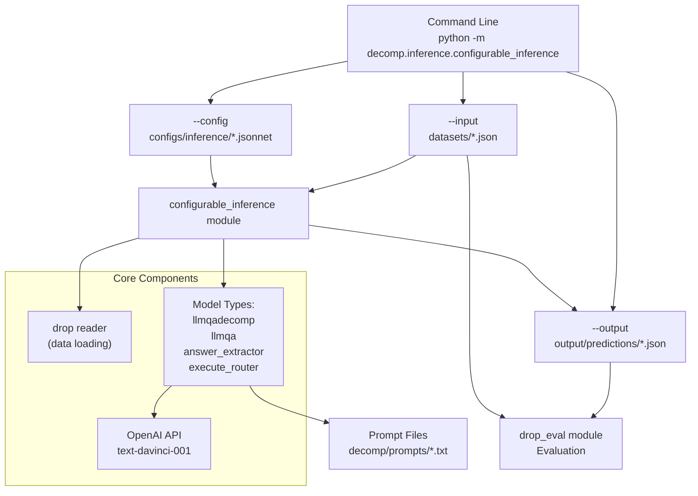
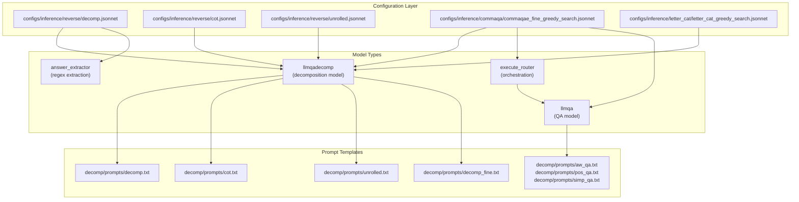

<!-- source: DeepWiki mcp.deepwiki.com · repo allenai/DecomP · page 1 Overview · fetched 2026-10-26 -->

# Overview

<details>
<summary>Relevant source files</summary>

The following files were used as context for generating this wiki page:

- [LICENSE](LICENSE)
- [README.md](README.md)

</details>


## Purpose and Scope

This document provides a high-level introduction to the DecomP repository, which implements and evaluates decomposed prompting strategies for natural language processing tasks. It covers the system's purpose, capabilities, main components, and supported experimental tasks.

For step-by-step instructions on setting up and running experiments, see [Getting Started](#2). For detailed explanations of the prompting strategies, see [Core Concepts](#3). For information on extending the system, see [Development Guide](#8).

## What is DecomP?

DecomP is a research framework for evaluating decomposed prompting strategies on compositional reasoning tasks. The system breaks complex problems into simpler sub-problems, allowing language models to solve tasks through structured decomposition rather than end-to-end generation.

The repository implements three distinct prompting strategies:
- **Decomposed Prompting**: Breaks tasks into explicit sub-operations
- **Chain of Thought (CoT)**: Uses natural language reasoning steps
- **Unrolled Execution**: Applies recursive decomposition with conditional logic

These strategies are evaluated across three experimental domains: letter concatenation, list reversal, and multi-hop question answering (CommAQA).

**Sources:** [README.md:1-6]()

## Key Capabilities

| Capability | Description | Configuration |
|------------|-------------|---------------|
| Multiple Prompting Strategies | Decomposed, CoT, and Unrolled approaches | Via `configs/inference/` |
| Configurable Inference | Jsonnet-based pipeline configuration | `configurable_inference` module |
| Dataset Generation | Synthetic data creation for list tasks | `build_reverse_dataset.py` |
| Multi-hop QA | Fine and coarse decomposition for CommAQA | `commaqae_fine.jsonnet`, `commaqae_coarse.jsonnet` |
| Automatic Evaluation | Drop-format evaluation metrics | `drop_eval` module |
| GPT-3 Integration | Text generation via OpenAI API | `text-davinci-001` model |

**Sources:** [README.md:18-79]()

## System Architecture

### Main Entry Point and Execution Flow

The system's main entry point is the `configurable_inference` module, which orchestrates the entire inference pipeline. The following diagram shows how the command-line interface connects to core system components:



The inference pipeline loads configuration from Jsonnet files in [configs/inference/](), reads input datasets in JSON format from [datasets/](), executes model components that interface with the GPT-3 API, and writes predictions to [output/predictions/](). Results are evaluated using the `drop_eval` module.

**Sources:** [README.md:18-79]()

### Configuration and Model Architecture

The following diagram shows the relationship between configuration files, model types, and prompt templates at the code level:



Configuration files in [configs/inference/]() define which model types to use and their transition logic. Model types reference specific prompt templates stored in [decomp/prompts/](). The `llmqadecomp` model handles decomposition, `llmqa` performs question answering, `answer_extractor` uses regex to extract final answers, and `execute_router` orchestrates multi-step execution for complex tasks like CommAQA.

**Sources:** [README.md:33-76]()

## Experimental Tasks

DecomP supports three main experimental tasks, each demonstrating different aspects of compositional reasoning:

### Letter Concatenation

Evaluates string manipulation capabilities by concatenating characters at specific positions. Configured via:
- [configs/inference/letter_cat/letter_cat_greedy_search.jsonnet]()
- [configs/inference/letter_cat/cot_letter_cat.jsonnet]()
- [configs/inference/letter_cat/cot_rollout_letter_cat.jsonnet]()

Input datasets are located in [datasets/letter_cat/](). Users can vary the `promptid` environment variable (p1, p2, p3) to test different prompt formulations.

**See [Letter Concatenation](#4.1) for detailed documentation.**

### List Reversal

Tests sequence reversal through systematic decomposition. This task requires dataset generation using [src/decomp/datasets_utils/build_reverse_dataset.py]() which creates sequences from vocabulary in [wordlist.txt](). Configurations include:
- [configs/inference/reverse/decomp.jsonnet]()
- [configs/inference/reverse/cot.jsonnet]()
- [configs/inference/reverse/unrolled.jsonnet]()

The `LEN` parameter controls sequence length (typically 4, 6, 8, or 10), and `STRAT` selects the prompting strategy.

**See [List Reversal](#4.2) for comprehensive documentation including dataset generation.**

### CommAQA Multi-hop Question Answering

Handles complex compositional questions requiring multi-hop reasoning. Supports two decomposition granularities:
- **Fine-grained**: [configs/inference/commaqa/commaqae_fine_greedy_search.jsonnet]()
- **Coarse-grained**: [configs/inference/commaqa/commaqae_coarse_greedy_search.jsonnet]()
- **Chain of Thought baseline**: [configs/inference/commaqa/cot_commaqae_greedy_search.jsonnet]()

Datasets include IID and compositional generalization splits in [datasets/commaqa_e/]():
- `iid_test_eg100.json` - In-distribution test set
- `compgen_test_eg300.json` - Compositional generalization test set

**See [CommAQA Multi-hop Question Answering](#4.3) for detailed decomposition strategies.**

**Sources:** [README.md:20-78]()

## Evaluation

All experiments use the `drop_eval` module for evaluation. The module compares predictions against gold-standard answers in the input dataset:

```shell
python -m decomp.datasets_utils.drop_eval \
  --gold_path <input_dataset.json> \
  --prediction_path <predictions.json>
```

The evaluation module is located at [src/decomp/datasets_utils/drop_eval.py]() and computes accuracy metrics appropriate for each task type.

**Sources:** [README.md:28-72]()

## Repository Structure

```
DecomP/
├── configs/inference/          # Jsonnet configuration files
│   ├── letter_cat/            # Letter concatenation configs
│   ├── reverse/               # List reversal configs
│   └── commaqa/               # CommAQA configs
├── datasets/                   # Input datasets
│   ├── letter_cat/            # Letter concatenation data
│   ├── reverse/               # List reversal data (generated)
│   └── commaqa_e/             # CommAQA datasets
├── decomp/prompts/            # Prompt template files
├── src/decomp/
│   ├── inference/             # Inference pipeline
│   │   └── configurable_inference.py
│   └── datasets_utils/        # Dataset utilities
│       ├── build_reverse_dataset.py
│       └── drop_eval.py
├── output/predictions/        # Generated predictions
└── wordlist.txt              # Vocabulary for dataset generation
```

For detailed information on directory structure and file organization, see [Repository Structure](#8.1).

**Sources:** [README.md:1-83]()

## Getting Started

To begin using DecomP:

1. **Environment Setup**: Install dependencies and configure API keys - see [Getting Started](#2)
2. **Choose an Experiment**: Select from letter concatenation, list reversal, or CommAQA - see [Experiments](#4)
3. **Select a Strategy**: Choose decomposed, CoT, or unrolled prompting - see [Core Concepts](#3)
4. **Run Inference**: Execute via `configurable_inference` module - see [Inference Pipeline](#5.1)
5. **Evaluate Results**: Use `drop_eval` to compute metrics - see individual experiment pages

## Related Systems

For multi-hop open-domain question answering experiments, refer to the separate DecomP-ODQA repository maintained by Harsh Trivedi at https://github.com/HarshTrivedi/DecomP-ODQA. That system extends DecomP's decomposition strategies to open-domain settings with retrieval components.

**Sources:** [README.md:80-82]()

## License

This repository is licensed under the Apache License 2.0. See [LICENSE]() for full terms.

**Sources:** [LICENSE:1-5]()

---

